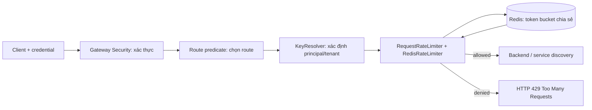
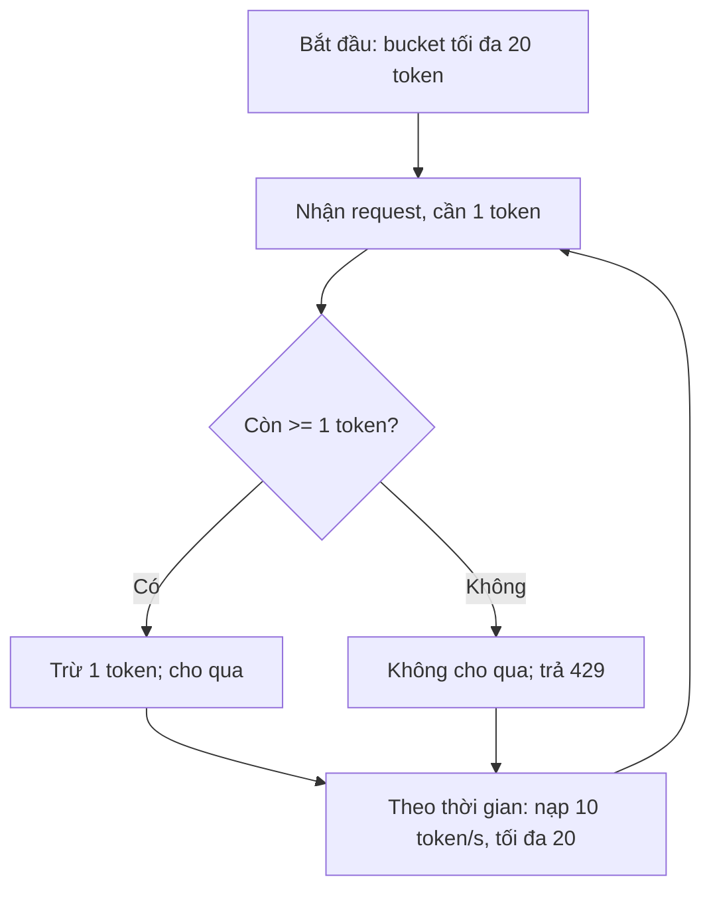
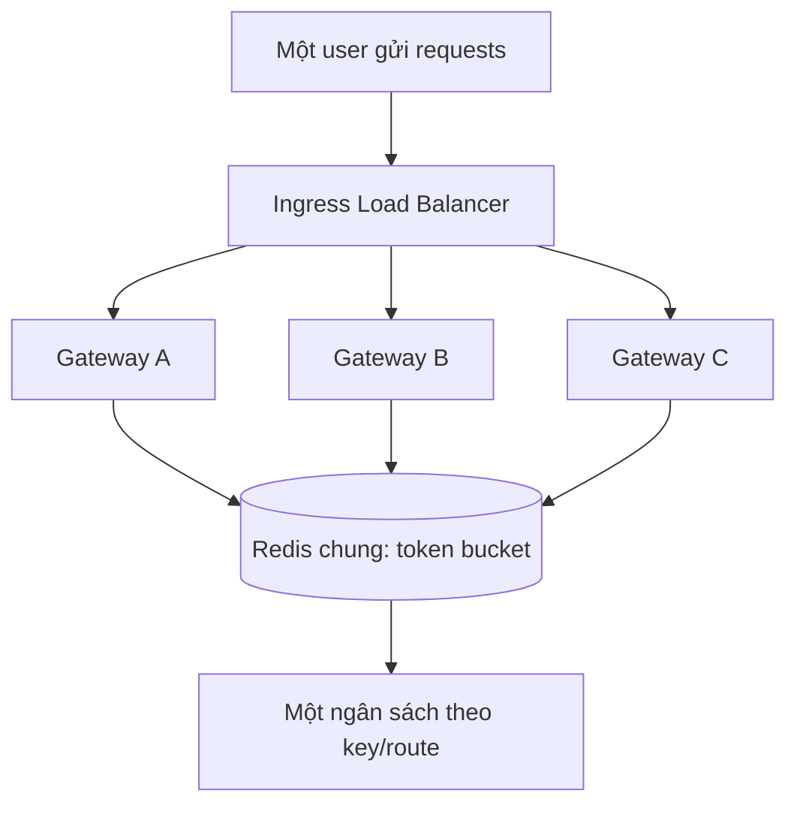

# RedisRateLimiter và dependency Redis reactive trong Spring Cloud Gateway

## 1. Tại sao API Gateway cần RedisRateLimiter?

Trong một hệ thống microservices, **Spring Cloud Gateway** là điểm vào HTTP: kiểm tra **route predicate**, chạy **filter chain**, biến đổi path/header, khám phá dịch vụ và proxy request tới backend. Ngoài xác thực, TLS, retry, circuit breaker và quan sát request, hệ thống còn cần **rate limiting** để ngăn một client hoặc workload gây quá tải cho dịch vụ phía sau.

Giả sử `orders-api` chỉ xử lý ổn định khoảng vài trăm yêu cầu/giây. Nếu một user gửi hàng nghìn yêu cầu cùng lúc, việc tăng số Gateway instances không giải quyết được tình trạng backend quá tải. Muốn giới hạn công bằng giữa nhiều Gateway replicas, các instance cần dùng **một trạng thái quota chia sẻ**, thay vì mỗi instance tự đếm trong RAM.

**`RedisRateLimiter`** là triển khai `RateLimiter` của Spring Cloud Gateway Server WebFlux dùng Redis để điều phối quota theo **token bucket**. Nó được cấu hình thông qua **`RequestRateLimiter` GatewayFilter**, và yêu cầu **dependency `spring-boot-starter-data-redis-reactive`**.

Sau bài học, bạn sẽ:

- Phân biệt **GatewayFilter `RequestRateLimiter`**, **RedisRateLimiter**, **`KeyResolver`** và **Redis reactive client**.
- Tính được `replenishRate`, `burstCapacity`, `requestedTokens` cho quota cụ thể.
- Cấu hình Maven/Gradle, Redis, YAML route và Java `KeyResolver` đúng phiên bản.
- Tránh lấy quota key từ header hoặc query parameter mà client tự sửa được.
- Kiểm thử `HTTP 429`, response headers, nhiều Gateway replicas, Redis outage và các ranh giới bảo mật.

> **Phạm vi:** bài dùng **Spring Cloud Gateway Server WebFlux 4.3+/5.x** với `spring.cloud.gateway.server.webflux.routes`. WebFlux 4.2 trở về trước thường dùng `spring.cloud.gateway.routes`. Gateway Server Web MVC có cơ chế filter và dependency riêng; không sao chép cấu hình/Java WebFlux vào MVC.

## 2. Các thành phần phối hợp



| Thành phần | Nhiệm vụ | Không nên hiểu nhầm |
|---|---|---|
`RequestRateLimiter` | GatewayFilter quyết định có tiếp tục chain cho request đã match route hay không | Không tự xác thực user |
`RedisRateLimiter` | Áp dụng thuật toán token bucket và lưu trạng thái quota qua Redis | Không phải database repository cho nghiệp vụ |
`KeyResolver` | Tạo **chuỗi key** phân biệt đối tượng bị giới hạn | Không thể tin query/header do client tự khai |
`spring-boot-starter-data-redis-reactive` | Cung cấp hạ tầng Redis reactive cho Gateway | Không thể thay bằng JDBC/Redis blocking một cách tương đương |
`spring.data.redis.*` | Cấu hình địa chỉ, TLS, credentials, timeout, Sentinel/Cluster của Redis | Không phải địa chỉ backend `lb://` |
Spring Security / JWT | Kiểm chứng danh tính và quyền để sinh quota key đáng tin | Quota 429 không thay thế 401/403 |
Redis shared state | Cho các Gateway replicas cùng nhìn thấy bucket của một key/route | Nếu mỗi replica dùng Redis riêng, quota không còn toàn cục |

**Luồng xử lý:** Gateway xác thực client ở tầng Spring Security thích hợp; sau khi route match, `RequestRateLimiter` gọi `KeyResolver`, rồi hỏi `RedisRateLimiter` liệu request có đủ token không. Nếu đủ, filter cho request đi tiếp; nếu không, trả **429** mặc định mà không proxy request đến backend.

Những request **không match route** hoặc bị Security chặn **trước route chain** không nhất thiết tiêu thụ token ở limiter của route đó. Đặt filter ở một route chỉ bảo vệ các request đi qua **chính route đó**, không phải mọi URL Gateway nhận.

## 3. Token bucket: tính rate và burst

RedisRateLimiter dựa trên thuật toán **token bucket**, với ba tham số chính:

| Tham số | Ý nghĩa | Đơn vị |
|---|---|---|
`redis-rate-limiter.replenishRate` | Tốc độ **bổ sung token** vào bucket | Token mỗi giây |
`redis-rate-limiter.burstCapacity` | **Số token tối đa** bucket chứa được | Token |
`redis-rate-limiter.requestedTokens` | **Số token tiêu tốn** cho mỗi request | Token/request, mặc định `1` |

Mỗi request được chấp nhận khi bucket còn **ít nhất `requestedTokens`**. Token tiêu thụ sau khi request được cho qua; bucket lại được nạp theo thời gian, nhưng không vượt `burstCapacity`.

Ví dụ:

```yaml
redis-rate-limiter.replenishRate: 10
redis-rate-limiter.burstCapacity: 20
redis-rate-limiter.requestedTokens: 1
```

Ý nghĩa: bucket có thể chứa tối đa 20 token, được nạp khoảng 10 token/giây và mỗi request tốn 1 token. **Sau một khoảng không có yêu cầu để bucket đầy**, một burst tối đa 20 request gần đồng thời có thể được cho qua; về lâu dài, tốc độ được duy trì quanh **10 request/giây cho một bucket**.

**Không nên giải thích** “burstCapacity=20 nghĩa là bất kỳ giây nào cũng cho đúng 20 request”: lượng token sẵn có phụ thuộc những request trước đó và thời gian phục hồi.

### 3.1. Trực quan hóa một bucket



### 3.2. Một số cấu hình quota

| Yêu cầu | `replenishRate` | `burstCapacity` | `requestedTokens` | Giải thích |
|---|---:|---:|---:|---|
5 yêu cầu/giây, không cho burst lớn | 5 | 5 | 1 | Bucket tối đa 5 token |
10 yêu cầu/giây, cho burst ngắn tới 20 | 10 | 20 | 1 | Khả năng burst chỉ có khi đã tích lũy đủ token |
1 yêu cầu/phút | 1 | 60 | 60 | Nạp 1 token/giây, mỗi lần gọi dùng 60 token |
2 yêu cầu/phút | 2 | 60 | 60 | Sau khi đầy, tối đa một request ngay nếu có 60 token; trung bình 2/min theo tốc độ nạp |
5 request/giây, mỗi request tính chi phí 2 | 10 | 20 | 2 | Tối đa khoảng 5 request/giây về lâu dài |

**Lưu ý tính toán:** để cấu hình **2 yêu cầu/phút**, tham số phổ biến phù hợp hơn là `replenishRate=2`, `requestedTokens=60`, `burstCapacity=120` nếu muốn cho phép tích lũy tối đa hai lần gọi liên tiếp. Trong hàng ví dụ trên, `burstCapacity=60` cố ý không cho burst hai request đồng thời. Các con số chỉ là minh họa ý tưởng; phải xác định rõ **quota bình quân** và **độ burst chấp nhận được** trong hợp đồng API.

### 3.3. Công thức đọc nhanh

Khi `replenishRate` đo **token/giây** và `requestedTokens` đo **token/request**:

```text
Sustained requests/s ≈ replenishRate / requestedTokens
Số request tối đa khi bucket đầy ≈ floor(burstCapacity / requestedTokens)
```

Hai công thức là ước lượng cho một **key/route**, chưa mô tả chính xác từng request khi có network latency, Redis server clock, giới hạn đồng thời hay nhiều buckets. `burstCapacity` nên **lớn hơn hoặc bằng `requestedTokens`** để ít nhất một request có thể lấy đủ token. Nếu `burstCapacity=0`, tài liệu Gateway mô tả việc chặn tất cả requests.

## 4. Dependency bắt buộc: Redis **reactive**

### 4.1. Maven

Với Gateway Server WebFlux mới, ví dụ dependencies:

```xml
<!-- Dùng Spring Boot BOM/Parent và Spring Cloud BOM tương thích;
     không tự ghim version lẻ cho các Spring starters. -->
<dependency>
    <groupId>org.springframework.cloud</groupId>
    <artifactId>spring-cloud-starter-gateway-server-webflux</artifactId>
</dependency>
<dependency>
    <groupId>org.springframework.boot</groupId>
    <artifactId>spring-boot-starter-data-redis-reactive</artifactId>
</dependency>
<dependency>
    <groupId>org.springframework.boot</groupId>
    <artifactId>spring-boot-starter-oauth2-resource-server</artifactId>
</dependency>
```

Trong bài này, `oauth2-resource-server` dành cho ví dụ giới hạn theo **principal đã xác thực**. Nếu hệ thống dùng OAuth2 login, API key có xác thực hoặc mTLS workload, thay cơ chế xác thực tương ứng; không bắt buộc luôn dùng JWT.

### 4.2. Gradle

```groovy
dependencies {
    implementation 'org.springframework.cloud:spring-cloud-starter-gateway-server-webflux'
    implementation 'org.springframework.boot:spring-boot-starter-data-redis-reactive'
    implementation 'org.springframework.boot:spring-boot-starter-oauth2-resource-server'
}
```

`spring-boot-starter-data-redis-reactive` đem vào Spring Data Redis Reactive và Redis driver phù hợp (thường là **Lettuce**) để Gateway thực thi Redis commands bất đồng bộ theo Reactor.

**Phân biệt dependency:**

| Dependency/kiểu client | Dùng cho RedisRateLimiter WebFlux? | Ghi chú |
|---|---|---|
`spring-boot-starter-data-redis-reactive` | **Có; tài liệu Gateway yêu cầu** | Tích hợp Redis reactive |
`spring-boot-starter-data-redis` | Không phải lựa chọn được docs nêu là dependency bắt buộc | Có thể phục vụ tác vụ sync khác nhưng không mặc định thay thế reactive API |
`RedisTemplate` blocking | **Không nên dùng** trong Gateway event loop | Có nguy cơ chặn luồng non-blocking |
`ReactiveStringRedisTemplate` / `ReactiveRedisTemplate` | API có thể phục vụ ứng dụng reactive | RedisRateLimiter dùng hạ tầng Redis reactive, không yêu cầu tự viết template |
`spring-cloud-starter-loadbalancer` | Không phải dependency Redis | Chỉ thêm khi route dùng `lb://` |

**Không trộn `spring-boot-starter-web` vào dự án Gateway Server WebFlux** nếu không có lý do kiến trúc và hiểu stack. WebFlux Gateway dựa trên Reactor Netty; REST/Web MVC starter có thể khiến runtime chọn web application type ngoài ý muốn.

### 4.3. Vì sao không dùng Redis blocking?

`RequestRateLimiter` có thể được gọi trên **Netty event loop**. Nếu mỗi request chờ một Redis call **blocking**, một luồng event loop có thể bị kẹt bởi mạng hoặc Redis chậm, ảnh hưởng hàng loạt request không liên quan.

Redis reactive client trả publisher như `Mono`/`Flux`; khi chờ Redis I/O, pipeline có thể **không chặn** event loop. Tuy vậy reactive **không làm Redis luôn nhanh hoặc không gặp quá tải**. Bạn vẫn phải đặt timeout, pool/network limits, quan sát latency và thiết kế cách xử lý Redis outage.

## 5. Kết nối Redis qua Spring Boot

### 5.1. Redis local để học

Đối với Redis có sẵn ở `127.0.0.1:6379` (chỉ môi trường local/dev), có thể dùng:

```yaml
spring:
  data:
    redis:
      host: localhost
      port: 6379
      connect-timeout: 2s
      timeout: 2s
```

Trong các phiên bản Spring Boot hiện nay, tiền tố Redis là **`spring.data.redis.*`**. Nhiều bài hướng dẫn cũ dùng `spring.redis.*`; đừng sao chép nguyên sang Boot 3.5/4.x nếu chưa đối chiếu application properties.

Nếu máy phát triển có Redis, xác nhận:

```bash
redis-cli -h 127.0.0.1 -p 6379 PING
# Kỳ vọng: PONG nếu Redis đang chạy và không yêu cầu auth.
```

`PONG` chỉ cho biết kết nối command đơn giản thành công từ môi trường chạy lệnh; **không chứng minh Gateway có cùng host/network, TLS, ACL và quyền chạy Lua scripts**. Với Docker/Kubernetes, `localhost` của Gateway container không trỏ tới Redis ở container khác.

### 5.2. Redis có authentication và TLS

Một ví dụ cho môi trường dùng Redis server nội bộ, DNS và TLS:

```yaml
spring:
  data:
    redis:
      host: redis.internal.example
      port: 6380
      username: ${REDIS_USERNAME}
      password: ${REDIS_PASSWORD}
      ssl:
        enabled: true
      connect-timeout: 2s
      timeout: 2s
```

Đây là **cấu hình mẫu**: port 6380 không mặc định đúng với mọi dịch vụ Redis. Biến môi trường phải được cấp từ secret manager/volume được bảo vệ. Gateway cần tin CA/server certificate của Redis và kiểm tra hostname; nếu dùng CA nội bộ, hãy dùng SSL bundle/truststore phù hợp với Spring Boot/Lettuce đang chạy. Không tắt certificate verification để né lỗi TLS.

**Nên tách Redis quota khỏi Redis dùng cho dữ liệu nhạy cảm** về credential, namespace/ACL và mức tải nếu kiến trúc yêu cầu. Redis ACL phải cho phép những lệnh cần thiết để limiter cập nhật quota atomically, nhưng không cấp quyền quản trị toàn máy chủ một cách vô cớ.

### 5.3. Redis Sentinel và Cluster

Để tăng khả năng chịu lỗi, Spring Boot hỗ trợ cấu hình Redis qua Sentinel hoặc Cluster, ví dụ **chỉ minh họa các key**:

```yaml
# Ví dụ Sentinel, không kết hợp cùng Cluster trong một môi trường.
spring:
  data:
    redis:
      sentinel:
        master: redis-master
        nodes:
          - sentinel-1.internal:26379
          - sentinel-2.internal:26379
          - sentinel-3.internal:26379
```

Với Redis Cluster:

```yaml
spring:
  data:
    redis:
      cluster:
        nodes:
          - redis-1.internal:6379
          - redis-2.internal:6379
          - redis-3.internal:6379
```

**Đừng ghép hai khối trên** trong một file đang chạy; chọn một topology theo hệ thống thực. Ngoài discovery nodes, phải cấu hình credentials, TLS, failover timeout, network policy và khả năng quan sát. `RedisRateLimiter` thực thi cập nhật bucket qua Redis Lua scripts để phối hợp trạng thái; trong Redis Cluster, các keys mà một script dùng phải được xử lý trên node/hash slot phù hợp. Dùng cơ chế của Gateway/Redis client thay vì tự thay tên keys/script thiếu kiểm chứng.

## 6. Cấu hình `RequestRateLimiter` trên route WebFlux

Giả sử Gateway ở cổng `8080`, backend `orders-service` ở `8081` và Redis ở `6379`. Bạn muốn mỗi **principal được xác thực** gọi Orders API ổn định khoảng 5 request/giây và có thể burst tối đa 10 request sau khi bucket tích lũy đủ token.

### 6.1. `application.yml` đầy đủ

```yaml
# Spring Cloud Gateway Server WebFlux 4.3+/5.x
server:
  port: 8080

spring:
  application:
    name: edge-gateway
  data:
    redis:
      host: localhost
      port: 6379
      connect-timeout: 2s
      timeout: 2s
  security:
    oauth2:
      resourceserver:
        jwt:
          issuer-uri: https://idp.example.test/realms/shop
          audiences:
            - orders-api
  cloud:
    gateway:
      server:
        webflux:
          redis-rate-limiter:
            include-headers: true
          routes:
            - id: orders-limited
              uri: http://localhost:8081
              predicates:
                - Path=/api/orders/**
                - Method=GET,POST
              filters:
                - name: RequestRateLimiter
                  args:
                    key-resolver: "#{@authenticatedUserKeyResolver}"
                    redis-rate-limiter.replenishRate: 5
                    redis-rate-limiter.burstCapacity: 10
                    redis-rate-limiter.requestedTokens: 1
                - StripPrefix=1
```

**Thứ tự logic:**

1. Spring Security xác thực Bearer JWT (cần security chain ở mục 7), sau đó route predicates chọn `orders-limited`.
2. `RequestRateLimiter` gọi `authenticatedUserKeyResolver` để lấy quota key từ principal đáng tin.
3. `RedisRateLimiter` hỏi Redis về trạng thái bucket và số token cần lấy.
4. Khi **được phép**, chain chạy tiếp, `StripPrefix=1` bỏ segment `api` và backend nhận `/orders/...`.
5. Khi **bị giới hạn**, Gateway trả `HTTP 429` mặc định, request không đến backend qua route đó.

`issuer-uri`/`audiences` chỉ là giá trị minh họa; thay bằng IdP và audience thật của hệ thống. Redis và backend phải chạy để bài tập end-to-end thành công.

**Cú pháp bắt buộc:** không viết `RequestRateLimiter=5, 10, 1`. Factory `RequestRateLimiter` **không hỗ trợ shortcut notation**; phải dùng `- name: RequestRateLimiter` cùng `args` có tên tham số rõ ràng.

### 6.2. Java `KeyResolver` cho principal đã xác thực

```java
package com.example.gateway.config;

import java.security.Principal;
import org.springframework.cloud.gateway.filter.ratelimit.KeyResolver;
import org.springframework.context.annotation.Bean;
import org.springframework.context.annotation.Configuration;

@Configuration(proxyBeanMethods = false)
public class RateLimitKeyConfig {
    @Bean
    KeyResolver authenticatedUserKeyResolver() {
        return exchange -> exchange.getPrincipal()
            .map(Principal::getName)
            .filter(name -> !name.isBlank());
    }
}
```

`KeyResolver` trả về `Mono<String>`. `getPrincipal()` chỉ mang danh tính đáng tin khi ứng dụng đã **thiết lập xác thực đúng**. Với JWT Resource Server, tên principal thường dựa trên claim `sub`; nếu có custom authentication converter, phải kiểm tra cách ánh xạ thực tế. Cần tránh giá trị key trống hoặc một tên cố định cho mọi user.

**Không dùng cách lấy key này trong production:**

```java
// Ví dụ KHÔNG AN TOÀN: client có thể đổi ?user=abc để né quota.
@Bean
KeyResolver insecureQueryKeyResolver() {
    return exchange -> reactor.core.publisher.Mono.justOrEmpty(
        exchange.getRequest().getQueryParams().getFirst("user"));
}
```

Client cũng có thể tự đặt header `X-User-Id` hoặc `X-Tenant-Id`. Nếu lấy các header đó làm key mà **không xác minh**, client có thể đổi identity để tạo bucket mới, né giới hạn hoặc làm ảnh hưởng quota người khác. API key chỉ nên làm căn cứ quota **sau khi xác thực và ánh xạ về client ID nội bộ**, không đưa nguyên secret vào Redis key.

### 6.3. Tham chiếu bean bằng SpEL

Trong YAML, `"#{@authenticatedUserKeyResolver}"` là biểu thức Spring tham chiếu bean tên `authenticatedUserKeyResolver`. Tên phải khớp bean được đăng ký trong Spring context.

```yaml
filters:
  - name: RequestRateLimiter
    args:
      key-resolver: "#{@authenticatedUserKeyResolver}"
      redis-rate-limiter.replenishRate: 5
      redis-rate-limiter.burstCapacity: 10
      redis-rate-limiter.requestedTokens: 1
```

Khi ứng dụng có nhiều implementation `RateLimiter`, có thể cần chỉ định bean limiter tường minh:

```yaml
# Tham khảo nếu Spring context thực sự có bean redisRateLimiter:
filters:
  - name: RequestRateLimiter
    args:
      rate-limiter: "#{@redisRateLimiter}"
      key-resolver: "#{@authenticatedUserKeyResolver}"
```

Không đặt cả hai cấu hình `RequestRateLimiter` lên cùng route khi chỉ cần một quota; kiểm tra tên bean và cách nạp cấu hình đúng theo phiên bản.

## 7. Bảo đảm xác thực đi trước quota

Một `KeyResolver` trả principal **không phải bộ lọc xác thực**. Với protected API, hãy yêu cầu JWT hợp lệ và scope phù hợp bằng Spring Security WebFlux trước khi request vào Gateway filter chain.

```java
package com.example.gateway.security;

import org.springframework.context.annotation.Bean;
import org.springframework.context.annotation.Configuration;
import org.springframework.http.HttpMethod;
import org.springframework.security.config.Customizer;
import org.springframework.security.config.web.server.ServerHttpSecurity;
import org.springframework.security.web.server.SecurityWebFilterChain;

@Configuration(proxyBeanMethods = false)
public class ApiSecurityConfig {
    @Bean
    SecurityWebFilterChain apiSecurity(ServerHttpSecurity http) {
        return http
            // Chỉ phù hợp API stateless Bearer-only, không dùng session cookie.
            .csrf(csrf -> csrf.disable())
            .authorizeExchange(ex -> ex
                .pathMatchers(HttpMethod.GET, "/api/orders/**")
                    .hasAuthority("SCOPE_orders.read")
                .pathMatchers(HttpMethod.POST, "/api/orders/**")
                    .hasAuthority("SCOPE_orders.write")
                .anyExchange().denyAll())
            .oauth2ResourceServer(oauth2 ->
                oauth2.jwt(Customizer.withDefaults()))
            .build();
    }
}
```

Với mô hình này, request không có JWT hoặc JWT không hợp lệ thường nhận **401**, thiếu scope phù hợp thường nhận **403**, còn request qua bước xác thực mới có thể bị `RequestRateLimiter` trả **429**. Backend **vẫn phải kiểm tra audience, scope và quyền trên tài nguyên**; rate limiting không cấp quyền đọc đơn hàng của người khác.

`csrf.disable()` chỉ phù hợp với API **stateless Bearer-only** trong ví dụ. Không sao chép nguyên sang ứng dụng browser sử dụng session/cookie mà không phân tích CSRF.

### 7.1. Khi không có quota key

Tài liệu Gateway mô tả `PrincipalNameKeyResolver` là resolver mặc định, lấy `Principal.getName()`. Khi resolver không có key, hành vi mặc định là **từ chối request**; mã trả về có thể khác `429` và có tùy chọn theo phiên bản.

- Không phát `Mono.just(null)`: Reactor không cho phép giá trị null.
- Khi không có principal, dùng `Mono.empty()`/`Mono.justOrEmpty(...)` và **quyết định chính sách** thiếu key.
- Không tự cho mọi anonymous requests dùng key cố định như `admin` hoặc key của người khác.
- Với public API cần quota anonymous theo IP, phải thiết kế resolver dựa trên địa chỉ qua **trusted proxy chain**. IP dùng chung bởi NAT và IPv6 rotation có thể ảnh hưởng công bằng; header `X-Forwarded-For` tự khai không đáng tin.

Tài liệu Gateway 5.0 đề cập `deny-empty-key` và `empty-key-status-code`. Do namespace có thể đổi qua release trains, cần đối chiếu **configprops/metadata của dependency đang chạy** trước khi áp dụng hai property đó.

## 8. Quota theo user, route, tenant hay client?

RedisRateLimiter dùng **quota key** kết hợp với ngữ cảnh route/policy. Hai routes khác nhau không tự mặc định chia chung một ngân sách quota toàn Gateway chỉ vì cùng dùng một `KeyResolver`.

| Mục tiêu | Key/policy phù hợp | Rủi ro |
|---|---|---|
Per user per route | Principal đã được xác thực | User tiêu thụ nhiều buckets qua nhiều routes |
Per tenant per route | Tenant ID đã được xác minh trong authentication | Tin `X-Tenant-Id` tự khai sẽ sai |
Per partner API key | Client ID tra ra sau khi xác thực API key | Không đưa raw key/secret vào Redis hoặc logs |
Anonymous by IP | Source address qua trusted proxy | NAT, IPv6 rotation, forged forwarding headers |
Quota chung xuyên routes | Thiết kế shared quota namespace riêng | Không suy rằng reuse cùng bean limiter đã gộp routes |
Quota theo tác vụ nặng | Policy theo method/route, token cost phù hợp | Token cost không tự biết CPU/DB cost thực |

### 8.1. Hai routes, hai policy

```yaml
spring:
  cloud:
    gateway:
      server:
        webflux:
          routes:
            - id: read-catalog
              uri: http://localhost:8081
              predicates:
                - Path=/api/catalog/**
                - Method=GET
              filters:
                - name: RequestRateLimiter
                  args:
                    key-resolver: "#{@authenticatedUserKeyResolver}"
                    redis-rate-limiter.replenishRate: 20
                    redis-rate-limiter.burstCapacity: 30
                    redis-rate-limiter.requestedTokens: 1

            - id: write-orders
              uri: http://localhost:8082
              predicates:
                - Path=/api/orders/**
                - Method=POST
              filters:
                - name: RequestRateLimiter
                  args:
                    key-resolver: "#{@authenticatedUserKeyResolver}"
                    redis-rate-limiter.replenishRate: 2
                    redis-rate-limiter.burstCapacity: 4
                    redis-rate-limiter.requestedTokens: 1
```

Catalog GET có burst lớn hơn Orders POST. Đây là **hai routes riêng**, không mặc định có quota global theo user. Không có `StripPrefix` trong ví dụ này nên backend phải xử lý path `/api/...`; nếu muốn path nội bộ khác, thêm filter rewrite/strip phù hợp.

**Lưu ý nghiệp vụ:** `POST` tạo đơn vẫn cần idempotency key. Một request được limiter chấp nhận có thể trở thành **nhiều downstream attempts** nếu cấu hình retry; limiter không tự bảo đảm exactly-once.

## 9. Redis chung cho nhiều Gateway instances

Nếu ba Gateway pods mỗi pod tự giới hạn 5 request/giây bằng counter trong RAM, client có thể được phân tán lưu lượng để vượt quota. RedisRateLimiter dùng shared bucket:



RedisRateLimiter dùng Redis scripting để thực thi cập nhật bucket **atomically** và tránh race đơn giản khi nhiều Gateway pods đồng thời xin token. Những điều cần đúng:

1. Mọi pods kết nối đến **cùng Redis deployment/namespace** dành cho quota.
2. Route IDs và KeyResolver mapping thống nhất trong các pods.
3. Principal/tenant ID được xác thực và ổn định qua tất cả Gateway replicas.
4. Redis failover/partition và policy consistency được kiểm thử; không khẳng định mọi mô hình multi-region đạt zero overshoot tuyệt đối.

**Key cardinality:** key tạo từ timestamp, random request ID hoặc URL chứa ID ngẫu nhiên sẽ gần như không bao giờ hết token, đồng thời tăng số Redis keys. Hãy dùng key ổn định, có chính sách bảo vệ PII và quan sát memory/evictions.

## 10. HTTP 429 và response headers

Khi bucket hết token, `RequestRateLimiter` trả **`429 Too Many Requests` mặc định** mà không proxy request qua route đó. Redis limiter có thể thêm header thông tin:

| Header | Ý nghĩa |
|---|---|
`X-RateLimit-Replenish-Rate` | Token được nạp mỗi giây |
`X-RateLimit-Burst-Capacity` | Số token tối đa trong bucket |
`X-RateLimit-Requested-Tokens` | Chi phí token của request |
`X-RateLimit-Remaining` | Token còn được báo lại ở thời điểm tính toán |

Gateway Server WebFlux 5.x có thể tùy chỉnh cách trả header:

```yaml
spring:
  cloud:
    gateway:
      server:
        webflux:
          redis-rate-limiter:
            include-headers: true
            remaining-header: X-RateLimit-Remaining
            replenish-rate-header: X-RateLimit-Replenish-Rate
            burst-capacity-header: X-RateLimit-Burst-Capacity
            requested-tokens-header: X-RateLimit-Requested-Tokens
```

`include-headers` được tài liệu Gateway 5.x mô tả mặc định là `true`. Đây là các header **theo triển khai Gateway**, không phải cam kết tổng quota trong ngày hoặc giá trị chuẩn `Retry-After`. Khi có request đồng thời, token có thể bị dùng tiếp ngay sau response.

**Không giả định** `Retry-After` được tự động sinh từ các headers trên. Nếu API public cần client chờ trong một thời gian rõ ràng, thiết kế response/error contract phù hợp và khuyến khích backoff có jitter thay vì retry tức thì.

## 11. Redis outage: chọn chính sách thay vì phỏng đoán

Redis nằm trên **đường quyết định quota**. Khi Redis không kết nối được, DNS/TLS sai, ACL từ chối script, timeout hoặc Redis bị quá tải, `RequestRateLimiter` có thể phát lỗi. Response cuối phụ thuộc bản Gateway, exception handling và phần hạ tầng xung quanh.

**Không kết luận rằng RedisRateLimiter mặc định luôn fail-open hoặc fail-closed ở mọi phiên bản.** Hãy thử nghiệm Redis outage và quy định ranh giới cho mỗi loại API:

| Chính sách khi không xác định được quota | Lợi ích | Đánh đổi |
|---|---|---|
**Fail-closed** | Không mở thêm lưu lượng tới backend nhạy cảm | Redis outage ảnh hưởng tính sẵn sàng của API |
**Fail-open có kiểm soát** | Một số request vẫn được phục vụ khi Redis hỏng | Có thể khiến backend quá tải; cần ingress/edge limit dự phòng |
**Fallback limiter cục bộ** | Có giới hạn thô khi mất Redis | Không bảo đảm quota global giữa nhiều Gateway pods |
**Thay đổi route/policy qua cơ chế vận hành khẩn cấp** | Có thể cô lập API đắt đỏ | Cần quy trình phê duyệt, audit và rollback nhanh |

Các biện pháp hỗ trợ: Redis HA/Sentinel/Cluster phù hợp, TLS/ACL, timeout ngắn hợp lý, quan sát p95/p99 Redis latency, cảnh báo độ sâu hàng đợi và sử dụng Redis health checks. **Không retry Redis operations vô hạn** trong pipeline xử lý request: điều đó làm tăng latency và backlog trên Netty/Gateway.

### 11.1. Rate limit khác concurrency limit

Token bucket giới hạn **tốc độ yêu cầu theo thời gian**, không đếm chính xác số tác vụ đang xử lý. Một user gửi 10 request được chấp nhận cùng lúc có thể khiến backend chịu 10 truy vấn kéo dài 30 giây.

Đối với API nặng, cần thêm **bulkhead/concurrency limit**, timeout, circuit breaker, backpressure/queue policy, giới hạn DB pool và request-size. Đặc biệt với SSE và upload/download lớn, số connection đang mở có thể quan trọng hơn requests/giây.

## 12. Thực hành kiểm thử với `curl`

### 12.1. Chuẩn bị ba thành phần

1. **Redis** ở `localhost:6379` hoặc Redis deployment cấu hình tại mục 5.
2. **Gateway Server WebFlux** ở `localhost:8080` với `orders-limited` tại mục 6, Java `KeyResolver` tại mục 6.2 và `SecurityWebFilterChain` tại mục 7.
3. **Orders backend** ở `localhost:8081` có endpoint `GET /orders/42`. `StripPrefix=1` biến request ngoài `/api/orders/42` thành path backend `/orders/42`.

Bạn cần token thử nghiệm **thực từ IdP phù hợp** (issuer, audience và scope đúng). Các mẫu YAML không tạo sẵn IdP hay JWT; không dùng một chuỗi `fake.jwt.token` rồi coi `401` là lỗi Redis.

### 12.2. Gửi nhanh nhiều request từ cùng principal

Trong Bash, sau khi biến môi trường `TOKEN_VALID` đã được cấp qua đăng nhập/test tooling:

```bash
# Không đặt raw bearer token trong ví dụ hoặc ghi ra log.
for i in $(seq 1 15); do
  curl -sS -o /dev/null \
    -w "request=$i status=%{http_code}\n" \
    -H "Authorization: Bearer $TOKEN_VALID" \
    http://localhost:8080/api/orders/42
done
```

Với `replenishRate=5`, `burstCapacity=10`, `requestedTokens=1` và bucket ban đầu đầy, khi gửi đủ nhanh 15 request, **một số request có thể nhận 429**. Đừng cố định trước phải có đúng 5 response 429: token được nạp theo thời gian, test có độ trễ và còn phụ thuộc requests trước đó.

Để xem response headers:

```bash
curl -i \
  -H "Authorization: Bearer $TOKEN_VALID" \
  http://localhost:8080/api/orders/42
```

Nếu backend không chạy, request được limiter cho qua vẫn có thể gặp lỗi kết nối hoặc 5xx. **Một request nhận 502/503 sau limiter vẫn có thể đã tiêu tốn token**, vì quota kiểm soát admission, không phải chỉ tính response thành công.

### 12.3. Kiểm tra key tách biệt

Dùng hai token test khác principal: `user-A` và `user-B`, cùng scope `orders.read`. Gửi cùng chuỗi request:

- Nếu resolver trả hai principal names khác nhau, **hai users có bucket khác nhau** trên cùng route.
- Nếu converter ánh xạ tất cả users thành một tên cố định, họ sẽ **chia sẻ quota**. Kiểm tra mapping `JwtAuthenticationToken.getName()` hoặc custom converter.
- Nếu client đổi `?user=admin`, `X-User-Id` hay `X-Tenant-Id` mà quota thay đổi, resolver có thể đang dựa vào dữ liệu **không đáng tin**.

### 12.4. Kiểm tra hai Gateway instances dùng Redis chung

Khởi chạy Gateway A tại `8080` và Gateway B tại `8083`, dùng **cùng Redis**, **cùng route ID**, **cùng principal/key resolver** và **cùng quota**. Gửi xen kẽ:

```bash
curl -i -H "Authorization: Bearer $TOKEN_VALID" \
  http://localhost:8080/api/orders/42

curl -i -H "Authorization: Bearer $TOKEN_VALID" \
  http://localhost:8083/api/orders/42
```

Khi bucket được dùng hết qua Gateway A, Gateway B không nên tạo một quota mới cho cùng key/route. Nếu hành vi khác, kiểm tra Redis endpoint/database, Spring profiles, route IDs, phương thức tạo key và việc filter `RequestRateLimiter` có thực sự được áp dụng ở cả hai instances.

### 12.5. Thử Redis outage trong môi trường riêng

Trong **môi trường test**, tạm chặn kết nối Gateway → Redis hoặc mô phỏng timeout Redis rồi gửi request hợp lệ. Ghi lại HTTP status, thời gian chờ, log lỗi, backend có nhận request hay không, và sự phục hồi sau khi Redis hoạt động lại.

**Không dùng `FLUSHALL`/`FLUSHDB` ở Redis đang phục vụ ứng dụng khác** để “reset quota”. Muốn bucket mới cho test, dùng principal/route thử nghiệm hoặc Redis database/deployment riêng.

### 12.6. Ma trận kết quả cần kiểm tra

| Thử nghiệm | Kết quả đúng cần đối chiếu |
|---|---|
JWT hợp lệ, chưa hết token | Gateway chuyển tiếp, backend nhận |
JWT hợp lệ, gửi vượt burst | Có response `429`, backend **không** nhận các request bị chặn |
Hai principal khác nhau | Quota riêng nếu resolver phân biệt key |
Không có bearer token | `401` trước route với security chain ví dụ |
Token hợp lệ nhưng thiếu scope | `403` trước limiter |
Client giả `X-User-Id: admin` | Không được đổi quota key của principal |
Hai Gateway replicas, cùng Redis | Cùng dùng trạng thái quota |
Redis outage | Hành vi đúng với chính sách được thiết kế và có cảnh báo |
Backend trả `500` sau khi được cho qua | Request có thể đã tiêu tốn token |
Request không match route | Không tiêu tốn token của limiter gắn trên route đó |

## 13. Chẩn đoán lỗi thường gặp

| Hiện tượng | Nguyên nhân có thể | Hướng xử lý |
|---|---|---|
Không tạo được Redis rate limiter | Thiếu reactive starter, sai stack hoặc bean/config không hợp lệ | Kiểm tra `spring-boot-starter-data-redis-reactive` và WebFlux starter |
`RequestRateLimiter=5,10` không hoạt động | Dùng shorthand không được hỗ trợ | Dùng `name: RequestRateLimiter` và `args` |
Redis connection refused | Sai host/port, container dùng `localhost` không đúng, Redis chưa chạy | Kiểm tra `spring.data.redis.*` và network |
Lỗi Redis ACL/Lua script | Credential thiếu quyền hoặc Cluster/script không phù hợp | Kiểm tra ACL, TLS và logs Redis theo phiên bản |
Không thấy `429` | Bucket chưa cạn, request quá thưa, không match route hoặc limiter chưa được nạp | Kiểm tra route, token math, trace |
Luôn nhận `401`/`403` | Security chặn trước rate limiter | Kiểm tra token, issuer, audience, scopes |
Luôn bị từ chối khi có JWT | `KeyResolver` trả key rỗng hoặc authentication name không hợp lệ | Kiểm tra mapping principal và empty-key policy |
Tất cả users chia chung quota | Resolver trả một key cố định hoặc một header proxy chung | Lấy ID đã xác thực, ổn định |
Quota bị bypass | Key có tính ngẫu nhiên hoặc client tự chọn `?user`/header | Dùng verified identity, hạn chế cardinality |
Gateway A chặn, B không chặn | Hai Redis hoặc route IDs khác nhau | Đồng bộ Redis, route IDs và resolver |
Redis memory tăng | Quá nhiều keys/cardinality, policy/TTL không phù hợp | Giám sát keys/memory và nguồn tạo key |
Redis outage khiến nhiều requests treo | Timeout/failover/exception policy chưa kiểm tra | Fault injection, thiết kế fail-open/closed rõ ràng |
Route tạo từ discovery không có limiter | Chỉ gắn filter vào route YAML khác | Rà toàn bộ routes; không tự suy default-filters áp cho mọi nguồn |
Retry làm backend quá tải | Admission limit không giới hạn downstream attempts | Cấu hình idempotency, retry/backoff, circuit breaker, bulkhead |

## 14. Nguyên tắc vận hành production

1. **Xác thực trước quota:** key phải dựa vào principal/tenant/client ID đã kiểm chứng, không lấy từ raw header hoặc query tùy ý.
2. **Chọn ngân sách công bằng:** phân biệt per-user, per-tenant, per-route, anonymous traffic và global quota.
3. **Định nghĩa rate và burst:** có phép tính, test và dashboard giúp giải thích `429`.
4. **Tách endpoint nặng:** POST tạo đơn, export dữ liệu, báo cáo lớn cần giới hạn khác GET nhẹ.
5. **Bảo vệ Redis:** private network, ACL/authentication, TLS/CA đúng, quản lý secrets, HA/failover phù hợp.
6. **Giữ pipeline reactive:** không đưa blocking `RedisTemplate` vào Netty event loop; giới hạn command/connect timeout.
7. **Kiểm thử nhiều replicas:** phải dùng Redis chia sẻ và key/route mapping nhất quán, kể cả trong rolling deployment.
8. **Xác định Redis outage policy:** fail-closed/open/fallback cần thiết kế theo độ nhạy API, có alerts và rollback.
9. **Bảo vệ nhiều lớp:** rate limit tại CDN/ingress/WAF, request-size, concurrency và backend resource quotas.
10. **Quan sát an toàn:** log route ID, allowed/denied/status/latency nhưng không ghi token, PII hoặc raw API keys.
11. **Bảo vệ Actuator/Redis admin:** không công bố management endpoints hay Redis control plane ra Internet.
12. **Giới hạn retry:** client nên có backoff jitter khi `429`; server retry không được tạo vô hạn downstream attempts.

## 15. Bài tập và đáp án

**Bài 1 — Dependency.** Gateway WebFlux khai báo `RequestRateLimiter` nhưng chỉ có Redis client blocking. Bạn cần kiểm tra gì?

**Đáp án:** tài liệu RedisRateLimiter yêu cầu `spring-boot-starter-data-redis-reactive`. Thêm đúng starter và kiểm tra Redis reactive connection factory; không dùng Redis blocking trên event loop.

**Bài 2 — Token bucket.** Với `replenishRate=10`, `burstCapacity=20`, `requestedTokens=1`, có phải lúc nào một giây cũng cho 20 requests?

**Đáp án:** không. Burst 20 chỉ có thể khi bucket đã tích lũy đủ token; nạp lại khoảng 10 token/giây và về lâu dài duy trì quanh 10 requests/giây.

**Bài 3 — Một request mỗi phút.** Cấu hình nào được docs nêu?

**Đáp án:** `replenishRate=1`, `burstCapacity=60`, `requestedTokens=60`. Mỗi request dùng 60 token; sau khi cạn cần khoảng 60 giây nạp lại.

**Bài 4 — Key giả.** Vì sao không nên lấy `?user=bob` để tạo bucket?

**Đáp án:** client đổi thành `?user=alice` để né quota hoặc làm ảnh hưởng user khác. Lấy identity từ authentication/JWT đã được xác minh.

**Bài 5 — Shortcut.** `RequestRateLimiter=5,10,1` có đúng không?

**Đáp án:** không. Filter không hỗ trợ shorthand; dùng `name` và `args` tường minh.

**Bài 6 — Multi-instance.** Hai Gateway pods dùng hai Redis độc lập nhưng cùng policy 5 requests/s. Quota đã toàn cục chưa?

**Đáp án:** chưa. Mỗi Redis có bucket riêng; cần dùng shared Redis deployment và key mapping thống nhất.

**Bài 7 — HTTP 401.** Request thiếu token nhận `401` dù Redis quota chưa hết. Redis hỏng?

**Đáp án:** không đủ căn cứ; Spring Security có thể chặn trước route limiter, đúng với API cần JWT.

**Bài 8 — Tác vụ chậm.** Backend mất 30 giây cho mỗi request, rate limit 5/s có bảo đảm tối đa 5 request đang chạy?

**Đáp án:** không. Rate limit khác concurrency limit. Cần bulkhead, timeout, connection/queue control.

**Bài 9 — Redis outage.** Có thể chắc chắn mọi Redis lỗi đều trả HTTP 429 không?

**Đáp án:** không. Hành vi còn phụ thuộc phiên bản và exception handling; phải thiết kế và thử fail-open/fail-closed/fallback.

**Bài 10 — Remaining header.** Khi client thấy `X-RateLimit-Remaining: 3`, họ chắc chắn được gửi ngay ba request nữa?

**Đáp án:** không. Các request song song hoặc Gateway replica khác có thể đã tiêu thụ token; đây chỉ là trạng thái tại thời điểm tính.

## 16. Tài liệu tham khảo chính thức

- [Spring Cloud Gateway 5.0 – RequestRateLimiter GatewayFilter](https://docs.spring.io/spring-cloud-gateway/reference/5.0/spring-cloud-gateway-server-webflux/gatewayfilter-factories/requestratelimiter-factory.html): RedisRateLimiter, dependency Redis reactive, token bucket, KeyResolver, 429 và cú pháp args.
- [Spring Cloud Gateway 4.2 – RequestRateLimiter](https://docs.spring.io/spring-cloud-gateway/reference/4.2/spring-cloud-gateway/gatewayfilter-factories/requestratelimiter-factory.html): so sánh prefix config cũ.
- [Spring Cloud Gateway 5.1 – Configuration Properties](https://docs.spring.io/spring-cloud-gateway/reference/5.1/configprops.html): cấu hình header Redis limiter và namespace WebFlux.
- [Spring Boot 4.0 – Common Application Properties](https://docs.spring.io/spring-boot/4.0/appendix/application-properties/): `spring.data.redis.*`, TLS, Sentinel, Cluster, timeout.
- [Spring Data Redis – Reference Documentation](https://docs.spring.io/spring-data/redis/reference/): Redis reactive/Lettuce, connection factory và quản lý kết nối.
- [Spring Security – Reactive OAuth2 Resource Server JWT](https://docs.spring.io/spring-security/reference/reactive/oauth2/resource-server/jwt.html): xác minh principal/scopes cho KeyResolver.
- [Redis – Lua Scripting](https://redis.io/docs/latest/develop/programmability/eval-intro/): atomic script execution và lưu ý Redis Cluster.

**Ghi nhớ:** `RequestRateLimiter` quyết định **cho phép hoặc từ chối**; `RedisRateLimiter` giữ **token bucket phân tán**; `KeyResolver` xác định **đối tượng dùng quota**; `spring-boot-starter-data-redis-reactive` cung cấp Redis client non-blocking cho Gateway WebFlux. Cấu hình đúng `replenishRate`/`burstCapacity`/`requestedTokens`, dùng key được xác thực, Redis chung giữa các replicas và kiểm thử cả `429` lẫn Redis outage để vận hành Gateway an toàn.
