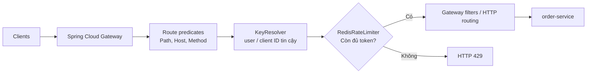
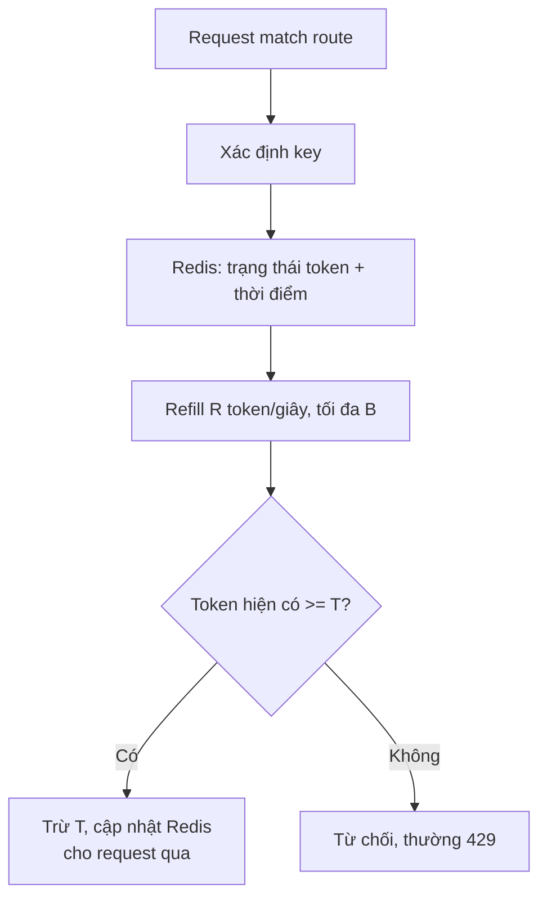
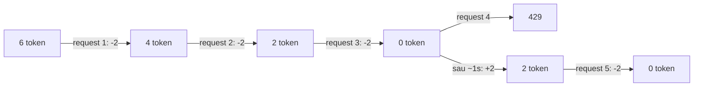
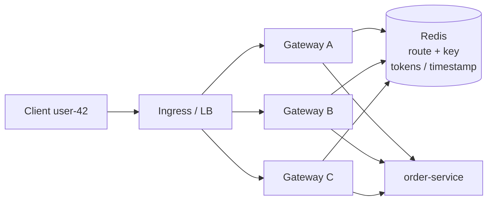

# replenishRate, burstCapacity và requestedTokens

Trong hệ thống microservices, một client có thể tạo hàng trăm request đến `order-service` trong vài giây, dù backend chỉ chịu được tải trung bình vài chục request mỗi giây. Nếu chỉ giới hạn bằng timeout hoặc circuit breaker, request quá mức vẫn có thể đã tiêu thụ kết nối và CPU của upstream. **Spring Cloud Gateway Server WebFlux** có thể chặn sớm những request vượt ngân sách bằng **`RequestRateLimiter` GatewayFilter Factory**, thường kết hợp với **`RedisRateLimiter`**.

RedisRateLimiter dựa trên thuật toán **token bucket**. Ba tham số quyết định chính sách là **`replenishRate`** (token bổ sung mỗi giây), **`burstCapacity`** (sức chứa token tối đa) và **`requestedTokens`** (token cần để nhận một request). Chúng liên quan với nhau: `replenishRate=10` không nhất thiết là 10 request/giây nếu mỗi request tốn nhiều hơn một token.

Bài thuộc chương **Giới hạn lưu lượng** trong module **SPRING_CLOUD_GATEWAY**. Kiến thức giúp kết hợp rate limiting với route predicate, filter chain, biến đổi path/header, service discovery, xác thực và phân quyền, circuit breaker, retry, TLS và khả năng quan sát để vận hành cổng vào microservices an toàn.

**Mục tiêu:**

1. Hiểu cơ chế token bucket và tính gần đúng thông lượng dài hạn cùng khả năng burst.
2. Cấu hình `replenishRate`, `burstCapacity`, `requestedTokens` bằng YAML/Java DSL và hiểu ý nghĩa đúng của đơn vị.
3. Xây dựng `KeyResolver` dựa trên identity đã xác thực, phân biệt `429` do hết token với `403` do key trống.
4. Thiết kế giới hạn dưới 1 request/giây, giới hạn theo route/user và chính sách bảo vệ nhiều Gateway replicas.
5. Kiểm thử Redis, request burst, tình huống mất kết nối, retry, concurrency và bảo mật.

> **Phạm vi:** Ví dụ dùng **Spring Cloud Gateway Server WebFlux** với Spring WebFlux, Reactor Netty và Redis reactive. Route YAML của Gateway WebFlux 4.3.x thường nằm dưới `spring.cloud.gateway.routes`; Gateway WebFlux 5.x dùng `spring.cloud.gateway.server.webflux.routes`. Hãy kiểm tra đúng version/starter khi áp dụng. Server MVC không dùng nguyên xi API và vòng đời filter WebFlux.

## 1. Rate limiting bảo vệ điều gì?

Rate limiting giúp giảm số request **được chuyển tiếp** đến một route/backend theo ngân sách định nghĩa trước. Ví dụ mỗi user có giới hạn 5 request/giây với khả năng burst 10 request. Khi vượt hạn mức, Gateway có thể trả **HTTP 429 Too Many Requests** thay vì gọi upstream.



Rate limiting hữu ích để:

- Giảm nguy cơ một client hoặc tenant tiêu thụ quá nhiều năng lực backend.
- Áp dụng hạn mức kỹ thuật theo user, client ID, route hoặc nhóm gói dịch vụ.
- Làm mềm các đợt request tăng đột ngột bằng một mức burst có chủ đích.
- Giảm tải cho database, HTTP connection pool và những dịch vụ nội bộ có chi phí cao.

Nhưng nó **không tự xác thực** user, không kiểm tra quyền với `orderId`, không hạn chế trực tiếp số request **đang chạy đồng thời**, không bảo đảm một request hoàn tất trong thời gian nào và cũng không thay thế circuit breaker/timeout.

## 2. Mô hình token bucket

Hình dung có một “thùng” token cho mỗi định danh `key` trên route. Thùng được bổ sung token theo thời gian, nhưng không vượt dung lượng tối đa. Mỗi request muốn qua phải “trả” đủ số token quy định.

Ký hiệu:

| Ký hiệu | Tham số | Đơn vị |
| --- | --- | --- |
| `R` | `replenishRate` | token/giây |
| `B` | `burstCapacity` | token tối đa |
| `T` | `requestedTokens` | token/request |
| `Δt` | Thời gian kể từ khi cập nhật trạng thái | giây |

Mô hình lý tưởng hóa:

```text
tokensAfterRefill = min(B, tokensBefore + R * deltaSeconds)

if tokensAfterRefill >= T:
    allowed = true
    tokensAfterRequest = tokensAfterRefill - T
else:
    allowed = false
    tokensAfterRequest = tokensAfterRefill
```



**Lưu ý:** Đây là mô hình giải thích, không phải bản sao chính xác từng dòng của Lua script trong mọi phiên bản Gateway. Triển khai có độ phân giải thời gian và cách lưu trạng thái riêng; kết quả thử tại các ranh giới giây có thể khác chút ít.

### Hai công thức cần nhớ

Khi thùng đã đầy và các request đến gần như tức thời:

```text
Số request burst ≈ floor(B / T)
```

Với tải duy trì lâu dài:

```text
Thông lượng bền vững ≈ R / T request/giây
```

Đây là **ước lượng trung bình**, không phải bảo đảm đúng `N` request trong *mọi* khoảng thời gian 1 giây hay trong một phút theo đồng hồ lịch. Token bucket khác thuật toán fixed-window và sliding-window.

## 3. replenishRate: tốc độ bổ sung token

`replenishRate` là tốc độ token “chảy vào thùng”. Ví dụ:

```yaml
redis-rate-limiter.replenishRate: 10
```

Nghĩa là mỗi giây bucket có thể được bổ sung **10 token**, không phải mặc nhiên 10 request. Với `requestedTokens=1`, thông lượng dài hạn gần 10 request/giây; với `requestedTokens=2`, nó còn gần 5 request/giây.

Hai cấu hình cùng `replenishRate=10` có thể rất khác nhau:

| R | B | T | Dài hạn xấp xỉ | Burst tối đa khi đầy |
| ---: | ---: | ---: | ---: | ---: |
| 10 | 10 | 1 | 10 req/s | 10 request |
| 10 | 100 | 1 | 10 req/s | 100 request |
| 10 | 100 | 5 | 2 req/s | 20 request |

Nếu `order-service` chỉ chịu được tối đa 15 request đồng thời, `B=100` có thể gây spike quá mạnh dù `R=10` hợp lý ở góc nhìn trung bình.

**Điều kiện giá trị:** dùng số nguyên dương hợp lệ theo `RedisRateLimiter` đang chạy. Không cấu hình `replenishRate=0` với hy vọng đạt “một request mỗi phút”; có cách dùng `requestedTokens` để làm điều đó.

## 4. burstCapacity: dung lượng token và khả năng chịu đột biến

`burstCapacity` đặt trần lượng token có thể tích lũy trong một bucket. Khi client không gọi API một thời gian, bucket thường có thể đầy đến `B`. Những request đến liên tiếp sau đó sử dụng lượng token đã tích lũy.

Ví dụ:

```yaml
redis-rate-limiter.replenishRate: 5
redis-rate-limiter.burstCapacity: 20
redis-rate-limiter.requestedTokens: 1
```

Khi bucket đầy, khoảng **20 request** có thể qua gần nhau, sau đó cần chờ refill. Nếu một request tiêu thụ 4 token, cùng `B=20` chỉ cho khoảng **5 request** khi đầy.

**Chọn B quá cao:** cho phép burst đủ mạnh để làm nghẽn DB/connection pool; đặc biệt nguy hiểm khi nhiều user cùng burst.

**Chọn B quá thấp:** gây nhiều `429` ngay cả khi backend có thể hấp thụ tăng tải ngắn hạn; ảnh hưởng UX khi ứng dụng web gọi nhiều endpoint song song.

**Chọn B nhỏ hơn T:** bucket không thể tích đủ số token cần cho bất kỳ request nào. Với `B=5, T=10`, request sẽ luôn không đủ token theo mô hình token bucket. Cấu hình phải bảo đảm **`B >= T > 0`**.

## 5. requestedTokens: chi phí của một request

`requestedTokens` là **số token phải trả cho mỗi request**. Nhiều ví dụ mặc định dùng `T=1`, vì vậy rất dễ lầm rằng token và request là cùng đơn vị. Chúng chỉ tương đương khi `T=1`.

Ví dụ:

```yaml
redis-rate-limiter.replenishRate: 6
redis-rate-limiter.burstCapacity: 30
redis-rate-limiter.requestedTokens: 3
```

- Mỗi giây refill **6 token**.
- Thùng chứa tối đa **30 token**.
- Mỗi request tốn **3 token**.
- Thông lượng dài hạn xấp xỉ `6/3 = 2 request/giây`.
- Burst khi đầy xấp xỉ `floor(30/3) = 10 request`.

### Các tổ hợp thường dùng

| R (token/s) | B (token) | T (token/request) | Dài hạn xấp xỉ | Burst khi đầy |
| ---: | ---: | ---: | --- | ---: |
| 10 | 20 | 1 | 10 req/s | 20 |
| 5 | 20 | 1 | 5 req/s | 20 |
| 6 | 30 | 3 | 2 req/s | 10 |
| 1 | 60 | 60 | 1 req/60 giây | 1 |
| 1 | 60 | 30 | 1 req/30 giây | 2 |
| 2 | 20 | 4 | 0,5 req/s | 5 |
| 3 | 15 | 5 | 0,6 req/s | 3 |

**Sai lầm thường gặp:** Đặt `replenishRate=60` và `requestedTokens=1` với ý định 60 request/phút. Thực tế đây là xấp xỉ **60 request/giây**, tức nhanh hơn 60 lần mức mong muốn.

## 6. Giới hạn dưới một request/giây

Một yêu cầu phổ biến là “mỗi tài khoản chỉ được xuất báo cáo **một lần mỗi phút**”. RedisRateLimiter thường dùng `replenishRate` là số nguyên token/giây, nên không cần hoặc không nên dùng `0.0167`.

Cách cấu hình minh họa:

```yaml
redis-rate-limiter.replenishRate: 1
redis-rate-limiter.burstCapacity: 60
redis-rate-limiter.requestedTokens: 60
```

Diễn giải:

1. Bucket đầy có 60 token.
2. Một request xuất báo cáo lấy hết 60 token.
3. Bucket refill 1 token/giây.
4. Sau khoảng 60 giây không tiêu thêm token, có thể nhận thêm một request.

**Đây không phải một fixed window 60 giây.** Token bucket không tự reset theo phút lịch. Nó nạp token dựa trên thời gian, còn Redis script có độ phân giải thời gian riêng.

### Ba bài toán khác nhau

**Mong muốn trung bình 60 request/phút, burst 5:**

```yaml
redis-rate-limiter.replenishRate: 1
redis-rate-limiter.burstCapacity: 5
redis-rate-limiter.requestedTokens: 1
```

**Mong muốn trung bình 30 request/phút, burst 3:**

```yaml
redis-rate-limiter.replenishRate: 1
redis-rate-limiter.burstCapacity: 6
redis-rate-limiter.requestedTokens: 2
```

**Mong muốn khoảng một request mỗi 20 giây, không burst nhiều hơn một:**

```yaml
redis-rate-limiter.replenishRate: 1
redis-rate-limiter.burstCapacity: 20
redis-rate-limiter.requestedTokens: 20
```

Nếu bài toán pháp lý/thanh toán yêu cầu **chính xác không quá 100 request trong bất kỳ cửa sổ trượt 60 giây**, token bucket không phải phát biểu tương đương; cần chọn thuật toán quota/cửa sổ phù hợp.

## 7. Timeline: vì sao thấy 429 rồi lại được gọi?

Cho `R=2, B=6, T=2` và bucket đầy tại `t=0`:

```text
t≈0 s    request #1   6 -> 4 token   ALLOW
t≈0 s    request #2   4 -> 2 token   ALLOW
t≈0 s    request #3   2 -> 0 token   ALLOW
t≈0 s    request #4   0 token       DENY (429)
t≈1 s    refill      0 -> 2 token
t≈1 s    request #5   2 -> 0 token   ALLOW
t≈2 s    refill      0 -> 2 token
```



Đây là timeline khái niệm. Không dùng nó để khẳng định độ chính xác đến mili giây trong bài benchmark. Nếu test kéo dài qua các thời điểm refill, số request được chấp nhận có thể khác phép tính “gửi tất cả cùng một lúc”.

## 8. RequestRateLimiter, RedisRateLimiter và KeyResolver

Ba thành phần có vai trò riêng:

| Thành phần | Vai trò |
| --- | --- |
| **`RequestRateLimiter`** | GatewayFilter quyết định có cho request tiếp tục hay trả response từ chối |
| **`RedisRateLimiter`** | Triển khai token bucket và cập nhật trạng thái trong Redis |
| **`KeyResolver`** | Xác định **ai** đang tiêu ngân sách, ví dụ principal đã xác thực |
| **Route ID** | Phân biệt route/quota trong key namespace của limiter |
| **Redis** | Lưu tokens/timestamp, cho phép nhiều Gateway pods dùng chung state |

Nếu `KeyResolver` trả user ID thật đã xác thực, hai user có thể có hai bucket khác nhau. Nếu resolver luôn trả một chuỗi cố định, mọi user có thể vô tình **chia sẻ một bucket**.

### Bean KeyResolver theo principal

```java
import java.security.Principal;

import org.springframework.cloud.gateway.filter.ratelimit.KeyResolver;
import org.springframework.context.annotation.Bean;
import org.springframework.context.annotation.Configuration;

@Configuration(proxyBeanMethods = false)
public class RateLimitKeyConfiguration {

    @Bean
    KeyResolver authenticatedUserKeyResolver() {
        return exchange -> exchange.getPrincipal()
            .map(Principal::getName);
    }
}
```

Cấu hình này yêu cầu Spring Security xác thực request trước khi filter cần key. Trong WebFlux, `getPrincipal()` là reactive publisher, nên không gọi `block()` để lấy identity.

Nếu không có principal, `Mono.empty()` có thể được trả về. Theo mặc định thông dụng của Spring Cloud Gateway, **RequestRateLimiter từ chối key rỗng** với status thường là **`403 Forbidden`**, khác `429 Too Many Requests` khi thiếu token. Có các tùy chọn `deny-empty-key` và `empty-key-status-code`, nhưng namespace cấu hình cần kiểm tra theo version.

**Không dùng header `X-User-Id` do client tự đặt làm key đáng tin.** Client có thể đổi header mỗi lần để nhận bucket mới. Với API key, phải xác thực khóa rồi dùng client ID đã xác minh; với IP cần có chính sách trusted proxy và chấp nhận bất lợi của NAT/IPv6.

## 9. Cấu hình YAML hoàn chỉnh cho Gateway WebFlux

Ví dụ Gateway WebFlux **5.x**:

- Redis ở `localhost:6379`, chỉ dành cho môi trường thử nghiệm.
- Gateway ở `localhost:8080`.
- Backend orders ở `localhost:8081`.
- Route đã có chính sách authentication và bean `authenticatedUserKeyResolver`.
- Một user được khoảng 5 request/giây, burst 10.

```yaml
spring:
  data:
    redis:
      host: localhost
      port: 6379

  cloud:
    gateway:
      server:
        webflux:
          routes:
            - id: orders-api
              uri: http://localhost:8081
              predicates:
                - Path=/api/orders/**
              filters:
                - StripPrefix=1
                - name: RequestRateLimiter
                  args:
                    key-resolver: "#{@authenticatedUserKeyResolver}"
                    redis-rate-limiter.replenishRate: 5
                    redis-rate-limiter.burstCapacity: 10
                    redis-rate-limiter.requestedTokens: 1
```

**Giải thích:**

1. Predicate `Path` match đường dẫn public `/api/orders/**`.
2. `StripPrefix=1` bỏ `/api`, backend nhận `/orders/42`.
3. `key-resolver` tham chiếu Spring bean bằng SpEL `#{@authenticatedUserKeyResolver}`.
4. `RedisRateLimiter` dùng `R=5, B=10, T=1`.
5. Khi hết token, `RequestRateLimiter` trả kết quả từ chối mà không cần proxy request đến `order-service`.

Với Gateway WebFlux **4.3.x**, dùng prefix `spring.cloud.gateway.routes` phù hợp thay cho `spring.cloud.gateway.server.webflux.routes`. Đừng sao chép nguyên namespace cấu hình của version khác mà không kiểm tra starter và configuration properties thực tế.

### Dependencies

```xml
<!-- Gateway Server WebFlux theo Spring Cloud BOM tương thích -->
<dependency>
  <groupId>org.springframework.cloud</groupId>
  <artifactId>spring-cloud-starter-gateway-server-webflux</artifactId>
</dependency>

<!-- Redis reactive cho RedisRateLimiter -->
<dependency>
  <groupId>org.springframework.boot</groupId>
  <artifactId>spring-boot-starter-data-redis-reactive</artifactId>
</dependency>
```

Nếu URI route là `lb://order-service`, cần thêm Spring Cloud LoadBalancer và discovery/nguồn service instances. RedisRateLimiter **không** thay thế service discovery hoặc cân bằng tải.

### Vì sao tránh shortcut filter?

Tài liệu Spring Cloud Gateway khuyên cấu hình `RequestRateLimiter` bằng dạng đầy đủ `name` và `args`. Đừng giả định rằng shortcut như dưới đây được hỗ trợ:

```yaml
# Không dùng như cấu hình RequestRateLimiter chuẩn
filters:
  - RequestRateLimiter=5,10,1
```

Nên khai báo chính xác tên arg và bean resolver; nếu không, route có thể không nạp hoặc limiter hoạt động khác kỳ vọng.

## 10. Java DSL cho cùng một chính sách

Có thể tạo route và limiter bằng Java, ví dụ:

```java
import org.springframework.beans.factory.annotation.Qualifier;
import org.springframework.cloud.gateway.filter.ratelimit.KeyResolver;
import org.springframework.cloud.gateway.filter.ratelimit.RedisRateLimiter;
import org.springframework.cloud.gateway.route.RouteLocator;
import org.springframework.cloud.gateway.route.builder.RouteLocatorBuilder;
import org.springframework.context.annotation.Bean;
import org.springframework.context.annotation.Configuration;
import org.springframework.http.HttpStatus;

@Configuration(proxyBeanMethods = false)
public class GatewayRateLimitRoutes {

    @Bean
    RedisRateLimiter orderRateLimiter() {
        // R=5 tokens/second, B=10 tokens, T=1 token/request
        return new RedisRateLimiter(5, 10, 1);
    }

    @Bean
    RouteLocator ordersRoutes(
            RouteLocatorBuilder builder,
            RedisRateLimiter orderRateLimiter,
            @Qualifier("authenticatedUserKeyResolver")
            KeyResolver userKeyResolver) {

        return builder.routes()
            .route("orders-api", r -> r
                .path("/api/orders/**")
                .filters(f -> f
                    .stripPrefix(1)
                    .requestRateLimiter(config -> {
                        config.setRateLimiter(orderRateLimiter);
                        config.setKeyResolver(userKeyResolver);
                        config.setStatusCode(
                            HttpStatus.TOO_MANY_REQUESTS);
                    }))
                .uri("http://localhost:8081"))
            .build();
    }
}
```

Bean `authenticatedUserKeyResolver` có ở mục 8. **Không** khai báo thêm route YAML cùng ID `orders-api` một cách vô tình khi đã dùng Java DSL; hai route có cùng predicate hoặc ID có thể dẫn tới lựa chọn khó kiểm soát.

Một số overload/setter trong Java DSL có thể thay đổi giữa Spring Cloud Gateway versions; cần đối chiếu API của dependency đang chạy. Các con số truyền vào `RedisRateLimiter(5, 10, 1)` vẫn là **token/giây**, **token bucket** và **token/request**.

## 11. KeyResolver: phạm vi quota và những lỗ hổng thiết kế

Một rate limiter chỉ tốt nếu **key đáng tin và ổn định**.

| Nguồn key | Khi phù hợp | Lưu ý |
| --- | --- | --- |
| Principal từ JWT/session đã xác thực | API user | Cùng user có thể dùng nhiều access tokens; nên dùng principal ổn định |
| Client ID từ API key đã xác minh | API B2B | Không dùng raw API secret làm key/log |
| Tenant ID đã xác thực | Giới hạn tổ chức | Tenant có thể có nhiều user; backend vẫn kiểm tra quyền |
| IP do kết nối/proxy tin cậy xác định | Một số endpoint anonymous | NAT, proxy, IPv6 ảnh hưởng tính công bằng |
| `X-Forwarded-For` đã được ingress chuẩn hóa | Có reverse proxy tin cậy | Không tin header nếu client được tự gửi giá trị |
| Header `X-User-Id` tự khai báo | Chỉ phù hợp demo không có yêu cầu an toàn | Có thể bypass bằng cách thay giá trị liên tục |

**Key trống:** nếu không có principal, đừng tự động đặt key cố định như `anonymous` cho mọi request public, vì tất cả client có thể bị chia sẻ một quota; đôi khi đây là chủ đích, nhưng phải ghi rõ. Với login endpoint, security có thể chưa tạo principal; cần một chính sách rate-limit độc lập với account auth, có khả năng chống giả mạo.

**Key cardinality:** nếu client có thể sinh vô số giá trị mới, Redis phải giữ nhiều trạng thái bucket và limiter hầu như không ngăn được abuse. Cần giới hạn số key, TTL, chống tạo tài khoản/API key hàng loạt và dùng identity đã xác minh.

### Quota giữa hai route có tự dùng chung?

Thông thường RedisRateLimiter phân chia bucket theo **route ID + key**. Nếu một user gọi `catalog-api` và `reports-api`, cùng principal `user-42` vẫn có thể tiêu thụ **hai bucket khác nhau**.

Nếu cần “mọi endpoint cùng trừ một ngân sách token duy nhất của user”, chỉ đặt cùng `KeyResolver` là **chưa đủ**. Cần thiết kế quota chung bằng một `RateLimiter`/policy phù hợp hoặc chủ động thống nhất phạm vi bucket. Tương tự, đổi tên route ID trong lúc deploy có thể làm namespace bucket thay đổi.

## 12. Mức tiêu token khác nhau cho những endpoint đắt rẻ

Một yêu cầu phổ biến:

- `GET /api/catalog/**` rẻ: 1 token/request.
- `POST /api/reports/**` đắt: 5 hoặc 10 token/request.
- Hạn mức dài hạn phải cân đối với chi phí CPU/database thực tế.

Có thể đặt hai route riêng:

```yaml
# Trích đoạn để minh họa chính sách, đặt trong danh sách routes
- id: catalog-api
  uri: http://localhost:8081
  predicates:
    - Path=/api/catalog/**
  filters:
    - name: RequestRateLimiter
      args:
        key-resolver: "#{@authenticatedUserKeyResolver}"
        redis-rate-limiter.replenishRate: 10
        redis-rate-limiter.burstCapacity: 20
        redis-rate-limiter.requestedTokens: 1

- id: reports-api
  uri: http://localhost:8082
  predicates:
    - Path=/api/reports/**
  filters:
    - name: RequestRateLimiter
      args:
        key-resolver: "#{@authenticatedUserKeyResolver}"
        redis-rate-limiter.replenishRate: 10
        redis-rate-limiter.burstCapacity: 20
        redis-rate-limiter.requestedTokens: 5
```

Như vậy catalog có thông lượng gần 10 req/s, report gần 2 req/s và burst report gần 4 request.

**Lưu ý:** Hai route **không tự chia sẻ ngân sách 20 token** cho cùng một user. Đó là hai limiter/bucket khác nhau theo route ID. Muốn quota tổng chung giữa catalog và report cần triển khai riêng, không suy diễn chỉ từ `requestedTokens`.

Nếu có hai route chồng lấn Path/Method, route order có thể ảnh hưởng route được chọn. Hãy kiểm tra route ID thực tế, không chỉ HTTP status.

## 13. Redis và nhiều Gateway replicas

Gateway thường chạy nhiều replicas phía sau ingress. Nếu mỗi pod có bộ đếm trong bộ nhớ riêng, client có thể phân tán request qua các pods và nhận hạn mức lớn hơn mong muốn. RedisRateLimiter giúp các pods **chia sẻ trạng thái** của cùng bucket qua Redis.



Để đúng hạn mức, các Gateway replicas phải dùng:

- Cùng Redis state hoặc Redis topology được cấu hình chia sẻ đúng.
- Cùng route ID, key resolver và các giá trị `R`/`B`/`T`.
- Cùng policy khi identity thay đổi, token hết hạn, tenant chuyển gói dịch vụ.
- Thời gian và trạng thái cache phù hợp; giám sát clock skew, Redis latency và connection errors.
- Cơ chế Redis update atomic mà implementation limiter đang sử dụng.

Redis script thường thực hiện cập nhật tokens/timestamp nguyên tử để tránh race giữa các pods. Nhưng **đừng coi Redis là bảo đảm mọi thứ đúng** nếu client thay key được, routes chồng lấn, Redis lỗi hoặc config giữa replicas không đồng nhất.

### Redis mất kết nối thì limiter làm gì?

Không nên khẳng định rằng Redis outage luôn trả `429`. Một số implementation/version RedisRateLimiter có thể **fail open** khi Redis lỗi (cho request qua để tránh mất khả dụng), trong khi ứng dụng khác có chính sách tùy biến **fail closed**.

Hãy test trên đúng dependency:

1. Redis hoạt động bình thường, bucket cạn thì nhận `429`.
2. Redis chậm hoặc bị ngắt trong môi trường test.
3. Quan sát request được phép, bị từ chối hay trả `5xx`.
4. Kiểm tra metrics và log về Redis connection/script.
5. Bảo vệ upstream bằng ingress/WAF/bulkhead nếu chính sách fail-open là không thể tránh.

Không tắt xác thực/TLS Redis để khắc phục lỗi mạng. Redis của môi trường production cần network isolation, credentials và TLS theo kiến trúc.

## 14. Status 429, header phản hồi và retry

Khi token không đủ, filter thường trả `429 Too Many Requests` và **không proxy upstream**. Đừng nhầm với:

- `401 Unauthorized`: chưa có authentication hợp lệ.
- `403 Forbidden`: thiếu quyền hoặc key resolver trả rỗng theo chính sách.
- `503 Service Unavailable`: có thể không có upstream instance hoặc circuit breaker/backend gặp lỗi.
- `504 Gateway Timeout`: có thể phát sinh từ timeout theo cách error handler ánh xạ.

Response minh họa:

```http
HTTP/1.1 429 Too Many Requests
Content-Length: 0
```

Tùy phiên bản và config, RedisRateLimiter có thể thêm một số header mô tả burst, refill hoặc tokens remaining. **Không giả định** mọi response `429` đều có `Retry-After` hoặc các `X-RateLimit-*` nhất định; hãy kiểm tra contract thực tế nếu frontend cần dùng.

### Retry có thể làm tình hình xấu hơn

Nếu client đồng loạt retry ngay khi nhận `429`, chúng tiếp tục tiêu kết nối tới gateway/Redis, làm tăng tải vô ích. Client nên dùng **backoff + jitter**, giới hạn attempts và tôn trọng `Retry-After` nếu có.

Với Gateway `Retry` filter, số lần request bị trừ token còn phụ thuộc filter ordering và cách một retry resubscribe/publisher được thực thi. **Không giả định mỗi attempt tới backend luôn tiêu đúng T token** nếu chưa kiểm tra chain. Các phương thức ghi như `POST /orders` cần idempotency khi retry.

## 15. Rate limit, concurrency, timeout và circuit breaker

**Rate limiting không đồng nghĩa concurrency limiting.** Với `burstCapacity=100`, nếu bucket đầy, 100 request có thể đi qua gần như đồng thời. Nếu mỗi request tồn tại 30 giây, số in-flight requests có thể rất cao dù thông lượng dài hạn là 5 req/s.

| Cơ chế | Mục tiêu | Ví dụ |
| --- | --- | --- |
| Token bucket | Giới hạn tốc độ trung bình và burst | 5 req/s, burst 10 |
| Bulkhead / concurrency limit | Giới hạn request đang xử lý | Tối đa 20 in-flight |
| Connection pool | Giới hạn kết nối và chờ acquire | Active/pending connections |
| Timeout | Giới hạn thời gian chờ HTTP client/upstream | Response timeout 2s |
| Circuit breaker | Ngừng/giảm gọi khi backend liên tục thất bại | Trạng thái open |
| Retry | Thử lại lỗi được phép | Backoff có giới hạn |
| Quota dài hạn | Tổng số lời gọi/chi phí theo ngày/tháng | 100.000 calls/tháng |

Vì vậy, một route xuất báo cáo có thể cần:

- `requestedTokens` cao hơn route catalog.
- Burst nhỏ để tránh nhiều báo cáo nặng bắt đầu đồng thời.
- Bulkhead để không vượt số job đồng thời.
- Timeout và circuit breaker phù hợp với backend.
- Rate limit ở ingress cho anonymous traffic trước khi đến Gateway.
- Xác thực và kiểm tra quyền tài nguyên ở service.

Các chính sách này bổ sung cho nhau; `RequestRateLimiter` không thay thế chúng.

## 16. Thực hành: kiểm thử token bucket bằng curl

### 16.1. Chuẩn bị

- Gateway Server WebFlux tại `localhost:8080`.
- Redis test tại `localhost:6379`.
- Backend echo đơn giản tại `localhost:8081` có `GET /orders/42`.
- Security tạo principal hợp lệ từ Bearer token test.
- Bean `authenticatedUserKeyResolver` đã đăng ký như mục 8.

Tạo **một route riêng** để quan sát được burst và 429:

```yaml
spring:
  cloud:
    gateway:
      server:
        webflux:
          routes:
            - id: orders-rate-test
              uri: http://localhost:8081
              predicates:
                - Path=/api/orders/**
              filters:
                - StripPrefix=1
                - name: RequestRateLimiter
                  args:
                    key-resolver: "#{@authenticatedUserKeyResolver}"
                    redis-rate-limiter.replenishRate: 1
                    redis-rate-limiter.burstCapacity: 3
                    redis-rate-limiter.requestedTokens: 1
```

Không để route `orders-api` khác cùng match `/api/orders/**` nếu chưa xác minh order và route ID; nếu không bạn có thể test nhầm route.

### 16.2. Gửi burst liên tiếp

Giả sử biến môi trường `ACCESS_TOKEN` đã chứa access token test, không in token ra log:

```bash
for i in 1 2 3 4 5; do
  curl -s -o /dev/null \
    -w "request=$i status=%{http_code}\n" \
    -H "Authorization: Bearer $ACCESS_TOKEN" \
    http://localhost:8080/api/orders/42
done
```

Khi bucket mới đầy, các request đầu có thể được cho phép đến khi hết ba token, sau đó có `429`. **Không khẳng định đúng ba lần 200 rồi hai lần 429** nếu loop chạy qua lúc refill, bucket cũ còn tồn tại, có traffic khác, auth không hợp lệ hoặc Redis không hoạt động.

Nếu nhận `401`, kiểm tra token. Nếu nhận `403`, kiểm tra principal/scope hoặc chính sách key trống. Không tự kết luận đó là lỗi `replenishRate`.

### 16.3. Đợi refill

```bash
sleep 4

curl -i \
  -H "Authorization: Bearer $ACCESS_TOKEN" \
  http://localhost:8080/api/orders/42
```

Với `R=1, B=3, T=1`, vài giây không có traffic có thể đủ để bucket trở lại mức đầy. Kết quả còn tùy auth, backend, route và trạng thái Redis.

### 16.4. Kiểm thử hai user và nhiều Gateway pods

Sử dụng token test của `user-A` và `user-B`; làm cạn bucket A rồi gọi B. Nếu resolver phân biệt principal, B không nên bị chặn **chỉ vì** A hết token trên cùng route.

Tiếp theo, chạy hai Gateway replicas cùng route ID và Redis. Gửi traffic xen kẽ; xác minh A không được **nhân đôi quota** chỉ vì qua hai pods. Kiểm tra thêm lỗi Redis, khởi động lại một pod và thay đổi route ID trong môi trường test để thấy sự khác nhau của namespace bucket.

### 16.5. Bảng nghiệm thu

| Kịch bản | Kết quả cần xác minh |
| --- | --- |
| User hợp lệ, token đủ | Request qua và backend nhận đúng path |
| Cùng user gửi burst vượt B/T | Một số request nhận `429` |
| Đợi đủ thời gian refill | Request lại có thể qua |
| User khác cùng route | Có bucket tách biệt nếu key resolver đúng |
| Không có principal | Chính sách auth/key trống xử lý có chủ đích |
| `T > B` | Cấu hình bị phát hiện sai trước production |
| Redis outage | Biết rõ fail-open/closed và cơ chế giám sát |
| Hai Gateway replicas dùng cùng Redis | Không cấp quota độc lập ngoài ý muốn |
| Route đổi ID | Hiểu tác động tới trạng thái quota |
| Backend down | Phân biệt lỗi upstream với lỗi rate limiting |

## 17. Chẩn đoán lỗi thường gặp

| Triệu chứng | Khả năng cần kiểm tra | Hướng xử lý |
| --- | --- | --- |
| Mong 1 req/phút nhưng được 1 req/giây | `R=1, B=1, T=1` | Dùng `R=1, B=60, T=60` cho mức trung bình 1/phút |
| Không có request nào được phép | `requestedTokens > burstCapacity` | Bảo đảm `B >= T` |
| Thấy rất nhiều request burst | `burstCapacity` quá lớn | Đặt B theo sức chịu tải backend |
| Không bao giờ thấy 429 | Sai route, sai key, Redis fail-open hoặc không có filter | Kiểm tra route ID, KeyResolver, Redis errors |
| Nhận 403 thay vì 429 | KeyResolver trả rỗng hoặc security thiếu quyền | Xem principal, empty-key policy |
| Mọi user chia sẻ quota | KeyResolver luôn trả một key, hoặc IP ingress | Dùng identity đã xác minh |
| Client dễ bypass bằng đổi header | Key lấy từ input chưa xác thực | Xác minh API key/identity trước |
| Hai route không chia sẻ quota | Bucket thường scope theo route ID + key | Thiết kế quota chung riêng |
| Hai Gateway pods cho thông lượng cao gấp đôi | Không cùng Redis, route ID hoặc resolver | Kiểm tra cấu hình tất cả replicas |
| Redis lỗi nhưng Gateway vẫn cho request qua | Có thể fail-open tùy implementation | Kiểm thử và bổ sung lớp bảo vệ |
| RequestRateLimiter không bind cấu hình | Shortcut hoặc tên bean/args sai | Dùng dạng `name` + `args` đầy đủ |
| Backend nghẽn dù tỉ lệ 429 thấp | Nhiều keys cùng burst, thiếu bulkhead | Hạn chế concurrency/tổng tải |
| Retry làm tăng traffic | Client retry 429 không backoff | Dùng jitter/backoff, giới hạn attempts |
| Thời gian gateway tăng cao | Redis latency hoặc custom resolver blocking | Quan sát event loop và Redis metrics |

**Trình tự debug:** xác định route ID → principal/key → các giá trị R/B/T thực tế → Redis connection/script → thử burst với cùng key → kiểm tra nhiều pods → phân biệt 429 với lỗi security/upstream.

## 18. Quan sát và bảo mật trong production

Nên giám sát:

- Tổng request, `429`, `401`, `403` theo **route ID** và nhóm chính sách.
- Redis latency, lỗi script/connection, tỷ lệ fail-open/closed theo version.
- `p95/p99` của Gateway và backend, retry/circuit breaker state.
- Số key bucket, TTL, Redis memory và dấu hiệu key cardinality tăng bất thường.
- Số request in-flight, connection pool pending và áp lực CPU/DB của upstream.

**Không** đưa raw JWT, API secret, user ID tùy ý, IP nguyên bản hoặc `kid` không kiểm soát vào metric labels; số lượng label quá lớn gây áp lực cho hệ thống monitoring. Chỉ log metadata cần thiết đã giảm rủi ro và trace ID.

Về bảo mật:

1. Rate limiting không xác thực JWT, không thay authorization của backend.
2. Dùng key đã xác thực; không tin `X-User-Id`, `X-Tenant-Id` hay `X-Forwarded-For` chưa được proxy tin cậy chuẩn hóa.
3. Bảo vệ Redis bằng network segmentation, auth/TLS phù hợp; tránh lộ Redis credentials.
4. Khi Redis lỗi, không tự cho rằng limiter vẫn áp dụng quota. Biết rõ chính sách fallback trước production.
5. CORS preflight `OPTIONS` có thể được xử lý trước khi route filter chạy, nên không mặc định mọi preflight sẽ tiêu token; bảo vệ HTTP edge khỏi abuse riêng.
6. Retry/circuit breaker chỉ bổ sung khả năng chịu lỗi, không được tạo side effect trùng cho thao tác thanh toán/đặt hàng.

## 19. Câu hỏi củng cố

**1. `replenishRate=10` luôn có nghĩa 10 request/giây không?**

> Không. Nó là 10 token/giây; số request/giây phụ thuộc `requestedTokens`.

**2. `burstCapacity=100` có nghĩa “tối đa 100 request mỗi phút” không?**

> Không. Đây là tối đa 100 token trong bucket; với T=1 có thể cho 100 request gần nhau khi bucket đầy, sau đó refill.

**3. Vì sao muốn 1 request/phút lại có thể dùng `R=1, B=60, T=60`?**

> Một request tiêu 60 token, bucket chỉ bổ sung 1 token/giây, nên cần khoảng 60 giây để tích lũy đủ token cho một request tiếp theo.

**4. `B=5, T=10` có hoạt động như ý muốn không?**

> Không. Bucket tối đa 5 token, mỗi request cần 10 token, nên không bao giờ đủ.

**5. Hai route cùng user key có tự chia chung quota không?**

> Không nên giả định. RedisRateLimiter thường phân tách bucket theo route ID và key; muốn chia ngân sách chung cần policy riêng.

**6. Tại sao IP hoặc header `X-User-Id` chưa xác minh có thể làm limiter kém hiệu quả?**

> IP sau NAT không đại diện cho một user, còn header do client tự khai báo có thể bị thay đổi liên tục để tạo bucket mới.

**7. Redis mất kết nối có bảo đảm trả 429 không?**

> Không. Hành vi lỗi tùy implementation/configuration, có thể fail-open; phải kiểm thử.

**8. Rate limiter có bảo đảm tối đa 10 request đồng thời nếu B=10, T=1 không?**

> Không. Nó hạn chế burst token và tốc độ refill, không giới hạn trực tiếp in-flight requests.

## 20. Checklist vận hành RedisRateLimiter

- [ ] Hiểu đúng đơn vị: **R = token/giây, B = token tối đa, T = token/request**.
- [ ] Kiểm tra `B >= T > 0` và R hợp lệ/dương.
- [ ] Dùng công thức `R/T` cho throughput dài hạn và `floor(B/T)` cho burst lý tưởng.
- [ ] Không nhầm token bucket với quota cửa sổ phút/giờ cố định.
- [ ] Bảo đảm `KeyResolver` dùng danh tính tin cậy, không từ header do client tùy ý gửi.
- [ ] Phân biệt key rỗng `403` với bucket cạn `429` và authentication `401`.
- [ ] Dùng Gateway Server WebFlux/Redis reactive đúng version; YAML `RequestRateLimiter` dạng `name`/`args`.
- [ ] Với nhiều replicas, dùng cùng Redis, route IDs, key resolver và tham số.
- [ ] Đánh giá route ID có phải một phần namespace quota hay không khi deploy phiên bản mới.
- [ ] Có test Redis outage/fail-open/fail-closed và lớp bảo vệ thay thế ở ingress khi cần.
- [ ] Bảo vệ Redis network/auth/TLS và giám sát độ trễ, lỗi, memory, key cardinality.
- [ ] Chọn burst theo sức chịu tải thật của backend; cân nhắc bulkhead/concurrency limit.
- [ ] Có backoff + jitter với 429 và idempotency khi retry request ghi.
- [ ] Không dùng limiter thay authentication, authorization, timeout, circuit breaker hoặc TLS.
- [ ] Kiểm thử burst/refill/cùng key/khác key/multiple pods và status thực tế.
- [ ] Đo metrics theo route ID, không ghi secret/token hoặc raw identity vào log.

## Kết luận

Trong **Spring Cloud Gateway Server WebFlux**, **`RedisRateLimiter`** cho phép đặt giới hạn lưu lượng bằng token bucket qua ba tham số: **`replenishRate`** bổ sung token mỗi giây, **`burstCapacity`** giới hạn token tích lũy và **`requestedTokens`** là chi phí mỗi request. Công thức gần đúng **`R/T` request/giây** và **`floor(B/T)` request burst** giúp kiểm tra cấu hình nhanh trước khi thử nghiệm.

Ví dụ `R=1, B=60, T=60` tạo mức trung bình khoảng **một request mỗi phút**, trong khi `R=1, B=1, T=1` lại gần **một request mỗi giây**. Để policy thật sự có tác dụng, cần định danh key đáng tin, state Redis nhất quán giữa Gateway replicas, xử lý Redis outage có chủ đích và phối hợp với authentication, rate limiting ở edge, circuit breaker, retry, timeout, TLS cùng observability.

## Tài liệu tham khảo

- [Spring Cloud Gateway Server WebFlux — RequestRateLimiter GatewayFilter Factory](https://docs.spring.io/spring-cloud-gateway/reference/spring-cloud-gateway-server-webflux/gatewayfilter-factories/requestratelimiter-factory.html)
- [Spring Cloud Gateway Server WebFlux 4.3.x — RequestRateLimiter GatewayFilter Factory](https://docs.spring.io/spring-cloud-gateway/reference/4.3/spring-cloud-gateway-server-webflux/gatewayfilter-factories/requestratelimiter-factory.html)
- [Spring Cloud Gateway — Configuration Properties](https://docs.spring.io/spring-cloud-gateway/reference/configprops.html)
- [Spring Framework — WebFlux](https://docs.spring.io/spring-framework/reference/web/webflux.html)
- [RFC 6585 — HTTP 429 Too Many Requests](https://www.rfc-editor.org/rfc/rfc6585#section-4)
