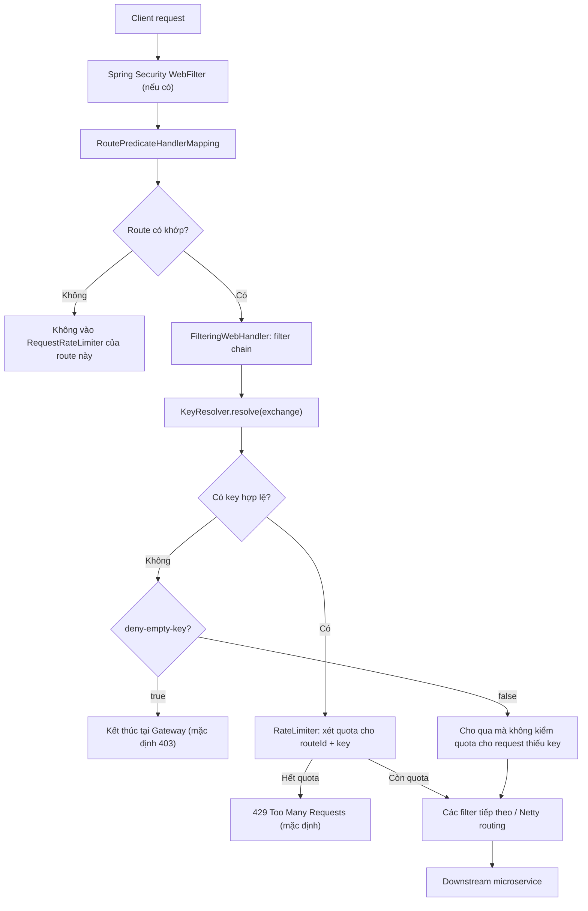

# Khóa rỗng, `deny-empty-key` và nguy cơ chọn khóa không tin cậy

## 1. Vì sao một bộ giới hạn lưu lượng cần khóa đáng tin?

Trong **SPRING_CLOUD_GATEWAY**, một route có thể chạy `RequestRateLimiter` để ngăn client gửi quá nhiều request trước khi Gateway chuyển tiếp tới microservice. Spring Cloud Gateway kết hợp **route predicate**, **filter chain**, biến đổi đường dẫn/header, khám phá dịch vụ (`lb://`) và các tính năng xác thực, circuit breaker, retry, TLS, observability để làm cổng vào an toàn. Rate limiter là một phần trong đó.

Tuy nhiên, rate limiter không chỉ cần con số "5 request/giây". Nó còn cần trả lời:

> **Năm request mỗi giây là của ai?**

Câu trả lời được thể hiện bằng **rate-limit key** — khóa dùng để gom request vào cùng một ngân sách (bucket). Ví dụ:

```text
Route: /api/orders/**

Request của user-a  -> key = user-a -> bucket A
Request của user-b  -> key = user-b -> bucket B
Request không có user -> không có key -> phải quyết định từ chối hay cho qua
```

Nếu khóa lấy từ một HTTP header do client tự ý đặt, kẻ tấn công có thể **đổi header ở mỗi request** để nhận một bucket mới và né quota. Nếu không trích xuất được khóa, một cấu hình "cho qua nếu thiếu key" có thể vô hiệu hóa limiter đúng lúc hệ thống cần bảo vệ nhất.

Bài học thuộc chương **Giới hạn lưu lượng**, tập trung vào ba vấn đề:

1. **Khóa rỗng:** `KeyResolver` không tìm được danh tính/định danh cho request.
2. **`deny-empty-key`:** Gateway có chặn request không có khóa hay để request tiếp tục?
3. **Khóa không đáng tin:** có khóa nhưng người gọi có thể tự chọn, giả mạo hoặc thay đổi nó.

Kết thúc bài học, bạn có thể cấu hình `RequestRateLimiter` cho Gateway Server WebFlux, viết `KeyResolver` xử lý `Mono.empty()` đúng cách, thử các tình huống `403` và `429`, và lựa chọn key theo danh tính đã được xác thực hoặc chính sách proxy tin cậy.

> **Phạm vi:** bài dùng **Spring Cloud Gateway Server WebFlux 4.3.x** thuộc Spring Cloud 2025.0.x và Spring Boot 3.5.x. Starter là `spring-cloud-starter-gateway-server-webflux`, route YAML ở `spring.cloud.gateway.server.webflux.routes`. **Gateway Server MVC** có filter rate limiting, kiểu `KeyResolver` và cấu hình khác; không áp dụng nguyên xi bài này cho MVC.

## 2. RequestRateLimiter hoạt động ở đâu trong filter chain?

Luồng điển hình:



`RequestRateLimiter` là một **GatewayFilterFactory** của route. Nó dùng:

- `KeyResolver` để phân giải request thành một **chuỗi khóa**.
- `RateLimiter` để kiểm tra request ứng với khóa đó có còn quota không.
- `GatewayFilterChain` để tiếp tục khi được phép, hoặc tự kết thúc response nếu bị chặn.

Chữ ký `KeyResolver` ở Gateway Server WebFlux:

```java
public interface KeyResolver {
    Mono<String> resolve(ServerWebExchange exchange);
}
```

`Mono<String>` là publisher reactive: có thể phát ra một khóa hoặc hoàn tất **không phát ra giá trị** (`Mono.empty()`). Không được trả `null` thay `Mono<String>`, và không được tạo `Mono.just(null)`.

Theo tài liệu Spring Cloud Gateway, `KeyResolver` mặc định là `PrincipalNameKeyResolver`: nó lấy `Principal` của `ServerWebExchange`, sau đó lấy `Principal.getName()`. Nếu request không có principal phù hợp, có thể không tìm được khóa. **Principal cần bắt nguồn từ cơ chế xác thực đáng tin**; một chuỗi `username` do client gửi qua query/header không tự tương đương với principal.

### Hai nhánh từ chối trả status khác nhau

| Trường hợp | Có key? | Limiter đã xét quota? | Phản hồi mặc định thường gặp |
| --- | --- | --- | --- |
| `KeyResolver` không sinh khóa, `deny-empty-key=true` | Không | Chưa cần xét bucket | **403 Forbidden** (có thể cấu hình status riêng). |
| Có khóa nhưng quota đã hết | Có | Có | **429 Too Many Requests**. |
| Có khóa và còn quota | Có | Có | Request tiếp tục; status phụ thuộc upstream. |
| Không có khóa, `deny-empty-key=false` | Không | Có thể **bỏ qua rate limiting** cho request này | Request tiếp tục; status phụ thuộc upstream. |
| Không có route khớp | Không liên quan | Không | Thường 404 nếu không có handler khác. |
| Limiter backend (Redis) lỗi | Có thể có | Không thể kết luận bằng status đơn lẻ | Phụ thuộc implementation/chính sách lỗi; phải test. |

**Đừng nhầm 403 do thiếu key với 429 do vượt quota.** Cả hai có thể do Gateway trả mà **không gọi backend**, nhưng nguyên nhân và cách khắc phục khác nhau. `429` cũng không đồng nghĩa người dùng chưa xác thực; `403` vì missing key không nhất thiết là quyết định authorization của Spring Security.

## 3. "Khóa rỗng" thực sự có những trường hợp nào?

Các tình huống kỹ thuật thường gặp:

```text
A. Header hoàn toàn vắng mặt:
   X-Demo-User: <không có>
   -> Mono.empty()  [nếu resolver xử lý đúng]

B. Header có chuỗi rỗng:
   X-Demo-User:
   -> ""            [phải chuẩn hóa trước khi trả key]

C. Header chỉ chứa dấu cách:
   X-Demo-User: "   "
   -> "   "         [phải trim và kiểm tra blank]

D. Principal không tồn tại:
   exchange.getPrincipal() -> Mono.empty()

E. Client gửi literal "unknown" hoặc "anonymous":
   -> đây KHÔNG tự động là "thiếu khóa"
   -> thường trở thành một key thật nếu resolver chấp nhận!
```

**Ranh giới quan trọng:** `Mono.empty()` là publisher không có phần tử. Nó không giống `Mono.just("")` hoặc `Mono.just("anonymous")`. Một số version/framework có logic riêng nhận biết empty-string, nhưng **không nên dựa vào suy đoán này** để bảo vệ API.

Cách an toàn hơn là chuẩn hóa trước khi trả:

```java
return Mono.justOrEmpty(header)
        .map(String::trim)
        .filter(value -> !value.isBlank());
```

Nếu `header == null`, `Mono.justOrEmpty(header)` hoàn tất rỗng. Nếu header chỉ có whitespace, `filter` loại giá trị đó và trả `Mono.empty()`.

Ngược lại, đoạn sau **không an toàn** nếu giá trị `unknown` có ý nghĩa như một người dùng mới:

```java
return Mono.justOrEmpty(header)
        .defaultIfEmpty("unknown");
```

Nó tạo **một khóa chung** cho mọi request thiếu key. Đây không còn là nhánh "không có khóa" để `deny-empty-key` xử lý. Người dùng hợp pháp có thể tranh quota với kẻ tấn công, còn hệ thống có thể vô tình mở quyền cho request đáng ra phải bị từ chối.

### Không nên dùng fallback key để lách lỗi thiết kế

| Fallback | Rủi ro |
| --- | --- |
| `anonymous` cho mọi người | Chia sẻ một quota toàn cục ngoài dự tính; dễ bị làm cạn bucket gây từ chối dịch vụ cho người khác. |
| `UUID.randomUUID()` trên mỗi request | Mỗi request có bucket mới, gần như **vô hiệu hóa rate limiting**. |
| `?user=<client-input>` | Client đổi user liên tục để có key mới. |
| Raw `X-Forwarded-For` | Client có thể giả IP nếu proxy trust không được cấu hình đúng. |
| `X-API-Key` chưa xác minh | Người gọi có thể tạo chuỗi bất kỳ để đổi bucket. |
| `getRemoteAddress()` khi sau một reverse proxy | Có thể luôn là IP proxy; nhiều client bị gom chung quota. |

Cần xác định rõ chính sách **anonymous traffic** thay vì vô tình chọn một fallback. Một route public có thể dùng một bucket theo IP **được xác minh nguồn mạng** hoặc một quota chung cố ý; route chỉ dành cho người đã đăng nhập cần yêu cầu principal hợp lệ.

## 4. `deny-empty-key` và `empty-key-status-code`

Theo tài liệu `RequestRateLimiter`, **mặc định request không tìm được key bị từ chối**. Thuộc tính `deny-empty-key` là công tắc quản lý tình huống đó.

| Cấu hình | Ý nghĩa | Đánh giá với API cần rate limit theo user |
| --- | --- | --- |
| `deny-empty-key=true` | Không có khóa → chặn request. | **Khuyến nghị** khi không thể xác định danh tính đáng tin. |
| `deny-empty-key=false` | Không có khóa → cho request tiếp tục theo nhánh thiếu key. | Rủi ro **bypass quota**; chỉ dùng khi chủ động cho anonymous qua cơ chế bảo vệ khác. |
| `empty-key-status-code=FORBIDDEN` | Status 403 khi thiếu khóa và deny đang bật. | Phân biệt được với tình huống vượt quota 429. |
| `empty-key-status-code=UNAUTHORIZED` | Status 401 thay cho 403 nếu được hỗ trợ/configure đúng. | Chỉ hợp lý với chính sách xác thực; xử lý `WWW-Authenticate` ở tầng auth khi cần. |

### Lưu ý rất quan trọng về tên property giữa các phiên bản

Tài liệu mô tả factory ở một số bản **4.3.x** vẫn dẫn tên legacy:

```properties
# Tên trong phần mô tả RequestRateLimiter của tài liệu cũ:
spring.cloud.gateway.filter.request-rate-limiter.deny-empty-key=true
spring.cloud.gateway.filter.request-rate-limiter.empty-key-status-code=FORBIDDEN
```

Trong Gateway **Server WebFlux** thuộc release train có namespace mới, cấu hình filter factory sử dụng nhóm:

```yaml
# Minh họa nhóm cấu hình WebFlux mới; kiểm tra binding trên bản vá thực tế.
spring:
  cloud:
    gateway:
      server:
        webflux:
          filter:
            request-rate-limiter:
              deny-empty-key: true
              empty-key-status-code: FORBIDDEN
```

**Không copy mù quáng property prefix cũ vào ứng dụng 2025.0.x.** Phần `routes` của Gateway WebFlux được chuyển vào `spring.cloud.gateway.server.webflux`, nhưng trang tài liệu factory có chỗ vẫn dùng các snippet legacy. Bảng `Configuration Properties` cho 4.3 liệt kê `spring.cloud.gateway.server.webflux.filter.request-rate-limiter` (trong đó có `enabled` và default resolver/limiter) nhưng **không liệt kê rõ hai key empty-key ở tất cả bản vá/trang**. Vì vậy:

1. Giữ **`deny-empty-key=true`** làm lựa chọn bảo vệ trong ví dụ.
2. Kiểm tra **version/namespace/binding thực tế** của artifact đang chạy.
3. Test bằng request **thiếu key** trước/sau khi thay property, thay vì chỉ tin ứng dụng đã khởi động thành công.
4. Với security-critical route, có thể bổ sung một tầng xác thực **fail closed** độc lập: không cho người thiếu identity đi tới API bất kể factory binding ra sao.

> **Không coi `deny-empty-key=false` là cách sửa lỗi 403 hàng loạt** khi mới triển khai. 403 có thể là tín hiệu `KeyResolver` đang lấy key từ sai nguồn (ví dụ chưa có principal); hãy sửa resolver hoặc thứ tự/authentication trước.

## 5. Chọn khóa rate limit theo thứ tự tin cậy

Có một sự khác biệt cơ bản giữa "**có khóa**" và "**khóa đáng tin**". `RequestRateLimiter` có thể giới hạn rất chính xác trên một chuỗi mà client tự tạo; nhưng hành vi đó không bảo vệ được chính sách quota theo danh tính.

### 5.1. Nguồn khóa đáng ưu tiên

| Nguồn key | Mức tin cậy mặc định | Khi nào nên dùng? |
| --- | --- | --- |
| **`JwtAuthenticationToken` đã verify** | Cao nếu issuer, signature, audience, thời hạn và policy đúng | Rate limit theo user/account/tenant với resource server. |
| **Principal đã xác thực bằng session** | Cao nếu session/authentication được bảo vệ đúng | OAuth2 Login/BFF, session-backed Gateway. |
| **API key đã kiểm tra và ánh xạ với client registration** | Cao sau xác minh thật sự | API máy–máy; key limiter nên là client ID ổn định, không phải raw API secret. |
| **mTLS service identity** | Cao khi cert chain/SAN/identity mapping hợp lệ | Quota theo workload/service. |
| IP client được **trusted proxy chain** xác định | Có điều kiện | Public/anonymous endpoints; cần xử lý NAT, IPv6, chuyển đổi IP. |
| Raw `X-User-Id`, `X-Api-Key`, `X-Forwarded-For` do client gửi | **Không đáng tin theo mặc định** | Không dùng trực tiếp cho quota gắn với user/service. |
| Query `?user=user-a` | Không đáng tin | Chỉ minh họa API và nguy cơ bypass, không dùng production. |

Với JWT, không chỉ nhìn thấy một token có ba phần rồi decode payload. Gateway hoặc Spring Security phải **xác minh chữ ký, `iss`, `aud`, `exp`, `nbf`**, sau đó mới dùng claim như `sub`. Với nhiều issuer/tenant, khóa có thể cần bao gồm **issuer + tenant + subject** để tránh hai người ở hai nguồn định danh khác nhau có cùng `sub` nhưng bị gom vào một bucket.

### 5.2. Vì sao dùng IP không đơn giản?

Nếu Gateway đứng sau load balancer hoặc ingress:

```text
Client 203.0.113.10
    |
  Ingress 10.0.0.8  --(TCP)--> Gateway
                               remoteAddress = 10.0.0.8
```

`exchange.getRequest().getRemoteAddress()` có thể trả địa chỉ của **ingress**, không phải client. Nếu Gateway tự tin `X-Forwarded-For: 203.0.113.10` do request gửi đến mà không có chính sách trusted proxies, kẻ tấn công có thể giả một địa chỉ mới trong mỗi request:

```bash
curl -H "X-Forwarded-For: 203.0.113.10" http://gateway.example.test/api/public
curl -H "X-Forwarded-For: 203.0.113.11" http://gateway.example.test/api/public
```

Một mô hình đúng cần:

- Chỉ cho Gateway nhận traffic từ **ingress/proxy được tin cậy** nếu kiến trúc yêu cầu.
- Ingress **xóa/ghi lại** các forwarded headers do client gửi, theo chính sách của hệ thống.
- Dùng cơ chế phân giải địa chỉ client **aware of proxy chain**, có số hop/proxy được tin cậy.
- Bảo vệ network path để client không bypass ingress.
- Test với client tự chèn `X-Forwarded-For`, nhiều địa chỉ, IPv6 và trường hợp header bị thiếu.
- Không nhầm property liên quan việc **ghi** `Forwarded`/`X-Forwarded-*` sang upstream với việc **đọc** và tin địa chỉ trong header để làm rate-limit key.

Kể cả đã xác minh IP, NAT/CGNAT khiến nhiều người dùng chia sẻ IP; roaming/mobile có thể thay IP liên tục. IP-based rate limiting là một tín hiệu chống abuse, **không thay thế quota theo tài khoản đã xác thực**.

### 5.3. API key và tenant

Nếu client gửi API key có định dạng hợp lệ, chưa chắc nó là credential được cấp thật. Trước khi dùng key cho quota:

1. Xác minh credential bằng phương pháp đáng tin cậy (hash/lookup hoặc cơ chế chứng thực phù hợp).
2. Ánh xạ thành **client/account ID ổn định**.
3. Dùng ID đó làm rate-limit key; tránh lưu raw API key vào Redis key hoặc metrics.
4. Kiểm soát tenant ID dựa trên thông tin đã xác thực, không chỉ `Host`/query.
5. Có chiến lược rotate/revoke API key mà không làm đổi quota ngoài ý muốn.

Tất cả những yếu tố này quan trọng nếu Gateway cần xác thực, giới hạn lưu lượng, phân quyền và chọn upstream theo danh tính.

## 6. KeyResolver an toàn: lấy danh tính đã xác thực

Trong Gateway làm **OAuth2 Resource Server JWT**, có thể lấy `JwtAuthenticationToken` được Spring Security thiết lập sau khi verify:

```java
package com.example.gateway;

import org.springframework.cloud.gateway.filter.ratelimit.KeyResolver;
import org.springframework.context.annotation.Bean;
import org.springframework.context.annotation.Configuration;
import org.springframework.security.oauth2.server.resource.authentication.JwtAuthenticationToken;

import reactor.core.publisher.Mono;

@Configuration
public class RateLimitIdentityConfig {

    @Bean
    KeyResolver authenticatedUserKeyResolver() {
        return exchange -> exchange.getPrincipal()
                .ofType(JwtAuthenticationToken.class)
                .map(JwtAuthenticationToken::getToken)
                .filter(jwt -> jwt.getIssuer() != null
                        && jwt.getSubject() != null
                        && !jwt.getSubject().isBlank())
                .map(jwt -> jwt.getIssuer().toString()
                        + "|" + jwt.getSubject());
    }
}
```

**Điều kiện sử dụng:** Gateway phải thực sự cấu hình Spring Security WebFlux Resource Server để validate JWT theo issuer, signature, audience, thời gian và scope. Nếu không, `exchange.getPrincipal()` không tự cung cấp một `JwtAuthenticationToken` đáng tin cậy.

- Nếu principal không phải JWT đã xác thực, `ofType(...)` trả publisher rỗng.
- Nếu issuer/subject thiếu hoặc subject trống, filter loại token khỏi luồng,
  tạo `Mono.empty()` để chính sách missing key có thể chặn.
- Ghép issuer giúp tránh trùng subject giữa các nguồn cấp token; production có thể thêm tenant/account ID theo chính sách đã verify.
- **Không log giá trị khóa nếu chứa dữ liệu định danh cá nhân** và không dùng raw token làm Redis key.

Mã trên chỉ chịu trách nhiệm **key derivation**, không triển khai authentication. Cấu hình security ở Gateway nên yêu cầu auth trước route:

```java
@Bean
SecurityWebFilterChain gatewaySecurity(ServerHttpSecurity http) {
    return http
            .csrf(ServerHttpSecurity.CsrfSpec::disable)
            .authorizeExchange(exchanges -> exchanges
                    .pathMatchers("/api/orders/**")
                        .hasAuthority("SCOPE_orders.read")
                    .anyExchange().denyAll()
            )
            .oauth2ResourceServer(oauth2 -> oauth2
                    .jwt(Customizer.withDefaults())
            )
            .build();
}
```

Đây là đoạn mã đặt trong class `@Configuration` với các import Spring Security WebFlux tương ứng. Tắt CSRF **chỉ phù hợp cho API bearer-stateless**, không copy vào ứng dụng dùng session cookie/OAuth2 Login mà chưa thiết kế CSRF. Backend vẫn cần kiểm tra quyền đối với **tài nguyên cụ thể** (owner/tenant), vì quota theo user không thay thế authorization.

### Một sai lầm tinh vi về anonymous principal

Không chỉ viết:

```java
return exchange.getPrincipal()
        .map(Principal::getName);
```

rồi giả định mọi request đều có identity đã xác thực. Một hệ thống cho phép anonymous hoặc dùng loại principal đặc biệt có thể tạo ra tên như `anonymousUser`. Các cơ chế đánh dấu `Authentication.isAuthenticated()` cũng cần hiểu đúng: trong Spring Security, `AnonymousAuthenticationToken` có thể được coi là authenticated ở mức token object, nhưng **không phải tài khoản thực đã đăng nhập**.

Với API cần quota theo user, hãy lọc theo **loại authentication và authorization policy** thích hợp, chẳng hạn `JwtAuthenticationToken` đã xác minh như trên. Nếu cho phép nhiều hình thức đăng nhập, tạo một abstraction chuyển chúng thành danh tính chuẩn theo policy, không gộp chúng thành một key thiếu kiểm soát.

## 7. Thực hành: quan sát khóa trống và khóa bị giả mạo

Phần thực hành cố ý dùng một **header demo do client tự đặt** để bạn tận mắt thấy hai vấn đề: missing key bị chặn và header có thể bị đổi để né quota.

**Ranh giới an toàn:** `X-Demo-User` **không phải credential xác thực**. Ví dụ chỉ chạy trên localhost, không triển khai ra môi trường thật hoặc gắn vào API có dữ liệu nhạy cảm. Sau bài thực hành, thay resolver bằng `authenticatedUserKeyResolver` ở mục 6 khi tích hợp Spring Security thật.

Kiến trúc:

```text
Client --curl--> Gateway :8080
                  |
                  +-- KeyResolver: đọc X-Demo-User
                  +-- RequestRateLimiter (Redis token bucket)
                  |
                  +--> Backend Echo :9001 (chỉ khi được phép)
                              |
                              +--> response 200
```

### 7.1. Chuẩn bị Maven và các dependency

Yêu cầu: Java 17+, Maven, Redis local, `curl`. Ví dụ `pom.xml` dùng Spring Boot `3.5.0` và Spring Cloud `2025.0.0` để minh họa release train, **không** khẳng định đây là những bản vá mới nhất để triển khai production.

```xml
<?xml version="1.0" encoding="UTF-8"?>
<project xmlns="http://maven.apache.org/POM/4.0.0"
         xmlns:xsi="http://www.w3.org/2001/XMLSchema-instance"
         xsi:schemaLocation="http://maven.apache.org/POM/4.0.0
                             https://maven.apache.org/xsd/maven-4.0.0.xsd">
    <modelVersion>4.0.0</modelVersion>

    <parent>
        <groupId>org.springframework.boot</groupId>
        <artifactId>spring-boot-starter-parent</artifactId>
        <version>3.5.0</version>
        <relativePath/>
    </parent>

    <groupId>com.example</groupId>
    <artifactId>gateway-rate-key-lab</artifactId>
    <version>0.0.1-SNAPSHOT</version>

    <properties>
        <java.version>17</java.version>
    </properties>

    <dependencyManagement>
        <dependencies>
            <dependency>
                <groupId>org.springframework.cloud</groupId>
                <artifactId>spring-cloud-dependencies</artifactId>
                <version>2025.0.0</version>
                <type>pom</type>
                <scope>import</scope>
            </dependency>
        </dependencies>
    </dependencyManagement>

    <dependencies>
        <dependency>
            <groupId>org.springframework.cloud</groupId>
            <artifactId>spring-cloud-starter-gateway-server-webflux</artifactId>
        </dependency>
        <dependency>
            <groupId>org.springframework.boot</groupId>
            <artifactId>spring-boot-starter-data-redis-reactive</artifactId>
        </dependency>
    </dependencies>

    <build>
        <plugins>
            <plugin>
                <groupId>org.springframework.boot</groupId>
                <artifactId>spring-boot-maven-plugin</artifactId>
            </plugin>
        </plugins>
    </build>
</project>
```

Spring Cloud BOM quản lý các dependency Cloud; không gắn version riêng cho Gateway starter. Redis **reactive** starter được Spring Cloud Gateway docs yêu cầu cho RedisRateLimiter. Không dùng `spring-boot-starter-web` ở ví dụ WebFlux này.

### 7.2. Tạo ứng dụng và KeyResolver demo

`src/main/java/com/example/gateway/GatewayApplication.java`:

```java
package com.example.gateway;

import org.springframework.boot.SpringApplication;
import org.springframework.boot.autoconfigure.SpringBootApplication;

@SpringBootApplication
public class GatewayApplication {
    public static void main(String[] args) {
        SpringApplication.run(GatewayApplication.class, args);
    }
}
```

`src/main/java/com/example/gateway/DemoKeyConfig.java`:

```java
package com.example.gateway;

import org.springframework.cloud.gateway.filter.ratelimit.KeyResolver;
import org.springframework.context.annotation.Bean;
import org.springframework.context.annotation.Configuration;

import reactor.core.publisher.Mono;

@Configuration
public class DemoKeyConfig {

    @Bean
    KeyResolver demoHeaderKeyResolver() {
        return exchange -> Mono.justOrEmpty(exchange.getRequest()
                    .getHeaders()
                    .getFirst("X-Demo-User"))
                .map(String::trim)
                .filter(value -> !value.isBlank())
                .filter(value -> value.length() <= 40)
                .filter(value -> value.matches("[a-zA-Z0-9_-]+"));
    }
}
```

Resolver minh họa:

1. Không có header → `Mono.empty()`.
2. Header toàn dấu cách → sau `trim` và `filter` thành `Mono.empty()`.
3. Header dài quá 40 ký tự hoặc có ký tự ngoài whitelist demo → `Mono.empty()`.
4. Header hợp lệ như `alice` → trả key `alice`.

**Quan trọng:** kiểm tra regex/độ dài **không xác thực được người gửi**. Bất kỳ client nào vẫn có thể gửi `X-Demo-User: alice` hoặc `X-Demo-User: bob`. Đó chính là điểm yếu mà phần kiểm thử sẽ làm rõ.

### 7.3. Cấu hình route và rate limiter

Tạo `src/main/resources/application.yml`:

```yaml
server:
  port: 8080

spring:
  application:
    name: rate-key-lab

  data:
    redis:
      host: 127.0.0.1
      port: 6379

  cloud:
    gateway:
      server:
        webflux:
          filter:
            request-rate-limiter:
              deny-empty-key: true
              empty-key-status-code: FORBIDDEN

          routes:
            - id: echo-limited
              uri: http://127.0.0.1:9001
              predicates:
                - Path=/api/echo/**
              filters:
                - StripPrefix=2
                - name: RequestRateLimiter
                  args:
                    key-resolver: "#{@demoHeaderKeyResolver}"
                    redis-rate-limiter.replenishRate: 2
                    redis-rate-limiter.burstCapacity: 3
                    redis-rate-limiter.requestedTokens: 1
```

Giải thích:

| Phần | Ý nghĩa |
| --- | --- |
| `Path=/api/echo/**` | Chọn route theo path. |
| `StripPrefix=2` | Backend nhận path sau khi bỏ `/api/echo`. |
| `RequestRateLimiter` | Áp dụng limiter cho request khớp route. |
| `key-resolver: "#{@demoHeaderKeyResolver}"` | Tham chiếu Spring bean bằng SpEL, **không** phải key literal. |
| `replenishRate: 2` | Nạp lại khoảng 2 token/giây cho mỗi bucket trong mô hình token bucket. |
| `burstCapacity: 3` | Bucket tối đa 3 token; có thể chịu burst ngắn. |
| `requestedTokens: 1` | Mỗi request được phép tiêu thụ 1 token. |
| `deny-empty-key: true` | Không tìm được khóa thì từ chối trước bước xét quota. |
| `empty-key-status-code: FORBIDDEN` | Trả 403 cho tình huống thiếu key, khác 429 khi hết quota. |

**Không dùng shortcut** kiểu `RequestRateLimiter=2,3,...`: tài liệu chính thức yêu cầu named filter với `args` cho `RequestRateLimiter`.

`replenishRate=2` và `burstCapacity=3` chỉ giúp demo 429 dễ xảy ra. Giá trị thực cần chọn từ tải backend, mức sử dụng tài khoản, traffic burst, retry và SLA. Nếu Redis đang chứa nhiều bucket từ lần test trước, chờ đủ thời gian để bucket được nạp token hoặc dùng key demo mới khi kiểm thử; **không xóa dữ liệu Redis production** để "reset" bài lab.

### 7.4. Khởi chạy Redis cục bộ

Nếu máy học tập có Docker, có thể chạy một Redis tách biệt chỉ bind loopback:

```bash
docker run --rm --name scg-lab-redis \
  -p 127.0.0.1:6379:6379 \
  redis:7.4-alpine
```

Giữ terminal Redis đang chạy. Đây là cấu hình **không có authentication/TLS cho mục đích local**; tuyệt đối không công khai cổng Redis ra mạng ngoài. Nếu đã có Redis cục bộ được cấu hình an toàn ở `127.0.0.1:6379`, sử dụng nó thay cho việc khởi động container thứ hai. Không đụng Redis dùng cho công việc thật khi làm bài thực hành.

### 7.5. Tạo backend Echo đơn giản

Tạo file `EchoBackend.java` trong thư mục test riêng, bên ngoài project Gateway:

```java
import com.sun.net.httpserver.HttpServer;
import java.net.InetSocketAddress;
import java.nio.charset.StandardCharsets;

public class EchoBackend {
    public static void main(String[] args) throws Exception {
        HttpServer server = HttpServer.create(
                new InetSocketAddress("127.0.0.1", 9001), 0);

        server.createContext("/", exchange -> {
            String path = exchange.getRequestURI().getRawPath();
            System.out.println("UPSTREAM RECEIVED " + path);

            byte[] bytes = ("backend-path=" + path + "\n")
                    .getBytes(StandardCharsets.UTF_8);

            exchange.getResponseHeaders().set(
                    "Content-Type", "text/plain; charset=UTF-8");
            exchange.sendResponseHeaders(200, bytes.length);

            try (var body = exchange.getResponseBody()) {
                body.write(bytes);
            }
        });

        server.start();
        System.out.println("Echo backend ready at 127.0.0.1:9001");
    }
}
```

Chạy backend:

```bash
java EchoBackend.java
```

Chạy Gateway từ thư mục có `pom.xml`:

```bash
mvn spring-boot:run
```

Nếu dự án có Maven Wrapper: `./mvnw spring-boot:run` trên Linux/macOS, hoặc `mvnw.cmd spring-boot:run` trên Windows.

### 7.6. Test khóa vắng mặt

```bash
curl -i "http://127.0.0.1:8080/api/echo/42"
```

Vì không có `X-Demo-User`, `KeyResolver` trả `Mono.empty()`. Với chính sách deny-empty-key mặc định, Gateway dự kiến trả:

```http
HTTP/1.1 403 Forbidden
```

Ở terminal backend **không có** thêm dòng `UPSTREAM RECEIVED /42`. Đó là dấu hiệu request kết thúc ngay tại Gateway.

### 7.7. Test header rỗng và whitespace

```bash
curl -i -H "X-Demo-User:" \
  "http://127.0.0.1:8080/api/echo/42"

curl -i -H "X-Demo-User:   " \
  "http://127.0.0.1:8080/api/echo/42"
```

Kỳ vọng sau khi resolver `trim`/lọc: không có key, nhận 403. Đối với dòng có header rỗng, một số phiên bản `curl` xử lý `-H "X-Demo-User:"` thành **loại bỏ header**; điều đó vẫn phù hợp để kiểm tra nhánh missing key. Nếu muốn thật sự gửi header rỗng, kiểm tra dạng `X-Demo-User;` của curl và xác nhận bytes/headers bằng server thử nghiệm.

### 7.8. Test có key và vượt quota

Gửi một request:

```bash
curl -i -H "X-Demo-User: alice" \
  "http://127.0.0.1:8080/api/echo/42"
```

Nếu Redis hoạt động và bucket còn token, backend trả:

```http
HTTP/1.1 200 OK
Content-Type: text/plain; charset=UTF-8

backend-path=/42
```

Gửi nhiều request thật nhanh với cùng key, ví dụ (Bash):

```bash
for i in 1 2 3 4 5 6 7 8 9 10; do
  curl -s -o /dev/null -w "alice status=%{http_code}\n" \
    -H "X-Demo-User: alice" \
    "http://127.0.0.1:8080/api/echo/42"
done
```

Vì `replenishRate=2`, `burstCapacity=3`, trong một loạt đủ nhanh **một số request có thể trả 429**. Không viết test đòi "chính xác request thứ tư là 429" trong mọi môi trường: token có thể được nạp lại giữa các request; tốc độ máy và network ảnh hưởng kết quả.

Ở terminal backend, số dòng `UPSTREAM RECEIVED` phải khớp số request **được limiter cho qua**, không phải mọi request mà client đã gửi.

### 7.9. Test đổi key để né quota

Thử:

```bash
curl -i -H "X-Demo-User: alice" \
  "http://127.0.0.1:8080/api/echo/42"

curl -i -H "X-Demo-User: bob" \
  "http://127.0.0.1:8080/api/echo/42"

curl -i -H "X-Demo-User: charlie" \
  "http://127.0.0.1:8080/api/echo/42"
```

Mỗi key mới có thể nhận quota riêng. Đây là hành vi đúng **nếu** key đại diện cho ba danh tính khác nhau **đã được xác minh**. Trong demo, một client có thể tùy ý đổi header nên việc né limiter rất dễ: **rate limiter hoạt động đúng về thuật toán nhưng policy chọn key lại không an toàn**.

Đừng "sửa" điểm yếu này bằng cách tăng quota hoặc `deny-empty-key=false`. Phải thay nguồn key bằng principal/token/API key **đã xác thực**, hoặc cơ chế anonymous/IP có kiểm soát.

### 7.10. Thử `deny-empty-key=false` có kiểm soát

Chỉ ở môi trường local, tạm chuyển:

```yaml
spring:
  cloud:
    gateway:
      server:
        webflux:
          filter:
            request-rate-limiter:
              deny-empty-key: false
```

Sau khi khởi động lại Gateway, thử request **không có `X-Demo-User`**. Theo cơ chế được mô tả, request thiếu key có thể đi tiếp **mà không bị tính vào bucket**, backend trả 200. Sau phép thử, **khôi phục `true`**.

Nếu thay đổi không ảnh hưởng hành vi, đừng suy rằng `false` là an toàn hay factory đã chấp nhận property: kiểm tra namespace, version artifact, property binding và logs; tham chiếu lưu ý ở mục 4. **Không giữ cấu hình fail-open chỉ vì test trả 403 với key vắng mặt.**

## 8. Redis token bucket không tự giải quyết việc chọn key

RedisRateLimiter áp dụng token-bucket và lưu trạng thái phân tán, hữu ích khi nhiều Gateway replica chia sẻ quota. Nhưng Redis **không xác minh danh tính** của key.

```text
Gateway A ---+
             +-- Redis: bucket(routeId, key) --> allow / deny
Gateway B ---+

Nếu key = JWT subject đã xác thực: quota có thể gắn với tài khoản.
Nếu key = header tự khai báo: client có thể tạo vô hạn bucket.
Nếu key rỗng và fail-open: có thể không kiểm quota cho request.
```

Khi khóa có độ biến thiên rất cao, kẻ tấn công có thể gây **key-cardinality explosion**: quá nhiều bucket lưu trong Redis, làm tốn tài nguyên. Việc giới hạn regex/độ dài chuỗi chỉ giảm một phần rủi ro; cần xác thực nguồn, giới hạn số định danh được cấp, kiểm soát TTL/capacity, ingress protection và quan sát rate limiter.

### Route ID cũng quan trọng

Trong nhiều `RateLimiter` implementation, `routeId` được dùng cùng key để phân biệt ngân sách. Vì vậy cùng user `alice` có thể có quota khác nhau giữa `orders-read` và `orders-write` nếu cấu hình tách route/bucket. **Không giả định** một user có quota toàn hệ thống chỉ từ việc dùng cùng string key; phải xác minh thực tế limiter implementation và route ID.

### Redis mất kết nối thì sao?

Nếu Redis không hoạt động, đó **không phải** "missing key". `KeyResolver` có thể trả key hợp lệ, nhưng `RateLimiter` không xét được bucket. Cách trả lỗi/fail-open/fail-closed có thể khác giữa implementation/version và policy exception handling; phải có **integration test ngắt Redis**. Đừng tự tuyên bố Redis outage luôn tạo 403, 429 hoặc 503 trong mọi phiên bản.

Với dịch vụ cần bảo vệ nghiêm ngặt, thiết kế fail-closed hoặc fallback limiter có giới hạn theo policy đã được phê duyệt; với hệ thống ưu tiên availability, cần hiểu tác động của fail-open tới backend và kiểm soát tải ở tầng khác. **`deny-empty-key` không phải công tắc xử lý Redis outage.**

## 9. Kết hợp với auth, header filters, TLS, circuit breaker và retry

### 9.1. Authentication trước khi lấy key

Với route cần đăng nhập, mô hình ưu tiên:

```text
Spring Security WebFilter:
  - Verify JWT/session/API key
  - Xác thực danh tính, scope
       |
       v
Gateway RequestRateLimiter:
  - Lấy key từ principal đã xác thực
  - Kiểm quota
       |
       v
GatewayFilter transforms / LoadBalancer / Netty proxy
       |
       v
Downstream:
  - Tự kiểm tra quyền trên tài nguyên
```

Nếu Spring Security chặn request chưa xác thực, client có thể thấy **401** trước khi `RequestRateLimiter` chạy; đó là hành vi tốt. Không được kỳ vọng mọi request không có token đều rơi vào nhánh `deny-empty-key` của Gateway. Một request thiếu key nhưng đã vào limiter thường nhận **403** theo chính sách mặc định của limiter.

### 9.2. Header transforms và forwarded trust

Nếu muốn gắn `X-Authenticated-User` xuống service, Gateway chỉ nên làm sau khi xác thực; xóa header cùng tên từ client và thiết kế ranh giới tin cậy đến backend. Tuy nhiên, **rate-limit key vẫn nên lấy trực tiếp từ security principal** thay vì tự đọc header do client có thể điều khiển.

Khi Gateway đứng sau proxy, đừng dùng raw `X-Forwarded-For` làm key nếu chưa có **trusted proxy configuration, network policy và header sanitization**. DNS, TLS và mTLS có thể giúp xác minh proxy/backend nhưng không tự biến một header tùy ý thành dữ liệu đáng tin.

### 9.3. Retry và circuit breaker

- Rate limiter thường nên đặt **trước bước proxy**, để request bị chặn không gây tải xuống microservice.
- Retry có thể khiến một request được gửi đến backend **nhiều lần** tùy vị trí filter và cấu hình; phải quyết định quota tính **mỗi client request** hay **mỗi downstream attempt**.
- Không retry mù quáng request bị `429`; điều đó có thể gây **retry storm**. Client nên dùng backoff và `Retry-After` khi có thông tin phù hợp.
- Circuit breaker bảo vệ trước lỗi/thất bại của backend; nó không thay thế rate limiting theo identity. Fallback phải tránh trả dữ liệu nhạy cảm nếu auth/quota policy không đạt.
- Với `POST`/ `PATCH`, cần idempotency nếu có retry để tránh tạo nhiều side effect.

### 9.4. Multi-instance, observability và TLS

Với nhiều Gateway replica, limiter dùng Redis có thể chia sẻ trạng thái; nhưng cần xem cấu hình timeouts, network partitions, pool connections, Redis HA và bảo vệ Redis credentials/TLS. Không để Redis cổng public; không log Redis keys có thể chứa user IDs, token hoặc địa chỉ IP chi tiết.

Quan sát các chỉ số:

- Route ID, tỷ lệ request `403` vì missing key, `429` vì vượt quota.
- Số key resolver không trả giá trị, số key bị reject do format sai.
- Tần suất lỗi Redis, latency gọi limiter, số request được cho qua và bị chặn.
- HTTP status/latency upstream và số retry attempts.
- Trạng thái filter chain để xác định request **đã được proxy hay bị trả sớm**.

**Không thêm giá trị key vào metric labels** khi chúng có độ phân biệt cao hoặc là dữ liệu cá nhân. Có thể dùng hashed/aggregated analytics theo chính sách bảo vệ dữ liệu và kiểm soát truy cập logs.

## 10. Bảng xử lý sự cố

| Triệu chứng | Nguyên nhân cần xem | Hướng kiểm tra |
| --- | --- | --- |
| Mọi request đều 403 | Không có principal, resolver trả `Mono.empty()`, hoặc property deny đang bật. | Log an toàn số lần key missing; kiểm tra auth, bean resolver, route args. |
| 403 với request không gửi header demo | Resolver không tìm được key; đây là kết quả mong đợi trong lab. | Gửi một key hợp lệ để test nhánh quota, không bật fail-open vội. |
| 429 xuất hiện rất sớm | Burst/replenish thấp, bucket đã cạn, nhiều request cùng key, client retry. | Kiểm tra `routeId`, key policy, burst/requestedTokens và tốc độ request. |
| Gửi nhiều request nhưng không bao giờ 429 | Mỗi request có key mới, limiter bị bypass do missing key, cấu hình filter không có hiệu lực. | Cố định một key và gửi burst; xác minh Redis và route config. |
| Header rỗng nhưng vẫn chia bucket `""` | Resolver phát `Mono.just("")` thay vì `Mono.empty()`. | Trim/filter blank trước khi trả key. |
| Client thay `X-User-Id` là có quota mới | Key lấy từ header do client kiểm soát. | Lấy từ authenticated principal hoặc trusted identity mapping. |
| Mọi client chia cùng quota | Đang dùng `anonymous` hoặc IP proxy làm key. | Xem nguồn identity và reverse proxy topology. |
| `X-Forwarded-For` đổi là quota đổi | Header có thể bị spoof hoặc parser tin sai hop. | Chỉ dùng trusted proxy chain, ingress overwrite và network control. |
| Cấu hình `deny-empty-key=false` không đổi hành vi | Sai prefix hoặc property không được bind theo version. | Xem release train, actual factory properties, test request thiếu key. |
| Không có `RequestRateLimiter` khi startup | Starter Gateway sai (WebFlux/MVC), thiếu dependency/tự cấu hình route sai. | Kiểm tra starter `spring-cloud-starter-gateway-server-webflux`, named filter. |
| Redis lỗi nhưng client thấy 5xx/429 | RateLimiter không tính được bucket, behavior theo version/exception handling. | Test mô phỏng Redis outage và root cause; không nhầm missing key. |
| Nhìn thấy log hậu xử lý dù backend không nhận request | Filter phía ngoài vẫn có callback `doFinally`. | Dùng backend counter/tracing để phân biệt short-circuit. |

## 11. Ma trận kiểm thử bảo vệ chính sách

| Nhóm kiểm thử | Đầu vào | Kỳ vọng |
| --- | --- | --- |
| Missing key | Không header `X-Demo-User` | `Mono.empty()`, mặc định 403, backend không nhận request. |
| Whitespace key | `X-Demo-User:   ` | Bị chuẩn hóa thành missing key. |
| Valid key | `X-Demo-User: alice` | Khi còn quota, được proxy tới backend. |
| Burst | 10 request nhanh với cùng `alice` | Có request được cho qua và có thể có 429. |
| Different keys | `alice`, `bob` | Bucket/quota theo key; minh họa spoofing. |
| Invalid characters | `X-Demo-User: a/b` | Resolver demo loại thành missing key. |
| Toggle deny | `deny-empty-key=false` ở local | Request missing key có thể bypass quota; sau test khôi phục `true`. |
| Authenticated key | JWT `sub` đã verify | Key dựa trên principal; thiếu token bị auth từ chối. |
| Bypass proxy | Client giả `X-Forwarded-For` | Không được tăng số bucket nếu dùng trusted identity policy. |
| Scale Gateway | Hai replicas + Redis chung | Cùng key chia quota theo chính sách. |
| Redis outage | Ngắt Redis test | Hành vi lỗi xác định, có metrics, không rò vào policy không mong muốn. |
| Backend outage | Echo backend dừng | Có key/đủ quota nhưng routing thất bại; phân biệt với 403/429. |
| Route miss | `GET /no-route` | Không chạy limiter của route `echo-limited`; thường 404. |

Đối với kiểm thử tự động, nên dùng một mock backend **có bộ đếm request** để chứng minh request bị thiếu key hoặc bị rate-limited **không chạm downstream**. Không chỉ assert status: cần khẳng định route nào được chọn, key nào được resolver xác định (không log giá trị nhạy cảm) và token bucket có hoạt động hay không.

### Câu hỏi tự kiểm tra

**1. `deny-empty-key=true` và hết quota có cùng mã HTTP mặc định không?**

Không. Khi thiếu key, Gateway thường trả **403**; khi có key nhưng hết quota, `RequestRateLimiter` thường trả **429**.

**2. `Mono.empty()` có giống `Mono.just("")` không?**

Không. `Mono.empty()` không phát ra giá trị; `Mono.just("")` phát một chuỗi rỗng. Nên chuẩn hóa blank về `Mono.empty()` trước khi đưa cho limiter.

**3. Vì sao `defaultIfEmpty("anonymous")` không tương đương deny-empty-key?**

Vì nó **tạo một key mới**; limiter không còn thấy trường hợp thiếu key. Tất cả người thiếu danh tính có thể chia chung bucket `anonymous`.

**4. Vì sao `?user=alice` là khóa nguy hiểm trong API có quota theo tài khoản?**

Vì client tự thay được tham số thành `bob`, `charlie`, … để tạo bucket khác hoặc làm cạn quota người khác.

**5. Vì sao raw `X-Forwarded-For` không phải nguồn IP đáng tin?**

Client có thể giả header nếu ingress không kiểm soát. Phải có trusted proxy chain, network isolation và chính sách ghi/đọc forwarded headers đúng.

**6. `deny-empty-key=false` có giải quyết lỗi Redis không khả dụng không?**

Không. Đây là chính sách khi **không phân giải được key**, không phải chính sách lỗi storage/rate limiter.

**7. Một client có JWT đã verify nhưng vẫn đọc được dữ liệu của người khác vì sao?**

Rate limiting chỉ kiểm quota; downstream vẫn phải kiểm tra quyền trên từng resource (owner, tenant, scope), và Gateway phải làm xác thực/phân quyền cơ bản.

**8. Nếu app dùng `lb://` và nhiều backend replica, có cần RedisRateLimiter không?**

Không bắt buộc mọi kiến trúc đều cần Redis, nhưng nếu muốn **quota chung giữa nhiều Gateway replicas**, cần một implementation chia sẻ state phù hợp. `lb://` chỉ chọn backend instance, không tự phối hợp quota.

**9. Vì sao key nên gồm issuer và subject trong hệ thống nhiều issuer?**

Vì hai issuer có thể cấp cùng giá trị `sub` cho hai danh tính khác nhau. Ghép những namespace đã được xác minh giúp tránh va chạm bucket.

**10. Khi nhận 403 thiếu key, nên tắt deny-empty-key trước hay kiểm tra KeyResolver trước?**

Nên kiểm tra resolver, authentication, trust model và route config trước. Bật fail-open có thể biến sự cố cấu hình thành lỗ hổng quota.

## Kết luận

`RequestRateLimiter` của **Spring Cloud Gateway Server WebFlux** chỉ thực sự bảo vệ được microservices khi **khóa limiter đại diện đúng cho danh tính hoặc phạm vi đáng tin**. `deny-empty-key` giúp ứng dụng không vô tình cho request thiếu key đi qua, nhưng không ngăn client **giả một khóa khác** nếu `KeyResolver` lấy dữ liệu không được xác minh. Hãy chuẩn hóa missing/blank key về `Mono.empty()`, giữ chính sách từ chối khi không có identity, lấy key từ JWT principal/session/API key đã xác thực hoặc một proxy chain được kiểm soát, và test riêng tình huống `403` thiếu key, `429` hết quota, Redis lỗi và backend không khả dụng.

Rate limiting là một lớp bổ sung bên cạnh **authentication, authorization, TLS, circuit breaker, retry và observability**; không thay thế các lớp đó. Với route nhiều instance hoặc cần chịu tải production, luôn kiểm thử đủ trường hợp giả mạo nguồn key và biến động key cardinality trước khi công khai Gateway.

### Tài liệu tham khảo chính thức

- [Spring Cloud Gateway Server WebFlux 4.3 — RequestRateLimiter GatewayFilter Factory](https://docs.spring.io/spring-cloud-gateway/reference/4.3/spring-cloud-gateway-server-webflux/gatewayfilter-factories/requestratelimiter-factory.html)
- [Spring Cloud Gateway 4.3 — Configuration Properties](https://docs.spring.io/spring-cloud-gateway/reference/4.3/configprops.html)
- [Spring Cloud Gateway Server WebFlux 4.3 — How It Works](https://docs.spring.io/spring-cloud-gateway/reference/4.3/spring-cloud-gateway-server-webflux/how-it-works.html)
- [Spring Cloud Gateway Server WebFlux 4.3 — Global Filters](https://docs.spring.io/spring-cloud-gateway/reference/4.3/spring-cloud-gateway-server-webflux/global-filters.html)
- [Spring Security — Reactive OAuth2 Resource Server JWT](https://docs.spring.io/spring-security/reference/reactive/oauth2/resource-server/jwt.html)
- [Spring Cloud Gateway — API Rate Limiting, Spring Blog](https://spring.io/blog/2021/04/05/api-rate-limiting-with-spring-cloud-gateway/)
- [Spring Cloud — release trains và tương thích Spring Boot](https://spring.io/projects/spring-cloud/)
