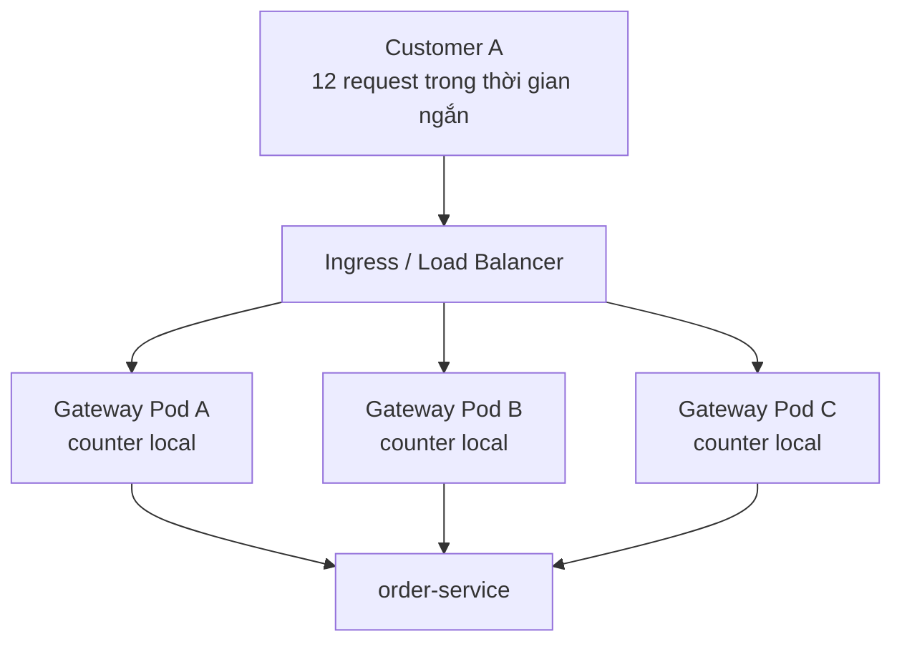
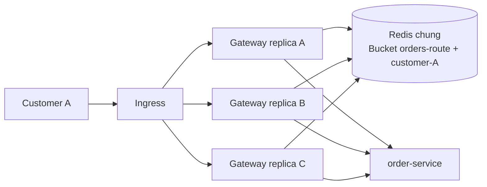
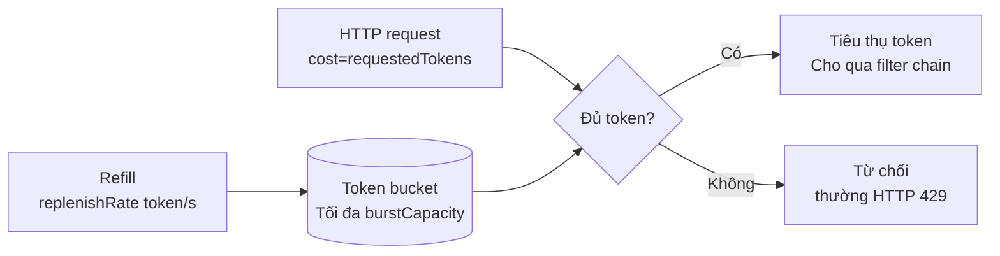
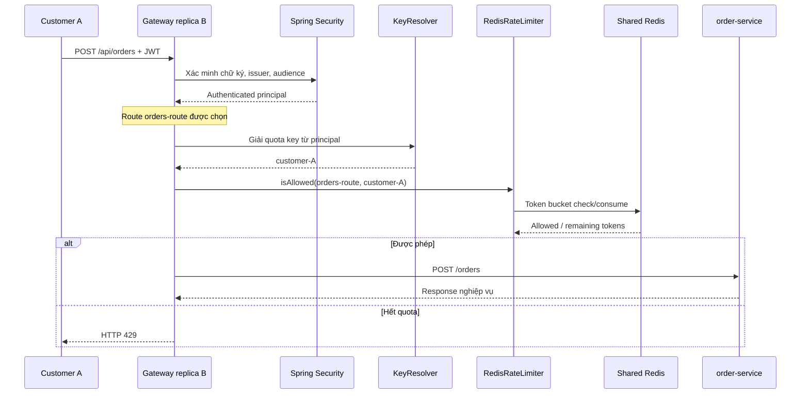
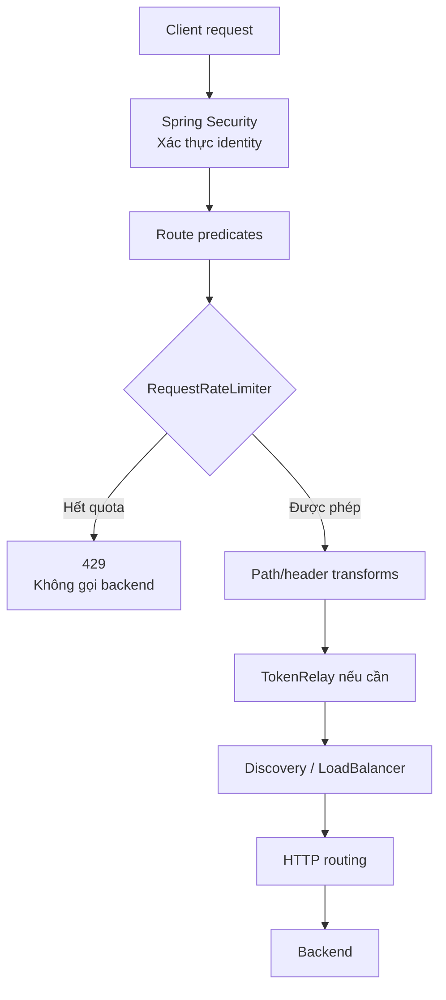
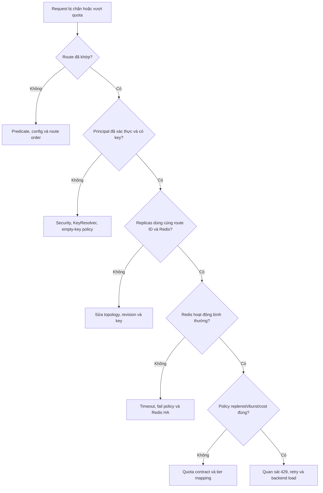

# Hạn mức theo tuyến và khách hàng trong hệ thống nhiều bản sao

Trong một cổng vào microservices, giới hạn lưu lượng chỉ có ích khi **hạn mức được tính đúng đối tượng** và **nhất quán giữa nhiều bản sao Gateway**. Giả sử khách hàng A được gọi API tạo đơn hàng tối đa một số request mỗi giây. Nếu có ba Spring Cloud Gateway replicas nhưng mỗi replica chỉ tự đếm request trong bộ nhớ, khách hàng có thể gửi request qua cả ba replica và sử dụng tổng hạn mức lớn hơn dự định.

**Spring Cloud Gateway** cung cấp `RequestRateLimiter` để quyết định một request có được đi tiếp hay không. Với **`RedisRateLimiter`** và **`KeyResolver`**, gateway có thể áp dụng **token bucket theo route và theo danh tính khách hàng**, đồng thời sử dụng Redis làm nơi phối hợp trạng thái giữa các gateway replicas. Tuy nhiên, cấu hình này không tự giải quyết mọi dạng quota: hạn mức tổng của một khách hàng trên nhiều route, quota theo ngày/tháng, kế hoạch dịch vụ (subscription tier), chống lạm dụng từ người chưa đăng nhập và khả năng chịu lỗi khi Redis mất kết nối đều cần được thiết kế rõ.

Bài thuộc chương **Giới hạn lưu lượng** của module **SPRING_CLOUD_GATEWAY**. Chúng ta sẽ xây dựng cấu hình thực tế có route predicate, filter chain, identity từ Spring Security, Redis, service discovery, timeout/TLS, retry, circuit breaker và observability; đặc biệt kiểm tra **khi nhiều bản sao gateway cùng nhận request của một khách hàng**.

> **Phạm vi:** Các mẫu `RequestRateLimiterGatewayFilterFactory`, `RedisRateLimiter`, `KeyResolver` và route YAML/Java dùng **Spring Cloud Gateway Server WebFlux**. Biến thể **Server Web MVC** có API và các loại rate limiter riêng ở một số phiên bản. Starter, property namespace và hành vi cụ thể phải đối chiếu với bộ Spring Boot/Spring Cloud/Gateway, Spring Security và Spring Data Redis đang chạy.

## 1. Phân biệt giới hạn theo tuyến, theo khách hàng và toàn hệ thống

Hãy xét hai public routes:

```text
GET  /api/catalog/products/42
POST /api/orders
```

Ta muốn áp dụng chính sách ví dụ:

| Chính sách | Đối tượng bị giới hạn | Ý tưởng |
| --- | --- | --- |
| **Theo tuyến** | Từng route ID | Route tạo đơn hàng nghiêm ngặt hơn route đọc danh mục. |
| **Theo khách hàng** | User/account/API key đã xác thực | Hai request của cùng một tài khoản dùng chung quota của tài khoản đó. |
| **Theo tuyến *và* khách hàng** | Cặp `(routeId, customerId)` | Mỗi khách hàng có hạn mức riêng cho từng route. |
| **Toàn API của một khách hàng** | `customerId` trên **mọi** route được chọn | Cần một ngân sách dùng chung, không chỉ giới hạn từng route riêng. |
| **Toàn hệ thống** | Mọi request tới gateway hoặc nhóm backend | Bảo vệ năng lực hạ tầng, thường kết hợp ingress, concurrency limit và backend. |

**Điểm then chốt:** `RedisRateLimiter` tích hợp của Gateway thường tổ chức bucket theo **route ID + key của `KeyResolver`**. Nếu cùng user đi qua hai route khác nhau, hai bucket route thông thường **độc lập**, dù cả hai có dùng chung một Redis.

Ví dụ:

```text
Customer A:
  catalog-route | customer-A  -> bucket catalog của A
  orders-route  | customer-A  -> bucket orders của A

Customer B:
  catalog-route | customer-B  -> bucket catalog của B
  orders-route  | customer-B  -> bucket orders của B
```

Như vậy, **“Redis dùng chung” không tự đồng nghĩa “quota toàn tài khoản trên tất cả API”**. Chọn cấu trúc khóa và phạm vi quota là một quyết định sản phẩm/kỹ thuật phải làm trước khi chọn filter.

## 2. Vì sao limiter cục bộ sai trong môi trường nhiều replicas?

Giả sử policy cho phép **5 request/giây cho một khách hàng** trên route tạo đơn hàng. Có ba Gateway pods:



Nếu mỗi pod lưu một bộ đếm độc lập có giới hạn 5 request/giây, tổng số request được chấp nhận có thể vượt xa quota **5 trên toàn cụm**. Cách phân phối request giữa pods còn thay đổi khi pod chết, rollout hoặc có sticky session; không thể dựa vào nó để tạo quota chính xác.

Với Redis dùng chung:



Mỗi replica vẫn tự xử lý HTTP request, nhưng **quyết định tiêu thụ token** cho cùng một cặp route/customer được phối hợp qua một trạng thái chung. RedisRateLimiter dùng logic token bucket và thao tác Redis phù hợp để tránh các bản sao cùng nhìn thấy “còn token” rồi chấp nhận vượt giới hạn chỉ vì đua ghi local counter.

**Điều kiện:** tất cả replicas phải trỏ đến **cùng miền dữ liệu Redis**, cùng chính sách key/route ID và các tham số rate/burst. Nếu mỗi pod có Redis riêng, hoặc route ID khác nhau giữa các pods, hạn mức không còn thống nhất như mong đợi.

## 3. Cơ chế token bucket của RedisRateLimiter

**Token bucket** là một mô hình hạn mức có khả năng cho phép burst có kiểm soát:

- Bucket có sức chứa tối đa là `burstCapacity` token.
- Token được bổ sung theo tốc độ `replenishRate` token/giây.
- Một request tiêu thụ `requestedTokens` token.
- Request được chấp nhận nếu bucket có đủ token tại thời điểm kiểm tra; nếu không, rate limiter có thể từ chối trước khi chuyển đến backend.



### Tính lượng request ở trạng thái lý tưởng

Nếu mỗi request có chi phí cố định:

```text
R = replenishRate  (token / giây)
B = burstCapacity (token)
T = requestedTokens (token / request)

Tốc độ duy trì xấp xỉ  R / T  request / giây
Burst tức thời tối đa khi bucket đầy ≈ floor(B / T) request
```

Với `replenishRate=5`, `burstCapacity=10`, `requestedTokens=1`, một tài khoản có thể gửi burst tối đa khoảng 10 request **nếu bucket đang đầy và không có refill đáng kể trong quá trình thử**; sau đó được bổ sung trung bình 5 token/giây. Giá trị quan sát thực tế còn phụ thuộc thời gian, độ đồng thời và cách triển khai token bucket.

| Replenish rate | Burst capacity | Requested tokens | Ý nghĩa gần đúng |
| --- | --- | --- | --- |
| `5` | `10` | `1` | Tốc độ duy trì 5 request/s, burst ban đầu tối đa 10. |
| `20` | `40` | `1` | Dành cho route đọc có mức sử dụng cao hơn. |
| `10` | `20` | `2` | Mỗi request tốn 2 token, trung bình 5 request/s. |
| `1` | `60` | `60` | Trung bình 1 request/phút, burst tối đa một request khi bucket đầy. |

Ví dụ cuối thể hiện cách biểu diễn một **tốc độ trung bình nhỏ hơn một request/giây** bằng `requestedTokens` lớn hơn. Nhưng đây vẫn là **token bucket liên tục**, **không phải** bộ đếm chính xác theo “phút lịch”, “ngày lịch” hoặc chu kỳ thanh toán.

### Những điều token bucket không làm

- Không giới hạn số request **đang chạy đồng thời** bằng một semaphore/concurrency limiter.
- Không tự định nghĩa quota theo hóa đơn, gói dịch vụ hoặc tháng.
- Không thay giới hạn kết nối, request body size, response timeout hoặc circuit breaker.
- Không tự phát hiện tài khoản giả mạo nếu key lấy từ một header không đáng tin.
- Không đảm bảo mức công bằng giữa những người dùng nếu nhiều người cùng bị gom dưới một key quá rộng.

## 4. Thành phần trong Spring Cloud Gateway

| Thành phần | Vai trò |
| --- | --- |
| **`RequestRateLimiterGatewayFilterFactory`** | Gateway filter đánh giá cho phép/từ chối request theo `RateLimiter`. |
| **`RedisRateLimiter`** | Implement rate limiter dựa trên Redis và token bucket. |
| **`KeyResolver`** | Xác định khóa quota từ `ServerWebExchange`, ví dụ danh tính user đã xác thực. |
| **Redis** | Kho trạng thái dùng chung cho các replicas. |
| **Route ID** | Xác định scope của bucket mặc định cho mỗi route. |
| **Spring Security** | Xác thực principal/JWT/session trước khi KeyResolver dùng thông tin danh tính. |
| **FilteringWebHandler** | Chạy filter chain sau khi route được chọn. |
| **Actuator/metrics/tracing** | Quan sát request được cho qua, bị từ chối, lỗi Redis và độ trễ. |



Sơ đồ không khẳng định `KeyResolver` tự xác minh token; **Spring Security phải xác thực request trước**. Token relay (nếu dùng) cũng là một trách nhiệm khác: key được xác định để giới hạn request; access token outbound phải được chuyển tiếp theo chính sách xác thực/ủy quyền của backend.

## 5. Dependency và môi trường cần chuẩn bị

Một POC cho **Gateway Server WebFlux + RedisRateLimiter** cần:

| Nhóm | Dependency/cấu hình minh họa |
| --- | --- |
| Gateway WebFlux | `spring-cloud-starter-gateway-server-webflux` ở các dòng có starter này. |
| Redis Reactive | `spring-boot-starter-data-redis-reactive`. |
| Xác thực JWT ở Gateway | `spring-boot-starter-oauth2-resource-server` nếu dùng bearer JWT. |
| Quan sát | `spring-boot-starter-actuator` và hệ metrics/tracing của dự án. |
| Service discovery nếu dùng `lb://` | `spring-cloud-starter-loadbalancer` và một nguồn `ServiceInstance`. |
| Redis Server | Một dịch vụ Redis có network/TLS/auth được cấu hình phù hợp. |

Các dòng Spring Cloud Gateway cũ có thể dùng starter `spring-cloud-starter-gateway`. Khóa Spring Boot/Spring Cloud release train và để BOM quản lý các version tương thích; đừng tự trộn WebFlux và MVC starters theo cảm tính.

Ví dụ cấu hình Redis trong môi trường thử nghiệm với Spring Boot hỗ trợ namespace này:

```yaml
spring:
  data:
    redis:
      host: localhost
      port: 6379
```

Các property Redis ở Spring Boot có thể khác theo thế hệ. Ở production, dùng endpoint riêng, secrets/credential, TLS, pool, timeout, ACL và topology Sentinel/Cluster/managed Redis theo hướng dẫn phiên bản; **không để Redis public không xác thực**.

Đoạn `host: localhost` chỉ phù hợp khi Redis chạy cùng môi trường mạng nhìn từ Gateway. Trong container/Kubernetes, `localhost` thường trỏ đến chính pod/container Gateway, không tự trỏ đến Redis của cluster.

## 6. Cấu hình giới hạn theo route và khách hàng

Ví dụ **Server WebFlux** dùng nhánh `spring.cloud.gateway.server.webflux.routes` trên các dòng hỗ trợ:

```yaml
spring:
  cloud:
    gateway:
      server:
        webflux:
          routes:
            - id: orders-route
              uri: lb://order-service
              predicates:
                - Path=/api/orders/**
              filters:
                - StripPrefix=2
                - name: RequestRateLimiter
                  args:
                    key-resolver: "#{@jwtCustomerKeyResolver}"
                    redis-rate-limiter.replenishRate: 5
                    redis-rate-limiter.burstCapacity: 10
                    redis-rate-limiter.requestedTokens: 1

            - id: catalog-route
              uri: lb://catalog-service
              predicates:
                - Path=/api/catalog/**
              filters:
                - StripPrefix=2
                - name: RequestRateLimiter
                  args:
                    key-resolver: "#{@jwtCustomerKeyResolver}"
                    redis-rate-limiter.replenishRate: 20
                    redis-rate-limiter.burstCapacity: 40
                    redis-rate-limiter.requestedTokens: 1
```

Giải thích:

1. Mỗi route có **route ID** ổn định, ví dụ `orders-route` và `catalog-route`.
2. `Path` chọn route dựa trên URL public, trước khi `StripPrefix` sửa path chuyển tiếp.
3. `RequestRateLimiter` gọi `jwtCustomerKeyResolver` để lấy khóa quota.
4. `RedisRateLimiter` tiêu thụ token theo chính sách của **route đã khớp**.
5. `lb://...` chọn backend service qua LoadBalancer/discovery **sau** các bước xử lý route theo thứ tự thực tế.
6. Request không được phép sẽ được chặn ở Gateway, thường là **`429 Too Many Requests`** và không đi xuống backend.

**Lưu ý phiên bản:** các tên tham số `redis-rate-limiter.replenishRate`, `burstCapacity` và `requestedTokens` cần đúng filter factory/RedisRateLimiter của dòng Gateway. Những nhánh WebFlux cũ thường khai báo `spring.cloud.gateway.routes` thay vì `spring.cloud.gateway.server.webflux.routes`.

### Không dùng shorthand tùy ý

`RequestRateLimiter` không nên được viết như một filter shortcut thiếu tên tham số nếu phiên bản yêu cầu `name/args`. Dạng cấu hình rõ ràng giúp kiểm tra `key-resolver` là bean SpEL, không phải tên header hay literal URL.

### `requestedTokens` là chi phí của mỗi request

Trong ví dụ `orders-route`, mỗi request trừ 1 token. Nếu nghiệp vụ muốn request tạo báo cáo nặng hơn request đọc báo cáo, có thể dùng route riêng với `requestedTokens` khác. Tuy nhiên, cấu hình token bucket theo route **không tự tạo chung một số dư cho nhiều route**; cần thiết kế một quota domain chung nếu bạn muốn các endpoint cùng tiêu thụ một ngân sách.

## 7. KeyResolver: chọn đúng danh tính, không dùng input giả mạo

**KeyResolver** quyết định “request của ai” để limiter áp quota. Nếu key được chọn sai, thuật toán token bucket vẫn chạy đúng nhưng chính sách kinh doanh/bảo mật bị sai.

Một số ứng viên:

| Loại khóa | Ưu điểm | Rủi ro |
| --- | --- | --- |
| **User/account ID đã xác thực** | Gắn quota vào tài khoản qua nhiều IP/thiết bị. | Phải đảm bảo issuer/tenant, ID ổn định và không lộ PII. |
| **API key ID đã được kiểm tra** | Phù hợp B2B hoặc service clients. | Không dùng raw API key làm Redis key/log; xử lý rotation. |
| **Client credentials principal** | Phù hợp M2M. | Nếu mọi workload dùng chung client ID thì cùng chia quota. |
| **IP nguồn** | Có thể áp lớp bảo vệ sơ bộ trước login. | NAT/proxy/CDN, IPv6 và header spoofing khiến sai công bằng. |
| **Header `X-Customer-ID`** không xác thực | Dễ cấu hình. | **Không an toàn:** client có thể đổi ID để vượt quota hoặc chặn quota người khác. |

### Java KeyResolver dựa trên JWT đã xác thực

Trong một Gateway **Spring Security Resource Server** xác minh bearer JWT, có thể tạo bean:

```java
import java.net.URI;

import org.springframework.cloud.gateway.filter.ratelimit.KeyResolver;
import org.springframework.context.annotation.Bean;
import org.springframework.context.annotation.Configuration;
import org.springframework.security.oauth2.server.resource.authentication.JwtAuthenticationToken;
import reactor.core.publisher.Mono;

@Configuration
public class QuotaKeyConfiguration {

    @Bean
    KeyResolver jwtCustomerKeyResolver() {
        return exchange -> exchange.getPrincipal()
            .ofType(JwtAuthenticationToken.class)
            .flatMap(authentication -> {
                var jwt = authentication.getToken();
                URI issuer = jwt.getIssuer();
                String subject = jwt.getSubject();
                String tenant = jwt.getClaimAsString("tenant_id");

                if (issuer == null || subject == null
                        || subject.isBlank()
                        || tenant == null || tenant.isBlank()) {
                    return Mono.empty();
                }

                // Minh họa khóa theo issuer + tenant + subject.
                // Production: ưu tiên định danh opaque hoặc HMAC keyed.
                String key = issuer + "|tenant:" + tenant + "|sub:" + subject;
                return Mono.just(key);
            });
    }
}
```

**Tiền đề:** `JwtAuthenticationToken` chỉ có khi Security Resource Server đã xác thực JWT và principal mang kiểu này. Nếu Gateway dùng `oauth2Login` và session (thường có principal kiểu khác), bean trên **không** sinh key; cần một resolver riêng phù hợp login principal. Nếu người dùng chưa được xác thực, đừng tự tạo “user ID” từ request JSON hoặc header tùy ý.

### Khóa phải vừa ổn định vừa bảo mật

Kết hợp `issuer + tenant + subject` nhằm tránh hai IdP/tenant dùng cùng chuỗi `sub` nhưng bị tính chung quota. Tuy vậy, **Redis key là dữ liệu có thể xuất hiện trong hệ vận hành**, không nên lưu thẳng email/phone/ID nhạy cảm. Trong production nên dùng **opaque customer identifier** hoặc **HMAC với server-side secret được quản lý an toàn**; không dùng hash không có secret của email dễ đoán như một cách “ẩn danh chắc chắn”.

Nếu tenant claim có thể không đáng tin trong mô hình nhiều issuer, phải **kiểm chứng issuer, audience và quyền thuộc tenant** trước khi dùng. Khóa quota không thay authorization.

### Không tạo một khóa mặc định quá rộng

Một resolver như:

```java
return exchange -> Mono.just("anonymous");
```

sẽ gom **mọi request cùng route** vào một bucket. Điều này có thể có chủ đích cho hạn mức toàn route, nhưng **không phải hạn mức riêng từng khách hàng**. Với traffic public, một client xấu có thể tiêu hết quota chung khiến client bình thường bị chặn.

### Không có key thì xử lý thế nào?

`KeyResolver` có thể trả `Mono.empty()` khi không có principal phù hợp. Trong các bản Gateway WebFlux có `RequestRateLimiter`, mặc định thường **từ chối request không có key** (mã phản hồi mặc định được tài liệu mô tả là **403**), và có cấu hình liên quan đến xử lý empty key theo phiên bản.

Vì vậy:

- API yêu cầu user login nên được **Spring Security trả 401/login flow đúng policy** trước khi tới limiter.
- Không tự động cho mọi request thiếu key dùng hạn mức dành cho user đã login.
- Nếu API public cần quota theo IP/anonymous, hãy thiết kế **resolver và tầng policy riêng**.
- Test chính xác mã lỗi của phiên bản triển khai; đừng cho rằng mọi request không có key sẽ nhận 429.

## 8. Trong hệ thống nhiều replicas, route ID cũng là một phần chính sách

Hình dung hai Gateway pods chạy cùng cấu hình hạn mức nhưng đặt route ID khác nhau:

```text
Pod A: route id = orders-route
Pod B: route id = order-create

KeyResolver trên cả hai: customer-A
Redis trên cả hai: cùng một dịch vụ
```

Vì limiter thường dùng route ID cùng key để xác định bucket, hai pod có thể tính quota **ở hai bucket khác nhau**. Tình trạng này có thể xảy ra trong rollout khi một version đổi route ID nhưng version cũ vẫn nhận traffic.

**Nguyên tắc vận hành:**

- Giữ route ID ổn định qua các replicas và các đợt nâng cấp không có thay đổi quota có chủ đích.
- Đảm bảo toàn bộ pods sử dụng cùng cấu hình replenish/burst/requested tokens.
- Nếu thay hạn mức hoặc cách tạo key, ghi rõ cách xử lý **bucket cũ**, thời điểm rollout và tác động lên người dùng.
- Với multi-region, xác định Redis là tập trung hay mỗi vùng có quota riêng. **Redis riêng mỗi vùng không tạo một quota toàn cầu**.
- Quan sát route ID, revision của quota policy và rate-limit result khi debug trường hợp “cùng user, pod A cho qua nhưng pod B từ chối”.

## 9. Một quota chung cho nhiều route khó hơn per-route limiter

Giả sử sản phẩm yêu cầu khách hàng ở gói Basic **tối đa 100 API calls/phút trên toàn bộ API**, bao gồm catalog, orders và reports.

Nếu cấu hình:

```text
catalog-route: 100/phút cho customer-A
orders-route:  100/phút cho customer-A
reports-route: 100/phút cho customer-A
```

khách hàng có thể dùng **nhiều ngân sách riêng**, không phải tổng 100/phút. `RedisRateLimiter` mặc định với route ID khác nhau không tự gộp chúng thành một bucket duy nhất.

### Ba lớp quota thường cần phân biệt

1. **Customer-wide budget:** tổng API usage của khách hàng trên tất cả route, được định nghĩa trong một quota domain chung.
2. **Route-specific budget:** `POST /payments` thấp hơn `GET /catalog`.
3. **Infrastructure guardrail:** giới hạn toàn bộ request/concurrency của hệ thống khi backend hoặc Redis bị quá tải.

### Các phương án thiết kế

| Phương án | Mô tả | Khi phù hợp |
| --- | --- | --- |
| **Per-route RedisRateLimiter chuẩn** | Bucket `(routeId, key)` theo mỗi route. | Mỗi API có quota độc lập. |
| **Custom RateLimiter dùng namespace chung** | Dùng một khóa quota domain cho nhiều route với script/counter nguyên tử. | Cần ngân sách chung across routes. |
| **Dịch vụ quota tập trung** | Gateway gọi quota service được kiểm soát, có chính sách account/tier/period. | Hạn mức phức tạp, nhiều sản phẩm, billing hoặc audit. |
| **Limiter ở edge/ingress và Gateway** | Edge thực thi quota chung; Gateway thực thi quota chi tiết. | Hạ tầng đã có gateway API management/edge policy. |

Nếu cần **cả quota chung lẫn quota theo route** trong một request, phải thiết kế cách **tiêu thụ/hoàn token khi một trong hai kiểm tra thất bại**, thứ tự và atomicity. Không chỉ xâu hai limiter độc lập rồi mặc định chúng cùng tạo một giao dịch nguyên tử: một limiter có thể trừ token trước khi limiter sau từ chối.

### Token bucket không thay quota theo kỳ thanh toán

Gói Basic “100 request mỗi phút trung bình” khác “100 request mỗi phút lịch” hoặc “100.000 request trong tháng”. `replenishRate`/`burstCapacity` tạo hạn mức theo **dòng thời gian trượt/tích lũy token**, không tự định nghĩa điểm reset vào 00:00 hay kết sổ tài khoản.

Quota theo ngày/tháng có thể cần **fixed/sliding-window counters**, event usage, persistence và xử lý timezone/period riêng. Với doanh thu/billing, nên xem đó là **sổ ghi usage** riêng, không suy đoán chi phí từ các bucket token đang có trong Redis.

## 10. Hạn mức theo gói khách hàng: Basic, Pro và doanh nghiệp

Một hệ thống API thương mại có thể đưa ra các gói:

| Gói ví dụ | Hạn mức danh mục | Hạn mức tạo đơn | Ý nghĩa |
| --- | --- | --- | --- |
| Basic | `10 request/s`, burst `20` | `2 request/s`, burst `4` | Bảo vệ backend khi khách hàng nhỏ tăng tải đột ngột. |
| Pro | `50 request/s`, burst `100` | `10 request/s`, burst `20` | Cho phép khách hàng có traffic lớn hơn. |
| Enterprise | Theo hợp đồng | Theo hợp đồng | Có thể cần SLA riêng, dedicated capacity hoặc quota service. |

Các con số chỉ để **minh họa mô hình chính sách**, không phải giá trị mặc định hay khuyến nghị chung.

### Vấn đề của một route có thông số tĩnh

```yaml
filters:
  - name: RequestRateLimiter
    args:
      key-resolver: "#{@jwtCustomerKeyResolver}"
      redis-rate-limiter.replenishRate: 10
      redis-rate-limiter.burstCapacity: 20
      redis-rate-limiter.requestedTokens: 1
```

Thông số trên áp cho **mọi key ở route** theo cấu hình limiter đó; việc KeyResolver trả về `customer-Basic` hay `customer-Pro` **không tự làm replenish rate đổi theo gói**.

Để giới hạn động theo gói, có thể:

1. Dùng một implementation `RateLimiter` tùy chỉnh lấy policy theo **account/tier đã được xác minh**, thực hiện check/consume nguyên tử ở kho chung.
2. Phân nhóm khách hàng qua các route/policy có kiểm soát **chỉ khi** có cơ chế định tuyến đáng tin và không tạo route explosion.
3. Dùng API management/quota service ở edge với một nguồn chính sách tập trung.

Tránh cho client tự gửi `X-Plan: Enterprise` để nhận quota cao hơn. Gói dịch vụ phải được tra từ nguồn dữ liệu đáng tin, claim được xác minh hoặc một policy cache được quản lý và có quy trình cập nhật/thu hồi.

### Thay gói giữa lúc request đang chạy

Nếu account nâng từ Basic lên Pro:

- Xác định khi nào policy mới có hiệu lực trên mọi replicas.
- Bảo đảm version/revision của policy được cập nhật đồng nhất.
- Quyết định có giữ số dư token cũ, khởi tạo bucket mới hay chuyển trạng thái.
- Không mở rộng quyền vì một replica dùng cache tier cũ hoặc claim JWT còn hiệu lực từ trước.
- Có audit trail cho việc thay đổi gói và rollback khi cấu hình lỗi.

Đừng giả định một token JWT đã phát hành sẽ tự có claim “tier mới” ngay khi database thay đổi. Nếu dùng claim tier, cần hiểu cache và vòng đời token; nếu tra policy service, cần xem độ trễ và tính sẵn sàng của dịch vụ ấy.

## 11. Giới hạn theo IP và khách hàng chưa đăng nhập

Một public catalog API có thể cho anonymous users truy cập. Nếu chỉ có `jwtCustomerKeyResolver`, request không có `JwtAuthenticationToken` sẽ không có quota key và có thể bị từ chối theo chính sách empty key.

### Có nên dùng IP address làm key?

Chỉ nên coi IP là một **tín hiệu chống lạm dụng có giới hạn**:

- Nhiều người dùng chia sẻ một public IP qua NAT/mobile network.
- Một người dùng có thể thay IP hoặc chuyển IPv4/IPv6.
- Gateway sau ingress thường nhìn thấy IP **của ingress**, không phải client cuối.
- `X-Forwarded-For` có thể bị giả mạo nếu proxy không xóa/ghi lại giá trị đầu vào.
- Tấn công phân tán có thể đến từ nhiều IP, nên per-IP limiter không đủ bảo vệ.

Nếu dùng IP, xác định **chuỗi proxy đáng tin** và cơ chế lấy client IP do ingress/framework hỗ trợ. Chỉ tin forwarded headers từ mạng/proxy có kiểm soát, không parse `X-Forwarded-For` từ request Internet rồi lấy bất kỳ giá trị nào client muốn.

### Thiết kế nhiều tầng cho API anonymous

| Tầng | Giới hạn | Mục tiêu |
| --- | --- | --- |
| CDN/Ingress | Per-IP hoặc bot/connection policy | Chặn một phần traffic bất thường trước khi vào app. |
| Gateway | Route-level quota theo key tin cậy hoặc quota chung thích hợp | Bảo vệ API công khai và backend. |
| Backend | Concurrency/DB/query/resource limits | Chống workload nặng dù request rate không cao. |

Đừng chỉ dùng một bucket `anonymous` cho tất cả người dùng rồi xem đó là per-customer quota. Nó là **global anonymous budget** và có thể bị một nguồn traffic tiêu hết.

## 12. Redis là điểm phối hợp, cũng là dependency cần vận hành

Redis giúp nhiều replicas cùng tham chiếu trạng thái hạn mức, nhưng nó cũng trở thành một **phụ thuộc trên đường xử lý request**.

### Những gì cần chuẩn bị

| Khía cạnh | Câu hỏi vận hành |
| --- | --- |
| **Availability** | Redis gặp sự cố thì tất cả Gateway replicas xử lý ra sao? |
| **Latency** | Mỗi quyết định hạn mức mất bao lâu khi Redis ở khác vùng mạng? |
| **TLS/auth** | Gateway dùng credential/ACL nào, có giới hạn quyền thao tác không? |
| **Capacity** | Số lượng key tương ứng routes × customers × chiều quota là bao nhiêu? |
| **Persistence/TTL** | Key hết hạn/được dọn thế nào, hệ thống có yêu cầu lưu usage dài hạn không? |
| **Failover** | Hành vi khi Sentinel/Redis Cluster/managed Redis chuyển primary là gì? |
| **Multi-region** | Một quota toàn cầu thật hay chia ngân sách theo region? |
| **Security** | Redis có bị expose Internet hoặc chứa định danh nhạy cảm không? |

### Fail-open hay fail-closed khi Redis lỗi?

Hai chính sách phổ biến:

- **Fail-closed:** không thể xác định quota thì từ chối/hạn chế request. Bảo vệ backend khỏi flood nhưng có nguy cơ ảnh hưởng tính sẵn sàng của API.
- **Fail-open:** tạm cho request đi tiếp khi limiter không hoạt động. Giảm sự cố availability nhưng tạo nguy cơ vượt quota, quá tải hoặc thất thoát kiểm soát.

**Không giả định RedisRateLimiter mặc định luôn fail-open hoặc luôn trả 429 khi Redis chết.** Lỗi kết nối Redis có thể trở thành exception/response lỗi theo filter chain và error handling của phiên bản. Cần **thử Redis outage thật trong POC**, ghi rõ policy mong muốn và thiết kế fallback có kiểm soát nếu cần.

Đối với API tạo đơn hàng/thanh toán hoặc endpoint dễ bị lạm dụng, chính sách fail-open phải được review về bảo mật và năng lực backend. Nếu muốn degrade an toàn, có thể có **local emergency limiter** với hạn mức rất thấp như một lớp bổ sung, nhưng nó **không đồng nghĩa quota chính xác toàn cụm** trong lúc Redis mất.

### Độ tin cậy của trạng thái quota

Redis replication/failover không có nghĩa mọi thao tác đã được tính sẽ luôn hiện diện sau mọi kiểu sự cố. Hãy xem cơ chế consistency/durability của hệ Redis thực tế và mức sai số sản phẩm chấp nhận. Nếu quota liên quan tính tiền hoặc hợp đồng pháp lý, nên có **usage ledger** riêng; Redis token bucket là cơ chế bảo vệ request theo thời gian thực, không phải nguồn sổ sách cuối cùng.

### Redis Cluster và key layout

`RedisRateLimiter` có logic Redis phía server (chẳng hạn script nguyên tử) để cập nhật trạng thái bucket. Với Redis Cluster, các key liên quan đến cùng một phép tính phải được bố trí theo cơ chế hash-slot mà triển khai yêu cầu. Sử dụng integration chính thức của phiên bản, không tự đổi key prefix/TTL/script hoặc gọi song song những lệnh `GET`/`SET` rời rạc để làm lại thuật toán.

## 13. HTTP 429, header hạn mức và trải nghiệm client

Khi Gateway từ chối do vượt quota, phản hồi thường là:

```http
HTTP/1.1 429 Too Many Requests
Content-Type: application/json

{"error":"rate_limit_exceeded"}
```

Đây là **response minh họa do ứng dụng có thể tùy biến**, không phải body mặc định được `RequestRateLimiter` bảo đảm tạo. Mã trạng thái chặn `429` có thể cấu hình trong những dòng Gateway hỗ trợ.

### Những header có thể xuất hiện

Các phiên bản `RedisRateLimiter` có thể cung cấp header mô tả quota, ví dụ:

- `X-RateLimit-Remaining`.
- `X-RateLimit-Replenish-Rate`.
- `X-RateLimit-Burst-Capacity`.
- `X-RateLimit-Requested-Tokens`.

**Kiểm tra tên header, khả năng bật/tắt và ý nghĩa ở phiên bản đang chạy.** Một số cấu hình hoặc reverse proxy có thể thay đổi/xóa các header này. Đừng giả định mọi phản hồi `429` đều có `Retry-After` hoặc các header trên luôn phản ánh hạn mức tổng trên nhiều routes.

### Có nên thêm Retry-After?

`Retry-After` hữu ích để client biết khi nào có thể thử lại, **nếu** hệ thống tính được thời gian chờ hợp lý. Nhưng với token bucket, thời điểm đủ token phụ thuộc tốc độ refill, requested tokens, số request đồng thời và trạng thái bucket. Không tự ghi `Retry-After: 1` như một “con số chắc chắn” nếu policy không hỗ trợ tính.

Ở frontend/mobile/client SDK:

1. Nhận diện `429` như **quota rejection**, không phải lỗi kết nối.
2. Tôn trọng `Retry-After` nếu được cung cấp hợp lệ.
3. Dùng backoff có jitter; không phát nhiều retry đồng thời ngay sau khi bị từ chối.
4. Không tự thay API key/account để lách quota.
5. Với thao tác ghi, kiểm tra idempotency và trạng thái yêu cầu trước khi retry.

### CORS với 429

Browser gọi API cross-origin cần CORS headers phù hợp để JavaScript đọc được status `429`. Nếu `RequestRateLimiter` trả response sớm mà CORS policy chỉ nằm ở backend, browser có thể hiện “CORS error” thay vì status thật.

Nên để một tầng sớm (Spring Security/WebFlux CORS hoặc Gateway CORS được tích hợp đúng) đảm bảo policy cho các response từ chối, đồng thời kiểm tra `OPTIONS` preflight. Đừng bắt preflight phải có bearer JWT của actual request để giải quota người dùng.

## 14. Thứ tự filter: hạn mức nên được tính trước những việc tốn chi phí

Một request có thể đi qua:



Sơ đồ biểu diễn **thứ tự trách nhiệm mong muốn**, không khẳng định mọi filter tích hợp chạy chính xác theo vị trí minh họa. `GlobalFilter`, `GatewayFilter` và các factory có thể có `Ordered` riêng; khi thêm filter tự viết, cần xác minh thứ tự thực tế.

**Tại sao nên chặn sớm?** Một request đã vượt quota không cần:

- Đọc/cache một body JSON hoặc upload lớn nếu có thể tránh.
- Gọi service discovery hoặc mở TLS connection đến backend.
- Kích hoạt retry/circuit breaker downstream.
- Thực hiện truy vấn database của microservice.

Nhưng KeyResolver theo user phải có **Authentication đáng tin cậy** trước khi nó chạy. Đừng tối ưu “rate limit trước mọi thứ” bằng cách bỏ qua xác thực rồi lấy thẳng user ID do client gửi.

### Một request bị chặn có ảnh hưởng đến retry?

`RequestRateLimiter` chỉ thấy số lần **filter được thực thi**, có thể khác số request thực sự đến backend. Nếu một `Retry` filter phía trước chạy lại phần filter chain chứa limiter, một incoming request có thể bị tính nhiều lần. Nếu limiter ở phía ngoài retry chain, nó có thể chỉ bị tính một lần cho incoming request trong tình huống cụ thể.

Vì vậy, cần xác định **đơn vị tính phí**:

| Đơn vị | Diễn giải |
| --- | --- |
| Client HTTP request | Một request bên ngoài tính một lần, dù có retry downstream. |
| Backend attempt | Mỗi lần gọi backend có thể tính vào ngân sách tài nguyên. |
| Business operation | Một hành động nghiệp vụ đã được chấp nhận, có thể khác số HTTP attempts. |

Đừng suy luận “1 request client = 1 token = 1 lần backend xử lý” trong mọi cấu hình có retry, redirect hoặc asynchronous processing.

## 15. Rate limiting kết hợp bảo mật, TLS và resilience

| Cơ chế | Quan hệ với giới hạn lưu lượng | Lưu ý |
| --- | --- | --- |
| **Spring Security OAuth2/JWT** | Cung cấp identity đáng tin cho KeyResolver. | Kiểm tra issuer/audience, tenant và API key ownership. |
| **TokenRelay** | Chuyển access token phù hợp sang backend. | Quota key không phải token; không lưu bearer token trong Redis key. |
| **Path rewrite / StripPrefix** | Biến đổi đường dẫn sau route match. | Quota scope thường gắn route ID, không phụ thuộc path backend. |
| **CORS** | Trình duyệt kiểm tra quyền đọc response. | Preflight/429 phải có CORS policy đúng. |
| **Discovery/LoadBalancer** | Chọn backend instance. | Shared Redis quota độc lập với số backend/gateway replicas. |
| **Retry** | Thử lại request khi lỗi được phép. | Tránh tăng số attempts ngoài dự kiến hoặc đếm quota sai. |
| **CircuitBreaker** | Giảm áp lực khi backend lỗi/chậm. | Không phải rate limiter; kết hợp theo ngân sách rõ ràng. |
| **Connect/response timeout** | Giới hạn thời gian network/HTTP. | Không giới hạn request rate; Redis cũng có timeout riêng. |
| **TLS/mTLS** | Bảo vệ đường truyền Gateway↔Redis/IdP/backend. | Không coi `lb://` hoặc Redis client là tự bật TLS. |
| **Backend concurrency** | Giới hạn số công việc chạy cùng lúc. | Token bucket có thể cho burst cao hơn backend xử lý đồng thời được. |

### Một ví dụ về “thundering herd”

Giả sử 1000 khách hàng, mỗi khách hàng được burst 20 request. Mỗi bucket tuân thủ quota riêng, nhưng **20.000 request gần đồng thời** vẫn có thể vượt khả năng backend. Do đó cần thêm:

- Load shedding ở ingress hoặc gateway.
- Concurrency/connection pool limits.
- Queue hoặc backpressure phù hợp.
- Circuit breaker, timeout và capacity planning.

**Per-customer quota không thay thế giới hạn toàn hệ thống**; hai lớp có mục tiêu khác nhau.

## 16. Quan sát hạn mức trong môi trường production

Để vận hành nhiều Gateway replicas, cần thấy quota **đã chặn bao nhiêu**, **đã cho qua bao nhiêu**, **theo route/policy nào** và **Redis có hoạt động bình thường không**.

### Nhóm thông tin nên đo

| Nhóm | Chỉ số/sự kiện nên có |
| --- | --- |
| Request | Tổng request theo route, status `2xx`/`4xx`/`5xx`, số `429`. |
| Limiter | Allowed/denied count, latency của phép kiểm tra, lỗi Redis. |
| Policy | Route ID, tên nhóm quota/tier, revision cấu hình. |
| Redis | Latency, connections, timeout, saturation, memory/evictions, failover. |
| Backend | Request/s thực nhận, concurrency, retry attempts, p95/p99 latency. |
| Identity | Loại principal: user, API key, service, anonymous; **không dùng raw subject làm metric tag**. |

Log minh họa:

```text
traceId:      [trace ID]
gatewayPod:   gateway-b
routeId:      orders-route
quotaTier:    basic
principalType: jwt-user
rateLimit:    denied
status:       429
elapsedMs:    [số đo thực tế]
```

Đây là **mẫu sự kiện đội phát triển tự instrument**, không phải output mặc định của `RedisRateLimiter`. Micrometer, Spring Boot Actuator và Gateway metrics filter có thể cung cấp nhiều chỉ số HTTP, nhưng meter names/tags/phạm vi phụ thuộc phiên bản và cấu hình. Nếu cần đo riêng allowed/denied theo quota tier, có thể phải bổ sung instrumentation.

### Tránh nhãn metrics có cardinality cao

Không dùng **customerId, token, email, IP raw, URI chứa ID đơn hàng, API key** làm nhãn metrics theo request. Điều đó tạo số lượng time series rất lớn và có thể lộ dữ liệu nhạy cảm. Ưu tiên route ID, quota plan, result, status và region có tập giá trị hữu hạn.

### Cảnh báo vận hành

Tạo cảnh báo cho:

- Tỷ lệ `429` tăng bất thường ở một route hoặc tier.
- Redis latency/timeout/error tăng.
- Backend p95/p99 latency tăng trong khi allowed RPS giữ nguyên.
- Một gateway replica có tỷ lệ 429 khác hẳn các replica còn lại do config/key/Redis không thống nhất.
- Rate limit bị vô hiệu ngoài chủ đích sau rollout hoặc Redis failover.

Lưu ý: nhiều `429` không phải lúc nào là sự cố; có thể đúng vì client vượt hợp đồng. Cần phân biệt **quota chính xác đang bảo vệ hệ thống** với **policy đặt quá thấp hoặc bị tính sai**.

## 17. Bài thực hành A: một route, một Redis, hai Gateway replicas

### 17.1. Mục tiêu POC

Chứng minh **cùng một khách hàng không nhận hai quota độc lập chỉ vì request đi qua hai Gateway replicas**. Thí nghiệm trong **mạng local cô lập**:

| Thành phần | Địa chỉ giả định | Vai trò |
| --- | --- | --- |
| Gateway replica A | `http://localhost:8080` | Một instance Spring Cloud Gateway WebFlux. |
| Gateway replica B | `http://localhost:8083` | Một instance nữa, cùng cấu hình route và key resolver. |
| Redis dùng chung | `localhost:6379` | Kho token bucket cho cả hai. |
| Mock order-service | `http://localhost:8081` | Nhận request đã qua filter, trả thông tin ngắn. |
| Client test | Terminal/script | Gọi xen kẽ hoặc đồng thời hai Gateway ports. |

Để tập trung vào rate limiting, POC có thể tạm dùng `uri: http://localhost:8081` thay vì `lb://order-service`. Khi đã chứng minh limiter hoạt động, chuyển lại `lb://` để test discovery/load balancing độc lập.

### 17.2. Đồng nhất cấu hình

Cả hai Gateway replicas phải dùng:

```yaml
routes:
  - id: orders-route
    uri: http://localhost:8081
    predicates:
      - Path=/api/orders/**
    filters:
      - StripPrefix=2
      - name: RequestRateLimiter
        args:
          key-resolver: "#{@jwtCustomerKeyResolver}"
          redis-rate-limiter.replenishRate: 5
          redis-rate-limiter.burstCapacity: 10
          redis-rate-limiter.requestedTokens: 1
```

Đây là **đoạn routes rút gọn**, cần đặt dưới nhánh `spring.cloud.gateway.server.webflux.routes` hoặc nhánh phù hợp phiên bản. Redis và Security phải được cấu hình riêng như các mục trước.

Nếu muốn POC token bucket trước khi triển khai IdP/JWT, **chỉ trong profile thử nghiệm không công khai**, có thể tạo một KeyResolver cố định:

```java
import org.springframework.cloud.gateway.filter.ratelimit.KeyResolver;
import org.springframework.context.annotation.Bean;
import org.springframework.context.annotation.Configuration;
import org.springframework.context.annotation.Profile;
import reactor.core.publisher.Mono;

@Configuration
@Profile("ratelimit-lab")
public class RateLimitLabConfiguration {

    @Bean
    KeyResolver labKeyResolver() {
        return exchange -> Mono.just("lab-customer");
    }
}
```

Khi dùng profile này, tạm đổi `key-resolver` thành `"#{@labKeyResolver}"` **trong cấu hình lab**. Vì mọi request có cùng key, nó chỉ chứng minh **shared bucket cho một customer giả định**, không chứng minh cơ chế xác thực hay phân biệt các customer thật.

**Tuyệt đối không deploy `labKeyResolver` vào production**: mọi khách hàng sẽ chia một bucket. Sau POC, quay lại resolver dựa trên identity đáng tin và kiểm chứng authentication/authorization.

### 17.3. Backend mock cần thể hiện gì?

Một mock backend có endpoint `GET /orders/123` và trả:

```json
{
  "instance": "orders-mock",
  "path": "/orders/123",
  "accepted": true
}
```

Response trên là ví dụ do mock tạo, không phải kết quả mặc định của Gateway. Mock chỉ cần ghi method/path và số request đã đến; không cần nhìn bearer token.

### 17.4. Gọi xen kẽ hai Gateway replicas

Với profile lab, có thể chạy script Bash:

```bash
for i in $(seq 1 25); do
  port=8080
  if [ $((i % 2)) -eq 0 ]; then
    port=8083
  fi

  curl -s -o /dev/null \
    -w "gateway=$port status=%{http_code}\n" \
    "http://localhost:$port/api/orders/123"
done
```

**Cần quan sát:** ở cùng một quãng thời gian, request qua 8080 và 8083 cùng tiêu thụ một ngân sách `orders-route + lab-customer`. Nếu gửi đủ nhanh, sẽ có request bị chặn với `429` khi hết token.

Không khẳng định **đúng 10 request đầu luôn được chấp nhận rồi request 11 luôn bị 429**: script chạy tuần tự, token được refill trong lúc test; kết quả phụ thuộc độ trễ và tải. Để so sánh chặt hơn, dùng traffic generator có kiểm soát, timestamp, số requests đồng thời, bucket mới hoặc thời gian nghỉ đủ refill, rồi so tổng allowed/denied của cả hai replicas.

### 17.5. Đối chứng khi mỗi replica dùng Redis khác nhau

Trong môi trường POC cô lập, thử cho A và B dùng **hai Redis instances độc lập** nhưng cùng route ID/key/config. Mỗi Redis có bucket riêng và tổng quota có thể bị nhân lên. Đây là **thí nghiệm chứng minh sai kiến trúc**, không phải phương án triển khai đề xuất.

Khôi phục cả hai replicas về **một Redis chung** ngay sau thử nghiệm, rồi ghi:

| Chỉ số | Redis chung | Redis tách riêng |
| --- | --- | --- |
| Số request được chấp nhận trên A/B | Đo thực tế | Đo thực tế |
| Tổng allowed A + B | Đo thực tế | Đo thực tế |
| Tổng 429 | Đo thực tế | Đo thực tế |
| Route ID và key có giống nhau | Có | Có |
| Một bucket toàn cụm | Có, theo thiết kế | Không |

## 18. Bài thực hành B: hai khách hàng và hai routes

Sau khi dùng Redis chung, bật lại resolver `jwtCustomerKeyResolver` và cấu hình Spring Security Resource Server với **JWT test hợp lệ** do IdP thử nghiệm cấp.

### 18.1. Tách customer A và customer B

Chuẩn bị hai token test có issuer/audience được Gateway xác minh, subject riêng cho hai khách hàng, tenant claim hợp lệ và quyền gọi route. Không tự viết JWT giả rồi bỏ xác minh chữ ký. Nếu muốn học bucket trước, dùng profile lab; khi muốn chứng minh “per customer” thật, cần principal **đã xác thực**.

### 18.2. Gửi request

Giả sử `ACCESS_TOKEN_A`/`ACCESS_TOKEN_B` được cấp an toàn cho shell thử nghiệm (không dán token vào tài liệu hoặc log):

```bash
curl -i \
  -H "Authorization: Bearer $ACCESS_TOKEN_A" \
  "http://localhost:8080/api/orders/123"

curl -i \
  -H "Authorization: Bearer $ACCESS_TOKEN_B" \
  "http://localhost:8083/api/orders/123"
```

Kỳ vọng:

1. Cả hai đều xác thực được.
2. Quota key của A và B **khác nhau**; hai tài khoản không làm cạn bucket của nhau.
3. Với cùng một token A, dù request đi qua gateway port nào, bucket `orders-route + customer-A` vẫn là **một**.
4. Khi A hết token, B có thể vẫn còn hạn mức, nếu không bị chặn bởi lớp quota chung khác.

### 18.3. Gọi hai routes bằng cùng customer

Gửi request:

```text
GET /api/catalog/products/42
GET /api/orders/123
```

Nếu mỗi route có `RedisRateLimiter` riêng như mục 6, quan sát **hai bucket quota** cho cùng customer. Điều này là **đúng hành vi per-route**, không phải lỗi Redis không nhất quán.

Để giới hạn “customer A có tối đa 100 calls/phút trên toàn API”, cần giải pháp quota domain chung ở mục 9 và test tổng lưu lượng across routes.

## 19. Bài thực hành C: lỗi Redis, rolling deployment và retry

### C01. Mô phỏng Redis outage

Ở môi trường lab:

1. Ghi baseline allowed/denied và p95 latency.
2. Ngắt kết nối đến Redis test theo cách có kiểm soát.
3. Gọi API qua cả hai Gateway replicas.
4. Quan sát exception, status, timeout, số request vào backend và khả năng hồi phục.
5. Khôi phục Redis, ghi thời gian hệ thống trở lại bình thường.

Không suy ra fail-open/fail-closed chỉ từ việc thấy `500` hoặc `503`. Xác định lỗi sinh ở đâu; nếu nghiệp vụ cần chế độ suy giảm riêng, phải triển khai và test có chủ đích.

### C02. Đổi route ID khi rolling deployment

Trong lab, giữ pod A với `orders-route` và pod B với `orders-route-v2` nhưng dùng chung Redis và user. Quan sát quota bucket không còn thống nhất như trước. Sau đó khôi phục **cùng route ID** trên cả hai.

Thử nghiệm cho thấy **tên route là một phần tính ổn định của quota**, không chỉ tên hiển thị trong metrics.

### C03. Redis failover

Nếu lab dùng Redis Sentinel/Cluster hoặc Redis managed, thực hiện failover test theo phương án được phép. Đo số lỗi limiter, thời gian reconnect, sự thay đổi token state, request vào backend và khả năng hồi phục của tất cả Gateway replicas.

Không ngắt hoặc failover Redis production chỉ để kiểm tra bài thực hành.

### C04. Retry và idempotency

Với API GET test, cấu hình Retry có giới hạn rồi làm backend trả lỗi tạm thời. Ghi:

- Một client request có bao nhiêu backend attempts?
- Limiter tính bao nhiêu token?
- Thứ tự `Retry` và `RequestRateLimiter` có ảnh hưởng số lần đánh giá không?
- Total latency và error rate thay đổi ra sao?

Không bật retry tự động cho `POST /payments` hoặc `POST /orders` khi chưa có idempotency key và cơ chế chống xử lý trùng.

### Ma trận nghiệm thu đa replica

| Mã | Tình huống | Bằng chứng cần thu thập |
| --- | --- | --- |
| R01 | Một Gateway, một route, key cố định | Token bucket chặn khi vượt hạn mức theo thời gian. |
| R02 | Hai Gateway replicas, một Redis | Tổng allowed/429 phản ánh **một bucket chung**. |
| R03 | Hai Gateway replicas, hai Redis độc lập | Thấy nguy cơ nhân quota; không dùng cho global quota. |
| R04 | Hai customers JWT hợp lệ | Mỗi customer có bucket riêng theo route. |
| R05 | Cùng customer qua hai routes | Hai route buckets khác nhau theo mặc định. |
| R06 | Không có principal/key | Security hoặc empty-key policy từ chối theo cấu hình. |
| R07 | KeyResolver dựa header giả mạo | Chính sách không tin raw header; không cho bypass quota. |
| R08 | A/B có route ID khác nhau | Phát hiện bucket bị chia trong rolling deploy. |
| R09 | Redis mất kết nối | Status, fail policy và tải backend đúng quyết định vận hành. |
| R10 | Redis failover | Đo tác động tới quota, latency và availability. |
| R11 | API trả `429` cho browser | CORS headers và client backoff đúng policy. |
| R12 | Retry GET | Đếm incoming requests vs backend attempts vs token consumption. |
| R13 | Route có `lb://` | Phân biệt lỗi discovery với lỗi hạn mức. |
| R14 | JWT hết hạn/sai audience | Security từ chối, không dùng key từ token chưa xác minh. |
| R15 | Client gói Basic/Pro | Tier policy thực sự áp khác nhau theo thiết kế custom. |
| R16 | Tải đồng thời lớn | Backend, Redis, gateway pool/memory và p95/p99 đủ an toàn. |

## 20. Runbook: vì sao 429 tăng hoặc quota không nhất quán?

| Triệu chứng | Nguyên nhân có thể | Bước kiểm tra |
| --- | --- | --- |
| Một khách hàng thường xuyên nhận 429 | Policy quá thấp, client burst, retry hoặc token cost cao. | Route ID, key, replenish/burst, tải theo thời gian. |
| Khách hàng vượt quota khi nhiều pods | Redis riêng, route ID khác, KeyResolver không ổn định, local limiter. | Redis topology, policy revision và key creation trên mỗi pod. |
| Nhiều khách hàng bị chặn như một người | Resolver trả key chung hoặc dùng IP ingress. | Principal và proxy trust; không log PII. |
| A nhận 429 nhưng B còn quota | Hai keys khác nhau do tenant/issuer hoặc route ID. | So cách tạo key, tên route và nguồn xác thực. |
| Request không token trả 403 thay vì 429 | Empty key hoặc Security policy. | KeyResolver result, Security và error path. |
| Redis chậm làm API chậm | Redis xa, saturation hoặc connection issue. | Redis latency/connection metrics và filter time. |
| Redis chết, client nhận 5xx | Lỗi Redis chưa được xử lý theo fail policy. | Exception, retry/backoff và resilience design. |
| Frontend báo CORS thay vì 429 | Response limit thiếu CORS headers. | Security/global CORS và preflight. |
| Backend quá tải dù per-user quota đúng | Nhiều user cùng burst hoặc concurrency cao. | Global/concurrency capacity limits. |
| Đổi gói khách hàng không đổi hạn mức | Limiter tĩnh hoặc tier policy/claim bị cache. | Tier mapping và lifecycle token/policy. |
| Sau rollout quota reset/khác nhau | Route ID, Redis DB/key prefix hoặc policy thay đổi. | So deployment revision và limiter state. |
| Backend 401/403 | JWT/scope/audience sai, không phải limiter. | Security và policy backend. |
| `lb://service` trả 503 | Không có instance backend. | DiscoveryClient/LoadBalancer, không nhầm 429. |



## 21. Checklist triển khai production

- [ ] Xác định quota theo **route**, **customer**, **API key**, **subscription tier**, **toàn API** hay **toàn hệ thống**.
- [ ] Phân biệt token bucket liên tục với quota theo phút/ngày/tháng hoặc billing ledger.
- [ ] Chọn Server WebFlux/MVC đúng phiên bản, dùng release train/starter Gateway/Redis reactive tương thích.
- [ ] RedisRateLimiter dùng `replenishRate`, `burstCapacity`, `requestedTokens` phù hợp SLO và năng lực backend.
- [ ] KeyResolver dùng identity đã xác thực; không tin raw customer ID/API key/`X-Forwarded-For` từ client.
- [ ] Khóa quota gồm issuer/tenant/account đúng phạm vi, không làm lộ PII trong Redis/log.
- [ ] Không dùng `Mono.just("anonymous")` cho mọi customer nếu mục tiêu là per-customer quota.
- [ ] Tất cả Gateway replicas kết nối cùng Redis quota domain, route ID và policy version nhất quán.
- [ ] Nếu nhiều region, xác định **quota toàn cầu** hay quota riêng vùng và sai số cho phép.
- [ ] Nếu cần quota across routes, dùng quota domain chung/custom limiter thay vì mong bucket per-route tự gộp.
- [ ] Nếu Basic/Pro khác nhau, policy tier từ nguồn đáng tin và cập nhật đồng nhất.
- [ ] Redis có auth/ACL, TLS, firewall, HA/failover, timeout và metrics phù hợp.
- [ ] Đã mô phỏng Redis outage và viết rõ fail-open/fail-closed, không đoán default.
- [ ] 429/response headers được kiểm chứng; client dùng backoff thay vì retry ồ ạt.
- [ ] CORS preflight và response 429 đúng; không yêu cầu bearer actual request trên OPTIONS.
- [ ] Filter ordering tránh chi phí cache body/upstream trước khi chặn và Retry không làm sai đơn vị quota.
- [ ] Kết hợp concurrency limits, timeout, circuit breaker/backend protection; không chỉ dựa quota per-user.
- [ ] Với `lb://`, discovery/TLS kiểm tra độc lập; backend vẫn thực thi authorization.
- [ ] Metrics/tracing có route ID, quota tier, allowed/denied, Redis error/latency và status; **không chứa token/PII**.
- [ ] Test một/nhiều replicas, hai customers, hai routes, Redis failover, rolling deploy và tải burst.
- [ ] Có runbook thay đổi quota, rollback, Redis outage và khiếu nại về hạn mức.

## 22. Câu hỏi tự kiểm tra

1. Vì sao giới hạn 5 request/giây trong bộ nhớ từng Gateway pod có thể thành khoảng 15 request/giây khi có ba replicas?
2. `RedisRateLimiter` và `KeyResolver` đảm nhiệm trách nhiệm khác nhau nào?
3. `replenishRate=5`, `burstCapacity=10`, `requestedTokens=1` cho burst ra sao? Vì sao request thứ 11 không chắc chắn bị 429 trong test tuần tự chậm?
4. Vì sao cùng customer qua hai route IDs dùng hai buckets riêng dù chung Redis?
5. Làm sao có **một quota toàn API của customer** mà không nhân theo số routes?
6. Chỉ đổi chuỗi key trong KeyResolver có tự đổi `replenishRate` theo gói Basic/Pro không?
7. Vì sao không dùng raw `X-Customer-ID` làm key?
8. Vì sao `JwtAuthenticationToken`-only resolver có thể từ chối người dùng đã OAuth2 Login bằng session?
9. Hai pods cùng Redis nhưng route IDs khác nhau thì quota bị ảnh hưởng thế nào?
10. Redis riêng mỗi vùng có tự tạo quota toàn cầu không?
11. Redis outage khác gì “customer hết token”? Có nên trả 429 cho cả hai không?
12. Vì sao 429 không tự bảo đảm browser đọc được nếu CORS nằm sai tầng?
13. Số client requests, backend attempts và tokens tiêu thụ có luôn bằng nhau khi bật Retry?
14. Tại sao per-customer quota vẫn có thể để backend quá tải khi hàng nghìn khách hàng đồng thời burst?
15. Nên đo gì để phát hiện một Gateway replica đang dùng key/Redis/policy khác replica khác mà không log customer ID?
16. Vì sao Redis token bucket không nên là sổ tính phí chính xác theo tháng?

## 23. Tài liệu tham khảo theo phiên bản

Đối chiếu reference theo release train và biến thể Gateway đang chạy:

- [Spring Cloud Gateway Server WebFlux — RequestRateLimiter GatewayFilter Factory](https://docs.spring.io/spring-cloud-gateway/reference/spring-cloud-gateway-server-webflux/gatewayfilter-factories/requestratelimiter-factory.html)
- [Spring Cloud Gateway Server WebFlux — GatewayFilter Factories](https://docs.spring.io/spring-cloud-gateway/reference/spring-cloud-gateway-server-webflux/gatewayfilter-factories.html)
- [Spring Cloud Gateway Server WebFlux — Global Filters](https://docs.spring.io/spring-cloud-gateway/reference/spring-cloud-gateway-server-webflux/global-filters.html)
- [Spring Cloud Gateway — Configuration Properties](https://docs.spring.io/spring-cloud-gateway/reference/configprops.html)
- [Spring Cloud Gateway Server Web MVC — Reference](https://docs.spring.io/spring-cloud-gateway/reference/spring-cloud-gateway-server-webmvc/index.html)
- [Spring Security Reactive — OAuth2 Resource Server](https://docs.spring.io/spring-security/reference/reactive/oauth2/resource-server/index.html)
- [Spring Data Redis — Reference](https://docs.spring.io/spring-data/redis/reference/)
- [Redis — Rate limiting patterns](https://redis.io/learn/howtos/ratelimiting)
- [HTTP 429 Too Many Requests — RFC 6585](https://www.rfc-editor.org/rfc/rfc6585#section-4)

**Ghi nhớ:** Trong Spring Cloud Gateway, **`RequestRateLimiter` quyết định chặn/cho qua, `KeyResolver` xác định khách hàng và `RedisRateLimiter` phối hợp token bucket giữa các bản sao Gateway**. Hạn mức theo route và khách hàng thường là bucket theo **route ID + identity key**; nó không tự tạo quota chung across routes, quota theo tháng hay giới hạn đồng thời. Muốn vận hành cổng microservices an toàn, phải bảo vệ nguồn danh tính, đồng nhất route ID và Redis qua replicas, định nghĩa policy khi Redis lỗi, và phối hợp CORS, TLS, retry, circuit breaker, discovery cùng quan sát thực tế.


