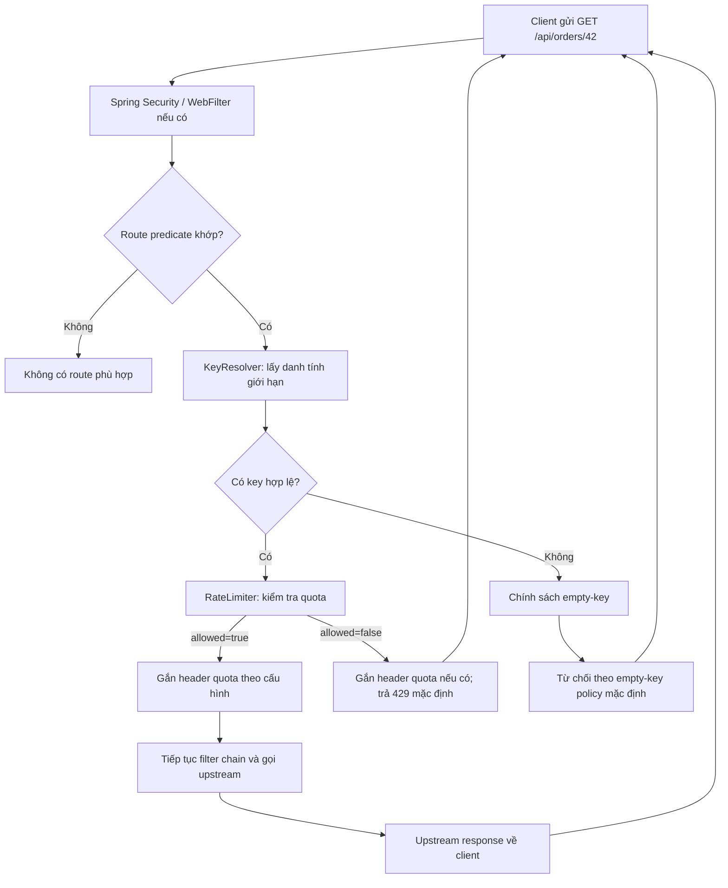
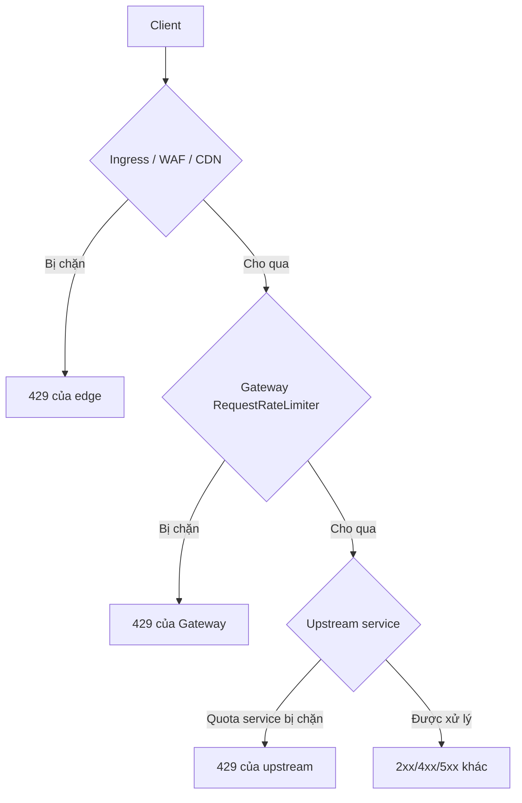

# Header thông báo giới hạn và phản hồi khi bị từ chối

## 1. Vì sao client cần biết mình đã bị giới hạn?

Trong **Spring Cloud Gateway**, API Gateway là điểm vào chung cho các microservices: request được chọn bằng route predicate, đi qua filter chain, có thể thay đổi path/header, tìm instance qua service discovery và chuyển tiếp đến backend. Ngoài xác thực, TLS, retry, circuit breaker và quan sát request, Gateway thường áp dụng **rate limiting** để tránh một client hoặc một nhóm người dùng tiêu thụ quá nhiều tài nguyên trong thời gian ngắn.

Ví dụ ứng dụng quản lý đơn hàng cho phép một người dùng gửi nhiều nhất một lượng request nhất định đến `GET /api/orders/**` trong một khoảng thời gian. Khi hết lượt, Gateway cần **từ chối có kiểm soát**, thay vì tiếp tục gửi tất cả request đến `order-service`.

Từ phía client, chỉ biết “request thất bại” là chưa đủ. Client cần phân biệt:

- **HTTP 429 Too Many Requests:** request bị từ chối do vượt giới hạn, có thể thử lại sau nếu chính sách cho phép.
- **HTTP 401 Unauthorized:** chưa xác thực hoặc token không hợp lệ.
- **HTTP 403 Forbidden:** đã xác thực nhưng thiếu quyền, hoặc một chính sách đặc biệt từ chối request không có khóa giới hạn.
- **HTTP 503 Service Unavailable:** một tầng không khả dụng; không được tự xem là “đã hết lượt”.
- **HTTP 5xx khác:** lỗi kỹ thuật hoặc upstream, không nhất thiết liên quan quota.

Bài thuộc chương **Giới hạn lưu lượng** của module **SPRING_CLOUD_GATEWAY**, tập trung vào **các header thông báo trạng thái giới hạn** và **response khi Gateway từ chối**. Sau bài này bạn có thể:

1. Giải thích `RequestRateLimiter`, `RedisRateLimiter`, `KeyResolver` và trạng thái HTTP **429**.
2. Đọc đúng `X-RateLimit-Remaining`, `X-RateLimit-Replenish-Rate`, `X-RateLimit-Burst-Capacity`, `X-RateLimit-Requested-Tokens`.
3. Bật/tắt hoặc đổi tên header thông báo trong cấu hình Gateway Server WebFlux.
4. Phân biệt `Retry-After` **do hệ thống thực sự phát** với thời gian chờ do client tự suy đoán.
5. Thiết kế hợp đồng phản hồi và cách client xử lý 429 an toàn, không gây retry storm.
6. Kiểm thử 429, header, trường hợp thiếu key, lỗi Redis và tương tác với bảo mật/microservices.

> **Phạm vi:** ví dụ dùng **Spring Cloud Gateway Server WebFlux** với Redis-backed `RequestRateLimiter`. Namespace cấu hình được trình bày cho WebFlux phiên bản mới (`spring.cloud.gateway.server.webflux`) và các dự án 4.x thường dùng (`spring.cloud.gateway`). Server MVC có rate limiter API và khả năng cung cấp header khác; không áp dụng máy móc các ví dụ WebFlux cho MVC.

## 2. Đường đi của request khi vượt hạn mức

`RequestRateLimiter` là một **GatewayFilter**. Nó gọi `RateLimiter` tương ứng để hỏi liệu request này có được phép tiếp tục không. Với Redis implementation phổ biến, cơ chế nền tảng là **token bucket**.



Điểm quan trọng là **nhánh từ chối của RequestRateLimiter thường kết thúc response sớm**, không gọi tiếp `chain.filter(exchange)` và **không gửi request đến upstream**.

Vì vậy:

- Một request 429 từ Gateway có thể không có HTTP body hay header tùy biến do backend tạo.
- `SetStatus`, `AddResponseHeader` hoặc filter đặt **sau** điểm short-circuit không đương nhiên chạy.
- Response 429 ở Gateway, response 429 của backend và response 429 của CDN/ingress **không nhất thiết có cùng header/body**.
- Nếu Spring Security chặn request ở WebFilter trước khi Gateway route được xử lý, `RequestRateLimiter` trên route đó cũng có thể không chạy.

### 2.1. Token bucket minh họa

Giả sử:

```text
replenishRate  = 2 token/giây
burstCapacity  = 4 token
requestedTokens = 1 token/request
```

Nếu bucket đang đầy và bốn request đến gần như cùng thời điểm, hệ thống có thể cho qua bốn request; request thứ năm có thể bị từ chối. Theo thời gian, token được bổ sung, nhưng **không phải cứ đến đầu giây mới được “reset tất cả”** như một fixed-window counter.

```text
Bucket ban đầu: 4 token
Request 1: chấp nhận, còn 3
Request 2: chấp nhận, còn 2
Request 3: chấp nhận, còn 1
Request 4: chấp nhận, còn 0
Request 5: từ chối, chưa đủ 1 token
Token được bổ sung theo replenishRate của bucket
```

Đây là mô hình trực quan, không phải trace thực chạy. RedisRateLimiter quản lý trạng thái theo key/route, thời điểm và lượng token có thể đổi giữa các request đồng thời.

### 2.2. Không đồng nhất token với request

Khi `requestedTokens=1`, một token tương ứng một request theo cấu hình này. Nếu `requestedTokens=5`, mỗi request tốn **5 token**. Do đó `X-RateLimit-Remaining: 3` không thể luôn được diễn giải là “còn 3 request”.

## 3. HTTP 429 Too Many Requests: tín hiệu chính khi từ chối

Spring Cloud Gateway Server WebFlux `RequestRateLimiter` **mặc định trả HTTP 429 Too Many Requests** nếu limiter quyết định không cho request đi tiếp.

Response ví dụ:

```http
HTTP/1.1 429 Too Many Requests
X-RateLimit-Remaining: 0
X-RateLimit-Replenish-Rate: 2
X-RateLimit-Burst-Capacity: 4
X-RateLimit-Requested-Tokens: 1
Content-Length: 0
```

**Đây là ví dụ minh họa một cấu hình RedisRateLimiter có bật các header**, không phải bảo đảm mọi bản Gateway đều phát đúng bốn header, đúng thứ tự, có `Content-Length: 0` hoặc có cùng giá trị. HTTP stack, filter chain, implementation và hạ tầng trung gian có thể làm response khác nhau.

### 3.1. 429 là gì — và không là gì?

- **429** có nghĩa server/tầng giới hạn đang từ chối request vì gửi quá nhiều theo chính sách hiện hành.
- **429 không phải 401**: gửi lại cùng token hợp lệ vẫn có thể bị giới hạn.
- **429 không phải 403 phân quyền**: user có thể đủ quyền nhưng đang hết quota.
- **429 không bảo đảm có `Retry-After`**: header này hữu ích nhưng không nên giả định được thêm tự động.
- **429 không mặc nhiên có JSON lỗi**: nếu Gateway kết thúc response trước khi upstream được gọi, backend không thể viết body cho response đó.
- **429 không chứng minh Redis đã chạy bình thường**: cần phân biệt limiter từ chối thật với chính sách khi Redis lỗi hoặc gateway khác đã trả 429.

Khi một route có `status-code` được cấu hình khác mặc định hoặc nhiều lớp bảo vệ cùng hoạt động, status có thể khác. Tuy nhiên, **giữ 429 cho rate limiting thông thường** giúp client và công cụ giám sát hiểu đúng mục đích.

### 3.2. Đừng tự retry mọi 429

`429` là tín hiệu để giảm tốc hoặc chờ, không phải lệnh phải thử ngay. Nếu hàng nghìn client cùng retry tức thì, hệ thống có thể gặp **retry storm**: lưu lượng tăng đúng lúc đang quá tải.

Client nên tôn trọng `Retry-After` nếu response **thực sự có** và hợp lệ, hoặc dùng backoff có jitter, ngân sách retry và giới hạn thời gian. Với request ghi dữ liệu như `POST /payments`, phải đánh giá **idempotency** trước khi tự thử lại.

## 4. Các header RedisRateLimiter thường có

Khi dùng **`RedisRateLimiter`** và bật `include-headers`, các tên header mặc định được Spring Cloud Gateway công bố trong configuration properties:

| Header | Nội dung | Cách hiểu đúng |
| --- | --- | --- |
| `X-RateLimit-Remaining` | Lượng token còn lại do limiter báo | Trạng thái ước tính tại lần kiểm tra, **không bảo đảm** số request sắp tới chắc chắn được duyệt |
| `X-RateLimit-Replenish-Rate` | Giá trị `replenishRate` của bucket | Tốc độ bổ sung token trong cấu hình, không tự là “quota mỗi phút” |
| `X-RateLimit-Burst-Capacity` | Giá trị `burstCapacity` | Sức chứa tối đa của bucket |
| `X-RateLimit-Requested-Tokens` | Giá trị `requestedTokens` | Số token mà **request này** cần |
| `Retry-After` | Thời gian đề nghị client chờ, nếu được phát | **Không coi là một trong bốn header mặc định của RedisRateLimiter** |

Có thể xem **Remaining**, **Replenish Rate**, **Burst Capacity** và **Requested Tokens** như một tập metadata phục vụ debug và hỗ trợ client điều chỉnh nhịp gọi API.

Các tên `X-RateLimit-*` nói trên là **tên header do implementation Spring Cloud Gateway RedisRateLimiter cung cấp**, không có nghĩa chúng là một hợp đồng HTTP chuẩn bắt buộc ở mọi proxy/framework. Nếu upstream dùng một bộ header khác hoặc tổ chức chuẩn hóa `RateLimit-*`, cần định nghĩa cách tương thích và thống nhất nguồn phát.

### 4.1. Ví dụ phân tích response cho phép request

Giả định bucket `replenishRate=2`, `burstCapacity=4`, `requestedTokens=1`, tại thời điểm này còn 3 token:

```http
HTTP/1.1 200 OK
X-RateLimit-Remaining: 3
X-RateLimit-Replenish-Rate: 2
X-RateLimit-Burst-Capacity: 4
X-RateLimit-Requested-Tokens: 1
Content-Type: application/json

{"orderId":42,"state":"CREATED"}
```

Đây là **response mô phỏng**: status và body do `order-service` trả, còn các header quota do Gateway RedisRateLimiter đặt. Giá trị `Remaining=3` là thông tin chụp tại thời điểm quyết định; nếu client gửi tiếp 20 request song song, không có bảo đảm ba request bất kỳ sẽ được chấp nhận.

### 4.2. Ví dụ phân tích response bị từ chối

```http
HTTP/1.1 429 Too Many Requests
X-RateLimit-Remaining: 0
X-RateLimit-Replenish-Rate: 2
X-RateLimit-Burst-Capacity: 4
X-RateLimit-Requested-Tokens: 1
```

Nếu `include-headers=false` hoặc implementation RateLimiter khác không trả metadata, bạn có thể chỉ thấy `429`. Tình huống thiếu key cũng có thể bị xử lý theo nhánh riêng mà không có bốn header quota.

### 4.3. Cẩn thận với header và phép tính “thời gian còn lại”

Không nên tính:

```text
X-RateLimit-Remaining = 0
=> Retry-After phải bằng 1 giây
```

Vì lượng token tiêu thụ (`requestedTokens`), tốc độ bổ sung, trạng thái bucket thực tế, request song song và nhiều lớp hạn mức đều ảnh hưởng thời điểm có thể được cho phép lại. `Remaining=0` cũng không cho biết hết chính xác một “khung 60 giây” như fixed-window limiter.

Nếu muốn công bố thời gian chờ, hãy tính từ **trạng thái/chính sách đáng tin của limiter**, không lấy một con số cố định tùy tiện rồi gắn vào mọi 429.

## 5. Cấu hình HTTP header trong Spring Cloud Gateway WebFlux

### 5.1. Namespace Server WebFlux mới

Ví dụ cấu hình Redis rate limiter và các header trả về với Spring Cloud Gateway Server WebFlux sử dụng prefix mới:

```yaml
spring:
  cloud:
    gateway:
      server:
        webflux:
          redis-rate-limiter:
            include-headers: true
            remaining-header: X-RateLimit-Remaining
            replenish-rate-header: X-RateLimit-Replenish-Rate
            burst-capacity-header: X-RateLimit-Burst-Capacity
            requested-tokens-header: X-RateLimit-Requested-Tokens
```

Giải thích:

- `include-headers` mặc định là **`true`** trong cấu hình RedisRateLimiter được tài liệu công bố. Bật tường minh giúp policy dễ đọc.
- Các property `*-header` là **tên header** trả về, không phải giá trị quota.
- Các tên mặc định có thể được đổi để phù hợp hợp đồng API, nhưng việc đổi tên không thay thế logic giới hạn.
- Cấu hình thuộc **RedisRateLimiter**, không mặc nhiên áp dụng với Bucket4j hoặc RateLimiter tùy biến khác.
- Đây là nhóm cấu hình **RedisRateLimiter ở phạm vi ứng dụng Gateway**, không phải cấu hình `HttpClient` và không tự khiến mọi endpoint phát header quota nếu request không đi qua `RequestRateLimiter`.

Nếu không muốn phơi bày thông tin quota:

```yaml
spring:
  cloud:
    gateway:
      server:
        webflux:
          redis-rate-limiter:
            include-headers: false
```

Khi tắt các header này, **rate limiting vẫn có thể hoạt động bình thường**. Client vẫn cần dựa vào HTTP status và hợp đồng API để biết một request bị từ chối.

### 5.2. Namespace thường gặp ở WebFlux 4.x

Với dự án dùng Spring Cloud Gateway WebFlux 4.x theo prefix cũ:

```yaml
spring:
  cloud:
    gateway:
      redis-rate-limiter:
        include-headers: true
        remaining-header: X-RateLimit-Remaining
        replenish-rate-header: X-RateLimit-Replenish-Rate
        burst-capacity-header: X-RateLimit-Burst-Capacity
        requested-tokens-header: X-RateLimit-Requested-Tokens
```

**Hai đoạn ở mục 5.1 và 5.2 là lựa chọn theo phiên bản**, không phải hai block nên khai báo song song. Trước khi kết luận header bị lỗi, cần xác nhận phiên bản Gateway đã thực sự bind đúng namespace; property bị bỏ qua có thể khiến response vẫn dùng tên mặc định hoặc không được gắn như kỳ vọng.

### 5.3. Ví dụ đổi tên header có kiểm soát

Một API có thể yêu cầu tên header theo hợp đồng riêng:

```yaml
# Đặt dưới redis-rate-limiter ở namespace phù hợp:
include-headers: true
remaining-header: X-Quota-Remaining
replenish-rate-header: X-Quota-Refill-Rate
burst-capacity-header: X-Quota-Burst
requested-tokens-header: X-Quota-Request-Cost
```

Tên này chỉ có tác dụng với các response thực sự nhận header từ RedisRateLimiter. Khi đổi tên, cập nhật API docs, SDK, dashboard, kiểm thử và chính sách CDN/CORS; tránh để cùng một response xuất hiện cả hai bộ header có giá trị không nhất quán.

**CORS:** với JavaScript ở origin khác, một response có `X-RateLimit-Remaining` không có nghĩa frontend đọc được nó qua `fetch().headers`. Cần cấu hình `Access-Control-Expose-Headers` cho các header muốn client đọc, cùng CORS policy hợp lệ và không làm mất bảo mật token/cookie.

## 6. Ví dụ route hoàn chỉnh: RequestRateLimiter + KeyResolver + Redis

### 6.1. Dependencies và hạ tầng

Để dùng RedisRateLimiter ở Gateway Server WebFlux, dự án cần có:

- Starter **Spring Cloud Gateway Server WebFlux** phù hợp release train.
- Dependency `spring-boot-starter-data-redis-reactive`.
- Một Redis server/cluster có thể truy cập và cấu hình kết nối theo môi trường.
- `KeyResolver` để phân biệt quota theo principal/user/client đáng tin.
- Chính sách Spring Security nếu quota dựa trên người dùng đã đăng nhập.

Mục tiêu bài là **quan sát response header và 429**. Ví dụ dưới dùng route `/api/orders/**` với `replenishRate=2`, `burstCapacity=4`, `requestedTokens=1`.

### 6.2. Java: lấy key từ principal đã xác thực

```java
package example.gateway;

import java.security.Principal;
import org.springframework.cloud.gateway.filter.ratelimit.KeyResolver;
import org.springframework.context.annotation.Bean;
import org.springframework.context.annotation.Configuration;

@Configuration
public class RateLimitKeyConfig {

    @Bean
    KeyResolver principalKeyResolver() {
        return exchange -> exchange.getPrincipal()
                .map(Principal::getName);
    }
}
```

`exchange.getPrincipal()` trả về một `Mono`; khi principal tồn tại, dùng tên principal làm key. Khi không có principal, publisher thường rỗng và `RequestRateLimiter` sẽ xử lý bằng chính sách **empty key**.

**Điều kiện quan trọng:** nếu dùng key theo user, hãy cấu hình **Spring Security** thực sự xác thực request trước khi dùng principal làm khóa. Không lấy key từ `?user=alice`, `X-User-Id` hoặc `X-API-Key` do client tự khai báo mà không xác minh: attacker có thể đổi key để né quota hoặc khiến user khác bị giới hạn.

Một hệ thống nhiều tenant có thể cần key kết hợp tenant ID + user ID đã xác thực. Cần tránh đưa email, token và thông tin định danh không cần thiết vào Redis key, access log hoặc metric labels.

### 6.3. Route YAML Server WebFlux mới

```yaml
spring:
  data:
    redis:
      host: localhost
      port: 6379

  cloud:
    gateway:
      server:
        webflux:
          routes:
            - id: orders-api
              uri: http://localhost:8081
              predicates:
                - Path=/api/orders/**
              filters:
                - name: RequestRateLimiter
                  args:
                    key-resolver: "#{@principalKeyResolver}"
                    redis-rate-limiter.replenishRate: 2
                    redis-rate-limiter.burstCapacity: 4
                    redis-rate-limiter.requestedTokens: 1
                - StripPrefix=1

          redis-rate-limiter:
            include-headers: true
```

Với cấu hình này:

1. `Path=/api/orders/**` chọn route `orders-api`.
2. `RequestRateLimiter` xác định key bằng bean `principalKeyResolver`.
3. Bucket tối đa **4 token**, được bổ sung theo tốc độ cấu hình **2 token/giây**, mỗi request tốn **1 token**.
4. Khi được cho phép, `StripPrefix=1` chuyển `/api/orders/42` thành `/orders/42` và Gateway gọi backend.
5. Khi bị từ chối bởi limiter, response mặc định là **429**, thường không gọi backend.
6. `include-headers: true` yêu cầu RedisRateLimiter cung cấp metadata theo cấu hình.

`localhost` ở Redis/upstream là **địa chỉ test khi các tiến trình chạy cùng host**. Trong Kubernetes/Docker, `localhost` bên trong container Gateway không tự trỏ đến Redis hoặc service ở container khác; dùng service DNS, secret và cấu hình kết nối đúng môi trường.

### 6.4. Route YAML WebFlux 4.x

Một cấu hình tương đương cho dự án dùng prefix WebFlux 4.x:

```yaml
spring:
  cloud:
    gateway:
      routes:
        - id: orders-api
          uri: http://localhost:8081
          predicates:
            - Path=/api/orders/**
          filters:
            - name: RequestRateLimiter
              args:
                key-resolver: "#{@principalKeyResolver}"
                redis-rate-limiter.replenishRate: 2
                redis-rate-limiter.burstCapacity: 4
                redis-rate-limiter.requestedTokens: 1
            - StripPrefix=1

      redis-rate-limiter:
        include-headers: true
```

Redis connection properties `spring.data.redis.*` ở ví dụ trước cần được giữ trong ứng dụng thật, hoặc thay bằng kết nối Redis do deployment cung cấp. Các snippet là **biến thể theo version**, không phải cấu hình nên chép cả hai cùng lúc.

### 6.5. Tránh shortcut notation không hợp lệ

`RequestRateLimiter` **không** được cấu hình theo shortcut dạng:

```yaml
# KHÔNG HỢP LỆ: đừng dùng cho RequestRateLimiter.
filters:
  - RequestRateLimiter=2, 4, 1
```

Cần dùng cấu trúc `name: RequestRateLimiter` với `args` như ví dụ chính thức. Tên bean `principalKeyResolver` trong SpEL phải đúng với `@Bean` đã đăng ký.

## 7. Khi thiếu key: đừng nhầm 403 với 429

Một trường hợp quan trọng: route có `RequestRateLimiter` nhưng `KeyResolver` không tìm được key.

Theo tài liệu Spring Cloud Gateway WebFlux, **mặc định request không có key sẽ bị từ chối**, với status thường là **403 Forbidden** ở chính sách empty-key mặc định, **không nhất thiết là 429**.

Ví dụ:

```text
GET /api/orders/42
Authorization: (không có)
KeyResolver: không có principal
Kết quả: có thể bị Security chặn 401 trước,
         hoặc RequestRateLimiter từ chối empty-key theo policy.
```

Vì SecurityWebFilterChain có thể kiểm tra trước Gateway route, một request anonymous có thể **401** mà chưa đi tới `KeyResolver`. Khi thiết kế test, phải xác định **tầng nào trả status**.

Các cấu hình liên quan đến empty key trong nhiều phiên bản gồm:

- `deny-empty-key`: có từ chối request không tìm được key hay không.
- `empty-key-status-code`: status dùng khi bị từ chối vì không có key.
- `statusCode`/`status-code` của `RequestRateLimiter`: status khi limiter **đánh giá và từ chối quota**, mặc định 429.

> **Caveat phiên bản:** namespace của các property ở `RequestRateLimiterGatewayFilterFactory` đã có thay đổi giữa các release. Một số trang tài liệu dùng prefix cũ `spring.cloud.gateway.filter.request-rate-limiter.*` ngay cả khi route nằm dưới `spring.cloud.gateway.server.webflux`. Phải kiểm tra **configuration properties và code của đúng bản đang chạy** trước khi cấu hình, tránh sao chép một prefix cũ và nghĩ đã đổi chính sách.

**Khuyến nghị bảo mật:** không đặt `deny-empty-key=false` chỉ để “cho website hoạt động”. Làm vậy có thể cho request không có key **bỏ qua quota** và vô hiệu hóa chính sách giới hạn với nhóm anonymous. Nếu endpoint công khai, hãy chọn một khóa đáng tin khác và hạn mức riêng, ví dụ theo IP đã được xác minh qua trusted proxy hoặc API key đã kiểm tra.

## 8. Retry-After: không được tự giả định Gateway đã thêm

Header HTTP `Retry-After` có thể cho client biết **thời gian nên chờ** trước khi gửi lại request. Dạng giá trị phổ biến:

```http
HTTP/1.1 429 Too Many Requests
Retry-After: 5
```

Ý nghĩa: server **đề nghị** chờ ít nhất khoảng 5 giây (delta-seconds) trước khi thử lại. Một dạng khác là ngày HTTP:

```http
Retry-After: Wed, 25 Nov 2026 08:00:00 GMT
```

**Đừng khẳng định RedisRateLimiter mặc định phát `Retry-After`** chỉ vì trả 429. Các property chính thức của RedisRateLimiter mô tả bốn `X-RateLimit-*` và `include-headers`, không đồng nghĩa có giá trị retry time. Nếu sản phẩm cần `Retry-After`, phải xác minh bản đang dùng hoặc có một **cơ chế mở rộng chính xác**, và kiểm thử response thật.

### 8.1. Tính thời gian chờ không đơn giản bằng Remaining

Ví dụ với bucket:

```text
replenishRate  = 2 token/giây
requestedTokens = 5 token/request
Remaining       = 0 token
```

Một request cần 5 token, không phải 1 token. Chờ **một giây** có thể vẫn không đủ. Thời điểm có thể thử lại còn phụ thuộc các request đồng thời, quota nhiều tầng, giới hạn của Redis/script và cách tính token.

`Retry-After` nên là **khuyến nghị** dựa trên trạng thái limiter đã biết, làm tròn và đặt giới hạn phù hợp. Nó **không hứa** request tiếp theo chắc chắn thành công nếu những client khác cũng đang tiêu thụ quota.

### 8.2. Nếu cần thêm Retry-After hoặc body lỗi, nên mở rộng ở đâu?

Các hướng thiết kế phù hợp:

1. **Một RateLimiter tùy biến/trang trí** trả về metadata, trong đó có header `Retry-After` tính từ thuật toán cho đúng quyết định giới hạn; kiểm tra cách `RequestRateLimiter` đưa `RateLimiter.Response.getHeaders()` vào response của đúng phiên bản.
2. **Một GatewayFilter/GlobalFilter có chủ đích**, đăng ký xử lý response trước khi commit; phải có thông tin limiter thật và order đúng. Filter chạy sau điểm short-circuit có thể **không được gọi**.
3. **Một error response writer tập trung** chỉ xử lý đúng nhánh rate limit và không đánh đồng với 429 từ upstream. Duy trì status, headers, response lifecycle và backpressure phù hợp.

**Không nên** gắn một `AddResponseHeader=Retry-After,1` sau `RequestRateLimiter` rồi tin chắc nó được thực thi khi request đã bị chặn. Cũng không đặt một giá trị `Retry-After` cố định cho mọi endpoint nếu chưa phù hợp thuật toán/quota.

Nếu chọn cách dùng `throwOnLimit` ở những phiên bản hỗ trợ, hành vi có thể chuyển từ **set status trực tiếp** sang **phát exception** để handler khác xử lý. Điều này thay đổi luồng reactive và error handling, cần kiểm thử toàn bộ, không coi là công tắc tự tạo JSON 429 hay Retry-After.

## 9. Hợp đồng response 429 cho API công khai

Một sản phẩm thường muốn client nhận status, thông tin giới hạn và thông báo đọc được. Có thể định nghĩa **hợp đồng API** riêng:

```http
HTTP/1.1 429 Too Many Requests
Content-Type: application/problem+json
Retry-After: 5
X-RateLimit-Remaining: 0
Cache-Control: no-store

{
  "type": "https://api.example.test/problems/rate-limit-exceeded",
  "title": "Đã vượt giới hạn số lần gọi API",
  "status": 429,
  "detail": "Vui lòng thử lại sau."
}
```

Đây là **response thiết kế minh họa**, **không phải body mặc định của RequestRateLimiter**. Để có được response này, ứng dụng cần triển khai writer/handler cho nhánh bị chặn hoặc mở rộng limiter. Giá trị `Retry-After` chỉ nên công bố nếu hệ thống tính được một giá trị có ý nghĩa.

Một hợp đồng thực tế nên trả lời:

| Câu hỏi | Quyết định thiết kế |
| --- | --- |
| Có trả body khi 429 không? | Có thể chọn JSON Problem Details hoặc body rỗng; phải nhất quán với SDK |
| Header nào là bắt buộc? | 429 là tín hiệu chính; các header quota nên được tài liệu hóa |
| Có `Retry-After` không? | Chỉ khi thực sự tính/phát được |
| Key được giới hạn theo ai? | User/tenant/client đã xác thực, hoặc IP từ trusted proxy theo chính sách |
| Khóa có bị lộ trong response không? | Không trả raw token, Redis key, PII hoặc định danh nội bộ |
| Có khác nhau giữa 429 Gateway và upstream không? | Nếu có, xác định nguồn và định nghĩa tương tác |
| 429 có cache được không? | Thông thường nên đặt chính sách cache thận trọng; không để CDN dùng chung response của người này cho người khác |
| Có logging/audit không? | Ghi route ID, status, policy ID và nhóm key đã làm sạch, không log secret |

### 9.1. Vì sao 429 mặc định có thể không có body?

Ở nhánh `allowed=false`, `RequestRateLimiter` có thể đặt HTTP status và **hoàn tất response ngay**. Tại thời điểm đó upstream chưa được gọi, nên endpoint service không có cơ hội tạo JSON.

Bởi vậy, sửa body/error handler **ở backend** không giúp cho 429 phát sinh tại Gateway. Phải thiết kế tại tầng đã tạo lỗi, hoặc ở lớp bên ngoài có thể quan sát/mutate response trước commit theo cơ chế hợp lệ.

### 9.2. Phân biệt 429 do các lớp khác nhau



Hệ thống nên có một **contract phía client** nhất quán khi có thể, nhưng không phải lúc nào tất cả tầng đều hỗ trợ cùng header. Khi debug, xác định đúng tầng phát 429 qua route metrics, proxy logs và upstream request counters; tránh cho client phụ thuộc vào một header nội bộ không ổn định.

## 10. Client nên xử lý 429 thế nào?

### 10.1. Quy tắc cơ bản

Khi nhận response 429, client nên:

1. Xác định request có **được phép thử lại** về mặt nghiệp vụ và idempotency không.
2. Nếu có `Retry-After` hợp lệ, tính thời điểm chờ theo giá trị delta-seconds hoặc HTTP-date.
3. Nếu không có, dùng **exponential backoff kèm jitter**, với thời gian chờ tối đa và tổng ngân sách retry.
4. Giới hạn số request đồng thời thay vì “xếp hàng vô hạn” trong ứng dụng.
5. Không xoay IP/user/token để né quota; đó là hành vi vi phạm chính sách API.
6. Khi hết ngân sách retry, trả thông báo rõ ràng cho user thay vì tiếp tục gửi request.
7. Tránh đồng bộ hàng nghìn client cùng retry vào đúng giây khi `Retry-After` hết hạn; jitter vẫn hữu ích.

Ví dụ chiến lược **minh họa**, không phải thuật toán bắt buộc:

```text
Attempt 1: HTTP 429, Retry-After không có
Delay = random(0, 500 ms)
Attempt 2: HTTP 429
Delay = random(0, 1000 ms)
Attempt 3: HTTP 429
Delay = random(0, 2000 ms)
Attempt 4: dừng và báo người dùng

Ngân sách tổng / timeout vẫn phải được áp dụng.
```

Không lập trình client để retry `POST /payments` hay `POST /orders` vô điều kiện. Với operation có side effect, cần **idempotency key** hoặc cách xác nhận trạng thái giao dịch trước khi thử lại.

### 10.2. Header quota có giúp client “biết chắc” số request còn lại?

Không. Với nhiều client sử dụng cùng tài khoản, các request đi qua nhiều Gateway replica và Redis cùng cập nhật bucket. Giá trị `X-RateLimit-Remaining` được tính tại thời điểm một quyết định, **không phải reservation cho request tiếp theo**.

Client có thể dùng nó để hiển thị mức sử dụng hoặc giảm nhịp gửi, nhưng khi quyết định đã có một response 429, **status** và chính sách server là nguồn có thẩm quyền.

### 10.3. CORS với frontend

Nếu web app ở `https://app.example.test` gọi API ở `https://api.example.test`, những header `X-RateLimit-*` có thể hiện trong tab Network nhưng không đọc được qua JavaScript nếu thiếu:

```http
Access-Control-Expose-Headers: X-RateLimit-Remaining, X-RateLimit-Replenish-Rate, X-RateLimit-Burst-Capacity, X-RateLimit-Requested-Tokens, Retry-After
```

Đó là **ví dụ response header của CORS policy**, không phải `RequestRateLimiter` tự thêm. Nếu dùng browser credentials, cần cấu hình `Access-Control-Allow-Origin` cụ thể và `Access-Control-Allow-Credentials` đúng; không đặt `*` tùy ý.

Browser áp dụng CORS; **curl** không tự áp dụng cùng chính sách. Kiểm thử rate-limit bằng curl giúp xem HTTP thô, nhưng cần DevTools để biết frontend có đọc được quota headers hay không.

## 11. Bảo mật key và thứ tự với các filter khác

### 11.1. KeyResolver nên dùng nguồn đã xác minh

Các lựa chọn:

| Key | Khi phù hợp | Rủi ro cần tránh |
| --- | --- | --- |
| Principal name đã xác thực | API đăng nhập/Resource Server | Principal không có trên endpoint anonymous |
| Tenant ID + user ID từ principal đã xác thực | Multi-tenant quotas | Thông tin tenant phải được xác thực, không lấy header client |
| API key đã được xác minh | Public developer API | Raw API key không nên lưu log/Redis key không cần thiết |
| IP thật sau trusted proxies | API anonymous | NAT chia sẻ IP, IPv6, X-Forwarded-For spoofing |
| Query `?user=` do client nhập | Hầu như không nên ở production | Dễ đổi giá trị để tránh quota |

Với IP, **không** lấy phần tử đầu tiên của `X-Forwarded-For` và coi là thật nếu ingress không xóa/ghi đè header từ Internet. Phải cấu hình đúng trusted proxy chain, chính sách cho IPv4/IPv6 và các tầng egress/ingress.

### 11.2. Rate limiting và authentication là hai cơ chế khác nhau

`RequestRateLimiter` không tự xác minh JWT hoặc opaque token. Một `KeyResolver` lấy `Principal::getName` chỉ có ý nghĩa sau khi SecurityWebFilterChain đã chứng thực request.

Nếu Security từ chối một token bị thu hồi với 401, `RequestRateLimiter` trên route có thể **không chạy** và không thêm `X-RateLimit-Remaining`. Đừng kết luận “lỗi quota header biến mất” khi nguyên nhân là request bị chặn ở tầng khác.

Với API anonymous cần chống abuse trước authentication, có thể dùng WAF/ingress rate limit theo IP đáng tin cậy và một limiter cho auth attempts riêng. Tránh dùng một quota duy nhất thay thế tất cả biện pháp.

### 11.3. Filter order và short-circuit

```text
Gateway request được route:
  -> RequestRateLimiter
     allowed: true  -> StripPrefix / headers / lb:// / upstream
     allowed: false -> status 429 / complete response
```

Nếu bạn đặt filter tùy biến `AddResponseHeader` **sau** `RequestRateLimiter`, nhánh bị chặn có thể không đi qua filter đó. Muốn thêm thông tin khi từ chối, phải đặt xử lý ở vị trí **bao quanh cả nhánh denied** hoặc đưa metadata vào `RateLimiter.Response` đúng API, trước khi response được commit.

Với Gateway Server WebFlux, `GlobalFilter` và route `GatewayFilter` cùng tham gia chain đã sắp xếp; một `WebFilter` của Spring Security thuộc tầng ngoài và không chia sẻ trực tiếp cùng một hệ order. Vì vậy việc chỉnh một số order không đảm bảo sẽ sửa được response 401/403 do Security tạo ra trước route.

### 11.4. Tương tác với retries và circuit breaker

Nếu upstream lỗi nhưng Gateway đã cho qua quota, token có thể đã được trừ. Cấu hình retry/circuit breaker có thể tạo nhiều lần gọi upstream cho một request của client; **số token trừ không mặc định bằng số lần HTTP client gửi lại**. Phụ thuộc filter order, cách retry resubscribe publisher và nơi đặt limiter.

Nếu có retry ở **client** sau 429, mỗi lần thử lại có thể lại được kiểm tra quota và tiếp tục bị chặn. Không thiết kế retry dựa trên giả định một 429 sẽ được hoàn lại token hay tự reset bộ đếm.

## 12. Kiểm thử 429 và response header bằng curl

### 12.1. Chuẩn bị môi trường

Giả sử:

- Gateway chạy ở `http://localhost:8080`.
- Backend demo chạy `http://localhost:8081`, phục vụ `GET /orders/42`.
- Redis reactive kết nối được và `RedisRateLimiter` đã khởi tạo.
- Route `orders-api` có `replenishRate=2`, `burstCapacity=4`, `requestedTokens=1`.
- Request thử được **Spring Security cho phép** và `principalKeyResolver` trả một key ổn định.

Nếu chỉ chạy Gateway với KeyResolver dựa trên principal mà **chưa có auth**, các request có thể bị từ chối vì **empty key** trước khi kiểm tra quota. Khi đó 403 **không chứng minh** RedisRateLimiter đã hết token. Có thể dùng một mock Security/test principal hoặc một KeyResolver test chỉ dành cho môi trường local, tuyệt đối không giữ key cứng chung trên production.

### 12.2. Gửi nhiều request trong thời gian ngắn

```bash
curl -i http://localhost:8080/api/orders/42
curl -i http://localhost:8080/api/orders/42
curl -i http://localhost:8080/api/orders/42
curl -i http://localhost:8080/api/orders/42
curl -i http://localhost:8080/api/orders/42
curl -i http://localhost:8080/api/orders/42
```

Các lệnh **chỉ minh họa**. Nếu có xác thực, cần gửi credential **thử nghiệm**, hoặc dùng test client có principal được inject phù hợp. Đừng chia sẻ access token thật qua shell history/screenshot.

Vì RedisRateLimiter bổ sung token theo thời gian, chạy lệnh chậm có thể **không** tạo 429. Muốn tái hiện ổn định, dùng test integration gửi burst nhanh với cùng key, xác nhận thời điểm/Redis state ban đầu và không làm quá tải dịch vụ bên ngoài.

### 12.3. Xem status và các header

Ví dụ dùng curl để chỉ in headers và status trong môi trường local:

```bash
curl -sS -D - -o /dev/null \
  -w "HTTP status: %{http_code}\n" \
  http://localhost:8080/api/orders/42
```

Phân tích:

- Nếu response 2xx: kiểm tra `X-RateLimit-Remaining` và thông số bucket.
- Nếu response 429: xem bốn `X-RateLimit-*` có mặt không, có `Retry-After` không, response body rỗng hay có writer riêng.
- Nếu response 401/403: kiểm tra Security và empty-key policy trước khi kết luận quota.
- Nếu response 5xx: kiểm tra Redis/discovery/network/upstream; không coi mọi 5xx là rate-limit.
- Nếu không có các header: xác minh RedisRateLimiter implementation, `include-headers`, route match, property namespace và thứ tự filter.

Để kết luận request bị chặn tại Gateway, cần xác nhận **upstream không có access log/request counter mới** ở ca 429. Nếu upstream cũng có limiter, nó có thể tự trả 429 và Gateway chỉ proxy response đó.

### 12.4. Kiểm thử bảng tình huống

| Ca | Thiết lập | Kỳ vọng kiểm tra |
| --- | --- | --- |
| T1 | Key hợp lệ, token bucket còn | Request đi upstream; metadata quota có thể có |
| T2 | Key hợp lệ, burst vượt bucket | Gateway trả 429 mặc định; upstream không được gọi |
| T3 | Không có key nhưng Security không chặn trước | Empty-key policy có thể từ chối 403, không đồng nhất với 429 |
| T4 | Security thiếu/invalid Bearer token | Có thể 401 trước Gateway filter |
| T5 | Bật `include-headers=false` | Hạn mức vẫn hoạt động; Redis header có thể biến mất |
| T6 | Đổi `remaining-header` | Response dùng tên mới theo configuration binding |
| T7 | `requestedTokens=2` | Remaining là token, không phải số request |
| T8 | Client gửi 20 request song song cùng user | Không bảo đảm Remaining giảm tuần tự trong log client |
| T9 | Redis không sẵn sàng | Quan sát failure policy của đúng implementation/phiên bản |
| T10 | Backend trả 429 riêng | Phân biệt nguồn và bộ header có sẵn |
| T11 | Chờ một khoảng rồi gửi tiếp | Bucket bổ sung token theo `replenishRate` |
| T12 | Frontend khác origin | Kiểm tra `Access-Control-Expose-Headers` |
| T13 | Nhiều Gateway replicas dùng cùng Redis | Kiểm tra cùng key/route chia sẻ quota |
| T14 | Retry-After không xuất hiện | Client dùng backoff theo SDK policy, không coi là lỗi bắt buộc |

**Không dùng IP user thật hoặc token thật trong test report**. Với Redis state, dùng key test/namespace riêng để tránh nhiễu dữ liệu production.

## 13. Khi Redis lỗi: cần phát hiện, không gán nhầm 429

RedisRateLimiter phụ thuộc Redis và Lua script/token bucket state. Khi Redis timeout, kết nối hỏng hoặc quyền Redis bị hạn chế, ứng dụng có thể xử lý khác nhau tùy phiên bản, policy và custom RateLimiter.

Đừng tự giả định:

- “Redis lỗi thì Gateway luôn trả 429”.
- “Redis lỗi thì Gateway luôn cho qua”.
- “Mọi 429 đều là dấu hiệu user đã dùng hết quota”.

Thiết kế phải **xác định rõ** fail-open/fail-closed theo rủi ro:

| Chính sách | Lợi ích | Rủi ro |
| --- | --- | --- |
| **Fail closed** khi không xác minh được quota | Chặn abuse khi backend limiter mất | Có thể làm gián đoạn API hợp lệ |
| **Fail open** có kiểm soát | Giữ khả dụng khi Redis outage | Có thể mất khả năng giới hạn, gây quá tải |
| **Fallback quota cục bộ** | Có lớp bảo vệ tạm thời | Quota có thể không nhất quán giữa Gateway replicas |
| **Ingress/WAF limit bổ sung** | Bảo vệ biên khi Gateway limiter hỏng | Khác key, khác độ chính xác và policy |

Không dùng `Retry-After: 1` như “giải pháp” cho outage kéo dài của Redis. Cần metrics riêng cho errors, Redis latency, response status, health và số request được phép/không được phép theo policy.

Một response 429 có metadata “remaining 0” vẫn **không đủ** để phân biệt thua quota thật với lỗi cơ chế limiter nếu implementation ánh xạ cùng output. Quan sát phải dựa vào **trạng thái Redis, logs/metrics của limiter và các tầng mạng**.

## 14. Những sai lầm thường gặp

| Hiện tượng | Nguyên nhân có thể | Cách khắc phục |
| --- | --- | --- |
| HTTP 429 nhưng không có `Retry-After` | Gateway mặc định không nhất thiết phát header này | Chỉ dựa nếu có; triển khai metadata retry chính xác khi cần |
| Header `X-RateLimit-Remaining` không xuất hiện | Route không có limiter, `include-headers=false`, sai implementation/namespace | Kiểm tra route/filter, configprops và response tầng nào |
| Header Remaining nói còn 3 nhưng request mới bị 429 | Request song song, token cost >1, cùng key dùng chung nhiều client | Hiểu số token là snapshot, không cam kết |
| Vẫn thấy response 403 thay vì 429 | KeyResolver rỗng hoặc thiếu quyền | Kiểm tra Security 401/403 và empty-key policy |
| Đặt key theo query `?user=` | Client tự đổi identity/quota | Dùng principal, API key đã xác thực hoặc IP trusted |
| Redis timeout làm nhiều request lỗi | Limiter dependency không khỏe | Xác định fail-open/closed, Redis HA, alert, timeout |
| Rate limit hoạt động ở một replica nhưng không đồng nhất replicas khác | Redis khác, route ID/key khác, local limiter hoặc config drift | Đồng bộ config/policy và shared Redis |
| Client được 200 nhưng web JS không đọc được X-RateLimit | Thiếu `Access-Control-Expose-Headers` | Sửa CORS policy |
| Backend trả body lỗi 429 không giống Gateway | Gateway short-circuit không gọi backend | Chuẩn hóa contract tại đúng tầng phát lỗi |
| Đặt filter sửa header sau limiter nhưng 429 vẫn thiếu header | Filter không chạy khi RequestRateLimiter từ chối | Dùng metadata RateLimiter.Response hoặc hook đúng trước commit |
| Gắn `AddResponseHeader=Retry-After,1` rồi 429 vẫn thiếu | Short-circuit xảy ra trước AddResponseHeader | Thiết kế custom response đúng pha |
| Chỉ thấy 429 từ CDN | Edge tạo lỗi trước khi request vào Gateway | Xem CDN/WAF/ingress metrics và policy |
| Thử sáu request tuần tự nhưng không nhận 429 | Bucket được nạp thêm giữa các lần gọi | Tạo burst đủ nhanh và kiểm soát thời gian |
| Cấu hình `RequestRateLimiter=2,4` không hoạt động | Shortcut notation không được hỗ trợ | Dùng dạng `name`/`args` |
| Retry 429 vô hạn | Client không giới hạn retry/backoff | Giới hạn số lần và thời gian; jitter, idempotency |
| Rate limit nhầm người vì X-Forwarded-For giả | Tin header proxy do client kiểm soát | Thiết lập trusted proxies và IP policy |
| Đổi status 429 thành 200 để “ẩn lỗi” | Làm client tưởng request đã được xử lý | Giữ semantics HTTP đúng; tài liệu hóa 429 |

## 15. Bài thực hành: thiết kế hợp đồng trả 429 cho order-service

**Bối cảnh:** Gateway công khai route `/api/orders/**`, backend được tìm bằng `lb://ORDER-SERVICE`, có Spring Security xác thực Bearer token và RedisRateLimiter giới hạn theo principal.

Yêu cầu:

1. Chọn `replenishRate=5`, `burstCapacity=10`, `requestedTokens=1`.
2. Phát bốn `X-RateLimit-*` bằng các tên mặc định ở Gateway WebFlux và xác nhận chúng xuất hiện khi đi qua RedisRateLimiter.
3. Giữ **HTTP 429** khi quota bị từ chối; không định nghĩa nó là lỗi 500 của backend.
4. Không cho request bị từ chối đi qua `StripPrefix`/LoadBalancer/HTTP client tới order-service.
5. Thiết kế SDK đọc `Retry-After` **chỉ khi header có mặt**, còn lại dùng exponential backoff + jitter.
6. Định nghĩa body lỗi `application/problem+json` nếu API contract yêu cầu, nhưng không giả định built-in RequestRateLimiter tự sinh nó.
7. Bảo đảm KeyResolver dùng principal đã xác thực; request không có principal không được âm thầm bypass quota.
8. Thử nhiều Gateway replicas và Redis dùng chung; ghi nhận `Remaining` không bảo đảm cho request tương lai.
9. Mô phỏng Redis lỗi và xác nhận chính sách fail-open/fail-closed **thực tế** của hệ thống.
10. Ghi metrics theo route, status, policy và kết quả limiter, không log token hoặc thông tin nhận dạng không cần thiết.

Ví dụ route **Gateway Server WebFlux mới**:

```yaml
spring:
  cloud:
    gateway:
      server:
        webflux:
          routes:
            - id: orders-api
              uri: lb://ORDER-SERVICE
              predicates:
                - Path=/api/orders/**
              filters:
                - name: RequestRateLimiter
                  args:
                    key-resolver: "#{@principalKeyResolver}"
                    redis-rate-limiter.replenishRate: 5
                    redis-rate-limiter.burstCapacity: 10
                    redis-rate-limiter.requestedTokens: 1
                - StripPrefix=1
          redis-rate-limiter:
            include-headers: true
```

Trong một bài kiểm thử tích hợp, thay Redis/upstream bằng test dependencies phù hợp và kiểm tra:

```text
given: token/principal hợp lệ, bucket đủ token
when:  GET /api/orders/42
then:  Gateway chuyển /orders/42 đến upstream
       client nhận response và X-RateLimit-* nếu limiter trả metadata

given: token/principal hợp lệ, bucket cạn
when:  GET /api/orders/42
then:  Gateway trả 429
       upstream request count không tăng
       response không bắt buộc có Retry-After hay JSON body

given: principal không tồn tại
when:  GET /api/orders/42
then:  Security hoặc empty-key policy từ chối theo thiết kế
       không âm thầm bỏ qua limiter
```

### Checklist trước khi đưa rate-limit headers lên production

- [ ] Xác định **rate-limit owner**: Gateway, ingress, WAF, upstream hoặc nhiều tầng.
- [ ] HTTP 429 có ngữ nghĩa rõ, không biến thành 200 giả hoặc 500 không cần thiết.
- [ ] Nếu dùng RedisRateLimiter, biết chính xác `include-headers` và bốn tên header mặc định.
- [ ] Phân biệt **token remaining** với **số request remaining** khi `requestedTokens` khác 1.
- [ ] Không coi `Retry-After` là built-in nếu chưa quan sát được trong bản chạy thật.
- [ ] KeyResolver dựa trên principal/API key/IP **đã xác minh**.
- [ ] Phân biệt HTTP 401/403 từ Security, empty-key policy và 429 từ quota.
- [ ] Kiểm tra response 429 short-circuit không gọi backend.
- [ ] Không phụ thuộc vào `AddResponseHeader` đặt sau limiter để sửa 429.
- [ ] Chọn chính sách cache, CORS Expose-Headers và format body lỗi phù hợp với SDK.
- [ ] Có retry budget/backoff/jitter, tránh retry POST không idempotent.
- [ ] Quan sát Redis health/error, route ID, request status và giới hạn nhiều replicas.
- [ ] Bảo vệ Redis, tránh log token, cookie, private key hoặc PII trong metrics.
- [ ] Kiểm thử cả ở ingress/CDN và Gateway, tránh nhầm tầng trả lỗi.
- [ ] Đối chiếu configuration properties và implementation của đúng Gateway version.

## 16. Tổng kết và tài liệu tham khảo

Trong **Spring Cloud Gateway Server WebFlux**, `RequestRateLimiter` hỏi một `RateLimiter` xem request có được đi tiếp hay không. Khi Redis-backed limiter từ chối quota, Gateway **thường trả HTTP 429 Too Many Requests** và kết thúc response trước khi gọi microservice. **HTTP status** là tín hiệu quan trọng nhất; RedisRateLimiter có thể bổ sung `X-RateLimit-Remaining`, `X-RateLimit-Replenish-Rate`, `X-RateLimit-Burst-Capacity` và `X-RateLimit-Requested-Tokens` theo cấu hình.

**Các header quota giúp mô tả trạng thái tại thời điểm kiểm tra, không bảo đảm request kế tiếp sẽ được phép.** `Retry-After` hữu ích nhưng phải được tính/phát thật theo chính sách, không mặc nhiên có sẵn; body lỗi JSON cũng cần một cơ chế xây dựng response riêng nếu API yêu cầu.

Cuối cùng, giới hạn lưu lượng chỉ là một lớp trong Gateway: KeyResolver phải dựa trên danh tính đáng tin, **Spring Security** kiểm soát xác thực/phân quyền, LoadBalancer chuyển đến backend, circuit breaker/retry xử lý lỗi phù hợp, TLS bảo vệ truyền tải và observability giúp xác định **ai đã chặn request, vì sao, khi nào**. Kết hợp đúng các lớp sẽ tránh vừa quá tải microservice vừa tạo phản hồi khó hiểu cho client.

### Tài liệu tham khảo

- [Spring Cloud Gateway Server WebFlux — RequestRateLimiter GatewayFilter Factory](https://docs.spring.io/spring-cloud-gateway/reference/spring-cloud-gateway-server-webflux/gatewayfilter-factories/requestratelimiter-factory.html).
- [Spring Cloud Gateway — Configuration Properties: RedisRateLimiter headers](https://docs.spring.io/spring-cloud-gateway/reference/configprops.html).
- [Spring Cloud Gateway WebFlux 4.1 — Configuration Properties](https://docs.spring.io/spring-cloud-gateway/reference/4.1/configprops.html).
- [RFC 9110 — Retry-After HTTP field](https://www.rfc-editor.org/rfc/rfc9110.html#section-10.2.3).
- [RFC 6585 — HTTP 429 Too Many Requests](https://www.rfc-editor.org/rfc/rfc6585.html#section-4).
