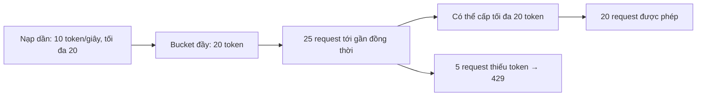
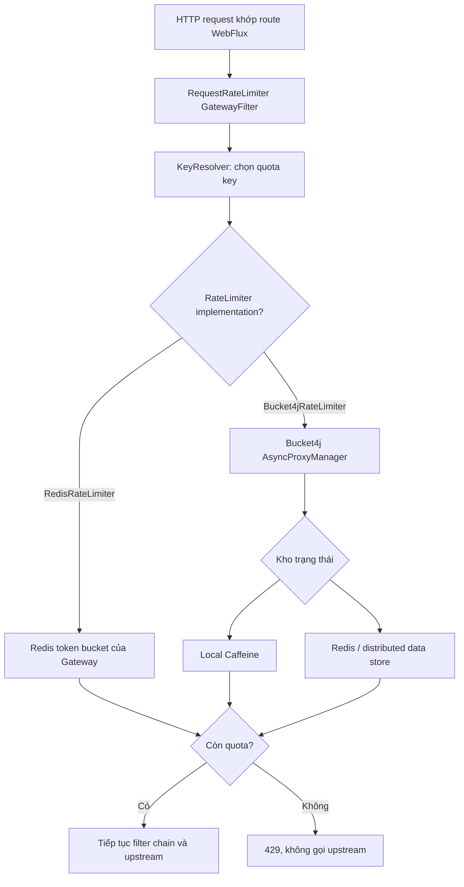
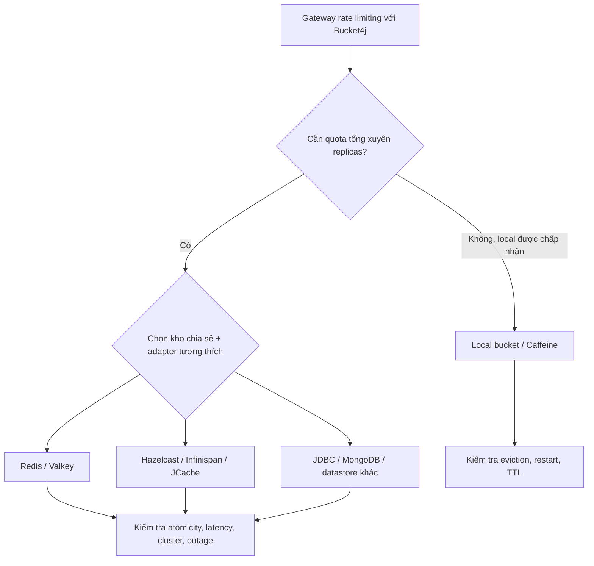
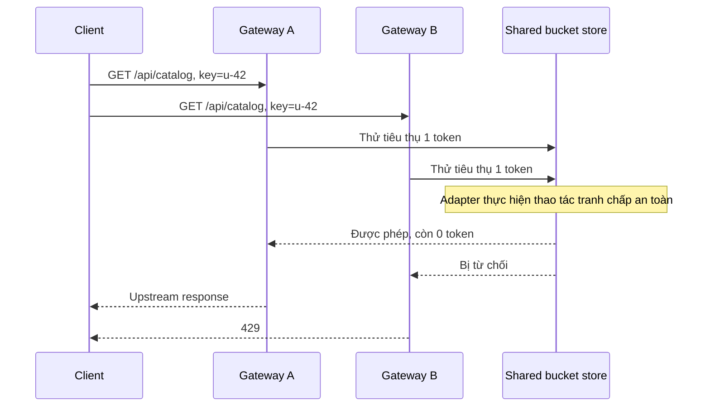

# Bucket4j và lựa chọn kho trạng thái theo biến thể, phiên bản hỗ trợ trong Spring Cloud Gateway

Trong API Gateway dành cho microservices, giới hạn tốc độ request chỉ có ý nghĩa khi hệ thống biết **request thuộc về ai**, **mỗi request tiêu thụ bao nhiêu hạn mức** và **trạng thái quota được chia sẻ ở đâu**. Ví dụ một khách hàng được phép gọi tối đa 60 request/phút; nếu Gateway có ba replica nhưng mỗi replica tự giữ bộ đếm riêng, khách hàng có thể vô tình được nhận tổng cộng nhiều hơn hợp đồng công bố.

**Bucket4j** là thư viện Java triển khai cơ chế *token bucket* để quản lý quota theo key. Thư viện có các hình thức bucket cục bộ và các tích hợp với kho trạng thái phân tán. Trong **Spring Cloud Gateway**, việc dùng Bucket4j phụ thuộc **biến thể Gateway** (**Server WebFlux** hay **Server MVC**), **phiên bản** và **loại kho trạng thái** được cấu hình. Không thể giả định rằng chỉ thêm một dependency Bucket4j thì Gateway tự động giới hạn tất cả route.

Bài thuộc chương **Giới hạn lưu lượng** của module `SPRING_CLOUD_GATEWAY`. Nó giúp chọn giải pháp rate limiting trong hệ thống dùng route predicate, filter chain, biến đổi path/header, khám phá dịch vụ và load balancing; đồng thời phối hợp xác thực/phân quyền, retry, circuit breaker, TLS và quan sát request để vận hành cổng vào an toàn.

**Các câu hỏi cần giải quyết:**

1. Bucket4j và token bucket hoạt động như thế nào?
2. **Server WebFlux** cấu hình Bucket4j qua `RequestRateLimiter` khác gì **Server MVC** dùng bộ lọc `RateLimiter` dựa trên Bucket4j?
3. Vì sao **Caffeine trong bộ nhớ** phù hợp thử nghiệm nhưng không tự tạo quota toàn cụm nhiều Gateway replica?
4. Chọn **Redis, Hazelcast, JCache, database hay kho khác** theo tính nhất quán, hiệu năng và API hỗ trợ ra sao?
5. Kiểm thử 429, key rỗng, Redis/store outage, rolling update và các rủi ro bảo mật thế nào?

> **Phạm vi và phiên bản:** Trọng tâm của module là **Spring Cloud Gateway Server WebFlux**. Tài liệu chính thức của các nhánh **4.3.5** và **5.1.0** mô tả Bucket4j `RateLimiter` trong `RequestRateLimiter` của WebFlux; tài liệu **Server MVC** mô tả API `Bucket4jFilterFunctions.rateLimit` riêng. Không sao chép Java DSL của MVC vào ứng dụng WebFlux. Những nhánh cũ hơn hoặc starter bên thứ ba có thể khác, vì thế luôn đối chiếu tài liệu chính xác của phiên bản đang chạy.

## 1. Bucket4j giải quyết bài toán gì?

Giả sử một hệ thống thương mại điện tử có:

- `GET /api/catalog/**`: đọc danh mục, có thể chấp nhận lưu lượng cao.
- `POST /api/orders`: tạo đơn hàng, tốn database transaction.
- `POST /api/payments`: xử lý thanh toán, cần xác thực, idempotency và giới hạn chặt hơn.
- `GET /api/reports/**`: chạy truy vấn hoặc tạo báo cáo tốn CPU.

Không phải API nào cũng cần cùng quota. Đội vận hành có thể đặt 20 request/giây cho catalog theo user và 2 request/giây cho order creation, đồng thời cho phép những đợt tăng đột biến ngắn.

Bucket4j giúp biểu diễn **số token được phép tiêu thụ theo thời gian**, còn Gateway quyết định **route nào chịu quota, lấy key từ đâu và phản hồi HTTP ra sao**.

### 1.1. Rate limiting khác timeout, retry và circuit breaker

| Cơ chế | Quyết định gì? | Khi nào dùng? |
| --- | --- | --- |
| **Rate limiting** | Request này còn quota hay bị từ chối? | Bảo vệ tài nguyên, phân bổ lưu lượng công bằng. |
| **Concurrency limiting** | Có bao nhiêu request đang chạy đồng thời? | Bảo vệ worker/thread, connection pool, tác vụ chậm. |
| **Timeout** | Có phải dừng chờ một operation quá lâu? | Tránh giữ tài nguyên không giới hạn. |
| **Circuit breaker** | Backend đang lỗi nhiều đến mức cần ngắt gọi tạm thời? | Giảm tác động khi upstream suy giảm. |
| **Retry** | Có được thử lại một lần gọi bị lỗi không? | Tăng khả năng phục hồi với chính sách an toàn. |
| **Request size limit** | Body một request có vượt số byte cho phép? | Bảo vệ bộ nhớ, upload và mạng. |

Rate limiting không tự chữa một service `lb://order-service` thiếu instance; tăng quota có thể chỉ khiến nhiều request đi tới lỗi 503 hơn. Tương tự, circuit breaker mở không làm quota của user tự đầy trở lại.

## 2. Token bucket: capacity, refill và chi phí mỗi request

Hãy hình dung mỗi người dùng có một bucket chứa token:

- **Capacity:** sức chứa tối đa của bucket.
- **Refill:** quy tắc nạp thêm token theo thời gian.
- **Requested tokens:** lượng token cần trừ cho một request.
- **Consume decision:** nếu còn đủ token thì cho phép request đi tiếp; nếu không thì từ chối, thường bằng HTTP 429.

Ví dụ capacity = 20, refill = 10 token/giây, mỗi request tốn 1 token.



Nếu một bucket đang đầy và 25 request đến thực sự sát nhau, có thể cho qua khoảng 20 request đầu và từ chối phần còn lại, miễn chưa kịp nạp lại đáng kể. Trong hệ thống thực, concurrency, clock, độ trễ kho trạng thái và chính sách refill ảnh hưởng thứ tự chính xác.

### 2.1. Công thức tư duy

Với kiểu refill đều (*greedy*), mô hình khái niệm có thể viết:

```text
tokensAvailable =
    min(capacity, previousTokens + refillRate * elapsedSeconds)

if tokensAvailable >= requestedTokens:
    allow = true
    tokensAfter = tokensAvailable - requestedTokens
else:
    allow = false
    tokensAfter = tokensAvailable
```

Đây không phải mã nội bộ của Bucket4j. Một số refill style làm thay đổi cách phân phối token theo thời gian, ví dụ nạp cả lô khi hết một kỳ hoặc căn chỉnh với mốc thời gian cố định.

### 2.2. Capacity không bằng tốc độ mỗi giây

| Cấu hình ví dụ | Diễn giải |
| --- | --- |
| Capacity 20; refill 10 token/giây; cost 1 | Burst ban đầu có thể tới 20 request; duy trì lâu dài xấp xỉ 10 request/giây. |
| Capacity 4; refill 2 token/giây; cost 1 | Burst 4 request, sau đó trung bình 2 request/giây. |
| Capacity 60; refill 60 token/phút; cost 60 | Mỗi request dùng hết 60 token; trung bình khoảng 1 request/phút. |
| Capacity 10; refill 10 token/phút theo kiểu nạp cả lô | Hành vi theo mốc refill khác với phân phối token đều trong phút. |

Nếu sản phẩm yêu cầu **quota chính xác theo cửa sổ ngày/tháng**, cần xét giải pháp hạch toán quota riêng thay vì chỉ dựa vào một token bucket tốc độ ngắn hạn.

## 3. Phải nhận diện đúng biến thể Spring Cloud Gateway

Spring Cloud Gateway có những biến thể server khác nhau. Mặc dù cả hai có thể dùng Bucket4j, API và pipeline **không tương đương**.

| Khía cạnh | **Server WebFlux** | **Server MVC** |
| --- | --- | --- |
| Nền tảng | Reactive WebFlux, `ServerWebExchange`, Project Reactor. | Servlet/Spring MVC, `ServerRequest`, `RouterFunction`. |
| Bộ lọc liên quan | `RequestRateLimiter` GatewayFilter Factory. | `Bucket4jFilterFunctions.rateLimit` trong MVC filter DSL. |
| Key resolver | `org.springframework.cloud.gateway.filter.ratelimit.KeyResolver` với `Mono<String>`. | Hàm kiểu `Function<ServerRequest, String>` theo MVC DSL. |
| Bucket4j | `Bucket4jRateLimiter` và các tham số `bucket4j-rate-limiter.*` ở các phiên bản hỗ trợ. | Các tham số cấu hình bucket qua builder/filter Java DSL. |
| Kho trạng thái | `AsyncProxyManager`/integration phù hợp với Gateway reactive. | Tài liệu MVC cũng mô tả `AsyncProxyManager`; filter API vẫn khác WebFlux. |
| Ví dụ URL/route | `spring.cloud.gateway.server.webflux.routes` ở nhánh mới. | `GatewayRouterFunctions.route(...)` trong tài liệu MVC. |
| Không được sao chép | `request.servletRequest()`, MVC `rateLimit(...)`. | `ServerWebExchange` và `Mono` của WebFlux để viết MVC key resolver. |

**Điểm quan trọng:** Thư viện Bucket4j là **engine giới hạn token**. Spring Cloud Gateway cung cấp integration riêng để engine này tham gia pipeline HTTP. Một starter Bucket4j của bên thứ ba có thể dùng servlet filter, annotation hoặc WebFlux filter khác; **không mặc nhiên tương thích** với `RequestRateLimiter` của Spring Cloud Gateway.

### 3.1. Đối chiếu phiên bản trước khi lập trình

Trong tài liệu Spring Cloud Gateway được đối chiếu:

- **Server WebFlux 4.3.5:** `RequestRateLimiter` có phần **Bucket4j RateLimiter**, cấu hình route theo `spring.cloud.gateway.routes`.
- **Server WebFlux 5.1.0:** vẫn có phần **Bucket4j RateLimiter**, ví dụ cấu hình route theo `spring.cloud.gateway.server.webflux.routes`.
- **Server MVC 4.3.5 và 5.1.0:** có bộ lọc `RateLimiter` dùng Bucket4j, ví dụ bằng Java DSL `Bucket4jFilterFunctions.rateLimit`.
- **Phiên bản khác:** không kết luận từ việc thấy `Bucket4j` trên Internet; phải kiểm tra đúng nhánh tài liệu và dependency thực tế.

Đây là những **mốc tài liệu cụ thể**, không phải khẳng định mọi patch version, mọi starter hoặc mọi phối hợp Boot/Cloud đều có chính xác cùng chữ ký API và property. Đừng trộn namespace `4.3` với namespace `5.x` rồi nghĩ Spring Boot sẽ tự chọn đúng.

## 4. RequestRateLimiter trên WebFlux chọn Bucket4j như thế nào?

Ở Gateway Server WebFlux, filter `RequestRateLimiter` dùng một implementation của interface `RateLimiter`. Những bản hỗ trợ có ít nhất hai hướng thường gặp:

1. **`RedisRateLimiter`:** implementation sử dụng Redis theo cơ chế riêng của Spring Cloud Gateway.
2. **`Bucket4jRateLimiter`:** implementation dựa trên thư viện Bucket4j và một `AsyncProxyManager` phù hợp.

Cả hai có thể trả `429 Too Many Requests` khi không đủ quota, nhưng **cấu hình tham số và cách lưu trạng thái khác nhau**. Không có quy tắc “chỉ thêm Bucket4j dependency rồi tự thay tất cả RedisRateLimiter” cho mọi trường hợp. Hãy khai đúng family args, bean/integration và kiểm chứng filter thực sự dùng implementation mong muốn.



Một số lỗi có thể kết thúc trước bước rate limiting: Spring Security trả 401/403 hoặc route predicate không khớp. Với một `KeyResolver` không tìm ra key, `RequestRateLimiter` còn có **empty-key policy** riêng; không nên gán mọi 403 cho “hết token”.

## 5. Tích hợp Bucket4j WebFlux: dependency và kho Caffeine cục bộ

Tài liệu WebFlux 4.3/5.x mô tả việc dùng Bucket4j với dependency phù hợp và một integration lưu trữ. Ví dụ local Caffeine giúp học/test mà không cần Redis.

### 5.1. Dependency Maven minh họa

```xml
<!-- Chọn phiên bản qua dependencyManagement/BOM tương thích. -->
<dependency>
    <groupId>com.bucket4j</groupId>
    <artifactId>bucket4j_jdk17-core</artifactId>
    <version>${bucket4j.version}</version>
</dependency>

<dependency>
    <groupId>com.bucket4j</groupId>
    <artifactId>bucket4j_jdk17-caffeine</artifactId>
    <version>${bucket4j.version}</version>
</dependency>

<dependency>
    <groupId>com.github.ben-manes.caffeine</groupId>
    <artifactId>caffeine</artifactId>
</dependency>
```

Đây là **fragment** dependency, chưa bao gồm Gateway starter, Spring Security, LoadBalancer hay cấu hình Maven BOM. Dùng **tọa độ module Bucket4j theo tài liệu phiên bản đang dùng**: ở các nhánh Bucket4j cũ, tên artifact và API khác đáng kể. Đừng đưa module Bucket4j đời mới vào Spring Cloud Gateway cũ mà không xác minh binary compatibility.

Caffeine lưu dữ liệu **trong JVM**. Nó phù hợp demo, unit/integration test, một Gateway duy nhất hoặc giới hạn cục bộ có chủ đích. Nó không tự chia quota giữa nhiều Gateway pods.

### 5.2. Bean `AsyncProxyManager<String>`

Một mẫu cấu hình tương tự tài liệu chính thức Spring Cloud Gateway, dùng CaffeineProxyManager rồi chuyển sang API bất đồng bộ:

```java
import java.time.Duration;

import com.github.benmanes.caffeine.cache.Caffeine;
import io.github.bucket4j.caffeine.CaffeineProxyManager;
import io.github.bucket4j.distributed.proxy.AsyncProxyManager;
import io.github.bucket4j.distributed.remote.RemoteBucketState;

import org.springframework.context.annotation.Bean;
import org.springframework.context.annotation.Configuration;

@Configuration
public class Bucket4jStorageConfig {

    @Bean
    @SuppressWarnings({"unchecked", "rawtypes"})
    AsyncProxyManager<String> bucket4jProxyManager() {
        Caffeine<String, RemoteBucketState> cache =
            (Caffeine) Caffeine.newBuilder()
                .maximumSize(10_000);

        return new CaffeineProxyManager<>(
            cache,
            Duration.ofMinutes(10)
        ).asAsync();
    }
}
```

**Cách đọc:**

- `Caffeine` quản lý các entry key → trạng thái bucket trong một Gateway JVM.
- `CaffeineProxyManager` cung cấp proxy manager tích hợp Bucket4j trên Caffeine.
- `asAsync()` tạo `AsyncProxyManager<String>` để tích hợp với pipeline Gateway reactive tương ứng.
- `maximumSize` giới hạn số entry cache; `Duration.ofMinutes(10)` trong constructor là một tham số quản lý vòng đời/expiration theo API module được tài liệu hóa, **không phải** hạn mức “10 request/phút”.
- Ép kiểu `(Caffeine)` phản ánh chữ ký generic trong ví dụ tài liệu; tránh copy mù quáng mà không kiểm tra version của Bucket4j và Caffeine.

**Giới hạn quan trọng:** API Caffeine integration và tên package/type có thể thay đổi giữa các nhánh Bucket4j; mã trên cần được **biên dịch/kiểm thử trong dự án dùng đúng phiên bản**. Bài STEP 4 không chạy Gradle/Maven hoặc Content QA, nên đây là ví dụ hướng dẫn, chưa phải bằng chứng tương thích với build cụ thể.

### 5.3. Trạng thái local và mất quota khi restart/eviction

Nếu dùng Caffeine:

- Pod A và Pod B mỗi bên có **bucket riêng**, ngay cả khi cùng key `user-123`.
- Restart JVM khiến bucket local biến mất; lần gọi tiếp theo có thể tạo một bucket mới đầy token.
- Eviction do giới hạn cache hoặc expiration có thể khiến quota của một key **được cấp lại** sớm hơn dự kiến.
- Sticky routing giúp cùng client thường tới một pod nhưng không bảo đảm tính chính xác khi failover, scale-up hoặc chuyển region.

**Không dùng local Caffeine nếu hợp đồng yêu cầu quota tổng chính xác trên cả cụm Gateway**, trừ khi có cơ chế phân chia quota độc lập và chấp nhận được các giới hạn của nó.

## 6. Cấu hình Bucket4j RateLimiter trong WebFlux bằng YAML

Ví dụ cho **Spring Cloud Gateway Server WebFlux thuộc nhánh sử dụng namespace `server.webflux`**, với route Catalog và key theo người dùng:

```yaml
spring:
  cloud:
    gateway:
      server:
        webflux:
          routes:
            - id: catalog-rate-limited
              uri: lb://catalog-service
              predicates:
                - Path=/api/catalog/**
                - Method=GET
              filters:
                - StripPrefix=1
                - name: RequestRateLimiter
                  args:
                    key-resolver: "#{@authenticatedUserKeyResolver}"
                    bucket4j-rate-limiter.capacity: 20
                    bucket4j-rate-limiter.refillTokens: 10
                    bucket4j-rate-limiter.refillPeriod: 1s
                    bucket4j-rate-limiter.requestedTokens: 1
```

Ở các nhánh WebFlux dùng namespace cũ, đường dẫn route thường là `spring.cloud.gateway.routes`. Giữ nguyên ý tưởng `RequestRateLimiter` nhưng **chuyển đúng namespace** cho version tương ứng; không đồng thời khai cả hai.

**Giải thích tham số:**

| Tham số Bucket4j của Gateway | Ý nghĩa trong ví dụ |
| --- | --- |
| `bucket4j-rate-limiter.capacity: 20` | Sức chứa bucket tối đa 20 token. |
| `bucket4j-rate-limiter.refillTokens: 10` | Mỗi chu kỳ refill được nạp tối đa/định lượng 10 token theo style. |
| `bucket4j-rate-limiter.refillPeriod: 1s` | Chu kỳ nạp 1 giây. |
| `bucket4j-rate-limiter.requestedTokens: 1` | Mỗi request cần 1 token. |
| `key-resolver: "#{@authenticatedUserKeyResolver}"` | Tham chiếu bean KeyResolver từ Spring context. |

Với refill style mặc định kiểu `GREEDY` trong tài liệu phiên bản được đối chiếu, ý tưởng là bucket có **burst tối đa 20** và tốc độ bù tương đương **10 token/giây**, không phải một cửa sổ cố định đúng 1 giây.

### 6.1. Không trộn tên tham số RedisRateLimiter với Bucket4j

Hai bộ tham số **không thay thế trực tiếp bằng việc đổi tên Bean**:

| RedisRateLimiter | Bucket4jRateLimiter | Ý tưởng tương ứng |
| --- | --- | --- |
| `redis-rate-limiter.burstCapacity` | `bucket4j-rate-limiter.capacity` | Sức chứa token bucket. |
| `redis-rate-limiter.replenishRate` | `refillTokens` + `refillPeriod` | Tốc độ/quy tắc refill. |
| `redis-rate-limiter.requestedTokens` | `bucket4j-rate-limiter.requestedTokens` | Chi phí mỗi request. |
| Cơ chế Redis riêng tích hợp | `AsyncProxyManager`/storage adapter Bucket4j | Đọc/ghi trạng thái quota. |

Ví dụ không đúng về ngữ nghĩa khi muốn dùng Bucket4j:

```yaml
filters:
  - name: RequestRateLimiter
    args:
      bucket4j-rate-limiter.capacity: 20
      redis-rate-limiter.replenishRate: 10
```

Khai lẫn hai họ thuộc tính dễ tạo hành vi khó đoán hoặc không bind đúng configuration. Chọn **một implementation và một bộ tham số có hiệu lực**, rồi xác nhận quyết định 429 bằng kiểm thử thực tế.

### 6.2. RequestRateLimiter không hỗ trợ cú pháp shortcut tùy ý

Trong tài liệu WebFlux, dạng shortcut kiểu `RequestRateLimiter=2,2` không phải cấu hình hợp lệ chung cho factory này. Dùng `name: RequestRateLimiter` và `args` rõ ràng để truyền key resolver và tham số của implementation.

### 6.3. Bean KeyResolver tin cậy

```java
import java.security.Principal;

import org.springframework.cloud.gateway.filter.ratelimit.KeyResolver;
import org.springframework.context.annotation.Bean;
import org.springframework.context.annotation.Configuration;

@Configuration
public class RateLimitKeys {

    @Bean
    KeyResolver authenticatedUserKeyResolver() {
        return exchange ->
            exchange.getPrincipal().map(Principal::getName);
    }
}
```

`Principal.getName()` đến từ cơ chế xác thực hiện hành; khi dùng OAuth 2.0 Resource Server, nó thường là subject hoặc một principal name đã được converter cấu hình. Nếu quota theo tenant, hãy lấy tenant key từ **claim đã được xác minh** và quyền tenant đáng tin, không dùng raw `tenantId` do client tự gửi.

## 7. Các refill style của Bucket4j

Một điểm mạnh của Bucket4j là có thể tùy biến cách nạp token. Tài liệu Gateway WebFlux hỗ trợ các lựa chọn:

- **`GREEDY`:** cố gắng phân phối token nạp dần sớm nhất có thể; là giá trị mặc định trong tài liệu được đối chiếu.
- **`INTERVALLY`:** nạp token theo từng đợt khi hoàn tất toàn bộ kỳ.
- **`INTERVALLY_ALIGNED`:** nạp từng đợt căn theo một mốc thời gian cụ thể; dùng tham số `timeOfFirstRefill`.

So sánh khái niệm:

| Kiểu | Capacity 10, refill 10 token/phút | Đặc điểm |
| --- | --- | --- |
| `GREEDY` | Token có thể xuất hiện dần trong phút theo thuật toán. | Đỡ tạo “vách quota” đúng đầu mỗi phút. |
| `INTERVALLY` | Chờ trọn kỳ rồi thêm một lô token. | Phù hợp một số chính sách “nạp theo đợt”. |
| `INTERVALLY_ALIGNED` | Lô refill căn theo mốc thời gian định trước. | Thích hợp một số lịch quota; cần xử lý clock/timezone/mốc căn chỉnh. |

Mẫu chỉ định rõ style và kỳ:

```yaml
filters:
  - name: RequestRateLimiter
    args:
      key-resolver: "#{@authenticatedUserKeyResolver}"
      bucket4j-rate-limiter.capacity: 10
      bucket4j-rate-limiter.refillTokens: 10
      bucket4j-rate-limiter.refillPeriod: 1m
      bucket4j-rate-limiter.refillStyle: INTERVALLY
      bucket4j-rate-limiter.requestedTokens: 1
```

**Không nhầm `INTERVALLY` với quota hạch toán theo phút cố định của nhà cung cấp API**. Bucket state có thời điểm khởi tạo/chu kỳ riêng; cùng key và khác key có thể có mốc refill khác nhau. Muốn reset đúng đầu mỗi phút UTC theo hợp đồng phải xem xét `INTERVALLY_ALIGNED` và cách hiện thực/clock, không suy luận từ `refillPeriod: 1m`.

### 7.1. `timeOfFirstRefill` dùng trong trường hợp nào?

Khi chọn `INTERVALLY_ALIGNED`, tham số `timeOfFirstRefill` biểu diễn một `Instant` làm mốc căn chỉnh. Giá trị phải được chọn theo lịch quota có chủ đích, timezone/UTC và yêu cầu của phiên bản. Không thêm vào cấu hình `GREEDY` rồi mong nó thay đổi tốc độ refill.

### 7.2. Tại sao cần ghi rõ refill style trong tài liệu API?

Hai hệ thống đều ghi “10 request/phút” nhưng một bên nạp dần còn bên kia reset theo lô, trải nghiệm của client sẽ khác nhau khi gửi burst ở gần ranh giới thời gian. API contract nên nêu rõ nếu quota là **tốc độ trung bình**, **burst theo token bucket** hay **cửa sổ lịch**.

## 8. Server MVC: Bucket4j tích hợp theo cách khác

Để tránh nhầm phiên bản và code mẫu, xem một ví dụ **Server MVC** có trong tài liệu chính thức:

```java
import java.time.Duration;

import org.springframework.context.annotation.Bean;
import org.springframework.context.annotation.Configuration;
import org.springframework.web.servlet.function.RouterFunction;
import org.springframework.web.servlet.function.ServerResponse;

import static org.springframework.cloud.gateway.server.mvc.filter.BeforeFilterFunctions.uri;
import static org.springframework.cloud.gateway.server.mvc.filter.Bucket4jFilterFunctions.rateLimit;
import static org.springframework.cloud.gateway.server.mvc.handler.GatewayRouterFunctions.route;
import static org.springframework.cloud.gateway.server.mvc.handler.HandlerFunctions.http;

@Configuration
class MvcGatewayRateLimitRoutes {

    @Bean
    RouterFunction<ServerResponse> mvcRateLimitedRoute() {
        return route("mvc_catalog")
            .GET("/api/catalog/**", http())
            .before(uri("https://catalog.example.org"))
            .filter(rateLimit(c -> c
                .setCapacity(100)
                .setPeriod(Duration.ofMinutes(1))
                .setKeyResolver(request ->
                    request.servletRequest()
                        .getUserPrincipal()
                        .getName())))
            .build();
    }
}
```

**Chỉ dùng ví dụ này khi ứng dụng thật là Gateway Server MVC** và đã có principal phù hợp. Với anonymous request, `getUserPrincipal()` có thể null; code minh họa không xử lý nhánh này. Không copy `ServerRequest.servletRequest()` hoặc `Bucket4jFilterFunctions` vào `GatewayFilter` của Server WebFlux.

Theo tài liệu MVC:

- Filter `rateLimit(...)` sử dụng Bucket4j để kiểm tra request.
- Có các cấu hình như `capacity`, `period`, `tokens`, `statusCode`, `headerName` và `timeout` theo Java DSL.
- Key resolver có dạng `Function<ServerRequest, String>`, không phải reactive `KeyResolver` của WebFlux.
- Phần lưu trạng thái phân tán cần cấu hình `AsyncProxyManager` phù hợp.
- Tài liệu nhấn mạnh key resolver được cấu hình trong **Java DSL** thay vì giả định khai được qua thuộc tính ngoại vi.

**Một kiến trúc chỉ nên chọn đúng server variant** cho ứng dụng thực tế. Nếu đang triển khai `SPRING_CLOUD_GATEWAY` với WebFlux, phần MVC ở đây chỉ nhằm nhận diện và tránh lỗi sao chép.

## 9. Lựa chọn kho trạng thái: local hay phân tán?

**Bucket4j không tự biến mọi cache thành một kho quota toàn cụm.** Sự khác biệt quan trọng là trạng thái bucket lưu trong phạm vi nào, các thao tác tiêu thụ token có atomic hay không và khi một Gateway replica chết thì state có còn không.



### 9.1. Local cache: nhanh nhưng quota bị phân mảnh

Bucket cục bộ thích hợp khi:

- Chạy **một Gateway instance** hoặc chỉ cần bảo vệ tài nguyên ở mức mỗi node.
- Dùng cho demo, unit test, môi trường thử nghiệm có dữ liệu giả.
- Có cơ chế phân vùng traffic và chấp nhận quota không nhất quán khi failover.

Điểm yếu:

- Mỗi replica có trạng thái riêng.
- Restart/eviction có thể reset bucket.
- Sticky session không đảm bảo tính chính xác khi load balancer chuyển request.
- Không có atomicity chung khi request đến nhiều JVM.

### 9.2. Distributed store: thống nhất quota nhưng tăng phụ thuộc mạng

Kho chia sẻ phù hợp khi:

- Có từ hai Gateway replica trở lên.
- Hợp đồng yêu cầu hạn mức tổng theo user/tenant/API key.
- Muốn rollout/scale mà không đổi số token khách hàng được sử dụng.

Đổi lại cần quản lý:

- Latency mỗi lần kiểm tra quota.
- Atomic compare-and-update trên cùng key.
- Availability, timeout, retry và circuit breaker riêng của storage client.
- TTL và expiration để không giữ hàng triệu bucket không còn dùng.
- Cluster partition, replication lag, failover và consistency.
- Serialization/schema version của trạng thái bucket khi nâng cấp.

“Chạy Redis Cluster” hoặc “dùng MongoDB” không tự chứng minh quota nhất quán. Phải kiểm tra **adapter Bucket4j cụ thể**, khả năng async, transaction/CAS/locking và failure semantics.

## 10. Các nhóm storage adapter được Bucket4j hỗ trợ

Bucket4j là một thư viện với nhiều **module/integration**. Danh sách dưới đây mô tả các **nhóm backend được dự án Bucket4j công bố**, không bảo đảm mỗi module đều có artifact/tính năng như nhau ở mọi major version hay được Spring Cloud Gateway auto-configure.

| Kho trạng thái | Ví dụ integration | Điểm mạnh/cân nhắc khi dùng với Gateway |
| --- | --- | --- |
| **Local Caffeine** | `bucket4j-...-caffeine` | Rất nhanh, phù hợp test; bucket không chia giữa replicas. |
| **Redis** | Bucket4j Redis adapter qua **Lettuce**, **Redisson**, **Vert.x** hoặc **Jedis**. | Phổ biến, latency thấp; chọn client/module có API async thật cho WebFlux. |
| **Valkey** | Adapter Valkey/Glide ở nhánh hỗ trợ. | Có thể dùng hệ thống tương thích Redis theo integration được dự án công bố; cần xác minh version. |
| **Hazelcast** | Bucket4j Hazelcast adapter. | Phù hợp khi hệ thống đã có cluster Hazelcast và semantics nhất quán đủ dùng. |
| **Infinispan / JCache** | Adapter tương ứng. | Cần phân biệt `JCache API` đồng bộ với adapter async chuyên biệt; không mặc định nonblocking. |
| **MongoDB** | Sync hoặc reactive driver adapter. | Tận dụng hạ tầng sẵn có; đánh giá chi phí ghi/đọc và cơ chế atomic update. |
| **JDBC/RDBMS** | PostgreSQL, MySQL, Oracle, SQL Server và một số backend khác theo module. | Quota có thể chia sẻ nhưng contention/transaction/latency có thể cao. |
| **Cassandra / Couchbase / Memcached** | Module tương ứng ở các bản Bucket4j hỗ trợ. | Cần kiểm tra consistency, CAS/transaction và overhead cho từng request. |

**Cảnh báo quan trọng:** “Bucket4j có adapter X” không có nghĩa “Spring Cloud Gateway WebFlux hỗ trợ ngay X khi thêm một dòng YAML”. Bạn phải tạo **Bean `AsyncProxyManager<K>` hoặc adapter tương thích**, cấu hình client/storage và dependency, đồng thời xác minh Gateway dùng Bean đó. Nếu backend chỉ cung cấp API synchronous, không được gọi thẳng API blocking từ Netty event loop.

### 10.1. Vì sao chọn async adapter cho WebFlux?

Spring Cloud Gateway Server WebFlux hướng tới I/O nonblocking. Nếu dùng Redis/JDBC client blocking để đọc token trên mỗi request và gọi nó trực tiếp trong reactive chain:

- Event loop có thể bị khóa.
- Latency của những request khác tăng ngay cả khi backend khỏe.
- Throughput sụt giảm bất thường dưới tải cao.
- Timeout và cancellation trở nên khó kiểm soát.

Ưu tiên **`AsyncProxyManager`** cùng client async thực sự; không coi việc bọc một hàm blocking trong `Mono.just(...)` là đã biến nó thành nonblocking.

### 10.2. Đồng bộ state khi Redis không giống RedisRateLimiter

Nếu chọn **Bucket4j + Redis adapter**, trạng thái quota do **Bucket4j proxy manager** quản lý theo scheme và serialization của nó. Nếu chọn **Spring Cloud Gateway RedisRateLimiter**, trạng thái quota theo implementation và Redis script/keys riêng của Spring Cloud Gateway.

Hai kiểu đó **không tự chia sẻ bucket** chỉ vì cùng trỏ đến một Redis server. Không chuyển config từ `RedisRateLimiter` sang Bucket4j rồi nghĩ số token đã tiêu thụ sẽ được giữ nguyên.

## 11. So sánh RedisRateLimiter và Bucket4jRateLimiter

Trong WebFlux, lựa chọn phổ biến là giữ `RedisRateLimiter` mặc định với Redis hoặc dùng `Bucket4jRateLimiter` khi cần mô hình refill/storage của Bucket4j.

| Tiêu chí | **RedisRateLimiter** của Gateway | **Bucket4jRateLimiter** |
| --- | --- | --- |
| Engine | Token bucket implementation của Spring Cloud Gateway. | Thư viện Bucket4j. |
| Kho lưu trữ | Redis theo integration của Gateway. | Local hoặc kho phân tán tùy `AsyncProxyManager` và module. |
| Tham số chính | `replenishRate`, `burstCapacity`, `requestedTokens`. | `capacity`, `refillTokens`, `refillPeriod`, `refillStyle`, `requestedTokens`. |
| Tính linh hoạt refill | Hướng tới tốc độ nạp và burst. | Có các chiến lược refill, kể cả interval/aligned khi version hỗ trợ. |
| Tính linh hoạt storage | Redis theo implementation sẵn. | Đa dạng adapter Bucket4j, nhưng phải tương thích version/API. |
| Độ phức tạp tích hợp | Thường đơn giản khi ứng dụng đã có Redis reactive. | Thêm proxy manager/adapter và kiểm tra compatibility. |
| Chuyển đổi quota giữa hai engine | Không tự động. | Không tự đọc state RedisRateLimiter cũ. |

**Gợi ý lựa chọn:** Nếu chỉ cần rate limit theo user trên Gateway WebFlux và đã có Redis reactive, `RedisRateLimiter` thường là đường đi đơn giản. Nếu cần các refill style cụ thể, muốn tận dụng một backend khác hoặc đã chuẩn hóa Bucket4j trong hệ thống, cân nhắc Bucket4j với kho phù hợp. Đừng chọn công nghệ chỉ vì số module có tên “distributed”.

### 11.1. Tránh “double limiting” không chủ đích

Nếu cùng một route có hai filter limiter hoặc Gateway và backend cùng kiểm tra hai quota:

- Client có thể bị từ chối trước khi chạm backend dù một bucket còn token.
- Hai nguồn phát `X-RateLimit-*` headers dễ mâu thuẫn.
- Retry/fallback có thể thay đổi số lần tính quota.
- Dashboard 429 khó phân biệt nguồn từ chối.

Có thể cần nhiều tầng quota, nhưng hợp đồng phải rõ: **global traffic cap**, **tenant quota**, **user quota** hoặc **backend endpoint-specific quota**. Không vô tình chồng hai limiter chỉ vì di chuyển từ RedisRateLimiter sang Bucket4j.

## 12. Kiểm tra độ nhất quán phân tán và tính nguyên tử

Giả sử có hai Gateway replica cùng nhận request cho user `u-42`:



Để đạt hành vi hợp đồng, storage adapter phải xử lý **cập nhật bucket một cách nguyên tử hoặc có kiểm soát tranh chấp**. Hai replica đọc cùng “còn 1 token” rồi tự trừ độc lập có thể cùng cho phép request và làm vượt quota.

Khi đánh giá adapter, hãy hỏi:

1. Thao tác consume token có atomic không? Dùng Lua, CAS, transaction, lock hoặc primitive gì?
2. Có hỗ trợ async hay đang blocking?
3. Khi hai request race cùng key, kết quả có đúng bất biến quota?
4. Khi một node store failover/partition, state còn nhất quán hay có cửa sổ mất update?
5. Khi retry client–storage, operation có thể bị thực hiện lặp không?
6. Khi serialize state sau nâng cấp Bucket4j, có tương thích rolling upgrade không?

### 12.1. TTL và eviction có thể làm mất quota

Với cả local và distributed store, nếu bucket state bị xóa trước khi người dùng đã “trả hết nợ quota”, lần truy cập tiếp theo có thể khởi tạo bucket mới với capacity đầy. Thiết kế expiration phải phù hợp **refill period, capacity, tốc độ nạp và hành vi idle**.

Ví dụ, một gói chỉ cho 1 request/phút nhưng TTL của bucket là 5 giây có thể tạo cơ hội reset quota sau mỗi 5 giây nghỉ, tùy cách adapter tái tạo state. **Không đặt TTL bằng cảm tính**; kiểm thử behavior sau idle, eviction, restart và failover.

### 12.2. Memory và cardinality

Nếu `KeyResolver` trả key tùy ý từ client, một attacker có thể tạo hàng triệu bucket khác nhau, gây phình cache/Redis/database. Hãy:

- Dùng user/tenant/API key đã xác thực hoặc IP đáng tin theo policy.
- Chuẩn hóa key, cân nhắc hashing/pseudonymization với dữ liệu nhạy cảm.
- Giới hạn số lượng bucket và có retention hợp lý.
- Không lấy raw JWT/access token làm key.
- Không dùng mỗi request ID làm quota key, vì điều đó biến mọi request thành bucket mới.

## 13. Failure semantics: không thể chọn storage chỉ dựa trên tốc độ

Kho quota cũng có thể chậm hoặc mất kết nối. Một quyết định rate-limit trong request path có thể phát sinh timeout, lỗi authentication Redis, lỗi pool, transaction conflict hoặc failover.

| Chính sách khi storage không trả lời | Lợi ích | Rủi ro |
| --- | --- | --- |
| **Fail-closed** | Không cho traffic vượt quota khi không xác minh được. | Có thể từ chối toàn bộ user hợp lệ nếu storage outage. |
| **Fail-open** | Giữ được lưu lượng khi limiter hỏng. | Có thể bỏ qua chính sách bảo vệ và làm backend quá tải. |
| **Local fallback** | Tiếp tục giới hạn ở mức một replica. | Quota toàn cụm bị phân mảnh, có thể vượt hạn mức tổng. |
| **Reject có kiểm soát** | Trả lỗi nhất quán, có alert và backoff. | Client bị gián đoạn cho tới khi storage phục hồi. |

**Không mặc định Bucket4j và mọi adapter của nó tự động fail-open hoặc fail-closed theo đúng ý muốn**. Hành vi khi lỗi phụ thuộc Gateway integration, exception mapping và timeout, nên cần test lỗi storage trong staging.

### 13.1. Timeout với distributed bucket

Đối với MVC, tài liệu `RateLimiter` mô tả tùy chọn `timeout` cho phản hồi của distributed bucket. Trong WebFlux, các chính sách timeout phải được thiết kế phù hợp với `AsyncProxyManager` và route/request budget cụ thể.

Không cho một lệnh Redis quota chờ 10 giây trong khi HTTP request toàn Gateway chỉ có 2 giây timeout. Cần xem:

- Timeout kết nối và request quota.
- Số lần retry nội bộ của storage client.
- Connection pool và số thao tác đồng thời.
- Backoff/recovery khi store failover.
- Metric latency và error type cho mỗi quyết định quota.

Nếu storage có vấn đề, đừng chỉ tăng Redis timeout vô hạn. Điều đó có thể khiến latency của toàn hệ thống tăng mạnh.

### 13.2. Redis Cluster, Hazelcast partition và database lock

Các backend khác nhau có failure model khác nhau:

- **Redis/Valkey cluster:** cần kiểm tra hash slot/key routing, failover, replication và cách adapter thực thi thao tác consume.
- **Hazelcast/Infinispan:** xem cluster topology, partition, split-brain policies, locking và khả năng async.
- **JDBC:** xem isolation, row contention, transaction timeout, deadlock và chi phí cho mỗi request.
- **Mongo/Cassandra:** đánh giá consistency/atomic operations và latency trong trường hợp partition hoặc replica lag.
- **JCache API:** không giả định interface chung tự cho khả năng async nonblocking trên WebFlux.

“Distributed” không tự đồng nghĩa “strictly consistent trong mọi sự cố mạng”. Cần định nghĩa **mức chính xác quota chấp nhận được**.

## 14. Chọn key resolver đúng với ranh giới bảo mật

Kho state tốt không cứu được một key resolver sai. Nếu client tự đổi key để né hạn mức, quota phân tán vẫn bị bypass.

### 14.1. Key theo principal đã xác thực

Đối với route yêu cầu OAuth 2.0 Resource Server, `Principal.getName()` có thể là một key ban đầu nếu hệ thống bảo đảm stable và đúng identity contract.

```java
@Bean
KeyResolver userKeyResolver() {
    return exchange ->
        exchange.getPrincipal()
            .map(java.security.Principal::getName);
}
```

Nếu backend phục vụ nhiều tenant, quota theo user có thể không công bằng so với hợp đồng tính theo tenant. Hãy chọn **key theo quota contract**, không nhất thiết key theo danh tính đăng nhập.

### 14.2. Key theo tenant hoặc API key

Với tenant claim, cần xác minh chữ ký JWT, issuer, audience và quyền thuộc tenant trước khi dùng claim để cấp quota. Với API key, xác thực API key trước, rồi dùng ID nội bộ/hashing phù hợp; không ghi raw secret vào Redis key, logs hoặc headers.

### 14.3. Key theo địa chỉ IP

Giới hạn API công khai không có user có thể dùng IP, nhưng cần:

- Xác định địa chỉ IP client thật qua **trusted proxy** và network boundary.
- Không mặc định `X-Forwarded-For` do client gửi là đáng tin.
- Hiểu NAT và mạng di động khiến nhiều người chia một IP.
- Chuẩn hóa IPv4/IPv6, các khoảng địa chỉ và thay đổi IP.
- Kết hợp WAF/CDN nếu yêu cầu chống abuse cao.

Không có một key duy nhất phù hợp mọi API.

### 14.4. Empty key có thể trả 403

Một `KeyResolver` reactive có thể trả `Mono.empty()` khi không có principal. `RequestRateLimiter` ở các nhánh phổ biến có chính sách **deny empty key**, và status của trường hợp này có thể là **403 Forbidden**, khác với 429 khi bucket cạn.

Do đó, khi test thấy 403 trước cả việc gọi storage, đừng vội kết luận cơ chế rate-limit sai. Kiểm tra authentication policy, key resolver và property `deny-empty-key`/`empty-key-status-code` của phiên bản Gateway đang chạy.

## 15. HTTP 429, Retry-After và header hạn mức

Khi Bucket4j rate limiter từ chối request vì thiếu token, Gateway thường trả **429 Too Many Requests**. Response có thể trông như sau:

```http
HTTP/1.1 429 Too Many Requests
X-RateLimit-Remaining: 0
Cache-Control: no-store
```

Ví dụ này minh họa ý nghĩa response; **không bảo đảm mọi biến thể/phiên bản tự thêm cùng header, body JSON hoặc `Retry-After`**.

| Header | Chú ý |
| --- | --- |
| `X-RateLimit-Remaining` | Header implementation-specific ở một số integration; kiểm tra version và cách tính thực tế. |
| `Retry-After` | Có thể là số giây hoặc HTTP-date; chỉ thêm khi có nguồn tính hợp lý. |
| `Cache-Control` | Hạn chế caching sai response quota theo user/tenant. |
| `Access-Control-Allow-Origin` | Cần cho frontend browser đọc được 429 trong CORS hợp lệ. |
| `WWW-Authenticate` | Liên quan authentication failure, không tự là header dành cho quota. |

### 15.1. Không nhầm 429 và 403

- **401:** thiếu hoặc không có token xác thực hợp lệ.
- **403:** đã xác thực nhưng thiếu quyền, hoặc policy từ chối key rỗng.
- **429:** key hợp lệ nhưng vượt hạn mức.
- **503:** dịch vụ tạm không sẵn sàng hoặc không có backend instance theo `lb://`.
- **500/5xx:** có thể phát sinh từ lỗi filter/storage hoặc backend tùy error handling.

Một status 429 có thể do **CDN, Gateway hoặc backend** tạo ra. Quan sát cần phân biệt nguồn để không sửa quota sai tầng.

### 15.2. Client retry ra sao?

Khi nhận 429, client nên giảm tốc độ, chấp nhận `Retry-After` nếu có và dùng backoff có jitter khi thiếu hướng dẫn cụ thể. Không retry ngay lập tức vô hạn; đặc biệt tránh gửi lại POST thanh toán/tạo đơn khi chưa xác định idempotency và trạng thái thao tác trước đó.

## 16. CORS, Spring Security và thứ tự filter

Trong Server WebFlux, **Spring Security WebFilterChain** có thể xử lý authentication trước Gateway filter chain. `RequestRateLimiter` chỉ chạy trên route đã khớp; còn CORS preflight `OPTIONS` có thể được hoàn tất trước một số GatewayFilters.

Ví dụ SPA ở `https://app.example.com` gửi `POST /api/orders` kèm JWT:

1. Browser có thể gửi preflight OPTIONS vì `Authorization` hoặc JSON content type.
2. CORS hợp lệ phải được xử lý đúng lớp mà không yêu cầu JWT cho preflight thông thường.
3. Request POST thực tế cần JWT/scope đúng.
4. Nếu quota hết, Gateway có thể trả 429.
5. Response 429 phải có CORS headers thích hợp để JavaScript đọc được status, thay vì chỉ thấy lỗi CORS mơ hồ.

**Không nên dùng `AddResponseHeader=Access-Control-Allow-Origin, *` để “chữa nhanh” tất cả 429** nếu hệ thống dùng credentials; phải áp một chính sách origin/method/header hợp lệ.

### 16.1. Rate limit và security không thay thế nhau

Một user có token hợp lệ vẫn có thể bị 429 khi gửi quá nhiều request; một request thiếu JWT có thể bị 401 trước khi quota được kiểm tra. Điều này cần được diễn đạt rõ trong contract API, client SDK và metrics.

### 16.2. Khi backend không có instance

Nếu quota cho phép nhưng load balancer không có `ServiceInstance` cho `lb://order-service`, Gateway có thể trả 503 hoặc 404 theo cấu hình. Bucket4j không thể tạo lại backend instance. Đừng tăng `capacity` để chữa một lỗi service discovery.

## 17. Thay đổi chính sách quota theo phiên bản và rollout

Trong hệ thống nhiều Gateway pods, đổi code, schema bucket hoặc tham số quota giữa các version có thể có tác động không nhỏ:

- Pod A đang dùng capacity 20, pod B dùng capacity 10.
- Token state được serialize bằng một version Bucket4j khác.
- Một adapter mới đổi tên/key namespace của bucket.
- Local Caffeine trên mỗi pod reset state khi rollout.
- Đổi refill style có thể thay đổi burst trong giai đoạn chuyển đổi.

### 17.1. Các chiến lược rollout

1. **Giữ hợp đồng quota ổn định**, triển khai config cùng version hoặc phối hợp rollout ngắn.
2. **Kiểm tra backward/forward compatibility** của serialization và API proxy manager giữa các version.
3. **Dùng namespace/key migration có chủ đích** nếu cần tách state cũ và mới; đánh giá tác động “cấp lại” capacity.
4. **Kiểm tra xử lý state cũ** khi thay capacity/refill rules; không tự giả định state sẽ được migrate theo ý mới.
5. **Kiểm thử song song hai Gateway replicas** có cùng quota key.
6. **Chuẩn bị rollback**: quay lại code cũ có đọc được state mới không? quota có bị reset không?
7. **Giám sát** 429, store latency, errors, user complaints và backend load trong rollout.

**Không xóa toàn bộ key quota trên Redis production chỉ để “đồng bộ version”**. Hành động đó có thể cấp lại đầy token cho tất cả client, tạo traffic spike và phá hợp đồng quota.

### 17.2. State không phải dữ liệu hạch toán dài hạn

Token bucket lưu **trạng thái để quyết định request tức thời**, không mặc nhiên cung cấp số liệu sử dụng chính xác phục vụ billing/kiểm toán. Nếu phải tính tiền theo 1 triệu API calls/tháng, cần một luồng metering/hạch toán bền vững và có thể đối soát, độc lập với eviction/restart.

## 18. Ma trận lựa chọn kho trạng thái

Có thể bắt đầu bằng các câu hỏi thay vì chọn công nghệ theo thói quen:

| Yêu cầu | Gợi ý ban đầu | Phải kiểm thử |
| --- | --- | --- |
| Một Gateway instance cho demo | Caffeine/local | Bucket reset khi restart/eviction. |
| Nhiều Gateway replicas, cần quota chung | Redis/Valkey hoặc distributed adapter phù hợp | Atomicity, latency, failover, TTL. |
| Hệ thống đã vận hành Hazelcast ổn định | Bucket4j Hazelcast adapter, nếu version tương thích | Cluster partition/consistency/async. |
| Đã có Redis nhưng không cần refill style đặc biệt | `RedisRateLimiter` của Gateway có thể đơn giản hơn | Quota/headers/behavior/upgrade. |
| Cần `INTERVALLY_ALIGNED` và distributed quota | Bucket4j + adapter async phù hợp | Clock alignment, migration, state consistency. |
| Chỉ có relational database | JDBC adapter khi có nhu cầu và được version hỗ trợ | Transaction contention, pool, latency, blocking trong WebFlux. |
| Quota theo ngày/tháng và billing | Hệ thống metering/quota chuyên biệt, có thể kết hợp token bucket | Tính bền vững, reconciliation, chính xác. |
| Giới hạn anonymous clients theo IP | Edge/CDN/WAF hoặc Gateway với trusted client IP | NAT, spoofing, cardinality, CORS. |
| Cần chính xác toàn cầu nhiều region | Thiết kế quota phân tán có yêu cầu consistency rõ ràng | Partition, RTT, regional failover, ngân sách lỗi. |

### 18.1. Các chỉ số nên đo trước quyết định

- **Peak RPS** và phân bố số lượng unique keys.
- **Latency p50/p95/p99** của quyết định rate limiter.
- **Memory/CPU** của Gateway và storage.
- **Tỷ lệ 429** theo route và tier.
- **Độ chênh quota khi nhiều replica chạy đồng thời**.
- **Thời gian khôi phục** sau storage outage.
- **Số key tồn tại và TTL/eviction rate**.
- **Chi phí vận hành** (replication, backup, cluster, SLA).
- **Tác động lên backend** khi fail-open/fail-closed.

Không thể chọn đúng kho trạng thái chỉ từ benchmark một request đơn lẻ trên máy phát triển.

## 19. Quy trình kiểm thử có thể lặp lại

Giả sử Gateway thử nghiệm chạy tại `http://localhost:8080`, route `GET /api/catalog/**` có Bucket4j với:

```yaml
bucket4j-rate-limiter.capacity: 3
bucket4j-rate-limiter.refillTokens: 1
bucket4j-rate-limiter.refillPeriod: 1s
bucket4j-rate-limiter.requestedTokens: 1
```

Và `KeyResolver` trả **cùng key** cho các request trong một test đã được cách ly.

### 19.1. Thử burst nhỏ bằng curl

```bash
for i in 1 2 3 4 5 6; do
  curl -sS -o /dev/null \
    -w "n=$i http=%{http_code}\n" \
    "http://localhost:8080/api/catalog/products/42"
done
```

Nếu bucket khởi đầu đầy, các request đủ gần nhau về thời gian có thể cho qua khoảng 3 request rồi từ chối phần còn lại. Do refill, kết quả thực tế còn phụ thuộc thời điểm, concurrent traffic, Redis/cache state và thứ tự gọi. **Không xem status 200 là bắt buộc ở request được cho phép**, vì backend có thể trả 404 hoặc status nghiệp vụ khác.

### 19.2. Kiểm tra request bị từ chối không gọi backend

Dùng mock backend hoặc log/tracing ở test environment để đếm số request **thực sự đến upstream**. Khi `RequestRateLimiter` quyết định deny và không chạy downstream filter chain, request bị 429 không được gửi tới backend.

Đây là kiểm thử quan trọng hơn việc chỉ nhìn một chuỗi mã status 200/429.

### 19.3. Hai key độc lập

Dùng hai principal test `user-A` và `user-B`; tạo burst vượt quota cho A rồi gửi request của B. Nếu policy theo user, B nên có bucket riêng và không tự bị 429 do A.

Nếu cả A và B đều bị ảnh hưởng, kiểm tra resolver có trả cùng key cố định, key prefix thiếu tenant hay NAT IP khiến traffic bị gom.

### 19.4. Hai Gateway replicas

Cho cùng key đi qua Gateway A và B. Với Caffeine local, có thể thấy hạn mức bị nhân đôi trong một số thử nghiệm. Sau khi chuyển sang distributed adapter và tạo bucket chung, kiểm tra bất biến quota tổng.

Cần đo cả khi các request diễn ra **đồng thời**, không chỉ một chuỗi request tuần tự.

### 19.5. Restart, TTL và eviction

Gửi request đến khi hết token rồi restart một Gateway replica dùng local state; nếu quota được cấp lại sớm, đó là đặc tính cần ghi nhận. Với distributed store, kiểm tra bucket có còn không sau restart Gateway; sau expiration/eviction, kiểm tra state được tái tạo thế nào.

### 19.6. Storage outage

Trong staging, ngắt kết nối tới store quota hoặc mô phỏng timeout, kiểm tra:

- Hệ thống chọn fail-open/fail-closed/hành vi error nào.
- HTTP status và body có nhất quán không.
- Request nào thực sự đến backend.
- Redis/cache client có làm treo event loop không.
- Alert có được kích hoạt đúng không.

Không tự tắt Redis production để test.

### 19.7. Browser và CORS

Frontend gửi request cross-origin và vượt quota. Xác minh **preflight** có hoạt động, **response 429** có CORS headers hợp lệ và JavaScript đọc được status 429. `curl` không thực thi Same-Origin Policy nên không thay thế thử nghiệm browser.

## 20. Những lỗi thường gặp

| Triệu chứng | Nguyên nhân đáng kiểm tra | Hướng xử lý |
| --- | --- | --- |
| Cấu hình `bucket4j-rate-limiter.*` nhưng không thấy 429. | Sai biến thể/version, thiếu Bean proxy manager, filter không áp route hoặc key luôn đổi. | Kiểm tra tài liệu đúng version, bean, route và test key ổn định. |
| Có nhiều Gateway pods thì quota bị vượt. | Dùng Caffeine local hoặc không trỏ vào cùng distributed store. | Dùng shared adapter và test concurrent consumption. |
| Thấy 403 thay vì 429. | `KeyResolver` trả empty hoặc Security từ chối. | Kiểm tra Spring Security, empty-key policy và principal. |
| Thêm `bucket4j_jdk17-core` là nghĩ Gateway tự có quota. | Thiếu integration/config/route. | Đăng ký ProxyManager, gắn RequestRateLimiter, kiểm tra binding. |
| Copy MVC `rateLimit(...)` sang WebFlux không compile. | API khác server variant. | Dùng WebFlux `RequestRateLimiter`/`KeyResolver` phù hợp. |
| Local bucket reset khi pod restart. | Trạng thái nằm trong JVM. | Chọn distributed state nếu cần hợp đồng quota toàn cụm. |
| Redis cùng server nhưng hai limiter không chia quota. | RedisRateLimiter và Bucket4j dùng key/state khác. | Chọn engine, migration và key namespace có chủ đích. |
| 429 tăng sau deploy. | Capacity/refill style thay đổi, bucket state cũ hoặc mapping key thay đổi. | So sánh config/version/state trước và sau rollout. |
| Kho phân tán chậm làm Gateway tăng latency. | Backend store/blocking adapter, pool thiếu hoặc timeout cao. | Ưu tiên async, đo p99 và timeout budget. |
| Mỗi request tự tạo bucket mới. | Key theo request ID hoặc header không đáng tin. | Dùng user/tenant/API key đã xác thực, giới hạn cardinality. |
| Quota được reset sau một khoảng idle quá ngắn. | TTL/eviction không phù hợp. | Chọn expiration theo refill/state requirements. |
| Client bị CORS error khi quota hết. | Response 429 thiếu CORS header. | Test CORS trên nhánh deny, chọn nơi xử lý CORS đúng. |
| Redis outage nhưng ứng dụng vẫn cho qua toàn bộ traffic. | Failure policy hoặc fallback fail-open. | Quyết định theo rủi ro, test/alert và bảo vệ backend. |
| Backend trả 503 nhưng nhóm tăng capacity Bucket4j. | Lỗi không có instance/overload khác với rate limiter. | Phân loại route, discovery và upstream. |
| JDBC adapter làm nghẽn event loop. | API blocking được dùng trực tiếp trong WebFlux. | Chọn async compatible adapter hoặc kiến trúc khác. |
| Test thứ 4 không luôn 429. | Refill diễn ra giữa request, cache state chưa reset. | Test cô lập key, xét thời gian và các bất biến. |
| Số 429 giảm nhưng backend vẫn quá tải. | Có thể đổi source/status, key sai hoặc quota không còn chia sẻ. | Đo upstream RPS/latency, số instance và rate-limit decisions. |

## 21. Bài tập vận dụng có đáp án

### Bài 1 — Caffeine và nhiều replicas

Gateway có ba pod, mỗi pod dùng Caffeine local với capacity 10 token/user. Một user được phân phối request qua cả ba pod. Có chắc tổng burst không vượt 10 request?

**Đáp án:** Không. Mỗi pod có bucket riêng, nên quota tổng có thể cao hơn. Muốn quota toàn cụm cần shared state hoặc cơ chế phân vùng/budget đặc biệt được thiết kế rõ.

### Bài 2 — RedisRateLimiter so với Bucket4j + Redis

Cả hai limiter kết nối tới một Redis cluster. Chúng có dùng chung trạng thái token không?

**Đáp án:** Không thể mặc định. Hai engine có mô hình key/serialization/logic khác nhau. Phải thiết kế migration nếu chuyển implementation, không tự suy từ cùng địa chỉ Redis.

### Bài 3 — Phân biệt WebFlux và MVC

Một code mẫu dùng `Function<ServerRequest, String>` và `Bucket4jFilterFunctions.rateLimit`. Nó thuộc biến thể nào, có dùng trực tiếp trong `SecurityWebFilterChain`/GatewayFilter WebFlux được không?

**Đáp án:** Thuộc Server MVC. Không dùng trực tiếp trong WebFlux. Với WebFlux, dùng `KeyResolver` trả `Mono<String>` và `RequestRateLimiter` trên route.

### Bài 4 — GREEDY và INTERVALLY

Một bucket capacity 10, refill 10 token mỗi phút. Tại sao kiểu `GREEDY` và `INTERVALLY` có thể cho kết quả khác nhau nếu user gửi request ở giây 30?

**Đáp án:** GREEDY nạp dần, trong khi INTERVALLY chờ đủ kỳ mới nạp token cả lô. Phải xác định kiểu refill tương ứng hợp đồng API.

### Bài 5 — Chọn storage cho Gateway reactive

Một Gateway WebFlux cần quota xuyên replicas, đã vận hành Redis, và đội muốn dùng Bucket4j. Có nên chọn Redis client synchronous rồi gọi trực tiếp trong Gateway filter?

**Đáp án:** Không nên. Ưu tiên adapter hỗ trợ async/nonblocking và `AsyncProxyManager`, thử latency/concurrency. Nếu yêu cầu đơn giản, cân nhắc cả `RedisRateLimiter` có sẵn trước khi tăng độ phức tạp.

### Bài 6 — Key spoofing

Quota theo header `X-Tenant-Id` do client có thể tự đổi. Kho Redis atomic và rất nhanh. Rate limit đã an toàn chưa?

**Đáp án:** Chưa. Client tự đổi key là có thể né quota. Chỉ dùng tenant ID từ danh tính/claim đã xác minh và kiểm tra quyền thuộc tenant.

### Bài 7 — Vì sao 403?

Request chưa đăng nhập đi vào route, `KeyResolver` lấy `Principal.getName()` trả empty; response 403 dù quota bucket vẫn còn. Là lỗi token bucket?

**Đáp án:** Không nhất thiết. Đây có thể là nhánh **empty key** của RequestRateLimiter, khác với 429 do hết quota. Xem security và empty-key policy.

### Bài 8 — Quota sau restart

Local bucket đã bị cạn; Gateway restart rồi client được chấp nhận ngay. Cần sửa ở đâu nếu hợp đồng quota phải giữ nguyên qua restart?

**Đáp án:** Trạng thái local không bền. Chọn distributed/persistent store với expiration phù hợp, kiểm thử state giữ qua restart và tránh tự reset quota không có kế hoạch.

### Bài 9 — Hạch toán theo tháng

Một khách hàng mua gói 1 triệu API calls/tháng. Có thể chỉ dùng Bucket4j với TTL 10 phút và dựa vào token còn lại để tính tiền không?

**Đáp án:** Không phù hợp. Token bucket là công cụ ra quyết định tốc độ tức thời, có thể bị eviction/reset. Billing cần metering bền vững và có khả năng đối soát.

### Bài 10 — Fail-open hay fail-closed?

Redis outage, team muốn tất cả request đi tiếp để giữ availability. Có luôn đúng không?

**Đáp án:** Không. Với endpoint nhạy cảm, fail-open có thể mở đường abuse/overload. Quyết định phải theo threat model, SLO, mức rủi ro và khả năng giới hạn dự phòng. Kiểm thử rõ trước production.

### Bài 11 — Chẩn đoán 503

Request có bucket hợp lệ, nhưng `lb://payment-service` không còn instance. Gateway trả 503. Tăng `capacity` có giải quyết được không?

**Đáp án:** Không. Rate limiter đã cho request qua; lỗi nằm ở discovery/load balancing. Kiểm tra service ID, readiness, instance supplier và upstream.

### Bài 12 — Kết quả không ổn định trong test burst

Test gửi 4 request liên tiếp với capacity 3, refill 1 token/giây, nhưng request thứ tư đôi lúc được phép. Có phải Bucket4j không atomic?

**Đáp án:** Không đủ căn cứ. Token có thể được nạp giữa các request hoặc bucket state chưa được cô lập. Dùng test kiểm soát thời gian/key, thử burst đồng thời và xác minh bất biến; không suy từ số thứ tự cứng.

## 22. Checklist trước production

- [ ] Xác định **Server WebFlux hay Server MVC** và chọn đúng filter/API cho variant.
- [ ] Đối chiếu **phiên bản Spring Cloud Gateway** với tài liệu Bucket4j RateLimiter tương ứng.
- [ ] Dependency Bucket4j core/integration/Redis client tương thích Java và phiên bản Spring Boot/Cloud.
- [ ] Trong WebFlux, `RequestRateLimiter` dùng đúng family `bucket4j-rate-limiter.*` cùng `AsyncProxyManager` phù hợp.
- [ ] Không trộn tham số `redis-rate-limiter.*` với Bucket4j mà không có chủ đích.
- [ ] Cấu hình `capacity`, `refillTokens`, `refillPeriod`, `requestedTokens` và `refillStyle` phù hợp API contract.
- [ ] Key resolver dùng user/tenant/API key **đã xác thực**, hoặc IP từ trusted proxy khi policy cho phép.
- [ ] Empty-key policy rõ ràng, không tự nhầm 403 với 429.
- [ ] Local Caffeine chỉ dùng khi quota riêng từng instance được chấp nhận; nếu cần quota toàn cụm phải dùng shared state.
- [ ] Distributed adapter bảo đảm thao tác token đúng khi concurrent requests cùng key.
- [ ] WebFlux dùng client/adapter async thực sự; không block Netty event loop.
- [ ] TTL, eviction, serialization, restart và rolling upgrade không vô tình cấp lại quota ngoài hợp đồng.
- [ ] Có kế hoạch Redis/Valkey/Hazelcast/store outage: timeout, fail-open/closed, alert và fallback nếu cần.
- [ ] Quota xuyên replicas, region và tenant được test bằng concurrency thực tế.
- [ ] Response 429 có status/header/body nhất quán và không làm lộ token hoặc key nhạy cảm.
- [ ] CORS preflight và response 429 được thử trên browser thật.
- [ ] Retry có giới hạn/backoff; POST có idempotency, không retry 429 mù quáng.
- [ ] Circuit breaker, load balancing, TLS và discovery được quan sát tách biệt với rate limiting.
- [ ] Metrics có route ID, status, limiter decision, store latency/error; không dùng raw user ID làm high-cardinality label.
- [ ] Thay đổi quota/engine/storage có kế hoạch migration, rollout và rollback rõ ràng.
- [ ] Không sử dụng bucket state tạm thời để thay hệ thống hạch toán/billing dài hạn.

## 23. Tài liệu chính thức để đối chiếu phiên bản

Khi triển khai thực tế, hãy mở **đúng tài liệu của nhánh đang dùng**, không chỉ trang “latest”:

1. **Spring Cloud Gateway Server WebFlux 5.1.0 — RequestRateLimiter, Redis và Bucket4j:**  
   https://docs.spring.io/spring-cloud-gateway/reference/spring-cloud-gateway-server-webflux/gatewayfilter-factories/requestratelimiter-factory.html
2. **Spring Cloud Gateway Server WebFlux 4.3.5 — RequestRateLimiter:**  
   https://docs.spring.io/spring-cloud-gateway/reference/4.3/spring-cloud-gateway-server-webflux/gatewayfilter-factories/requestratelimiter-factory.html
3. **Spring Cloud Gateway Server MVC — RateLimiter Filter:**  
   https://docs.spring.io/spring-cloud-gateway/reference/spring-cloud-gateway-server-webmvc/filters/ratelimiter.html
4. **Dự án Bucket4j — các integration local và distributed:**  
   https://github.com/bucket4j/bucket4j

Những địa chỉ này là **điểm xuất phát để kiểm chứng** các API, dependency và thuộc tính. Trong một dự án đang chạy, còn cần xác nhận bằng dependency tree, auto-configuration và kiểm thử Spring context; không xem tên artifact hoặc một đoạn YAML hợp lệ là bằng chứng filter đã hoạt động.

## 24. Tổng kết

**Bucket4j** mang đến thuật toán **token bucket** với cách nạp token linh hoạt và nhiều tùy chọn lưu trạng thái. Trong **Spring Cloud Gateway Server WebFlux**, các phiên bản hỗ trợ tích hợp Bucket4j qua **`RequestRateLimiter`**, `KeyResolver`, bộ tham số `bucket4j-rate-limiter.*` và `AsyncProxyManager` tương thích. Trong **Server MVC**, API rate-limit dựa trên **`Bucket4jFilterFunctions.rateLimit`** và `ServerRequest`, không được sao chép nhầm sang WebFlux.

**Lựa chọn kho trạng thái quyết định độ chính xác quota:** Caffeine/local nhanh và dễ thử nghiệm nhưng không giữ bucket chung giữa các Gateway replicas; distributed adapter như Redis, Hazelcast hoặc database cho phép phối hợp nhiều instance nhưng cần kiểm tra atomicity, async I/O, TTL, partition, failover và serialization. Bucket4j dùng Redis cũng **không tự chia sẻ trạng thái** với `RedisRateLimiter` của Spring Cloud Gateway.

Thiết kế tốt phải kết hợp **key đáng tin**, **quota/refill đúng hợp đồng**, **phân loại 401/403/429/503**, **retry có giới hạn**, **bảo vệ kết nối TLS** và **quan sát cả Gateway lẫn storage**. Khi hiểu rõ server variant, phiên bản và failure semantics, `SPRING_CLOUD_GATEWAY` có thể giữ hạn mức công bằng trên các microservices mà không biến rate limiting thành điểm nghẽn hoặc nguồn lỗi khó chẩn đoán.
