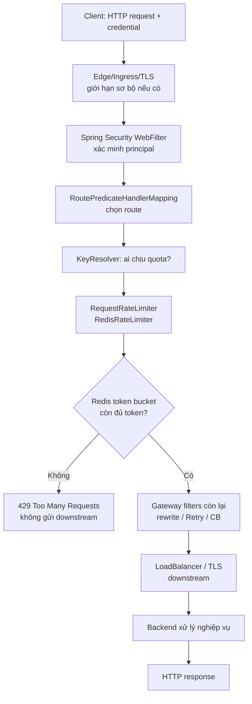
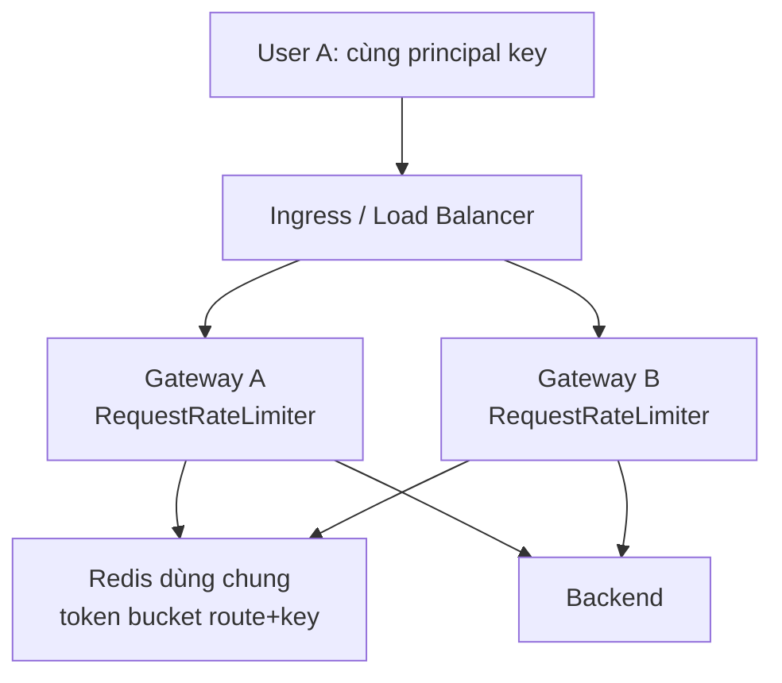

# Kiểm thử tải đột biến, phân bố khóa và tính nhất quán hạn mức

Một API Gateway có thể xử lý ổn định 200 request/giây khi lưu lượng phân bố đều, nhưng vẫn gặp sự cố khi 2.000 request cùng đến trong vài trăm mili giây. Tình huống phức tạp hơn khi tất cả request mang **cùng một khóa định danh**, khi mỗi request dùng **một khóa khác nhau**, hoặc khi hệ thống có nhiều Gateway replica chia sẻ Redis để giới hạn tốc độ. Nếu chỉ chạy một lệnh tải rồi nhìn số phản hồi `429`, người vận hành rất dễ kết luận sai rằng bộ giới hạn lưu lượng hoạt động tốt hoặc bị lỗi.

Trong **Spring Cloud Gateway Server WebFlux**, **`RequestRateLimiter` GatewayFilter Factory** có thể kết hợp với **`RedisRateLimiter`**, một triển khai dựa trên thuật toán **token bucket** và Redis. Filter xét request đã chọn route, dùng **`KeyResolver`** để xác định đối tượng chịu hạn mức, sau đó hỏi rate limiter xem request có được **admit** hay phải bị từ chối. Từ đó xuất hiện ba câu hỏi thực hành:

1. **Tải đột biến (burst):** Có bao nhiêu request được chấp nhận tức thời, bao nhiêu bị giới hạn và khi nào bucket được nạp lại?
2. **Phân bố khóa (key distribution):** Một người dùng, nhiều người dùng, nhiều thiết bị, nhiều tenant và những khóa có phân bố lệch ảnh hưởng thế nào đến tính công bằng và tài nguyên Redis?
3. **Tính nhất quán (quota consistency):** Hai hoặc nhiều Gateway replica có áp dụng **cùng một hạn mức logic** hay vô tình nhân hạn mức lên? Khi Redis lỗi, failover hoặc thay đổi route thì điều gì được bảo đảm?

Bài thuộc chương **Giới hạn lưu lượng** của module **SPRING_CLOUD_GATEWAY**. Nó kết nối cơ chế route predicate và filter chain với xác thực, biến đổi header/path, khám phá dịch vụ, circuit breaker, retry, TLS và observability để vận hành cổng vào microservices an toàn dưới tải không đều.

> **Phạm vi phiên bản:** Ví dụ chính dùng Spring Cloud Gateway **Server WebFlux**, tích hợp Spring Security Resource Server JWT và Reactive Redis. Tài liệu những phiên bản mới dùng namespace `spring.cloud.gateway.server.webflux.routes`; nhiều phiên bản 4.x trước dùng `spring.cloud.gateway.routes`. Cấu hình, defaults, tên metrics và hành vi khi lỗi cần được xác nhận trên phiên bản Gateway/Redis/Reactor Netty thực tế. Bài tập trung vào **kiểm thử và diễn giải kết quả**, không coi các con số minh họa là bảo đảm tuyệt đối của framework.

## 1. Xác định chính xác “hạn mức” đang muốn bảo vệ

Trước khi tạo tải, hãy trả lời **ai chia sẻ một bucket** và **bucket đó áp dụng cho những request nào**.

| Mô hình | Khóa hạn mức ví dụ | Tình huống phù hợp | Rủi ro nếu chọn sai |
| --- | --- | --- | --- |
| Theo **user** | `issuer + subject` của JWT hợp lệ | Mỗi người dùng có quota độc lập | Một user có nhiều danh tính có thể có nhiều bucket |
| Theo **OAuth2 client** | `issuer + client_id` đáng tin cậy | API máy–máy, tích hợp đối tác | Gộp nhiều người dùng dưới một client nếu cần quota riêng |
| Theo **tenant** | Tenant ID được xác minh ở server-side | Giới hạn tổng lưu lượng của tổ chức | Một tenant lớn có thể bị một người sử dụng hết quota |
| Theo **API key** | Định danh key đã xác thực | Tích hợp đối tác dùng khóa API | Đếm trùng/quota bị né nếu dùng header tùy ý |
| Theo **IP đã xác minh** | Remote IP đáng tin cậy | Giới hạn sơ bộ ở vùng public/anonymous | NAT làm nhiều người dùng chung bucket; proxy có thể che IP thật |
| Theo **route + identity** | Route ID và khóa do KeyResolver trả | Một quota cho API orders, quota khác cho catalog | Không tạo quota chung toàn hệ thống dù cùng KeyResolver |

**Giới hạn theo một route không đồng nghĩa giới hạn toàn bộ Gateway.** Trong triển khai RedisRateLimiter thông dụng, khóa trạng thái được phân biệt bởi **route ID** và **khóa do KeyResolver cung cấp**. Vì thế cùng một user có thể có bucket riêng trên `orders-read` và `orders-write` dù hai route dùng cùng một KeyResolver. Nếu yêu cầu một quota tổng cho **nhiều route**, phải có thiết kế quota key/limiter chia sẻ ở đúng tầng; **chỉ đặt cùng tên bean KeyResolver là chưa đủ**.

**Một rate limiter không thể tự thay thế phân quyền.** Request có JWT hợp lệ và còn quota vẫn có thể bị backend từ chối vì không sở hữu tài nguyên. Ngược lại, client bị giới hạn `429` không nhất thiết là kẻ tấn công; có thể họ là người dùng hợp lệ đang bị đồng bộ hóa số lượng lớn request từ ứng dụng.

### 1.1. Sự khác biệt giữa ba mức giới hạn

- **Quota theo khóa:** mọi request có cùng identity key cạnh tranh cho một bucket, bất kể chúng đến Gateway replica nào nếu thực sự dùng chung Redis/state.
- **Quota theo route:** mỗi route có thể có bucket, refill rate và burst capacity riêng.
- **Giới hạn hệ thống:** bảo vệ tổng QPS, concurrent requests, kết nối và chi phí backend trên mọi keys/routes. Cần các cơ chế khác như rate limiting ở edge, concurrency limit, queue budget, circuit breaker, backend admission control.

Ví dụ: 10.000 users, mỗi user được 5 req/s, vẫn có thể tạo tổng yêu cầu **50.000 req/s** sau khi các bucket vào trạng thái ổn định nếu mọi user đều hoạt động. Một chính sách công bằng theo user **không đủ** để bảo vệ backend chỉ phục vụ được 5.000 req/s.

## 2. Vị trí RequestRateLimiter trong đường đi request



Sơ đồ mô tả **một cấu hình điển hình**, không khẳng định mọi security filter hay GatewayFilter luôn chạy theo thứ tự trên trong tất cả cấu hình:

1. **Spring Security WebFilter** có thể trả `401`/`403` trước khi Gateway route được chọn.
2. **Route predicate** xác định route nào thắng; `RequestRateLimiter` chỉ chạy trên route có gắn filter (hoặc được áp dụng qua default filters).
3. **KeyResolver** lấy key từ exchange/security context; nếu không tìm được key, policy “empty key” có thể từ chối khác với vượt quota.
4. **RedisRateLimiter** thực hiện quyết định admit/reject dựa trên trạng thái token bucket.
5. Nếu được chấp nhận, request mới tiếp tục đi downstream, có thể đi qua load balancing, timeout, retry và circuit breaker.

**Không có hàng đợi chờ token mặc định tại RequestRateLimiter.** Khi bucket không còn đủ token, phản hồi điển hình là **`429 Too Many Requests`**, thay vì giữ request cho đến lúc được nạp thêm token. Nếu quan sát request bị treo lâu khi bị giới hạn, hãy kiểm tra Redis latency, network, filter khác hoặc HTTP connection pool, không giả định limiter cố ý xếp queue.

### 2.1. 429 khác các loại lỗi khác

| Kết quả | Ý nghĩa thường gặp | Có chắc là RequestRateLimiter không? |
| --- | --- | --- |
| `429 Too Many Requests` | Quá quota/rate limit | **Không chắc**: ingress, WAF hoặc backend cũng có thể trả 429 |
| `401 Unauthorized` | Thiếu/sai access token | Thường từ security chain, không phải hết token bucket |
| `403 Forbidden` | Thiếu quyền hoặc một empty-key policy từ limiter | Phải xác định lớp phát sinh |
| `404 Not Found` | Không match route/handler hoặc backend không thấy resource | Không chứng minh quota còn/đã hết |
| `5xx` | Lỗi downstream, kết nối Redis hoặc các tầng khác | Không quy kết cho limiter nếu chưa có log/metric gốc |
| `200 OK` | Backend trả thành công | Không đủ để xác định mọi request được admit, nhất là khi có caching hoặc route khác |

Để đo chính xác, nên ghi nhận **quyết định limiter**, **route ID**, **key group đã ẩn danh** và **request có thực sự tới backend hay không**.

## 3. Mô hình token bucket để dự đoán tải đột biến

RedisRateLimiter của Spring Cloud Gateway thực hiện ý tưởng **token bucket**:

- **`replenishRate = r`:** số token được bổ sung mỗi giây.
- **`burstCapacity = B`:** số token tối đa bucket có thể tích lũy.
- **`requestedTokens = q`:** số token một request phải chi trả.
- Mỗi **route + key** có trạng thái token riêng theo cách triển khai của limiter.

Giả sử bucket đã đầy trước lần gọi đầu:

\[
T_{\text{available}}(t+\Delta t)
= \min\left(B,\;T_{\text{after previous admission}}+r\Delta t\right)
\]

Nếu `T_available >= q`, request được chấp nhận và số token còn lại giảm đi `q`; nếu thấp hơn `q`, request bị từ chối. Công thức này là **mô hình liên tục để tính kỳ vọng**. Lua script/thời gian mà phiên bản cụ thể dùng có thể xử lý đơn vị thời gian, làm tròn và độ phân giải khác; hãy kiểm thử ranh giới.

Với một bucket bắt đầu đầy, trong khoảng dài `D` giây, **giới hạn lý tưởng trên** của số request được admit là:

\[
N_{\max}(D) \lesssim
\left\lfloor\frac{B+rD}{q}\right\rfloor
\]

Đây là một **upper bound ước lượng** khi không có hiệu ứng thời gian rời rạc/cancellation/failover; không phải lời hứa Gateway sẽ chấp nhận đúng `N_max` request. Nếu máy phát tải không gửi đủ request, key bị tách thành nhiều bucket, nhiều route khớp khác nhau hoặc Redis từ chối lệnh, kết quả sẽ khác.

### 3.1. Ví dụ nền: 5 token/giây, burst 10, giá một token

```text
replenishRate = 5
burstCapacity = 10
requestedTokens = 1
```

Trong điều kiện bucket đã đầy và nhiều request đồng thời:

- **Ngay lúc bắt đầu:** có thể chấp nhận tối đa khoảng **10 request** trước khi dùng hết token sẵn có.
- **Trong 1 giây tiếp theo:** bucket được bổ sung lượng tương ứng tối đa khoảng **5 token**; request tiếp theo cạnh tranh sử dụng các token đó.
- **Trong 10 giây tải liên tục:** số lượt được admit theo mô hình lý tưởng không vượt khoảng `10 + 5 × 10 = 60`, nhưng số đo thực tế phải xét ranh giới thời gian, độ trễ và cơ chế script.
- **Sau khoảng nghỉ đủ dài:** bucket có thể đầy lại tới `10` token, **không tích lũy vô hạn** 5 token cho mỗi giây nghỉ.

Nếu gửi 100 request trong một thời điểm rất ngắn, việc khoảng 10 request được chấp nhận và phần lớn còn lại bị từ chối có thể **đúng chính sách**. Nếu gửi 100 request phân tán đều trong nhiều giây, tỷ lệ admit có thể cao hơn. Vì vậy, **tổng số request giống nhau chưa nói lên hình dạng tải**.

### 3.2. Ảnh hưởng của requestedTokens

| Cấu hình | Burst tức thời lý tưởng khi bucket đầy | Tốc độ admit dài hạn theo mô hình |
| --- | --- | --- |
| `r=5, B=10, q=1` | Khoảng 10 request | Khoảng 5 request/giây |
| `r=5, B=10, q=2` | Khoảng 5 request | Khoảng 2,5 request/giây |
| `r=1, B=60, q=60` | Khoảng 1 request | Khoảng 1 request/phút |
| `r=20, B=20, q=1` | Khoảng 20 request | Khoảng 20 request/giây |

Các giá trị là **dung lượng theo token**, không có nghĩa `burstCapacity=10` cho phép đúng 10 RPS ở mỗi cửa sổ một giây. Token bucket cho phép **burst ngắn** khi đã tích lũy token; nó không giống fixed-window counter.

### 3.3. Phân biệt token bucket với fixed/sliding window

| Thuật toán | Hành vi chung | Điểm cần cẩn trọng khi test |
| --- | --- | --- |
| **Token bucket** | Bổ sung token theo thời gian, cap lượng token tích lũy | Request có thể burst đầu kỳ rồi bị chặn; không có ranh giới cửa sổ cứng |
| **Fixed window** | Đếm trong các cửa sổ cố định | Có thể thấy burst gấp đôi gần ranh giới hai cửa sổ |
| **Sliding window** | Đếm/tính theo khoảng trượt | Kết quả phụ thuộc độ phân giải và kỹ thuật triển khai |
| **Concurrency limiter** | Giới hạn số công việc đang xử lý cùng lúc | Không phải tốc độ request/s; backend chậm làm giữ slot lâu |

**Không dùng công thức fixed window để phán đoán RedisRateLimiter token bucket**, chẳng hạn “mỗi giây luôn phải đúng 5 response 200”. Hãy kiểm tra tổng tokens tiêu thụ theo thời gian và mức burst mà chính sách cho phép.

## 4. Cấu hình RedisRateLimiter cho một route thử nghiệm

Ví dụ một API orders dùng RedisRateLimiter với hai mục tiêu: mỗi người dùng có thể tạo burst ngắn, nhưng lưu lượng dài hạn khoảng 5 request/giây; Gateway dùng service discovery để tìm downstream.

### 4.1. YAML Server WebFlux (namespace mới)

```yaml
spring:
  cloud:
    gateway:
      server:
        webflux:
          routes:
            - id: orders-api
              uri: lb://order-service
              predicates:
                - Path=/api/orders/**
              filters:
                - name: RequestRateLimiter
                  args:
                    key-resolver: "#{@principalKeyResolver}"
                    redis-rate-limiter.replenishRate: 5
                    redis-rate-limiter.burstCapacity: 10
                    redis-rate-limiter.requestedTokens: 1
                - StripPrefix=1
```

Các điểm cần hiểu:

1. **`RequestRateLimiter` là tên factory**, không phải một route predicate. Cú pháp **name/args** tránh nhầm lẫn; factory này không dùng một shortcut cấu hình rút gọn tùy ý như `RequestRateLimiter=5,10`.
2. **`key-resolver`** tham chiếu bean bằng SpEL `#{@principalKeyResolver}`. Bean phải hiện diện trong Spring context và có kiểu `KeyResolver`.
3. Ba tham số `redis-rate-limiter.*` định nghĩa token bucket cho **route này**; nếu route bị một route khác bắt trước, filter ở đây không chạy.
4. **`StripPrefix=1`** chỉ thay request path về backend; không quyết định quota key.
5. URI `lb://order-service` cần Spring Cloud LoadBalancer và discovery/source instances. Muốn cô lập thử nghiệm limiter, có thể thay tạm bằng một URI HTTP trỏ đến backend stub ổn định.

Với nhiều phiên bản Spring Cloud Gateway 4.x, thuộc tính route thường nằm dưới:

```yaml
spring:
  cloud:
    gateway:
      routes:
        - id: orders-api
          uri: http://localhost:9090
          predicates:
            - Path=/api/orders/**
          filters:
            - name: RequestRateLimiter
              args:
                key-resolver: "#{@principalKeyResolver}"
                redis-rate-limiter.replenishRate: 5
                redis-rate-limiter.burstCapacity: 10
                redis-rate-limiter.requestedTokens: 1
```

**Không đồng thời khai báo cả hai namespace** để “chắc chắn hoạt động”. Chọn đúng Spring Cloud Gateway BOM/starter và xác minh route/filter đã được nạp trong runtime.

### 4.2. Redis và dependency

RedisRateLimiter cần kết nối tới Redis và tích hợp **Spring Data Redis Reactive**, thông thường qua dependency `spring-boot-starter-data-redis-reactive` cùng phiên bản Spring Boot phù hợp.

Ví dụ cấu hình Redis trong môi trường test:

```yaml
spring:
  data:
    redis:
      host: redis.internal.example.test
      port: 6379
      # Thêm TLS, xác thực và timeout theo hạ tầng thực tế.
```

Hostname chỉ minh họa. Production phải bảo vệ Redis bằng ACL/credentials, TLS hoặc mạng tin cậy, giới hạn truy cập và theo dõi tình trạng Redis. Không dùng Redis public/không xác thực để lưu trạng thái quota.

**Một lỗi kết nối Redis không nên được âm thầm coi là “bị rate limit 429”**. Nó có thể tạo timeout/lỗi ứng dụng, và cách hệ thống xử lý khi Redis không sẵn sàng phải là một quyết định rõ ràng về fail-closed, fail-open hoặc fallback có kiểm soát.

### 4.3. KeyResolver dựa vào principal đã xác thực

Trong API dùng Spring Security, cách đơn giản là dùng tên principal sau khi xác thực:

```java
package com.example.gateway.ratelimit;

import java.security.Principal;
import org.springframework.cloud.gateway.filter.ratelimit.KeyResolver;
import org.springframework.context.annotation.Bean;
import org.springframework.context.annotation.Configuration;

@Configuration
public class RateLimitKeyConfiguration {

    @Bean("principalKeyResolver")
    KeyResolver principalKeyResolver() {
        return exchange -> exchange.getPrincipal()
            .map(Principal::getName)
            .filter(name -> !name.isBlank());
    }
}
```

Ví dụ chỉ có ý nghĩa khi WebFlux/Spring Security hoặc thành phần xác thực đáng tin cậy thiết lập principal. Với JWT Resource Server, `Authentication.getName()` thường là `sub` theo converter mặc định, nhưng cần xác minh với IdP và cấu hình thật.

**Lưu ý quan trọng về định danh:** `sub` có thể chỉ duy nhất **trong phạm vi issuer**. Nếu Gateway nhận token từ nhiều issuer/tenant, dùng `sub` trần có thể làm hai người dùng khác issuer vô tình chia sẻ quota. Một key ổn định hơn có thể là tổ hợp `issuer|subject` hoặc `tenant|subject` đã được kiểm chứng, có định dạng chuẩn hóa và cách mã hóa tránh va chạm ký tự.

Ví dụ KeyResolver khi chỉ chấp nhận JWT đã xác minh:

```java
import org.springframework.cloud.gateway.filter.ratelimit.KeyResolver;
import org.springframework.context.annotation.Bean;
import org.springframework.security.oauth2.server.resource.authentication.JwtAuthenticationToken;
import reactor.core.publisher.Mono;

@Bean("issuerSubjectKeyResolver")
KeyResolver issuerSubjectKeyResolver() {
    return exchange -> exchange.getPrincipal()
        .ofType(JwtAuthenticationToken.class)
        .flatMap(authentication -> {
            var jwt = authentication.getToken();
            if (jwt.getIssuer() == null || jwt.getSubject() == null) {
                return Mono.empty();
            }
            return Mono.just(
                jwt.getIssuer().toString() + "|" + jwt.getSubject());
        });
}
```

Đây là **mẫu minh họa**, không phải bộ chuẩn hóa key hoàn chỉnh: nếu input cho phép ký tự phân cách, cần encode hoặc length-prefix để không có hai cặp giá trị sinh cùng key. Đừng ghi raw subject/tenant nhạy cảm vào metrics labels hoặc logs. Có thể tạo fingerprint/HMAC có quản lý khóa cho mục đích quan sát khi thích hợp.

### 4.4. Khi KeyResolver không trả key

Theo tài liệu Gateway, khi KeyResolver không tạo được key, `RequestRateLimiter` **mặc định từ chối request**; có các thuộc tính như `deny-empty-key` và `empty-key-status-code` để tùy chỉnh ở những phiên bản hỗ trợ.

Trường hợp **không có principal** có thể bị Spring Security trả `401` **trước khi** đến GatewayFilter. Nếu request đã vào limiter mà resolver trả `Mono.empty()`, status có thể là policy empty-key, **không nên mặc định là 429**. Phải test tầng phát sinh response.

**Không sử dụng một key fallback cố định kiểu `"anonymous"` cho mọi request** mà không xem xét tác động: mọi người dùng vô danh sẽ chia sẻ bucket, tạo cạnh tranh ngoài ý muốn. Nếu cần bảo vệ public/anonymous API, cân nhắc một quota chung kết hợp edge limits, IP đã xác thực hoặc cơ chế nhận dạng khác phù hợp với rủi ro.

## 5. Thiết kế kiểm thử tải có thể tái lập

Kiểm thử rate limit không chỉ là “bắn request thật nhanh”. Mọi phép thử cần có **mục tiêu, biến kiểm soát, cách đếm và tiêu chí đánh giá**.

### 5.1. Chuẩn bị môi trường

Một môi trường thử nghiệm có thể gồm:

```text
                   ┌── Gateway A ──┐
Test clients  ─ LB ┤               ├── Redis dùng chung
                   └── Gateway B ──┘
                         │
                Backend HTTP stub
                (trả JSON 200, ghi call count)
```

Các thành phần nên có:

- **Gateway A/B** cùng phiên bản, route ID, KeyResolver, Redis endpoint và tham số limiter.
- **Redis** dùng chung, được theo dõi memory, latency, command errors và failover.
- **Backend stub** trả một response xác định như `200 OK`, không phụ thuộc database/IdP thật. Có thể bật độ trễ giả có kiểm soát cho những bài test khác.
- **Bộ sinh tải** tách biệt khỏi máy Gateway/Redis để tránh CPU của load generator làm méo kết quả.
- **Token test A/B** được ký hợp lệ với **hai identity khác nhau nhưng quyền tương tự**, hoặc một giải pháp test auth đáng tin cậy. Không dùng token production trong file script.
- **Observability**: HTTP status, request latency, route ID, Gateway instance, Redis metrics và backend call count.

**Chạy trong môi trường được phép kiểm thử.** Thử burst trên cổng public/production có thể gây quá tải cho người dùng thật hoặc kích hoạt hệ thống chống tấn công. Cần điều phối, giới hạn cường độ tải và dùng dữ liệu không có tác dụng phụ.

### 5.2. Các biến cần giữ cố định

| Biến | Vì sao cần giữ cố định trong một phép thử? |
| --- | --- |
| Route ID và path/method | Chuyển sang route khác có thể tạo bucket khác hoặc bỏ qua limiter |
| JWT identity/tenant/issuer | Thay key giữa chừng làm kết quả không còn là phép thử một bucket |
| Redis endpoint/state | Nhiều Redis riêng biệt tạo hạn mức riêng; bucket cũ có thể chưa reset |
| Gateway replica count | Thay số replica làm thay đổi topology, latency và cân bằng tải |
| Backend response/latency | Lỗi backend hoặc tăng độ trễ làm lẫn số response thành công |
| Generator arrival rate | Số VUs không đồng nghĩa request/giây, đặc biệt khi latency tăng |
| Time window và vị trí bắt đầu | Bucket đầy hoặc đang cạn tạo kết quả burst khác nhau |

Một phép test tốt có **warm-up**, chạy ổn định, giai đoạn burst, cooldown và lặp lại nhiều lần với điều kiện được ghi nhận. Cần biết bucket đã đầy hay chưa tại lúc bắt đầu; nếu dùng lại cùng key sau test trước, số token còn lại có thể khác với giả định.

### 5.3. Đếm bốn kết quả độc lập

Đối với mỗi test run, ghi:

1. **Requests attempted:** load generator dự định/gửi được bao nhiêu request?
2. **Requests rejected by limiter:** bao nhiêu request bị limiter chủ động từ chối?
3. **Requests admitted by limiter:** bao nhiêu request được cho đi tiếp **bất kể backend trả 200 hay 5xx**?
4. **Backend calls observed:** backend nhận bao nhiêu request thật, bao gồm retry hoặc request do route khác gửi?

Đừng mặc định `200 = admitted` và `429 = limiter rejected` trong tất cả môi trường. Một backend có thể trả 429, Gateway security trả 401 trước limiter, hoặc một request được admit nhưng downstream timeout. Với backend stub cố định và không có filter khác, số 200/429 có thể là proxy metric hữu ích, **nhưng vẫn phải kiểm chứng nguồn status**.

## 6. Bài kiểm thử 1: tải đột biến vào một khóa

Thiết lập:

```text
Route: orders-api
Key: user-A (một JWT identity cố định)
replenishRate: 5
burstCapacity: 10
requestedTokens: 1
Bucket trước test: đã có thời gian idle để đầy
Backend: trả 200 ngay, không retry
```

### 6.1. Kết quả kỳ vọng

Gửi một burst **50 request gần đồng thời**:

- Số request được admit ngay có thể tiến tới **10** theo lượng token đầy ban đầu.
- Các request còn lại có thể bị `429` nếu không có đủ thời gian để nạp thêm.
- Nếu bộ sinh tải làm burst kéo dài vài giây, có thêm token refill; khi đó admit nhiều hơn 10 **không nhất thiết là lỗi**.
- Thứ tự request nào thành công **không được bảo đảm**; client/request thứ 1 chưa chắc thắng request thứ 2 nếu request đi qua các Gateway replica và mạng khác nhau.

**Không assert “chính xác 10/50” trong một test chịu ảnh hưởng scheduler/latency ngoài kiểm soát.** Nên kiểm tra khoảng dung sai dựa trên khoảng thời gian thật và xác nhận không có dấu hiệu được admit vượt mô hình một bucket với tải thử cụ thể.

### 6.2. Test sau khi bucket cạn

Ngay sau burst đầu:

1. Gửi thêm 20 request trong thời gian rất ngắn.
2. Kỳ vọng phần lớn sẽ bị từ chối, vì bucket chưa đủ thời gian nạp lại.
3. Để bucket yên lâu hơn thời gian cần để đầy, ví dụ khoảng `B/r = 10/5 = 2 giây` **trong mô hình lý tưởng**, rồi gửi burst mới.
4. Kỳ vọng xuất hiện khả năng nhận burst trở lại.

Con số **2 giây** chỉ là thời gian refill lý tưởng từ rỗng đến đầy, không phải lời hứa rằng đúng 2.000 ms thì mọi triển khai phải nhận đủ 10 request. Độ phân giải thời gian của script, Redis latency và các request phát sinh khác cần được tính đến.

### 6.3. Phân biệt burst với sustained overload

Hai workload có cùng 500 request nhưng hành vi khác nhau:

| Workload | Hình dạng tải | Điều muốn kiểm tra |
| --- | --- | --- |
| **Spike** | 500 request tập trung trong khoảng cực ngắn | Bucket cap và tỷ lệ reject tức thời |
| **Ramp-up** | Tăng dần từ 1 → 100 RPS | Điểm bắt đầu có 429 và độ trễ Redis/Gateway |
| **Sustained overload** | Giữ 100 RPS trong 30 giây | Admit dài hạn theo replenish rate |
| **Cooldown + second spike** | Nghỉ đủ lâu rồi burst lần nữa | Refill và trạng thái bucket sau idle |
| **Bursty periodic** | Mỗi giây gửi một nhóm lớn thay vì đều | Tác động burstCapacity, scheduling và biên thời gian |

**Nếu backend vốn đã quá tải**, hãy sửa môi trường thử trước khi kết luận về limiter. Một test limiter nên bắt đầu với backend stub ổn định và riêng biệt; sau đó mới thêm độ trễ/lỗi backend để đánh giá tính ổn định end-to-end.

## 7. Bài kiểm thử 2: phân bố khóa và tính công bằng

**Key distribution** là cách request được phân bố lên các khóa quota. Đây có thể là yếu tố lớn hơn cả `replenishRate` khi tính tổng traffic qua Gateway.

### 7.1. Một khóa nóng và nhiều khóa lạnh

Giả sử:

- User A gửi 100 request/giây.
- User B gửi 1 request/giây.
- User C gửi 1 request/giây.
- Mỗi user có **bucket độc lập** với `r=5, B=10, q=1` trên cùng route.

Kỳ vọng theo thiết kế:

- A nhận nhiều `429` sau khi tiêu thụ burst và refill.
- B và C vẫn có khả năng được admit hầu hết request hợp lệ vì **bucket của họ không bị A tiêu thụ token**.
- Nếu B/C cũng bị chặn bất thường, kiểm tra liệu KeyResolver có trả **cùng key** cho A/B/C hay không, hoặc Redis/backend/Gateway có nghẽn chung.

**Không đồng nhất “tỷ lệ 429 cao trên toàn Gateway” với “mọi user bị giới hạn công bằng”.** Một key nóng có thể chiếm phần lớn request reject, còn phần lớn users khác không bị ảnh hưởng.

### 7.2. Nhiều khóa tạo tổng quota lớn

Giả sử có 100 users, mỗi user đều gửi 5 request/giây trên cùng route:

\[
\text{Tải dài hạn có thể được admit} \approx
100\ \text{keys} \times 5\ \text{req/s per key}
= 500\ \text{req/s}
\]

Đây là giá trị **lý tưởng nếu mỗi bucket thực sự độc lập** và không có giới hạn chung khác. Nếu backend chỉ phục vụ 300 req/s, một chính sách quota theo user vẫn có thể làm backend quá tải. Cần bổ sung:

- Quota theo tenant hoặc API client tùy hợp đồng.
- Giới hạn tổng tại edge/ingress hoặc dịch vụ quota tập trung.
- Backend concurrency/connection pool limits và circuit breaker.
- Theo dõi tổng admitted RPS, không chỉ phần trăm 429.

### 7.3. Tình huống NAT: nhiều người cùng một IP

Một trường học hoặc công ty có thể có hàng trăm người dùng đi ra Internet qua **một public IP**. Nếu KeyResolver dùng địa chỉ IP, mọi người có thể chia sẻ một bucket, dẫn đến một người tải lớn khiến những người khác bị `429`.

Ngược lại, một người dùng di chuyển giữa mạng di động, VPN và Wi-Fi có thể dùng nhiều IP, vô tình nhận nhiều bucket hơn dự kiến.

**Không tin `X-Forwarded-For` do client tự gửi**. Khi phải giới hạn theo IP, hãy dựa trên địa chỉ ở ranh giới proxy tin cậy với cấu hình xử lý `Forwarded`/`X-Forwarded-*` chính xác, tránh cho client tự chọn key bằng header giả mạo.

### 7.4. Multi-tenant và khóa nhiều chiều

Khi nhiều user thuộc cùng một tenant, có ít nhất hai chính sách:

- **Per-user quota:** user-A và user-B có bucket riêng.
- **Per-tenant quota:** cả hai cùng tiêu thụ bucket của tenant-X.

Không thể giả định chỉ thêm `tenantId` vào key user là đạt **hai tầng quota**. Khóa `tenantX|userA` và `tenantX|userB` vẫn là **hai bucket riêng**, chưa có tổng quota của tenant. Nếu cần cả user **và** tenant limit, thiết kế **hai quyết định quota độc lập** hoặc một cơ chế quota nhiều tầng có atomicity phù hợp.

Ví dụ:

```text
Tenant X: tối đa 100 req/s tổng
  User A: tối đa 20 req/s
  User B: tối đa 20 req/s

Request của User A chỉ được admit nếu:
  còn quota tenant X
  VÀ còn quota user A
```

Việc kiểm tra hai bucket **không tự trở thành một giao dịch nguyên tử** chỉ bằng cách xếp hai filter mặc định; có thể có token bị trừ ở bucket thứ nhất rồi bị từ chối ở bucket thứ hai. Nếu yêu cầu không lãng phí quota/cần tính chính xác mạnh, dùng một cơ chế đa mức được thiết kế riêng.

### 7.5. Key có cardinality cao

Nếu một header `X-Request-Id` hoặc timestamp mới cho mỗi request bị dùng làm key, mỗi request có thể tạo **một bucket mới đầy token**. Khi đó:

- Limiter gần như không giới hạn được một client lặp request.
- Redis phải quản lý nhiều key trạng thái và TTL, gây memory pressure.
- Metrics theo raw key có thể bùng nổ số nhãn (*high cardinality*), làm observability quá tải.

**Key phải ổn định theo thực thể cần giới hạn**, không theo request ID. Không lấy query parameter, user-agent hay một header tùy ý chưa được xác thực làm key trực tiếp trong production.

## 8. Bài kiểm thử 3: tính nhất quán giữa nhiều Gateway replica

Giả sử cùng một token của user A gửi request qua một load balancer phân phối tới **Gateway A** và **Gateway B**:



**Nếu cả hai Gateway dùng cùng Redis, cùng route ID, cùng định danh key và cùng cấu hình limiter**, phép tính bucket được phối hợp qua Redis; tăng số Gateway replicas **không mặc nhiên nhân đôi quota một user**.

RedisRateLimiter của Spring Cloud Gateway dùng **Redis Lua script** để tính và cập nhật trạng thái token bucket theo key trong một thao tác phía Redis, giúp tránh kiểu read–modify–write không nguyên tử giữa các Gateway replicas trong điều kiện vận hành thông thường.

### 8.1. Điều kiện để nói “cùng một quota”

| Điều kiện | Khi sai sẽ ra sao? |
| --- | --- |
| **Cùng Redis state** | A và B trỏ tới Redis riêng tạo hai bucket độc lập, có thể nhân quota |
| **Cùng route ID logic** | Hai route ID khác nhau có thể có hai bucket cho cùng người |
| **Cùng KeyResolver/chuẩn hóa key** | A trả `issuer|sub`, B trả `sub`: chia trạng thái |
| **Cùng r/B/q** | Hai replica quyết định theo ngưỡng khác nhau, gây kết quả khó đoán |
| **Cùng trust/auth identity** | Principal khác nhau do mapper/issuer sẽ tạo key khác |
| **Cùng phiên bản/triển khai tương thích** | Khác script/key format hoặc config có thể gây drift |
| **Redis khả dụng, không có phân vùng/failover ngoài dự đoán** | Không thể giả định nhất quán tuyệt đối khi mất đồng bộ hoặc lỗi |

**Thực nghiệm dễ bị đánh lừa:** mỗi Gateway có Redis local của riêng nó. Khi gửi 50 request trực tiếp đến A thấy khoảng 10 thành công và gửi 50 trực tiếp đến B cũng thấy khoảng 10 thành công, người vận hành tưởng “quá tốt: Gateway nào cũng chặn”, nhưng khi đứng sau một load balancer, user A có thể tiêu thụ **hai quota**. Cần kiểm thử **cùng identity qua cả hai replicas**, không chỉ test mỗi replica độc lập.

### 8.2. Test qua một và nhiều replica

Quy trình minh họa:

1. Bảo đảm test có một route ID thống nhất `orders-api` và cùng key resolver.
2. Đưa Redis về trạng thái thử nghiệm đã kiểm soát mà **không xóa các key sản xuất**; tốt nhất dùng Redis test riêng và chờ bucket đầy trước mỗi run.
3. Gửi burst qua **chỉ Gateway A**; ghi accepted/rejected và Redis metrics.
4. Lặp lại với **chỉ Gateway B** sau khi reset trạng thái thử nghiệm an toàn.
5. Gửi **cùng burst qua load balancer** để A/B cùng nhận request.
6. So sánh tổng admitted trên **A+B**, không chỉ ở từng replica.
7. Kiểm tra log/token key normalization nếu tổng admit vượt kỳ vọng.

Khi dùng chung Redis, tổng admitted trong một khoảng ngắn phải phù hợp **mô hình một bucket** (có dung sai do thời gian/thử nghiệm), không phải mặc định cộng hai dung lượng burst riêng.

### 8.3. Tại sao “Lua atomic” không đồng nghĩa đúng tuyệt đối trong mọi sự cố?

Redis script cho một key/bộ key phù hợp có thể cập nhật trạng thái một cách nguyên tử trên server đang xử lý. Nhưng toàn hệ thống vẫn có những tình huống:

- **Redis failover:** quá trình sao chép sang replica có thể không đồng bộ hoàn toàn; sau failover, một số ghi gần thời điểm sự cố có thể không còn.
- **Network partition/timeouts:** một Gateway không biết lệnh đã được Redis thực thi hay chưa nếu kết nối đứt sau khi gửi; retry vô điều kiện có thể làm trạng thái thay đổi thêm.
- **Nhiều Redis clusters độc lập:** không chia sẻ cùng trạng thái nên không có quota toàn cụm.
- **Clock skew:** nếu phiên bản limiter lấy thời gian từ máy Gateway để tính refill, đồng hồ lệch giữa các replicas có thể gây sai khác; phải đồng bộ thời gian/NTP và kiểm tra cơ chế phiên bản.
- **Route/config refresh:** đổi route ID hoặc key format có thể tạo bucket mới, khiến quota “reset” theo góc nhìn người dùng.

Do đó cần mô tả cam kết thực tế: **phối hợp quota trên Redis ở trạng thái ổn định**, kèm một chính sách khi Redis lỗi/failover. Không quảng cáo “global exactly-once quota tuyệt đối” nếu chưa thiết kế các giả định đồng bộ và xử lý lỗi.

### 8.4. Redis Cluster và vị trí key

RedisRateLimiter lưu trạng thái bucket trong Redis, thường có hơn một trường/key liên quan như token count và timestamp. Với Redis Cluster, những key được xử lý **trong cùng một Lua script** phải thỏa điều kiện nằm trong **cùng hash slot**. Triển khai Spring Cloud Gateway sử dụng cách đặt tên key phục vụ yêu cầu này, nhưng khi tự viết rate limiter/script, cần kiểm tra rõ quy tắc hash tags và cluster compatibility.

**Đừng tự đổi định dạng key nội bộ của RedisRateLimiter** chỉ để “dễ nhìn” nếu chưa hiểu yêu cầu script, TTL, hash slot và migration. Redis ACL, TLS, latency, thời gian failover và khả năng chịu tải là một phần của tính nhất quán hạn mức.

## 9. Công cụ phát tải: kiểm thử arrival rate, không chỉ concurrency

Nhiều công cụ đo tải dùng **virtual users/concurrency**. Tuy nhiên, **20 concurrent users** không có nghĩa luôn tạo **20 request/giây**; tốc độ thực tế phụ thuộc thời gian mỗi request và hành vi retry.

Để kiểm thử quota theo req/s, nên dùng một generator hỗ trợ **constant arrival rate** hoặc **open model**: đặt mục tiêu số request phát ra theo thời gian, không vô tình giảm lưu lượng khi Gateway trả lời chậm.

### 9.1. Ví dụ k6: một key và hai key

Ví dụ script `k6` sau giả định đã có hai Bearer JWT **test** hợp lệ, với hai `sub` khác nhau và cùng quyền gọi endpoint. Token chỉ được inject qua biến môi trường khi chạy, **không ghi cứng vào file**.

```javascript
import http from 'k6/http';
import exec from 'k6/execution';
import { check } from 'k6';
import { Counter } from 'k6/metrics';

export const options = {
  scenarios: {
    spike: {
      executor: 'constant-arrival-rate',
      rate: 100,
      timeUnit: '1s',
      duration: '10s',
      preAllocatedVUs: 100,
      maxVUs: 200,
    },
  },
};

const acceptedA = new Counter('backend_200_a');
const acceptedB = new Counter('backend_200_b');
const rejectedA = new Counter('rejected_429_a');
const rejectedB = new Counter('rejected_429_b');
const unexpected = new Counter('unexpected_status');

export default function () {
  // KEY_MODE=one -> tất cả dùng TOKEN_A.
  // KEY_MODE=two -> luân phiên TOKEN_A / TOKEN_B.
  const useB = __ENV.KEY_MODE === 'two' &&
    (exec.scenario.iterationInTest % 2 === 1);
  const token = useB ? __ENV.TOKEN_B : __ENV.TOKEN_A;
  if (!token) {
    throw new Error('Missing test token in environment');
  }

  const response = http.get(
    'http://localhost:8080/api/orders/42',
    {
      headers: { Authorization: 'Bearer ' + token },
      redirects: 0,
      tags: { key_group: useB ? 'B' : 'A' },
    }
  );

  if (response.status === 200) {
    (useB ? acceptedB : acceptedA).add(1);
  } else if (response.status === 429) {
    (useB ? rejectedB : rejectedA).add(1);
  } else {
    unexpected.add(1);
  }

  check(response, {
    'expected status 200 or 429': r =>
      r.status === 200 || r.status === 429,
  });
}
```

**Giới hạn của ví dụ:** tên counter `backend_200_*` giả định downstream stub **luôn trả 200 khi được gọi** và không có cache/fallback. Khi backend trả 5xx hoặc route khác trả 200, những counter này không còn là số admit chính xác của limiter. Test cần log/counter backend để đối chiếu.

**Cách dùng:** lưu script vào một tệp **ngoài dự án bài học** trong môi trường thực hành được phép, nạp `TOKEN_A` và `TOKEN_B` từ secret/environment của test runner, rồi chạy `k6 run` theo cơ chế môi trường. Không đặt JWT thật trong command line được ghi lịch sử, VCS hoặc output gửi cho người khác.

Hai bài chạy:

- **KEY_MODE=one:** 100 req/s đều dùng key của A; kỳ vọng phần lớn 429 nếu quota chỉ 5 token/s sau burst.
- **KEY_MODE=two:** cùng tổng 100 req/s nhưng chia đều giữa A và B; hai bucket độc lập có thể admit khoảng **gấp đôi dài hạn** so với một key, miễn đúng route, Redis state và không có giới hạn hệ thống khác.

Mẫu chạy **10 giây ở 100 RPS** dự kiến gửi khoảng 1.000 request. Theo mô hình ban đầu đầy: với một key có `B=10, r=5, q=1`, số được admit lý tưởng tối đa khoảng 60 trong 10 giây; với hai keys mỗi bucket như vậy, tổng có thể gần 120. **Đây là ước lượng để nhận biết order of magnitude**, không phải assert cứng: các run có timing khác nhau và generator có thể không phát đủ tải dự kiến.

**Quan trọng:** k6 có metric `dropped_iterations` nếu không đủ VUs để phát các lần lặp ở rate mục tiêu. Khi có dropped iterations, phải so số **request thực sự phát ra** trước khi dùng tỷ lệ 429 để đánh giá Gateway. Tăng VUs khi thích hợp nhưng không thay đổi đồng thời nhiều biến trong cùng một phép đo.

### 9.2. Dùng curl để xác nhận cấu hình trước khi load test

```bash
curl -i "http://localhost:8080/api/orders/42" \
  -H "Authorization: Bearer <TEST_ACCESS_TOKEN>"
```

Kiểm tra:

- Path đúng và route có filter thật sự được chọn.
- JWT test hợp lệ, token đủ quyền (không gặp `401`/`403` do auth).
- Backend stub trả `200` khi được admit.
- Sau khi gửi nhiều request nhanh có thể quan sát `429`.
- Nếu có `X-RateLimit-*` headers do phiên bản Gateway cung cấp, có thể sử dụng để hỗ trợ debug, **nhưng không dựa duy nhất vào các header này** để kết luận phân phối quota toàn cụm.

Ví dụ một số phiên bản RedisRateLimiter có thể trả thông tin như `X-RateLimit-Remaining`, `X-RateLimit-Burst-Capacity`, `X-RateLimit-Replenish-Rate` hoặc `X-RateLimit-Requested-Tokens`. Tên và khả năng bật/tắt phải đối chiếu phiên bản; nội dung có thể là **snapshot ở thời điểm quyết định**, không phải một phép đo đồng bộ mọi request khác đang bay.

## 10. Ma trận kiểm thử tối thiểu

| ID | Tình huống | Điều phải xác minh |
| --- | --- | --- |
| T1 | Một key, bucket đầy, 50 request gần đồng thời | Burst được giới hạn quanh capacity; reject khi hết token |
| T2 | Một key, tải duy trì trên replenish rate | Admit tiến gần tốc độ refill dài hạn; số 429 tăng |
| T3 | Một key, nghỉ đủ lâu rồi burst lại | Token hồi phục nhưng không vượt `burstCapacity` |
| T4 | Hai user khác key, cùng route | Bucket độc lập, tổng admit có thể tăng tương ứng |
| T5 | Hot key A + cold key B/C | Hot key bị giới hạn nhưng cold keys không mất quota vì A |
| T6 | 100 keys khác nhau, mỗi key lưu lượng thấp | Tổng admitted có thể cao hơn dự kiến nếu chỉ nhìn một key |
| T7 | Nhiều users chung public IP/NAT | IP-based key tạo tranh chấp ngoài ý muốn nếu dùng IP làm quota |
| T8 | Key lấy từ header không được xác thực | Nhận diện nguy cơ spoofing/key explosion; không chấp nhận cấu hình production này |
| T9 | Một user, hai Gateway replicas, cùng Redis và route ID | Tổng admit gần mô hình **một bucket chung** |
| T10 | Hai Gateway replicas dùng hai Redis độc lập | Phát hiện quota bị nhân theo số Redis stores |
| T11 | Cùng user qua hai route ID | Kiểm tra có hai bucket riêng theo thiết kế |
| T12 | KeyResolver trả Mono.empty() | Kiểm tra empty-key policy, phân biệt 401/403/429 |
| T13 | Redis chậm hoặc không sẵn sàng | Quan sát timeout/lỗi và đúng chính sách fail-open/fail-closed |
| T14 | Redis failover/route refresh | Theo dõi drift/reset trạng thái, không giả định chính xác tuyệt đối |
| T15 | Backend trả 500 hoặc 429 | Không gán nhầm response downstream cho quyết định limiter |
| T16 | Retry được bật | Đo backend attempts so với inbound requests; bảo vệ idempotency |
| T17 | API public và admin trên các routes khác | Đúng quota/auth riêng, không có route shadowing |
| T18 | Tăng Gateway replicas trong lúc chạy | Không vô tình nhân quota khi cùng Redis/state, theo dõi latency/redis load |

### 10.1. Các phép thử phản ví dụ rất có giá trị

**Phản ví dụ 1:** 500 request từ 500 JWT khác nhau đều được nhận, trong khi quota là 5 req/s. Đây **không chứng minh limiter hỏng**; nếu một key chỉ gửi một request, mỗi bucket đều có đủ token.

**Phản ví dụ 2:** 50 request cùng JWT, qua hai Gateway replicas, 20 request được nhận rất nhanh dù `burstCapacity=10`. Có thể do hai Redis độc lập, route IDs khác nhau, KeyResolver trả key khác nhau hoặc khoảng phát tải dài đủ để refill. Đừng kết luận do “Redis Lua không nguyên tử” trước khi loại trừ các nguyên nhân này.

**Phản ví dụ 3:** User A bị 429 còn user B cũng bị timeout. Nếu B có bucket riêng, B vẫn có thể bị ảnh hưởng bởi tài nguyên dùng chung: Redis quá tải, Gateway event loop/connection pool bận, ingress hoặc backend nghẽn. “Quota độc lập” không đồng nghĩa “hoàn toàn cô lập mọi tài nguyên”.

## 11. Kiểm thử tính nhất quán dưới concurrent requests

Một lỗi limiter tự viết phổ biến là:

```text
Gateway A đọc tokens = 1
Gateway B đọc tokens = 1
Gateway A ghi tokens = 0, cho qua request A
Gateway B ghi tokens = 0, cho qua request B
=> Hai request được admit dù chỉ còn 1 token
```

Đây là **race condition** của cách read–modify–write không nguyên tử. RedisRateLimiter sử dụng Lua script cho quyết định và cập nhật token để tránh kiểu race này trên cùng trạng thái Redis trong điều kiện thích hợp.

### 11.1. Một bài test concurrent cần nhìn những gì?

1. Tạo nhiều requests có **cùng principal key** và cùng route.
2. Phân tán requests qua nhiều Gateway replicas.
3. Giữ khoảng phát tải rất ngắn nếu muốn kiểm tra **burst capacity**.
4. Ghi nhận **thời gian request thực sự đến Gateway** và thời gian Redis xử lý, không chỉ thời điểm load generator chuẩn bị gửi.
5. Đối chiếu tổng admitted trong khoảng với mô hình token bucket có allowance cho refill.
6. Kiểm tra một request bị từ chối **không được gửi tới backend**.
7. Lặp lại khi tăng replica count và khi Redis chịu tải nền khác.

**Không thể chứng minh tính nhất quán bằng một phép chạy ngắn duy nhất.** Nếu cần cam kết mạnh, hãy test nhiều lượt, nhiều key distributions, Redis HA/failover và xem log/traces/metrics ở từng tầng.

### 11.2. Khi Redis có lỗi hoặc bị partition

Cần một bảng quyết định vận hành:

| Phương án khi không kiểm tra được quota | Ưu điểm | Rủi ro |
| --- | --- | --- |
| **Fail closed**: từ chối hoặc trả lỗi phù hợp | Bảo vệ backend và ngăn vượt quota ngoài kiểm soát | Có thể giảm tính sẵn sàng cho client hợp lệ |
| **Fail open có điều kiện** | Tiếp tục phục vụ một số request khi Redis lỗi | Backend có thể chịu tải lớn; quota bị vô hiệu tạm thời |
| **Fallback limiter cục bộ** | Có thể cung cấp bảo vệ sơ bộ khi Redis mất | Hạn mức không còn nhất quán giữa replicas |
| **Circuit breaker/cắt tải cấp cao** | Bảo vệ cả Redis/Gateway/backend theo rủi ro | Cần phân loại lỗi cẩn thận và thông báo client rõ |

**Không mặc định Spring Cloud Gateway tự áp dụng chính sách nào trong bảng cho mọi loại lỗi Redis.** Muốn thay đổi cách xử lý exception phải cấu hình hoặc mở rộng và **kiểm thử kết quả thật**. Đừng nuốt lỗi Redis rồi mặc nhiên cho phép tất cả request vì đó có thể là đường bypass quota khi Redis bị tấn công/lỗi.

### 11.3. Thay đổi cấu hình khi đang có lưu lượng

Những thay đổi có thể làm quota mất liên tục:

- Đổi route ID `orders-api` thành `orders-v2`, làm key Redis của bucket thay đổi.
- Thay KeyResolver từ `sub` sang `issuer|sub`.
- Đổi cách chuẩn hóa chữ hoa/thường của tenant/client ID.
- Sử dụng Redis key prefix khác giữa Gateway replicas.
- Chuyển từ Redis A sang Redis B mà không có phương án chuyển/trống trạng thái.
- Bật thêm route canary hoặc fallback dẫn cùng endpoint nhưng có route ID khác.

**Cần thiết kế rollout quota như thay đổi schema/state**, không chỉ coi là sửa ba số `r/B/q`. Khi thay đổi key format, cần có phương án migration, kiểm thử và cảnh báo quota reset nếu ảnh hưởng tới cam kết với khách hàng.

## 12. Quan sát để xác định nguyên nhân gốc

Một dashboard hữu ích cần kết hợp **traffic**, **quyết định rate limit**, **phân bố keys** và **tình trạng Redis/Backend**.

| Chỉ số | Đo để trả lời | Lưu ý |
| --- | --- | --- |
| Inbound RPS theo route/status | Tổng traffic có tăng đột biến không? | Phân biệt `429` từ gateway/ingress/backend |
| Allowed/rejected của rate limiter | Tỷ lệ admit/reject thật là bao nhiêu? | Có thể cần custom instrumentation nếu metric mặc định chưa đủ |
| Tỷ lệ `401`/`403` | Auth/key resolver có gây sai lệch không? | Request bị security từ chối có thể chưa đến limiter |
| Unique key count đã tổng hợp | Có xuất hiện key explosion? | Tránh metric label cho từng raw key |
| Hot key concentration (top buckets đã làm sạch) | Có một identity chiếm phần lớn request? | Tránh log trực tiếp JWT/PII |
| Redis command latency/errors | Limiter có đang chờ Redis không? | Redis chậm gây tăng p99 dù request cuối cùng được admit |
| Redis CPU/memory/expired keys | Số bucket và TTL có gây áp lực không? | Key cardinality là bài toán tài nguyên |
| Gateway replica / version | Có drift giữa nodes không? | Cùng Redis nhưng config khác vẫn gây bất thường |
| Backend RPS/errors/latency | Limiter có bảo vệ được downstream không? | Admitted request có thể bị retry thành nhiều backend calls |
| Load generator dropped iterations | Có thực sự gửi đủ tải không? | Thiếu tải làm tỷ lệ 429 thấp giả tạo |

### 12.1. Không tạo metric label theo từng subject/IP thô

Nếu gắn `userId`, JWT subject hoặc API key nguyên bản thành label Prometheus cho từng request, số lượng time series có thể tăng nhanh và làm quá tải hệ thống giám sát. Hơn nữa, subject/định danh có thể là dữ liệu cá nhân.

Thay vào đó:

- Tổng hợp theo **route ID**, môi trường, status, Gateway instance.
- Dùng cohort đã định nghĩa như `single-key`, `two-keys`, `hot-key` cho test.
- Nếu cần tìm hot key, dùng cơ chế phân tích riêng có giới hạn cardinality và fingerprint phù hợp, quản trị quyền xem.
- Ghi correlation ID an toàn để điều tra lỗi, không log full `Authorization` header.

### 12.2. Đừng tin một response header là ảnh chụp toàn bộ cluster

Nếu Gateway trả `X-RateLimit-Remaining`, giá trị này phản ánh trạng thái tại thời điểm một quyết định của limiter. Dưới tải đồng thời, một request khác có thể tiêu thụ token ngay sau đó. Không dùng header remaining của **một request** để khẳng định số token còn ở thời điểm client đọc được response.

## 13. Tương tác với route order, filter order, retry và circuit breaker

### 13.1. Route catch-all có thể bypass limiter chuyên biệt

Giả sử:

```yaml
# Minh họa tình huống sai: route tổng quát ưu tiên trước.
routes:
  - id: api-fallback
    order: -100
    uri: lb://legacy-service
    predicates:
      - Path=/api/**
  - id: orders-api
    order: 0
    uri: lb://order-service
    predicates:
      - Path=/api/orders/**
    filters:
      - name: RequestRateLimiter
        args:
          key-resolver: "#{@principalKeyResolver}"
          redis-rate-limiter.replenishRate: 5
          redis-rate-limiter.burstCapacity: 10
```

Request `/api/orders/42` có thể bị `api-fallback` bắt trước, nên **filter gắn riêng ở `orders-api` không chạy**. Sửa thứ tự và vùng match; kiểm thử route ID thực sự. Không xem việc API trả 200 và không có 429 là bằng chứng limiter không hoạt động nếu request chưa hề vào route cần test.

### 13.2. Retry làm tăng backend calls

Một request **được admit một lần** ở Gateway có thể tạo nhiều lần gọi backend khi `Retry` filter được bật. Vì vậy:

```text
Inbound requests: 100
Limiter admitted: 10
Backend attempts: có thể > 10 nếu retry được bật
Successful backend responses: có thể < 10 nếu backend lỗi
```

**Không dùng backend call count làm accepted count** khi không kiểm soát Retry. Tùy vị trí các filters và kiểu lỗi, retry có thể ảnh hưởng số lần thực thi những đoạn xử lý nào; phải kiểm tra bằng instrumentation trên ứng dụng thật.

Đặc biệt thận trọng với POST thanh toán/ghi dữ liệu. Hết quota không phải lý do để retry ngay lập tức; nếu retry một request gây tác dụng phụ, phải có idempotency và retry budget đúng.

### 13.3. Circuit breaker không thay thế rate limiter

Circuit breaker phản ứng với **lỗi của downstream**, còn rate limiter bảo vệ **lượng request được chấp nhận**. Một backend khỏe vẫn có thể bị quá tải nếu lượng request vượt năng lực; một backend lỗi vẫn cần giới hạn những request được thử lại.

Một thiết kế nhiều lớp có thể gồm:

1. Ingress/WAF chặn traffic bất thường sớm.
2. Spring Security xác thực và phân quyền.
3. Gateway rate limiter theo key/tenant/route.
4. Timeout/circuit breaker/retry có kiểm soát.
5. Backend concurrency/database limits và idempotency.

Không cấu hình một tầng rồi coi các tầng còn lại là không cần thiết.

## 14. Những lỗi diễn giải số liệu thường gặp

### Lỗi 1 — Kỳ vọng đúng 10 request đầu thành công trong mọi burst

Token bucket có refill theo thời gian; request concurrency và thời gian tới Redis không đồng đều. Trong phép thử cực ngắn có thể gần dung lượng burst, nhưng không có thứ tự “request số 1–10 chắc chắn thắng”.

### Lỗi 2 — Tổng 429 thấp nên kết luận limiter quá rộng

Kiểm tra có đang gửi 100 keys khác nhau hay không. Mỗi bucket có capacity riêng; tổng traffic có thể lớn dù từng key đều nằm trong quota.

### Lỗi 3 — Bị 403 nên tưởng quota cạn

403 có thể do Spring Security hoặc policy khi KeyResolver không trả key. Quota cạn thường trả 429 ở RequestRateLimiter thông dụng; phải xác định nguồn status.

### Lỗi 4 — Cùng user qua hai routes nên quota tăng gấp đôi

Route IDs khác nhau có thể tạo hai bucket. Nếu yêu cầu quota chung, phải có thiết kế bucket chia sẻ thực sự, không chỉ cùng JWT subject.

### Lỗi 5 — Hai Gateway dùng Redis riêng

Mỗi Gateway có state riêng nên tổng quota có thể bị nhân theo replicas. Kiểm tra endpoint/DB/credentials Redis và đường đi traffic thật.

### Lỗi 6 — Dùng raw X-Forwarded-For làm key

Client có thể giả mạo forwarded IP nếu proxy không làm sạch/chuẩn hóa; một số triển khai tạo thêm bucket theo mỗi giá trị giả. Dùng ranh giới proxy tin cậy hoặc identity đã xác thực.

### Lỗi 7 — Đo tỷ lệ 429 nhưng bỏ qua dropped iterations

Load generator không phát được đủ request do thiếu VUs/CPU/network. Nếu chỉ nhìn số request đã tới, có thể kết luận sai rằng Gateway chịu tải tốt hơn thực tế.

### Lỗi 8 — Redis timeout bị coi là backend 5xx

Một lỗi Redis có thể xảy ra trước khi route gọi backend. Kiểm tra Redis latency, logs của Gateway và backend call count. Đừng tăng backend connection pool khi nguyên nhân là limiter storage.

### Lỗi 9 — Thay YAML nhưng không refresh mọi Gateway replicas

Route/filter/config có thể vẫn ở trạng thái cũ tại runtime hoặc một số replicas. Kiểm tra config effective và route IDs trên từng instance sau deploy.

### Lỗi 10 — Rate limiter theo user được xem là chống mọi DDoS

Kẻ tấn công có thể tạo traffic trước bước auth, dùng nhiều tài khoản/keys hoặc gây tốn CPU TLS/JWT trước limiter. Cần giới hạn ở ingress/edge, quota tổng, security, WAF và hạ tầng mạng.

## 15. Quy trình triển khai và rollback hạn mức

Một thay đổi quota nên có **thước đo trước/sau**, phạm vi thử nghiệm và hành động rollback cụ thể:

1. **Định nghĩa quota contract:** per-user, per-client, per-tenant hay global? Theo route nào, method nào, có tính request bị lỗi không?
2. **Xác minh key source:** issuer, subject, tenant, client ID có được xác thực chưa? Có trường hợp rỗng, trùng hoặc thay đổi qua replicas không?
3. **Tính tải lý tưởng:** dùng `r`, `B`, `q` để ước lượng burst/sustained admission theo một key.
4. **Thử nghiệm staging:** backend stub, Redis test, một rồi hai Gateway replicas; đảm bảo load generator không tự nghẽn.
5. **Đo key distribution:** single-key, two-keys, hot-key và high-cardinality; so sánh tổng admitted với mức tải backend chịu được.
6. **Xác minh failure policy:** Redis timeout, failover, route refresh, token expired, missing key, backend 5xx.
7. **Phát hành có kiểm soát:** thay đổi từng tham số; không đổi route ID/key schema đồng thời nếu không có kế hoạch migration.
8. **Theo dõi sau deploy:** 429/401/403/5xx, p95/p99, Redis latency, backend saturation và báo cáo lỗi của client.
9. **Rollback:** quay lại cấu hình đã kiểm chứng nếu người dùng hợp lệ bị chặn bất thường hoặc Redis/backend gặp quá tải; xác nhận mọi replicas đã đồng bộ.
10. **Ghi lại kết quả:** tải thực tế, phân bố keys, timestamps, version, hạn mức và mức dung sai, không chỉ ảnh chụp một đồ thị.

### 15.1. Ví dụ báo cáo kiểm thử có thể tái lập

| Trường | Giá trị minh họa |
| --- | --- |
| Môi trường | Staging, 2 Gateway replicas, Redis chung |
| Route | `orders-api` |
| Limiter | `r=5, B=10, q=1` |
| Key mode | Một JWT principal / một bucket |
| Tải mục tiêu | 100 req/s trong 10 s |
| Tải thực phát | 995 requests, 5 dropped iterations |
| Admit quan sát | 58 qua limiter |
| Từ chối do quota | 937 do limiter |
| Backend calls | 58, không bật Retry |
| Redis lỗi | 0 |
| Kết luận | Phù hợp kỳ vọng sơ bộ một bucket (ví dụ minh họa, không phải số đo đã chạy) |

**Không dùng bảng minh họa làm báo cáo production thực tế.** Để báo cáo thật cần bổ sung thời gian chạy, công cụ, cấu hình effective, khoảng tin cậy phù hợp với biến động và bằng chứng từ logs/metrics cho nguồn status.

## 16. Bài tập tự kiểm tra

### Tình huống A — Burst 100 request

Một key có `replenishRate=10`, `burstCapacity=20`, `requestedTokens=1`. Gửi 100 request gần như tức thời sau khi bucket đầy.

**Đáp án:** Mô hình token bucket cho phép tối đa khoảng 20 request từ token tích lũy ban đầu; phần còn lại có thể bị 429 nếu không kịp refill. Nếu burst kéo dài hơn, số request được admit có thể tăng theo thời gian.

### Tình huống B — Mỗi request tốn hai token

`r=10, B=20, q=2`. Tốc độ dài hạn và burst tức thời lý tưởng là bao nhiêu?

**Đáp án:** Khoảng `10/2 = 5 request/giây` dài hạn và tối đa khoảng `20/2 = 10 request` ở thời điểm bucket đầy.

### Tình huống C — Một user trên ba Gateway replicas

Ba Gateway replicas cùng dùng Redis, cùng route ID và cùng resolver key. Liệu quota của user có tự gấp ba?

**Đáp án:** Không theo thiết kế thông thường: cùng trạng thái Redis giúp phối hợp một bucket logic. Phải kiểm tra thật bằng test qua các replicas và xem failover/partition, config drift.

### Tình huống D — Ba user sau một địa chỉ NAT

Rate limit theo IP, cả ba dùng chung public IP, mỗi người muốn 3 req/s nhưng quota IP là 5 req/s.

**Đáp án:** Tổng request của ba người cùng cạnh tranh cho 5 req/s; có thể bị chặn dù cá nhân nào cũng dùng ít. Nếu yêu cầu quota công bằng theo user, dùng identity đã xác thực.

### Tình huống E — Hai routes dùng cùng principalKeyResolver

`orders-read` và `orders-write` đều cấu hình RedisRateLimiter và dùng cùng bean KeyResolver. Có đảm bảo tổng hai route tối đa 5 req/s cho user A?

**Đáp án:** Không. Trạng thái RedisRateLimiter thông dụng phân biệt route ID; hai route có thể có bucket riêng. Muốn quota chung, phải thiết kế lại cơ chế chia sẻ bucket.

### Tình huống F — Mỗi request dùng một UUID mới làm key

Client tự gửi `X-Request-Id`, Gateway dùng trực tiếp làm rate limit key. Vì sao không thấy 429?

**Đáp án:** Mỗi request tạo một bucket mới với capacity riêng; limiter gần như mất tác dụng theo client và gây key explosion trong Redis. Dùng identity ổn định đã xác minh.

### Tình huống G — Một key bị 429, key khác bị 5xx

User A chạm quota; user B không chạm quota nhưng vẫn nhận 5xx.

**Đáp án:** Không thể kết luận hai key dùng chung bucket. Có thể xảy ra lỗi Redis, Gateway, route, backend hoặc các tài nguyên chung. Đối chiếu nguồn 429/5xx, Redis latency, backend metrics và key resolution.

### Tình huống H — Tăng route ID khi triển khai canary

Phiên bản mới đổi route ID từ `orders-api` thành `orders-canary` nhưng giữ cùng KeyResolver.

**Đáp án:** Có nguy cơ tạo bucket trạng thái mới, khiến user nhận thêm burst. Cần review cách RedisRateLimiter tạo key, giữ route ID ổn định nếu hợp đồng quota cần liên tục, hoặc có chiến lược migration.

### Tình huống I — Redis failover

Đang chạy tải đồng thời qua hai Gateway replicas thì Redis primary đổi.

**Đáp án:** Không thể khẳng định số tokens không thay đổi tuyệt đối vì sao chép/failover có thể mất cập nhật gần thời điểm sự cố. Phải xác định SLO quota dưới failure, kiểm thử và chọn fail-open/fail-closed có kiểm soát.

## 17. Ghi nhớ

1. **`RequestRateLimiter` xử lý quota theo key trong filter chain của route**, còn `RedisRateLimiter` dùng mô hình token bucket với `replenishRate`, `burstCapacity` và `requestedTokens`.
2. **Burst capacity không phải RPS**, và một bucket đầy có thể nhận burst ngay rồi bị từ chối cho tới khi refill.
3. **Phân bố khóa quyết định tổng traffic:** một hot key khác 100 cold keys; quota theo user không tự giới hạn tổng Gateway hay backend.
4. **KeyResolver phải ổn định và đáng tin cậy:** ưu tiên principal/tenant/client identity đã xác thực, tránh key lấy từ request ID hoặc header giả mạo.
5. **Nhiều Gateway replicas chỉ chia sẻ quota khi thực sự chia sẻ Redis, route ID, key và tham số.** Redis Lua giúp atomic trên state bình thường, không bảo đảm nhất quán tuyệt đối qua failover/partition.
6. **Đo kết quả có nguồn:** attempted, admitted, limiter rejected, backend calls, dropped load iterations và lỗi Redis; không chỉ đếm response 200/429.
7. **Bảo vệ cả hệ thống:** ingress limits, auth/authz, quota theo key/tenant, connection/concurrency limits, circuit breaker, retry budget, TLS và observability.
8. **Kiểm thử lại sau đổi route/config:** key format, route ID, rollout canary và replica drift có thể làm quota thay đổi dù ba con số limiter không đổi.

**Kết luận thực hành:** Giới hạn lưu lượng đáng tin cậy không dừng ở việc đặt một ngưỡng `5 req/s` trong YAML. Phải kiểm chứng **burst có giới hạn, từng thực thể được phân bucket đúng, và nhiều Gateway replicas phối hợp trên cùng trạng thái**. Khi đo đủ các lớp từ request generator đến Redis và backend, ta mới có thể khẳng định Spring Cloud Gateway đang bảo vệ microservices theo chính sách đã thiết kế, kể cả khi traffic tăng đột biến hoặc hạ tầng thay đổi.

### Tài liệu tham khảo

- [Spring Cloud Gateway Server WebFlux — RequestRateLimiter GatewayFilter Factory](https://docs.spring.io/spring-cloud-gateway/reference/spring-cloud-gateway-server-webflux/gatewayfilter-factories/requestratelimiter-factory.html): KeyResolver, RedisRateLimiter, các tham số token bucket, mã 429 và hành vi khi key rỗng.
- [Spring Cloud Gateway 4.2 — RequestRateLimiter GatewayFilter Factory](https://docs.spring.io/spring-cloud-gateway/reference/4.2/spring-cloud-gateway/gatewayfilter-factories/requestratelimiter-factory.html): cấu hình legacy dưới `spring.cloud.gateway.routes`.
- [Spring Security Reactive — OAuth2 Resource Server JWT](https://docs.spring.io/spring-security/reference/reactive/oauth2/resource-server/jwt.html): xác minh Bearer JWT, issuer/audience và principal dùng cho KeyResolver.
- [Redis — Scripting with Lua](https://redis.io/docs/latest/develop/programmability/eval-intro/): tính nguyên tử của script, các giới hạn khi làm việc với Redis/Cluster.
- [Grafana k6 — Constant Arrival Rate](https://grafana.com/docs/k6/latest/using-k6/scenarios/executors/constant-arrival-rate/): kịch bản phát tải theo arrival rate và cách đọc dropped iterations.
