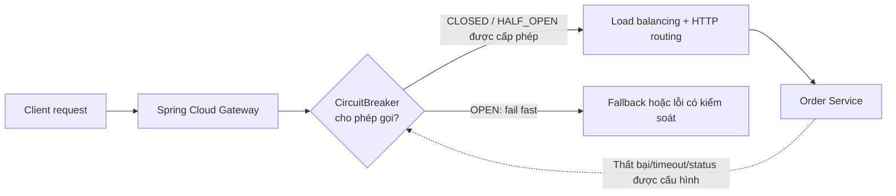
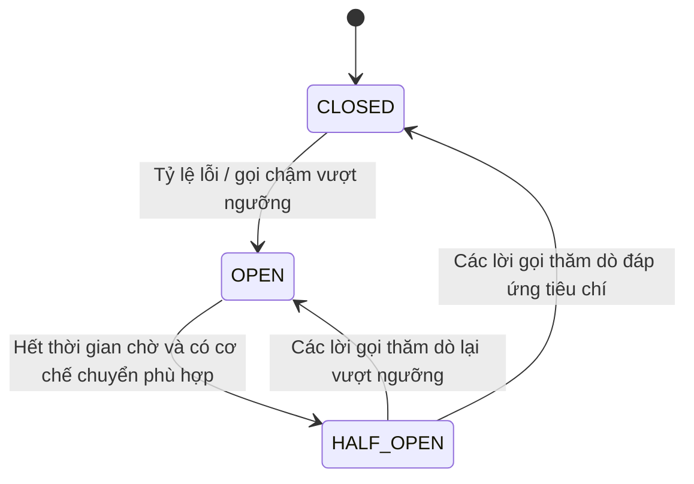
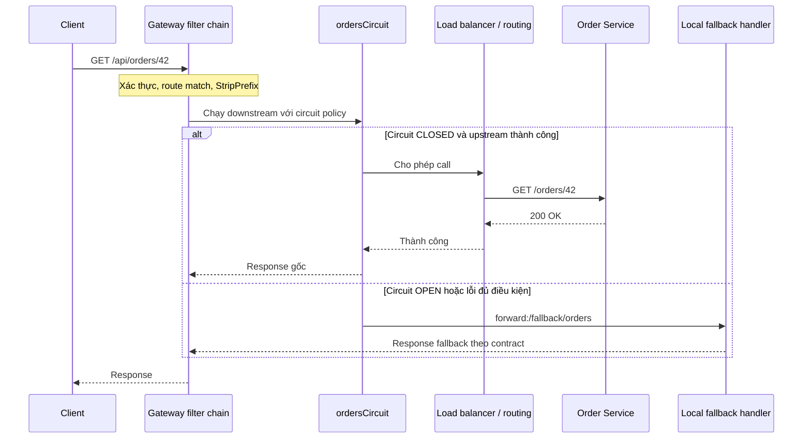

# Tích hợp CircuitBreaker filter với Spring Cloud CircuitBreaker

## Mục tiêu bài học

Trong chương **Ngắt mạch và dự phòng** của **Spring Cloud Gateway**, bài này hướng dẫn tích hợp **`CircuitBreaker` GatewayFilter Factory** với **Spring Cloud CircuitBreaker** và triển khai phổ biến dựa trên **Resilience4j**. Mục tiêu là giúp API Gateway nhận biết một upstream đang gặp sự cố, hạn chế gọi lặp lại tới upstream đó, trả phản hồi dự phòng phù hợp và tự thử phục hồi theo chính sách.

Sau bài học, bạn có thể:

- Mô tả ba trạng thái **CLOSED, OPEN, HALF_OPEN** và cách circuit breaker chuyển trạng thái theo thống kê lỗi hoặc độ trễ.
- Phân biệt vai trò của **Gateway `CircuitBreaker` filter**, abstraction **Spring Cloud CircuitBreaker** và implementation **Resilience4j**.
- Thêm dependency, cấu hình một route `CircuitBreaker`, tên circuit và `fallbackUri: forward:/...`.
- Cấu hình `resilience4j.circuitbreaker.instances` và `resilience4j.timelimiter.instances` theo cùng tên circuit.
- Hiểu điều kiện nào là **exception**, điều kiện nào là **HTTP status**, và khi nào cần cấu hình `statusCodes` để kích hoạt fallback.
- Thiết kế fallback bảo toàn ngữ nghĩa HTTP, phân quyền và dữ liệu, không “giả thành công” cho giao dịch quan trọng.
- Phân tích tương tác giữa breaker với `Retry`, `RequestRateLimiter`, `RewritePath`, load balancing, timeout và Spring Security WebFlux.
- Viết integration tests kiểm tra circuit chuyển trạng thái, fallback, recovery và metrics trong môi trường nhiều Gateway replicas.

> Phạm vi kỹ thuật là **Spring Cloud Gateway Server WebFlux**, không phải Gateway Server MVC. Tên property và API có thể khác giữa Spring Cloud Gateway/Spring Boot/Resilience4j từng dòng. Các ví dụ YAML phía dưới dùng namespace `spring.cloud.gateway.routes` phổ biến ở nhiều bản Server WebFlux 4.x; những dòng mới có thể dùng `spring.cloud.gateway.server.webflux.routes`. Hãy đối chiếu chính xác dependency của dự án trước khi triển khai.

## 1. Vấn đề: upstream lỗi làm nghẽn gateway

Giả sử client gửi:

```http
GET /api/orders/42 HTTP/1.1
Host: api.example.com
Authorization: Bearer <access-token>
```

Gateway đã xác thực người dùng, chọn route tới `order-service` và gọi một instance qua `lb://order-service`. Một ngày, database của Order Service chậm hoặc service không khả dụng. Nếu Gateway vẫn chuyển **mọi request** tới upstream:

- Các request có thể chờ đến khi timeout, làm tăng **latency** và số kết nối đang hoạt động.
- Client có thể tự retry; Gateway cũng có thể retry và gây **request amplification**.
- Upstream vốn đã lỗi càng nhận thêm tải, khiến thời gian phục hồi kéo dài.
- Các backend khác có thể bị ảnh hưởng khi chúng dùng chung thread, connection pool, CPU, mạng hoặc tài nguyên hạ tầng.

**Circuit breaker** giống một bộ ngắt mạch: nó quan sát kết quả gọi upstream, và sau khi vượt ngưỡng thất bại, **tạm thời không cho thêm các lời gọi thông thường đi qua**. Sau thời gian chờ, một số lời gọi thăm dò được phép đi qua để quyết định có thể đóng mạch trở lại hay không.



Circuit breaker **không dự đoán trước** một service sẽ lỗi; nó dựa trên dữ liệu quan sát và chính sách để đưa ra quyết định có tiếp tục gửi requests hay không. Những request đầu tiên trong một đợt lỗi vẫn có thể gặp timeout/lỗi trước khi breaker mở.

### 1.1. Ba trạng thái cơ bản

| Trạng thái | Hành vi | Ý nghĩa vận hành |
| --- | --- | --- |
| **CLOSED** | Cho phép calls qua, ghi nhận kết quả và đánh giá ngưỡng | Hệ thống vận hành bình thường hoặc đang thu thập mẫu |
| **OPEN** | Phần lớn lời gọi thông thường bị từ chối ngay, thường phát sinh `CallNotPermittedException` ở implementation Resilience4j | Upstream được giảm tải, caller nhận fallback/error sớm |
| **HALF_OPEN** | Cho một số calls thăm dò qua để đánh giá khả năng phục hồi | Nếu thăm dò đạt điều kiện, về CLOSED; nếu tiếp tục lỗi, về OPEN |



Resilience4j còn có những trạng thái/chế độ đặc biệt như **DISABLED**, **FORCED_OPEN** và **METRICS_ONLY** dành cho các tình huống điều khiển riêng. Chúng không phải ba trạng thái thường dùng của vòng tự phục hồi.

### 1.2. Vì sao không mở mạch sau đúng một lỗi?

Nếu service có một lỗi tạm thời nhưng hàng nghìn request khác thành công, mở mạch sau đúng một lỗi có thể quá nhạy. Circuit breaker thường tính tỷ lệ lỗi trên **sliding window**, với một số mẫu tối thiểu.

Ví dụ:

```text
slidingWindowSize   = 20 calls
minimumNumberOfCalls = 10
failureRateThreshold = 50 (%)
```

Khi đủ mẫu trong cửa sổ, tỷ lệ lỗi đạt ngưỡng đã định có thể khiến breaker mở. Trước khi có đủ **minimumNumberOfCalls**, breaker không đưa ra quyết định mở mạch dựa trên tỷ lệ lỗi của một vài requests đầu tiên theo cơ chế thông thường.

Đây là **thống kê theo các cuộc gọi được circuit breaker quan sát**. Nếu một request ở bên ngoài bị Spring Security từ chối trước Gateway filter chain hoặc bị rate limiter chặn trước breaker, nó có thể **không đi vào mẫu** của circuit.

## 2. Ba thành phần phối hợp với nhau

Một integration thông thường gồm:

```text
Spring Cloud Gateway route
  └─ CircuitBreaker GatewayFilter Factory
       └─ Spring Cloud CircuitBreaker abstraction
            └─ Resilience4j reactive CircuitBreaker + TimeLimiter
```

| Thành phần | Vai trò | Không tự làm |
| --- | --- | --- |
| **Gateway `CircuitBreaker` filter** | Đặt logic ngắt mạch vào pipeline của route, cấu hình tên circuit và fallback | Không tự định nghĩa toàn bộ thuật toán thống kê, không phân quyền |
| **Spring Cloud CircuitBreaker** | Abstraction/factory thống nhất để tạo và sử dụng circuit breaker | Không phải backend HTTP hay service discovery |
| **Resilience4j** | Triển khai trạng thái, sliding window, ngưỡng lỗi/chậm, half-open và các metrics/cơ chế liên quan | Không tự sửa path, không chọn service instance |
| **`ReactiveLoadBalancerClientFilter`** | Resolve URI `lb://` tới instance nếu route dùng load balancing | Không tự quyết định khi nào breaker nên mở |
| **HTTP routing** | Thực hiện request tới URI đích | Không thay thế circuit breaker, timeout và policy |

Gateway sử dụng **reactive publisher** của WebFlux. Các filter có order và nhiều lớp xử lý pre/post; circuit breaker bao bọc một phần downstream để quan sát các tín hiệu hoàn tất/lỗi và điều khiển fallback. Vì vậy **thứ tự tương đối với Retry, rewrite và các custom filters** có thể thay đổi ý nghĩa của một “call” được thống kê.

### 2.1. Dependency cần có

Với Spring Cloud Gateway Server WebFlux và Resilience4j, một starter thường dùng là:

```xml
<dependency>
    <groupId>org.springframework.cloud</groupId>
    <artifactId>spring-cloud-starter-circuitbreaker-reactor-resilience4j</artifactId>
</dependency>
```

Ngoài ra, ứng dụng cần Spring Cloud Gateway Server WebFlux và Spring Boot tương thích; nếu route dùng `lb://`, cần Spring Cloud LoadBalancer cùng nguồn danh sách instance phù hợp. **Đừng đoán phiên bản** của starter hoặc tự chọn tùy ý bản Resilience4j không tương thích với Spring Cloud BOM của dự án.

Nếu thiếu implementation/factory phù hợp, cấu hình `CircuitBreaker` có thể không được tạo hoặc route không vận hành đúng. Khi gặp lỗi startup, kiểm tra dependency và Spring Cloud release train trước khi sửa tên filter.

### 2.2. Cần phân biệt CircuitBreaker và TimeLimiter

- **CircuitBreaker** quyết định có cho lời gọi qua hay không, theo thống kê lỗi/chậm và trạng thái.
- **TimeLimiter** có thể giới hạn **thời gian chờ kết quả của một lời gọi**; khi vượt ngưỡng, lời gọi bị coi là timeout theo integration cụ thể.
- **HTTP client connect/response timeout** lại là giới hạn của kết nối hoặc phản hồi ở tầng Reactor Netty/Gateway.

Không có một property duy nhất tự thay thế mọi timeout của HTTP client và toàn bộ request end-to-end. Khi xây latency budget phải xem cả network, pool, timeout, retry backoff và thời gian tạo fallback.

## 3. Ví dụ tối thiểu: CircuitBreaker filter theo route

Giả sử `order-service` nhận path `/orders/**`, còn client công khai gọi `/api/orders/**`. Ta cấu hình Gateway chọn route, bỏ tiền tố `/api`, bọc phần upstream bằng circuit breaker và chuyển tới fallback nội bộ nếu cần.

```yaml
spring:
  cloud:
    gateway:
      routes:
        - id: orders-read
          uri: lb://order-service
          predicates:
            - Path=/api/orders/**
            - Method=GET
          filters:
            - StripPrefix=1
            - name: CircuitBreaker
              args:
                name: ordersCircuit
                fallbackUri: forward:/fallback/orders
```

Những điểm cần đọc đúng:

1. `Path` và `Method` quyết định request nào **match** route `orders-read`.
2. `StripPrefix=1` đổi `/api/orders/42` thành `/orders/42` để phù hợp path backend.
3. `CircuitBreaker` dùng tên **`ordersCircuit`** để lấy hoặc tạo circuit theo cấu hình Spring Cloud CircuitBreaker/Resilience4j.
4. `fallbackUri: forward:/fallback/orders` chỉ tới một **handler nội bộ của ứng dụng Gateway** được dispatch theo cơ chế forward, không phải lệnh HTTP gửi đến `http://fallback-service`.
5. `lb://order-service` dùng load balancing để tìm backend; nó là một concern khác với trạng thái breaker.



Trong sơ đồ, lỗi đủ điều kiện có thể là **exception, timeout hoặc HTTP status nằm trong cấu hình breaker**. **Không mặc định mọi HTTP 5xx đều khiến circuit ghi nhận lỗi hoặc đi fallback**: cơ chế xử lý status cần được kiểm tra và có thể phải cấu hình `statusCodes`.

### 3.1. Fallback handler tối giản

Một ứng dụng Gateway có thể khai báo handler WebFlux nội bộ:

```java
import java.util.Map;
import org.springframework.http.HttpStatus;
import org.springframework.http.MediaType;
import org.springframework.http.ResponseEntity;
import org.springframework.web.bind.annotation.GetMapping;
import org.springframework.web.bind.annotation.RestController;
import reactor.core.publisher.Mono;

@RestController
class OrdersFallbackController {

    @GetMapping(path = "/fallback/orders",
                produces = MediaType.APPLICATION_JSON_VALUE)
    Mono<ResponseEntity<Map<String, String>>> unavailable() {
        return Mono.just(
            ResponseEntity.status(HttpStatus.SERVICE_UNAVAILABLE)
                .body(Map.of(
                    "code", "ORDERS_TEMPORARILY_UNAVAILABLE",
                    "message", "Vui lòng thử lại sau"
                ))
        );
    }
}
```

Ở đây fallback trả **503 Service Unavailable**, không trả `200 OK` giả chỉ để dashboard đẹp. Handler trên cố ý không in exception, URL backend, IP nội bộ, token hoặc thông tin cá nhân vào response.

**Điểm an toàn cần rà soát:** `/fallback/orders` là một URL handler trong ứng dụng WebFlux. Tùy routing/security setup, client bên ngoài **có thể tự gọi** đường dẫn đó nếu được expose. Cần thiết kế policy Spring Security/network và xử lý truy cập trực tiếp; không coi `forward:` tự động làm fallback endpoint trở thành endpoint bí mật hoặc chỉ nội bộ.

### 3.2. Kết quả mong đợi

| Tình huống | Kết quả mô hình |
| --- | --- |
| Backend khỏe, circuit CLOSED | Trả phản hồi backend bình thường |
| Connect timeout/exception được breaker nhận là lỗi | Chuyển fallback nếu `fallbackUri` hợp lệ |
| Circuit OPEN | Call có thể bị từ chối sớm, trả fallback thay vì tiếp tục gọi backend |
| Backend trả HTTP 503 nhưng chưa khai báo xử lý status | **Không chắc** kích hoạt fallback; phụ thuộc contract/filter |
| Backend trả HTTP 503 được cấu hình trong `statusCodes` | Có thể được đưa vào nhánh lỗi/fallback |
| Fallback handler lỗi | Client có thể nhận lỗi fallback, không có bảo đảm fallback luôn thành công |
| Request không match route | Không chạy filter của route này; các route khác/404 xử lý |

Fallback không tự chứng minh microservice đã phục hồi. Chỉ các lời gọi thật được cấp phép ở CLOSED/HALF_OPEN mới cung cấp tín hiệu đánh giá upstream; fallback success phải được đo **riêng**, tránh tính nó thành backend success.

## 4. Chuyển HTTP status thành điều kiện circuit breaker

Một tình huống thường gặp là backend **không ném exception** nhưng trả:

```http
HTTP/1.1 503 Service Unavailable
Content-Type: application/json

{"error":"upstream overloaded"}
```

Với HTTP client, đây vẫn có thể là một **HTTP response hợp lệ về mặt giao thức**, dù là lỗi nghiệp vụ/vận hành. Để `CircuitBreaker` GatewayFilter coi một số status là điều kiện chạy fallback, Spring Cloud Gateway hỗ trợ tham số **`statusCodes`** ở các phiên bản tương ứng.

Ví dụ:

```yaml
spring:
  cloud:
    gateway:
      routes:
        - id: orders-read
          uri: lb://order-service
          predicates:
            - Path=/api/orders/**
            - Method=GET
          filters:
            - StripPrefix=1
            - name: CircuitBreaker
              args:
                name: ordersCircuit
                fallbackUri: forward:/fallback/orders
                statusCodes:
                  - 500
                  - 502
                  - 503
                  - 504
```

**Ý nghĩa:** những response status cụ thể được liệt kê sẽ được xem là điều kiện thất bại cho circuit/fallback theo cơ chế của Gateway filter ở phiên bản hỗ trợ. Không cần cho `404 Not Found` vào danh sách nếu 404 biểu thị đơn hàng thực sự không tồn tại.

| HTTP status | Có nên kích hoạt fallback cho Order Service? | Vì sao |
| --- | --- | --- |
| 200 | Không | Upstream hoạt động theo contract |
| 404 | Thường **không** | Có thể là resource không tồn tại, không phải mất khả dụng |
| 400 | Không | Request không hợp lệ; client cần sửa input |
| 401/403 | **Không** | Lỗi xác thực/phân quyền, không phải lỗi availability |
| 429 | Tùy chính sách, thường không nhập chung với lỗi kết nối | Upstream chủ động rate limit; xử lý retry/backoff riêng |
| 500 | Có thể | Lỗi server; cần cân nhắc 500 do bug dữ liệu có nên mở mạch không |
| 502/503/504 | Thường là ứng viên | Upstream/network/timeout không khả dụng |

Không coi bảng trên là luật HTTP bắt buộc: các API có semantics khác nhau. Quan trọng là **không để lỗi do user gửi sai hoặc thiếu quyền làm circuit mở cho toàn bộ khách hàng**.

### 4.1. Status số và tên

Tùy phiên bản factory, `statusCodes` có thể chấp nhận **mã số** và **tên enum HTTP status** như `NOT_FOUND`. Dùng mã số cụ thể ở ví dụ để tránh nhầm tên enum, và kiểm thử config được bind đúng. Một giá trị không hỗ trợ hoặc đặt sai indentation trong YAML có thể khiến filter không được khởi tạo.

### 4.2. Exception khác HTTP status

Ví dụ các trường hợp khác nhau:

```text
ConnectException       → Không thiết lập được kết nối TCP
TimeoutException       → Quá thời gian cho phép
CallNotPermittedException → Circuit OPEN nên call bị từ chối
HTTP 503 response      → Server thực sự trả status 503
HTTP 404 response      → Server trả status 404, có thể là kết quả nghiệp vụ bình thường
```

Gateway/Resilience4j có thể áp cấu hình **recordExceptions**, **ignoreExceptions** hoặc predicate tùy biến ở cấp implementation. Không mặc định mọi `Exception` đều biểu thị backend unhealthy: lỗi client cancel, validation, serialization hoặc fallback error có thể cần phân loại riêng.

## 5. Cấu hình Resilience4j theo tên circuit

Khi dùng starter **Spring Cloud CircuitBreaker Reactor Resilience4j**, có thể cấu hình instance theo **cùng tên** được Gateway dùng:

```yaml
resilience4j:
  circuitbreaker:
    instances:
      ordersCircuit:
        slidingWindowType: COUNT_BASED
        slidingWindowSize: 20
        minimumNumberOfCalls: 10
        failureRateThreshold: 50
        slowCallRateThreshold: 70
        slowCallDurationThreshold: 2s
        permittedNumberOfCallsInHalfOpenState: 3
        waitDurationInOpenState: 15s

  timelimiter:
    instances:
      ordersCircuit:
        timeoutDuration: 3s
```

Các giá trị trên **chỉ dành cho minh họa cách đọc policy**, không phải lựa chọn tối ưu cố định:

| Thuộc tính | Vai trò | Cách suy nghĩ |
| --- | --- | --- |
| `slidingWindowType` | Cửa sổ theo số calls (`COUNT_BASED`) hoặc thời gian (`TIME_BASED`) | Chọn cách thống kê có ý nghĩa với traffic |
| `slidingWindowSize` | Kích thước cửa sổ | Quá nhỏ dễ dao động; quá lớn phản ứng chậm |
| `minimumNumberOfCalls` | Số calls tối thiểu trước khi đánh giá mở mạch theo tỷ lệ | Tránh quyết định khi chỉ có vài mẫu |
| `failureRateThreshold` | Phần trăm calls thất bại để mở mạch | Gắn với SLO/đặc tính backend |
| `slowCallRateThreshold` | Tỷ lệ calls chậm để mở mạch | Bảo vệ khi backend chưa lỗi hẳn nhưng latency xấu |
| `slowCallDurationThreshold` | Ngưỡng gọi được xem là chậm | Phân biệt với timeout |
| `permittedNumberOfCallsInHalfOpenState` | Số calls thăm dò được phép ở HALF_OPEN | Tránh nạp tải lớn ngay khi thử phục hồi |
| `waitDurationInOpenState` | Thời gian chờ trước cơ hội chuyển về HALF_OPEN | Không phải lời hứa backend sẽ khỏe sau đúng khoảng này |
| `timelimiter.instances.*.timeoutDuration` | Ngưỡng timeout ở lớp TimeLimiter | Phải phối hợp HTTP connect/response timeout và toàn bộ deadline |

**Điểm tinh tế:** một số cấu hình Resilience4j có tùy chọn `automaticTransitionFromOpenToHalfOpenEnabled`. Khi không bật cơ chế chuyển tự động, circuit có thể chỉ chuyển trạng thái khi một lời gọi mới tới sau thời gian chờ. Vì vậy không nên suy luận rằng “15 giây sau chắc chắn có ba probe đã chạy” nếu không có request.

### 5.1. Ví dụ tính ngưỡng

Giả sử:

```text
slidingWindowSize = 20
minimumNumberOfCalls = 10
failureRateThreshold = 50%
```

Sau mười lời gọi được ghi nhận, nếu ít nhất năm lời gọi bị phân loại thất bại trong cửa sổ đang xét, tỷ lệ lỗi có thể đạt ngưỡng mở mạch. Khi đã có 20 mẫu, cách Resilience4j trượt cửa sổ sẽ loại bỏ hoặc cập nhật thống kê theo mẫu mới.

Không lấy **số request client gửi** thay cho **số call đã được circuit nhận và đánh giá** nếu một request bị Security/RateLimiter chặn trước đó, bị circuit OPEN fail-fast hoặc Retry tạo nhiều attempts ở một vị trí khác.

### 5.2. Failure rate và slow-call rate là hai tín hiệu riêng

Một upstream có thể trả `200 OK` nhưng mất 10 giây. Trường hợp đó:

- Có thể được tính là **thành công về status**.
- Vẫn có thể được tính là **slow call** nếu vượt `slowCallDurationThreshold`.
- Nếu vượt TimeLimiter timeout, có thể trở thành **timeout failure** thay vì success.

Do đó phải xét cả **độ trễ**, không chỉ tỷ lệ HTTP 5xx. Tuy nhiên đừng đặt `slowCallDurationThreshold` thấp hơn latency bình thường hoặc TimeLimiter quá ngắn khiến circuit liên tục mở khi load tăng vừa phải.

### 5.3. Đừng nhầm cấu hình ở Resilience4j với filter ở Gateway

Ví dụ có:

```yaml
name: ordersCircuit
```

ở Gateway và:

```yaml
resilience4j:
  circuitbreaker:
    instances:
      ordersCircuit:
```

ở Resilience4j. **Tên phải khớp** theo cách factory tạo instance. Nếu không, ứng dụng có thể dùng default config thay vì policy riêng mà người viết tưởng đang áp dụng.

Khi có cấu hình `configs.default`, cấu hình group, programmatic customizer hoặc property overrides, precedence có thể ảnh hưởng giá trị hiệu lực. Kiểm tra **circuit instance runtime** và metrics, không chỉ thấy YAML hợp lệ.

## 6. Fallback nên trả gì?

`fallbackUri` nói **chuyển xử lý tới đâu** khi circuit không cho call đi tiếp hoặc khi phần downstream thất bại phù hợp. Nó không quyết định **nội dung hoặc HTTP status** tốt nhất cho nghiệp vụ.

### 6.1. Fallback cho API đọc

Với:

```http
GET /api/catalog/top-products
```

Một fallback có thể trả dữ liệu công khai đã cache trong thời gian ngắn, nếu:

- Dữ liệu stale vẫn an toàn và được chấp nhận về mặt sản phẩm.
- Có cách ghi rõ dữ liệu không cập nhật, ví dụ header metadata hoặc field `stale`.
- Cache không trộn dữ liệu người dùng/tenant và có giới hạn tuổi hợp lệ.
- Không giả làm dữ liệu chính xác real-time như số dư ngân hàng.

Response minh họa:

```http
HTTP/1.1 200 OK
Content-Type: application/json
Cache-Control: max-age=30

{"items":[],"stale":true}
```

**Chỉ trả 200 khi contract cho phép** xem đây là kết quả thành công chấp nhận được. Danh sách rỗng `[]` có thể bị frontend hiểu thành “thực sự không có sản phẩm”, khác hẳn “service đang lỗi”. Khi không thể cung cấp một giá trị dự phòng đáng tin, **trả 503 trung thực** thường tốt hơn.

### 6.2. Fallback cho API ghi hoặc nhạy cảm

Không tạo fallback kiểu:

```http
POST /api/payments/charge

HTTP/1.1 200 OK
{"status":"paid"}
```

khi backend thanh toán không xác nhận đã thu tiền. Đó là **giả thành công**, có thể làm mất tiền hoặc sai sổ sách.

Với hành động ghi, cần:

- Xác định request đã được backend thực thi hay chỉ mất response.
- Dùng idempotency key và backend deduplication theo contract.
- Nếu cần nhận tác vụ bất đồng bộ, chỉ trả `202 Accepted` khi hệ thống **thực sự nhận bền vững** tác vụ vào hàng đợi/sổ cái phù hợp.
- Nếu không có bảo đảm, trả lỗi thích hợp và hướng dẫn kiểm tra trạng thái giao dịch.
- Không lặp lại POST không idempotent chỉ vì `Retry` hoặc circuit fallback hoạt động.

### 6.3. Fallback và dữ liệu cá nhân

Một handler dự phòng không được bỏ qua xác thực/phân quyền:

- Không lấy `X-User-Id` hoặc `X-Tenant-Id` do client tự đặt làm identity.
- Không trả cache dùng chung nếu chứa đơn hàng/hồ sơ cá nhân của người dùng khác.
- Không đưa nguyên exception, URI backend, token, cookie hoặc stack trace vào response.
- Không truy cập dịch vụ nội bộ bí mật từ fallback nếu không có trust boundary rõ.

Nếu đường `/fallback/orders` là một handler có thể được truy cập trực tiếp, phải bảo vệ nó bằng Security WebFilterChain hoặc một cách thiết kế routing/handler phù hợp; **đừng coi tiền tố `/fallback` tự làm endpoint thành private**.

### 6.4. Fallback local so với fallback service từ xa

| Mô hình | Ưu điểm | Rủi ro |
| --- | --- | --- |
| **Local forward handler** | Không cần thêm network call để tạo lỗi/dữ liệu tĩnh | Cần quản lý endpoint, code và security trong Gateway |
| **Dịch vụ fallback riêng** | Có thể cung cấp cache/đối sách chuyên biệt | Có thể trở thành dependency mới, cần timeout/circuit và bảo mật riêng |
| **Không có fallbackUri** | Cho lỗi circuit/timeout đi qua error handling chuẩn | Client nhận error; cần mapping status và body ổn định |

Trong Gateway `CircuitBreaker` filter, **`fallbackUri` được thiết kế cho URI `forward:`**. Không đổi trực tiếp thành `fallbackUri: lb://other-service` rồi mặc định Gateway sẽ gọi HTTP tới service đó. Muốn forward đến dịch vụ fallback ở xa, cần cấu hình **một route/handler phù hợp cho đường forward** và kiểm thử hành vi routing.

## 7. Biết nguyên nhân fallback bằng exchange attribute

Khi dùng `CircuitBreaker` và fallback nội bộ, Gateway có thể đặt thông tin exception vào một exchange attribute, thường được truy cập qua hằng số:

```java
import static org.springframework.cloud.gateway.support.ServerWebExchangeUtils
    .GATEWAY_CIRCUITBREAKER_EXECUTION_EXCEPTION_ATTR;
```

Một handler có thể kiểm tra loại lỗi **cho telemetry nội bộ**, ví dụ:

```java
import java.util.Map;
import org.slf4j.Logger;
import org.slf4j.LoggerFactory;
import org.springframework.http.HttpStatus;
import org.springframework.http.ResponseEntity;
import org.springframework.web.bind.annotation.GetMapping;
import org.springframework.web.bind.annotation.RestController;
import org.springframework.web.server.ServerWebExchange;
import reactor.core.publisher.Mono;

import static org.springframework.cloud.gateway.support.ServerWebExchangeUtils
    .GATEWAY_CIRCUITBREAKER_EXECUTION_EXCEPTION_ATTR;

@RestController
class OrdersFallbackWithTelemetry {
    private static final Logger log =
        LoggerFactory.getLogger(OrdersFallbackWithTelemetry.class);

    @GetMapping("/fallback/orders")
    Mono<ResponseEntity<Map<String, String>>> fallback(
            ServerWebExchange exchange) {

        Throwable cause = exchange.getAttribute(
            GATEWAY_CIRCUITBREAKER_EXECUTION_EXCEPTION_ATTR
        );

        log.warn("orders fallback causeType={}",
            cause == null ? "unknown" : cause.getClass().getSimpleName());

        return Mono.just(
            ResponseEntity.status(HttpStatus.SERVICE_UNAVAILABLE)
                .body(Map.of("code", "ORDERS_UNAVAILABLE"))
        );
    }
}
```

Đây là **biến thể thay thế** cho controller ở mục 3.1, **không khai báo cùng lúc hai handler `GET /fallback/orders`** trong một ứng dụng thật vì sẽ gây mapping conflict.

**Không ghi** `cause.getMessage()` một cách mù quáng: thông báo lỗi có thể chứa URL đầy đủ, query parameters, token, dữ liệu cá nhân hoặc địa chỉ hạ tầng. Với observability, ưu tiên exception **type**, route ID, circuit name, trạng thái circuit và trace ID đã chuẩn hóa.

### 7.1. Chuyển tiếp nguyên nhân tới fallback service khác

Spring Cloud Gateway còn có **`FallbackHeaders` GatewayFilter Factory** phục vụ một số kiến trúc forward/fallback service. Nó có thể bổ sung metadata về exception vào **request headers** gửi tới dịch vụ fallback.

Chỉ dùng khi có hợp đồng giữa các service và đường kết nối đủ tin cậy. Exception type/message có thể tiết lộ chi tiết nội bộ; cần xem việc truyền hoặc loại bỏ header theo bảo mật, tránh phản ánh raw exception tới Internet. Không mặc định bật `FallbackHeaders` ở mọi route hoặc sao chép nguyên exception message vào response.

## 8. Tên circuit và ranh giới isolation

Circuit breaker của Resilience4j được nhận diện bằng **tên instance**, chẳng hạn `ordersCircuit`. Ranh giới một circuit cần được thiết kế:

```text
ordersCircuit
  route GET /api/orders/** → lb://order-service
```

Nếu nhiều route **cùng dùng tên** `ordersCircuit`, chúng có thể chia sẻ trạng thái và thống kê của circuit instance. Một lỗi ở route này có thể ảnh hưởng route kia nếu cùng tên theo cùng factory. Nếu mục đích là tách API đọc nặng khỏi API ghi, có thể dùng tên riêng:

```text
ordersReadCircuit
ordersWriteCircuit
```

Nhưng cũng không nên tạo một circuit riêng cho **mỗi request/user/UUID** vì sẽ làm bùng số lượng state và metrics, khó đạt đủ mẫu để circuit có ý nghĩa.

### 8.1. Circuit theo service logic không nhất thiết theo instance backend

Khi route:

```yaml
uri: lb://order-service
```

LoadBalancer có thể chọn một trong nhiều instances. `CircuitBreaker` đặt ở cấp route/tên circuit **thường quan sát kết quả gọi tới service logic**, không tự tạo một circuit riêng cho mỗi `host:port` được resolve.

Điều này có hai mặt:

- **Ưu điểm:** khi toàn bộ service gặp sự cố, circuit chung giảm traffic đến service.
- **Nhược điểm:** một instance xấu trong nhóm có thể làm tỷ lệ lỗi tăng và ảnh hưởng quyết định với cả các instances khỏe nếu không có cơ chế loại bỏ instance xấu.

Load balancer, health checks, instance eviction, retry strategy và circuit isolation là **những cơ chế riêng**. Không mặc định circuit breaker per-route tự nhận biết instance nào cụ thể vừa lỗi.

### 8.2. Nhiều Gateway replicas có cùng circuit name

Giả sử có:

```text
Gateway A → ordersCircuit
Gateway B → ordersCircuit
Gateway C → ordersCircuit
```

Với cấu hình Resilience4j **in-memory thông thường**, mỗi JVM/replica có circuit state và sliding window **riêng**. Cùng tên không tự tạo một circuit phân tán chia sẻ state giữa ba pods.

Hậu quả:

- Pod A có thể OPEN trong khi pod B còn CLOSED.
- Một replica ít traffic có thể chưa đủ `minimumNumberOfCalls` để mở mạch.
- Dashboard phải quan sát state theo instance/replica và tổng hợp thận trọng.

Đây không nhất thiết là lỗi: circuit breaker local tránh một shared-state dependency trên đường request. Nhưng khi vận hành, **không suy ra toàn cụm đã OPEN chỉ vì một pod OPEN**; áp dụng traffic management hoặc policy bổ sung nếu cần.

## 9. Tương tác với Retry, rate limiting và timeout

### 9.1. CircuitBreaker và Retry: filter nào bao bọc filter nào?

Xét hai cấu trúc logic:

```text
Phương án A:
  CircuitBreaker
    └─ Retry
         └─ LoadBalancer + HTTP routing
```

```text
Phương án B:
  Retry
    └─ CircuitBreaker
         └─ LoadBalancer + HTTP routing
```

**A — CircuitBreaker bên ngoài Retry:** một lời gọi được breaker quan sát có thể đại diện cho **cả nhóm attempts**, tùy cách Retry phát kết quả và lỗi cuối. Nếu Retry phục hồi và trả thành công, breaker phía ngoài có thể chỉ thấy kết quả cuối; không nhất thiết đếm từng lỗi ở các attempts nội bộ.

**B — Retry bên ngoài CircuitBreaker:** mỗi lần đoạn downstream chạy lại có thể kích hoạt circuit breaker riêng, khiến nhiều lỗi của cùng một request client đóng góp vào thống kê. Khi breaker OPEN, những retries tiếp theo có thể gặp `CallNotPermittedException`; nếu vẫn tiếp tục retry không có ích, chỉ tăng tải vào Gateway.

Đây là **mô hình giải thích publisher composition**, không phải cam kết mọi phiên bản chạy đúng số lần như hình. Với GatewayFilter ordering, global filters, `Ordered` và cách Retry resubscribe, phải kiểm tra **effective filter chain và số outbound attempts thực tế**.

**Khuyến nghị thiết kế:** chọn một retry budget nhỏ, có backoff và deadline; quyết định breaker đo **request logic** hay **upstream attempt**. Tránh để Retry vô hạn hoặc fallback làm một upstream đang lỗi nhận thêm tải không cần thiết.

### 9.2. Rate limiting đứng ở đâu?

Một cấu trúc mục tiêu thường là:

```text
TLS/Ingress
  ↓
Spring Security: xác thực/ủy quyền
  ↓
RequestRateLimiter theo user/tenant
  ↓
CircuitBreaker
  ↓
HTTP routing
```

Khi rate limiter nằm ngoài vùng retry/circuit, nó thường đếm **một inbound request** theo client, không bị nhân số lần do Retry. Nếu nằm bên trong phần có thể được retry, quota có nguy cơ bị trừ nhiều lần. Đồng thời, kể cả rate limit đúng, vẫn phải kiểm soát **outbound attempts** để tránh request amplification.

Những request bị chặn bởi Spring Security **trước** Gateway filter chain có thể không được rate limiter/circuit của route quan sát. Vì vậy ingress/WAF cần biện pháp riêng chống traffic không xác thực quá lớn.

### 9.3. Timeout và circuit breaker

Một bộ timeout thường gồm:

```text
Client deadline
  └─ Gateway end-to-end deadline
       └─ Retry budget / backoff
            └─ CircuitBreaker TimeLimiter
                 └─ HTTP connect/response timeout
```

Không phải cấu trúc mặc định của mọi ứng dụng; nó là cách hình dung để thiết kế **ngân sách thời gian**. Ví dụ client chỉ chờ tối đa 2 giây mà Gateway có TimeLimiter 10 giây và ba attempts 5 giây thì client có thể bỏ kết nối trước khi Gateway hoàn tất.

Khi TimeLimiter phát timeout:

- Cần xác định downstream đã bị cancel chưa và tài nguyên HTTP có được giải phóng không.
- Không giả định backend **chưa** thực hiện tác vụ nếu request bị timeout.
- Fallback không được tạo kết quả giả cho giao dịch ghi mà trạng thái thực chưa biết.
- Metrics phải phân biệt timeout, connection error, backend 5xx và circuit OPEN reject.

### 9.4. CircuitBreaker không phải Bulkhead

Circuit breaker **không mặc nhiên giới hạn số request đồng thời**. Nếu service vẫn có tỷ lệ lỗi thấp nhưng phản hồi rất chậm, số in-flight calls có thể tăng. `slowCallRateThreshold` giúp phát hiện call chậm, nhưng nó không phải một semaphore concurrency limit cứng.

Khi cần bảo vệ tài nguyên:

- Sử dụng bulkhead/concurrency limit phù hợp với Reactor/WebFlux và hạ tầng.
- Đặt timeout và kết nối pool/budget rõ ràng.
- Không block Netty event-loop bằng `Thread.sleep()` hoặc `Semaphore.acquire()` blocking.
- Có chính sách riêng cho SSE, streaming và WebSocket vì thời gian sống kết nối dài.

## 10. Fallback và Spring Security, CORS, headers

### 10.1. Xác thực vẫn phải có hiệu lực

Một request:

```http
GET /api/orders/42
Authorization: Bearer <invalid-token>
```

không được nhận dữ liệu fallback cá nhân chỉ vì upstream đang OPEN. **Security WebFilterChain** thường chạy trước route filters của Gateway, còn backend cần kiểm tra quyền theo tài nguyên.

Trong một số thiết kế, fallback nội bộ là một handler có quyền truy cập dữ liệu cache, phải bảo đảm nó **không làm lộ dữ liệu user/tenant khác** và không coi client-provided headers là chứng cứ identity. Fallback cho dữ liệu nhạy cảm nên trả lỗi an toàn nếu không thể thực hiện authorization tương đương.

### 10.2. CORS khi fallback trả 503

Nếu frontend từ `https://portal.example.com` gọi Gateway cross-origin, phản hồi fallback 503 vẫn cần CORS headers nhất quán với route/edge policy để frontend có thể đọc mã lỗi được phép.

Nếu fallback được forward đến handler có một đường xử lý khác, phải kiểm thử:

- Preflight OPTIONS được xử lý ở tầng CORS phù hợp.
- Actual request có `Origin` được phép nhận headers đúng, kể cả khi circuit OPEN.
- Không duplicate `Access-Control-Allow-Origin` giữa Gateway, fallback handler và ingress.
- Không mở wildcard origin/credentials để “chữa” một lỗi fallback 503.

### 10.3. Response status và body không được mâu thuẫn

Fallback có thể đổi response status và body so với upstream. Khi tạo response mới:

- `Content-Type` phản ánh body thật, ví dụ JSON.
- `Content-Length`, `Transfer-Encoding` và `Content-Encoding` được HTTP writer xử lý hợp lệ.
- Không giữ ETag, `Content-Range` hoặc cache validators của body upstream nếu representation đã đổi.
- Không trả body cho các status/method không cho phép body, chẳng hạn 204 hoặc HEAD.
- Không log body/token/exception message nhạy cảm.

Khi dùng `ModifyResponseBody` hoặc custom decorators song song với CircuitBreaker, phải xem **filter order và response commit**. Nếu response đã được ghi một phần cho client, Gateway không thể tùy ý rút lại nó để gửi một fallback body mới.

### 10.4. Fallback không phải cache mặc định

Một số hệ thống muốn Gateway dùng fallback dữ liệu cũ khi service lỗi. Nhưng circuit breaker bản thân **không lưu cache** và không bảo đảm dữ liệu dự phòng. Cần một nguồn dữ liệu cache được thiết kế, có TTL, khóa tenant/user và policy quyền truy cập phù hợp.

Đừng lấy “fallback configured” làm bằng chứng API luôn sẵn sàng hoặc luôn có dữ liệu chính xác.

## 11. Theo dõi circuit breaker trong production

Nếu có Micrometer/Actuator và tích hợp metrics phù hợp của Resilience4j, nên quan sát:

| Tín hiệu | Ý nghĩa | Cách dùng |
| --- | --- | --- |
| Circuit state theo name/replica | CLOSED, OPEN, HALF_OPEN | Phát hiện circuit mở kéo dài |
| Number of failed/successful/not-permitted calls | Kết quả circuit nhìn thấy | Phân biệt backend lỗi với call bị chặn sớm |
| Slow call count/rate | Upstream chậm dù chưa lỗi hẳn | Điều chỉnh slow-call threshold |
| Rate mở circuit | Tần suất chuyển OPEN | Phát hiện ngưỡng quá nhạy hoặc upstream bất ổn |
| TimeLimiter timeout count | Request vượt timeout | Kiểm tra latency budget/network |
| Fallback response count và status | Có bao nhiêu request phải degrade | Tránh fallback success làm che lỗi thật |
| HTTP 5xx/timeout theo route | SLO của API | Theo dõi tác động tới client |
| Outbound attempts/retries | Số HTTP calls tới backend | Phát hiện retry amplification |
| In-flight/connection pool | Áp lực tài nguyên | Bổ sung bulkhead và timeout |

Tên metric/labels cụ thể phụ thuộc phiên bản Resilience4j, Spring Boot Actuator, Micrometer và cấu hình export. Ví dụ một số triển khai có metric kiểu `resilience4j.circuitbreaker.calls` và `resilience4j.circuitbreaker.state`; không coi tên đó là bất biến, phải kiểm tra metrics đang được expose thực.

### 11.1. Log hợp lý, không chứa bí mật

Ví dụ:

```text
route=orders-read circuit=ordersCircuit state=OPEN
outcome=fallback causeType=CallNotPermittedException status=503
traceId=<trace-id>
```

Đừng ghi:

```text
Authorization: Bearer ...
Cookie: SESSION=...
backendUrl=https://backend.internal/orders?token=...
exceptionMessage=<raw-error>
```

Route ID, circuit name, loại lỗi đã chuẩn hóa và trace ID có kiểm soát thường đủ để điều tra mà không tạo thêm điểm rò dữ liệu nhạy cảm.

### 11.2. Một số câu hỏi cần trả lời khi circuit OPEN

1. Nó mở vì **exceptions**, **statusCodes** hay **slow calls**?
2. Có đủ số mẫu theo `minimumNumberOfCalls` chưa?
3. Có lỗi bắt nguồn từ client/authorization đang bị tính nhầm thành upstream failure không?
4. TimeLimiter/HTTP timeout có đang quá ngắn so với latency bình thường?
5. Retry có làm tăng số attempts và gây mở circuit nhanh hơn dự kiến không?
6. Tên circuit có bị dùng chung bởi các routes không nên ảnh hưởng nhau không?
7. Gateway instances khác có cùng trạng thái không?
8. CORS/fallback có làm frontend nhìn thấy lỗi thực không?
9. Backend đã hồi phục nhưng traffic thăm dò HALF_OPEN có đủ không?

Không “sửa” bằng cách đặt `failureRateThreshold: 100` hoặc xóa mọi timeout mà chưa xác định nguyên nhân; điều này có thể che lỗi mà không phục hồi SLO.

## 12. Kiểm thử tích hợp với backend giả lập

Một unit test chỉ đọc YAML và thấy tên `CircuitBreaker` **không đủ**. Cần chạy Gateway thật trong integration test với backend stub kiểm soát được status, thời gian phản hồi, số request nhận và instance ID.

### 12.1. Ma trận kiểm thử

| Tình huống | Upstream / trạng thái | Điều cần kiểm tra |
| --- | --- | --- |
| Backend khỏe | GET → 200 nhanh | Response gốc được trả, không fallback |
| Exception kết nối | Backend không thể kết nối | Fallback/error đúng contract |
| HTTP status được liệt kê | Backend → 503 | Circuit ghi nhận/tạo fallback theo cấu hình |
| HTTP 404 nghiệp vụ | Backend → 404 | Không bị biến thành fallback khi không cấu hình 404 |
| Lỗi do auth | Token sai, Security 401/403 | Không đi upstream, không thành fallback cho dữ liệu riêng |
| Dưới ngưỡng mở circuit | Một vài lỗi trong cửa sổ | Chưa mở khi chưa đủ mẫu/ngưỡng |
| Đạt ngưỡng lỗi | Đủ mẫu và tỷ lệ lỗi | Circuit chuyển OPEN theo thiết kế |
| OPEN fail fast | Gửi tiếp request khi OPEN | Backend không nhận call mới thông thường; fallback/error nhanh |
| HALF_OPEN probe | Sau thời gian chờ | Chỉ số probe đúng cấu hình, chuyển trạng thái theo kết quả |
| Slow calls | Backend trả 200 nhưng rất chậm | Được ghi nhận là slow call khi vượt ngưỡng |
| TimeLimiter | Backend chậm hơn timeoutDuration | Lỗi/timeout/fallback và cleanup đúng |
| Retry trước/sau breaker | Backend trả 503 một lần rồi 200 | Đếm requests backend và circuit decisions riêng |
| Multi-instance backend | Một instance lỗi, một instance khỏe | Hiểu breaker theo route/service logic, không giả per-instance |
| Multi-replica Gateway | Hai Gateway pods | Circuit state độc lập nếu implementation in-memory |
| Fallback handler lỗi | Forward path không có handler/throw | Client nhận error có kiểm soát; không recursion vô hạn |
| CORS | Browser Origin được phép | Đọc được 503/fallback contract, không duplicate CORS header |
| Concurrency/streaming | Nhiều requests và stream lâu | Không rò tài nguyên, timeout/cancellation an toàn |

### 12.2. Ví dụ dùng curl

Giả sử Gateway test chạy `localhost:8080`, route `/api/orders/**`, backend stub có thể chuyển sang 503:

```bash
# Trường hợp bình thường:
curl -i "http://localhost:8080/api/orders/42"

# Lặp request sau khi backend stub được cấu hình trả 503:
for i in 1 2 3 4 5 6 7 8 9 10 11 12; do
  curl -s -o /dev/null -w "%{http_code}\n" \
    "http://localhost:8080/api/orders/42"
done
```

Mười hai lần gọi chỉ minh họa. Không phải cứ chạy mười hai calls thì circuit chắc chắn OPEN: còn phụ thuộc:

- `minimumNumberOfCalls`, kích thước sliding window và trạng thái trước test.
- Lỗi có được **record** hay không; HTTP 503 cần `statusCodes`/cấu hình phù hợp.
- Routing/load balancer, backend stub và kết quả timeouts.
- Circuit state có được chia sẻ từ test trước hoặc replica khác không.
- Retry, fallback, rate limiting và các điều kiện khác trong filter chain.

Nên reset hoặc cách ly circuit state của test giữa các trường hợp, dùng một backend stub có counter và kiểm tra **số outbound requests thực nhận**, không chỉ dựa vào HTTP status client.

### 12.3. `WebTestClient` kiểm tra fallback

Ví dụ một integration test đã khởi động Gateway và backend stub:

```java
import org.junit.jupiter.api.Test;
import org.springframework.beans.factory.annotation.Autowired;
import org.springframework.test.web.reactive.server.WebTestClient;

class OrdersCircuitBreakerIntegrationTest {

    @Autowired
    WebTestClient webTestClient;

    @Test
    void returnsSafeFallbackWhenUpstreamIsUnavailable() {
        // Test setup: stub backend gây lỗi thuộc điều kiện fallback.
        webTestClient.get()
            .uri("/api/orders/42")
            .exchange()
            .expectStatus().isEqualTo(503)
            .expectBody()
            .jsonPath("$.code")
            .isEqualTo("ORDERS_TEMPORARILY_UNAVAILABLE");
    }
}
```

Đây là **đoạn assertion minh họa**, không phải một lớp test có thể chạy độc lập. Cần cấu hình route, test server, circuit breaker implementation, stub backend, policy/counters và security test phù hợp. Nếu dùng variant controller ở mục 7 thì response code có thể là `ORDERS_UNAVAILABLE` thay vì chuỗi trên; **chỉ chọn một hợp đồng fallback nhất quán cho test**.

### 12.4. Kiểm thử OPEN/HALF_OPEN không nên phụ thuộc sleep mù

Một test kiểu:

```text
gửi vài request lỗi
Thread.sleep(15000)
hy vọng breaker đã HALF_OPEN
```

có thể không ổn định vì thời điểm circuit mở, policy auto transition, lịch scheduler và không có request probe. Với integration test, tốt hơn:

- Tách circuit state theo test hoặc dùng tên circuit riêng.
- Kiểm tra state qua API/registry/metrics được framework hỗ trợ trong môi trường test.
- Điều khiển backend stub trả lỗi/khỏe theo số lần hoặc bằng latch không blocking.
- Chờ theo **điều kiện** trong một timeout test hữu hạn, thay vì sleep tùy ý.
- Kiểm tra số calls ở backend khi OPEN để chứng minh **fail fast**.

Khi muốn đánh giá recovery, phải gửi probes sau khi policy cho phép và kiểm tra trạng thái chuyển về CLOSED khi đủ thành công.

## 13. Những lỗi cấu hình thường gặp

### 13.1. Gateway báo không có CircuitBreaker factory

**Nguyên nhân khả dĩ:** thiếu starter circuit breaker reactive phù hợp, dependency conflict hoặc dùng namespace/filter không đúng phiên bản.

**Hướng xử lý:** kiểm tra Spring Cloud BOM/dependency và cấu hình route runtime. Không tùy tiện tự thêm một implementation Resilience4j version khác khi chưa kiểm tra tương thích.

### 13.2. Backend trả 503 nhưng không có fallback

**Nguyên nhân khả dĩ:** HTTP 503 là một response hợp lệ ở tầng HTTP client; `CircuitBreaker` chưa được cấu hình xử lý status đó qua `statusCodes`, hoặc route/filters khác chưa chạy như kỳ vọng.

**Hướng xử lý:** xác minh route match, circuit name, `statusCodes`, status thực của backend và kết quả response ở Gateway.

### 13.3. Fallback trả 404

**Nguyên nhân khả dĩ:** `forward:/fallback/orders` không có matching handler nội bộ, mapping method/path không phù hợp hoặc security layer chặn handler.

**Hướng xử lý:** xác minh `@GetMapping`/WebFlux handler, HTTP method của request và Security/CORS. Đừng nhầm 404 của fallback với 404 từ Order Service.

### 13.4. Breaker luôn CLOSED dù upstream lỗi

**Nguyên nhân khả dĩ:** chưa đủ `minimumNumberOfCalls`, exception bị ignore, HTTP status chưa được map thành lỗi, tên circuit không khớp instance config hoặc các attempts chạy qua một circuit khác.

**Hướng xử lý:** đối chiếu circuit metrics, exception type, threshold/window và filter order; tạo test với số calls kiểm soát được.

### 13.5. Breaker OPEN liên tục dù backend khỏe

**Nguyên nhân khả dĩ:** timeout quá ngắn, slow-call threshold quá thấp, backend chỉ vừa hồi phục và chưa đủ probe HALF_OPEN, có nhiều lỗi khác được ghi nhận hoặc client requests bị Retry khuếch đại.

**Hướng xử lý:** kiểm tra state transitions, TimeLimiter/HTTP timeouts, dữ liệu p95/p99 và số probes; tránh reset circuit thủ công hàng loạt nếu chưa bảo đảm upstream chịu được tải.

### 13.6. Một route lỗi làm route khác bị fallback

**Nguyên nhân khả dĩ:** các route dùng **cùng tên circuit** hoặc một custom configuration/chung factory state ngoài ý muốn.

**Hướng xử lý:** thiết kế lại circuit isolation theo logical dependency/criticality, kiểm tra names từ runtime, không tạo circuit theo mỗi request để “fix” vội.

### 13.7. Circuit OPEN ở pod A, CLOSED ở pod B

**Đây có thể là hành vi đúng** của Resilience4j local state. Đừng mặc định có shared circuit state như RedisRateLimiter. Quan sát theo pod và đánh giá lượng traffic/vòng đời sliding window trên từng replica.

### 13.8. Fallback 200 làm SLO trông tốt giả tạo

**Nguyên nhân:** fallback trả status 200 và hệ thống chỉ đo tỷ lệ 5xx.

**Hướng xử lý:** phân biệt **backend success**, **fallback/degraded response** và **client-visible success** theo hợp đồng. Có thể dùng header `X-Degraded: true` hoặc trường `stale`, nhưng phải kiểm soát dữ liệu và chỉ dùng khi đúng semantics.

## 14. Checklist production

| Hạng mục | Câu hỏi kiểm tra |
| --- | --- |
| **Dependency** | Đã có starter Spring Cloud CircuitBreaker **reactor-resilience4j** tương thích với Gateway/Boot chưa? |
| **Route** | Route predicate, `StripPrefix`/rewrite, `lb://` và URI đích đã test đúng chưa? |
| **Circuit name** | Tên circuit khớp config Resilience4j và isolation đúng giữa routes chưa? |
| **Failure classification** | HTTP `statusCodes`, exceptions, slow calls có phân loại đúng lỗi upstream không? |
| **Thresholds** | Sliding window, minimum calls, failure/slow thresholds và half-open probes phù hợp traffic chưa? |
| **Time budget** | TimeLimiter, HTTP connect/response timeout, Retry và client deadline có nhất quán không? |
| **Fallback** | `forward:` tới handler có thật, không recursive/không giả success cho hành động ghi? |
| **Security** | Fallback path được bảo vệ, không lộ dữ liệu cá nhân hoặc bỏ qua authz? |
| **CORS** | Browser đọc được response lỗi/fallback đúng origin; không duplicate headers? |
| **Concurrency** | Có cần bulkhead/rate limit ngoài breaker không? |
| **Multi-pod** | Hiểu state per-replica, test health/metrics theo instance chưa? |
| **Observability** | Có metrics circuit transitions, not-permitted, fallback, timeout, backend error và retry attempts? |
| **Testing** | Có test 200, 404, 503, exception, OPEN, HALF_OPEN, recovery, security và load không? |
| **Rollback** | Có cách điều chỉnh/rollback threshold hoặc tạm vô hiệu hóa fallback an toàn khi triển khai lỗi không? |

## 15. Bài thực hành có đáp án

Giả sử route:

```yaml
spring:
  cloud:
    gateway:
      routes:
        - id: reports-read
          uri: lb://report-service
          predicates:
            - Path=/api/reports/**
            - Method=GET
          filters:
            - StripPrefix=1
            - name: CircuitBreaker
              args:
                name: reportsCircuit
                fallbackUri: forward:/fallback/reports
                statusCodes:
                  - 502
                  - 503
                  - 504
```

Resilience4j:

```text
slidingWindowSize = 10
minimumNumberOfCalls = 5
failureRateThreshold = 60%
waitDurationInOpenState = 10s
permittedNumberOfCallsInHalfOpenState = 2
```

**Câu hỏi:**

1. Một GET `/api/reports/42` được chuyển thành path nào ở backend?
2. Nếu backend trả HTTP 404 nhưng 404 không nằm trong `statusCodes`, có nên tự fallback không?
3. Sau năm calls được quan sát, ba calls thất bại đủ điều kiện có thể kích hoạt OPEN không?
4. Khi circuit OPEN, việc gửi thêm mười requests có nhất thiết tạo mười HTTP calls tới `report-service` không?
5. Sau 10 giây, circuit có chắc tự nhận đủ hai HALF_OPEN probes dù không có request mới không?
6. Nếu hai Gateway pods cùng dùng tên `reportsCircuit`, trạng thái circuit có tự chia sẻ giữa pods không?
7. Nếu dùng `Retry` trong vùng breaker, có thể có nhiều outbound attempts cho một inbound request không?
8. Có được trả `200 OK` với nội dung báo cáo “giả” khi chưa có nguồn dữ liệu dự phòng an toàn không?
9. CircuitBreaker có thay thế rate limiter, bulkhead hay Spring Security không?
10. Nếu fallback handler là `/fallback/reports`, người ngoài có thể gọi trực tiếp đường dẫn đó không?
11. Lỗi preflight OPTIONS có được giải quyết chỉ bằng thêm `CircuitBreaker` filter không?
12. Metrics nào giúp biết số lượng calls bị circuit OPEN từ chối trước khi đi backend?

**Gợi ý đáp án:**

1. `StripPrefix=1` bỏ `/api`, nên upstream thường nhận **`/reports/42`**.
2. **Không tự động.** 404 thường là kết quả nghiệp vụ; chỉ fallback nếu contract/policy có chủ đích.
3. **Có thể**: 3/5 = 60% nếu đủ mẫu, lỗi được ghi nhận và cấu hình hiện hành áp dụng đúng.
4. **Không.** Circuit OPEN thường từ chối sớm phần lớn calls, không tiếp tục routing tới backend.
5. **Không.** Việc chuyển HALF_OPEN và thực hiện probes phụ thuộc cấu hình transition và các requests thực tế.
6. **Không.** Resilience4j in-memory mặc định ở mỗi JVM/replica.
7. **Có.** Phải đo số attempts tại backend; một request client không mặc nhiên bằng một outbound call.
8. **Không.** Nếu không có fallback đúng contract, trả 503 trung thực thường an toàn hơn giả kết quả thành công.
9. **Không.** Chúng kiểm soát những vấn đề khác nhau.
10. **Có thể.** Nếu handler được expose, cần policy ngăn truy cập không phù hợp hoặc đảm bảo response luôn an toàn.
11. **Không.** CORS preflight và route matching/security là vấn đề riêng.
12. Theo dõi **not-permitted calls / circuit state** (và fallback rate), đồng thời so sánh inbound với outbound request counts.

## Tổng kết

Tích hợp **`CircuitBreaker` GatewayFilter Factory** với **Spring Cloud CircuitBreaker và Resilience4j** giúp Spring Cloud Gateway giảm lượng gọi đến upstream đang lỗi, tự thăm dò phục hồi và đưa ra fallback phù hợp. Cấu hình trọng tâm gồm tên circuit trong route, `fallbackUri: forward:/...`, những `statusCodes` được coi là lỗi và chính sách Resilience4j về sliding window, ngưỡng lỗi/chậm, HALF_OPEN và TimeLimiter.

Một thiết kế tốt không chỉ làm circuit OPEN khi backend lỗi mà còn **giữ nguyên hợp đồng API và ranh giới bảo mật**: không biến 401/403/404 nghiệp vụ thành lỗi availability, không giả thành công cho thanh toán, không để fallback lộ dữ liệu, và không nhầm circuit breaker với bulkhead, rate limiter hay service discovery. Hãy kiểm thử cả trạng thái OPEN/HALF_OPEN, response fallback và recovery bằng backend giả lập, quan sát riêng circuit theo route/replica và cân bằng Retry, timeout, TLS, authorization cùng dữ liệu vận hành để cổng vào microservices có khả năng chống chịu thực sự.
