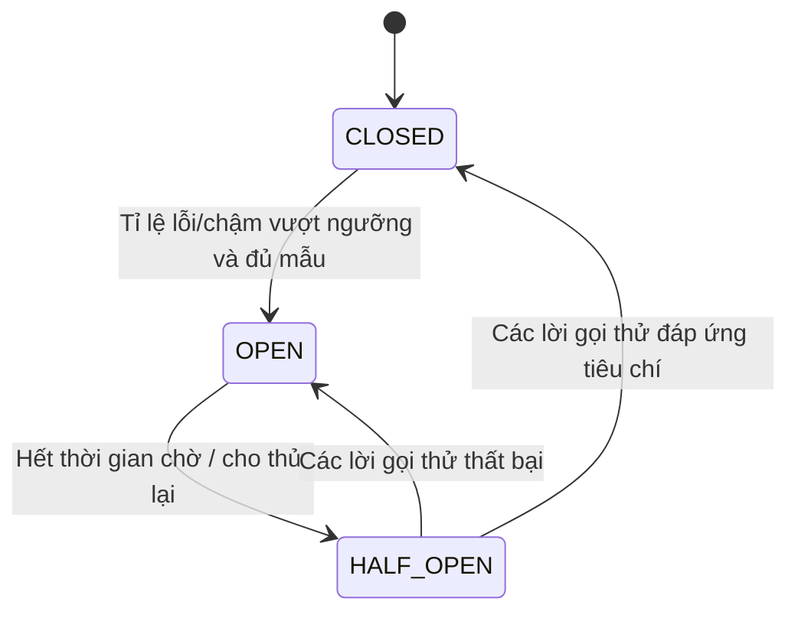
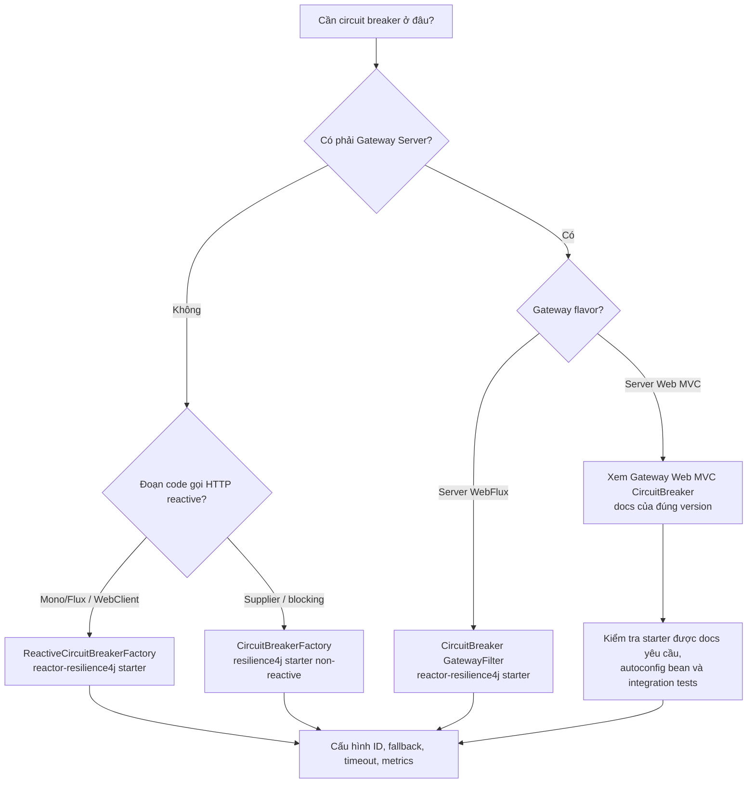

# Chọn implementation Resilience4j phù hợp với web stack

**Chương:** Ngắt mạch và dự phòng  
**Module:** `SPRING_CLOUD_GATEWAY` — Spring Cloud Gateway

Một API Gateway thường đứng giữa client và nhiều microservice. Khi một backend gặp lỗi hoặc trả lời quá chậm, việc Gateway tiếp tục đẩy thêm mọi request đến backend có thể làm cạn kết nối, tăng độ trễ và khiến nhiều service khác chịu ảnh hưởng dây chuyền. **Circuit breaker** giúp tạm ngừng những lượt gọi đến một đích đang có dấu hiệu không khỏe, sau đó kiểm tra khả năng phục hồi trước khi mở lại lưu lượng.

Spring Cloud Gateway cung cấp bộ lọc `CircuitBreaker` tích hợp với **Spring Cloud CircuitBreaker**; Resilience4j là một implementation phổ biến phía dưới abstraction đó. Nhưng một lựa chọn dependency tưởng chừng nhỏ lại dễ gây lỗi: **Gateway Server WebFlux dùng pipeline reactive**, trong khi ứng dụng Spring MVC truyền thống có API non-reactive. Thêm nhầm starter có thể khiến filter không được tạo, Spring không có factory đúng kiểu hoặc xuất hiện lỗi hành vi với `Mono`/`Flux` và thread.

Bài này tập trung vào cách **chọn implementation Resilience4j theo đúng web stack và đúng điểm tích hợp**, không chỉ giải thích lý thuyết circuit breaker. Ta sẽ đối chiếu Spring Cloud Gateway Server WebFlux, Gateway Server Web MVC, các service WebFlux/MVC sử dụng CircuitBreaker trực tiếp, cấu hình `fallbackUri`, TimeLimiter, HTTP status codes, lỗi thường gặp và thực hành HTTP. Đồng thời cần kết hợp route predicate, filter chain, biến đổi path/header, service discovery, xác thực, giới hạn lưu lượng, retry, TLS và quan sát request để bảo vệ cổng vào microservices một cách an toàn.

> **Phạm vi:** Ví dụ lab chính chạy **Spring Cloud Gateway Server WebFlux**, vì đây là nơi chọn `spring-cloud-starter-circuitbreaker-reactor-resilience4j` rõ ràng nhất. Phần Server Web MVC được trình bày riêng với caveat **theo tài liệu phiên bản**: trang CircuitBreaker Filter của Gateway Web MVC ở các dòng 4.2/4.3/5.x hiện cũng chỉ dẫn starter Reactor, dù trang Spring Cloud CircuitBreaker phân loại starter non-reactive cho ứng dụng non-reactive. Không nên đánh đồng hai tài liệu hoặc suy ra starter Gateway MVC chỉ từ tên “MVC”.

## 1. Mục tiêu học tập

Sau bài này, bạn có thể:

1. Xác định ứng dụng nào đang chạy **Gateway Server WebFlux**, **Gateway Server Web MVC**, hay chỉ là backend Spring MVC/WebFlux.
2. Chọn starter Resilience4j theo **kiểu API mà điểm tích hợp yêu cầu** và BOM/version tương thích.
3. Phân biệt `ReactiveCircuitBreakerFactory`, `CircuitBreakerFactory`, `ReactiveResilience4JCircuitBreakerFactory`, `Resilience4JCircuitBreakerFactory` và Resilience4j core.
4. Cấu hình `CircuitBreaker` filter cho Gateway WebFlux với `name`, `fallbackUri` và `statusCodes`.
5. Xây dựng một backend mô phỏng thành công, trả HTTP 500 và phản hồi chậm; dùng cURL kiểm tra fallback/trạng thái ngắt mạch.
6. Giải thích mối liên hệ và điểm khác biệt của **circuit breaker, TimeLimiter, retry, rate limiter và bulkhead**.
7. Chẩn đoán lỗi do dùng sai starter, sai stack, sai thứ tự filter, không bắt HTTP 5xx, fallback path sai hoặc bị ngắt ở tầng TLS/security.
8. Lựa chọn mô hình quan sát và cấu hình an toàn cho production.

## 2. Vì sao cần xác định web stack trước?

Trong Spring Cloud, không phải mọi API “trả về HTTP” đều cùng cơ chế xử lý:

| Ngữ cảnh | Runtime/cách xử lý chủ đạo | Kiểu thao tác điển hình |
|---|---|---|
| **Gateway Server WebFlux** | Spring WebFlux + Reactor, event loop/non-blocking HTTP client | `Mono<Void>`, `Flux<DataBuffer>`, `GatewayFilter` |
| **Gateway Server Web MVC** | Spring MVC/WebMvc.fn trên Servlet runtime | `RouterFunction<ServerResponse>` và `HandlerFilterFunction` |
| **Ứng dụng Spring WebFlux** gọi API | Reactive programming | `Mono<Response>`/`Flux<Response>` với `WebClient` |
| **Ứng dụng Spring MVC** gọi API blocking | Servlet thread + synchronous operation | `Supplier<T>`, `RestClient`/`RestTemplate` |
| **Proxy Exchange** | Thành phần proxy dạng annotated handler, phụ thuộc flavor | Không tự đồng nhất với Gateway Server CircuitBreaker filter |

Hai lớp quan trọng trong Spring Cloud CircuitBreaker:

- **`CircuitBreakerFactory`** tạo circuit breaker cho đoạn xử lý imperative, thường chạy một `Supplier` và hàm fallback.
- **`ReactiveCircuitBreakerFactory`** tạo circuit breaker để bao một reactive `Publisher` (ví dụ `Mono`/`Flux`), giúp lỗi/cancellation/timeout nằm trong reactive chain.

Resilience4j cung cấp implementation cụ thể tương ứng; Spring Cloud CircuitBreaker là **lớp trừu tượng** để Gateway/ứng dụng không phụ thuộc quá chặt vào API Resilience4j core.

### 2.1. Cùng tên “CircuitBreaker” nhưng không phải cùng lớp

```text
Spring Cloud Gateway Server WebFlux
  CircuitBreaker GatewayFilter
       |
       v
Spring Cloud CircuitBreaker (reactive API)
  ReactiveCircuitBreakerFactory
       |
       v
ReactiveResilience4JCircuitBreakerFactory
       |
       v
Resilience4j CircuitBreaker + Reactor integration
```

Trong ứng dụng MVC service thông thường:

```text
Spring MVC controller/service
  synchronous business call
       |
       v
Spring Cloud CircuitBreaker (imperative API)
  CircuitBreakerFactory
       |
       v
Resilience4JCircuitBreakerFactory
       |
       v
Resilience4j CircuitBreaker
```

**Không nên** giải quyết bằng cách import tùy ý `io.github.resilience4j.circuitbreaker.CircuitBreaker` vào GatewayFilter rồi tự `subscribe()` hoặc `block()`: như vậy có thể bỏ qua abstraction/filter chain, tạo hai đường cấu hình khác nhau và chặn thread reactor.

## 3. Ma trận chọn dependency: quy tắc chung và ngoại lệ tài liệu Gateway MVC

Spring Cloud CircuitBreaker công bố **hai starters**:

| Điểm tích hợp | Starter/framework khuyến nghị | Factory/API cần thiết |
|---|---|---|
| Gateway **Server WebFlux CircuitBreaker GatewayFilter** | `spring-cloud-starter-circuitbreaker-reactor-resilience4j` | Reactive |
| Spring **WebFlux service** bảo vệ `WebClient`/`Mono` | `spring-cloud-starter-circuitbreaker-reactor-resilience4j` | `ReactiveCircuitBreakerFactory` |
| Spring **MVC service** dùng `CircuitBreakerFactory.run(Supplier)` | `spring-cloud-starter-circuitbreaker-resilience4j` | `CircuitBreakerFactory` (non-reactive) |
| **Gateway Server Web MVC CircuitBreaker Filter** | **Đối chiếu đúng trang Gateway MVC filter/version**; tài liệu 4.2/4.3/5.x hiện hướng dẫn `spring-cloud-starter-circuitbreaker-reactor-resilience4j` | Filter trong Gateway Web MVC; kiểm tra autoconfiguration/bean của bản đang chạy |
| Chỉ thêm `resilience4j-circuitbreaker` core | Không đủ để mặc định kích hoạt Gateway `CircuitBreaker` filter | Thiếu Spring Cloud CircuitBreaker integration/filter wiring |

> **Điểm dễ sai nhất:** Quy tắc chung “WebMVC → non-reactive starter” **đúng với service MVC dùng API synchronous**, nhưng **không được tự áp vào Gateway Server Web MVC filter** nếu tài liệu đúng phiên bản của filter chỉ dẫn khác. Trang [Gateway Server Web MVC — CircuitBreaker Filter](https://docs.spring.io/spring-cloud-gateway/reference/spring-cloud-gateway-server-webmvc/filters/circuitbreaker-filter.html) hiện viết dùng starter Reactor; hãy xem đây là **yêu cầu tài liệu của tích hợp Gateway**, kiểm tra dependency graph và chạy integration test trên đúng release train, thay vì suy luận bằng tên starter.

### 3.1. Quy trình chọn implementation 5 bước

1. Xác định dự án là **Gateway Server WebFlux**, **Gateway Server Web MVC** hay chỉ một backend Spring Boot (WebFlux/MVC).
2. Xác định **điểm sử dụng circuit breaker** là GatewayFilter/HandlerFilter hay lời gọi HTTP trong một service.
3. Mở trang reference của **đúng Gateway flavor và release train**, kiểm tra starter mà filter yêu cầu.
4. Đảm bảo Spring Cloud BOM tương thích Spring Boot, để BOM quản lý version của `spring-cloud-*`; tránh tự gán các version Resilience4j không được kiểm chứng.
5. Xác minh trong runtime: route/filter được tạo, factory bean phù hợp, test request thành công/lỗi/fallback và Actuator/metrics.

**Không chọn bằng một tiêu chí duy nhất** như “dự án có `spring-webmvc`” hoặc “dependency chứa `reactor-core`”. Một số framework có Reactor trên classpath như dependency phụ nhưng ứng dụng chủ yếu vẫn chạy Servlet. Cần kiểm tra **web application type** và API/filter sử dụng.

### 3.2. Các tên rất dễ nhầm

| Tên | Không nên nhầm với |
|---|---|
| `spring-cloud-starter-gateway-server-webflux` | Starter Gateway Server Web MVC |
| `spring-cloud-starter-gateway-server-webmvc` | Starter Gateway Server WebFlux |
| `spring-cloud-starter-circuitbreaker-reactor-resilience4j` | `resilience4j-reactor` core đơn lẻ |
| `spring-cloud-starter-circuitbreaker-resilience4j` | Resilience4j annotation starter hoặc Spring Retry |
| `ReactiveResilience4JCircuitBreakerFactory` | `Resilience4JCircuitBreakerFactory` |
| Spring Cloud `CircuitBreaker` filter | Resilience4j `@CircuitBreaker` AOP annotation |
| `fallbackUri=forward:/...` | URI backend thông thường `http://...` hoặc `lb://...` |

Ngoài ra, có những phiên bản tài liệu cũ còn dùng `spring-cloud-starter-gateway` và cấu hình `spring.cloud.gateway.routes`. Với dòng Gateway Server WebFlux hiện đại, tên starter và prefix mới cần nhất quán.

## 4. Circuit breaker hoạt động thế nào?

Circuit breaker theo dõi kết quả các lời gọi được bao và có ba trạng thái chính:



- **CLOSED:** Cho phép request đi tới backend, thống kê thành công/thất bại/chậm theo cửa sổ cấu hình.
- **OPEN:** Phần lớn lời gọi được **từ chối nhanh** thay vì tiếp tục tải backend đang lỗi; với fallback được cấu hình, Gateway có thể trả response dự phòng.
- **HALF_OPEN:** Cho một số lượng lời gọi kiểm thử đi qua để đánh giá backend đã phục hồi hay chưa.

Đừng giả định chỉ cần **một HTTP 500** là breaker lập tức OPEN. Tỉ lệ lỗi, kích thước cửa sổ, `minimumNumberOfCalls`, `failureRateThreshold` và cấu hình ghi nhận lỗi quyết định trạng thái.

### 4.1. HTTP 5xx có tự được tính là failure không?

Một HTTP client reactive có thể nhận `500 Internal Server Error` như một **HTTP response hợp lệ ở tầng transport** thay vì exception. Gateway `CircuitBreaker` không nhất thiết đánh dấu mọi response 5xx là failure nếu bạn **không cấu hình `statusCodes`** tương ứng.

Ví dụ Gateway filter:

```yaml
- name: CircuitBreaker
  args:
    name: catalogBreaker
    fallbackUri: forward:/fallback/catalog
    statusCodes:
      - 500
      - 502
      - 503
      - 504
```

Khi đó các mã được liệt kê có thể làm circuit breaker ghi nhận lỗi và kích hoạt fallback theo cách Gateway filter hỗ trợ. Với lỗi kết nối, timeout hoặc exception downstream, breaker có thể ghi nhận failure dù không có response status.

**Không đưa 404/401/403 vào `statusCodes` chỉ vì đó là lỗi HTTP:** chúng thường biểu thị request/path/authorization không hợp lệ, không phải backend đang quá tải. Nếu business thực sự dùng status như một failure cần breaker, thiết kế rõ chính sách và kiểm thử.

### 4.2. Circuit breaker, TimeLimiter, Retry, RateLimiter và Bulkhead

| Cơ chế | Vấn đề chính | Nó không tự làm |
|---|---|---|
| **CircuitBreaker** | Giảm request tới đích đang lỗi, phục hồi có kiểm soát | Không sửa lỗi auth, path hay DNS |
| **TimeLimiter** | Giới hạn thời gian chờ một operation | Không chắc dừng được công việc blocking đang chạy |
| **Retry** | Thử lại một số lỗi tạm thời | Không bảo đảm an toàn với POST không idempotent |
| **RateLimiter** | Giới hạn tần suất request/client | Không thay thế bộ đếm concurrency và body size |
| **Bulkhead** | Giới hạn số operation concurrent/queue | Không thay thế timeout hay kiểm tra token |
| **LoadBalancer** | Chọn một service instance | Không tự circuit-break mọi instance |

Những cơ chế này là **các lớp phối hợp**, không phải một cấu hình bật tất cả và mong hệ thống an toàn. Tính thứ tự filter và semantics của từng loại request là bắt buộc.

## 5. Bài lab: backend MVC mô phỏng lỗi và phản hồi chậm

Ta triển khai hai ứng dụng độc lập:

| Ứng dụng | Web stack | Port | Nhiệm vụ |
|---|---|---:|---|
| `catalog-backend` | Spring MVC/Servlet | `8081` | Trả thành công, HTTP 500 hoặc trả chậm có kiểm soát |
| `catalog-gateway` | **Gateway Server WebFlux** | `8080` | Route, CircuitBreaker filter và fallback nội bộ |

Backend MVC có thể là đích của Gateway WebFlux vì hai ứng dụng giao tiếp qua HTTP. **Web stack của backend không quyết định starter CircuitBreaker của Gateway**: chính ứng dụng Gateway và filter của nó quyết định.

### 5.1. Tạo backend bằng Spring Initializr

Tạo project Maven, Java 17+ (ví dụ Spring Boot 3.x) với dependency **Spring Web**; package `com.example.catalog`. Với Spring Boot mới hơn, dùng starter đúng do Initializr cung cấp.

`application.yml` của backend:

```yaml
server:
  port: 8081
spring:
  application:
    name: catalog-backend
```

Lớp khởi động `CatalogApplication.java`:

```java
package com.example.catalog;

import org.springframework.boot.SpringApplication;
import org.springframework.boot.autoconfigure.SpringBootApplication;

@SpringBootApplication
public class CatalogApplication {
    public static void main(String[] args) {
        SpringApplication.run(CatalogApplication.class, args);
    }
}
```

Tạo `CatalogController.java`:

```java
package com.example.catalog;

import java.util.Map;
import org.springframework.http.HttpStatus;
import org.springframework.web.bind.annotation.GetMapping;
import org.springframework.web.bind.annotation.PathVariable;
import org.springframework.web.bind.annotation.RequestMapping;
import org.springframework.web.bind.annotation.RequestParam;
import org.springframework.web.bind.annotation.RestController;
import org.springframework.web.server.ResponseStatusException;

@RestController
@RequestMapping("/items")
public class CatalogController {

    @GetMapping("/{sku}")
    public Map<String, Object> item(
            @PathVariable String sku,
            @RequestParam(defaultValue = "ok") String mode)
            throws InterruptedException {

        if ("fail".equals(mode)) {
            throw new ResponseStatusException(
                HttpStatus.INTERNAL_SERVER_ERROR, "simulated failure");
        }

        if ("slow".equals(mode)) {
            // Chỉ để mô phỏng latency trong BACKEND MVC của lab.
            Thread.sleep(3500L);
        }

        return Map.of(
            "service", "catalog-backend",
            "sku", sku,
            "mode", mode,
            "available", true);
    }
}
```

`Thread.sleep(3500L)` ở đây chỉ chạy trong **backend MVC thử nghiệm** để tạo request chậm, **không được sao chép vào Gateway Server WebFlux**. Trong WebFlux filter/reactive service, chặn event-loop sẽ gây latency và giảm throughput; nếu buộc gọi thư viện blocking, cần mô hình chuyển thread có kiểm soát hoặc đổi cách tích hợp.

### 5.2. Kiểm thử backend trực tiếp

Khởi động backend:

```bash
./mvnw spring-boot:run
```

Trong Windows PowerShell:

```powershell
.\mvnw.cmd spring-boot:run
```

Thử ba chế độ:

```bash
# Nhanh, HTTP 200.
curl -i "http://localhost:8081/items/SKU-42?mode=ok"

# Trả lỗi nghiệp vụ giả lập, HTTP 500.
curl -i "http://localhost:8081/items/SKU-42?mode=fail"

# Đợi khoảng 3,5 giây rồi trả HTTP 200.
curl -i "http://localhost:8081/items/SKU-42?mode=slow"
```

Nếu gọi trực tiếp backend chưa đúng, **chưa cần sửa Gateway**. Xác minh `/items/SKU-42` là path thật và `8081` chưa bị ứng dụng khác chiếm.

## 6. Gateway Server WebFlux: dependency và filter chính xác

Tạo ứng dụng Spring Boot riêng với **Gateway Server WebFlux**. Dùng Spring Cloud BOM tương thích Spring Boot/Cloud Gateway đã chọn; ví dụ Maven dependencies trong dòng starter hiện đại:

```xml
<dependencies>
    <dependency>
        <groupId>org.springframework.cloud</groupId>
        <artifactId>spring-cloud-starter-gateway-server-webflux</artifactId>
    </dependency>
    <dependency>
        <groupId>org.springframework.cloud</groupId>
        <artifactId>spring-cloud-starter-circuitbreaker-reactor-resilience4j</artifactId>
    </dependency>
</dependencies>
```

**Đây là tổ hợp trọng tâm:** Gateway Server WebFlux cần integration CircuitBreaker **reactive**. Chỉ thêm `spring-cloud-starter-circuitbreaker-resilience4j` (non-reactive) không phải cách được tài liệu Gateway Server WebFlux hướng dẫn để kích hoạt `CircuitBreaker` GatewayFilter.

Không thêm `spring-boot-starter-web`/Servlet vào project WebFlux Gateway chỉ để “có MVC fallback controller”: Gateway WebFlux có `@RestController` reactive và WebFlux handler của riêng nó. Backend MVC là **dự án khác**.

### 6.1. `application.yml` của Gateway WebFlux

```yaml
server:
  port: 8080

spring:
  application:
    name: catalog-gateway-lab
  cloud:
    gateway:
      server:
        webflux:
          routes:
            - id: catalog-protected
              uri: http://localhost:8081
              predicates:
                - Path=/api/catalog/**
                - Method=GET
              filters:
                - name: CircuitBreaker
                  args:
                    name: catalogBreaker
                    fallbackUri: forward:/fallback/catalog
                    statusCodes:
                      - 500
                      - 502
                      - 503
                      - 504
                - StripPrefix=2

resilience4j:
  circuitbreaker:
    instances:
      catalogBreaker:
        slidingWindowType: COUNT_BASED
        slidingWindowSize: 8
        minimumNumberOfCalls: 4
        failureRateThreshold: 50
        permittedNumberOfCallsInHalfOpenState: 2
        waitDurationInOpenState: 10s
        automaticTransitionFromOpenToHalfOpenEnabled: true
  timelimiter:
    instances:
      catalogBreaker:
        timeoutDuration: 2s
```

**Giải thích chi tiết:**

1. `Path=/api/catalog/**` và `Method=GET` chỉ chọn route cho các request GET phù hợp.
2. `uri: http://localhost:8081` là đích cố định phục vụ lab; sau này có thể chuyển thành `lb://catalog-service` khi có Spring Cloud LoadBalancer và service instances.
3. `CircuitBreaker` được đặt tên `catalogBreaker`. Tên này phải khớp với key `resilience4j.circuitbreaker.instances.catalogBreaker` và `resilience4j.timelimiter.instances.catalogBreaker`.
4. `statusCodes` đưa các phản hồi 500/502/503/504 vào nhóm lỗi được breaker đánh giá. **Không nhất thiết mọi 4xx cần breaker**.
5. `fallbackUri: forward:/fallback/catalog` yêu cầu chuyển đến handler nội bộ Gateway khi lỗi hoặc breaker từ chối; prefix `forward:` là scheme được filter hỗ trợ cho fallback.
6. `StripPrefix=2` bỏ hai segment `api` và `catalog`, để backend nhận `/items/SKU-42`.
7. `minimumNumberOfCalls=4` yêu cầu đủ số call trước khi dùng tỉ lệ lỗi để quyết định mở mạch. `failureRateThreshold=50` là 50%, không phải “trượt đúng 50 call”.
8. `waitDurationInOpenState=10s` và `permittedNumberOfCallsInHalfOpenState=2` giúp thực nghiệm mở lại theo chu kỳ ngắn; giá trị thực tế phải được chọn theo tải và khả năng phục hồi backend.
9. `timeoutDuration=2s` của TimeLimiter thấp hơn `3,5s` ở mode slow để có cơ hội quan sát timeout/fallback.

Chỉ cấu hình một breaker instance trong lab để dễ nhìn. Production có thể tách breaker theo backend/loại operation, nhưng phải cân nhắc cardinality và trạng thái được chia sẻ.

### 6.2. Handler fallback chạy **trong Gateway WebFlux**

Tạo `CatalogFallbackController.java` dưới package được Gateway `@SpringBootApplication` quét:

```java
package com.example.gateway;

import java.util.Map;
import org.springframework.http.HttpStatus;
import org.springframework.http.ResponseEntity;
import org.springframework.web.bind.annotation.GetMapping;
import org.springframework.web.bind.annotation.RestController;
import reactor.core.publisher.Mono;

@RestController
public class CatalogFallbackController {

    @GetMapping("/fallback/catalog")
    public Mono<ResponseEntity<Map<String, String>>> fallback() {
        Map<String, String> body = Map.of(
            "service", "gateway",
            "type", "degraded",
            "message", "Catalog temporarily unavailable");

        return Mono.just(ResponseEntity
            .status(HttpStatus.SERVICE_UNAVAILABLE)
            .header("X-Gateway-Fallback", "catalog")
            .body(body));
    }
}
```

Fallback của bài lab **trả HTTP 503** một cách có chủ ý, để người gọi và hệ thống giám sát biết backend đang suy giảm thay vì “giấu” lỗi thành HTTP 200. Header `X-Gateway-Fallback: catalog` giúp phân biệt **503 do fallback tạo ra** với 503 từ một thành phần khác.

Không trả toàn bộ exception, URI nội bộ, access token, cookie hay thông tin máy chủ vào response fallback. Những chi tiết đó có thể chứa dữ liệu nhạy cảm và không giúp client xử lý tốt hơn.

**Tại sao không dùng `fallbackUri: http://localhost:9000`?** Với CircuitBreaker filter này, Spring Cloud Gateway chỉ hỗ trợ **`forward:`** làm `fallbackUri`. Nếu muốn fallback nằm ở một ứng dụng khác, có thể forward đến một route/handler thứ hai trong Gateway rồi dùng route ấy chuyển sang backend fallback; phải đánh giá thứ tự route, header và tránh vòng lặp.

### 6.3. Backend không cần dependency CircuitBreaker trong lab

Backend MVC ở cổng `8081` chỉ mô phỏng lỗi. **Không cần** thêm Resilience4j hay Spring Cloud CircuitBreaker vào backend để Gateway WebFlux có thể circuit-break các request hướng đến nó.

Tương tự, nếu sau này backend là ứng dụng WebFlux chứ không phải MVC, starter CircuitBreaker của **Gateway** vẫn chọn theo **Gateway Server WebFlux**, không tự đổi theo stack của backend.

## 7. Chạy lab và quan sát lỗi qua Gateway

Khởi động **backend `8081` trước**, sau đó Gateway WebFlux ở `8080`. Với Maven Wrapper:

```bash
./mvnw spring-boot:run
```

Chạy lệnh trên **trong từng dự án tương ứng**, ở hai terminal. Mở terminal thứ ba để kiểm tra.

### 7.1. Request thành công

```bash
curl -i "http://localhost:8080/api/catalog/items/SKU-42?mode=ok"
```

Phản hồi kỳ vọng là HTTP `200` của backend:

```json
{
  "service": "catalog-backend",
  "sku": "SKU-42",
  "mode": "ok",
  "available": true
}
```

Điều cần xác minh:

- Gateway route `catalog-protected` được chọn nhờ `Path` và `Method`;
- `StripPrefix=2` giúp request đến backend `/items/SKU-42`;
- `CircuitBreaker` không chặn request khi breaker còn CLOSED;
- Không có header `X-Gateway-Fallback` do controller fallback thêm.

### 7.2. HTTP 500 và `statusCodes`

```bash
curl -i "http://localhost:8080/api/catalog/items/SKU-42?mode=fail"
```

Backend trả HTTP 500 do `ResponseStatusException`; ở route Gateway, `statusCodes` có 500 nên lỗi có thể kích hoạt fallback:

```http
HTTP/1.1 503 Service Unavailable
X-Gateway-Fallback: catalog
Content-Type: application/json
```

Body JSON rút gọn:

```json
{
  "service": "gateway",
  "type": "degraded",
  "message": "Catalog temporarily unavailable"
}
```

Đây là kết quả minh họa cho đường fallback được kích hoạt; response headers, thứ tự và chi tiết log có thể khác theo HTTP runtime. Nếu bạn bỏ `statusCodes: [500,...]`, không nên mặc định response 500 được coi là breaker failure; một HTTP status là kết quả ứng dụng, còn exception/call result là tín hiệu mà circuit breaker cần được cấu hình để hiểu.

### 7.3. Mở mạch sau một số request lỗi

Gửi lặp request lỗi ở môi trường lab:

```bash
curl -s -o /dev/null -w "%{http_code}\n" "http://localhost:8080/api/catalog/items/SKU-42?mode=fail"
curl -s -o /dev/null -w "%{http_code}\n" "http://localhost:8080/api/catalog/items/SKU-42?mode=fail"
curl -s -o /dev/null -w "%{http_code}\n" "http://localhost:8080/api/catalog/items/SKU-42?mode=fail"
curl -s -o /dev/null -w "%{http_code}\n" "http://localhost:8080/api/catalog/items/SKU-42?mode=fail"
```

Với `minimumNumberOfCalls=4`, `failureRateThreshold=50` và cả bốn lần được breaker ghi nhận failure, breaker có thể chuyển sang **OPEN** sau khi đủ mẫu. Tuy nhiên, không khẳng định chính xác request thứ mấy bắt đầu bị chặn trong mọi hệ thống: phải kiểm tra logs/metrics vì state trước đó, request concurrent, TimeLimiter và cách filter ghi nhận outcome có thể ảnh hưởng.

Khi breaker **OPEN**, ngay cả request `mode=ok` có thể được trả fallback **mà không được gửi đến backend**. Đây là mục tiêu bảo vệ: giảm tải backend đang gặp lỗi. Sau `waitDurationInOpenState=10s`, breaker có thể chuyển sang HALF_OPEN và cho số request thử được cấu hình đi qua; nếu chúng thành công, mạch có thể đóng.

Để quan sát trạng thái này đáng tin cậy, nên dùng Resilience4j metrics/health hoặc event logs, thay vì suy đoán chỉ từ số HTTP 503 ở client. Kể cả backend vẫn còn trả lỗi, fallback của Gateway cũng trả 503 nên mã trạng thái **không phân biệt nguyên nhân**.

### 7.4. Phản hồi chậm và TimeLimiter

```bash
curl -i "http://localhost:8080/api/catalog/items/SKU-42?mode=slow"
```

Backend chờ khoảng `3,5 giây`; trong lab `resilience4j.timelimiter.instances.catalogBreaker.timeoutDuration=2s`. Nếu request đi qua breaker và TimeLimiter đang hoạt động như cấu hình, Gateway có thể ngừng chờ và chuyển sang fallback ở khoảng ngưỡng timeout. Lưu ý thời gian client đo được còn phụ thuộc scheduling, network, TLS và overhead, nên không đòi đúng `2.000 ms`.

**Timeout không luôn làm công việc backend dừng ngay:** Backend MVC có thể tiếp tục `Thread.sleep` và hoàn thành công việc sau khi Gateway đã ngừng chờ; việc hủy một reactive subscription không chắc chặn một thread blocking ở service khác. Vì vậy TimeLimiter giảm thời gian chờ ở Gateway nhưng **không thay thế backend timeout, cancellation logic, bulkhead và idempotency**.

### 7.5. Backend ngừng hoạt động

Chỉ trong lab, dừng tiến trình ở `8081`, rồi thử:

```bash
curl -i "http://localhost:8080/api/catalog/items/SKU-42?mode=ok"
```

Lỗi kết nối downstream có thể được breaker coi là failure, khiến fallback trả HTTP 503. Nếu bạn không nhìn thấy fallback, hãy xem:

1. `CircuitBreaker` filter có được tạo không (starter và autoconfiguration)?
2. Route `catalog-protected` có thực sự khớp không?
3. Handler `/fallback/catalog` có được Gateway WebFlux quét và gọi không?
4. Đã có lỗi nào xảy ra **trước** khi request đi vào filter hay không?
5. Fallback có bị Spring Security/cấu hình routing khác chặn không?

Không cố tình gây mất backend hoặc tạo lỗi tải lớn trong production để thử mở mạch.

### 7.6. Windows PowerShell tương đương

Nếu muốn kiểm tra status và JSON trên Windows:

```powershell
curl.exe -i "http://localhost:8080/api/catalog/items/SKU-42?mode=ok"
curl.exe -i "http://localhost:8080/api/catalog/items/SKU-42?mode=fail"
curl.exe -i "http://localhost:8080/api/catalog/items/SKU-42?mode=slow"
```

Trong Windows PowerShell, dùng `curl.exe` thay vì alias `curl` nếu muốn dùng cú pháp cURL chính xác. Để đo timing với công cụ cụ thể, hãy kiểm tra `time_total` hoặc latency trong metrics/traces; mã HTTP không đủ.

## 8. Java DSL của Gateway Server WebFlux

Nếu không khai báo route qua YAML, `RouteLocatorBuilder` cho phép cấu hình CircuitBreaker cùng fallback:

```java
package com.example.gateway;

import org.springframework.cloud.gateway.route.RouteLocator;
import org.springframework.cloud.gateway.route.builder.RouteLocatorBuilder;
import org.springframework.context.annotation.Bean;
import org.springframework.context.annotation.Configuration;
import org.springframework.http.HttpMethod;

@Configuration
public class CatalogRouteConfiguration {

    @Bean
    RouteLocator catalogRoutes(RouteLocatorBuilder builder) {
        return builder.routes()
            .route("catalog-protected", r -> r
                .path("/api/catalog/**")
                .and()
                .method(HttpMethod.GET)
                .filters(f -> f
                    .circuitBreaker(config -> config
                        .name("catalogBreaker")
                        .fallbackUri("forward:/fallback/catalog")
                        .addStatusCode("INTERNAL_SERVER_ERROR"))
                    .stripPrefix(2))
                .uri("http://localhost:8081"))
            .build();
    }
}
```

Java DSL này thể hiện cách đặt breaker trên route **WebFlux**. Ví dụ chỉ thêm status 500 (`INTERNAL_SERVER_ERROR`) để minh họa `addStatusCode`; nếu muốn bắt 502/503/504 như YAML, bổ sung các mã đó theo API phiên bản.

**Không bật đồng thời** bean route Java này và cấu hình YAML `catalog-protected` cùng ID/path trong cùng bài lab, trừ khi bạn đã chủ động quản lý thứ tự và hành vi route trùng. Dùng **một** cách khai báo route, giữ nguyên controller fallback và cấu hình Resilience4j.

### 8.1. Sử dụng reactive factory ở code tùy chỉnh

Khi một thành phần reactive **không phải route filter** cần circuit breaker cho `WebClient`:

```java
package com.example.gateway;

import org.springframework.cloud.client.circuitbreaker.ReactiveCircuitBreakerFactory;
import org.springframework.stereotype.Service;
import org.springframework.web.reactive.function.client.WebClient;
import reactor.core.publisher.Mono;

@Service
public class CatalogLookupService {
    private final WebClient webClient;
    private final ReactiveCircuitBreakerFactory<?, ?> breakers;

    public CatalogLookupService(
            WebClient.Builder builder,
            ReactiveCircuitBreakerFactory<?, ?> breakers) {
        this.webClient = builder.baseUrl("http://localhost:8081").build();
        this.breakers = breakers;
    }

    public Mono<String> load(String sku) {
        Mono<String> call = webClient.get()
            .uri("/items/{sku}", sku)
            .retrieve()
            .bodyToMono(String.class);

        return breakers.create("catalogBreaker").run(
            call,
            error -> Mono.just("Catalog temporarily unavailable"));
    }
}
```

Trong ví dụ này `WebClient.retrieve()` sẽ xử lý một số HTTP error status thành reactive error signals; đó là cách dùng service-level khác với GatewayFilter xử lý HTTP response và `statusCodes`. Cùng một tên `catalogBreaker` có thể khiến các đường gọi chia sẻ state nếu cùng registry/factory được thiết kế như vậy; nên xác định rõ đơn vị breaker theo **đích/loại operation** thay vì vô tình trộn nhiều nguồn lỗi vào một breaker.

**Không gọi `.block()`** trên `call` trong WebFlux event-loop chỉ để đưa nó vào `CircuitBreakerFactory.run(Supplier)`. Làm vậy chuyển một flow non-blocking thành blocking, có thể làm nghẽn event loop và bỏ mất lợi ích Reactive Streams.

### 8.2. Vì sao không dùng Resilience4j `@CircuitBreaker` để thay GatewayFilter?

Resilience4j cung cấp annotations/aspects dùng cho method-level protection, nhưng Gateway `CircuitBreaker` filter được tích hợp trong route/filter chain của Spring Cloud Gateway. Với nhu cầu bảo vệ **toàn bộ HTTP proxy route**, nên dùng filter/factory được Gateway hỗ trợ; annotations trong service Java là **cách tích hợp khác** và cần dependencies/AOP cũng như cấu hình riêng.

Đừng dùng cả hai lớp breaker cho cùng một call mà không xác định ý nghĩa: hai breaker lồng nhau có thể cùng ghi lỗi, cùng timeout và tạo fallback khó chẩn đoán.

## 9. Gateway Server Web MVC: trường hợp cần đọc tài liệu tích hợp riêng

Gateway Server Web MVC được xây trên **Spring WebMvc.fn** và Servlet runtime; nó không sử dụng `GatewayFilter`/`RouteLocatorBuilder` reactive như Gateway Server WebFlux. Ví dụ filter tương ứng là `CircuitBreaker` trong namespace:

```java
org.springframework.cloud.gateway.server.mvc.filter.CircuitBreakerFilterFunctions
```

Đây là **điểm khác biệt giữa Gateway Web MVC filter và một service MVC tự gọi API**. Theo tài liệu chính thức của **Gateway Server Web MVC CircuitBreaker Filter** (bao gồm 4.3 và 5.x), phần hướng dẫn dependency ghi rõ:

```text
org.springframework.cloud:spring-cloud-starter-circuitbreaker-reactor-resilience4j
```

Trong khi đó tài liệu **Spring Cloud CircuitBreaker Starters** phân loại:

```text
spring-cloud-starter-circuitbreaker-resilience4j          -> non-reactive
spring-cloud-starter-circuitbreaker-reactor-resilience4j  -> reactive
```

**Cách đọc hai tài liệu cho đúng:** hướng dẫn chung dùng để chọn API non-reactive cho một ứng dụng MVC; hướng dẫn **Gateway Web MVC filter** là yêu cầu tích hợp cụ thể cần kiểm chứng theo phiên bản. Không âm thầm “sửa” hướng dẫn Gateway MVC thành non-reactive vì tên Web MVC, cũng không suy luận rằng **mọi** ứng dụng MVC phải chọn Reactor. Nếu bản cài đặt/dòng phát hành thay đổi contract, ưu tiên reference và tests của đúng bản đó.

### 9.1. Cấu hình Gateway Server Web MVC qua YAML

Tạo **một project Gateway Web MVC riêng**, không chạy cùng port với WebFlux Gateway. Starter Gateway Web MVC:

```xml
<dependency>
    <groupId>org.springframework.cloud</groupId>
    <artifactId>spring-cloud-starter-gateway-server-webmvc</artifactId>
</dependency>
```

Và để sử dụng **CircuitBreaker Filter**, theo trang Gateway Web MVC hiện hành, bổ sung integration mà trang ấy chỉ định:

```xml
<dependency>
    <groupId>org.springframework.cloud</groupId>
    <artifactId>spring-cloud-starter-circuitbreaker-reactor-resilience4j</artifactId>
</dependency>
```

**Chú thích thực hành:** vì starter này mang tên Reactor trong một web stack Servlet, cần kiểm tra dependency graph và autoconfiguration trên **release train chính xác**. Nếu bạn sử dụng không phải Gateway Web MVC filter mà một `CircuitBreakerFactory` imperative tại service MVC, hãy theo phần 10 thay vì sao chép dependency này. Không trộn `spring-boot-starter-webflux`, `spring-boot-starter-web` và cả hai Gateway starter trong một project chỉ để thử tìm factory bean.

Ví dụ `application.yml` cho Gateway Server Web MVC:

```yaml
server:
  port: 8080

spring:
  cloud:
    gateway:
      server:
        webmvc:
          routes:
            - id: catalog-mvc
              uri: http://localhost:8081
              predicates:
                - Path=/api/catalog/**
              filters:
                - name: CircuitBreaker
                  args:
                    name: catalogBreaker
                    fallbackUri: forward:/fallback/catalog
                    statusCodes:
                      - 500
                      - 503
                - StripPrefix=2

resilience4j:
  circuitbreaker:
    instances:
      catalogBreaker:
        slidingWindowSize: 8
        minimumNumberOfCalls: 4
        failureRateThreshold: 50
        waitDurationInOpenState: 10s
  timelimiter:
    instances:
      catalogBreaker:
        timeoutDuration: 2s
```

Đây là **một project thay thế** WebFlux Gateway ở phần 6; không cấu hình `server.webflux.routes` và `server.webmvc.routes` trong cùng một project rồi mong cả hai web runtimes cùng được chọn như ý. Backend `8081` dùng lại từ phần 5.

Với các dòng Gateway Web MVC cũ, prefix cấu hình từng là `spring.cloud.gateway.mvc.routes` thay vì `spring.cloud.gateway.server.webmvc.routes`. Phải kiểm tra đúng bảng configuration properties theo version; ứng dụng có thể khởi động nhưng không sinh route nếu dùng sai prefix.

### 9.2. Fallback controller ở Gateway Web MVC

Với project Gateway Web MVC, controller fallback dùng Spring MVC:

```java
package com.example.gatewaymvc;

import java.util.Map;
import org.springframework.http.HttpStatus;
import org.springframework.http.ResponseEntity;
import org.springframework.web.bind.annotation.GetMapping;
import org.springframework.web.bind.annotation.RestController;

@RestController
public class CatalogMvcFallbackController {

    @GetMapping("/fallback/catalog")
    public ResponseEntity<Map<String, String>> fallback() {
        return ResponseEntity
            .status(HttpStatus.SERVICE_UNAVAILABLE)
            .header("X-Gateway-Fallback", "catalog-mvc")
            .body(Map.of(
                "service", "mvc-gateway",
                "message", "Catalog temporarily unavailable"));
    }
}
```

**Khác biệt quan trọng:** MVC controller trả `ResponseEntity` trực tiếp; WebFlux controller ví dụ trước trả `Mono<ResponseEntity<...>>`. Không import `Mono` chỉ vì dependency Reactor xuất hiện; mức reactive của **HTTP handler application** vẫn được xác định bởi Gateway flavor.

### 9.3. WebMvc.fn Java RouterFunction là DSL khác

Thay cho YAML, tài liệu Gateway Server Web MVC minh họa các static functions từ `GatewayRouterFunctions` và `CircuitBreakerFilterFunctions`:

```java
package com.example.gatewaymvc;

import java.net.URI;
import org.springframework.context.annotation.Bean;
import org.springframework.context.annotation.Configuration;
import org.springframework.web.servlet.function.RouterFunction;
import org.springframework.web.servlet.function.ServerResponse;

import static org.springframework.cloud.gateway.server.mvc.filter.BeforeFilterFunctions.uri;
import static org.springframework.cloud.gateway.server.mvc.filter.CircuitBreakerFilterFunctions.circuitBreaker;
import static org.springframework.cloud.gateway.server.mvc.handler.GatewayRouterFunctions.route;
import static org.springframework.cloud.gateway.server.mvc.handler.HandlerFunctions.http;
import static org.springframework.web.servlet.function.RequestPredicates.path;

@Configuration
public class MvcRouteConfiguration {

    @Bean
    RouterFunction<ServerResponse> catalogMvcRoute() {
        return route("catalog-mvc")
            .route(path("/api/catalog/**"), http())
            .before(uri("http://localhost:8081"))
            .filter(circuitBreaker(
                "catalogBreaker",
                URI.create("forward:/fallback/catalog")))
            .build();
    }
}
```

Ví dụ trên **chỉ** minh họa cách dựng route/filter và fallback bằng WebMvc.fn; nó **chưa viết lại `/api/catalog/items/SKU-42` thành `/items/SKU-42`**. Nếu sử dụng với backend ở phần 5, hãy bổ sung path-filter tương ứng theo API Gateway Server Web MVC phiên bản bạn dùng hoặc dùng ví dụ YAML có `StripPrefix=2`. Cố ý ghi rõ khác biệt này để tránh một ví dụ Java trông đúng nhưng downstream trả HTTP 404.

**Không** dùng `RouteLocatorBuilder` của Gateway Server WebFlux trong một WebMvc.fn route; hai DSL và các import thuộc hai hệ API khác nhau.

### 9.4. Checklist khi Gateway Web MVC không tạo được CircuitBreaker filter

1. Gateway starter là `spring-cloud-starter-gateway-server-webmvc`, không phải WebFlux.
2. Prefix properties là `server.webmvc` (hoặc prefix của release train đang chạy).
3. Đã đọc **trang CircuitBreaker Filter của Gateway Web MVC đúng version** cho dependency.
4. Tài nguyên Resilience4j/TimeLimiter có ID khớp `name: catalogBreaker`.
5. Bean/filter đã được autoconfigure và route có trong Gateway runtime.
6. Fallback handler nằm trong **Gateway MVC application**, có mapping đúng path/method.
7. Không nhầm YAML config Gateway MVC với `application.yml` của backend.
8. Kiểm chứng request thành công, HTTP statusCodes đã chọn và lỗi kết nối; không chỉ kiểm tra “ứng dụng start thành công”.

## 10. Service Spring MVC thông thường: non-reactive Resilience4j

Nếu bạn **không dùng Gateway Server Web MVC CircuitBreaker Filter**, mà chỉ cần bảo vệ một lời gọi blocking bên trong ứng dụng Spring MVC, quy tắc chung của Spring Cloud CircuitBreaker rất rõ:

```xml
<dependency>
    <groupId>org.springframework.cloud</groupId>
    <artifactId>spring-cloud-starter-circuitbreaker-resilience4j</artifactId>
</dependency>
```

Sử dụng `CircuitBreakerFactory` imperative để bao lời gọi `Supplier<T>`:

```java
package com.example.catalogclient;

import org.springframework.cloud.client.circuitbreaker.CircuitBreakerFactory;
import org.springframework.stereotype.Service;
import org.springframework.web.client.RestClient;

@Service
public class BlockingCatalogClient {

    private final RestClient restClient;
    private final CircuitBreakerFactory<?, ?> breakerFactory;

    public BlockingCatalogClient(
            RestClient.Builder builder,
            CircuitBreakerFactory<?, ?> breakerFactory) {
        this.restClient = builder
            .baseUrl("http://localhost:8081")
            .build();
        this.breakerFactory = breakerFactory;
    }

    public String getItem(String sku) {
        return breakerFactory.create("catalogSync").run(
            () -> restClient.get()
                .uri("/items/{sku}", sku)
                .retrieve()
                .body(String.class),
            error -> "{\"status\":\"temporarily_unavailable\"}");
    }
}
```

`RestClient` là synchronous client (Spring Framework 6.1+); ví dụ thích hợp với một Spring MVC app chạy trên thread request được quản lý. Nếu đang dùng phiên bản Framework cũ không có `RestClient`, chọn HTTP client tương thích; cách chọn CircuitBreaker imperative vẫn dựa trên API `Supplier`/`CircuitBreakerFactory`.

**Lưu ý status HTTP:** mã fallback ở đây trả chuỗi JSON **tại service layer**, không tự thiết lập HTTP status 503; controller gọi service phải quyết định mapping response/status. Đừng đánh đồng method-level fallback với Gateway `fallbackUri`.

### 10.1. TimeLimiter với lời gọi blocking

Đặt `timeoutDuration=2s` không có nghĩa `Thread.sleep(3500)` hoặc một lời gọi JDBC blocking chắc chắn bị ngắt đúng sau 2 giây. TimeLimiter có thể hoàn thành Future phía client bằng timeout, nhưng công việc nền có thể tiếp tục nếu không hỗ trợ interruption/cancellation. Vì vậy, trong MVC service, cần **HTTP socket/connect/read timeouts**, thread pool/bulkhead và hủy công việc phù hợp — không xem TimeLimiter như phép màu dừng tất cả I/O blocking.

### 10.2. Khi một service có cả MVC và WebClient?

Một controller Servlet có thể gọi `WebClient` và trả `Mono`/`CompletableFuture`, hoặc một service MVC có một số luồng reactive phụ. Trong trường hợp đó, **chọn abstraction theo API mà đoạn xử lý thực sự dùng**, không chỉ theo artifact starter Web:

- `Supplier<T>` synchronous → `CircuitBreakerFactory`.
- `Mono<T>`/`Flux<T>` non-blocking → `ReactiveCircuitBreakerFactory`.
- Gateway Server WebFlux route filter → integration reactive được trang Gateway quy định.
- Gateway Server Web MVC filter → xem docs integration cụ thể như phần 9.

Nếu ứng dụng cần cả hai loại, phải có lý do rõ, kiểm soát dependency graph, bean collisions, thread/cancellation và cách hai breaker ghi metrics. Không thêm cả hai starter “cho chắc” rồi bỏ qua kiểm thử.

## 11. Cấu hình Resilience4j: property và Java Customizer

Spring Cloud CircuitBreaker cho phép cấu hình Resilience4j bằng `resilience4j.circuitbreaker.*` và `resilience4j.timelimiter.*` hoặc bằng Java `Customizer`. Cần hiểu **ID, group và mức ưu tiên** trước khi sử dụng.

### 11.1. Tên breaker trong filter là khóa cấu hình

Nếu route khai báo:

```yaml
filters:
  - name: CircuitBreaker
    args:
      name: catalogBreaker
      fallbackUri: forward:/fallback/catalog
```

thì cấu hình instance đúng tên:

```yaml
resilience4j:
  circuitbreaker:
    instances:
      catalogBreaker:
        slidingWindowSize: 10
        minimumNumberOfCalls: 5
        failureRateThreshold: 50
  timelimiter:
    instances:
      catalogBreaker:
        timeoutDuration: 3s
```

Không nhầm với:

- **Route ID**: `catalog-protected`;
- **Service ID**: `catalog-service`;
- **Resilience4j breaker ID**: `catalogBreaker`.

Bạn có thể chủ động đặt chúng gần giống nhau để dễ tra cứu, nhưng Spring không tự suy ra breaker name từ service ID hoặc route ID nếu bạn đã khai `name` rõ ràng.

### 11.2. Shared defaults, groups và instances

Ví dụ nhiều backend:

```yaml
resilience4j:
  circuitbreaker:
    configs:
      default:
        slidingWindowSize: 20
        minimumNumberOfCalls: 10
        failureRateThreshold: 50
      criticalApi:
        slidingWindowSize: 30
        minimumNumberOfCalls: 15
        failureRateThreshold: 30
    instances:
      catalogBreaker:
        baseConfig: default
        waitDurationInOpenState: 15s
      checkoutBreaker:
        baseConfig: criticalApi
        waitDurationInOpenState: 30s
  timelimiter:
    configs:
      default:
        timeoutDuration: 3s
    instances:
      catalogBreaker:
        baseConfig: default
        timeoutDuration: 2s
      checkoutBreaker:
        baseConfig: default
        timeoutDuration: 4s
```

`configs` là nơi định nghĩa giá trị dùng lại; `instances` cho phép ghi đè theo ID cụ thể. `baseConfig` của Resilience4j hỗ trợ kế thừa cấu hình khi phiên bản tương ứng có property này. Đối với Spring Cloud CircuitBreaker Factory API, khái niệm **groupName** cũng được sử dụng khi tạo breaker; phải kiểm tra cách group được gọi bởi điểm tích hợp thay vì mặc định rằng GatewayFilter sẽ truyền một groupName giống route ID.

### 11.3. Java Customizer cho **reactive** implementation

Nếu muốn khai báo default bằng code trên ứng dụng dùng reactive factory:

```java
package com.example.gateway;

import java.time.Duration;
import io.github.resilience4j.circuitbreaker.CircuitBreakerConfig;
import io.github.resilience4j.timelimiter.TimeLimiterConfig;
import org.springframework.cloud.client.circuitbreaker.Customizer;
import org.springframework.cloud.circuitbreaker.resilience4j.ReactiveResilience4JCircuitBreakerFactory;
import org.springframework.cloud.circuitbreaker.resilience4j.Resilience4JConfigBuilder;
import org.springframework.context.annotation.Bean;
import org.springframework.context.annotation.Configuration;

@Configuration
public class ReactiveBreakerDefaults {

    @Bean
    Customizer<ReactiveResilience4JCircuitBreakerFactory> defaults() {
        return factory -> factory.configureDefault(id ->
            new Resilience4JConfigBuilder(id)
                .circuitBreakerConfig(
                    CircuitBreakerConfig.custom()
                        .slidingWindowSize(20)
                        .minimumNumberOfCalls(10)
                        .failureRateThreshold(50)
                        .build())
                .timeLimiterConfig(
                    TimeLimiterConfig.custom()
                        .timeoutDuration(Duration.ofSeconds(3))
                        .build())
                .build());
    }
}
```

Đây là cách dùng **`ReactiveResilience4JCircuitBreakerFactory`**, thích hợp với integration reactive. Nếu breaker `catalogBreaker` đã được cấu hình ở `resilience4j.circuitbreaker.instances` hoặc `resilience4j.timelimiter.instances`, **properties có mức ưu tiên cao hơn Java Customizer** theo tài liệu Spring Cloud CircuitBreaker. Đừng kết luận customizer không chạy chỉ vì một instance property đã ghi đè.

### 11.4. Customizer cho non-reactive factory

Trong ứng dụng/service synchronous dùng `CircuitBreakerFactory`, class phải là:

```java
org.springframework.cloud.circuitbreaker.resilience4j.Resilience4JCircuitBreakerFactory
```

và kiểu bean tương ứng:

```java
@Bean
Customizer<Resilience4JCircuitBreakerFactory> syncDefaults() {
    return factory -> factory.configureDefault(id ->
        new Resilience4JConfigBuilder(id)
            .circuitBreakerConfig(CircuitBreakerConfig.ofDefaults())
            .timeLimiterConfig(TimeLimiterConfig.custom()
                .timeoutDuration(Duration.ofSeconds(3))
                .build())
            .build());
}
```

Ví dụ ngắn này **giả định đã import** `Customizer`, `Resilience4JCircuitBreakerFactory`, `Resilience4JConfigBuilder`, `CircuitBreakerConfig`, `TimeLimiterConfig` và `Duration` tương ứng, như phần reactive. Chỉ đặt bean trong project dùng non-reactive factory; không sao chép cả hai customizers vào Gateway WebFlux cho mọi route.

### 11.5. Bật/tắt TimeLimiter là quyết định riêng

Theo tài liệu Spring Cloud CircuitBreaker, TimeLimiter được bật mặc định khi dùng Resilience4j integration (trừ khi đã vô hiệu hóa theo policy). Có thể tắt toàn cục bằng:

```yaml
spring:
  cloud:
    circuitbreaker:
      resilience4j:
        disable-time-limiter: true
```

Các dòng mới cũng hỗ trợ `disable-time-limiter-map` để điều khiển theo group/instance. **Không tắt TimeLimiter chỉ vì một request chậm** mà chưa xác định SLO, read/connect timeout, thread budget, payload size và downstream behavior. Nếu dùng request streaming dài hoặc WebSocket, cần thiết kế thời gian sống của operation riêng; ngưỡng timeout cố định dành cho API JSON ngắn không phù hợp mọi kiểu luồng.

### 11.6. Đặt timeout theo SLO chứ không theo trực giác

Ví dụ nếu toàn bộ API đặt mục tiêu p99 dưới 1 giây, TimeLimiter 15 giây thường quá dài để bảo vệ trải nghiệm; nhưng ngưỡng 100 ms có thể tạo hàng loạt false positive khi backend phải gọi database. Cần có:

- Thời gian kết nối và đọc response của HTTP client;
- TimeLimiter của breaker (phạm vi operation được bọc);
- Timeout của load balancer/proxy/ingress;
- Ngân sách thời gian cho retry;
- SLO tổng thể của API và mức concurrency có thể chịu.

Nếu một request timeout sau 2 giây và retry thêm hai lần, tổng latency có thể vượt SLO nhiều lần. Đặt các ngưỡng nhất quán thay vì mỗi tầng tự chọn một con số.

## 12. Thứ tự filter: CircuitBreaker, Retry, Path và Header

Trong Gateway, route predicate chạy để chọn route, sau đó các Gateway filters được sắp xếp và thực thi theo pipeline. Với một route HTTP:

```text
Client request
   -> Path/Method/Host/Header predicates
   -> GatewayFilter chain (ordered)
        CircuitBreaker?
        Retry?
        StripPrefix / RewritePath?
        Auth/header/body transforms?
   -> HTTP client / LoadBalancer / backend
   -> response -> client
```

### 12.1. Không có một thứ tự đúng cho mọi service

Khi có cả CircuitBreaker và Retry, ta phải quyết định **breaker quan sát mỗi lượt thử** hay **cả operation sau khi retry**. Hai mô hình có ý nghĩa khác nhau:

| Mô hình khái niệm | Breaker đếm gì? | Tác động |
|---|---|---|
| Breaker **bao ngoài** Retry | Có thể đếm kết quả cuối cùng sau khi Retry xử lý | Một request client có nhiều lượt backend nhưng chỉ một outcome ở breaker |
| Retry **bao ngoài** Breaker | Có thể đánh giá breaker ở mỗi lượt được retry | Nhiều failures của một request client có thể tăng số lỗi trong breaker |

**Chú ý:** đây là mô hình minh họa. Thứ tự filter thực tế còn phụ thuộc `Ordered` GlobalFilters, route filters, pre/post phase và implementation của từng phiên bản. **Không chỉ đảo vị trí hai dòng YAML rồi khẳng định state machine phải thay đổi y hệt sơ đồ**; hãy quan sát filter order thực và metrics/trace của mỗi downstream call.

### 12.2. Retry POST có thể gây side effect lặp

Đối với `POST /orders` hoặc thanh toán, Retry có thể khiến backend xử lý trùng thao tác khi response bị mất sau khi server đã commit. CircuitBreaker không tạo idempotency. Nếu buộc retry request có body:

1. Thiết kế idempotency key và de-duplication ở backend;
2. Xác định mã lỗi/exception nào thực sự retry được;
3. Kiểm tra body có được cache/replay chính xác qua mỗi lượt không;
4. Giới hạn số lần thử và tổng timeout;
5. Không sử dụng fallback trả HTTP 200 để ngụy trang một thao tác đã có thể commit/không commit.

Trong Gateway Server WebFlux, retry một request có body có thể cần cache dữ liệu, tạo áp lực bộ nhớ; vì vậy phải kết hợp giới hạn kích thước body và concurrency.

### 12.3. Fallback path phải tránh vòng lặp

`fallbackUri: forward:/fallback/catalog` nên trỏ đến **handler nội bộ có mapping rõ ràng**. Nếu bạn tạo route khác `Path=/fallback/**` rồi route ấy lại dùng CircuitBreaker quay về `forward:/fallback/catalog`, có thể xuất hiện chuỗi fallback vòng lặp. Xác định đường đi dự phòng và thiết kế điểm dừng rõ ràng.

Nếu muốn fallback nằm ở service ngoài, có thể dùng route bổ sung nhận `/fallback/catalog` rồi forward HTTP. Khi đó cần:

- Tránh để fallback service phụ thuộc chính backend đang lỗi;
- Cân nhắc một breaker riêng hoặc giới hạn tải của fallback service;
- Không gửi toàn bộ exception details/token/cookie ra một hệ thống không cần biết;
- Kiểm soát `Path`, `RewritePath`, `StripPrefix`, retry và thứ tự route để tránh gọi sai URL.

### 12.4. Header/auth context khi forward fallback

Request đến fallback có thể chứa các headers từ client hoặc metadata do Gateway tạo. **Không mặc định xóa/giữ mọi header**: xác định hợp đồng fallback cần dữ liệu gì. Nếu dùng `FallbackHeaders` để chuyển chi tiết lỗi sang external fallback handler, phải đánh giá khả năng lộ thông tin nội bộ và không công bố exception message nhạy cảm cho client.

Một fallback nội bộ trả JSON tối giản `{"type":"degraded"}` thường dễ kiểm soát hơn fallback đưa nguyên stack trace hoặc raw request body đi nơi khác.

## 13. Bulkhead, TimeLimiter và reactive event-loop

CircuitBreaker giúp giảm lời gọi vào backend không khỏe, nhưng nếu backend **chưa đến ngưỡng mở mạch** mà có hàng nghìn request đang chờ, Gateway vẫn có thể bị quá tải. Cần hiểu một số thành phần bổ sung của Resilience4j:

- **SemaphoreBulkhead:** giới hạn số operation được phép chạy đồng thời; khi hết slot, từ chối hoặc chờ theo cấu hình.
- **FixedThreadPoolBulkhead:** dùng một thread pool/queue hữu hạn cho các operation, phù hợp một số công việc blocking nhưng phải hiểu thread/context/cancellation.
- **TimeLimiter:** giới hạn thời gian chờ kết quả một operation.
- **CircuitBreaker:** ghi nhận failures/slow calls, OPEN/HALF_OPEN/CLOSED theo state machine.

Spring Cloud CircuitBreaker có tích hợp Bulkhead khi các thư viện tương ứng ở classpath; hành vi mặc định và cách bật/tắt phụ thuộc phiên bản. Nếu chỉ muốn một breaker đơn thuần, kiểm tra dependency tree xem có tự kéo Bulkhead/TimeLimiter ngoài ý định không.

### 13.1. Vì sao không tự tạo thread pool cho mọi WebFlux request?

WebFlux tối ưu dựa trên I/O non-blocking, phối hợp backpressure và số thread event-loop có giới hạn. Nếu một custom filter:

```java
// KHÔNG LÀM TRONG FILTER REACTIVE.
String payload = webClient.get()
    .uri("/items/SKU-42")
    .retrieve()
    .bodyToMono(String.class)
    .block();
```

thì nó có thể chặn event-loop, làm giảm khả năng phục vụ cả những request không liên quan. Việc bao đoạn `block()` đó bằng một Resilience4j breaker không biến nó thành non-blocking.

Nếu phải gọi thư viện blocking, cần đánh giá khả năng dùng client bất đồng bộ thay thế; nếu bất khả kháng, cách chuyển qua bounded scheduler/thread pool cũng phải có giới hạn concurrency, propagation của security/tracing context và chính sách cancellation đúng. Đừng giấu blocking code trong Reactor rồi chỉ tăng thread count để tránh lỗi.

### 13.2. Bulkhead khác rate limiter

`RequestRateLimiter` thường quản lý **số request trên một đơn vị thời gian** theo một key (user/IP đã được xác minh hoặc route), còn Bulkhead kiểm soát **số operation đang chạy đồng thời**. Một endpoint chậm có thể làm concurrency tăng dù RPS không lớn; ngược lại endpoint rất nhanh có thể quá RPS limit nhưng dùng ít concurrency. Cần kiểm soát cả hai theo mục tiêu hệ thống.

### 13.3. Ghi nhận slow calls

Resilience4j có các thuộc tính liên quan `slowCallDurationThreshold` và `slowCallRateThreshold` để quyết định mở mạch dựa trên **tỉ lệ lời gọi chậm**, không chỉ exceptions. Nếu nhiều request mất 4–5 giây nhưng cuối cùng đều trả 200, một breaker chỉ nhìn HTTP 5xx có thể không phát hiện trải nghiệm xấu.

Ví dụ cấu hình bổ sung:

```yaml
resilience4j:
  circuitbreaker:
    instances:
      catalogBreaker:
        slidingWindowSize: 20
        minimumNumberOfCalls: 10
        failureRateThreshold: 50
        slowCallDurationThreshold: 1500ms
        slowCallRateThreshold: 50
```

Không sao chép nguyên ngưỡng `1500ms` sang mọi API: với một endpoint cần stream lâu hoặc báo cáo nặng, thời gian “chậm” theo nghiệp vụ khác hẳn một API kiểm tra SKU.

## 14. Quan sát: làm sao biết breaker thật sự đang bảo vệ Gateway?

Một response fallback thành công **chưa đủ chứng minh state của breaker đã OPEN**. Một fallback có thể được dùng vì một lần timeout khi mạch vẫn CLOSED; ngược lại breaker OPEN có thể từ chối ngay mà không tạo request downstream.

### 14.1. Các tín hiệu nên theo dõi

| Tín hiệu | Câu hỏi trả lời |
|---|---|
| Breaker name và state (`CLOSED`/`OPEN`/`HALF_OPEN`) | Mạch hiện đang cho phép gọi backend không? |
| Số call succeeded/failed/not-permitted | Có lỗi gì được ghi nhận và đang từ chối bao nhiêu request? |
| Failure rate và slow call rate | Vì sao breaker mở mạch? |
| TimeLimiter timeout count và latency | Backend có thường xuyên vượt ngưỡng? |
| HTTP status 5xx/4xx theo route | Response client là lỗi ứng dụng, Gateway hay fallback? |
| `X-Gateway-Fallback` trên response lab | Có đi qua handler fallback không? |
| Số request thật đến backend | Mạch OPEN có giảm tải không? |
| Route ID và service ID | Lỗi gắn với đường đi nào? |
| Số lần retry và thời gian end-to-end | Retry đang cứu lỗi hay khuếch đại tải? |
| Heap/direct memory/threads/concurrency | Tình trạng hệ thống khi fallback/retry tăng |

### 14.2. Metrics/Actuator

Tùy Spring Boot, Resilience4j, Micrometer và starter đang dùng, có thể có các metrics như:

```text
resilience4j.circuitbreaker.calls
resilience4j.circuitbreaker.state
resilience4j.circuitbreaker.failure.rate
resilience4j.timelimiter.calls
spring.cloud.gateway.requests
```

Tên metric và tags có thể thay đổi theo phiên bản/binder; không coi danh sách trên là bảo đảm mọi metric xuất hiện chỉ vì thêm dependency. Cần thêm Actuator/metrics registry phù hợp, bật binder Resilience4j nếu cần và kiểm tra endpoint thực tế. Một số metric sẽ được xuất sang Prometheus với cách thay dấu chấm, suffix và labels khác.

Để quan sát trong lab có kiểm soát, có thể thêm Spring Boot Actuator và giới hạn endpoint exposure:

```yaml
management:
  endpoints:
    web:
      exposure:
        include: health,info,metrics
  endpoint:
    health:
      show-details: when_authorized
```

**Không mở** toàn bộ actuator endpoints cho Internet chỉ để test breaker. Health checks/metrics có thể tiết lộ tên route, service và trạng thái hạ tầng. Trong production, yêu cầu authentication/authorization và network policy riêng cho monitoring endpoints.

### 14.3. Dùng events an toàn

Resilience4j có circuit breaker event publisher, cho phép ghi các sự kiện state transition theo breaker ID. Ví dụ người vận hành quan sát:

```text
catalogBreaker: CLOSED -> OPEN
catalogBreaker: OPEN -> HALF_OPEN
catalogBreaker: HALF_OPEN -> CLOSED
```

Trạng thái **không phải danh tính người dùng** và có thể ghi trong log nội bộ. Nhưng không đưa request body, bearer token, cookie hay URL query chứa dữ liệu nhạy cảm vào event logs. Nếu triển khai nhiều Gateway replicas, một breaker thông thường quản lý state trong **mỗi tiến trình**; không mặc định các replica chia sẻ một state machine toàn cục.

### 14.4. Tránh cardinality cao

Không tạo một breaker mới cho từng user ID, raw URL, SKU, IP chưa được chuẩn hóa hoặc request ID. Mỗi breaker sinh state, metrics và có thể đi kèm cấu hình/registry resources. Nên lựa chọn các tên ổn định như `catalogBreaker`, `checkoutBreaker` hoặc nhóm endpoint được bảo vệ rõ ràng, đủ nhỏ để quan sát.

## 15. Tích hợp với bảo mật và các tính năng Gateway khác

### 15.1. Spring Security và Authorization

Gateway có thể kiểm tra JWT, OAuth2/OIDC session, scope, role hoặc tenant trước khi định tuyến. **Circuit breaker không phải authentication filter** và fallback không được dùng để bypass permission. Nếu user không có quyền đọc dữ liệu, ứng dụng phải trả `401/403` theo policy, không chuyển sang fallback trả một dữ liệu giả “thành công”.

Fallback cần đặc biệt thận trọng với dữ liệu nhạy cảm như lịch sử đơn hàng, thanh toán, định danh cá nhân hoặc thông tin nội bộ. Dữ liệu cache dùng làm fallback phải có nguồn, TTL, quyền truy cập và mức độ cũ được người dùng hiểu rõ.

### 15.2. Header và token forwarding

Các filter như `RemoveRequestHeader`, `AddRequestHeader` và `TokenRelay` có thể thay đổi request chuyển đến backend. Khi forward sang fallback:

- Xác định fallback handler có cần nhận identity/token/cookie không;
- Không chuyển access token của user đến fallback service bên thứ ba trái với audience;
- Không tin header `X-User`/`X-Role` do client tự đặt;
- Không in exception message hoặc request headers nhạy cảm vào JSON fallback.

### 15.3. HTTPS/TLS và service discovery

CircuitBreaker có thể ghi nhận connection reset, SSL handshake failure hoặc timeout như một lỗi gọi backend. Nhưng nếu **mọi** request thất bại do chứng chỉ TLS sai hoặc service ID `lb://...` không tồn tại, mở breaker chỉ giảm lưu lượng chứ **không sửa nguyên nhân**. Cần kiểm tra:

1. URI đích `http://`/`https://`/`lb://` đúng scheme;
2. Certificate/truststore/hostname/SNI và mTLS khi cần;
3. DiscoveryClient có instance khỏe với host/cổng hợp lệ;
4. Outbound network policy, proxy/firewall và DNS;
5. Path/RewritePath có khớp handler backend không.

Không tắt certificate verification chỉ để “breaker hết OPEN”.

### 15.4. Request body, retry và fallback

HTTP request body trong WebFlux là luồng dữ liệu **thường tiêu thụ một lượt**. Nếu route cần retry body hoặc fallback xử lý lại body, phải có cơ chế cache/replay đúng và giới hạn kích thước. Fallback cho file upload lớn hoặc streaming vô hạn không nên mặc định lấy toàn bộ body vào bộ nhớ để trả lời dự phòng.

Khi client đã gửi POST thanh toán mà Gateway timeout, backend có thể đã hoàn thành giao dịch dù client nhận 503 fallback. Response fallback phải **không khẳng định chắc chắn giao dịch đã thất bại** nếu trạng thái thực chưa được xác minh; thiết kế idempotency, tra cứu trạng thái và reconciliation là trách nhiệm nghiệp vụ.

### 15.5. CORS preflight

Preflight `OPTIONS` của browser có thể không khớp route chỉ cho `Method=GET,POST`. Khi route không được chọn, `CircuitBreaker` GatewayFilter của route ấy không chạy. Nếu browser gặp CORS error trước actual request, cần sửa CORS/Spring Security/handler mapping đúng tầng, không chỉnh Resilience4j để chữa một request chưa từng tới backend.

### 15.6. Fallback không nên luôn trả 200

Trả HTTP 200 và dữ liệu “ổn” giả tạo giúp giao diện khỏi báo lỗi ngay nhưng có thể làm sai cache, SLO, audit và logic quyết định của client. Với API quan trọng, ưu tiên một mã rõ như **503 Service Unavailable** cùng response body thống nhất và optional `Retry-After` nếu có căn cứ để tính thời điểm thử lại.

Chỉ trả HTTP 200 khi fallback thực sự cung cấp một **kết quả hợp lệ theo hợp đồng** (ví dụ dữ liệu cache công khai có thông báo `stale` và TTL), không phải để che outage khỏi monitoring.

## 16. Bảng lỗi thường gặp khi chọn Resilience4j implementation

| Triệu chứng | Nguyên nhân thường gặp | Hướng kiểm tra/khắc phục |
|---|---|---|
| Không có `CircuitBreaker` filter dù route đã khai báo | Thiếu starter integration Spring Cloud CircuitBreaker | Với WebFlux Gateway, xác minh có `spring-cloud-starter-circuitbreaker-reactor-resilience4j` |
| Spring không tìm thấy `ReactiveCircuitBreakerFactory` | Chỉ có non-reactive starter hoặc autoconfiguration bị tắt | Xem dependency tree và `spring.cloud.circuitbreaker.resilience4j.enabled` |
| Spring không tìm thấy `CircuitBreakerFactory` imperative | Chỉ thiết kế cho reactive factory hoặc starter không phù hợp | Trong MVC service dùng non-reactive starter, kiểm tra bean thực sự cần |
| Gateway Web MVC filter không tạo được | Suy starter từ tên MVC mà không xem tài liệu Gateway MVC filter | Kiểm tra đúng docs/version và đặc biệt lưu ý chỉ dẫn reactor starter của trang filter |
| Gateway WebFlux chạy kiểu Servlet/MVC không dự kiến | Cả `spring-boot-starter-web` và Gateway WebFlux starter gây nhầm web application type | Tách project hoặc chọn rõ web stack, tránh “trộn cho chắc” |
| App khởi động nhưng route không có | Sai prefix YAML theo Gateway release train | WebFlux `server.webflux.routes`, Web MVC `server.webmvc.routes` theo version |
| HTTP 500 đi qua nguyên trạng, breaker không OPEN | HTTP status không được cấu hình là failure | Thêm `statusCodes` phù hợp và kiểm tra minimum calls |
| 404 bị fallback dù endpoint không tồn tại | Đưa `NOT_FOUND` vào `statusCodes` ngoài ý định | Xem lại policy: 404 thường không phải backend outage |
| Fallback trả 404 | `fallbackUri` không khớp handler hoặc fallback path bị rewrite sai | Xem mapping `/fallback/catalog` và filter order |
| Đặt `fallbackUri: http://...` rồi không hoạt động | Scheme fallback không được hỗ trợ | Dùng `forward:/...`; nếu cần external fallback, tạo route/handler trung gian |
| Fallback bị chặn `401/403` | Security policy không cho phép forward handler hoặc request thiếu context | Review Spring Security rules, không tắt auth toàn bộ |
| Request thành công nhưng vẫn đi fallback | Breaker đang OPEN hoặc TimeLimiter quá thấp | Xem state, slow calls, timeout, backend log |
| Backend tiếp tục xử lý sau khi client timeout | Blocking thread/operation không bị hủy | Đặt backend I/O timeout, idempotency và concurrency guard |
| Breaker chuyển OPEN rất sớm | `minimumNumberOfCalls` quá thấp, các outcomes bị đếm ngoài ý muốn, retry nhiều lần | Xem sliding window, events/metrics, thứ tự filter |
| Breaker không bao giờ OPEN | Chưa đủ mẫu, failures chưa được ghi nhận, breaker ID khác | Kiểm tra `name` vs `instances`, `statusCodes`, event log |
| Ngưỡng Java Customizer không có tác dụng | Properties của instance ghi đè | Xem mức ưu tiên config, remove duplication |
| Runtime `CallNotPermittedException` | Breaker OPEN và call bị từ chối | Kiểm tra state và chính sách fallback |
| Tải backend tăng sau khi thêm Retry | Retry làm nhiều lượt downstream hoặc sau breaker | Kiểm tra order, số tries, backoff, idempotency |
| Metrics thiếu breaker state | Chưa có Actuator/Micrometer/binder hoặc breaker chưa được tạo | Xem dependencies, endpoint exposure, registry |
| Fallback HTTP 200 khiến monitoring xanh giả | Handler chọn status sai | Dùng status và payload phản ánh trạng thái thật |
| Mất token/cookie ở fallback | Có các filter header/auth thay đổi request | Kiểm tra contract, không relay token ngoài audience |
| `lb://catalog` không có instance | Discovery/LoadBalancer chứ không phải breaker | Kiểm tra registered service ID, host/port, health |
| Lỗi TLS khiến tất cả calls thất bại | Certificate/truststore/SNI sai | Sửa TLS, không disable verification |
| Gọi `/api/catalog/items` nhận 404 mà backend không thấy gì | Path/Method predicate không khớp | Kiểm tra route selection trước khi phân tích Resilience4j |
| Fallback được gọi liên tục gây quá tải | Fallback tốn tài nguyên hoặc phụ thuộc đích lỗi | Đơn giản hóa fallback, giới hạn tải, tránh circular dependency |

### 16.1. Quy trình debug có thứ tự

1. **Xác định stack:** Gateway Server WebFlux, Gateway Server Web MVC hay application service MVC/WebFlux?
2. **Xác định integration API:** Gateway filter hay `CircuitBreakerFactory`/`ReactiveCircuitBreakerFactory`?
3. **Đối chiếu starter với trang tài liệu đúng phiên bản:** đặc biệt Gateway Server Web MVC filter.
4. **Kiểm tra service trực tiếp:** `curl` đến `8081` ở ba chế độ `ok/fail/slow`.
5. **Kiểm tra route selection và path:** `/api/catalog/items/SKU-42` → `/items/SKU-42`.
6. **Kiểm tra fallback controller:** đường `/fallback/catalog` có mapping bên Gateway và status/header đúng?
7. **Kiểm tra breaker ID/config:** `name: catalogBreaker`, `resilience4j.circuitbreaker.instances.catalogBreaker`, `timelimiter.instances.catalogBreaker`.
8. **Kiểm tra error semantics:** exception, HTTP response 500, TimeLimiter timeout, `statusCodes`.
9. **Kiểm tra state/metrics:** CLOSED/OPEN/HALF_OPEN, permitted/failed/slow calls.
10. **Kiểm tra filter composition:** Retry, RateLimiter, security, body caching và fallback route.
11. **Kiểm tra hạ tầng:** DNS, discovery, LoadBalancer, TLS, connect/read timeout, proxy.
12. **Kiểm tra nhiều replicas:** mỗi Gateway có thể giữ breaker state khác nhau, không suy từ một instance rồi kết luận toàn cụm.

Nếu **backend trực tiếp cũng hỏng**, sửa backend/hạ tầng trước; nếu **route không khớp**, sửa predicate trước; nếu **filter không được tạo**, sửa dependency/autoconfig trước. Bắt đầu bằng cách tăng `failureRateThreshold` hoặc tắt TimeLimiter không phải phương pháp debug bền vững.

## 17. Lưu đồ quyết định chọn Resilience4j



### 17.1. Ba câu hỏi trước khi thêm dependency

**Câu hỏi A: “Lớp nào cần autoconfigure?”** Nếu route đang chạy Gateway WebFlux và bạn cần `CircuitBreaker` GatewayFilter, lớp integration là reactive, không phải mỗi `io.github.resilience4j.circuitbreaker.CircuitBreaker` core.

**Câu hỏi B: “API thực sự trả về gì?”** Nếu `Mono<T>`/`Flux<T>`, giữ operation trong Publisher và dùng reactive factory. Nếu `Supplier<T>` synchronous, dùng imperative factory; với Gateway Web MVC filter, xem docs filter thay vì suy luận từ `Supplier` của code khác.

**Câu hỏi C: “Tôi đã kiểm thử behavior chưa?”** Ứng dụng start thành công và có dependency Resilience4j **không chứng minh** route filter hoạt động. Phải có test ít nhất cho thành công, 500 được ghi nhận, timeout, breaker OPEN và fallback URI.

## 18. Bài tập thực hành

Làm từng bài ở môi trường cô lập. Không tạo quá nhiều request làm backend production quá tải.

### Bài 1 — Nhận diện implementation đúng

Cho bốn dự án:

- A. Gateway Server WebFlux có route YAML `CircuitBreaker`.
- B. MVC service gọi `RestClient` synchronous.
- C. WebFlux service gọi `WebClient` trả `Mono<String>`.
- D. Gateway Server Web MVC dùng `CircuitBreakerFilterFunctions`.

Hãy chọn starter, factory hoặc tài liệu tích hợp cần đọc cho từng dự án. Giải thích vì sao D không thể giải quyết chỉ bằng công thức “MVC nghĩa là non-reactive starter”.

### Bài 2 — Không có `statusCodes`

Ở Gateway WebFlux lab, tạm bỏ `statusCodes` khỏi filter, giữ `minimumNumberOfCalls=4`. Gửi request `mode=fail` và so sánh với trường hợp có `statusCodes: [500]`. Vì sao HTTP 500 có thể là response hoàn chỉnh mà không được breaker coi là exception?

### Bài 3 — TimeLimiter

Đặt `timeoutDuration: 2s` và backend `mode=slow` chờ 3,5 giây. Ghi thời gian từ client và log backend. Đặt `timeoutDuration: 5s` rồi thử lại. Thảo luận vì sao request vẫn có thể bị giới hạn bởi timeout ở tầng khác hoặc backend tiếp tục chạy sau khi Gateway timeout.

### Bài 4 — State transition

Với cấu hình lab, đưa breaker từ CLOSED sang OPEN bằng các request lỗi có giới hạn, quan sát metric/event state. Đợi qua `waitDurationInOpenState` rồi gửi các request `mode=ok` để kiểm chứng HALF_OPEN/closed. Không đòi đúng một chu kỳ request nếu có concurrency hoặc metrics latency.

### Bài 5 — Fallback status

Thay tạm status của `CatalogFallbackController` từ 503 sang 200 rồi chạy lại. So sánh ý nghĩa của kết quả với client và error-rate metrics. Tại sao status 200 có thể không phù hợp nếu catalogue thực sự không sẵn sàng?

### Bài 6 — Path filter

Tạm thay `StripPrefix=2` thành `StripPrefix=1`. Gửi `GET /api/catalog/items/SKU-42` rồi quan sát backend có handler cho URL mới không. Phân biệt HTTP 404 do sai path với lỗi Resilience4j; khôi phục `StripPrefix=2` sau thử nghiệm.

### Bài 7 — MVC route và non-reactive service

Viết hai ví dụ độc lập:

1. Gateway Server Web MVC `RouterFunction<ServerResponse>` với `circuitBreaker(...)` filter và `fallbackUri=forward:/fallback/catalog`.
2. Spring MVC service bao `RestClient` bằng `CircuitBreakerFactory.create("catalogSync").run(supplier, fallback)`.

Ghi rõ starter/stack và handler/filter của mỗi ví dụ. Với Gateway MVC, đối chiếu trang filter đúng version vì starter trong trang docs có thể gây bất ngờ.

### Bài 8 — Retry và bảo vệ backend

Giả sử client tạo đơn hàng bằng POST, backend trả timeout sau khi đã ghi dữ liệu. Lập một kế hoạch dùng idempotency key, giới hạn retry, breaker theo service và fallback không khẳng định giao dịch thất bại tuyệt đối. Nêu điều kiện nào cho phép trả 202/503 thay vì giả 200.

### Bài 9 — Nhiều instance và metrics

Đưa URI đích sang `lb://catalog-service` trong môi trường đã có Spring Cloud LoadBalancer và service instances. Làm sao phân biệt breaker đang bảo vệ **cả service** hay bạn muốn policy theo **instance cụ thể**? Liên hệ tên breaker ID, cardinality và sự khác nhau giữa Gateway replicas.

### Bài 10 — Security

Với `/api/catalog/**` yêu cầu JWT/role cụ thể, tạo một request thiếu token và một request backend thật lỗi. Tại sao request thiếu quyền không được trả fallback chứa dữ liệu không thuộc quyền? Kiểm tra thứ tự security/filter và response status.

### Bảng tự đánh giá

| Tiêu chí | Đạt khi |
|---|---|
| Phân biệt Gateway flavor | Biết WebFlux và Web MVC có runtime/filter API khác |
| Chọn đúng starter | Có lý do theo API và trang tài liệu phiên bản, không suy từ tên framework |
| Hiểu factory | Phân biệt reactive Publisher với imperative Supplier |
| Route WebFlux hoạt động | Backend nhận đúng path và request thành công |
| HTTP failure được ghi nhận | `statusCodes` cho phản hồi 500 phù hợp |
| Timeout có hiệu lực | Nhìn thấy TimeLimiter/fallback với backend chậm |
| Breaker OPEN | Biết quan sát state bằng event/metrics |
| Fallback an toàn | HTTP status, body và headers không che lỗi/lộ bí mật |
| Hiểu Retry/RateLimit/Bulkhead | Không coi chúng là cùng một chức năng |
| Nắm hạ tầng | Xác định lỗi do TLS/discovery/path khác circuit-break logic |
| Vận hành thực tế | Đo metrics, memory, concurrency và không gây test tải mất kiểm soát |

## 19. Câu hỏi ôn tập và đáp án định hướng

**1. Gateway Server WebFlux muốn dùng CircuitBreaker GatewayFilter phải thêm starter nào?**  
`spring-cloud-starter-circuitbreaker-reactor-resilience4j` cùng Gateway Server WebFlux starter và Spring Cloud BOM phù hợp.

**2. Một Spring MVC service dùng `RestClient` đồng bộ cần API nào?**  
Thông thường `CircuitBreakerFactory` non-reactive với `spring-cloud-starter-circuitbreaker-resilience4j`; method `run` nhận `Supplier` và fallback function.

**3. Vì sao không chỉ nhìn “Gateway Server Web MVC” rồi chọn non-reactive starter?**  
Vì **trang Gateway Server Web MVC CircuitBreaker Filter** của các bản đang được tài liệu hóa hiện có chỉ dẫn starter Reactor. Phải theo hợp đồng tích hợp cụ thể và xác minh trên đúng phiên bản; quy tắc non-reactive trong tài liệu Spring Cloud CircuitBreaker áp dụng rõ cho API imperative, không tự động chứng minh Gateway MVC filter dùng cùng dependency.

**4. `ReactiveCircuitBreakerFactory` dùng cho kiểu dữ liệu nào?**  
Các `Publisher` reactive như `Mono` và `Flux`; circuit breaker phối hợp với error/cancellation trong reactive chain. Không bắt buộc chuyển thành `String` bằng `block()`.

**5. Mặc định mọi HTTP 500 có làm breaker mở mạch không?**  
Không nên giả định. Một HTTP response 500 không nhất thiết là exception; với Gateway CircuitBreaker filter, dùng `statusCodes` để ghi nhận những HTTP statuses được coi là failure. Breaker còn cần đủ mẫu theo `minimumNumberOfCalls` và ngưỡng phù hợp.

**6. Tại sao đặt `minimumNumberOfCalls=4` nhưng sau một lần lỗi mạch không OPEN?**  
Vì chưa đủ số lượt để đánh giá tỉ lệ lỗi; state machine và sliding window có quy tắc tối thiểu.

**7. `fallbackUri: forward:/fallback/catalog` thực hiện điều gì?**  
Chuyển request đến handler/route nội bộ trong Gateway theo `forward:`. Nó không phải URI HTTPS của service khác; muốn fallback bên ngoài cần một đường chuyển tiếp được Gateway hỗ trợ.

**8. TimeLimiter 2 giây có chắc hủy `Thread.sleep(3500)` ở backend MVC không?**  
Không. Gateway có thể ngừng chờ, còn backend blocking operation vẫn có thể tiếp tục. Cần timeout/cancel và giới hạn tài nguyên thích hợp tại backend.

**9. CircuitBreaker khác Retry ở đâu?**  
Breaker quyết định **có nên cho gọi** khi backend đang lỗi và phục hồi có kiểm soát; Retry quyết định **thử lại** lỗi phù hợp. Dùng sai thứ tự hoặc retry nhiều lần có thể khuếch đại tải.

**10. Vì sao fallback trả 200 có thể nguy hiểm?**  
Nếu dữ liệu không hợp lệ hoặc backend chưa xử lý thành công, 200 có thể làm client/cache/monitoring hiểu sai. Fallback cần phản ánh đúng hợp đồng và mức độ suy giảm.

**11. Có cần thêm Resilience4j vào backend MVC nếu chỉ muốn Gateway circuit-break?**  
Không. Dependency của Gateway được chọn theo Gateway filter/stack. Backend có thể chạy độc lập, chỉ cần HTTP API và chính sách lỗi/timing.

**12. Khi Spring Security từ chối request 403 trước route, CircuitBreaker có được gọi không?**  
Không nhất thiết. Security và route selection diễn ra ở những tầng khác; filter của route chỉ chạy khi request qua được điều kiện liên quan và route đã được chọn.

**13. Một route dùng `lb://catalog-service` có đồng nghĩa mỗi instance có một breaker riêng không?**  
Không. Nếu filter dùng một `name: catalogBreaker`, breaker thường thống kê ở ID đó. Phải thiết kế tường minh nếu cần state theo instance và cân nhắc cardinality.

**14. Vì sao Java Customizer có thể không ghi đè ngưỡng instance YAML?**  
Theo Spring Cloud CircuitBreaker, cấu hình qua properties có ưu tiên cao hơn Java `Customizer` trong các trường hợp tương ứng.

**15. Nếu một Gateway replica OPEN còn replica khác CLOSED, có bug không?**  
Không nhất thiết. Trạng thái breaker thường nằm trong từng process; cần quan sát theo replica/instance. Không mặc định state chia sẻ toàn cụm.

**16. Có nên dùng TimeLimiter timeout rất thấp để giảm mọi lỗi 5xx?**  
Không. Ngưỡng quá thấp có thể tạo nhiều false timeouts/fallback, tác động throughput và tăng lỗi. Phải chọn theo SLO, timeout khác và latency histogram.

**17. `RequestRateLimiter` thay được `Bulkhead` không?**  
Không. Rate limiting kiểm soát số request trong một khoảng thời gian, còn bulkhead thường giới hạn số operation đang chạy đồng thời hoặc queue resources.

**18. Vì sao một response 404 cần được phân tích trước khi đưa vào statusCodes?**  
404 có thể do client dùng path sai, route predicate/StripPrefix sai hoặc backend không có tài nguyên, không nhất thiết do backend không khỏe.

## 20. Checklist trước khi vận hành

- [ ] Đã xác định **đúng web stack** của ứng dụng chạy CircuitBreaker: Gateway WebFlux/Web MVC hay service MVC/WebFlux.
- [ ] Đã đối chiếu **tài liệu đúng Gateway flavor và release train**, đặc biệt Gateway Web MVC CircuitBreaker Filter.
- [ ] Maven/Gradle dùng Spring Cloud BOM tương thích Spring Boot; không tự ép version Resilience4j mâu thuẫn.
- [ ] Đã kiểm tra starter integration và bean/factory cần thiết; không chỉ thêm Resilience4j core hoặc annotation module.
- [ ] `CircuitBreaker` filter đúng route, `name` khớp properties instance và fallback có handler tương ứng.
- [ ] `Path`/`Method`/`StripPrefix`/`RewritePath` đúng với backend mapping, kể cả URL có query/encoded path.
- [ ] HTTP `statusCodes` chỉ gồm những lỗi muốn breaker đánh giá; 401/403/404 không bị gom theo mặc định ngoài policy.
- [ ] `minimumNumberOfCalls`, cửa sổ, ngưỡng failure/slow, OPEN/HALF_OPEN được chọn theo traffic thực.
- [ ] TimeLimiter, connect/read timeout, retry/backoff và overall request SLO không mâu thuẫn.
- [ ] Fallback không gọi vòng lại backend lỗi, không tạo vòng lặp và không che giấu giao dịch không chắc kết quả.
- [ ] Response fallback có HTTP status/body/header phù hợp và không lộ exception/token/internal URI.
- [ ] Với POST/retry, đã có idempotency strategy và giới hạn buffer/body size/concurrency.
- [ ] Spring Security và authorization bảo vệ cả route nghiệp vụ lẫn dữ liệu fallback; không cho phép fallback bypass quyền.
- [ ] TLS hostname/certificate/trust/mTLS và `lb://` service discovery đã được kiểm tra riêng.
- [ ] Có metrics breaker state, failed/not-permitted/slow calls, timeout và HTTP route outcomes.
- [ ] Actuator/monitoring endpoints bị giới hạn truy cập, không public raw topology hoặc secrets.
- [ ] Mỗi Gateway replica có khả năng được theo dõi state riêng, không giả định circuit breaker phân tán.
- [ ] Đã thử **success, HTTP 500, timeout, connection refused, OPEN/HALF_OPEN, fallback 503 và breaker recovery** trong lab.
- [ ] Có alerting và runbook phân biệt lỗi dependency/autoconfig, path, DNS, TLS, quota và backend outage.

## 21. Tổng kết

Để dùng **Resilience4j trong Spring Cloud Gateway** một cách chính xác, điểm quyết định đầu tiên không phải là “thích thư viện nào” mà là **stack và API integration đang chạy**.

**Gateway Server WebFlux** cần tích hợp reactive theo hướng dẫn chính thức, điển hình là `spring-cloud-starter-circuitbreaker-reactor-resilience4j` để dùng `CircuitBreaker` GatewayFilter với `Mono`/`Flux`. Một **Spring MVC service synchronous** thường dùng `spring-cloud-starter-circuitbreaker-resilience4j` và `CircuitBreakerFactory.run(Supplier, fallback)`. Riêng **Gateway Server Web MVC CircuitBreaker Filter** cần kiểm tra hướng dẫn của chính flavor/version: tài liệu của 4.2/4.3/5.x hiện vẫn ghi starter Reactor, nên **không suy dependency của Gateway MVC từ tên web stack một cách máy móc**.

Sau khi chọn đúng implementation, cần cấu hình **breaker ID, statusCodes, TimeLimiter, fallbackUri forward, sliding window và ngưỡng chuyển state**, rồi kiểm thử bằng backend lỗi/chậm thật trong lab. CircuitBreaker giảm tải và tăng khả năng chịu lỗi, nhưng không thay thế retry policy, rate limiting, bulkhead, timeout cấp HTTP, service discovery, TLS, authentication hay observability. Một fallback tốt phải **an toàn, đúng ngữ nghĩa HTTP và không giấu lỗi nghiệp vụ**.

## Tài liệu tham khảo chính thức

1. [Spring Cloud CircuitBreaker — Resilience4j Starters](https://docs.spring.io/spring-cloud-circuitbreaker/reference/spring-cloud-circuitbreaker-resilience4j/starters.html): phân biệt starter reactive/non-reactive.
2. [Spring Cloud CircuitBreaker — Default Configuration](https://docs.spring.io/spring-cloud-circuitbreaker/reference/spring-cloud-circuitbreaker-resilience4j/default-configuration.html): `ReactiveResilience4JCircuitBreakerFactory` và `Resilience4JCircuitBreakerFactory`.
3. [Spring Cloud CircuitBreaker — Circuit Breaker Properties Configuration](https://docs.spring.io/spring-cloud-circuitbreaker/reference/spring-cloud-circuitbreaker-resilience4j/circuit-breaker-properties-configuration.html): `instances`, `configs`, TimeLimiter, ưu tiên properties.
4. [Spring Cloud Gateway Server WebFlux — CircuitBreaker GatewayFilter Factory](https://docs.spring.io/spring-cloud-gateway/reference/spring-cloud-gateway-server-webflux/gatewayfilter-factories/circuitbreaker-filter-factory.html): starter Reactor, `fallbackUri`, `statusCodes`, Java DSL.
5. [Spring Cloud Gateway Server Web MVC — CircuitBreaker Filter](https://docs.spring.io/spring-cloud-gateway/reference/spring-cloud-gateway-server-webmvc/filters/circuitbreaker-filter.html): WebMvc.fn và yêu cầu starter của filter ở phiên bản hiện hành.
6. [Spring Cloud Gateway Server Web MVC 4.3 — CircuitBreaker Filter](https://docs.spring.io/spring-cloud-gateway/reference/4.3/spring-cloud-gateway-server-webmvc/filters/circuitbreaker-filter.html): bản 4.3 để đối chiếu khi không dùng dòng 5.x.
7. [Spring Cloud Gateway Server Web MVC — How It Works](https://docs.spring.io/spring-cloud-gateway/reference/spring-cloud-gateway-server-webmvc/how-it-works.html): mô hình Servlet/WebMvc.fn.
8. [Spring Cloud Commons — Spring Cloud CircuitBreaker](https://docs.spring.io/spring-cloud-commons/reference/spring-cloud-circuitbreaker.html): abstraction và cách chạy synchronous/reactive circuit breaker.
9. [Spring Cloud Gateway Server WebFlux — FallbackHeaders GatewayFilter](https://docs.spring.io/spring-cloud-gateway/reference/spring-cloud-gateway-server-webflux/gatewayfilter-factories/fallback-headers.html): metadata lỗi trong external fallback path.
10. [Spring Cloud Gateway Server WebFlux — Retry GatewayFilter](https://docs.spring.io/spring-cloud-gateway/reference/spring-cloud-gateway-server-webflux/gatewayfilter-factories/retry-factory.html): tương tác retry và body caching.
11. [Resilience4j — CircuitBreaker](https://resilience4j.readme.io/docs/circuitbreaker): state machine, failure rate, sliding window, half-open.
12. [Resilience4j — TimeLimiter](https://resilience4j.readme.io/docs/timeout): giới hạn thời gian operation.

> **Lưu ý phiên bản:** Tên starter Gateway, prefix cấu hình `spring.cloud.gateway.server.webflux.*`/`server.webmvc.*` và hành vi filter/bean có thể thay đổi theo Spring Cloud release train. Bài học dựa vào cách tích hợp được các trang tham khảo chính thức mô tả và cố ý nêu điểm không nên suy diễn khi trang Gateway MVC và hướng dẫn CircuitBreaker chung khác cách trình bày dependency. Trước khi đưa vào production cần xác minh trên đúng version, kiểm tra dependency tree, integration tests, security và metrics. Đây là nội dung STEP 4; chưa thay cho vòng QA học thuật STEP 6.
