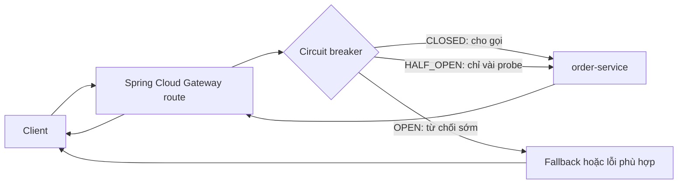
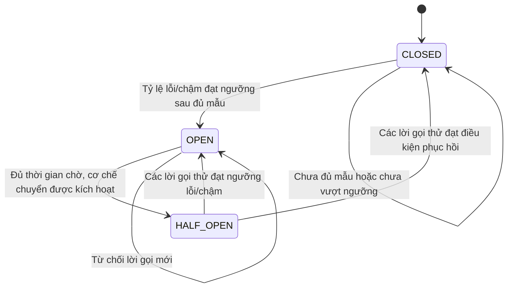

# Các trạng thái đóng, mở, thử lại và cách đo tỷ lệ lỗi

Trong kiến trúc microservices, một API Gateway có thể nhận hàng nghìn request tới cùng một dịch vụ. Khi `order-service` bắt đầu chậm hoặc gặp lỗi, việc tiếp tục gửi mọi request xuống đó có thể làm tăng lượng kết nối đang chờ, gây timeout dây chuyền và ảnh hưởng những API khác. **Circuit breaker (bộ ngắt mạch)** giúp Spring Cloud Gateway giới hạn tác động của lỗi bằng cách **quan sát các lần gọi upstream**, tạm thời từ chối gọi tiếp khi mức lỗi vượt ngưỡng, rồi cho phép một số lần thử có kiểm soát để đánh giá khả năng phục hồi.

Bài thuộc chương **Ngắt mạch và dự phòng** của **Spring Cloud Gateway**. Chủ đề trọng tâm là ba trạng thái **đóng (`CLOSED`), mở (`OPEN`), thử lại (`HALF_OPEN`)** và cách tính **tỷ lệ lỗi (failure rate)**, **tỷ lệ gọi chậm (slow-call rate)** để quyết định chuyển trạng thái. Ví dụ sử dụng Spring Cloud CircuitBreaker tích hợp **Resilience4j**, đồng thời kết nối với route predicate, Gateway filter chain, retry, timeout, fallback, service discovery, TLS và quan sát request.

> **Phạm vi:** Các ví dụ dành cho **Spring Cloud Gateway Server WebFlux**. Cú pháp cấu hình, starter, các API và tên metric có thể khác theo phiên bản. Không áp dụng nguyên xi các đoạn DSL/WebFlux cho Gateway Server MVC. Các ngưỡng trong bài chỉ là **giá trị thực hành**, không phải cấu hình tối ưu mặc định cho mọi dịch vụ.

## 1. Vì sao cần circuit breaker ở API Gateway?

Hãy tưởng tượng 100 request/giây gọi `GET /api/orders/42`. Bình thường backend phản hồi trong 50 ms. Khi cơ sở dữ liệu của `order-service` gặp sự cố, mỗi request có thể chờ 3–10 giây rồi thất bại. Nếu Gateway không có giới hạn thích hợp:

- Nhiều request bị giữ trong trạng thái chờ, tăng sử dụng connection, memory và tài nguyên xử lý.
- Client có thể đồng loạt retry, khiến backend đang hỏng càng quá tải.
- Các route khác cùng chia sẻ hạ tầng Gateway có nguy cơ chịu ảnh hưởng gián tiếp.
- Người dùng phải chờ tới khi timeout dù lỗi đã xuất hiện trong nhiều lần gọi trước.

Circuit breaker bảo vệ bằng cách **ngừng thử gọi upstream trong một khoảng thời gian** khi có đủ bằng chứng nó đang lỗi, rồi **thử một số request** để quyết định có mở lại luồng traffic bình thường hay không.



**Circuit breaker không phải retry.** Retry thử thực hiện lại một thao tác đã thất bại; circuit breaker quyết định **có cho phép một thao tác đi tới dependency không**. Chúng có thể phối hợp nhưng không thay thế nhau.

**Circuit breaker cũng không phải rate limiter.** Rate limiter kiểm soát request theo quota/key; circuit breaker kiểm soát việc gọi dependency dựa trên kết quả lỗi/chậm quan sát được.

## 2. Ba trạng thái chính: CLOSED, OPEN, HALF_OPEN

Tên trạng thái dễ gây nhầm vì chúng mượn từ công tắc điện:

| Trạng thái | Có cho request gọi upstream không? | Thu thập kết quả như thế nào? | Mục đích |
| --- | --- | --- | --- |
| **`CLOSED` — đóng mạch** | Có | Ghi nhận kết quả những lần gọi được bảo vệ trong sliding window | Cho phép dịch vụ hoạt động bình thường và phát hiện mức lỗi |
| **`OPEN` — mở mạch** | Không đối với các lời gọi được bảo vệ | Các lời gọi bị từ chối được ghi nhận là **not permitted**, không phải kết quả HTTP upstream mới | Giảm tải cho dependency đang gặp sự cố |
| **`HALF_OPEN` — nửa mở / thử lại** | Có nhưng **giới hạn số lời gọi thử** | Đánh giá kết quả của các lời gọi thử để quyết định hồi phục hay mở lại | Kiểm tra dependency đã ổn định chưa |



Sơ đồ thể hiện **luồng thông thường**. Resilience4j còn các trạng thái chuyên biệt như `METRICS_ONLY`, `DISABLED` và `FORCED_OPEN` dành cho vận hành; chúng được phân biệt ở mục sau.

### CLOSED — trạng thái bình thường

Ở `CLOSED`:

1. Request được cho phép vào logic gọi upstream.
2. Circuit breaker quan sát kết quả **của lời gọi nằm bên trong ranh giới bảo vệ**.
3. Kết quả được ghi vào **sliding window** theo số lời gọi hoặc khoảng thời gian.
4. Khi số lời gọi đủ để đánh giá, breaker tính failure rate và, nếu cấu hình, slow-call rate.
5. Nếu một trong các tỷ lệ đạt hoặc vượt ngưỡng, breaker chuyển sang `OPEN`.

CLOSED **không có nghĩa “không có lỗi”**. Có thể có một tỷ lệ lỗi nhỏ nằm dưới ngưỡng; breaker vẫn để traffic đi qua.

### OPEN — từ chối sớm

Ở `OPEN`:

- Request mới đi qua circuit breaker bị từ chối trước khi phần upstream call được thực thi.
- Resilience4j thường báo tín hiệu `CallNotPermittedException` cho lời gọi không được phép.
- Nếu route cấu hình fallback, Gateway có thể chuyển sang fallback; nếu không, request cần được xử lý thành một response lỗi phù hợp theo error mapping.
- Các request **bị từ chối** không chứng minh backend vừa thất bại; backend **chưa hề nhận** những lời gọi đó.
- Breaker đợi một khoảng `waitDurationInOpenState` trước khi cho phép cơ chế kiểm tra phục hồi.

**OPEN không phải “Gateway ngừng hoạt động”.** Các route khác hoặc các circuit breaker khác vẫn có thể làm việc bình thường.

### HALF_OPEN — thử lại có giới hạn

Khi đủ điều kiện rời `OPEN`, breaker chuyển sang `HALF_OPEN` và cho **một lượng nhỏ lời gọi thực** đi tới backend. Số lượng thường được điều khiển bởi `permittedNumberOfCallsInHalfOpenState`.

Ví dụ cho phép 3 probe:

```text
CLOSED -> đủ lỗi -> OPEN
                    |
             hết khoảng chờ
                    |
                HALF_OPEN
                    |
            cho phép 3 lời gọi
                    |
          +---------+----------+
          |                    |
     kết quả ổn           lỗi/chậm quá ngưỡng
          |                    |
        CLOSED                OPEN
```

Các request vượt quá số permit đang cho phép có thể bị từ chối. Nếu các probe đã được cấp phép đang chạy lâu, tiến trình đánh giá có thể phải đợi chúng hoàn tất, trừ khi phiên bản/cấu hình có deadline riêng cho HALF_OPEN.

**Probe không nhất thiết là request health check.** Với cấu hình Gateway thông thường, probe là **request thật** được circuit breaker cho đi qua. Vì thế không nên nghĩ trạng thái HALF_OPEN tự động chỉ gửi `GET /health`: request đầu tiên sau khoảng chờ có thể là một thao tác nghiệp vụ. Cần cân nhắc rủi ro với API ghi và cơ chế idempotency.

## 3. Các trạng thái chuyên biệt của Resilience4j

Ngoài bộ ba chính, Resilience4j có các trạng thái phục vụ chẩn đoán và thao tác quản trị:

| Trạng thái | Hành vi khái quát | Khi cần chú ý |
| --- | --- | --- |
| `METRICS_ONLY` | Cho phép lời gọi và thu thập metric nhưng không tự chuyển thành OPEN theo ngưỡng | Phù hợp quan sát thử chính sách trước khi chặn traffic |
| `DISABLED` | Cho phép lời gọi; cơ chế breaker được vô hiệu hóa theo ngữ nghĩa thư viện | Không còn bảo vệ upstream bằng breaker |
| `FORCED_OPEN` | Từ chối lời gọi ngay cả khi không đợi đủ metric | Chế độ vận hành đặc biệt, phải quản lý việc khôi phục |

Không sử dụng `FORCED_OPEN` như một cờ “đang lỗi HTTP 503” không cần quản trị. Khi ép mở, kết quả upstream mới không được đo thông qua những lời gọi bị chặn, vì bản thân upstream không được gọi. Cần runbook xác định **ai đặt trạng thái, khi nào bỏ trạng thái, điều gì chứng minh phục hồi**.

Chuyển trạng thái thủ công từ code hoặc actuator/admin tool phải được kiểm soát quyền. Cấu hình breaker trên từng replica Gateway có thể độc lập, vì vậy thay đổi thủ công ở một replica không mặc nhiên thay đổi ở tất cả replica.

## 4. Thế nào là một lời gọi thất bại?

Đây là câu hỏi quan trọng hơn việc chọn một con số `failureRateThreshold`.

**Circuit breaker đếm kết quả của lời gọi được nó bảo vệ**, không tự đọc hiểu mọi lỗi nghiệp vụ trên toàn bộ hệ thống. Với tích hợp Resilience4j, một lời gọi thường được ghi là thất bại khi phần được bảo vệ **kết thúc bằng exception mà cấu hình chọn ghi nhận là failure**. Có thể cấu hình cách xét exception qua `recordExceptions`, `ignoreExceptions` hoặc predicate tương ứng.

Ví dụ có thể cần ghi nhận failure:

- Timeout khi gọi upstream, nếu biểu diễn thành exception đi qua breaker.
- Không kết nối được TCP hoặc lỗi kết nối.
- Một lỗi từ Reactor Netty hoặc filter được chuyển thành exception.
- HTTP `503`/`502`/`504` **nếu Gateway CircuitBreaker filter được cấu hình coi các status đó là lỗi cần ghi nhận**, thay vì xem đó là một response HTTP hợp lệ.

Những điều **không nên tự động quy thành lỗi sức khỏe upstream**:

- `401`/`403` từ Spring Security tại Gateway trước khi route được chọn.
- `404` do client yêu cầu resource không tồn tại đúng như hợp đồng.
- `400`/`422` do dữ liệu client không hợp lệ.
- `429` do rate limiter chủ động từ chối theo quota.
- Request bị từ chối vì breaker đã `OPEN`: **not permitted** không phải một lần upstream trả lỗi mới.

### HTTP 5xx không mặc định tương đương exception

Một backend có thể trả response HTTP:

```http
HTTP/1.1 503 Service Unavailable
Content-Type: application/json

{"code":"BACKEND_UNAVAILABLE"}
```

Đây vẫn có thể là một **response HTTP đã nhận thành công ở tầng transport**. Nếu Gateway filter chỉ quan sát exception mà không được cấu hình chuyển những status nhất định thành lỗi, một response `503` có thể **không được tính là failure** trong circuit breaker.

Spring Cloud Gateway CircuitBreaker filter có khả năng nhận danh sách **`statusCodes`** ở những phiên bản hỗ trợ, để một số HTTP status được coi như lỗi khi xử lý breaker/fallback. Vì vậy phải kiểm tra **đúng cấu hình filter** trước khi kết luận “đã có 10 lần 503, tại sao breaker không mở?”.

**Định nghĩa failure là chính sách kỹ thuật/nghiệp vụ**, không chỉ là phép so sánh status >= 500. Một `404` có thể là lỗi bình thường của API, còn `503` từ dịch vụ không sẵn sàng thường phù hợp để bảo vệ upstream.

## 5. Failure rate được tính như thế nào?

Nếu breaker đã ghi nhận `N` lời gọi đủ điều kiện trong cửa sổ và `F` lời gọi bị xem là thất bại:

\[
\text{failureRate} = \frac{F}{N} \times 100\%
\]

Ví dụ 10 lời gọi hoàn tất, trong đó 5 lời gọi thất bại:

```text
Kết quả: S F S F F S F S F S
S = success; F = failure

Tổng lời gọi ghi nhận trong cửa sổ: N = 10
Thất bại:                         F = 5
Failure rate:                  5/10 = 50%
```

Nếu cấu hình `failureRateThreshold: 50` và đã đủ số lời gọi tối thiểu, Resilience4j có thể chuyển `CLOSED → OPEN` khi failure rate **đạt hoặc vượt** 50%.

### `minimumNumberOfCalls` quyết định khi nào phép đo đủ mẫu

Ví dụ:

```yaml
minimumNumberOfCalls: 10
failureRateThreshold: 50
```

Khi chỉ có 2 lời gọi và cả 2 thất bại, tỷ lệ thô là `100%` nhưng **chưa đủ 10 lời gọi** để đánh giá theo cấu hình này. Breaker chưa mở chỉ dựa trên hai kết quả đó.

Khi đã đủ 10 lời gọi được ghi nhận trong cửa sổ, việc đánh giá tỷ lệ mới có đủ điều kiện. Điều này giúp giảm mở mạch vì một mẫu quá nhỏ, nhưng cũng khiến breaker phản ứng chậm khi traffic thấp.

| Lời gọi đã ghi nhận | Failure | Failure rate thô | Ngưỡng minCalls = 10, threshold = 50% |
| ---: | ---: | ---: | --- |
| 2 | 2 | 100% | **Chưa đánh giá mở mạch** do thiếu mẫu |
| 8 | 6 | 75% | **Chưa đánh giá mở mạch** do thiếu mẫu |
| 10 | 4 | 40% | Đủ mẫu, vẫn `CLOSED` nếu không có điều kiện khác |
| 10 | 5 | 50% | Đủ mẫu, có thể chuyển `OPEN` |
| 10 | 7 | 70% | Đủ mẫu, có thể chuyển `OPEN` |

**Lưu ý:** `minimumNumberOfCalls` chủ yếu điều khiển lúc đánh giá tỷ lệ trong cửa sổ ở `CLOSED`. Trong `HALF_OPEN`, thư viện dùng số lời gọi thử được cho phép và chính sách hoàn thành thử để ra quyết định; không áp một cách máy móc “phải có 10 probe” chỉ vì ví dụ CLOSED dùng 10.

### Những gì không nằm trong mẫu số

Không nên tự cộng vào `N` mọi HTTP request tới Gateway. Ví dụ:

- Request không khớp route không chạy circuit breaker đó.
- `401` từ Security xảy ra trước route không thuộc lượt gọi được breaker bảo vệ.
- Request bị chặn khi `OPEN` thường được phân loại `not_permitted`, không phải một lượt upstream mới đưa vào failure rate của CLOSED.
- Exception được cấu hình **ignore** có thể không tham gia vào thống kê success/failure.
- Lời gọi chưa kết thúc hoặc bị cancel cần được xem theo hành vi đo cụ thể của thư viện/operator; không tự khẳng định mọi cancel đều được tính failed.

Một metric HTTP `5xx` của Gateway và `failureRate` của Resilience4j **không có cùng mẫu số** và không mặc nhiên bằng nhau.

## 6. Slow-call rate: không phải lỗi cũng có thể nguy hiểm

Một dịch vụ vẫn có thể trả `200` nhưng mất 8 giây mỗi request. Khi nhiều request giữ kết nối quá lâu, hệ thống vẫn có nguy cơ cạn tài nguyên. Resilience4j có thể chuyển circuit breaker sang OPEN dựa trên **tỷ lệ lời gọi chậm**.

Công thức:

\[
\text{slowCallRate} = \frac{\text{số lời gọi hoàn tất có thời gian >= ngưỡng chậm}}{\text{số lời gọi được ghi nhận trong cửa sổ}} \times 100\%
\]

Ví dụ cấu hình:

```yaml
slowCallDurationThreshold: 2s
slowCallRateThreshold: 80
minimumNumberOfCalls: 10
```

Nếu trong 10 lời gọi có 8 lời gọi mất ít nhất khoảng 2 giây, **slow-call rate = 80%**. Breaker có thể mở dù cả 8 lời gọi đều trả `200`.

### Một lời gọi có thể vừa “failed” vừa “slow”

Hai tỷ lệ được tính riêng trên dữ liệu lời gọi:

| Lời gọi | Kết quả | Thời gian | Failed? | Slow? |
| --- | --- | ---: | --- | --- |
| A | `200` thành công | 80 ms | Không | Không |
| B | `503` được cấu hình ghi nhận lỗi | 300 ms | Có | Không |
| C | `200` | 3.2 s | Không | Có |
| D | Timeout exception | 4.0 s | Có | Có |

Một lời gọi vừa failed vừa slow **đóng góp vào cả hai thống kê** nhưng không phải hai request. Điều kiện mở mạch có thể do failure rate **hoặc** slow-call rate đạt ngưỡng; không phải cộng hai tỷ lệ thành một tổng.

**Phân biệt threshold và timeout:** `slowCallDurationThreshold=2s` **chỉ phân loại lời gọi là chậm**; nó không bắt buộc hủy lời gọi sau 2 giây. Muốn giới hạn thời gian chờ phải cấu hình timeout/TimeLimiter hoặc HTTP client deadline riêng.

## 7. Sliding window theo số lời gọi và theo thời gian

Resilience4j có hai cách tính cửa sổ thống kê thường dùng:

### `COUNT_BASED`

```yaml
slidingWindowType: COUNT_BASED
slidingWindowSize: 10
minimumNumberOfCalls: 10
```

Breaker xét dữ liệu của **tối đa 10 lời gọi được ghi nhận gần nhất**. Khi có lời gọi mới, dữ liệu cũ dần rời cửa sổ. Không có nghĩa “10 request HTTP mới nhất tới toàn Gateway”.

Ví dụ 10 kết quả `S/F`:

```text
Ban đầu:       [S S S F F S S F S F]  -> 4 failure / 10 = 40%
Thêm 1 F mới:  [S S F F S S F S F F]  -> 5 failure / 10 = 50%
                                                   ^
                                      đạt threshold 50%
```

Nếu breaker đang CLOSED, đã đủ mẫu và không có điều kiện khác, tỷ lệ mới có thể khiến nó OPEN.

### `TIME_BASED`

```yaml
slidingWindowType: TIME_BASED
slidingWindowSize: 20
minimumNumberOfCalls: 10
```

Với cửa sổ theo thời gian, `slidingWindowSize: 20` đại diện một khoảng **20 giây** trong ngữ nghĩa cấu hình Resilience4j tương ứng. Breaker tổng hợp kết quả trong khung thời gian đó thay vì giữ đúng 20 request gần nhất.

Hệ quả:

- Traffic cao: cửa sổ có thể chứa rất nhiều lời gọi; failure rate dựa trên tập kết quả trong khoảng thời gian đó.
- Traffic thấp: có thể chưa đạt `minimumNumberOfCalls` nên breaker chưa đủ mẫu để mở.
- Khi lưu lượng ngừng, không có thêm phép đo mới; `OPEN` vẫn đi theo điều kiện thời gian chờ và quy tắc chuyển trạng thái, không biến thành CLOSED chỉ vì thời gian trôi.

### Chọn cửa sổ theo mục đích vận hành

| Thuộc tính | `COUNT_BASED` | `TIME_BASED` |
| --- | --- | --- |
| Cách giới hạn | Số lời gọi được ghi nhận | Khoảng thời gian |
| Dễ hình dung với test tuần tự | Rất dễ | Cần kiểm soát thời gian |
| Ảnh hưởng của thay đổi traffic | 10 request có thể rất nhanh hoặc rất chậm tùy tải | Khoảng thời gian cố định nhưng số mẫu biến động |
| Rủi ro cần đánh giá | Dữ liệu lịch sử có thể kéo dài lâu khi traffic thấp | Không đủ minCalls khi traffic thấp |
| Thích hợp | Bài lab và dịch vụ có số mẫu tương đối ổn | Quan sát theo diễn biến lỗi trong một khoảng thời gian |

Đừng chọn cửa sổ quá nhỏ chỉ để breaker “phản ứng nhanh”: một vài lỗi ngẫu nhiên có thể làm breaker lắc giữa OPEN và CLOSED, gây mất ổn định. Cần thử nhiều mức tải và cả giai đoạn thấp điểm.

## 8. Ví dụ toàn bộ chu kỳ CLOSED → OPEN → HALF_OPEN

Giả sử cấu hình thực hành:

```yaml
failureRateThreshold: 50
minimumNumberOfCalls: 10
slidingWindowType: COUNT_BASED
slidingWindowSize: 10
waitDurationInOpenState: 15s
permittedNumberOfCallsInHalfOpenState: 3
automaticTransitionFromOpenToHalfOpenEnabled: false
```

Trình tự minh họa:

| Mốc | Hành vi | Trạng thái sau xử lý |
| --- | --- | --- |
| T0 | Breaker khởi động và cho phép gọi backend | `CLOSED` |
| T1 | Hoàn tất 10 lời gọi, có 5 failure | `OPEN` vì đạt 50% |
| T2 | Client gửi request thứ 11 ngay sau đó | Từ chối upstream, vẫn `OPEN` |
| T3 | Đủ 15 giây tính theo quy tắc OPEN | Sẵn sàng thử; với auto=false, lượt gọi sau có thể kích hoạt `HALF_OPEN` |
| T4 | Cho phép tối đa 3 probe chạy theo chính sách | `HALF_OPEN` |
| T5 | 3 probe đều thành công và đủ nhanh | Có thể trở về `CLOSED` |
| T5 khác | 2 trong 3 probe thất bại (66,7%) | Có thể trở lại `OPEN` |

Trong Resilience4j, với `automaticTransitionFromOpenToHalfOpenEnabled: false`, việc hết `waitDurationInOpenState` không nhất thiết tạo chuyển trạng thái trong một tiến trình timer độc lập; **lời gọi tiếp theo có thể kích hoạt** chuyển trạng thái khi đủ điều kiện. Nếu bật auto transition, cơ chế chuyển có thể chủ động chuyển trạng thái sau thời gian chờ theo sự hỗ trợ của thư viện.

**Ba probe không phải ba giây.** Nếu cùng lúc rất nhiều request đến khi breaker chuyển HALF_OPEN, chỉ số permit được cấu hình mới được gọi; những request khác có thể bị từ chối. Kết quả đánh giá phải xét các probe đã **hoàn tất** và ngưỡng lỗi/chậm. Với cuộc gọi chậm đang chờ, cần giới hạn thời gian thích hợp để tránh HALF_OPEN kéo dài không kiểm soát.

## 9. Cấu hình CircuitBreaker filter trong Spring Cloud Gateway

Để thực hành, Gateway cần starter phù hợp cho **Spring Cloud CircuitBreaker + Resilience4j reactive** và Spring Cloud Gateway Server WebFlux, cùng các dependency theo BOM Spring Boot/Spring Cloud tương thích. Ví dụ thường dùng starter `spring-cloud-starter-circuitbreaker-reactor-resilience4j`.

Giả sử public API `GET /api/orders/**` được proxy sang `order-service`:

```yaml
spring:
  cloud:
    gateway:
      routes:
        - id: orders-read
          uri: lb://order-service
          predicates:
            - Path=/api/orders/**
            - Method=GET
          filters:
            - StripPrefix=1
            - name: CircuitBreaker
              args:
                name: ordersReadBreaker
                fallbackUri: forward:/fallback/orders
                statusCodes:
                  - INTERNAL_SERVER_ERROR
                  - BAD_GATEWAY
                  - SERVICE_UNAVAILABLE
                  - GATEWAY_TIMEOUT

resilience4j:
  circuitbreaker:
    instances:
      ordersReadBreaker:
        slidingWindowType: COUNT_BASED
        slidingWindowSize: 10
        minimumNumberOfCalls: 10
        failureRateThreshold: 50
        slowCallRateThreshold: 80
        slowCallDurationThreshold: 2s
        waitDurationInOpenState: 15s
        permittedNumberOfCallsInHalfOpenState: 3
        automaticTransitionFromOpenToHalfOpenEnabled: false
```

**Giải thích từng phần:**

- `Path` và `Method=GET` chọn **request công khai**; Gateway route filter chỉ chạy sau khi request khớp.
- `StripPrefix=1` biến `/api/orders/42` thành `/orders/42` trước khi gọi upstream.
- `uri: lb://order-service` yêu cầu Spring Cloud LoadBalancer/discovery cung cấp instance phù hợp.
- `name: ordersReadBreaker` là tên breaker, cần khớp với cấu hình Resilience4j tương ứng.
- `fallbackUri: forward:/fallback/orders` chuyển sang **handler nội bộ** tại Gateway khi phần protected call thất bại hoặc bị từ chối, theo khả năng của filter.
- `statusCodes` làm cho các HTTP status được liệt kê được coi là lỗi trong cơ chế circuit breaker của những phiên bản Gateway hỗ trợ thuộc tính này.
- Các tham số `resilience4j.circuitbreaker.instances.ordersReadBreaker` mô tả cách thu thập và đánh giá metric.

**Lưu ý phiên bản:** Cấu hình route trong những bản Gateway Server WebFlux cũ thường nằm ở `spring.cloud.gateway.routes`. Một số bản mới dùng `spring.cloud.gateway.server.webflux.routes`. Hãy xác minh starter, version và route thực sự được nạp. Không kết luận breaker “không hoạt động” khi prefix route không khớp phiên bản.

### Không dùng cùng ví dụ cho thao tác ghi một cách thiếu kiểm soát

Route minh họa được giới hạn `Method=GET` vì fallback đơn giản trả thông báo tạm không sẵn sàng. Với `POST` tạo đơn/thanh toán, failure/timeout không chứng minh thao tác chưa thực hiện. Cần idempotency key, trạng thái giao dịch và chính sách retry/fallback riêng trước khi dùng bảo vệ tương tự.

## 10. Fallback đúng hợp đồng, không che sự cố

Một fallback có thể trả dữ liệu cache hợp lệ, biểu diễn tình trạng “đang bảo trì”, hoặc response lỗi ổn định. Nhưng nó **không phải một cách tự động biến mọi request thành thành công**.

Ví dụ local fallback controller trong Gateway WebFlux cho route đọc:

```java
@RestController
class OrdersFallbackController {

    @GetMapping(
        path = "/fallback/orders",
        produces = MediaType.APPLICATION_JSON_VALUE)
    ResponseEntity<Map<String, String>> ordersUnavailable() {
        return ResponseEntity
            .status(HttpStatus.SERVICE_UNAVAILABLE)
            .header(HttpHeaders.CACHE_CONTROL, "no-store")
            .body(Map.of(
                "code", "ORDERS_TEMPORARILY_UNAVAILABLE",
                "message", "Orders service is temporarily unavailable"));
    }
}
```

Handler trả `503` theo hợp đồng vì không có dữ liệu đơn hàng có thể tin cậy. Nếu có dữ liệu cache và API được thiết kế hỗ trợ **stale response**, fallback có thể trả response tương ứng cùng metadata rõ ràng. Không tùy tiện trả `200` với body `{"orders":[]}` khi hệ thống không biết danh sách đơn hàng thực; client có thể hiểu sai là “người dùng không có đơn”.

**`fallbackUri: forward:/fallback/orders` là một forward nội bộ**, không phải redirect `302` cho browser. Với cách này cần có local handler tương ứng và CORS/Security/error response phù hợp.

### Fallback có được gọi khi breaker CLOSED không?

Có. Một **lời gọi lỗi đơn lẻ** trong CLOSED có thể kích hoạt fallback theo cấu hình, dù failure rate chưa đủ làm breaker OPEN. Fallback không đồng nghĩa breaker đang OPEN.

| Tình huống | Breaker có thể ở trạng thái | Fallback có thể được gọi? |
| --- | --- | --- |
| Backend trả `503` thuộc `statusCodes` | `CLOSED` hoặc `HALF_OPEN` | Có |
| TCP connect exception | `CLOSED` hoặc `HALF_OPEN` | Có |
| Request bị chặn do breaker `OPEN` | `OPEN` | Có, nếu có fallback cấu hình |
| Security trả `401` trước route matching | Không vào breaker của route | Không vì filter route không chạy |
| Không có route khớp | Không vào breaker | Không |
| Backend trả `404` không được cấu hình là failure | Thường vẫn `CLOSED` | Không nhất thiết |

**Đừng dùng tỷ lệ fallback response để suy ra failure rate chính xác.** Fallback có thể được gọi cả khi CLOSED hoặc OPEN, và Gateway trả `503` sau fallback dù upstream **không nhận** request mới. Cần phân loại rõ upstream failure, fallback invocation và calls-not-permitted.

### Tránh rò rỉ thông tin từ exception

Không trả trực tiếp stack trace, tên host nội bộ, token, TLS detail hoặc thông tin registry trong body fallback. Có thể dùng correlation ID và mã lỗi ổn định để client liên hệ hỗ trợ.

Nếu dùng một filter khác như `FallbackHeaders` để truyền exception metadata đến fallback endpoint, phải đảm bảo dữ liệu đó chỉ đi qua kênh tin cậy, không bị client giả mạo và không bị lộ ra response/log ngoài ý muốn.

## 11. Cấu hình Resilience4j: chọn ngưỡng có ý nghĩa

Một tập tham số thực hành phổ biến:

| Thuộc tính | Giá trị ví dụ | Điều điều khiển |
| --- | --- | --- |
| `slidingWindowType` | `COUNT_BASED` | Cửa sổ theo số lời gọi |
| `slidingWindowSize` | `10` | Kích thước cửa sổ |
| `minimumNumberOfCalls` | `10` | Số lời gọi tối thiểu trước khi đánh giá tỷ lệ ở CLOSED |
| `failureRateThreshold` | `50` | Tỷ lệ failure làm mở breaker khi đạt/vượt |
| `slowCallRateThreshold` | `80` | Tỷ lệ lời gọi chậm làm mở breaker |
| `slowCallDurationThreshold` | `2s` | Ngưỡng phân loại lời gọi là chậm |
| `waitDurationInOpenState` | `15s` | Thời gian chờ tối thiểu trước cơ hội HALF_OPEN |
| `permittedNumberOfCallsInHalfOpenState` | `3` | Số lời gọi thử được phép |
| `automaticTransitionFromOpenToHalfOpenEnabled` | `false` | Điều khiển chuyển OPEN → HALF_OPEN tự động hay theo lời gọi tiếp theo |

Các tham số trên phải được chọn theo **SLO, lưu lượng, khả năng chịu tải, loại lỗi và thời gian phục hồi** của dịch vụ. Ví dụ `slowCallDurationThreshold=2s` không phù hợp nếu API có hợp đồng xử lý 5 giây là bình thường.

### Phân loại exception có chủ đích

Resilience4j có thể cấu hình loại exception được ghi nhận hoặc bỏ qua. Ở cấp ứng dụng, có thể cần:

- Ghi nhận connect timeout, read timeout, lỗi kết nối từ upstream.
- Ghi nhận một số lỗi 5xx do dependency mất khả năng phục vụ.
- Bỏ qua lỗi client sai input, lỗi truy cập bị từ chối hoặc các trường hợp vốn không phản ánh sức khỏe dependency.
- Không vô tình bỏ qua timeout được dùng để xác định upstream đang chậm.

**Không nên copy class exception từ ví dụ mà chưa biết nơi nó được phát sinh.** Spring Cloud Gateway CircuitBreaker filter, Reactor Netty, WebFlux và Resilience4j có thể wrap exception thành những kiểu khác nhau. Dùng test và metric để kiểm tra một lỗi thực tế có được đếm là `failed` hay không.

## 12. Timeout, slow call và sự khác nhau giữa đo với hủy

Một request có thể cần nhiều mốc timeout:

| Cơ chế | Ý nghĩa | Có tự làm breaker OPEN không? |
| --- | --- | --- |
| `slowCallDurationThreshold` | Mốc phân loại **đã chậm** sau khi lời gọi hoàn tất | Chỉ ảnh hưởng slow-call rate nếu đủ mẫu |
| HTTP client **connect timeout** | Giới hạn thời gian mở TCP connection | Nếu lỗi đi qua breaker và được ghi nhận |
| HTTP client **response timeout** | Giới hạn đợi response theo chính sách Reactor Netty | Nếu lỗi được ghi nhận |
| Resilience4j **TimeLimiter** | Giới hạn thời gian của thao tác bất đồng bộ được bảo vệ, tùy integration | Nếu timeout tạo failure được circuit breaker quan sát |
| Client request deadline | Giới hạn tổng thời gian request end-to-end | Cần phối hợp với retry/fallback; không tự là breaker threshold |

**Một lời gọi chậm không nhất thiết bị hủy.** Nếu cấu hình slowCallDurationThreshold 2 giây nhưng response timeout 10 giây, lời gọi mất 4 giây trả 200 có thể được tính là **slow success**.

Nếu TimeLimiter hủy lời gọi sau 2 giây, bộ đo có thể ghi timeout exception, còn phía backend có thể tiếp tục xử lý request đã nhận. Cancellation từ Reactor không chứng minh giao dịch upstream đã rollback.

Ví dụ một cấu hình TimeLimiter theo cùng tên breaker:

```yaml
resilience4j:
  timelimiter:
    instances:
      ordersReadBreaker:
        timeoutDuration: 3s
```

Cần đối chiếu cách Spring Cloud CircuitBreaker reactive tích hợp TimeLimiter trong **đúng phiên bản**. Đừng chỉ đặt `timelimiter` rồi giả định nó luôn bao trùm mọi mạng/streaming call. Với streaming/SSE, thời hạn của toàn publisher còn cần được thiết kế riêng.

## 13. Kết hợp CircuitBreaker và Retry: thứ tự làm thay đổi mẫu đo

Circuit breaker và retry là hai công cụ khác nhau:

- **Circuit breaker:** nhìn vào kết quả phần được bảo vệ và quyết định **cho gọi hay không**.
- **Retry:** thử lại sau một lỗi có thể phục hồi được với số lần/backoff giới hạn.

Giả sử một request client được thử tối đa ba lần đến backend: `A1` thất bại, `A2` thất bại, `A3` thành công.

```text
Client request
   |
   +-- Attempt A1 -> error
   +-- Attempt A2 -> error
   +-- Attempt A3 -> success
   |
   +-- Client thấy 200
```

Breaker có thể quan sát:

- **Một kết quả cuối** nếu retry nằm hoàn toàn bên trong ranh giới protected call và breaker chỉ ghi nhận kết quả sau retry.
- **Nhiều attempt** nếu mỗi attempt lại đi qua breaker như một lời gọi được bảo vệ riêng.

Vì vậy cùng một request có thể góp **một** hoặc **nhiều** sự kiện vào metric, tùy vị trí và cách triển khai filter/Resilience4j integration. Không khẳng định một thứ tự YAML luôn tạo kết quả cố định khi không kiểm tra Gateway filter order và cơ chế subscribe/reactive retry.

### Cách tránh retry storm

- Giới hạn số attempt và dùng backoff có jitter theo chính sách phù hợp.
- Đặt **timeout budget tổng**, không để mỗi retry chờ đầy một timeout độc lập làm client vượt deadline.
- Chỉ retry những lỗi có thể phục hồi; tránh retry `400`, `401`, `403`, `404` hoặc lỗi nghiệp vụ cố định.
- Với `POST`/`PATCH` có side effect, phải dùng idempotency key hoặc cơ chế nghiệp vụ chứng minh việc retry an toàn.
- Xác định vị trí circuit breaker trong chain để kiểm soát **một lời gọi được đếm như thế nào**.
- Quan sát riêng **client request count**, **backend attempt count**, **failed calls** và **not-permitted calls**.

**Lưu ý:** Retry không bảo đảm lần thử sau đi tới instance khác trong `lb://order-service`. Điều đó phụ thuộc LoadBalancer, routing và cách filter chain thực hiện lại lời gọi; nếu chỉ có một instance lỗi, retry có thể làm tình hình nặng hơn.

## 14. Circuit breaker và load balancing: ngắt mạch theo phạm vi nào?

Giả sử `order-service` có ba instance:

```text
order-service:
  instance A: healthy
  instance B: healthy
  instance C: failing
```

Nếu tất cả request đi qua **một breaker tên `ordersReadBreaker` trên mỗi Gateway replica**, tỷ lệ lỗi từ instance C có thể ảnh hưởng quyết định mở mạch cho **toàn route**. Khi OPEN, Gateway không gọi cả A và B qua breaker đó, dù hai instance còn khỏe.

Đây là một **đánh đổi quan trọng về granularity**:

| Phạm vi breaker | Lợi ích | Rủi ro |
| --- | --- | --- |
| Theo route/service ID | Đơn giản, dễ quan sát và cấu hình | Một instance lỗi có thể làm toàn route bị chặn |
| Theo instance vật lý | Có thể cô lập backend lỗi riêng | Số breaker lớn, vòng đời instance thay đổi, metadata/cache phức tạp |
| Theo dependency/operation | Bảo vệ đúng nhóm thao tác/chức năng | Cần thiết kế tên breaker, policy và metric |
| Theo user | Thường không phù hợp cho sức khỏe downstream | Nổ số breaker, mất ý nghĩa điều khiển tải |

Spring Cloud Gateway CircuitBreaker filter được khai báo theo route và tên breaker; **không mặc định** tạo một breaker riêng cho từng IP/port instance do LoadBalancer chọn. Nếu muốn granularity theo instance, cần thiết kế riêng cùng health-aware load balancing/service discovery.

Các Gateway replica còn có thể giữ **breaker state riêng**. Khi Gateway-1 đã OPEN, Gateway-2 có thể vẫn CLOSED vì mẫu kết quả khác nhau. Không nhầm đó là bug nếu không có cơ chế state đồng bộ — Resilience4j thông thường giữ trạng thái trong process.

## 15. Security, rate limiting và fallback trong ngữ cảnh HTTP

### Security được xử lý trước Gateway route filter

Spring Security WebFlux thường hoạt động trong WebFilter chain trước khi chọn route. Nếu request thiếu JWT, Security có thể trả `401` hoặc `403`. Route `CircuitBreaker` không được gọi, do đó **không** ghi một “upstream failure”.

Đừng tính `401/403` của client vào tỷ lệ lỗi sức khỏe `order-service`; đây là vấn đề authentication/authorization riêng.

### Rate limiter trả 429

`RequestRateLimiter` có thể chặn request vượt quota; response `429 Too Many Requests` không đồng nghĩa upstream hỏng. Thứ tự và phạm vi filter quyết định request nào được đi tiếp. Một request bị rate limiter từ chối trước breaker không nên bị xem như một backend failure.

Khi thiết kế dashboard, phân biệt `429`, `5xx` từ backend, `5xx` từ fallback, `CallNotPermittedException` và connection timeout.

### CORS trên response fallback

Một frontend browser có thể thấy “CORS blocked” nếu fallback `503` hoặc error handler không có `Access-Control-Allow-Origin` phù hợp, mặc dù nguyên nhân gốc là backend quá tải. CORS nên được cấu hình nhất quán cho **request thành công và lỗi**; đừng giải quyết CORS bằng cách trả `200` giả.

### TLS và discovery

Nếu `lb://order-service` không tìm thấy instance, hoặc kết nối TLS tới instance bị lỗi hostname/SNI/certificate, request có thể thất bại ngay từ hạ tầng. Breaker có thể ghi nhận exception nếu nó nằm trong ranh giới protected call. Tuy nhiên **circuit breaker không sửa DNS, TLS truststore hay registry**; nó chỉ giảm tác động trong lúc lỗi vẫn tồn tại.

## 16. Đọc metric circuit breaker đúng ngữ nghĩa

Để vận hành, ít nhất cần đo:

| Nhóm metric/event | Giải thích | Không được suy luận |
| --- | --- | --- |
| **State** `CLOSED/OPEN/HALF_OPEN` | Trạng thái breaker tại một thời điểm | Toàn bộ Gateway replicas luôn có cùng state |
| **Successful calls** | Lời gọi protected thành công theo policy | Backend latency chắc chắn thấp |
| **Failed calls** | Lời gọi protected được phân loại thất bại | Toàn bộ HTTP 5xx của client |
| **Slow successful calls** | Có response thành công nhưng vượt ngưỡng chậm | Đây là failure |
| **Slow failed calls** | Vừa chậm vừa thất bại | Hai request khác nhau |
| **Not permitted calls** | Bị breaker từ chối khi OPEN/hết permit | Backend đã nhận request và thất bại |
| **Failure rate** | Phần trăm failed trong tập lời gọi ghi nhận | Phần trăm 5xx của toàn Gateway |
| **Slow-call rate** | Phần trăm lời gọi chậm | Số lượng timeout |
| **State transitions** | Sự kiện đổi trạng thái | Tự động nguyên nhân đã được khắc phục |
| **Fallback invocations** | Số lần fallback được chạy | Chỉ xảy ra khi breaker OPEN |

Trong hệ sinh thái Spring, Resilience4j có thể tích hợp **Micrometer/Actuator**. Tên chính xác của metric có thể khác theo thư viện/registry/version, ví dụ nhóm `resilience4j.circuitbreaker.calls`, `resilience4j.circuitbreaker.state` và các tag theo `name`, `kind`. Khi xuất sang Prometheus, cách đặt tên và suffix/counter có thể khác. Hãy kiểm tra endpoint metric thực tế; **không hard-code tên metric từ một bài viết** mà chưa xác nhận được xuất ra.

### Bảng quan sát phân loại sự cố

Giả sử dashboard trong 5 phút cho route orders hiển thị:

| Tín hiệu | Quan sát | Khả năng diễn giải |
| --- | --- | --- |
| Gateway client request | 1.000 | Tổng yêu cầu ở biên, gồm cả lời gọi không vào breaker |
| Circuit breaker successful | 180 | Lời gọi protected được ghi nhận success |
| Circuit breaker failed | 60 | Lời gọi protected được ghi nhận failure |
| Circuit breaker not permitted | 700 | Phần lớn request bị chặn sớm khi breaker OPEN |
| Security/rate limit/route mismatch | 60 | Những request có thể không qua breaker |

Các số trên là **ví dụ độc lập** để minh họa phân loại, không dùng làm phép đối soát mặc định cho mọi hệ thống (retry và filter order có thể làm số attempts khác số requests). Failure rate của 240 lời gọi protected hoàn tất là:

\[
\frac{60}{180+60}\times100\% = 25\%
\]

Con số 25% này có thể thấp hơn tỷ lệ 503 ở client, vì 700 request bị OPEN từ chối và fallback trả 503. Ngược lại, 180 successful calls có thể gồm những lời gọi chậm; phải xem slow-call metrics riêng.

**Đừng tính not-permitted như failed upstream** để phân tích nguyên nhân gốc. Không có request upstream nên không thể gán trách nhiệm cho một response HTTP backend mới.

### Nên gắn tag theo đâu?

Có ích: breaker name, Gateway replica ID, route ID, loại kết quả, môi trường triển khai, service ID. Cần thận trọng với IP instance, tenant/user ID hoặc URL đầy đủ vì có thể làm **cardinality** tăng cực lớn hoặc lộ thông tin cá nhân.

Một `traceId` trong log giúp đối chiếu sự kiện từng request, nhưng không nên đưa traceId vào nhãn metric. Không log Bearer token, cookie, request body hoặc thông tin nhạy cảm của fallback exception.

## 17. Kiểm thử với curl, WireMock và WebTestClient

### Chuẩn bị bài lab

- Gateway tại `http://localhost:8080`, route `GET /api/orders/**` như mục 9.
- Upstream giả lập tại `http://localhost:8081` (hoặc một `ServiceInstance` test tương ứng nếu dùng `lb://`).
- Fallback local `/fallback/orders` trả `503` với mã JSON `ORDERS_TEMPORARILY_UNAVAILABLE`.
- Cấu hình breaker **chỉ dùng cho test**: cửa sổ 10, min calls 10, threshold 50%, wait OPEN 15 giây, HALF_OPEN 3 calls.
- Test fixture có thể điều khiển upstream trả `200`, `503`, phản hồi chậm hoặc ngắt kết nối.

Nếu không có service discovery trong bài lab, có thể thay URI `lb://order-service` bằng `http://localhost:8081` để cô lập behavior circuit breaker; điều này không làm thay đổi ý nghĩa các trạng thái.

### Kiểm thử 1 — Dưới ngưỡng và đủ mẫu

Gửi 10 request tuần tự, giả lập 4 lỗi đã được cấu hình ghi nhận, 6 thành công. Kỳ vọng breaker vẫn CLOSED (giả sử slow-call threshold chưa bị vi phạm). Sau khi có lời gọi mới, hãy đo failure rate **trong cửa sổ hiện tại**, không dùng số lỗi tích lũy từ lúc chạy server.

### Kiểm thử 2 — Đạt ngưỡng và OPEN

Gửi 10 request, trong đó 5 lỗi `503` đã được liệt kê ở `statusCodes`:

```bash
for i in 1 2 3 4 5 6 7 8 9 10; do
  curl -sS -o /dev/null -w "%{http_code}\n" \
    http://localhost:8080/api/orders/42
done
```

Lệnh chỉ gửi request; để đảm bảo chính xác **5 lỗi và 5 thành công**, cần upstream stub có kịch bản trả status theo thứ tự xác định. Với fallback `503`, client có thể thấy nhiều `503`, nhưng **phải nhìn state/metric** mới xác nhận breaker OPEN.

Sau khi đủ điều kiện mở mạch, request tiếp theo phải bị từ chối ở circuit breaker và **không đi đến upstream**:

```text
Upstream đã nhận: 10 request (ví dụ)
Client gửi thêm: 1 request
Circuit breaker state: OPEN
Upstream số request sau: vẫn 10
Metric not_permitted: tăng
Response cho client: fallback theo policy
```

Đây là cách kiểm tra **ngắt mạch thực sự**, thay vì chỉ kiểm tra status `503` trên client.

### Kiểm thử 3 — HALF_OPEN

Sau khi đủ `waitDurationInOpenState`, gửi các lời gọi test có kiểm soát. Nếu cho 3 probe:

- Ba probe thành công, đủ nhanh → breaker có thể CLOSED.
- Hai probe thất bại → failure rate của probe là `2/3 ≈ 66,7%`; với threshold 50%, breaker có thể OPEN lại.
- Nếu chỉ hai probe hoàn tất và probe thứ ba đang bị treo, không được mặc định breaker đã ra quyết định cuối cùng.

Không viết test `Thread.sleep(15000)` rồi coi nó ổn định trên mọi CI. Nên dùng thời gian chờ ngắn cho môi trường test, kiểm soát scheduler/clock khi framework hỗ trợ và kiểm tra transition bằng event/metric với deadline. Nếu có concurrency, dùng barrier/test harness để xác nhận số permit tối đa và số request backend nhận.

### Ví dụ WebTestClient và upstream giả lập

```java
@Test
void upstream503CanTriggerFallback() {
    wireMockServer.stubFor(
        get(urlPathEqualTo("/orders/42"))
            .willReturn(aResponse()
                .withStatus(503)));

    webTestClient.get()
        .uri("/api/orders/42")
        .exchange()
        .expectStatus().isEqualTo(HttpStatus.SERVICE_UNAVAILABLE)
        .expectBody()
        .jsonPath("$.code")
        .isEqualTo("ORDERS_TEMPORARILY_UNAVAILABLE");

    wireMockServer.verify(
        1, getRequestedFor(urlPathEqualTo("/orders/42")));
}
```

Đoạn mã là **mảnh test minh họa**, cần các dependency, static imports và fixture `wireMockServer`/`webTestClient`, route/fallback đã cấu hình. Nó xác nhận fallback trên một upstream `503` đã được chọn ghi nhận là lỗi, **không tự chứng minh breaker OPEN**. Muốn kiểm tra OPEN, phải có nhiều lượt gọi đến đủ ngưỡng và assertion rằng backend **không nhận lời gọi mới** sau khi mở.

### Ma trận kiểm thử đầy đủ

| Kịch bản | Assertion chính |
| --- | --- |
| Dưới `minimumNumberOfCalls` dù lỗi nhiều | Không mở chỉ vì chưa đủ mẫu |
| Đủ mẫu nhưng failure rate dưới threshold | Vẫn CLOSED nếu slow rate không đạt ngưỡng |
| Đủ mẫu, failure rate đạt threshold | OPEN và từ chối các cuộc gọi mới |
| OPEN, request tiếp theo | Fallback/not-permitted; upstream không nhận mới |
| Sau waitDuration, HALF_OPEN | Chỉ cho số probe được cấu hình |
| Probe thành công | Có thể trở lại CLOSED |
| Probe thất bại/chậm vượt ngưỡng | OPEN trở lại |
| HTTP 503 **không** có `statusCodes` và không ném exception | Xác minh không tự bị tính là failure |
| HTTP 503 **có** `statusCodes` tương ứng | Được xử lý như lỗi theo tích hợp filter |
| Backend trả 400 do validation | Không làm breaker OPEN nếu policy đúng |
| Spring Security chặn 401 trước route | Breaker không ghi upstream failure |
| Request bị rate limit 429 | Phân biệt với upstream failure |
| Timeout/connection reset | Xác nhận loại exception được record |
| Retry trước/sau protected call | Đếm attempt và CB call chính xác |
| LoadBalancer có nhiều instance | Biết breaker đang bảo vệ route hay instance |
| Gateway có nhiều replica | State có thể khác giữa các replica |
| Client cancel giữa response streaming | Không giả định luôn tính failure và fallback đã gửi được |
| CORS error response/fallback | Browser nhận CORS header phù hợp mà không lộ dữ liệu |

## 18. Runbook khi breaker mở bất thường hoặc không chịu mở

### Trường hợp A: “Backend trả nhiều 503 nhưng breaker vẫn CLOSED”

Kiểm tra theo thứ tự:

1. Route có khớp `Path`/`Method` và tên breaker đang được áp dụng không?
2. Backend 503 có thực sự đi qua Gateway CircuitBreaker filter không, hay response đến từ Security/rate limiter/fallback?
3. `statusCodes` có liệt kê 503 hoặc có exception được cấu hình ghi nhận không?
4. `minimumNumberOfCalls` đã đạt chưa? Cửa sổ COUNT/TIME có đủ kết quả không?
5. Có các exception được `ignore` khiến mẫu số và số failure khác dự kiến không?
6. Retry/other filters có biến lỗi thành success trước khi breaker đo không?
7. Có đang xem nhầm breaker name hoặc Gateway replica khác không?

### Trường hợp B: “Breaker mở suốt dù backend đã phục hồi”

Kiểm tra:

1. `waitDurationInOpenState` đã đủ chưa?
2. `automaticTransitionFromOpenToHalfOpenEnabled` đang bật hay tắt? Có request mới để kích hoạt HALF_OPEN không?
3. Các probe có được cấp permit và hoàn tất không, hay luôn timeout?
4. Fallback/error policy có khiến probe tiếp tục bị tính failure không?
5. Có vấn đề nền tảng như DNS/TLS, certificate, service discovery, stale connection pool không?
6. Trạng thái có bị ép `FORCED_OPEN` bởi operator/code không?
7. Có đang quan sát đúng breaker và đúng replica không?

### Trường hợp C: “Client thấy 503 nhưng backend không có log lỗi”

Khả năng:

- Breaker OPEN và fallback tự trả 503; **không có lời gọi mới** tới backend.
- Không có service instance `lb://`; request không đến backend.
- HTTP client bị lỗi DNS/TLS/connect trước khi upstream ghi log.
- Error handler ở Gateway sinh 503 theo policy khác.
- Rate limiter hay Security có thể chặn request với status khác, rồi error mapping khiến quan sát nhầm.

**Bằng chứng tối thiểu:** route ID, breaker name/state, kết quả protected call, not-permitted count, fallback invocation, service instance được chọn, HTTP status cuối, trace ID và exception class.

## 19. Những nhận định sai thường gặp

| Nhận định sai | Giải thích đúng |
| --- | --- |
| “CLOSED là backend không bao giờ lỗi” | CLOSED vẫn cho request qua và có thể có lỗi dưới ngưỡng |
| “OPEN nghĩa là tất cả backend request vừa thất bại” | Request mới bị từ chối; không có upstream call mới |
| “Hết waitDuration là tự động CLOSED” | Thường thử qua HALF_OPEN, không nhảy thẳng CLOSED |
| “HALF_OPEN là chạy GET /health” | Thường là các lời gọi thật được cấp permit, tùy cơ chế |
| “Có 2 lỗi trên 2 request là 100%, breaker phải mở” | `minimumNumberOfCalls` có thể chưa đạt |
| “Mọi HTTP 5xx mặc định là exception” | Response HTTP 5xx có thể cần `statusCodes` hoặc mapping |
| “Cứ nhìn tỷ lệ 503 client là biết failureRate” | Client còn thấy fallback/not-permitted và các route khác |
| “Not permitted call là upstream failure” | Backend không nhận lời gọi đã bị breaker chặn |
| “Slow-call threshold là timeout” | Nó phân loại chậm, không tự hủy lời gọi |
| “Retry và circuit breaker là cùng một chức năng” | Retry lặp attempt; breaker quyết định quyền gọi |
| “Fallback trả 200 là đã chữa xong lỗi” | Có thể che mất dữ liệu không đáng tin, status/contract sai |
| “Một instance lỗi thì breaker route chỉ chặn instance đó” | Breaker theo route thường có phạm vi cả service |
| “Breaker state tự đồng bộ giữa Gateway replica” | State mặc định nằm trong process |
| “Security trả 401 khiến breaker OPEN” | Request bị chặn trước route thường không đi qua breaker |
| “Chỉnh CB thresholds là sửa được TLS/DNS” | Circuit breaker chỉ giảm tác động, không sửa nguồn lỗi |

## 20. Bài tập thực hành: dịch vụ đơn hàng suy giảm

Hệ thống có Gateway với hai replica và `order-service` gồm ba instance A/B/C. Circuit breaker `ordersReadBreaker` cấu hình:

```yaml
slidingWindowType: COUNT_BASED
slidingWindowSize: 10
minimumNumberOfCalls: 10
failureRateThreshold: 50
slowCallRateThreshold: 80
slowCallDurationThreshold: 2s
waitDurationInOpenState: 15s
permittedNumberOfCallsInHalfOpenState: 3
```

Bộ dữ liệu sau mô tả 10 lời gọi đã **hoàn tất và được ghi nhận** tại Gateway replica-1:

| Lời gọi | Kết quả | Thời gian |
| ---: | --- | ---: |
| 1 | Success | 100 ms |
| 2 | Failure | 150 ms |
| 3 | Success | 2.5 s |
| 4 | Failure | 3.1 s |
| 5 | Failure | 700 ms |
| 6 | Success | 200 ms |
| 7 | Failure | 2.8 s |
| 8 | Success | 180 ms |
| 9 | Failure | 90 ms |
| 10 | Success | 2.3 s |

Tính:

- Số lời gọi failed: **5/10 → failure rate = 50%**.
- Số lời gọi slow (ít nhất khoảng 2 s): **4/10 → slow-call rate = 40%**.
- Có đủ `minimumNumberOfCalls=10`.
- Với failure threshold 50%, **breaker có thể chuyển OPEN**, dù slow rate chưa đạt 80%.

Nếu tất cả lời gọi thất bại đều xuất phát từ instance C, cần đánh giá **phạm vi breaker**: một breaker cho toàn route có thể từ chối cả request vốn có thể đến A/B khỏe. Ngoài breaker, hệ thống nên có readiness/health-aware instance selection, điều chỉnh retry có giới hạn và loại C khỏi danh sách ứng viên khi thông tin discovery hội tụ.

### Câu hỏi tự kiểm tra

1. Vì sao CLOSED không đồng nghĩa toàn bộ lời gọi đều thành công?
2. `OPEN` từ chối lời gọi mới như thế nào và thường tạo exception nào?
3. HALF_OPEN khác CLOSED ở số lượng request được phép ra sao?
4. `minimumNumberOfCalls` giúp tránh sai lệch thống kê thế nào?
5. Với 4 failure trong 10 recorded calls, threshold 50%, trạng thái có cần OPEN không?
6. Nếu 8 trong 10 calls trả `200` nhưng mất 4 giây, slow-call threshold 2 giây và slow rate 80%, chuyện gì có thể xảy ra?
7. Một request vừa failed vừa slow có được tính vào cả hai tỷ lệ không?
8. `COUNT_BASED` khác `TIME_BASED` ở mẫu số và tốc độ hội tụ thế nào?
9. Vì sao HTTP `503` có thể không làm breaker ghi nhận failure nếu không cấu hình `statusCodes`?
10. Tại sao not-permitted calls không được tính như những HTTP 503 mới từ backend?
11. `fallbackUri: forward:/fallback/orders` có làm redirect browser không?
12. Fallback trả `200` với dữ liệu rỗng có nguy cơ sai hợp đồng gì?
13. Retry sau timeout của POST có thể gây lỗi nghiệp vụ nào?
14. Vì sao một Gateway replica OPEN nhưng replica khác vẫn CLOSED?
15. Khi breaker OPEN sau nhiều lỗi ở instance C, có chắc A và B vẫn nhận request qua cùng route không?
16. Điều gì phân biệt `slowCallDurationThreshold` với response timeout?
17. Những metric nào cần xem để phân biệt backend failure, fallback và breaker rejection?
18. Nếu backend hồi phục mà breaker chưa thử lại, cần kiểm tra những thuộc tính/chuyển trạng thái nào?

**Ghi nhớ:** **`CLOSED`** cho request đi qua và đo kết quả; **`OPEN`** từ chối sớm để giảm tải cho dependency đang lỗi; **`HALF_OPEN`** giới hạn một số lời gọi thử để đánh giá phục hồi. Resilience4j mở mạch dựa trên **failure rate hoặc slow-call rate trong sliding window khi đủ mẫu**, không dựa đơn giản vào số HTTP 5xx mà client nhìn thấy. Định nghĩa failure chính xác, bảo đảm fallback đúng hợp đồng, kiểm soát retry/timeout và quan sát theo breaker name cùng Gateway replica là nền tảng của bảo vệ microservices bằng Spring Cloud Gateway.

