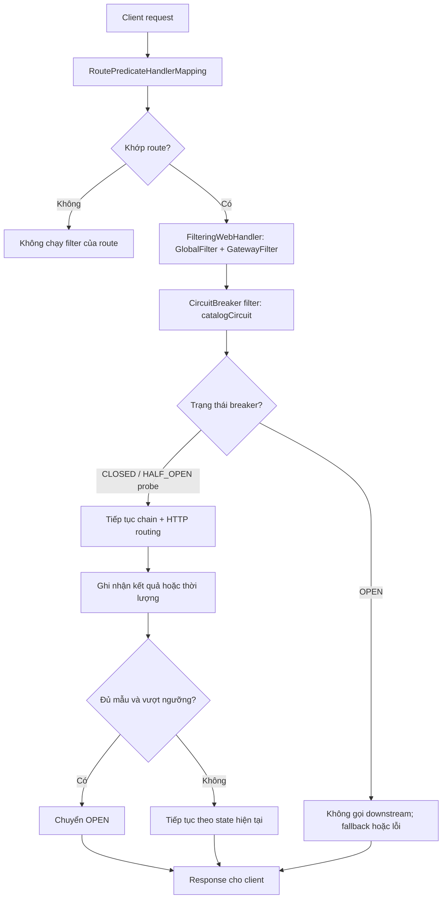
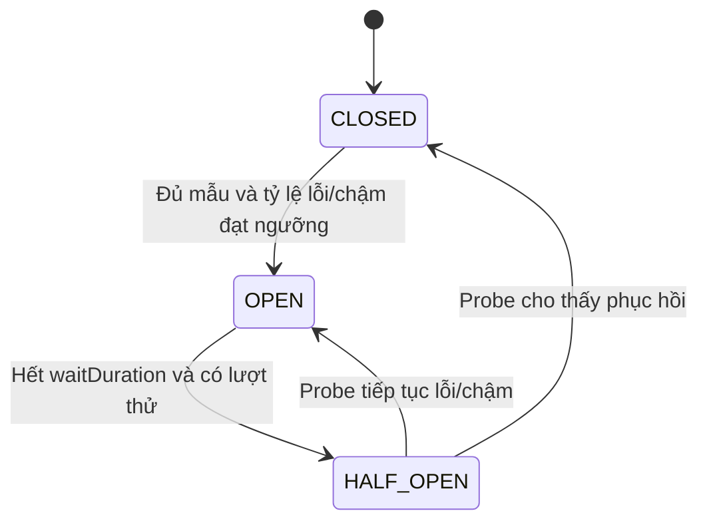

# Cấu hình tên circuit breaker, cửa sổ đo và ngưỡng

## 1. Vì sao phải cấu hình chính xác circuit breaker?

Trong **SPRING_CLOUD_GATEWAY**, API Gateway nhận request, đối chiếu **route predicate**, thực thi **filter chain**, biến đổi đường dẫn/header, có thể khám phá dịch vụ qua `lb://`, xác thực, giới hạn lưu lượng, retry và định tuyến HTTP(S) đến microservice. Khi một backend trở nên chậm hoặc liên tục thất bại, Gateway không nên tiếp tục gọi nó vô hạn: điều đó có thể làm tăng độ trễ, chiếm kết nối và lan truyền sự cố.

**Circuit breaker (bộ ngắt mạch)** theo dõi kết quả gọi downstream, ước lượng tỷ lệ lỗi/chậm trong một **cửa sổ đo** và tạm **từ chối các lần gọi mới** khi vượt ngưỡng. Một nhánh **fallback** có thể trả phản hồi thay thế có kiểm soát.

```text
Client ---> Gateway ---> Catalog Service

Khi Catalog khỏe:
  Gateway gọi Catalog -> HTTP 200

Khi Catalog liên tục lỗi:
  Gateway ghi nhận đủ mẫu -> chuyển OPEN
  Request tiếp theo -> không gọi Catalog -> fallback 503

Sau thời gian chờ:
  Cho một số probe vào HALF_OPEN
  Backend hồi phục -> CLOSED
  Backend vẫn lỗi/chậm -> OPEN
```

Bài học thuộc chương **Ngắt mạch và dự phòng**. Trọng tâm là liên kết **tên breaker** giữa Gateway và Resilience4j, hiểu cửa sổ `COUNT_BASED`/`TIME_BASED`, `minimumNumberOfCalls`, tỷ lệ lỗi/chậm và điều kiện chuyển trạng thái.

### Mục tiêu

Sau bài này, bạn có thể:

1. Cấu hình `CircuitBreaker` `GatewayFilter` cho một route **Gateway Server WebFlux**.
2. Ghép đúng `args.name` với `resilience4j.circuitbreaker.instances.<name>`.
3. Giải thích `slidingWindowType`, `slidingWindowSize`, `minimumNumberOfCalls`, `failureRateThreshold`, `slowCallRateThreshold` và `slowCallDurationThreshold`.
4. Phân biệt **CLOSED**, **OPEN**, **HALF_OPEN** và giới hạn lượt thử hồi phục.
5. Hiểu sự khác nhau giữa HTTP status, exception, timeout và fallback trong thống kê thất bại.
6. Thực hành backend trả 200/500/chậm để thấy khi nào breaker OPEN và CLOSED trở lại.
7. Thiết kế breaker an toàn khi có xác thực, rate limiting, retry, TLS, discovery và observability.

> **Phiên bản minh họa:** Spring Boot 3.5.x với Spring Cloud 2025.0.x / **Spring Cloud Gateway Server WebFlux 4.3.x**, sử dụng Resilience4j qua Spring Cloud CircuitBreaker. Starter Gateway: `spring-cloud-starter-gateway-server-webflux`; starter circuit breaker reactive: `spring-cloud-starter-circuitbreaker-reactor-resilience4j`. Chọn bản vá đang được hỗ trợ cho production. Gateway Server MVC có API/stack khác.

## 2. CircuitBreaker GatewayFilter nằm ở đâu?

Spring Cloud Gateway cung cấp `CircuitBreaker` như một **GatewayFilterFactory**. Nó bọc công việc downstream qua API Spring Cloud CircuitBreaker, và dùng Resilience4j khi có dependency phù hợp.



Khi breaker **OPEN**, Resilience4j thường từ chối cuộc gọi bằng `CallNotPermittedException`. Nếu route có `fallbackUri`, Gateway có thể forward nội bộ đến fallback handler.

**Phân biệt với rate limiting:** `RequestRateLimiter` kiểm soát số request theo **quota/key**, còn circuit breaker phản ứng với độ tin cậy/độ trễ của **downstream**. Circuit breaker cũng không thay thế xác thực JWT, phân quyền theo tài nguyên hay cơ chế chọn instance của `lb://`.

## 3. CLOSED, OPEN và HALF_OPEN



| Trạng thái | Request mới | Mục đích | Điều nên quan sát |
| --- | --- | --- | --- |
| **CLOSED** | Được phép gọi backend; kết quả được ghi vào cửa sổ. | Hệ thống đang tin downstream đủ khỏe. | Buffered calls, failure rate, slow-call rate. |
| **OPEN** | Chủ yếu bị từ chối **trước HTTP outbound**. | Cho backend thời gian hồi phục. | `not_permitted` calls, fallback count. |
| **HALF_OPEN** | Chỉ cho phép một số **probe calls**. | Đánh giá khả năng phục hồi. | Probe result và chuyển CLOSED/OPEN. |

Các trạng thái đặc biệt như `DISABLED`, `FORCED_OPEN` và `METRICS_ONLY` cũng tồn tại trong Resilience4j, nhưng không phải ba trạng thái hoạt động chính của bài lab.

### OPEN không tự động cho mọi request đi tiếp sau N giây

`waitDurationInOpenState` là thời gian chờ **trước khi đủ điều kiện thử lại**. Nếu `automaticTransitionFromOpenToHalfOpenEnabled=false` (mặc định), thường cần **một request mới đến sau thời gian chờ** để chuyển HALF_OPEN; không nhất thiết có một scheduler tự đổi state đúng thời điểm. Nếu tự bật transition, cần xem chi phí và hành vi vận hành của phiên bản đang dùng.

## 4. Tên breaker phải khớp với instance configuration

Route filter:

```yaml
filters:
  - name: CircuitBreaker
    args:
      name: catalogCircuit
      fallbackUri: forward:/internal/fallback/catalog
```

Cấu hình Resilience4j:

```yaml
resilience4j:
  circuitbreaker:
    instances:
      catalogCircuit:
        slidingWindowType: COUNT_BASED
        slidingWindowSize: 10
        minimumNumberOfCalls: 5
        failureRateThreshold: 50
```

**`catalogCircuit` phải khớp chính xác ở cả hai nơi.** Nếu filter gõ `catalogCircut` nhưng YAML chỉ có `catalogCircuit`, Gateway có thể tạo breaker tên khác với **cấu hình default**, khiến ngưỡng riêng không có hiệu lực mà ứng dụng vẫn khởi động.

| Định danh | Ví dụ | Vai trò |
| --- | --- | --- |
| Gateway route ID | `catalog-route` | Predicate/filter/metrics của route Gateway. |
| Breaker name | `catalogCircuit` | State machine và thống kê/ngưỡng Resilience4j. |
| `resilience4j.timelimiter.instances` key | `catalogCircuit` | Giới hạn thời gian của cùng breaker ID. |
| Service ID `lb://` | `catalog-service` | Tên logic để LoadBalancer chọn instance. |
| Backend hostname | `catalog.internal.example` | Địa chỉ mạng và danh tính TLS thực tế. |

Không suy luận route ID tự trở thành breaker name. Khi **hai route dùng cùng breaker name trong một Gateway process**, chúng có thể chia sẻ state, cửa sổ thống kê và tác động qua lại: lỗi route A làm route B bị từ chối. Điều này có chủ đích nếu hai route cùng một failure domain, nhưng nguy hiểm nếu chúng gọi hai upstream độc lập.

**Quy tắc đặt tên:**

- Chọn tên ổn định theo phụ thuộc hoặc nhóm operation có cùng chính sách lỗi.
- Tách breaker nếu hai backend có SLA/latency/failure domain khác nhau.
- Không tạo breaker name từ `userId`, request ID, path biến động hay query vì gây bùng nổ số instance và metric labels.
- Với `lb://catalog-service`, một breaker theo tên của route có thể bao trùm các replica; không tự có một breaker cho mỗi IP.
- **Mỗi Gateway replica có state Resilience4j riêng trong JVM**. Cùng một tên không có nghĩa các pod chia sẻ sliding window qua Redis.

## 5. Sliding window: N calls hay N giây?

| `slidingWindowType` | Ý nghĩa của `slidingWindowSize` | Ví dụ | Thích hợp khi |
| --- | --- | --- | --- |
| `COUNT_BASED` | **N calls gần nhất được ghi nhận**. | `10` = 10 kết quả call gần nhất. | Lưu lượng khá đều, muốn lấy mẫu theo số calls. |
| `TIME_BASED` | **N giây gần nhất**. | `30` = 30 giây trượt. | Muốn đo theo thời gian và lưu lượng thay đổi. |

### 5.1. COUNT_BASED

```yaml
resilience4j:
  circuitbreaker:
    instances:
      catalogCircuit:
        slidingWindowType: COUNT_BASED
        slidingWindowSize: 10
        minimumNumberOfCalls: 5
```

Giả sử năm kết quả đầu tiên:

```text
Call    1    2    3    4    5
Result  F    S    F    S    F
        \___________________/
             5 mẫu ghi nhận
```

- `F` = failed; `S` = successful.
- Đã có **5 mẫu**, đạt `minimumNumberOfCalls=5`.
- Có **3 lỗi / 5 lần = 60%**.
- Nếu `failureRateThreshold=50`, `60% >= 50%`, breaker đủ điều kiện **OPEN** sau khi kết quả thứ năm được ghi.

Nếu chỉ có **4 mẫu** thì chưa đạt minimum, kể cả cả bốn đều thất bại. Khi số mẫu vượt `slidingWindowSize=10`, mẫu cũ nhất được loại theo cơ chế rolling window. Không dùng tỷ lệ tích lũy từ lúc app khởi động để suy state của cửa sổ hiện tại.

### 5.2. TIME_BASED

```yaml
resilience4j:
  circuitbreaker:
    instances:
      catalogCircuit:
        slidingWindowType: TIME_BASED
        slidingWindowSize: 30
        minimumNumberOfCalls: 10
```

Lúc này `30` là **30 giây**, không phải 30 request. Nếu trong 30 giây chỉ có 4 requests, breaker **chưa đủ 10 mẫu** để đánh giá failure/slow rates. Nếu có 100 calls trong khoảng này, các calls thuộc cùng cửa sổ thời gian được tổng hợp.

**Cạm bẫy traffic thấp:** một TIME_BASED window quá ngắn với `minimumNumberOfCalls` quá cao có thể hiếm khi đạt đủ mẫu, làm breaker không mở dù backend có vấn đề. Ngược lại, chọn minimum quá thấp dễ nhạy quá mức vì vài lỗi ngẫu nhiên.

### 5.3. Minimum không phải "số lỗi tối thiểu"

- `minimumNumberOfCalls`: **số cuộc gọi ghi nhận tối thiểu**, không phải số lỗi.
- `failureRateThreshold`: tỷ lệ lỗi trong các cuộc gọi ghi nhận.
- `slowCallRateThreshold`: tỷ lệ cuộc gọi chậm trong các cuộc gọi ghi nhận.

Với minimum 5 và threshold 50%, **3 lỗi trong 5 calls** có thể mở mạch. Trong OPEN, các request bị từ chối trước outbound **không trở thành các lần gọi downstream mới** trong thống kê CLOSED. Không lấy số response fallback của client làm mẫu số cho failure rate backend.

## 6. Ngưỡng lỗi, ngưỡng chậm và TimeLimiter

| Property thuộc `resilience4j.circuitbreaker.instances.<name>` | Giá trị lab | Tác dụng |
| --- | --- | --- |
| `failureRateThreshold` | `50` | Mở khi tỷ lệ lỗi **đạt hoặc vượt 50%**, sau khi đủ mẫu. |
| `slowCallRateThreshold` | `60` | Mở khi tỷ lệ chậm **đạt hoặc vượt 60%**, sau khi đủ mẫu. |
| `slowCallDurationThreshold` | `800ms` | Call kéo dài hơn ngưỡng được phân loại là chậm. |
| `minimumNumberOfCalls` | `5` | Cần ít nhất 5 calls để tính tỷ lệ. |
| `slidingWindowSize` | `10` | Cửa sổ 10 calls hoặc 10 giây, tùy loại. |
| `permittedNumberOfCallsInHalfOpenState` | `3` | Số calls được phép thử trong HALF_OPEN. |
| `waitDurationInOpenState` | `10s` | Đợi trước khi đủ điều kiện vào HALF_OPEN. |
| `automaticTransitionFromOpenToHalfOpenEnabled` | `false` | Cần request mới sau khoảng chờ để thử lại. |
| `recordExceptions` / `ignoreExceptions` | Không đặt trong lab | Điều chỉnh ngoại lệ tính lỗi/bỏ qua; phải kiểm thử kỹ. |

### 6.1. Failure rate

\[
\text{Failure rate (\%)}=\frac{\text{số calls được ghi là lỗi}}{\text{tổng số calls ghi trong cửa sổ}}\times100
\]

Ví dụ 10 calls có 4 lỗi và 6 thành công → 40%. Với failure threshold 50%, **chưa đủ** điều kiện mở do lỗi; nhưng slow-call rate có thể độc lập kích hoạt OPEN.

### 6.2. Slow call có thể trả HTTP 200

```text
5 calls: 200 sau 1.2s, 200 sau 1.3s,
         200 sau 1.0s, 200 sau 0.1s, 200 sau 0.2s

Failure rate:   0/5 = 0%
Slow-call rate: 3/5 = 60%
```

Với `slowCallDurationThreshold=800ms`, `slowCallRateThreshold=60` và minimum 5, breaker vẫn có thể **OPEN vì quá chậm**, dù không có HTTP 5xx.

### 6.3. Slow threshold khác timeout

- `slowCallDurationThreshold` **phân loại** một call thành chậm.
- `resilience4j.timelimiter.instances.<name>.timeoutDuration` giới hạn **thời gian thực thi**; vượt giới hạn có thể phát sinh timeout exception.
- `spring.cloud.gateway.server.webflux.httpclient.connect-timeout` kiểm soát giai đoạn TCP.
- `spring.cloud.gateway.server.webflux.httpclient.response-timeout` liên quan thời gian chờ HTTP response.

Ví dụ slow threshold `800ms`, TimeLimiter `3s`: call mất `1.2s` có thể thành công nhưng là **slow call**. Nếu TimeLimiter chỉ `500ms`, call có thể bị ngắt vì timeout trước khi trả 200. Cần kiểm thử sự tương tác thực tế với Reactor/Netty.

## 7. HTTP status khác với exception

Một HTTP proxy có thể nhận **response HTTP 500 hợp lệ** từ backend. Nếu không cấu hình biến status này thành một failure trong pipeline, Resilience4j **không nhất thiết** coi nó là lỗi để tính tỷ lệ.

Gateway `CircuitBreaker` filter hỗ trợ `statusCodes`:

```yaml
- name: CircuitBreaker
  args:
    name: catalogCircuit
    fallbackUri: forward:/internal/fallback/catalog
    statusCodes:
      - 500
      - 503
```

Trong trường hợp này, `500` và `503` của route được bọc sẽ được xử lý như failure theo cơ chế filter và kích hoạt fallback nếu cấu hình. Các mã HTTP khác không tự thuộc tập này.

**Không tự thêm `400`, `401`, `403`, `404`, `429` vào tập status gây ngắt mạch.** Chúng thường liên quan request sai, thiếu quyền, không có tài nguyên hoặc vượt quota client — không chứng minh backend hỏng. Đếm chúng thành lỗi backend có thể khiến breaker mở nhầm và gây từ chối dịch vụ cho request hợp lệ.

Lỗi DNS, connection refused, timeout và TLS handshake có thể trở thành **exception**. Việc Resilience4j ghi chúng là failure còn phụ thuộc `recordExceptions`, `ignoreExceptions` và custom predicates thực tế. Nếu đã tùy biến quy tắc ghi lỗi, xác minh không bỏ qua lỗi hạ tầng hoặc tính lỗi nghiệp vụ thành lỗi phụ thuộc.

## 8. Cấu hình YAML đầy đủ: tên và ngưỡng

Một Gateway local:

- Route ID: `catalog-route`.
- Breaker name: `catalogCircuit`.
- Backend demo: `http://127.0.0.1:9001`.
- Fallback local: `forward:/internal/fallback/catalog`.

```yaml
server:
  port: 8080

spring:
  application:
    name: gateway-circuit-lab
  cloud:
    gateway:
      server:
        webflux:
          routes:
            - id: catalog-route
              uri: http://127.0.0.1:9001
              predicates:
                - Path=/api/catalog/**
              filters:
                - name: CircuitBreaker
                  args:
                    name: catalogCircuit
                    fallbackUri: forward:/internal/fallback/catalog
                    statusCodes:
                      - 500
                      - 503
                - StripPrefix=2

resilience4j:
  circuitbreaker:
    instances:
      catalogCircuit:
        slidingWindowType: COUNT_BASED
        slidingWindowSize: 10
        minimumNumberOfCalls: 5
        failureRateThreshold: 50
        slowCallRateThreshold: 60
        slowCallDurationThreshold: 800ms
        permittedNumberOfCallsInHalfOpenState: 3
        waitDurationInOpenState: 10s
        automaticTransitionFromOpenToHalfOpenEnabled: false
  timelimiter:
    instances:
      catalogCircuit:
        timeoutDuration: 3s
```

**Các điểm thiết yếu:**

1. `Path=/api/catalog/**` phải match trước khi filter của route chạy.
2. `name: catalogCircuit` **trùng** hai key `resilience4j.circuitbreaker.instances.catalogCircuit` và `resilience4j.timelimiter.instances.catalogCircuit`.
3. `StripPrefix=2` đổi `/api/catalog/42` thành `/42` khi proxy.
4. `statusCodes` chỉ ra các lỗi HTTP từ upstream cần ghi nhận.
5. COUNT_BASED size 10/minimum 5 quyết định thống kê; **không** phải giới hạn 10 requests/giây.
6. Failure threshold 50% và slow threshold 60% là **hai điều kiện** có thể gây OPEN.
7. Open wait 10s, half-open 3 probes kiểm soát hồi phục; TimeLimiter 3s riêng với slow threshold.

**Phân biệt namespace:** `resilience4j.circuitbreaker` và `resilience4j.timelimiter` là cấu hình **Resilience4j**, không đặt bên dưới `spring.cloud.gateway.server.webflux`. Chỉ route/filter thuộc namespace WebFlux này. Không dùng lẫn `spring.cloud.gateway.routes` của ví dụ Gateway cũ.

### 8.1. Kế thừa `configs` bằng `baseConfig`

```yaml
resilience4j:
  circuitbreaker:
    configs:
      default:
        slidingWindowType: COUNT_BASED
        slidingWindowSize: 100
        minimumNumberOfCalls: 30
        failureRateThreshold: 50
      serviceDefault:
        slidingWindowType: TIME_BASED
        slidingWindowSize: 30
        minimumNumberOfCalls: 10
        failureRateThreshold: 60
        slowCallRateThreshold: 70
        slowCallDurationThreshold: 2s
    instances:
      catalogCircuit:
        baseConfig: serviceDefault
        waitDurationInOpenState: 15s
      inventoryCircuit:
        baseConfig: serviceDefault
        waitDurationInOpenState: 20s
```

Hai instance dùng cấu hình chung nhưng có thời gian OPEN khác nhau; chúng **không chia sẻ state** chỉ vì dùng cùng baseConfig. Ngược lại, hai route cùng dùng `catalogCircuit` trong một process có thể chia sẻ state.

### 8.2. Property ưu tiên hơn Java Customizer

Spring Cloud CircuitBreaker hỗ trợ `Customizer<ReactiveResilience4JCircuitBreakerFactory>` để cấu hình bằng Java. Tài liệu chính thức xác nhận **property configuration có ưu tiên hơn Java Customizer**. Nếu YAML của instance đã chỉ ra threshold, đừng mặc định một customizer sẽ ghi đè theo ý muốn.

```text
Instance config: resilience4j.circuitbreaker.instances.catalogCircuit
Group config:    resilience4j.circuitbreaker.configs.serviceDefault
Global default:  resilience4j.circuitbreaker.configs.default
```

Cần thống nhất convention và test các instance không có config đúng tên: chúng có thể dùng group/default không như bạn tưởng.

## 9. Thực hành: mở mạch, fallback và thử hồi phục

Ta tạo **một Gateway** và **một backend Echo** chạy trên loopback. Backend giả lập có thể trả HTTP 200, 500 hoặc phản hồi chậm dựa trên query `mode`. Nhờ vậy người học quan sát được lỗi HTTP, slow call rate và HALF_OPEN mà không cần làm hỏng một microservice thật.

```text
GET /api/catalog/42?mode=ok
    -> Gateway -> Backend /42 -> HTTP 200

GET /api/catalog/42?mode=fail
    -> Gateway -> Backend /42 -> HTTP 500
    -> CircuitBreaker nhận failure -> Fallback HTTP 503

GET /api/catalog/42?mode=slow
    -> Gateway -> Backend /42 -> HTTP 200 sau khoảng 1.2s
    -> CircuitBreaker ghi slow call nếu quá 800ms
```

**Chú ý:** tham số `mode` chỉ phục vụ bài lab. Backend production không nên cung cấp endpoint công khai cho client tùy ý tạo lỗi, làm chậm hoặc thay đổi trạng thái vận hành.

### 9.1. Khởi tạo Maven project

Yêu cầu **JDK 17+**, Maven và `curl`. Ví dụ `pom.xml` dùng Spring Boot `3.5.0` và Spring Cloud `2025.0.0` làm **cặp minh họa tương thích**, không khuyến nghị ghim patch `*.0` khi triển khai production.

```xml
<?xml version="1.0" encoding="UTF-8"?>
<project xmlns="http://maven.apache.org/POM/4.0.0"
         xmlns:xsi="http://www.w3.org/2001/XMLSchema-instance"
         xsi:schemaLocation="http://maven.apache.org/POM/4.0.0
                             https://maven.apache.org/xsd/maven-4.0.0.xsd">
    <modelVersion>4.0.0</modelVersion>

    <parent>
        <groupId>org.springframework.boot</groupId>
        <artifactId>spring-boot-starter-parent</artifactId>
        <version>3.5.0</version>
        <relativePath/>
    </parent>

    <groupId>com.example</groupId>
    <artifactId>gateway-circuit-lab</artifactId>
    <version>0.0.1-SNAPSHOT</version>

    <properties>
        <java.version>17</java.version>
    </properties>

    <dependencyManagement>
        <dependencies>
            <dependency>
                <groupId>org.springframework.cloud</groupId>
                <artifactId>spring-cloud-dependencies</artifactId>
                <version>2025.0.0</version>
                <type>pom</type>
                <scope>import</scope>
            </dependency>
        </dependencies>
    </dependencyManagement>

    <dependencies>
        <dependency>
            <groupId>org.springframework.cloud</groupId>
            <artifactId>spring-cloud-starter-gateway-server-webflux</artifactId>
        </dependency>
        <dependency>
            <groupId>org.springframework.cloud</groupId>
            <artifactId>spring-cloud-starter-circuitbreaker-reactor-resilience4j</artifactId>
        </dependency>
        <dependency>
            <groupId>org.springframework.boot</groupId>
            <artifactId>spring-boot-starter-actuator</artifactId>
        </dependency>
    </dependencies>

    <build>
        <plugins>
            <plugin>
                <groupId>org.springframework.boot</groupId>
                <artifactId>spring-boot-maven-plugin</artifactId>
            </plugin>
        </plugins>
    </build>
</project>
```

Starter **Reactor Resilience4j** quan trọng vì Gateway WebFlux dùng publisher reactive; không dùng nhầm `spring-cloud-starter-circuitbreaker-resilience4j` **non-reactive**. Không thêm `spring-boot-starter-web` (Servlet MVC) trong project Gateway này. Các version starter được dependency management của Boot/Cloud điều phối.

Tạo `src/main/java/com/example/gateway/GatewayApplication.java`:

```java
package com.example.gateway;

import org.springframework.boot.SpringApplication;
import org.springframework.boot.autoconfigure.SpringBootApplication;

@SpringBootApplication
public class GatewayApplication {
    public static void main(String[] args) {
        SpringApplication.run(GatewayApplication.class, args);
    }
}
```

### 9.2. Cấu hình Gateway

Tạo `src/main/resources/application.yml` từ **toàn bộ YAML ở mục 8**, gồm route `catalog-route` và `resilience4j.circuitbreaker.instances.catalogCircuit`.

Nếu muốn quan sát Actuator trong **môi trường lab cục bộ**, thêm vào cùng file:

```yaml
management:
  endpoints:
    web:
      exposure:
        include: health,info,metrics
```

Để thu thập metric Resilience4j, tài liệu Spring Cloud CircuitBreaker hướng dẫn cần `spring-boot-starter-actuator` và `io.github.resilience4j:resilience4j-micrometer`. Khi có dependency management tương thích, thêm dependency sau:

```xml
<dependency>
    <groupId>io.github.resilience4j</groupId>
    <artifactId>resilience4j-micrometer</artifactId>
</dependency>
```

Đừng giả định Actuator starter **một mình** luôn làm mọi breaker metric xuất hiện. Với bản production, không công khai `/actuator/metrics` hoặc endpoint quản trị ra Internet: giới hạn qua mạng và chính sách xác thực phù hợp.

### 9.3. Viết fallback controller ở Gateway

Tạo `src/main/java/com/example/gateway/CatalogFallbackController.java`:

```java
package com.example.gateway;

import java.util.Map;

import org.springframework.cloud.gateway.support.ServerWebExchangeUtils;
import org.springframework.http.HttpStatus;
import org.springframework.http.ResponseEntity;
import org.springframework.web.bind.annotation.GetMapping;
import org.springframework.web.bind.annotation.RestController;
import org.springframework.web.server.ServerWebExchange;

import reactor.core.publisher.Mono;

@RestController
public class CatalogFallbackController {

    @GetMapping("/internal/fallback/catalog")
    public Mono<ResponseEntity<Map<String, String>>> fallback(
            ServerWebExchange exchange) {

        Throwable cause = exchange.getAttribute(
                ServerWebExchangeUtils.CIRCUITBREAKER_EXECUTION_EXCEPTION_ATTR);

        // Không đưa exception message/stacktrace ra response client.
        String marker = cause == null ? "unspecified" : "circuit";

        return Mono.just(ResponseEntity
                .status(HttpStatus.SERVICE_UNAVAILABLE)
                .header("Cache-Control", "no-store")
                .header("X-Gateway-Fallback", marker)
                .body(Map.of(
                        "code", "CATALOG_TEMPORARILY_UNAVAILABLE",
                        "message", "Please try again later")));
    }
}
```

`fallbackUri: forward:/internal/fallback/catalog` forward **nội bộ** tới một WebFlux handler; nó **không** tạo HTTP 302 redirect. Nhánh fallback trả **503 Service Unavailable** với chủ đích rõ ràng. Nếu trả `200` nhưng body chứa `{"error":"failed"}`, client và dashboard có thể nhầm đây là thành công.

`CIRCUITBREAKER_EXECUTION_EXCEPTION_ATTR` chứa nguyên nhân cho handler fallback. **Không trả nội dung exception, token, IP backend hoặc stacktrace tới client.** Có thể phân loại và ghi một nhãn nguyên nhân trong log vận hành được bảo vệ. Header `X-Gateway-Fallback` là marker của bài học, không chứng minh một lần gọi backend cụ thể đã xảy ra.

Nếu cần fallback từ cache, phải kiểm tra **quyền principal/tenant**, tính nhất quán và thời hạn dữ liệu; không trả dữ liệu người khác hoặc trạng thái ghi thành công giả.

### 9.4. Backend Echo trên JDK

Tạo `EchoBackend.java` trong **thư mục thực hành riêng**, không đặt vào source của Gateway:

```java
import com.sun.net.httpserver.HttpServer;
import java.net.InetSocketAddress;
import java.nio.charset.StandardCharsets;
import java.util.concurrent.atomic.AtomicInteger;

public class EchoBackend {

    public static void main(String[] args) throws Exception {
        AtomicInteger counter = new AtomicInteger();

        HttpServer server = HttpServer.create(
                new InetSocketAddress("127.0.0.1", 9001), 0);

        server.createContext("/", exchange -> {
            int number = counter.incrementAndGet();
            String path = exchange.getRequestURI().getPath();
            String query = exchange.getRequestURI().getRawQuery();

            String mode = "ok";
            if (query != null && query.contains("mode=fail")) {
                mode = "fail";
            } else if (query != null && query.contains("mode=slow")) {
                mode = "slow";
            }

            // Delay chỉ nằm trong test backend, KHÔNG trong Gateway reactive.
            if ("slow".equals(mode)) {
                try {
                    Thread.sleep(1200);
                } catch (InterruptedException ex) {
                    Thread.currentThread().interrupt();
                    exchange.close();
                    return;
                }
            }

            int status = "fail".equals(mode) ? 500 : 200;
            System.out.printf(
                    "UPSTREAM #%d path=%s mode=%s status=%d%n",
                    number, path, mode, status);

            byte[] bytes = ("backend-path=" + path + "\n"
                    + "mode=" + mode + "\n")
                    .getBytes(StandardCharsets.UTF_8);

            exchange.getResponseHeaders().set(
                    "Content-Type", "text/plain; charset=UTF-8");
            exchange.sendResponseHeaders(status, bytes.length);

            try (var output = exchange.getResponseBody()) {
                output.write(bytes);
            }
        });

        server.start();
        System.out.println("Echo backend ready on 127.0.0.1:9001");
    }
}
```

`Thread.sleep` chỉ tồn tại ở backend JDK để mô phỏng độ trễ. Trong một `GlobalFilter`/`GatewayFilter` reactive, không gọi `block()`, `Thread.sleep` hoặc I/O đồng bộ trên Netty event loop.

Chạy ở **terminal A**:

```bash
java EchoBackend.java
```

Chạy Gateway ở **terminal B**, tại project có `pom.xml`:

```bash
mvn spring-boot:run
```

Với Maven Wrapper: `./mvnw spring-boot:run` trên Linux/macOS hoặc `mvnw.cmd spring-boot:run` trên Windows. Đảm bảo các cổng `8080` và `9001` đang rảnh.

### 9.5. Request thành công trong CLOSED

Ở **terminal C**:

```bash
curl -i "http://127.0.0.1:8080/api/catalog/42?mode=ok"
```

Response kỳ vọng:

```http
HTTP/1.1 200 OK
Content-Type: text/plain; charset=UTF-8

backend-path=/42
mode=ok
```

Backend log `UPSTREAM #1 path=/42 mode=ok status=200` cho thấy route, `StripPrefix` và HTTP proxy hoạt động. Một lần gọi thành công này có thể được đưa vào cửa sổ CLOSED.

### 9.6. Gây lỗi đủ mẫu để chuyển OPEN

Để không lẫn mẫu thành công `mode=ok` vừa thử, **khởi động lại Gateway trước bài test độc lập**, đưa breaker về trạng thái ban đầu trong process mới.

Gửi năm request lỗi nhanh (Bash):

```bash
for i in 1 2 3 4 5; do
  curl -s -o /dev/null -w "call=$i status=%{http_code}\n" \
    "http://127.0.0.1:8080/api/catalog/42?mode=fail"
done
```

Với `statusCodes: [500,503]`, các HTTP 500 của backend được xử lý thành failed calls. Khi đã đủ năm mẫu với failure rate vượt threshold 50%, breaker có thể chuyển OPEN.

**Client có thể nhận fallback 503 ngay từ call lỗi đầu tiên**. Đừng coi "có 503" là dấu hiệu mạch đã OPEN: khi CLOSED, backend vẫn được gọi và trả 500, sau đó Gateway mới fallback.

Ngay khi loạt lỗi kết thúc, thử thêm:

```bash
for i in 1 2 3; do
  curl -i "http://127.0.0.1:8080/api/catalog/42?mode=ok"
done
```

Nếu breaker còn OPEN trong khoảng `waitDurationInOpenState=10s`, Gateway từ chối trước khi proxy: fallback vẫn 503 dù `mode=ok`, và **bộ đếm backend không tăng**. Thời gian thực thi lệnh có thể làm trạng thái chuyển sang HALF_OPEN nếu đã quá 10 giây; test tự động nên kiểm tra trạng thái/metric thay vì chỉ suy từ HTTP.

### 9.7. Sau waitDuration: thử HALF_OPEN

Sau khi OPEN, chờ qua khoảng `10s`, rồi gọi:

```bash
curl -i "http://127.0.0.1:8080/api/catalog/42?mode=ok"
curl -i "http://127.0.0.1:8080/api/catalog/42?mode=ok"
curl -i "http://127.0.0.1:8080/api/catalog/42?mode=ok"
```

Với `permittedNumberOfCallsInHalfOpenState=3`, breaker có thể cho tối đa ba lần thử. Khi các probe được ghi thành công, breaker có thể trở về CLOSED.

**Không gắn cứng "request thứ ba luôn chuyển CLOSED"** khi nhiều request chạy đồng thời hoặc có kết quả/timeout đang chờ. Hãy quan sát state thật và số phép thử được chấp nhận.

### 9.8. Kiểm tra mở mạch vì slow-call rate

Khởi động lại Gateway để tách khỏi thử nghiệm thất bại. Backend `mode=slow` đợi khoảng 1,2 giây, vượt `slowCallDurationThreshold=800ms` nhưng thấp hơn TimeLimiter `3s`.

```bash
for i in 1 2 3 4 5; do
  curl -s -o /dev/null -w "slow-call=$i status=%{http_code}\n" \
    "http://127.0.0.1:8080/api/catalog/42?mode=slow"
done
```

Các request đầu có thể trả **200** nhưng vẫn được ghi nhận là slow. Khi đạt `minimumNumberOfCalls=5` và tỷ lệ slow vượt 60%, breaker có thể OPEN. Gửi thêm request `mode=ok` ngay sau đó có thể nhận fallback mà không tới backend.

Cơ chế này khác HTTP error rate: **nhiều response chậm nhưng thành công cũng có thể làm circuit OPEN**.

### 9.9. Backend tắt và lỗi kết nối

Dừng tiến trình backend `9001` khi Gateway còn chạy; request proxy mới có thể gặp connection refused/timeout, được ghi nhận theo các quy tắc exception của breaker. Fallback 503 không tự cho biết lỗi gốc đến từ mạng, TimeLimiter, TLS, upstream HTTP hay breaker OPEN.

## 10. Java DSL tương đương

Nếu khai báo route bằng Java thay vì YAML, có thể dùng API fluent:

```java
@Bean
RouteLocator catalogRoute(RouteLocatorBuilder builder) {
    return builder.routes()
            .route("catalog-route", r -> r
                    .path("/api/catalog/**")
                    .filters(f -> f
                            .circuitBreaker(c -> c
                                    .name("catalogCircuit")
                                    .fallbackUri(
                                        "forward:/internal/fallback/catalog")
                                    .addStatusCode("INTERNAL_SERVER_ERROR"))
                            .stripPrefix(2))
                    .uri("http://127.0.0.1:9001"))
            .build();
}
```

Đây là method trong class `@Configuration` với các import Spring tương ứng. Java DSL là **phương án thay thế** route YAML, không nên đăng ký thêm route trùng predicate song song rồi đoán route nào sẽ được chọn. `addStatusCode("INTERNAL_SERVER_ERROR")` minh họa status 500; nếu cần cả 503, thêm status code bằng API hỗ trợ.

**Thứ tự filter quan trọng:** CircuitBreaker bọc downstream chain; Retry đặt trước/sau breaker có thể khiến một client request phát sinh nhiều HTTP attempts trong **một lần quan sát breaker** hoặc được ghi nhận theo từng attempt, tùy thứ tự. Khi thêm `RequestRateLimiter`, cần xác định quota áp dụng trên **client request** hay **backend attempt** và kiểm thử.

Nếu Spring Security hoặc rate limiter đã short-circuit request trước khi vào breaker, breaker có thể không ghi nhận nó. Điều đó hợp lý: `401`/`403` vì không đủ quyền hay `429` vì quota không chứng minh backend yếu.

## 11. Metrics và quan sát trạng thái

Một response fallback 503 chưa đủ để chẩn đoán. Cần đo:

- **Breaker name**: `catalogCircuit`.
- **State**: CLOSED, OPEN, HALF_OPEN.
- Buffered calls, failed calls, slow calls và **not-permitted calls**.
- Failure rate, slow-call rate, tỷ lệ fallback.
- HTTP status thực của upstream, nguyên nhân exception/TimeLimiter, latency.
- Số HTTP requests thực sự đến backend (request counter) và số attempts do Retry tạo ra.

Khi có Actuator và Resilience4j Micrometer binder, có thể thử trên localhost:

```bash
curl -s "http://127.0.0.1:8080/actuator/metrics"
curl -s "http://127.0.0.1:8080/actuator/metrics/resilience4j.circuitbreaker.calls"
curl -s "http://127.0.0.1:8080/actuator/metrics/resilience4j.circuitbreaker.state"
```

Tên metric và `availableTags` cần kiểm tra từ runtime thực tế vì phụ thuộc phiên bản binder. Nếu có tag tên breaker, lọc `catalogCircuit` khi xem số liệu thay vì gom mọi service vào một đường biểu đồ.

**Không lấy request ID, user ID, order ID, URL đầy đủ, token hoặc IP backend làm breaker name/metric label**. Chúng gây cardinality cao, tốn bộ nhớ và có thể tiết lộ thông tin nhạy cảm.

### Health indicator không đồng nghĩa liveness

Resilience4j có tùy chọn `registerHealthIndicator`. Một breaker OPEN có thể được ánh xạ thành health `DOWN`. Nếu ứng dụng dùng chung health check đó làm **liveness probe**, orchestrator có thể restart/loại Gateway pod chỉ vì một backend phụ trợ lỗi. Phân biệt rõ:

- **Liveness:** Gateway process còn sống/đủ khả năng chạy.
- **Readiness:** Có thể nhận traffic theo yêu cầu triển khai.
- **Dependency health / circuit state:** Mức khỏe của từng upstream/operation.

Không gắn một breaker không cốt lõi vào liveness một cách máy móc.

## 12. Kết hợp với discovery, TLS, retry và bảo mật

### 12.1. `lb://` và nhiều replica backend

Với `lb://catalog-service`, LoadBalancer chọn một instance. Một breaker tên `catalogCircuit` thường đo kết quả của **cả nhóm phụ thuộc qua route đó**, không tự đo một breaker riêng cho từng IP. Nếu một replica lỗi mà các replica khác khỏe, ngưỡng quá nhạy có thể làm breaker OPEN cho cả service. Cần xem health/discovery, chính sách retry và phạm vi failure domain.

### 12.2. TLS và timeout

Lỗi TLS handshake, certificate chain hoặc hostname/SAN mismatch có thể phát sinh exception và ảnh hưởng failure rate. **Không tắt hostname verification** hoặc bật trust-all để "giảm số lỗi breaker": phải sửa trust store, SNI/SAN và URI/backend đúng cách.

Các timeout của Reactor Netty, TimeLimiter và slow-call threshold cần được thống nhất với SLO: TimeLimiter `2s` và slow threshold `10s` có thể dẫn tới timeout trước khi đo được nhiều "slow successes".

### 12.3. Retry không được làm tăng lỗi lan truyền

```text
Một client request
   |
   +-- Attempt 1 -> timeout
   +-- Attempt 2 -> timeout
   +-- Attempt 3 -> timeout
   |
   +-- Circuit breaker ghi nhận theo vị trí filter
```

Cần xác định rõ:

- Retry bao nhiêu lần và cho method, status, exception nào.
- Có idempotency với POST/PATCH hay không.
- Breaker thấy một **logical call** hay nhiều **attempts** theo filter order.
- Có backoff/jitter; không để client và Gateway cùng retry vô hạn.
- Khi OPEN, không tạo retry storm; fallback không được trả dữ liệu không có quyền.

### 12.4. Authentication, authorization, rate limit

Circuit breaker không xác thực OAuth2/JWT và không kiểm tra quyền owner/tenant trên dữ liệu. Nếu fallback phục vụ một bản cache, phải phân quyền theo **principal/tenant hiện tại**. Không được để fallback bỏ qua auth hoặc trả trạng thái ghi thành công giả.

Rate limiter bảo vệ số request theo identity/quota, breaker bảo vệ phụ thuộc bị lỗi/chậm. Kết hợp chúng có chủ đích trong filter chain; đừng tính lỗi 401/403/429 của client thành failure của backend mà không có lý do nghiệp vụ đặc biệt.

### 12.5. Fallback cũng có thể gây overload

`forward:` có thể tới handler local hoặc cấu hình routing fallback khác. Nếu fallback lại gọi dịch vụ B, sự cố A có thể **dồn tải sang B**. Cần timeout/circuit breaker/quota phù hợp cho nhánh fallback và tránh đệ quy route/fallback.

## 13. Triệu chứng và cách sửa

| Triệu chứng | Nguyên nhân có thể | Cách kiểm tra |
| --- | --- | --- |
| Backend 500 nhưng breaker vẫn CLOSED | `statusCodes` chưa tính 500; chưa đủ mẫu; rule ignore lỗi. | Xem statusCodes, minimum calls và metric failure. |
| Threshold YAML trông không có tác dụng | `args.name` không khớp key instance. | So tên chính xác và cấu hình binding. |
| OPEN quá sớm | Minimum quá nhỏ, ngưỡng quá thấp, nhiều route cùng breaker. | Xem số mẫu, failure domain và traffic profile. |
| Không bao giờ OPEN | TIME_BASED ngắn, traffic thấp, minimum quá cao. | Đối chiếu sliding window và số recorded calls. |
| Response 200 nhưng breaker OPEN | Slow-call rate đạt ngưỡng. | Quan sát slowCallDurationThreshold/slow metrics. |
| OPEN nhưng backend vẫn nhận một vài request | HALF_OPEN probe sau waitDuration, route khác, retry. | Xem state, route/attempt và backend counter. |
| Fallback luôn trả 200 | Handler fallback tự trả 200. | Điều chỉnh HTTP status theo semantic thật. |
| Fallback không gọi | Sai path/URI scheme, thiếu starter, không có lỗi hoặc status trigger. | Kiểm tra `forward:`, handler mapping và filter. |
| Timeout nhưng không rõ nguồn | TimeLimiter, Netty connect/response timeout hoặc proxy. | Đọc root exception và đối chiếu timeout từng tầng. |
| Metrics không có | Thiếu Micrometer binder, Actuator, breaker chưa được tạo. | Kiểm tra runtime dependencies và `/actuator/metrics`. |
| Mỗi pod OPEN/CLOSED khác nhau | State local theo Gateway process. | Quan sát metric theo replica, không kỳ vọng Redis chia sẻ. |
| Lỗi client làm breaker OPEN sai | Đếm 401/403/429 như lỗi hạ tầng hoặc filter order không phù hợp. | Rà soát status codes và auth/rate-limit pipeline. |
| HALF_OPEN cho rất ít request | Giới hạn `permittedNumberOfCallsInHalfOpenState`. | Kiểm tra số probe và not-permitted calls. |

## 14. Ma trận kiểm thử khuyến nghị

| Test | Điều kiện | Tiêu chí |
| --- | --- | --- |
| Tên breaker | Route name = instance name | Áp dụng đúng cấu hình riêng, không dùng default ngoài ý muốn. |
| CLOSED bình thường | Backend `mode=ok` | 200, upstream nhận request, không fallback. |
| Chưa đủ mẫu | Bốn lỗi, minimum=5 | Không OPEN chỉ vì tỷ lệ lỗi cao. |
| Đạt ngưỡng | Ba lỗi trong năm recorded calls | 60% ≥ 50%, đủ điều kiện OPEN. |
| HTTP status counted | Backend 500, `statusCodes` chứa 500 | Lỗi được ghi nhận, fallback theo policy. |
| HTTP 404 | Không liệt kê trong `statusCodes` | Không tự tính như lỗi backend. |
| Slow rate | Năm calls khoảng 1.2s | Slow rate vượt ngưỡng và có thể OPEN. |
| OPEN short-circuit | Gọi ngay khi OPEN | Backend counter không tăng, fallback trả response. |
| HALF_OPEN hồi phục | Sau waitDuration, các probe 200 | Thử gọi trở lại, có thể CLOSED. |
| HALF_OPEN vẫn lỗi | Probe backend tiếp tục 500 | Mở lại theo threshold. |
| Sai tên | Đổi `catalogCircuit` thành tên khác | Kiểm thử phát hiện config không được áp dụng. |
| Backend mất kết nối | Tắt port 9001 | Exception được quan sát, phân biệt với lỗi status. |
| TimeLimiter | Backend chậm hơn timeout | Phân biệt timeout và slow-call measurement. |
| Retry | Bật retry có kiểm soát | Đếm backend attempts và breaker recorded calls. |
| Hai Gateway pods | Cùng breaker name | State local theo từng pod, metrics tách biệt. |
| Bảo mật | Thiếu token/quyền, fallback chứa cache | Không rò dữ liệu hay bỏ qua kiểm tra quyền. |

Trong test tự động, dùng HTTP mock server **có bộ đếm request** và metric/state Resilience4j. Chỉ assert HTTP 503 là **chưa đủ**: 503 có thể do upstream, fallback khi CLOSED, OPEN, LoadBalancer không có instance hoặc một tầng proxy khác.

## 15. Câu hỏi tự kiểm tra

**1. `name: catalogCircuit` liên hệ thế nào với Resilience4j YAML?**

Nó phải khớp `resilience4j.circuitbreaker.instances.catalogCircuit`. Nếu sai tên, breaker có thể dùng cấu hình mặc định mà ứng dụng vẫn chạy.

**2. `slidingWindowSize=30` là 30 request hay 30 giây?**

`COUNT_BASED`: 30 calls ghi nhận. `TIME_BASED`: 30 giây gần nhất.

**3. Với minimumNumberOfCalls=5 và failureRateThreshold=50, ba lỗi trong năm calls có đủ không?**

Có: `3/5 = 60%` đạt minimum và vượt ngưỡng. Bốn lỗi trong bốn calls vẫn chưa đủ minimum.

**4. Backend trả HTTP 500 có tự được tính là failure không?**

Không thể giả định. Trong Gateway `CircuitBreaker` filter, dùng `statusCodes` để chỉ định status cần trip breaker; exception được xử lý theo rules của implementation.

**5. Vì sao toàn HTTP 200 vẫn có thể OPEN?**

Vì slow-call rate có thể vượt ngưỡng, độc lập với failure rate.

**6. `waitDurationInOpenState=10s` có nghĩa hết đúng 10 giây là cho mọi request qua không?**

Không. Breaker chuyển sang đủ điều kiện thử HALF_OPEN; số probes bị giới hạn, và automatic transition có thể tắt.

**7. Cùng breaker name trên ba pod có đảm bảo OPEN đồng thời không?**

Không. Resilience4j giữ state local trong mỗi process theo mặc định.

**8. Fallback 503 có chứng minh backend chưa được gọi không?**

Không. Fallback có thể xảy ra sau khi backend thật trả 500 lúc CLOSED, hoặc do breaker từ chối trước outbound lúc OPEN.

**9. Vì sao không mặc định đưa 401/403/429 vào statusCodes?**

Chúng thường là lỗi xác thực, phân quyền hoặc quota của client, không phải sức khỏe của downstream. Ghi sai làm breaker OPEN oan.

**10. Muốn giảm timeout, chỉ hạ slowCallDurationThreshold đã đủ chưa?**

Chưa. Slow threshold dùng để phân loại; timeout thực thi do TimeLimiter, HTTP client và network config.

## Kết luận

Cấu hình circuit breaker trong **Spring Cloud Gateway Server WebFlux** phải nhất quán ở ba lớp: **tên breaker**, **cửa sổ thống kê** và **ngưỡng quyết định**. `CircuitBreaker` filter dùng `args.name` để chọn instance Resilience4j; `slidingWindowType`, `slidingWindowSize` và `minimumNumberOfCalls` quy định khi nào có đủ mẫu; `failureRateThreshold` và `slowCallRateThreshold` quy định khi nào OPEN. `waitDurationInOpenState` và `permittedNumberOfCallsInHalfOpenState` kiểm soát quá trình thử hồi phục; `fallbackUri` cung cấp response thay thế **theo chính sách**.

Để vận hành an toàn, định nghĩa rõ HTTP status và exception nào là **lỗi của phụ thuộc**, không tính lỗi xác thực/rate limit của client như backend failure. Hãy quan sát state và backend request counter, cân bằng TimeLimiter với HTTP timeouts, và phối hợp với retry, TLS, service discovery, xác thực và kiểm tra quyền. **Circuit breaker hạn chế lỗi lan truyền, không thay thế rate limiting hay bảo mật API.**

### Tài liệu tham khảo chính thức

- [Spring Cloud Gateway Server WebFlux 4.3 — CircuitBreaker GatewayFilter Factory](https://docs.spring.io/spring-cloud-gateway/reference/4.3/spring-cloud-gateway-server-webflux/gatewayfilter-factories/circuitbreaker-filter-factory.html)
- [Spring Cloud CircuitBreaker — Resilience4j Property Configuration](https://docs.spring.io/spring-cloud-circuitbreaker/reference/spring-cloud-circuitbreaker-resilience4j/circuit-breaker-properties-configuration.html)
- [Spring Cloud CircuitBreaker — Resilience4j Metrics](https://docs.spring.io/spring-cloud-circuitbreaker/reference/spring-cloud-circuitbreaker-resilience4j/collecting-metrics.html)
- [Resilience4j — CircuitBreaker và sliding windows](https://resilience4j.readme.io/docs/circuitbreaker)
- [Resilience4j — CircuitBreakerConfig API](https://javadoc.io/doc/io.github.resilience4j/resilience4j-circuitbreaker/latest/index.html)
- [Spring Cloud Gateway Server WebFlux 4.3 — How It Works](https://docs.spring.io/spring-cloud-gateway/reference/4.3/spring-cloud-gateway-server-webflux/how-it-works.html)
- [Spring Cloud — release trains tương thích với Spring Boot](https://spring.io/projects/spring-cloud/)
