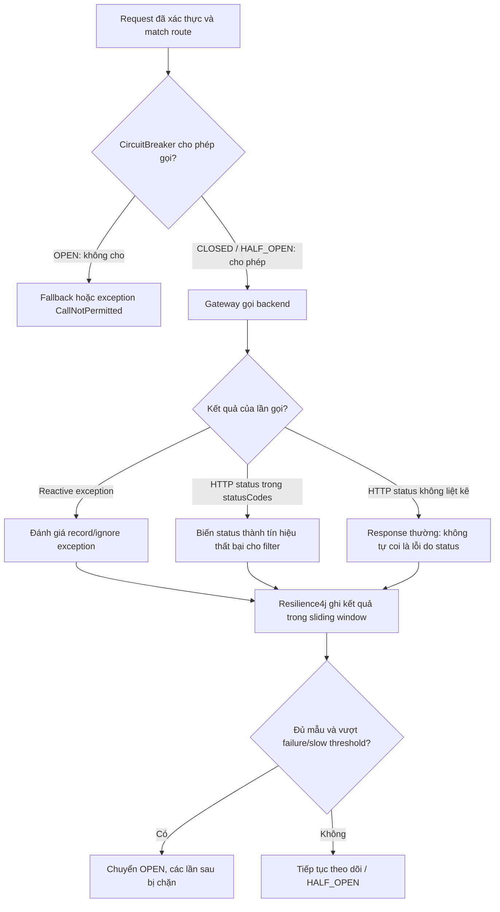
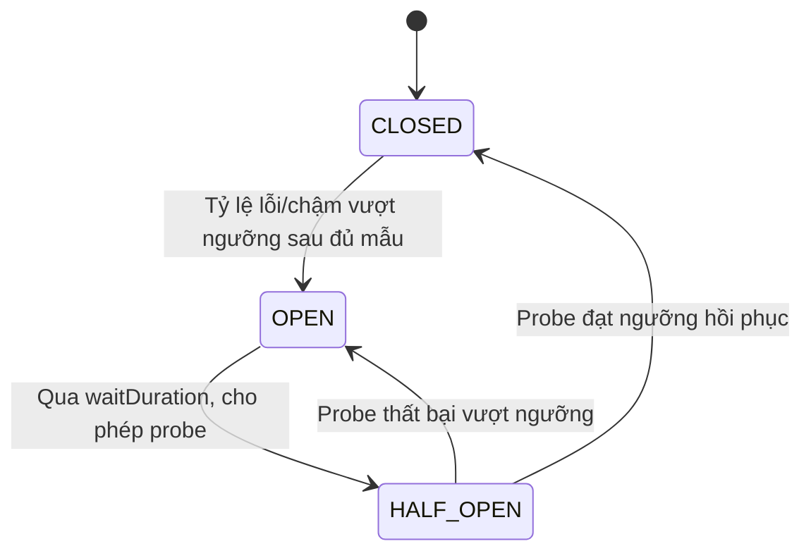

# Kích hoạt CircuitBreaker theo exception hoặc mã HTTP được chỉ định trong Spring Cloud Gateway

## 1. Bài toán: thế nào là một lần gọi downstream thất bại?

**Spring Cloud Gateway** là API Gateway cho hệ thống microservices: chọn route qua predicate, thực thi filter chain, biến đổi path/header, dùng service discovery/load balancing, xác thực, rate limiting, retry, TLS và quan sát request. Khi một dịch vụ phía sau bị lỗi hoặc chậm, Gateway không nên tiếp tục dồn vô hạn request vào dịch vụ đó.

**Circuit breaker (ngắt mạch)** theo dõi kết quả các lần gọi và, khi mức lỗi vượt chính sách, có thể tạm thời **ngừng thử gọi backend** để giảm tải. Trong Spring Cloud Gateway Server WebFlux, `CircuitBreaker` GatewayFilter sử dụng **Spring Cloud CircuitBreaker**, thường là implementation **Resilience4j**.

Điểm quan trọng nhất của bài là phân biệt **hai cách một lần gọi có thể được coi là lỗi**:

1. **Có exception (reactive error signal):** chẳng hạn Gateway không kết nối được backend, mất kết nối hoặc gặp timeout. Tín hiệu lỗi có thể được ghi nhận theo chính sách Resilience4j.
2. **Backend trả HTTP response:** chẳng hạn `500 Internal Server Error`. Một mã HTTP không tự nhiên là Java exception truyền qua mạng. Muốn Gateway CircuitBreaker **coi một số HTTP status là thất bại**, cần khai báo `statusCodes` trên `CircuitBreaker` filter.

Khi một lỗi đơn lẻ được ghi nhận, không có nghĩa breaker lập tức sang trạng thái `OPEN`. Nó còn xét **sliding window, minimumNumberOfCalls, failureRateThreshold, slow-call policy** và trạng thái hiện tại.

**Mục tiêu bài học:** cấu hình đúng dependency, chọn exception/status codes cần ghi nhận, hiểu các trạng thái breaker, tạo fallback an toàn, thử lỗi thật bằng `curl`, phối hợp timeout/retry và quan sát sự cố.

> **Phạm vi:** tập trung **Spring Cloud Gateway Server WebFlux 4.3+/5.x**; các ví dụ YAML dùng `spring.cloud.gateway.server.webflux.routes`. Với WebFlux 4.2 trở về trước thường dùng `spring.cloud.gateway.routes`. Gateway Server Web MVC có API/cấu hình riêng, không trộn Java DSL của hai stack.

## 2. Hai lớp quyết định: ghi nhận lỗi và mở mạch



Sơ đồ trên là **mô hình logic**, không mô tả từng callback nội bộ hay việc response body đã commit. Cần phân biệt:

| Lớp | Nơi cấu hình | Câu hỏi |
|---|---|---|
**Nhận diện HTTP lỗi** | `GatewayFilter CircuitBreaker.args.statusCodes` | Những response HTTP nào phải kích hoạt đường lỗi? |
**Phân loại exception** | `resilience4j.circuitbreaker.instances.*`, `recordExceptions`, `ignoreExceptions` hoặc predicate | Exception nào được tính là failure, bỏ qua hoặc tính success? |
**Ngưỡng mở mạch** | `failureRateThreshold`, `minimumNumberOfCalls`, `slidingWindowSize`, `slowCallRateThreshold` | Có đủ bằng chứng để OPEN hay chưa? |
**Chặn thử gọi backend** | Trạng thái `OPEN`/`HALF_OPEN` của Resilience4j | Lần gọi này có được vào backend không? |
**Xử lý khi thất bại** | `fallbackUri` hoặc error handling | Client nhận gì khi call lỗi hoặc breaker OPEN? |

### 2.1. Một HTTP 500 khác gì một exception trong backend?

Ví dụ backend Java ném:

```java
throw new IllegalStateException("database unavailable");
```

Framework HTTP **ở backend** thường chuyển exception đó thành một response **HTTP 500**. Gateway là **HTTP client**, nên thông thường nó thấy status 500, **không nhận nguyên đối tượng `IllegalStateException` từ JVM backend**.

Khi `statusCodes` không chứa `500`, HTTP response đó có thể vẫn được proxy về client theo flow thông thường; nó **không mặc nhiên được tính là exception của CircuitBreaker**. Với `statusCodes: [500]`, Gateway đưa status ấy vào nhánh xử lý thất bại của filter, nhờ đó có thể ghi nhận lỗi và chạy fallback.

Ngược lại, nếu Gateway **không mở được TCP socket** tới backend, nó không có HTTP 500 từ backend để so khớp. Lỗi `ConnectException`/I/O xuất hiện trong pipeline HTTP client và được đánh giá theo chính sách exception.

## 3. Ba trạng thái phổ biến của Resilience4j CircuitBreaker



| Trạng thái | Hành vi | Điều cần nhớ |
|---|---|---|
**CLOSED** | Cho phép request, đo kết quả trong sliding window | Một lỗi không nhất thiết làm mở mạch |
**OPEN** | Không chuyển request mới tới backend qua breaker đó | Thường tạo `CallNotPermittedException` rồi đi fallback nếu có |
**HALF_OPEN** | Cho phép một số lượng nhỏ request thử nghiệm | Dùng kết quả probe để quyết định đóng hoặc mở lại |

Resilience4j còn có các trạng thái đặc biệt như `DISABLED`, `FORCED_OPEN`. Không dùng chúng như cách thông thường để thay thế health check hoặc vô hiệu hóa chính sách ngoài quy trình vận hành có kiểm toán.

### 3.1. Ví dụ ngưỡng có thể tính được

Giả sử:

```yaml
resilience4j:
  circuitbreaker:
    instances:
      ordersBreaker:
        slidingWindowType: COUNT_BASED
        slidingWindowSize: 10
        minimumNumberOfCalls: 5
        failureRateThreshold: 50
        waitDurationInOpenState: 15s
        permittedNumberOfCallsInHalfOpenState: 2
```

Khi **ít nhất 5 lần gọi** đã được ghi nhận trong cửa sổ, breaker có thể tính tỷ lệ lỗi. Nếu **3 trong 5 lần** được tính là thất bại thì failure rate là **60%**, vượt ngưỡng 50%, và breaker có thể chuyển `OPEN`. Nếu mới chỉ 4 lần gọi dù cả 4 đều thất bại, `minimumNumberOfCalls: 5` thường khiến breaker **chưa mở**.

Sau khoảng `15s` ở trạng thái OPEN, một số request tiếp theo có thể được chọn làm **probe** HALF_OPEN. `permittedNumberOfCallsInHalfOpenState: 2` cho phép tối đa hai lần gọi đánh giá trong giai đoạn đó; các request khác có thể vẫn bị chặn. Khi có kết quả đủ để đánh giá, breaker quyết định đóng hoặc mở lại.

**Lưu ý tính theo thời điểm:** nếu bạn thử liên tục trong nhiều giây, các mẫu và thời gian chờ sẽ khác một bảng “5 request tức thì”. Với `TIME_BASED`, `slidingWindowSize` biểu thị số giây thay vì số lần gọi.

## 4. Dependencies: Gateway WebFlux + CircuitBreaker reactive

Spring Cloud Gateway dùng Spring Cloud CircuitBreaker API; với Resilience4j cần **reactive starter**.

### 4.1. Maven

```xml
<!-- Dùng Spring Boot dependency management và Spring Cloud BOM tương thích -->
<dependency>
    <groupId>org.springframework.cloud</groupId>
    <artifactId>spring-cloud-starter-gateway-server-webflux</artifactId>
</dependency>
<dependency>
    <groupId>org.springframework.cloud</groupId>
    <artifactId>spring-cloud-starter-circuitbreaker-reactor-resilience4j</artifactId>
</dependency>
<dependency>
    <groupId>org.springframework.boot</groupId>
    <artifactId>spring-boot-starter-actuator</artifactId>
</dependency>
```

`spring-boot-starter-actuator` là **tùy chọn** cho health/metrics, không phải dependency bắt buộc để filter CircuitBreaker hoạt động. Nếu dùng service discovery với `lb://`, bổ sung Spring Cloud LoadBalancer và DiscoveryClient tương ứng.

### 4.2. Gradle

```groovy
dependencies {
    implementation 'org.springframework.cloud:spring-cloud-starter-gateway-server-webflux'
    implementation 'org.springframework.cloud:spring-cloud-starter-circuitbreaker-reactor-resilience4j'
    implementation 'org.springframework.boot:spring-boot-starter-actuator'
}
```

| Thư viện | Nên dùng ở đâu? | Chú ý |
|---|---|---|
`spring-cloud-starter-circuitbreaker-reactor-resilience4j` | **Gateway Server WebFlux** | Tích hợp Reactive CircuitBreaker |
`spring-cloud-starter-circuitbreaker-resilience4j` | Ứng dụng **non-reactive** | Không thay thế tùy tiện starter reactive ở WebFlux Gateway |
`spring-boot-starter-web` | Spring MVC backend nếu cần | Không thêm vào Gateway WebFlux chỉ để có fallback controller |
`spring-boot-starter-webflux` | Backend WebFlux khi cần | Gateway WebFlux starter cung cấp stack Gateway; backend là ứng dụng riêng |

Không tự ghim phiên bản Resilience4j/Gateway khác release train Spring Cloud đang dùng. Sau khi nâng cấp, kiểm tra lại prefix `spring.cloud.gateway.server.webflux.*` và tính tương thích Spring Boot.

## 5. Cấu hình đầy đủ: đánh lỗi theo exception **và** HTTP status

Giả sử:

- Gateway nghe ở `http://localhost:8080`.
- Backend Orders có `GET /orders/{id}` tại `http://localhost:8081`.
- Client gọi `GET /api/orders/{id}`.
- Lỗi kết nối/timeout hoặc HTTP **500/503** từ backend cần được coi là thất bại và trả fallback có kiểm soát.
- HTTP **404** của “không tìm thấy đơn hàng” **không** phải sự cố backend và được giữ nguyên.

### 5.1. `application.yml` cho Gateway Server WebFlux

```yaml
server:
  port: 8080

spring:
  application:
    name: edge-gateway
  cloud:
    gateway:
      server:
        webflux:
          httpclient:
            connect-timeout: 2000
            response-timeout: 4s
          routes:
            - id: orders-protected
              uri: http://localhost:8081
              predicates:
                - Path=/api/orders/**
                - Method=GET
              filters:
                - StripPrefix=1
                - name: CircuitBreaker
                  args:
                    name: ordersBreaker
                    fallbackUri: forward:/fallback/orders
                    statusCodes:
                      - 500
                      - "SERVICE_UNAVAILABLE"

resilience4j:
  circuitbreaker:
    instances:
      ordersBreaker:
        slidingWindowType: COUNT_BASED
        slidingWindowSize: 10
        minimumNumberOfCalls: 5
        failureRateThreshold: 50
        waitDurationInOpenState: 15s
        permittedNumberOfCallsInHalfOpenState: 2
        slowCallRateThreshold: 100
        slowCallDurationThreshold: 3s
  timelimiter:
    instances:
      ordersBreaker:
        timeoutDuration: 3s
```

**Giải thích cấu hình:**

1. `Path=/api/orders/**` cùng `Method=GET` chỉ chọn request GET trên prefix Orders.
2. `StripPrefix=1` đổi `/api/orders/42` thành `/orders/42` trước khi backend nhận.
3. `CircuitBreaker.args.name=ordersBreaker` là tên CircuitBreaker được sử dụng.
4. `statusCodes` là danh sách **chính xác các HTTP codes cần coi là lỗi**: số `500` và tên enum `"SERVICE_UNAVAILABLE"` (503). Có thể dùng `"INTERNAL_SERVER_ERROR"` thay `500`.
5. `fallbackUri` là **`forward:` nội bộ Gateway**. Nó không phải HTTP redirect 302 và hiện tại chỉ URI scheme `forward:` được hỗ trợ trong cấu hình filter này.
6. `resilience4j.circuitbreaker.instances.ordersBreaker` xác định ngưỡng lỗi, minimum samples và state transitions.
7. `resilience4j.timelimiter.instances.ordersBreaker` đặt giới hạn thời gian thực thi của reactive operation. Tài liệu Spring Cloud CircuitBreaker cho biết **TimeLimiter được bật mặc định** trừ khi cấu hình tắt.

Trong file này, `timeoutDuration=3s` ngắn hơn `httpclient.response-timeout=4s` để bài tập minh họa **TimeLimiter phát lỗi trước** khi HTTP client chờ thêm. Trong production cần phối hợp connect/response timeout, TimeLimiter, retries và end-to-end deadline theo SLA; không chỉ copy các con số demo.

### 5.2. Không có `statusCodes` thì sao?

```yaml
filters:
  - name: CircuitBreaker
    args:
      name: ordersBreaker
      fallbackUri: forward:/fallback/orders
```

Filter vẫn có thể bắt **reactive exceptions** trên đoạn pipeline nó bao bọc, chẳng hạn connect failure/timeouts. Nhưng với HTTP **500 bình thường** được proxy thành một HTTP response, **không nên mặc định cho rằng chính response 500 được tính là breaker failure**. Muốn coi mã này là lỗi, khai báo `statusCodes` rõ ràng.

### 5.3. Chỉ tính mã mà nghiệp vụ thật sự coi là sự cố

| Status từ backend | Có nên đưa vào `statusCodes`? | Vì sao |
|---|---|---|
`500 INTERNAL_SERVER_ERROR` | **Thường có** | Lỗi kỹ thuật phía server |
`502 BAD_GATEWAY` | **Tùy topology** | Có thể phản ánh lỗi upstream/proxy |
`503 SERVICE_UNAVAILABLE` | **Thường có** | Dịch vụ không sẵn sàng/quá tải |
`504 GATEWAY_TIMEOUT` | **Thường có**, khi thực sự nhận thành HTTP status | Hạ tầng phía sau báo timeout |
`404 NOT_FOUND` | **Thường không** | Có thể là kết quả nghiệp vụ hợp lệ (đơn hàng không tồn tại) |
`400 BAD_REQUEST` | **Không nên mặc định** | Client gửi dữ liệu sai; mở mạch không chữa được |
`401 UNAUTHORIZED`/`403 FORBIDDEN` | **Không nên** | Xác thực/phân quyền, không phải backend hỏng |
`429 TOO_MANY_REQUESTS` | **Phải quyết định theo contract** | Có thể là quota của client; đôi khi là dấu hiệu downstream đang quá tải |

Danh sách `statusCodes` **không có nghĩa “tất cả 5xx”** nếu bạn chỉ liệt kê `500` và `503`. Với status khác, Gateway cần quyết định theo cấu hình và error signal thực nhận. Không dùng fallback trả `200 OK` cho mọi `404` nếu điều đó khiến client tưởng dữ liệu không tồn tại là hợp lệ.

## 6. Fallback handler nội bộ: trả kết quả an toàn, không che lỗi

Đối với `forward:/fallback/orders`, Gateway cần có một handler thực sự xử lý path `/fallback/orders`. Có thể viết `@RestController` **trong ứng dụng Gateway WebFlux**:

```java
package com.example.gateway.fallback;

import java.util.Map;

import org.springframework.cloud.gateway.support.ServerWebExchangeUtils;
import org.springframework.http.HttpHeaders;
import org.springframework.http.HttpStatus;
import org.springframework.http.ResponseEntity;
import org.springframework.web.bind.annotation.GetMapping;
import org.springframework.web.bind.annotation.RestController;
import org.springframework.web.server.ServerWebExchange;

@RestController
public class OrdersFallbackController {

    @GetMapping("/fallback/orders")
    public ResponseEntity<Map<String, String>> fallback(
            ServerWebExchange exchange) {

        Throwable cause = exchange.getAttribute(
            ServerWebExchangeUtils.CIRCUITBREAKER_EXECUTION_EXCEPTION_ATTR);

        // Chỉ phân loại để metric/log nội bộ; không trả stack trace
        // hay exception message cho client.
        String category = cause == null
            ? "unavailable"
            : "circuit-breaker";

        return ResponseEntity.status(HttpStatus.SERVICE_UNAVAILABLE)
            .header(HttpHeaders.CACHE_CONTROL, "no-store")
            .header("X-Gateway-Fallback", "true")
            .body(Map.of(
                "code", "ORDERS_TEMPORARILY_UNAVAILABLE",
                "message", "Orders service is temporarily unavailable",
                "category", category));
    }
}
```

**Lưu ý quan trọng:**

- `CIRCUITBREAKER_EXECUTION_EXCEPTION_ATTR` cung cấp `Throwable` liên quan ở **ServerWebExchange** khi fallback được gọi. Dữ liệu này phục vụ phân loại/quan sát nội bộ; không nên gửi exception class/message, stack trace, URI backend, token, session ID hoặc dữ liệu nhạy cảm về client.
- Ví dụ trả `503`, `Cache-Control: no-store` và `X-Gateway-Fallback: true` để client và giám sát phân biệt response dự phòng với kết quả Orders thật. Đừng “thành công giả” bằng `200` nếu client cần biết dữ liệu chưa sẵn sàng.
- Request trực tiếp tới `/fallback/orders` có thể đến được handler nếu không có Security/network policy tương ứng. Vì vậy fallback phải **không lộ dữ liệu nhạy cảm**, được bảo vệ theo kiến trúc và không cho phép dùng làm đường tắt phân quyền.
- `forward:` không tự chọn backend khác. Nếu muốn fallback tới **dịch vụ ngoài**, tài liệu mô tả tạo route/handler `/fallback` riêng; cần bảo vệ chính service fallback khỏi lỗi dây chuyền và recursion.
- Vì route ví dụ chỉ nhận `GET`, không có nguy cơ fallback vô tình làm giả thành công của `POST` tạo đơn hoặc thanh toán. Với write operations, phải xét idempotency và hợp đồng API trước khi thiết kế fallback.

### 6.1. Khi không cấu hình `fallbackUri`

`CircuitBreaker` vẫn có thể theo dõi lỗi và **mở mạch**, nhưng không có đường dự phòng do filter chỉ định. Lỗi được đưa vào cơ chế xử lý lỗi của Gateway; HTTP status thực tế phụ thuộc loại exception và exception handler. Không kết luận “OPEN luôn trả chính xác 503” nếu ứng dụng chưa cấu hình error handling rõ ràng.

### 6.2. Khi fallback cũng thất bại

Nếu handler fallback ném exception, truy cập tài nguyên không sẵn sàng hoặc response đã commit, client có thể nhận lỗi khác. **Không fallback đệ quy** về chính route đang lỗi và không retry vô hạn trong handler. Fallback nên tối giản, có deadline riêng, chỉ trả dữ liệu dự phòng thực sự được phép, và có metric đo tỷ lệ sử dụng.

## 7. Java DSL: `addStatusCode` và `fallbackUri`

Trong **Gateway Server WebFlux**, có thể cấu hình route bằng Java thay cho YAML:

```java
package com.example.gateway.routes;

import org.springframework.cloud.gateway.route.RouteLocator;
import org.springframework.cloud.gateway.route.builder.RouteLocatorBuilder;
import org.springframework.context.annotation.Bean;
import org.springframework.context.annotation.Configuration;

@Configuration(proxyBeanMethods = false)
public class OrdersCircuitRoutes {

    @Bean
    RouteLocator ordersProtected(RouteLocatorBuilder builder) {
        return builder.routes()
            .route("orders-protected", r -> r
                .path("/api/orders/**")
                .and()
                .method("GET")
                .filters(f -> f
                    .stripPrefix(1)
                    .circuitBreaker(c -> c
                        .name("ordersBreaker")
                        .fallbackUri("forward:/fallback/orders")
                        .addStatusCode("INTERNAL_SERVER_ERROR")
                        .addStatusCode("SERVICE_UNAVAILABLE")))
                .uri("http://localhost:8081"))
            .build();
    }
}
```

`addStatusCode("INTERNAL_SERVER_ERROR")` tương ứng với `500`; `addStatusCode("SERVICE_UNAVAILABLE")` tương ứng `503`. Tài liệu Gateway cũng minh họa method `addStatusCode(...)` bằng tên `HttpStatus` enum.

Đây là cách cấu hình **thay thế** cho route YAML của mục 5, không đồng thời đăng ký **hai route cùng ID** trong cùng một thử nghiệm. Bean `resilience4j.circuitbreaker.instances.ordersBreaker` và `resilience4j.timelimiter.instances.ordersBreaker` vẫn có thể được cấu hình bằng `application.yml` khi dùng route Java.

### 7.1. Nếu muốn thử trigger bằng 404

Để học cơ chế status matching, có thể thay:

```java
.addStatusCode("SERVICE_UNAVAILABLE")
```

bằng:

```java
.addStatusCode("NOT_FOUND")
```

và xem `HTTP 404` được filter coi là lỗi như thế nào. Nhưng **đừng đưa 404 vào breaker một cách mặc định cho API nghiệp vụ**. Nếu “order ID không tồn tại” là kết quả hợp lệ, ghi 404 như lỗi hệ thống có thể mở mạch và làm hàng loạt người dùng hợp lệ nhận fallback.

### 7.2. Một lưu ý về filter order

Trong YAML/Java ở bài này, `StripPrefix` được khai báo trước `CircuitBreaker` để request downstream nhận path đã sửa. **GatewayFilter order là quan trọng**, nhất là khi thêm `Retry`, filters tùy chỉnh, xử lý cache hoặc response headers. Đừng suy đoán rằng hai filters có logic “trước/sau” giống nhau chỉ vì chúng xuất hiện cạnh nhau trong YAML; phải kiểm tra behavior thực tế và chain ordering theo đúng phiên bản.

## 8. Exception nào làm tăng tỷ lệ lỗi?

### 8.1. Exceptions xuất phát từ Gateway khác backend HTTP status

| Tình huống | Gateway thường quan sát | Lớp quyết định |
|---|---|---|
Backend process ngừng, cổng không mở | I/O/connection exception, không có HTTP status từ backend | Resilience4j exception policy |
DNS/resolve backend thất bại | Reactive error signal từ HTTP client/discovery | Exception policy, phụ thuộc vị trí lỗi trong chain |
Backend gửi TCP reset | I/O exception trong pipeline | Exception policy |
Spring Cloud CircuitBreaker `TimeLimiter` hết hạn | Timeout exception trên reactive execution | Exception policy, TimeLimiter |
Reactor Netty HTTP client timeout | Reactive error từ HTTP client | Exception policy |
Backend Java ném `IllegalStateException` nhưng có error handler | Thường là **HTTP 500**, không phải Java exception truyền qua mạng | `statusCodes` phải chứa `500` để tính bằng status |
Backend trả JSON lỗi với HTTP `200` | HTTP 200; CircuitBreaker không hiểu business error trong body mặc định | Cần chỉnh API contract hoặc custom handling có kiểm soát |
Spring Security chặn `401` trước Gateway route | Request không vào route-specific breaker | Spring Security, không phải `statusCodes` của route |
Backend trả `404` hợp lệ | HTTP 404 bình thường | Không ghi lỗi nếu `404` không nằm trong `statusCodes` |

**Điểm quan trọng:** chỉ “có một exception ở đâu đó trong hệ thống” là chưa đủ. Nó phải là **error signal trong pipeline mà CircuitBreaker bao bọc** và được Resilience4j phân loại là failure. Nếu exception được filter khác xử lý thành response bình thường **trước khi đến CircuitBreaker**, breaker có thể không thấy nó.

### 8.2. `recordExceptions`, `ignoreExceptions` và predicates của Resilience4j

Resilience4j có thể được tùy biến để:

- **Ghi nhận** những exception thuộc danh sách `recordExceptions` như failure.
- **Bỏ qua** những exception thuộc `ignoreExceptions`: không tính là success hay failure.
- Sử dụng `recordFailurePredicate`/các predicate Java để phân loại nâng cao.

Định hướng cấu hình:

```yaml
# Chỉ là VÍ DỤ HÌNH THỨC cho một exception class của chính ứng dụng.
# Không copy vào ứng dụng chưa có class này.
resilience4j:
  circuitbreaker:
    instances:
      ordersBreaker:
        ignoreExceptions:
          - com.example.gateway.errors.BusinessRuleException
```

Đoạn trên chỉ hợp lệ khi ứng dụng thực sự có exception class `com.example.gateway.errors.BusinessRuleException`; **nó không tự khiến HTTP 400/404 từ backend biến thành BusinessRuleException**.

**Cảnh báo quan trọng:** nếu cấu hình `recordExceptions` thành một **danh sách đóng** chỉ gồm một vài exception, những exception khác có thể được Resilience4j **coi là success**, trừ khi bị cấu hình ignore. Status được Gateway đưa vào nhánh lỗi bằng `statusCodes` có thể đi qua một exception type của Gateway; bạn phải kiểm tra **nó có được ghi nhận theo record policy hay không**. Nếu vừa muốn 500/503 vừa muốn connection/timeout failures được đếm, hãy kiểm tra kết quả metrics bằng test, không chỉ nhìn vào `statusCodes`.

Trong phần thực hành cơ bản, **không đặt `recordExceptions`/`ignoreExceptions`** để sử dụng chính sách mặc định ghi nhận lỗi, đồng thời khai báo `statusCodes` rõ ràng cho HTTP response statuses cần đếm.

### 8.3. Exception bị bỏ qua không tương đương fallback không chạy

Việc một exception được **ignore** trong thống kê breaker và việc một request **kích hoạt fallback** là hai quyết định khác nhau trong pipeline. Resilience4j có thể không ghi exception vào failure rate nhưng request vẫn có lỗi cần xử lý. Vì vậy, đừng khẳng định “đã ignore exception thì request sẽ tự thành công” hoặc “không bao giờ chạy fallback”. Đo cả **breaker metrics** và **HTTP response thực nhận**.

## 9. Timeout và slow-call policy không phải cùng một điều kiện

Spring Cloud Gateway có thể dùng nhiều cơ chế kiểm soát thời gian:

| Cơ chế | Ví dụ config | Ý nghĩa |
|---|---|---|
TCP connect timeout | `spring.cloud.gateway.server.webflux.httpclient.connect-timeout: 2000` | Chờ thiết lập kết nối tới backend |
HTTP response read timeout | `...httpclient.response-timeout: 4s` | Khoảng chờ đọc network response |
Resilience4j TimeLimiter | `resilience4j.timelimiter.instances.ordersBreaker.timeoutDuration: 3s` | Giới hạn thời gian reactive execution của breaker |
Slow-call tracking | `slowCallDurationThreshold: 2s` và `slowCallRateThreshold: 60` | Ghi nhận tỷ lệ calls **chậm**, có thể mở mạch dù không ném exception |
Retry backoff | `Retry` filter riêng | Trì hoãn giữa các lần thử; có thể làm tăng tổng latency |
End-to-end deadline | Policy client/API | Giới hạn tổng hành trình, không tự xuất hiện từ một timeout đơn |

**Slow call không nhất thiết là exception.** Resilience4j có thể tính một lần gọi chậm vào **slow-call rate** ngay cả khi nó trả HTTP 200. Khi tỷ lệ slow calls vượt ngưỡng sau đủ mẫu, breaker cũng có thể mở.

Ngược lại, `TimeLimiter` có thể phát **timeout error**, khiến lần gọi được tính là failure. Ở ví dụ mục 5, `slowCallRateThreshold: 100` được đặt nhằm tránh mở mạch quá dễ do một vài calls hơi chậm trong thí nghiệm; `timeoutDuration: 3s` minh họa lỗi khi backend chậm hơn đáng kể.

Với **SSE** và các response stream dài, một TimeLimiter/response timeout ngắn có thể ngắt kết nối hợp lệ vì stream không kết thúc sớm. Cần phân loại routes streaming, flush/heartbeat và định nghĩa timeout riêng; không áp cùng một chính sách cho API JSON ngắn và SSE liên tục.

### 9.1. Resilience4j TimeLimiter có thể bật mặc định

Tài liệu Spring Cloud CircuitBreaker 5.x mô tả TimeLimiter **được bật mặc định**. Có thể tắt toàn cục hoặc chọn group/instance bằng các property `spring.cloud.circuitbreaker.resilience4j.disable-time-limiter` và `disable-time-limiter-map`. Tắt TimeLimiter không tự loại bỏ những timeout khác của Netty hoặc timeout đầu vào.

**Không tắt timeout chỉ vì muốn tránh fallback.** Khi backend hỏng, các request có thể giữ tài nguyên lâu và đẩy quá tải sang Gateway. Cần chọn deadline theo hợp đồng và khả năng phục hồi của downstream.

## 10. Phối hợp `CircuitBreaker` với `Retry`

**CircuitBreaker** bảo vệ backend khỏi lượng call lỗi kéo dài; **Retry** thử lại một call theo điều kiện. Hai cơ chế có thể bổ sung nhau hoặc gây bão lưu lượng nếu thiết kế không đúng.

| Tình huống | Rủi ro |
|---|---|
Retry trước khi breaker ghi nhận kết quả | Một “logical request” có thể tạo **nhiều backend attempts**; breaker có thể chỉ nhìn thấy kết quả cuối tùy chain |
Breaker ở bên trong Retry | Mỗi attempt có thể gặp breaker policy khác nhau; OPEN có thể khiến attempts sau bị từ chối nhanh |
Retry trên HTTP 500 với backoff=0 | Tăng ngay tải trên backend đang lỗi |
Retry POST tạo đơn/thanh toán | Có thể tạo side effects trùng; yêu cầu idempotency key |
Fallback dùng HTTP 200 và client retry theo body | Làm sai metrics và kỳ vọng client |
Rate limiting chỉ ở client request | Không tự hạn chế tổng downstream retries từ một request đã được chấp nhận |

Không có một thứ tự filter “chuẩn” phù hợp mọi API. Khi dùng cả `Retry` và `CircuitBreaker`, hãy thử **thứ tự GatewayFilter thực tế**, đo số lần backend nhận request, số call Resilience4j ghi nhận và latency. Chỉ retry những lỗi **tạm thời** theo chính sách rõ, có giới hạn attempts, exponential backoff/jitter và tổng deadline.

**Không đặt `Retry` mặc định trên mọi route** chứa mutation hoặc body lớn. Khi retry request có body, Gateway có thể phải cache payload trong memory; cần giới hạn size, concurrency và idempotency.

## 11. Fallback ra service ngoài và dữ liệu exception

Mặc dù `fallbackUri` chỉ hỗ trợ `forward:`, Gateway có thể forward tới một path mà **route riêng** tiếp tục proxy đến fallback backend:

```yaml
spring:
  cloud:
    gateway:
      server:
        webflux:
          routes:
            - id: live-inventory
              uri: http://inventory.internal.example:8081
              predicates:
                - Path=/api/inventory/**
              filters:
                - name: CircuitBreaker
                  args:
                    name: inventoryBreaker
                    fallbackUri: forward:/internal/inventory-fallback

            - id: inventory-fallback
              uri: http://fallback.internal.example:8082
              predicates:
                - Path=/internal/inventory-fallback
```

Đây là **mô hình định tuyến hai chặng** theo tài liệu, không phải fallback controller nội bộ của mục 6. Phải xác minh khả năng route lại path `/internal/inventory-fallback` và bảo vệ nó trước client trực tiếp, tránh vô tình công bố fallback service như API public. Nếu fallback service cũng lỗi, cần có giới hạn timeout và không tạo vòng gọi.

### 11.1. `FallbackHeaders`: chỉ dùng cho mục đích nội bộ

Khi forward sang một **external fallback service**, Gateway có filter `FallbackHeaders` để chuyển một phần thông tin execution exception thành HTTP request headers:

```yaml
# Filter này thuộc route inventory-fallback, không thuộc route live-inventory.
filters:
  - name: FallbackHeaders
    args:
      executionExceptionTypeHeaderName: X-Internal-Execution-Exception-Type
```

Các trường có thể gồm exception type/message và root cause. **Không mặc định chuyển đầy đủ thông tin exception ra mạng không đáng tin**, đặc biệt với exception message có địa chỉ host, query, token hoặc dữ liệu khách hàng. Fallback backend chỉ nên sử dụng các trường đã được chuẩn hóa, bảo vệ qua mTLS/ACL; không tin headers tương tự do client tự tạo.

**Header từ client có thể bị giả mạo.** Nếu route fallback được công bố, client có thể gửi `X-Internal-Execution-Exception-Type` giả. Cần loại bỏ header nhạy cảm trước khi ghi thông tin nội bộ và xác thực workload mà backend nhận; không dùng exception header làm credential phân quyền.

## 12. Gateway Server Web MVC có cách cấu hình khác

Trong Gateway Server **Web MVC**, documentation cũng hỗ trợ danh sách `statusCodes` dạng số hoặc tên enum, nhưng:

- YAML route đặt theo namespace `spring.cloud.gateway.server.webmvc.routes` ở các dòng mới.
- Java DSL dùng `RouterFunction` và `CircuitBreakerFilterFunctions`, **khác** `RouteLocatorBuilder` của WebFlux.
- Phần xử lý HTTP client, exception, Servlet request/response và lifecycle khác Netty reactive.

Ví dụ ý tưởng YAML cho MVC (phải dùng starter MVC và cấu hình stack phù hợp):

```yaml
spring:
  cloud:
    gateway:
      server:
        webmvc:
          routes:
            - id: mvc-orders
              uri: http://localhost:8081
              predicates:
                - Path=/orders/**
              filters:
                - name: CircuitBreaker
                  args:
                    name: mvcOrdersBreaker
                    fallbackUri: forward:/fallback/orders
                    statusCodes:
                      - 500
                      - "SERVICE_UNAVAILABLE"
```

**Không trộn** hai ví dụ WebFlux/MVC trong một ứng dụng để thử nghiệm vì starter, server stack, route APIs và filter execution khác nhau. Phạm vi thực hành tiếp theo dùng **WebFlux**.

## 13. Thực hành end-to-end: HTTP 500, 503, 404, timeout và connection failure

### 13.1. Chuẩn bị hai ứng dụng

Bạn cần:

1. **Gateway** Server WebFlux ở `localhost:8080`, với `application.yml` mục 5 và `OrdersFallbackController` mục 6.
2. **Backend** Spring Boot WebFlux ở `localhost:8081` có endpoint `GET /orders/{id}` trả nhiều trường hợp khác nhau.

Đặt controller sau vào **ứng dụng backend riêng** (có `spring-boot-starter-webflux` và Spring Boot main class), **không đặt trong ứng dụng Gateway**:

```java
package com.example.orders.demo;

import java.time.Duration;
import java.util.Map;

import org.springframework.http.HttpStatus;
import org.springframework.http.ResponseEntity;
import org.springframework.web.bind.annotation.GetMapping;
import org.springframework.web.bind.annotation.PathVariable;
import org.springframework.web.bind.annotation.RestController;
import reactor.core.publisher.Mono;

@RestController
public class DemoOrdersController {

    @GetMapping("/orders/{id}")
    Mono<ResponseEntity<Map<String, String>>> get(
            @PathVariable String id) {

        if ("500".equals(id)) {
            return Mono.just(ResponseEntity
                .status(HttpStatus.INTERNAL_SERVER_ERROR)
                .body(Map.of("error", "backend server error")));
        }
        if ("503".equals(id)) {
            return Mono.just(ResponseEntity
                .status(HttpStatus.SERVICE_UNAVAILABLE)
                .body(Map.of("error", "backend unavailable")));
        }
        if ("missing".equals(id)) {
            return Mono.just(ResponseEntity
                .status(HttpStatus.NOT_FOUND)
                .body(Map.of("error", "order not found")));
        }
        if ("slow".equals(id)) {
            return Mono.delay(Duration.ofSeconds(5))
                .map(tick -> ResponseEntity.ok(Map.of("id", id)));
        }
        if ("throw".equals(id)) {
            return Mono.error(
                new IllegalStateException("backend internal failure"));
        }
        return Mono.just(ResponseEntity.ok(Map.of("id", id)));
    }
}
```

Ứng dụng backend phải chạy ở cổng 8081 và có lớp `@SpringBootApplication`/`main` phù hợp. Controller `"throw"` cố tình ném exception **bên backend**: khi không có error handler riêng, Spring WebFlux thường chuyển thành response HTTP 500. Gateway **không nhận nguyên Java exception `IllegalStateException` đó**; nó nhận response HTTP, rồi `statusCodes` mới quyết định có đánh lỗi theo status hay không.

### 13.2. Kiểm tra backend trước khi đi qua Gateway

```bash
curl -i http://localhost:8081/orders/ok
curl -i http://localhost:8081/orders/missing
curl -i http://localhost:8081/orders/500
curl -i http://localhost:8081/orders/503
```

Kỳ vọng ở backend trực tiếp:

| Path backend | HTTP status | Body minh họa |
|---|---|---|
`/orders/ok` | 200 | `{"id":"ok"}` |
`/orders/missing` | 404 | `{"error":"order not found"}` |
`/orders/500` | 500 | `{"error":"backend server error"}` |
`/orders/503` | 503 | `{"error":"backend unavailable"}` |

Nếu không thấy đúng statuses ở bước này, cần sửa backend demo trước; đừng quy mọi lỗi vào filter CircuitBreaker.

### 13.3. Gọi qua Gateway khi breaker còn CLOSED

```bash
# Thành công bình thường, không dùng fallback.
curl -i http://localhost:8080/api/orders/ok

# 404 hợp lệ theo nghiệp vụ, KHÔNG nằm trong statusCodes của bài.
curl -i http://localhost:8080/api/orders/missing

# 500 được liệt kê -> kích hoạt xử lý lỗi và fallback.
curl -i http://localhost:8080/api/orders/500

# 503 cũng được liệt kê -> fallback.
curl -i http://localhost:8080/api/orders/503

# Backend trả sau khoảng 5s, TimeLimiter 3s có thể hết hạn trước.
curl --max-time 10 -i http://localhost:8080/api/orders/slow
```

| Request qua Gateway | Khi breaker CLOSED và backend demo hoạt động | Dấu phân biệt |
|---|---|---|
`GET /api/orders/ok` | 200 backend | Không có `X-Gateway-Fallback: true` |
`GET /api/orders/missing` | 404 backend | Không có fallback header, vì 404 không được chọn |
`GET /api/orders/500` | 503 từ fallback | Có `X-Gateway-Fallback: true` |
`GET /api/orders/503` | 503 từ fallback | Có fallback header |
`GET /api/orders/slow` | Có thể 503 từ fallback khi TimeLimiter 3s hết hạn | Cần kiểm tra timeout type/log và metrics |

**Thứ tự test quan trọng:** nếu bạn gửi nhiều `500`/`503` liên tiếp, breaker có thể sang `OPEN`. Khi đó **ngay cả `/ok` hoặc `/missing` cũng có thể bị fallback**, vì breaker đang không cho phép đi backend. Để kiểm tra riêng từng HTTP status, dùng môi trường mới khởi động hoặc đợi giai đoạn HALF_OPEN/CLOSED theo cấu hình; không thao tác force reset breaker trên production chỉ để thử nghiệm.

### 13.4. Lặp lỗi để quan sát trạng thái OPEN

```bash
# Chỉ chạy trong môi trường test:
for i in $(seq 1 12); do
  curl -sS -o /dev/null \
    -w "attempt=$i status=%{http_code}\n" \
    http://localhost:8080/api/orders/500
done

# Sau khi breaker OPEN, path /ok cũng có thể đi fallback.
curl -i http://localhost:8080/api/orders/ok
```

Giả sử breaker mới, `minimumNumberOfCalls=5`, `failureRateThreshold=50` và 5 request đầu được ghi nhận là lỗi, breaker có thể chuyển OPEN sau khi đủ 5 samples. Những request tiếp theo bị từ chối nhanh, **không tiếp tục đi backend**. `CallNotPermittedException` có thể xuất hiện trong exception attribute/log nội bộ và fallback vẫn trả 503 theo controller ví dụ.

Không khẳng định tất cả 12 lần gọi đều đã tới backend: **điểm lợi của OPEN là cắt bớt những lần gọi khi backend đang lỗi**. Không khẳng định mọi response đều khác nhau vì fallback của bài cố ý trả cùng 503 cho lỗi backend và open breaker.

### 13.5. Thử exception **không có HTTP response**

Trong môi trường test, dừng backend ở `8081` rồi gọi:

```bash
curl --max-time 10 -i http://localhost:8080/api/orders/ok
```

Khi breaker cho phép probe, Gateway có thể nhận **connection refused** hoặc lỗi mạng khác, từ đó vào nhánh exception/fallback dù chưa nhận status 500/503 từ backend. Nếu breaker hiện đang OPEN, request có thể **không thử kết nối mới**, nên test này chưa chứng minh connect exception đã được nhận. Dùng breaker còn CLOSED hoặc tạo một route/breaker test riêng nếu cần phân biệt.

**Phân biệt rõ:**

- Lỗi kết nối/timeout trước HTTP response: kích hoạt theo **exception**.
- Backend trả HTTP 500/503 bình thường: kích hoạt theo **`statusCodes`**.
- Backend trả HTTP 404: **không kích hoạt theo status** trong cấu hình bài này.
- Breaker OPEN: phát **CallNotPermitted** trước khi đi backend.

### 13.6. Thử cấu hình thêm 404

Để thấy rõ HTTP status được chọn khác với mặc định, trong **profile test** có thể thay:

```yaml
filters:
  - name: CircuitBreaker
    args:
      name: ordersBreaker
      fallbackUri: forward:/fallback/orders
      statusCodes:
        - 500
        - "SERVICE_UNAVAILABLE"
        - "NOT_FOUND"
```

Sau khi khởi động lại/refresh route theo cách quản lý cấu hình, khi breaker CLOSED, `GET /api/orders/missing` có thể đi fallback thay vì trả 404 gốc. Điều đó **chứng minh `statusCodes` đang có hiệu lực**, nhưng cũng cho thấy rủi ro của việc coi “not found” nghiệp vụ là lỗi kỹ thuật. Chỉ dùng 404 làm trigger khi **hợp đồng thực sự định nghĩa** nó là dấu hiệu backend bất thường.

## 14. Quan sát state, failure rate và fallback

Để phân biệt **một fallback do HTTP 500**, **một fallback do timeout** và **một fallback vì OPEN**, cần đo nhiều lớp:

| Dữ liệu | Cần trả lời |
|---|---|
Gateway route ID / URI | Request vào đúng route `orders-protected` chưa? |
Response status gốc của backend | Backend trả 500/503/404 hay không có response? |
Exception class/cause trong exchange nội bộ | I/O, timeout, CallNotPermitted hay status-induced error? |
Resilience4j state | CLOSED, OPEN hay HALF_OPEN? |
Failure rate và minimum samples | Breaker có đủ dữ liệu để tính tỷ lệ lỗi chưa? |
Number of permitted/blocked calls | Backend còn nhận request hay đã được bảo vệ? |
Fallback invocation count | Bao nhiêu request đã được phục vụ bởi fallback? |
Gateway latency, backend latency, timeout | Lỗi chủ yếu do server lỗi, mạng hay chậm? |
Retry attempts | Một client request đã gây bao nhiêu downstream attempts? |

### 14.1. Actuator và Micrometer

Khi đã cài Spring Boot Actuator, có metrics binder Resilience4j phù hợp với version và chỉ mở các endpoint quản trị cho người được phép, có thể quan sát tên metric như `resilience4j.circuitbreaker.calls`, `resilience4j.circuitbreaker.state` và Gateway request metrics. Tên, tag và tính khả dụng của metrics phụ thuộc starter/binder/registry đang dùng.

Ví dụ cho môi trường quản trị riêng:

```yaml
management:
  endpoints:
    web:
      exposure:
        include: health,info,metrics
```

```bash
# Chỉ gọi từ mạng quản trị đã được xác thực/phân quyền.
curl -i http://localhost:8080/actuator/metrics
curl -i http://localhost:8080/actuator/metrics/resilience4j.circuitbreaker.calls
```

Endpoint `/actuator/metrics/resilience4j.circuitbreaker.calls` **không chắc đã có** nếu app thiếu binder/metrics registry hoặc chưa có breaker events. Không mở toàn bộ Actuator endpoints ra Internet và không ghi token, cookie, request body hoặc exception message nhạy cảm vào metric labels/log.

Có thể bật `registerHealthIndicator: true` cho breaker theo cấu hình Resilience4j và Spring Boot Actuator tương ứng. Nhưng **breaker OPEN không tự chứng minh toàn bộ Gateway “đã chết”**: Gateway có thể còn hoạt động để phục vụ những routes khác hoặc trả fallback dự kiến. Health indicator/ready probe cần được thiết kế phù hợp kịch bản vận hành.

### 14.2. Breaker state thường nằm trong **từng Gateway instance**

Resilience4j CircuitBreaker thông thường được giữ trong **JVM của mỗi Gateway replica**. Nó **không mặc nhiên dùng Redis hay trạng thái phân tán**. Nếu có Gateway A và B, A có thể OPEN do quan sát nhiều lỗi trong khi B vẫn CLOSED; điều này không nhất thiết là bug.

Không nhầm với `RedisRateLimiter` vốn có Redis data store chia sẻ. Đối với nhiều Gateway pods, quan sát và alert theo **breaker name + instance/pod + route**, tránh dùng một trạng thái tổng hợp duy nhất để suy mọi pod hành xử giống nhau.

## 15. Bảo mật và hợp đồng API khi dùng fallback

1. **Không che dữ liệu chưa sẵn sàng thành `200`** nếu client có thể nhầm là đơn hàng đã được tải hoặc giao dịch đã thành công. Với ví dụ Orders, `503` và mã lỗi máy đọc được minh bạch hơn.
2. **Không biến `401`/`403` thành fallback công khai:** người dùng chưa xác thực/phân quyền không được dùng fallback để lấy dữ liệu mà endpoint thật đã bảo vệ.
3. **Không gửi exception message nội bộ:** `Throwable` có thể chứa backend hostname, URI, headers, SQL errors, token hoặc dữ liệu cá nhân.
4. **Không fallback tạo side effects:** tránh tự tạo đơn, đổi trạng thái thanh toán hoặc gửi email trong một fallback khi không biết downstream đã thực hiện yêu cầu hay chưa.
5. **Xác định data freshness:** nếu fallback dùng cache/stale response, API contract phải nói rõ dữ liệu có thể cũ, TTL và mức quyền truy cập phù hợp.
6. **Bảo vệ `/fallback/** handler:** không để một route forward nội bộ trở thành cửa sau tới service fallback hoặc endpoint quản trị.
7. **Mã hóa và xác minh kết nối:** HTTPS/mTLS tới backend khi hệ thống yêu cầu; circuit breaker không thay thế TLS hay JWT.
8. **Rà lại rate limiter và retry:** breaker OPEN giảm downstream calls, nhưng không ngăn DDoS trên edge; rate limiting/connection limit vẫn cần thiết.
9. **Tránh chia chung tên breaker tùy tiện:** hai route của hai backend không liên quan nếu dùng cùng `name` có thể ảnh hưởng nhau về failure rate.
10. **Test hết thời gian OPEN:** một breaker luôn trả fallback nhưng không bao giờ được probe thành công có thể che sự cố kéo dài; cần cảnh báo trạng thái, fallback rate và quy trình điều tra.

## 16. Các lỗi cấu hình thường gặp

| Triệu chứng | Nguyên nhân có thể | Hướng xử lý |
|---|---|---|
Không tạo được `CircuitBreaker` filter | Thiếu starter reactive Resilience4j hoặc sai web stack | Thêm `spring-cloud-starter-circuitbreaker-reactor-resilience4j` cho WebFlux |
Backend trả 500 mà breaker không ghi lỗi | `statusCodes` chưa chứa 500, hoặc filter không bao bọc response đó | Cấu hình `statusCodes` và kiểm tra route/filter chain |
Đã có `statusCodes` nhưng failure rate không tăng | `recordExceptions` quá hẹp, breaker name khác hoặc flow lỗi bị xử lý trước | Kiểm tra Resilience4j exception classification và metrics |
Breaker chưa OPEN dù 4/4 call thất bại | `minimumNumberOfCalls` còn lớn hơn 4 | Kiểm tra minimum samples/window |
Breaker OPEN quá nhạy khi backend trả 404 | Đã thêm `NOT_FOUND` như một lỗi hệ thống | Loại 404 nếu đó là kết quả nghiệp vụ bình thường |
HTTP 401/403 không kích hoạt fallback | Spring Security từ chối trước Gateway route | Đây thường là đúng, không nên bypass authorization |
Không thấy fallback dù backend connection refused | Route không match, fallback handler sai path hoặc exception bị xử lý ở filter khác | Kiểm tra route, URI, filter order và handler `/fallback/orders` |
Fallback trả 404 | Chưa có controller/route cho `forward:` path | Tạo handler chính xác và kiểm tra Security rules |
Fallback trả 200 ngoài ý muốn | Controller fallback dùng `ResponseEntity.ok(...)` | Chọn status theo API contract, ví dụ 503 |
SSE bị ngắt và chuyển fallback | TimeLimiter/response timeout quá ngắn | Tách policy route streaming, heartbeat và deadline |
Gateway A OPEN nhưng B CLOSED | Breaker state theo JVM/pod | Quan sát theo instance, không giả định state chia sẻ |
Lỗi sau nâng cấp Gateway | Prefix YAML sai, starter không tương thích, API WebFlux/MVC khác nhau | Rà release train, configprops và dependencies |
Tỷ lệ lỗi từ Metrics không khớp backend 500 | Nhiều 500 chưa nằm trong `statusCodes`, retry che lỗi, hoặc request chưa đến backend | Đối chiếu HTTP statuses, breaker calls, retry attempts và route |
Fallback service bị overload | Nhiều requests OPEN dồn sang cùng một fallback backend | Giới hạn fallback, dùng response tối giản/cache hợp lý, breaker/timeout riêng |

## 17. Bài tập và đáp án

**Bài 1 — Exception hay HTTP status?** Backend Java ném `IllegalStateException` nhưng Spring chuyển thành HTTP 500. Gateway có cấu hình CircuitBreaker không có `statusCodes`. Có thể khẳng định breaker ghi nhận Java exception đó không?

**Đáp án:** không. Gateway là HTTP client, thường chỉ thấy **HTTP 500**, không nhận trực tiếp exception của backend. Muốn coi 500 là một failure, cấu hình `statusCodes` có `500` hoặc `"INTERNAL_SERVER_ERROR"`.

**Bài 2 — Status được chỉ định.** Cấu hình `statusCodes: [500, "SERVICE_UNAVAILABLE"]` sẽ ghi lỗi mọi response 5xx chứ?

**Đáp án:** không. Nó liệt kê 500 và 503. Không suy ra 502 hoặc 504 cũng sẽ được ghi lỗi chỉ vì cùng nhóm 5xx; tuy nhiên lỗi mạng/timeout dạng exception vẫn có thể được xử lý theo policy khác.

**Bài 3 — Minimum samples.** `minimumNumberOfCalls=5`, `failureRateThreshold=50`. Sau 4 lỗi liên tiếp, breaker bắt buộc OPEN không?

**Đáp án:** không. Phải có tối thiểu 5 calls được ghi nhận trước khi tính ngưỡng lỗi; 4/4 chưa đủ theo cấu hình này.

**Bài 4 — Ngưỡng failure rate.** Năm calls đầu có ba lỗi được ghi nhận. Failure rate bằng bao nhiêu và chuyện gì có thể xảy ra?

**Đáp án:** `3/5 = 60%`, lớn hơn ngưỡng 50%. Khi đủ mẫu và không có policy đặc biệt khác, breaker có thể chuyển sang OPEN.

**Bài 5 — 404 hợp lệ.** `GET /api/orders/missing` trả HTTP 404 vì order không tồn tại. Có nên thêm `"NOT_FOUND"` vào `statusCodes`?

**Đáp án:** thường không. 404 nghiệp vụ là phản hồi bình thường; coi nó là backend failure khiến breaker có thể mở mạch vô ích, chặn các request hợp lệ khác.

**Bài 6 — Kết nối bị từ chối.** Backend tắt hoàn toàn nên Gateway nhận connection exception. Có cần liệt kê status 500 để bắt loại lỗi này không?

**Đáp án:** không. Không có response HTTP 500 để match. Exception có thể được Resilience4j ghi nhận theo chính sách exception mặc định hoặc cấu hình, miễn nó nằm trong pipeline được CircuitBreaker bao bọc.

**Bài 7 — Fallback URI.** `fallbackUri: http://backup.internal/fallback` có phải cú pháp được hỗ trợ trực tiếp?

**Đáp án:** không. Gateway CircuitBreaker filter chỉ hỗ trợ scheme `forward:` cho `fallbackUri`. Muốn đến fallback backend ngoài, forward tới một path có handler/route riêng rồi proxy tiếp, kèm chính sách bảo mật và timeout.

**Bài 8 — OPEN.** Breaker đã OPEN; vì sao `GET /api/orders/ok` trả fallback dù backend có khả năng trả HTTP 200?

**Đáp án:** breaker OPEN không cho thử gọi backend, phát `CallNotPermittedException`; fallback của route xử lý phản hồi. Chỉ khi qua thời gian chờ và được phép HALF_OPEN probe mới kiểm tra phục hồi.

**Bài 9 — Retry.** Một GET gây 3 lần downstream attempts do Retry, nhưng breaker ghi một outcome. Có mâu thuẫn không?

**Đáp án:** không nhất thiết. Filter order quyết định breaker bao bọc cả retry hay từng attempt. Đo thực tế số downstream calls, breaker metrics và thứ tự filters trước khi chọn thiết kế.

**Bài 10 — Security.** JWT thiếu quyền bị Spring Security chặn `403` trước khi route match. Việc CircuitBreaker không tăng failure rate có phải lỗi?

**Đáp án:** thường không. `403` từ Security không phải tình trạng backend hỏng và route-specific breaker có thể chưa chạy.

**Bài 11 — Fallback status.** Fallback trả `200` với `{"items":[]}` khi Orders API không liên lạc được. Rủi ro?

**Đáp án:** client có thể nhầm “không có đơn hàng” với “không lấy được dữ liệu”, làm sai business logic/cache/metrics. Nên trả status và mã lỗi phản ánh không sẵn sàng, ví dụ `503`, hoặc chỉ dùng cached/stale response nếu API contract cho phép và có chỉ dấu rõ.

**Bài 12 — Hai Gateway replicas.** Gateway A OPEN còn B CLOSED với cùng `ordersBreaker`. Có phải lỗi Redis/distributed consistency?

**Đáp án:** không. Resilience4j CircuitBreaker thường lưu trạng thái trong **mỗi JVM**, không mặc định đồng bộ Redis. Theo dõi riêng từng replica và kiểm tra các giá trị window/traffic thực tế.

## 18. Tài liệu tham khảo chính thức

- [Spring Cloud Gateway Server WebFlux 5.1 – CircuitBreaker GatewayFilter Factory](https://docs.spring.io/spring-cloud-gateway/reference/5.1/spring-cloud-gateway-server-webflux/gatewayfilter-factories/circuitbreaker-filter-factory.html): dependency reactive Resilience4j, `fallbackUri`, `statusCodes`, Java `addStatusCode` và exchange exception attribute.
- [Spring Cloud Gateway Server WebFlux 4.3 – CircuitBreaker Factory](https://docs.spring.io/spring-cloud-gateway/reference/4.3/spring-cloud-gateway-server-webflux/gatewayfilter-factories/circuitbreaker-filter-factory.html): cấu hình trên dòng 4.3.
- [Spring Cloud CircuitBreaker 5.1 – Resilience4j Properties](https://docs.spring.io/spring-cloud-circuitbreaker/reference/spring-cloud-circuitbreaker-resilience4j/circuit-breaker-properties-configuration.html): `instances`, `configs`, TimeLimiter và precedence.
- [Spring Cloud Gateway – FallbackHeaders GatewayFilter](https://docs.spring.io/spring-cloud-gateway/reference/spring-cloud-gateway-server-webflux/gatewayfilter-factories/fallback-headers.html): truyền exception metadata cho route fallback ngoài.
- [Spring Cloud Gateway – Global Filters and Ordering](https://docs.spring.io/spring-cloud-gateway/reference/spring-cloud-gateway-server-webflux/global-filters.html): thứ tự và vòng đời GatewayFilter/GlobalFilter.
- [Spring Cloud Gateway Server Web MVC – CircuitBreaker](https://docs.spring.io/spring-cloud-gateway/reference/spring-cloud-gateway-server-webmvc/filters/circuitbreaker-filter.html): statusCodes/fallback trên stack MVC.
- [Resilience4j – CircuitBreaker](https://resilience4j.readme.io/docs/circuitbreaker): CLOSED/OPEN/HALF_OPEN, failure/slow-call thresholds và exception classification.
- [Spring Boot – Actuator Metrics](https://docs.spring.io/spring-boot/reference/actuator/metrics.html): kiểm tra metrics một cách có kiểm soát.

**Ghi nhớ:** **exception trong pipeline** và **HTTP status từ backend** là hai nguồn thất bại khác nhau. Muốn CircuitBreaker của Gateway coi `500`, `503` hoặc một status cụ thể là lỗi, khai báo `statusCodes`; muốn thay cách đếm exceptions, cấu hình chính sách `record/ignore` của Resilience4j. Sau đó các ngưỡng failure/slow-call mới quyết định **khi nào OPEN**. Thiết kế fallback bằng `forward:` rõ ràng, không biến lỗi thật thành thành công giả, và luôn thử cả HTTP errors, connect failure, timeout, OPEN/HALF_OPEN cùng quyền truy cập trước khi triển khai production.
