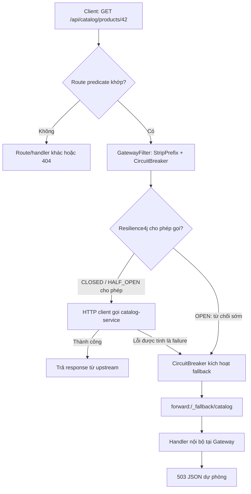
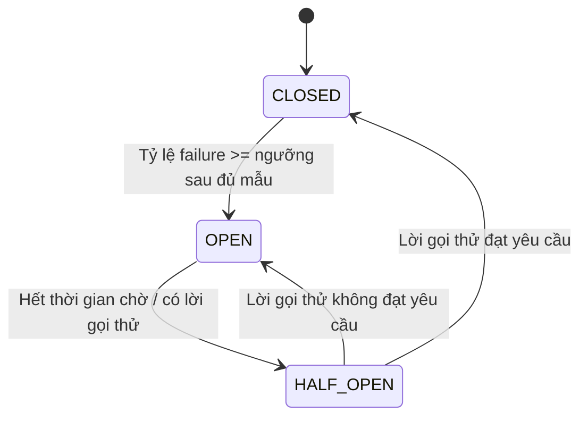

# fallbackUri và endpoint dự phòng nội bộ

## 1. Bài toán: dịch vụ lỗi nhưng Gateway vẫn cần phản hồi có kiểm soát

**Spring Cloud Gateway** là điểm vào cho microservices: chọn route qua **predicate**, chạy **filter chain** để sửa đường dẫn/header, tìm service instance qua **service discovery**, áp dụng xác thực, giới hạn lưu lượng, retry, circuit breaker, TLS và quan sát request. Một tình huống thực tế là `catalog-service` quá tải, chậm hoặc ngừng hoạt động. Nếu mọi request vẫn chờ upstream, người dùng dễ gặp timeout dây chuyền, còn các tài nguyên ở Gateway có nguy cơ bị tiêu hao.

**Circuit breaker (ngắt mạch)** theo dõi lỗi và từ chối sớm một số lời gọi khi upstream có dấu hiệu không khỏe. **Fallback (dự phòng)** quyết định **Gateway phản hồi thế nào** khi lời gọi bị lỗi hoặc ngắt mạch mở. Trong bài này, fallback được xử lý bởi **endpoint ngay bên trong ứng dụng Gateway**, sử dụng `fallbackUri: forward:/...`.

Ví dụ:

```text
GET /api/catalog/products/42
      │
      ▼
Gateway route catalog → catalog-service :8081
      │
      ├─ upstream khỏe  → 200 JSON sản phẩm
      │
      └─ upstream lỗi / breaker OPEN
                 → forward:/_fallback/catalog
                 → 503 JSON có kiểm soát
```

Sau bài thuộc chương **Ngắt mạch và dự phòng**, bạn sẽ:

1. Hiểu `fallbackUri` là **đích forward nội bộ**, không phải URL HTTP tùy ý.
2. Cấu hình `CircuitBreaker` GatewayFilter với Resilience4j bằng YAML và Java DSL.
3. Tạo **WebFlux controller** trong chính Gateway để trả `503 Service Unavailable` mà không gọi backend.
4. Phân biệt **lỗi kết nối/timeout**, **HTTP 5xx**, `statusCodes` và trạng thái CLOSED/OPEN/HALF_OPEN.
5. Kiểm thử backend khỏe, lỗi, ngắt mạch mở, thiếu endpoint fallback, các status 404/401 và request không khớp route.
6. Tránh những lỗi thiết kế như trả 200 giả cho nghiệp vụ nhạy cảm, lộ stack trace, loop route hoặc retry vô hạn.

> **Phạm vi:** Ví dụ chính dùng **Spring Cloud Gateway Server WebFlux 5.0.x** với namespace `spring.cloud.gateway.server.webflux`, Java 17+ và Spring Boot/Spring Cloud BOM tương thích. **Server Web MVC** có filter cùng tên nhưng Java DSL/Servlet API khác (mục 12). Không dùng các ví dụ Hystrix/Ribbon cũ cho dự án mới.

## 2. CircuitBreaker, fallbackUri và forward: là ba khái niệm khác nhau

### 2.1. Một request đi qua các thành phần nào?



Sơ đồ **rút gọn**: cấu hình cụ thể quyết định lỗi nào được coi là failure. Không phải mọi HTTP 4xx/5xx đều tự kích hoạt fallback. Ngoài ra, Spring Security, rate limiter hoặc filter khác có thể **trả response sớm**, trước khi downstream/circuit breaker được thực thi.

### 2.2. Vai trò của từng phần

| Thành phần | Trả lời câu hỏi | Ví dụ |
|---|---|---|
| **Route URI** | Khi khỏe, Gateway gọi dịch vụ nào? | `http://localhost:8081` hoặc `lb://catalog-service` |
| **CircuitBreaker GatewayFilter** | Khi nào cho phép/từ chối lời gọi? | `name: catalogBreaker` |
| **Resilience4j configuration** | Bao nhiêu lỗi thì OPEN, sau bao lâu thử lại? | `failureRateThreshold`, `minimumNumberOfCalls` |
| **`fallbackUri`** | Khi rơi vào fallback, forward đến handler nào? | `forward:/_fallback/catalog` |
| **Fallback handler** | Client nhận HTTP status, headers và body gì? | `503` với JSON thông báo tạm thời |

**Tách bạch:** circuit breaker kiểm soát **quyết định gọi upstream**, còn fallback kiểm soát **phản hồi khi có lỗi**. Một breaker có thể có fallback hoặc không; một fallback có thể trả dữ liệu từ cache, thông báo degraded mode hoặc status lỗi rõ ràng tùy hợp đồng API.

### 2.3. Vì sao chỉ dùng URI có scheme forward:?

Theo tài liệu Spring Cloud Gateway, tham số `fallbackUri` của `CircuitBreaker` hiện chỉ hỗ trợ **scheme `forward:`**. Với:

```yaml
fallbackUri: forward:/_fallback/catalog
```

Gateway **không mở kết nối TCP mới** tới `_fallback` như một server ngoài. Nó chuyển xử lý tới **controller/handler được đăng ký trong chính ứng dụng Gateway** tương ứng với path `/_fallback/catalog`.

Những lựa chọn dưới đây **không tương đương**:

| Giá trị | Có dùng làm `fallbackUri` trực tiếp? | Lý do |
|---|---|---|
| `forward:/_fallback/catalog` | **Có** | Forward tới local handler hoặc tiếp tục routing nội bộ |
| `http://localhost:9999/fallback` | **Không phải scheme được hỗ trợ** | Muốn external fallback cần route trung gian riêng |
| `lb://fallback-service` | **Không phải scheme được hỗ trợ** | `lb://` là cơ chế chọn upstream cho **route**, không phải fallbackUri trực tiếp |
| `redirect:/fallback` | **Không** | Redirect client không phải internal forward của CircuitBreaker |
| `/_fallback/catalog` | **Không nên dùng thiếu scheme** | Hãy khai báo rõ `forward:` |

**Forward không phải redirect:** browser vẫn đang gọi `/api/catalog/products/42`, không bắt buộc nhận HTTP 302/307 và không cần phát một request mới tới `/_fallback/catalog`. Vì vậy, endpoint fallback phải có mapping đúng trong Gateway.

## 3. Chuẩn bị ứng dụng và dependency

Sử dụng hai ứng dụng Spring Boot độc lập:

| Ứng dụng | Cổng | Stack | Vai trò |
|---|---:|---|---|
| `gateway-demo` | 8080 | Spring Cloud Gateway Server WebFlux | Route, circuit breaker và fallback controller nội bộ |
| `catalog-demo` | 8081 | Spring Boot Web MVC | Backend trả thành công hoặc lỗi giả lập |

Trong `pom.xml` của **gateway-demo**, ngoài Spring Cloud BOM tương thích, cần:

```xml
<dependencies>
    <dependency>
        <groupId>org.springframework.cloud</groupId>
        <artifactId>spring-cloud-starter-gateway-server-webflux</artifactId>
    </dependency>
    <dependency>
        <groupId>org.springframework.cloud</groupId>
        <artifactId>spring-cloud-starter-circuitbreaker-reactor-resilience4j</artifactId>
    </dependency>
</dependencies>
```

Dependency thứ hai rất quan trọng: nó cung cấp **Spring Cloud CircuitBreaker reactive** dựa trên Resilience4j. Chỉ viết `- name: CircuitBreaker` trong YAML khi thiếu starter có thể khiến Gateway không tìm được factory/implementation phù hợp lúc startup.

Đối với **catalog-demo** dùng Spring Boot 4.x, có thể dùng starter:

```xml
<dependency>
    <groupId>org.springframework.boot</groupId>
    <artifactId>spring-boot-starter-webmvc</artifactId>
</dependency>
```

Nếu đang dùng Spring Boot 3.x, starter Servlet phổ biến là `spring-boot-starter-web`. Trong lab, backend chạy Servlet còn Gateway chạy **WebFlux**; không đưa Servlet starter vào **ứng dụng Gateway WebFlux** để tránh lẫn runtime.

## 4. Cấu hình Gateway WebFlux với fallbackUri nội bộ

### 4.1. File application.yml đầy đủ

Trong **gateway-demo**, tạo `src/main/resources/application.yml`:

```yaml
server:
  port: 8080

spring:
  application:
    name: gateway-demo
  cloud:
    gateway:
      server:
        webflux:
          routes:
            - id: catalog-protected
              uri: http://localhost:8081
              predicates:
                - Path=/api/catalog/**
                - Method=GET
              filters:
                - StripPrefix=2
                - name: CircuitBreaker
                  args:
                    name: catalogBreaker
                    fallbackUri: forward:/_fallback/catalog
                    statusCodes:
                      - 500
                      - 502
                      - 503
                      - 504

# Cấu hình instance Resilience4j có tên trùng tên breaker trong route.
resilience4j:
  circuitbreaker:
    instances:
      catalogBreaker:
        slidingWindowType: COUNT_BASED
        slidingWindowSize: 4
        minimumNumberOfCalls: 4
        failureRateThreshold: 50
        waitDurationInOpenState: 10s
        permittedNumberOfCallsInHalfOpenState: 2
```

**Đọc cấu hình từng lớp:**

1. `Path=/api/catalog/**` và `Method=GET` chọn request cần proxy.
2. `StripPrefix=2` biến `/api/catalog/products/42` thành `/products/42` trước khi gọi backend.
3. `CircuitBreaker` lấy tên instance `catalogBreaker`; cùng tên phải xuất hiện trong `resilience4j.circuitbreaker.instances`.
4. `fallbackUri: forward:/_fallback/catalog` chuyển sang local controller nếu cần fallback; **không có route HTTP mới đến chính Gateway**.
5. `statusCodes` yêu cầu các upstream HTTP status 500/502/503/504 được tính như failure để CircuitBreaker xử lý; **không** liệt kê 404/401/403 như lỗi hạ tầng mặc định.
6. Resilience4j đánh giá tỷ lệ thất bại trên cửa sổ bốn lời gọi; cần **ít nhất bốn** kết quả được ghi nhận mới xét ngưỡng 50%. Khi OPEN, breaker từ chối một số lời gọi mới trước khi thử backend.

Các ngưỡng `4 calls`, `50%` và `10s` dùng **để quan sát nhanh trong lab**. Với production phải đo theo QPS, SLA, failure rate, latency, mức tải và chính sách thử lại; không lấy cấu hình này làm chuẩn chung.

### 4.2. Nếu bỏ statusCodes thì sao?

**Lỗi kết nối** như connection refused, DNS failure hoặc timeout thường đi qua pipeline dưới dạng **exception** và có thể kích hoạt fallback khi breaker bao quanh lời gọi. Trái lại, nhiều HTTP response 5xx là **response đã được upstream trả về**; không phải exception tự động. Để chắc chắn 503 của backend làm breaker ghi nhận lỗi và chuyển fallback, bài lab khai báo `statusCodes` tường minh.

Một HTTP **404 Not Found** có thể là dữ liệu nghiệp vụ đúng: sản phẩm không tồn tại. Không đánh dấu mọi 404 là failure nếu không có yêu cầu đặc biệt, vì có thể làm breaker OPEN dù backend đang hoạt động bình thường.

## 5. Endpoint dự phòng nội bộ: controller nằm trong Gateway

### 5.1. Tạo REST controller ngay tại gateway-demo

Trong **ứng dụng Gateway Server WebFlux**, tạo class `CatalogFallbackController.java`:

```java
package com.example.gateway;

import java.util.Map;
import org.slf4j.Logger;
import org.slf4j.LoggerFactory;
import org.springframework.cloud.gateway.support.ServerWebExchangeUtils;
import org.springframework.http.CacheControl;
import org.springframework.http.HttpStatus;
import org.springframework.http.ResponseEntity;
import org.springframework.web.bind.annotation.GetMapping;
import org.springframework.web.bind.annotation.RestController;
import org.springframework.web.server.ServerWebExchange;

@RestController
public class CatalogFallbackController {

    private static final Logger log =
        LoggerFactory.getLogger(CatalogFallbackController.class);

    @GetMapping("/_fallback/catalog")
    public ResponseEntity<Map<String, String>> catalogUnavailable(
            ServerWebExchange exchange) {

        Throwable failure = exchange.getAttribute(
            ServerWebExchangeUtils.CIRCUITBREAKER_EXECUTION_EXCEPTION_ATTR);

        // Chỉ ghi loại lỗi tối thiểu, KHÔNG xuất message/stack trace ra client.
        if (failure != null) {
            log.warn("Catalog fallback triggered, causeType={}",
                failure.getClass().getSimpleName());
        } else {
            log.warn("Catalog fallback endpoint was called without breaker error");
        }

        return ResponseEntity
            .status(HttpStatus.SERVICE_UNAVAILABLE)
            .header("X-Gateway-Fallback", "catalog")
            .cacheControl(CacheControl.noStore())
            .body(Map.of(
                "code", "CATALOG_TEMPORARILY_UNAVAILABLE",
                "message", "Dịch vụ sản phẩm đang tạm gián đoạn",
                "service", "catalog"));
    }
}
```

Đặt class này **trong package được Spring Boot component-scan**. Với một main class:

```java
package com.example.gateway;

import org.springframework.boot.SpringApplication;
import org.springframework.boot.autoconfigure.SpringBootApplication;

@SpringBootApplication
public class GatewayApplication {
    public static void main(String[] args) {
        SpringApplication.run(GatewayApplication.class, args);
    }
}
```

Hai class cùng package `com.example.gateway` sẽ được quét và tạo handler mapping. Không cần (và không nên) đặt một route `uri: http://localhost:8080` chỉ để proxy tới endpoint này. Khi `fallbackUri: forward:/_fallback/catalog` được kích hoạt, **forward đi đến handler local**, không gọi thêm một TCP connection về chính Gateway.

### 5.2. Vì sao chọn status 503 thay vì luôn trả 200?

Fallback nghĩa là **kết quả thay thế**, không tự có nghĩa **xử lý nghiệp vụ đã thành công**:

| Tình huống | Gợi ý phản hồi | Lý do |
|---|---|---|
| Không đọc được catalog và không có dữ liệu chính xác | **503** cùng JSON thông báo | Trung thực về tình trạng service |
| Có cache public hợp lệ, đủ mới và hợp đồng chấp nhận degraded mode | Có thể **200** kèm metadata như `degraded: true` | Client biết đó là dữ liệu dự phòng có giới hạn |
| Thao tác thanh toán/đặt đơn chưa biết đã thực hiện hay chưa | **Không tự trả 200 giả** | Tránh báo thành công khi kết quả không chắc chắn |
| Resource không tồn tại nhưng upstream khỏe | **404** bình thường | Không chuyển thành sự cố hạ tầng |
| User không có quyền | **401/403** từ Security | Không che lỗi xác thực/phân quyền bằng dữ liệu dự phòng |

Trong lab này, response **503** là lựa chọn đơn giản và có thể kiểm chứng. Header `Cache-Control: no-store` giúp giảm nguy cơ cache một thông báo lỗi tạm thời như dữ liệu thành công. Header `X-Gateway-Fallback` là dấu vết chẩn đoán; nếu frontend chạy cross-origin và muốn đọc header này trong JavaScript, cần cấu hình **CORS `exposedHeaders`** tương ứng.

### 5.3. Lấy nguyên nhân từ ServerWebExchange như thế nào?

Khi Gateway chuyển tới fallback do circuit breaker, nó có thể ghi `Throwable` vào exchange attribute:

```java
Throwable failure = exchange.getAttribute(
    ServerWebExchangeUtils.CIRCUITBREAKER_EXECUTION_EXCEPTION_ATTR);
```

Điểm quan trọng:

- Đây là **attribute nội bộ của Gateway**, không phải `Exception` do client gửi trong header.
- Có thể không có attribute nếu ai đó **gọi thẳng** `/_fallback/catalog` hoặc luồng chuyển tiếp không xuất phát từ breaker.
- Với một số trạng thái, nguyên nhân có thể là lỗi kết nối, timeout, exception liên quan HTTP status hoặc `CallNotPermittedException` khi breaker OPEN; **đừng viết business logic phụ thuộc chặt vào tên class exception**.
- Chỉ dùng nguyên nhân cho **log/metrics nội bộ đã giảm dữ liệu**, không gửi `failure.getMessage()` hoặc stack trace cho client; message đôi khi chứa URL, hostname hay dữ liệu nhạy cảm.

Endpoint fallback nên **ít phụ thuộc**: không gọi lại `catalog-service` đang lỗi, không block event loop của WebFlux, không thực hiện I/O nặng, không tạo vòng retry/forward.

### 5.4. Không biến path fallback thành cửa hậu bảo mật

`/_fallback/catalog` vẫn là một endpoint HTTP nếu client có thể gọi trực tiếp. Chính sách Spring Security/WebFilter ở Gateway cần kiểm soát nó thích hợp; không mở `permitAll("/_fallback/**")` rộng rãi chỉ vì “đây là fallback”. Handler demo không trả dữ liệu bí mật, nhưng hệ thống thực có thể có response theo tenant/user.

**Không tin** một header tự khai như `X-Is-Fallback: true` để bỏ authentication. Chỉ căn cứ vào SecurityContext và thuộc tính nội bộ từ breaker theo mô hình đã kiểm chứng. Nếu có dữ liệu phụ thuộc user, xác thực/phân quyền phải nhất quán trên cả request bình thường và fallback.

## 6. Backend mô phỏng thành công, lỗi 503 và 404

Trong ứng dụng **catalog-demo** chạy Spring Boot Web MVC, tạo controller có hai chế độ:

```java
package com.example.catalog;

import java.util.Map;
import java.util.concurrent.atomic.AtomicLong;
import org.springframework.boot.SpringApplication;
import org.springframework.boot.autoconfigure.SpringBootApplication;
import org.springframework.http.HttpStatus;
import org.springframework.http.ResponseEntity;
import org.springframework.web.bind.annotation.GetMapping;
import org.springframework.web.bind.annotation.PathVariable;
import org.springframework.web.bind.annotation.RequestParam;
import org.springframework.web.bind.annotation.RestController;

@SpringBootApplication
@RestController
public class CatalogApplication {

    private final AtomicLong requests = new AtomicLong();

    public static void main(String[] args) {
        SpringApplication.run(CatalogApplication.class, args);
    }

    @GetMapping("/products/{id}")
    public ResponseEntity<Map<String, String>> getProduct(
            @PathVariable String id,
            @RequestParam(name = "mode", defaultValue = "ok") String mode) {

        long callNumber = requests.incrementAndGet();

        if ("fail".equals(mode)) {
            return ResponseEntity.status(HttpStatus.SERVICE_UNAVAILABLE)
                .body(Map.of(
                    "error", "UPSTREAM_UNAVAILABLE",
                    "backendCall", Long.toString(callNumber)));
        }

        if (!"42".equals(id)) {
            return ResponseEntity.notFound().build();
        }

        return ResponseEntity.ok(Map.of(
            "id", id,
            "name", "Tai nghe không dây",
            "backendCall", Long.toString(callNumber)));
    }
}
```

Đặt file cấu hình của **backend**:

```yaml
server:
  port: 8081
spring:
  application:
    name: catalog-demo
```

Cách thử trực tiếp backend:

```bash
# Khỏe: 200
curl -i 'http://localhost:8081/products/42'

# Giả lập lỗi hạ tầng bằng HTTP 503
curl -i 'http://localhost:8081/products/42?mode=fail'

# Không tìm thấy sản phẩm: 404
curl -i 'http://localhost:8081/products/99'
```

Giá trị `backendCall` tăng mỗi khi request **thực sự đến backend**. Đây là chỉ dấu thuận tiện để phân biệt request bị CircuitBreaker từ chối sớm khi OPEN. Trong hệ thống production, dùng metrics/access log ở backend thay cho một counter chỉ tồn tại trong RAM của demo.

**Phạm vi thử nghiệm:** không có database, không ghi dữ liệu và không cần login. Cố ý chỉ dùng **GET** để dễ mô phỏng failure mà không tạo nguy cơ replay thao tác thay đổi trạng thái.

## 7. Kiểm thử đường bình thường và đường fallback

### 7.1. Khi backend khỏe

Khởi động backend ở `8081`, sau đó Gateway ở `8080`. Gọi:

```bash
curl -i 'http://localhost:8080/api/catalog/products/42'
```

Khi route khớp và breaker cho phép, kết quả dự kiến:

```http
HTTP/1.1 200 OK
Content-Type: application/json

{"id":"42","name":"Tai nghe không dây","backendCall":"1"}
```

**Giải thích:** route `catalog-protected` match, `StripPrefix=2` làm backend nhận `/products/42`, upstream thành công nên **không forward** tới `/_fallback/catalog`. Không có header `X-Gateway-Fallback`.

### 7.2. Khi backend trả HTTP 503

```bash
curl -i 'http://localhost:8080/api/catalog/products/42?mode=fail'
```

Với `statusCodes` đã cấu hình chứa 503, response **dự kiến** từ fallback controller:

```http
HTTP/1.1 503 Service Unavailable
Content-Type: application/json
X-Gateway-Fallback: catalog
Cache-Control: no-store

{"code":"CATALOG_TEMPORARILY_UNAVAILABLE",
 "message":"Dịch vụ sản phẩm đang tạm gián đoạn",
 "service":"catalog"}
```

Đó là **dữ liệu có kiểm soát từ Gateway**, không phải JSON lỗi `UPSTREAM_UNAVAILABLE` do backend tạo. Status 503 ở phía client là do **fallback controller chủ động trả**, không phải bắt buộc giữ status 503 gốc. Trong từng sản phẩm, hãy quyết định có cần trả status gốc, nội dung cache hay format lỗi dùng chung.

### 7.3. Quan sát circuit OPEN sau nhiều lời gọi lỗi

Ở cấu hình lab, Resilience4j cần ít nhất **bốn** lời gọi được ghi nhận trước khi đánh giá failure rate. Để quan sát nhanh, **khởi động lại Gateway hoặc đặt lại trạng thái breaker qua cơ chế quản trị được kiểm soát** khi bắt đầu test, rồi:

```bash
# Gửi nhanh các request lỗi trong thời gian chưa hết thời gian OPEN.
for i in 1 2 3 4 5 6; do
  echo "request $i"
  curl -sS -o /dev/null -w 'HTTP %{http_code}\n' \
    'http://localhost:8080/api/catalog/products/42?mode=fail'
done
```

**Kỳ vọng tổng quát**:

1. Những request đầu đủ điều kiện được phép gọi backend, backend trả 503 và fallback cũng trả 503.
2. Khi đủ số mẫu và tỷ lệ lỗi ≥ 50%, breaker có thể chuyển **CLOSED → OPEN**.
3. Trong OPEN, request mới bị từ chối **trước khi đến backend** và được xử lý bằng fallback; client vẫn thấy 503, nhưng **backendCall không tăng** ở những request bị chặn.
4. Sau `waitDurationInOpenState: 10s`, các lời gọi thử ở **HALF_OPEN** có thể được cho phép; kết quả thử quyết định quay về CLOSED hay OPEN.

**Không chỉ nhìn mã 503 để kết luận breaker OPEN**: cả lỗi upstream và fallback lúc OPEN đều có thể sinh cùng HTTP status. Cần kết hợp **metric/trạng thái Resilience4j** hoặc backend access log để biết request có đến upstream hay không. Số lần gọi cần thiết phụ thuộc kết quả đã ghi nhận, cấu hình/phiên bản và trạng thái ban đầu.

### 7.4. Khi sản phẩm không tồn tại

```bash
curl -i 'http://localhost:8080/api/catalog/products/99'
```

Nếu breaker chưa OPEN và backend trả **404 không body**, route ở mục 4 **không** cấu hình 404 trong `statusCodes`, nên response 404 của upstream được gửi về client mà **không kích hoạt fallback**. Đây là điều mong muốn cho lỗi “không tìm thấy sản phẩm”. Nếu breaker đã OPEN từ trước, request này có thể bị chặn sớm mà không đến backend — phải phân biệt hai trạng thái.

### 7.5. Khi backend ngừng chạy

Dừng **catalog-demo** rồi gọi route một lần:

```bash
curl -i 'http://localhost:8080/api/catalog/products/42'
```

Gateway HTTP client gặp lỗi kết nối (ví dụ connection refused), CircuitBreaker có thể kích hoạt fallback controller và trả `503`. Nếu response không như dự kiến, kiểm tra route, dependency Resilience4j, các filter/timeout và handler mapping. Nếu **Gateway cũng đã dừng**, client sẽ không nhận được fallback: **fallback nội bộ phụ thuộc vào chính Gateway đang hoạt động**.

> Các đoạn `curl`, JSON và trạng thái là **kết quả dự kiến dùng để tự thực hành**, không phải thông báo rằng dự án đã được xây dựng/chạy trong bước viết bài.

## 8. Khai báo CircuitBreaker và fallback bằng Java RouteLocatorBuilder

Nếu ứng dụng sử dụng Java DSL, có thể thay **route YAML** ở mục 4 bằng bean `RouteLocator`:

```java
package com.example.gateway;

import org.springframework.cloud.gateway.route.RouteLocator;
import org.springframework.cloud.gateway.route.builder.RouteLocatorBuilder;
import org.springframework.context.annotation.Bean;
import org.springframework.context.annotation.Configuration;
import org.springframework.http.HttpMethod;

@Configuration
public class CatalogRouteConfig {

    @Bean
    public RouteLocator catalogRoutes(RouteLocatorBuilder builder) {
        return builder.routes()
            .route("catalog-protected", r -> r
                .path("/api/catalog/**")
                .and()
                .method(HttpMethod.GET)
                .filters(f -> f
                    .stripPrefix(2)
                    .circuitBreaker(config -> config
                        .name("catalogBreaker")
                        .fallbackUri("forward:/_fallback/catalog")
                        .addStatusCode("INTERNAL_SERVER_ERROR")
                        .addStatusCode("BAD_GATEWAY")
                        .addStatusCode("SERVICE_UNAVAILABLE")
                        .addStatusCode("GATEWAY_TIMEOUT")))
                .uri("http://localhost:8081"))
            .build();
    }
}
```

**Đây là cách khai báo thay thế**: không đồng thời định nghĩa route `catalog-protected` bằng cả Java và YAML trong một bài lab. Tên `catalogBreaker` vẫn được cấu hình Resilience4j bằng `resilience4j.circuitbreaker.instances.catalogBreaker`. Controller `/_fallback/catalog` từ mục 5 **được giữ nguyên**.

| YAML | Java DSL | Ý nghĩa |
|---|---|---|
| `name: CircuitBreaker` | `.circuitBreaker(...)` | Gắn GatewayFilter |
| `args.name: catalogBreaker` | `.name("catalogBreaker")` | Chọn breaker instance |
| `fallbackUri: forward:/_fallback/catalog` | `.fallbackUri("forward:/_fallback/catalog")` | Chuyển tới local handler |
| `statusCodes: [500,502,503,504]` | Bốn lần `.addStatusCode(...)` | Xem các status này như lỗi cần ngắt mạch |
| `StripPrefix=2` | `.stripPrefix(2)` | Bỏ hai segment đầu của request path |

Java DSL thuận tiện khi cần đặt route theo điều kiện mã nguồn, nhưng **không biến fallback thành Java callback bắt mọi exception**. `fallbackUri` vẫn yêu cầu URI forward tới handler được đăng ký. Trong ứng dụng lớn, cấu hình route nên thống nhất với nguồn route thực tế (YAML, Java, discovery) để không tạo route chồng lấn.

## 9. fallbackUri có thể dùng biến đường dẫn không?

### 9.1. Truyền ID sản phẩm tới fallback controller

Trong bài lab, fallback cố ý trả cùng một thông báo cho mọi sản phẩm. Nhưng đôi khi API fallback cần biết **ID của tài nguyên** để trả một bản tóm tắt an toàn. `CircuitBreaker` hỗ trợ biến URL trong `fallbackUri` lấy từ `Path` predicate.

Ví dụ **độc lập**, dành cho route chỉ match đường dẫn có một `id`:

```yaml
spring:
  cloud:
    gateway:
      server:
        webflux:
          routes:
            - id: product-with-path-variable
              uri: http://localhost:8081
              predicates:
                - Path=/api/catalog/products/{id}
                - Method=GET
              filters:
                - StripPrefix=2
                - name: CircuitBreaker
                  args:
                    name: catalogByIdBreaker
                    fallbackUri: forward:/_fallback/products/{id}
                    statusCodes:
                      - 503
```

Tạo controller fallback **trong Gateway** tương ứng:

```java
@GetMapping("/_fallback/products/{id}")
public ResponseEntity<Map<String, String>> productFallback(
        @PathVariable String id) {
    return ResponseEntity.status(HttpStatus.SERVICE_UNAVAILABLE)
        .cacheControl(CacheControl.noStore())
        .body(Map.of(
            "code", "PRODUCT_TEMPORARILY_UNAVAILABLE",
            "productId", id));
}
```

Đoạn method trên đặt **trong `CatalogFallbackController`** (thêm import `PathVariable`) cùng `ResponseEntity`, `CacheControl`, `Map` đã dùng ở mục 5. Không dán nó như một class Java độc lập.

Khi client gọi `/api/catalog/products/42`, fallback có thể đến `/_fallback/products/42` nếu route match và circuit kích hoạt. **Chỉ đặt những biến path được phép vào response**, sau khi xác thực/phân quyền và kiểm tra định dạng. Không đưa nguyên một đường dẫn tùy ý, tên file hay upstream URL do client kiểm soát vào `forward:`; dữ liệu động phải được giới hạn để tránh đường forward tới endpoint nội bộ khác.

### 9.2. Một handler fallback cần khớp HTTP method

Forward không tự chuyển một request `POST` thành `GET`. Trong bài, route chỉ nhận **GET**, nên `@GetMapping` phù hợp. Nếu chuyển phương thức khác, controller/handler fallback phải có mapping tương ứng và xử lý request body/method semantics có kiểm soát.

Đặc biệt, một request POST thanh toán hoặc ghi đơn hàng có thể đã **được backend xử lý trước khi kết nối timeout**. Nếu Gateway forward tới fallback rồi trả một response giả thành công hoặc tự retry, client có thể hiểu nhầm trạng thái thanh toán. Hãy ưu tiên **idempotency key**, xác minh trạng thái nghiệp vụ và trả lỗi rõ khi kết quả không chắc chắn.

## 10. Fallback nội bộ và fallback sang service khác không giống nhau

### 10.1. Thiết kế ưu tiên: controller nội bộ

```text
CircuitBreaker → forward:/_fallback/catalog
                           └─ @GetMapping("/_fallback/catalog")
                              trong cùng Gateway JVM
```

Ưu điểm: ít dependency, không mở kết nối mạng mới, dễ kiểm soát format và status. Hạn chế: không nên chứa nghiệp vụ hoặc cache lớn trong process Gateway; fallback **cũng không hoạt động** khi Gateway chết hoặc local handler lỗi.

### 10.2. Khi fallback cần đến một ứng dụng bên ngoài

Tài liệu Spring Gateway mô tả một mô hình **hai route**: `CircuitBreaker` trước hết forward đến path nội bộ, sau đó một **Gateway route riêng** match path ấy để gọi upstream fallback.

Ví dụ minh họa:

```yaml
# Thay thế route local ở mục 4; ứng dụng external chạy :9994.
spring:
  cloud:
    gateway:
      server:
        webflux:
          routes:
            - id: catalog-main
              uri: http://localhost:8081
              predicates:
                - Path=/api/catalog/**
              filters:
                - StripPrefix=2
                - name: CircuitBreaker
                  args:
                    name: catalogBreaker
                    fallbackUri: forward:/_fallback/external/catalog
                    statusCodes:
                      - 503

            - id: catalog-fallback-service
              uri: http://localhost:9994
              predicates:
                - Path=/_fallback/external/catalog
              filters:
                - SetPath=/fallback/catalog
                # FallbackHeaders chỉ dùng khi thực sự cần
                # chuyển metadata exception cho fallback service.
```

Ở mô hình này **không tạo `@GetMapping("/_fallback/external/catalog")`** trong Gateway để tránh handler local bắt request trước route fallback. `forward:` chuyển tới route mapping nội bộ, còn **route thứ hai** mới mở kết nối tới `http://localhost:9994`.

Nếu fallback service cần biết lỗi ban đầu, có thể gắn `FallbackHeaders` vào **route fallback thứ hai**:

```yaml
# Thêm vào filters của route catalog-fallback-service, không phải route chính.
- name: FallbackHeaders
  args:
    executionExceptionTypeHeaderName: X-Fallback-Error-Type
```

`FallbackHeaders` có thể chuyển thông tin loại lỗi/message/root cause vào **request headers** tới fallback service. Những thông tin này có thể lộ hostname hoặc dữ liệu nội bộ; **chỉ dùng giữa các service đã được tin cậy**, giới hạn network access và hạn chế/loại bỏ message khi không cần. **Không trả lại các header exception thô cho browser**.

### 10.3. So sánh hai cách

| Tiêu chí | Fallback controller nội bộ | Fallback service bên ngoài |
|---|---|---|
| `fallbackUri` | `forward:/_fallback/catalog` | Vẫn là `forward:/_fallback/external/catalog` |
| Ai nhận forward? | `@GetMapping` trong Gateway | Một Gateway route khác |
| Kết nối mạng mới đến fallback? | **Không** | **Có**, route thứ hai proxy ra ngoài |
| Độ phức tạp | Thấp | Cao hơn: route, DNS, TLS, timeout, bảo mật |
| Rủi ro | Local handler lỗi/logic quá nặng | Fallback service cũng có thể lỗi, loop hoặc chậm |
| Dùng khi | Message đơn giản, fallback tĩnh/nhẹ | Có một nguồn dữ liệu dự phòng riêng đáng tin |

Trong cả hai mô hình, hãy giữ fallback **đơn giản, không đệ quy**, có timeout hữu hạn và không gửi bearer token hoặc cookie đến service dự phòng không nằm trong trust boundary.

## 11. Trạng thái breaker và kết hợp timeout, retry

### 11.1. CLOSED, OPEN và HALF_OPEN



| Trạng thái | Gateway có gọi backend không? | Điều gì xảy ra? |
|---|---|---|
| **CLOSED** | Có | Theo dõi kết quả; đủ lỗi có thể chuyển OPEN |
| **OPEN** | Không cho phép các call được bảo vệ | Từ chối nhanh, có thể chạy fallback |
| **HALF_OPEN** | Chỉ cho một số call thử | Kiểm tra service đã hồi phục chưa |

Resilience4j có các trạng thái đặc biệt khác như DISABLED/FORCED_OPEN trong API quản trị; **không** cần cho bài lab cơ bản. Sau `waitDurationInOpenState`, thời điểm chuyển sang HALF_OPEN phụ thuộc `automaticTransitionFromOpenToHalfOpenEnabled` và lưu lượng thử theo cấu hình; không giả định timer luôn tự chuyển trong mọi setup.

### 11.2. Timeout là nguồn failure, không phải fallbackUri

`fallbackUri` **không đặt deadline** cho backend. Bạn có thể cấu hình riêng Gateway HTTP client:

```yaml
# Thuộc tính outbound HTTP client của Gateway Server WebFlux 5.0.x.
spring:
  cloud:
    gateway:
      server:
        webflux:
          httpclient:
            connect-timeout: 2000
            response-timeout: 4s
```

`connect-timeout` giới hạn thời gian **tạo kết nối TCP** (mili-giây), còn `response-timeout` là Duration chờ phản hồi theo cơ chế HTTP client. Bên cạnh đó, Spring Cloud CircuitBreaker + Resilience4j có thể tích hợp **TimeLimiter** với cấu hình riêng:

```yaml
# Ví dụ tuỳ chọn: chỉ dùng khi đã kiểm tra TimeLimiter của bản đang chạy.
resilience4j:
  timelimiter:
    instances:
      catalogBreaker:
        timeoutDuration: 3s
```

**Không nhầm** ba thứ: connect timeout, response timeout và TimeLimiter. Bên nào hết hạn trước có thể quyết định nguyên nhân lỗi mà fallback nhận. Client/ingress cũng có timeout riêng; nếu client đã ngắt kết nối, một fallback tạo muộn không chắc còn được nhận.

### 11.3. Retry trước hay sau CircuitBreaker?

Khi gắn thêm `Retry` filter, thứ tự `Ordered` và cách đặt filter có thể thay đổi **bao nhiêu lần backend bị gọi trước khi một failure được ghi nhận**. Hai ví dụ khái niệm:

- Retry **bên trong** phần được CircuitBreaker bảo vệ: một logical request có thể gây nhiều HTTP attempts rồi mới tính kết quả cuối.
- Retry **bên ngoài** CircuitBreaker: mỗi lần retry có thể gặp breaker đang OPEN và được từ chối nhanh hoặc sinh fallback.

Kết quả thực tế phụ thuộc filter chain và cấu hình của bản Gateway; cần xác minh bằng backend request count, log/trace và metrics. **Không tự kết hợp retry vô hạn với circuit breaker**: một downstream lỗi có thể bị dồn quá nhiều request khi nhiều client đồng thời retry. Ưu tiên bounded retries, backoff/jitter, timeout budget và chỉ retry hoạt động idempotent.

## 12. Gateway Server Web MVC: nguyên tắc giống, API khác

**Gateway Server Web MVC 5.0.x** cũng có `CircuitBreaker` và `fallbackUri` dạng `forward:`, nhưng runtime dựa trên **Servlet/WebMvc.fn**. Không dùng `GlobalFilter`, `ServerWebExchange` hoặc `RouteLocatorBuilder` của WebFlux cho MVC.

Ví dụ **độc lập** với một ứng dụng Gateway Server Web MVC:

```yaml
spring:
  cloud:
    gateway:
      server:
        webmvc:
          routes:
            - id: catalog-mvc
              uri: http://localhost:8081
              predicates:
                - Path=/products/**
              filters:
                - name: CircuitBreaker
                  args:
                    name: catalogMvcBreaker
                    fallbackUri: forward:/_fallback/catalog
```

Trong Java RouterFunction DSL của **MVC**, có thể sử dụng:

```java
import java.net.URI;
import org.springframework.context.annotation.Bean;
import org.springframework.context.annotation.Configuration;
import org.springframework.web.servlet.function.RouterFunction;
import org.springframework.web.servlet.function.ServerResponse;

import static org.springframework.cloud.gateway.server.mvc.filter.BeforeFilterFunctions.uri;
import static org.springframework.cloud.gateway.server.mvc.filter.CircuitBreakerFilterFunctions.circuitBreaker;
import static org.springframework.cloud.gateway.server.mvc.handler.GatewayRouterFunctions.route;
import static org.springframework.cloud.gateway.server.mvc.handler.HandlerFunctions.http;

@Configuration
public class MvcGatewayRoutes {

    @Bean
    RouterFunction<ServerResponse> catalogMvc() {
        return route("catalog-mvc")
            .GET("/products/{id}", http())
            .before(uri("http://localhost:8081"))
            .filter(circuitBreaker(
                "catalogMvcBreaker",
                URI.create("forward:/_fallback/catalog")))
            .build();
    }
}
```

**Cách này thay thế route YAML MVC**, không đăng ký đồng thời cả hai dưới cùng ID. Local fallback cho MVC có thể là một Servlet `@RestController` xử lý `GET /_fallback/catalog`. Nếu cần đọc nguyên nhân, MVC có attribute `MvcUtils.CIRCUITBREAKER_EXECUTION_EXCEPTION_ATTR` trong ngữ cảnh `ServerRequest`/Servlet; **không** dùng `ServerWebExchangeUtils` của WebFlux.

Trên MVC và WebFlux đều cần dependency circuit breaker phù hợp, nhưng reactive starter `spring-cloud-starter-circuitbreaker-reactor-resilience4j` **không phải lựa chọn mặc định cho Servlet stack**. Hãy đối chiếu starter và Spring Cloud BOM đúng biến thể, thay vì sao chép dependency giữa hai ứng dụng.

## 13. Bảo mật và tính đúng đắn của fallback

### 13.1. Fallback không phải cơ chế bỏ qua authorization

Một request có thể bị Spring Security từ chối **trước khi Gateway chọn route**. CircuitBreaker không tự biến 401/403 thành response dự phòng. Cần phân biệt:

- **401 Unauthorized:** chưa có/mất thông tin xác thực hợp lệ.
- **403 Forbidden:** đã xác thực nhưng không được quyền truy cập.
- **404 Not Found:** không có route/tài nguyên phù hợp.
- **429 Too Many Requests:** rate limiter từ chối.
- **503 Service Unavailable:** fallback trong ví dụ báo catalog tạm thời không sẵn sàng.

**Không dùng fallback để che 401/403 bằng 200**, và không đặt `statusCodes: [401,403]` một cách vô tình. Với API đa tenant, dữ liệu từ cache dự phòng vẫn phải gắn với đúng user/tenant và quyền truy cập; dữ liệu “stale” không có nghĩa được phép lộ.

### 13.2. Nguy cơ lộ chi tiết exception

Header hoặc JSON dạng:

```json
{
  "error": "java.net.ConnectException",
  "target": "http://payments-private.internal:8443",
  "stackTrace": "..."
}
```

**không thích hợp để gửi cho client**. Nó tiết lộ topology, tên service nội bộ và dấu vết thực thi. Nên trả error code ổn định như `CATALOG_TEMPORARILY_UNAVAILABLE`, request/trace ID đã được kiểm soát, HTTP 503 và thông điệp dành cho người dùng.

Raw exception chỉ nên được quan sát trong log nội bộ có kiểm soát, và ngay cả log cũng cần redact token, URL chứa query nhạy cảm hoặc user data. Với `FallbackHeaders`, giới hạn các header được gửi tới fallback service và không phản chiếu thẳng chúng về browser.

### 13.3. Không làm hỏng tính nhất quán nghiệp vụ

| API | Fallback an toàn hơn | Điều cần tránh |
|---|---|---|
| `GET /catalog/products` công khai | Trả 503 hoặc cache public hợp lệ có nhãn `stale` | Trả giá/tồn kho cũ như dữ liệu chắc chắn còn hiệu lực |
| `GET /account/balance` | Trả 503 nếu không có dữ liệu đúng và đủ quyền | Dùng cache chung giữa nhiều người dùng |
| `POST /orders` | Trả trạng thái không chắc chắn có mã tra cứu/idempotency key khi phù hợp | Tự trả 200 “đã đặt hàng” sau timeout |
| `POST /payments` | Tra cứu kết quả giao dịch bằng cơ chế an toàn; yêu cầu xác nhận | Retry không giới hạn hoặc tạo thanh toán trùng |
| `GET /feature-flags` | Có thể dùng giá trị default đã được phê duyệt | Trả mặc định làm thay đổi quyền truy cập bảo mật |

Một fallback nội bộ phải hoạt động được **ngay cả khi upstream không sẵn sàng**, nhưng không vì thế mà được phép bỏ qua nguyên tắc dữ liệu chính xác, audit, authorization hoặc consistency.

### 13.4. Tương tác với Header, TLS và service discovery

- **Header:** fallback controller tạo response mới; header `X-Gateway-Fallback` chỉ là thông tin chẩn đoán. Nếu CORS được bật, bảo đảm response lỗi cũng có CORS headers hợp lệ để frontend đọc lỗi.
- **TLS:** route `uri: https://catalog.internal.test` yêu cầu Gateway xác minh chứng chỉ phía backend. `forward:` nội bộ không phải TLS connection; đừng dùng điều đó để tuyên bố toàn bộ hệ thống không cần TLS.
- **Service discovery:** có thể dùng `uri: lb://catalog-service` khi LoadBalancer/DiscoveryClient đã cấu hình. Fallback vẫn là `forward:/_fallback/catalog`, không phụ thuộc service discovery nếu handler nằm trong Gateway.
- **Rate limiting:** request bị rate limiter chặn sớm có thể không tới breaker/fallback, tùy thứ tự filter. Không coi 429 là sự cố hạ tầng.
- **TokenRelay:** route có bearer token cần chắc chắn fallback không gửi token sang bên thứ ba không tin cậy; controller nội bộ không tự cần in token.

## 14. Quan sát và xử lý sự cố

### 14.1. Nên theo dõi những gì?

Một phản hồi fallback 503 có thể có nhiều nguyên nhân: DNS, TCP, TLS, response timeout, upstream 503 hoặc breaker OPEN. Chỉ nhìn một HTTP status là không đủ.

| Tín hiệu | Vai trò |
|---|---|
| **Route ID** và method/path | Xác nhận request khớp route có CircuitBreaker |
| **Circuit breaker name/state** | Biết `catalogBreaker` đang CLOSED, OPEN hay HALF_OPEN |
| **Failure/slow-call rate** | Hiểu vì sao ngắt mạch mở theo Resilience4j |
| **Backend request count/access log** | Xác nhận request có tới upstream hay bị từ chối sớm |
| **Fallback counter** | Biết tỷ lệ request phải dùng fallback |
| **Exception category** đã giảm dữ liệu | Phân biệt connect, timeout, status-based và call-not-permitted |
| **Response status/time** của client và upstream | Biết trải nghiệm user và chi phí thêm của fallback |
| **Trace/request ID** | Ghép log Gateway và backend trong môi trường đồng thời |

Thêm `spring-boot-starter-actuator` và các Micrometer/Resilience4j metrics dependencies thích hợp (theo phiên bản của dự án) khi cần metrics. Với Gateway Server WebFlux, cấu hình quyền **read-only**:

```yaml
management:
  endpoint:
    gateway:
      access: read-only
  endpoints:
    web:
      exposure:
        include: health,info,metrics,gateway
```

Khi đã bảo vệ Actuator qua Spring Security/network policy, có thể đọc:

```bash
# Route/factory được Gateway đang nắm giữ.
curl -sS 'http://localhost:8080/actuator/gateway/routes'
curl -sS 'http://localhost:8080/actuator/gateway/routes/catalog-protected'

# Danh sách metric khả dụng; chỉ khi đã bật metric binders tương ứng.
curl -sS 'http://localhost:8080/actuator/metrics'
```

Resilience4j có các metric và endpoint sự kiện/trạng thái riêng khi được tích hợp/bật đúng dependency; **không giả định chúng tự xuất hiện chỉ nhờ YAML route**. Tìm tên metric/tags thực tế của phiên bản đang chạy và xây dashboard cho failure rate, OPEN state, fallback rate, timeout, 5xx, p95/p99 latency.

Không mở Actuator ra Internet và không ghi full `Authorization`, cookie, request body nhạy cảm hoặc stack trace vào trace attributes.

### 14.2. Bảng chẩn đoán theo triệu chứng

| Triệu chứng | Nguyên nhân khả dĩ | Hướng kiểm tra |
|---|---|---|
| Startup báo không có `CircuitBreaker` filter | Thiếu starter reactive Resilience4j hoặc phiên bản/BOM không tương thích | Kiểm tra dependency, Gateway stack, filter factory |
| Request backend lỗi nhưng client vẫn thấy body lỗi upstream | `statusCodes` thiếu status thực tế hoặc request đi route khác | Kiểm tra route ID, statusCodes, backend status |
| `forward:/_fallback/catalog` trả 404 | Controller không được component scan, sai `@GetMapping` path/method | Kiểm tra handler mapping Gateway và request method |
| Fallback trả 500 | Controller lỗi (null dereference, xử lý blocking/exception) | Kiểm tra log nội bộ đã redact, code handler |
| Gateway trả 503 cho cả khi backend khỏe | Breaker vẫn OPEN sau các lỗi trước hoặc đường đi backend khác dự kiến | Xem breaker state và backend request count |
| Breaker không OPEN dù nhiều 503 | Chưa đủ `minimumNumberOfCalls`, cấu hình instance name sai hoặc 503 chưa được tính failure | Kiểm tra Resilience4j instance + statusCodes + metrics |
| Breaker OPEN nhưng backend vẫn thấy traffic | Nhiều Gateway instances/route names, request từ client khác, HALF_OPEN probe | Quan sát theo instance/route/trace ID |
| Request 404 bị biến thành fallback | Đã cấu hình 404 trong `statusCodes` hoặc fallback từ lỗi khác | Kiểm tra policy lỗi nghiệp vụ vs hạ tầng |
| Client nhận 401/403 thay vì fallback | Spring Security chặn request trước Gateway routing | Kiểm tra authentication/authorization; không bỏ qua Security |
| Request timeout lâu hơn dự kiến | Client/ingress/HTTP client/TimeLimiter có budget khác nhau | Đối chiếu connect, response, TimeLimiter và retries |
| Có loop request đến Gateway | Fallback route trỏ về chính nó hoặc default filters gây vòng lặp | Xem forward path, route matching và filter chain |
| Fallback trả 200 nhưng downstream không thành công | Controller dùng status sai hoặc cache stale không có metadata | Xem contract degraded-mode, chọn 503 nếu không chắc |
| Header exception tới client | Raw `FallbackHeaders`/logging bị phản chiếu ra ngoài | Chặn, redact, thu hẹp trust boundary |
| Phần lớn traffic rơi fallback sau deploy | Đổi DNS/cert/route URI, service registry lỗi, threshold quá nhạy | Kiểm tra upstream readiness, TLS, Resilience4j config và rollout |

### 14.3. Quy trình điều tra có thể lặp lại

1. Ghi nhận **instance Gateway cụ thể** nhận request, phiên bản/config profile và route ID.
2. Gửi đối chứng `/products/42` **trực tiếp từ môi trường Gateway** tới backend, kiểm tra TCP/DNS/TLS và status.
3. Gửi một request qua Gateway, xác định có `X-Gateway-Fallback` và controller fallback được gọi hay không.
4. So sánh **statusCodes**, Resilience4j breaker name, `minimumNumberOfCalls`/`failureRateThreshold` và trạng thái circuit hiện hành.
5. Phân biệt backend 503 với **OPEN từ chối sớm** bằng counter/log/metric; không kết luận chỉ từ HTTP 503.
6. Kiểm tra Security, Retry, rate limiter, CORS và các filter khác có trả response trước breaker không.
7. Kiểm tra tác động của cấu hình mới lên toàn bộ Gateway instances, không chỉ một pod.
8. Kết thúc bằng **hồi quy**: upstream khỏe → trả body thật; upstream lỗi → fallback phù hợp; phục hồi → circuit trở về CLOSED.

## 15. Ma trận kiểm thử tích hợp trước khi triển khai

Một test chỉ chứng minh “backend lỗi thì Gateway trả 503” **chưa đủ**. Nên kiểm thử các đường **success**, **failure**, **OPEN**, **recovery**, **authorization** và **route-matching** bằng một backend có thể chuyển trạng thái có kiểm soát:

| ID | Trạng thái / request | Điều phải kiểm chứng |
|---|---|---|
| T1 | Backend khỏe, `GET /api/catalog/products/42` | 200 JSON upstream, không có `X-Gateway-Fallback` |
| T2 | Backend trả 503, statusCodes có 503 | Local fallback trả 503 và JSON lỗi an toàn |
| T3 | Backend trả 500/502/504 theo policy | CircuitBreaker tính failure/forward theo cấu hình |
| T4 | Backend trả 404 sản phẩm không có | Trả 404 bình thường khi circuit CLOSED, không che bằng fallback |
| T5 | Gửi nhiều lỗi đủ ngưỡng, breaker OPEN | Request sau bị chặn sớm; upstream request count không tăng |
| T6 | Hết thời gian OPEN, upstream phục hồi | HALF_OPEN probe thành công rồi trở lại CLOSED |
| T7 | Backend dừng TCP listener | Connection error được xử lý, không lộ exception body |
| T8 | Backend rất chậm | Client/ingress/Gateway/TimeLimiter timeout nhất quán theo budget |
| T9 | Request `POST` vào route chỉ nhận GET | Không tự match route/get fallback, không thực hiện thao tác ghi |
| T10 | Client không có quyền vào API | Spring Security vẫn trả 401/403, không gọi fallback để lách quyền |
| T11 | Local fallback handler không tồn tại | Phát hiện lỗi mapping; không nhận nhầm 503 “thành công” |
| T12 | Gọi trực tiếp `GET /_fallback/catalog` | Endpoint không lộ dữ liệu nhạy cảm và bị bảo vệ theo policy |
| T13 | Hai Gateway pods có breaker state riêng | Hành vi theo từng instance được quan sát, không giả định trạng thái phân tán |
| T14 | Thêm Retry trước/sau breaker | Số lần gọi backend không vượt ngân sách retry và latency |
| T15 | Frontend cross-origin nhận fallback | CORS headers đủ trên response lỗi; JS đọc body/diagnostic header được phép |

**Gợi ý automation test:** dùng integration test với backend stub có thể phát **200/404/503**, ngắt kết nối hoặc tạo delay; kiểm tra cả **response client** lẫn **số request stub thực nhận**. Khi test trạng thái OPEN, cô lập instance breaker giữa các test để không ảnh hưởng nhau; tránh phụ thuộc timing/clock không kiểm soát khiến test flaky. Không cần chạy build hay test trong bước viết bài này.

## 16. Bài tập thực hành

**Bài 1 — Forward hay HTTP?** Gateway có `fallbackUri: forward:/_fallback/catalog`. Khi backend mất kết nối, Gateway có mở một TCP connection mới tới `/_fallback/catalog` không? Endpoint đó nên được triển khai ở đâu?

**Bài 2 — HTTP status.** Backend trả 503 nhưng route không khai báo `statusCodes`. Có thể khẳng định CircuitBreaker luôn chạy fallback không? Viết cấu hình bổ sung để 503 chắc chắn được coi là lỗi của route trong demo.

**Bài 3 — Lựa chọn status fallback.** Một API `GET /account/balance` thất bại và không có bản cân bằng đáng tin. Nên trả 200 với số dư `0` hay 503? Giải thích tác động với người dùng.

**Bài 4 — Path rewrite.** Route `Path=/api/catalog/**` có `StripPrefix=2` và `uri: http://localhost:8081`. Hãy xác định backend path khi client gọi `/api/catalog/products/42`. Nếu lỗi, endpoint fallback path nào được gọi?

**Bài 5 — Ngắt mạch mở.** Resilience4j có `minimumNumberOfCalls=4`, `failureRateThreshold=50`. Sau bốn request liên tiếp có hai lỗi và hai thành công, circuit có thể OPEN không? Một request mới trong OPEN có phải gửi đến backend?

**Bài 6 — Không có fallback handler.** Cấu hình forward tới `/_fallback/catalog` nhưng class controller được đặt ngoài package mà Spring Boot scan. Client có thể thấy hiện tượng gì và nên kiểm tra ở đâu?

**Bài 7 — Lỗi nghiệp vụ.** Có nên đưa 401, 403 và 404 vào `statusCodes` của catalog route mặc định không? Trình bày lý do.

**Bài 8 — Fallback external.** Bạn muốn dùng service riêng ở `http://localhost:9994`. Có được ghi `fallbackUri: http://localhost:9994/fallback` trực tiếp không? Phác thảo hai route đúng.

**Bài 9 — Bảo mật dữ liệu.** Fallback controller ghi `failure.getMessage()` vào JSON để khách hàng hiểu lỗi. Rủi ro gì? Đề xuất response và cách log phù hợp.

**Bài 10 — Phục hồi.** Circuit OPEN, backend đã khỏe sau 10 giây. Có chắc request tiếp theo thành công ngay không? Giải thích `HALF_OPEN` và giới hạn lời gọi thử.

**Bài 11 — Retry và thanh toán.** Một route tạo thanh toán có `Retry` kết hợp `CircuitBreaker`. Nếu upstream xử lý thành công nhưng response timeout, retry có thể gây hậu quả gì? Hãy đề xuất chiến lược an toàn.

**Bài 12 — Metrics.** Client luôn nhận 503 khi upstream fail và khi circuit OPEN. Làm sao phân biệt hai tình huống bằng bằng chứng thực tế?

### Gợi ý đáp án

1. **Không** trong trường hợp local handler: `forward:` chuyển xử lý nội bộ trong Gateway. Cần controller/handler đúng mapping path/method ngay trong Gateway app.
2. Không; HTTP 503 là response, không mặc nhiên được coi là exception trong mọi cơ chế. Bổ sung `args.statusCodes: [503]` trong filter `CircuitBreaker`.
3. Trả **503** với lỗi có kiểm soát, không trả 200 số dư 0 vì đó là dữ liệu sai có thể ảnh hưởng quyết định tài chính.
4. Backend nhận `/products/42`. Nếu CircuitBreaker kích hoạt fallback theo ví dụ, handler nội bộ nhận `/_fallback/catalog`; fallback không tiếp tục `StripPrefix=2` như một lời gọi tới upstream mới.
5. **Có thể OPEN** khi đã đủ bốn kết quả và tỷ lệ failure ≥ 50%, tùy quy tắc đánh giá/cấu hình breaker. Trong OPEN, call được bảo vệ thường bị từ chối sớm, không tới backend.
6. Local forward có thể dẫn tới 404/handler không tìm thấy hoặc response lỗi tùy dispatch; kiểm tra component scan, handler mapping, đúng URI/path/method và Gateway logs.
7. Không mặc định; 401/403 liên quan auth/permission, 404 thường là không tìm thấy tài nguyên. Cho chúng vào failure policy có thể làm circuit mở vì request sai hoặc user thiếu quyền.
8. Không hỗ trợ HTTP URI trực tiếp làm `fallbackUri`. Dùng `forward:/_fallback/external/catalog` ở route chính, thêm route match path ấy với `uri: http://localhost:9994`.
9. Có thể lộ internal URL, hostname, exception detail hoặc dữ liệu nhạy cảm. Trả code/message ổn định, log nội bộ đã redact và trace ID theo policy.
10. Không chắc. Resilience4j có thể chuyển sang **HALF_OPEN** và chỉ cho một số probe; kết quả probe quyết định chuyển CLOSED hoặc OPEN.
11. Có thể tạo giao dịch **trùng** nếu retry gửi lại request sau khi upstream đã ghi dữ liệu. Dùng idempotency key, hạn chế/không retry non-idempotent calls và cơ chế tra cứu trạng thái.
12. Quan sát backend access log/counter, Resilience4j breaker state/metric, Gateway route/trace ID và loại exception đã lọc; không suy từ status 503 đơn lẻ.

## Tài liệu tham khảo chính thức

- [Spring Cloud Gateway Server WebFlux — CircuitBreaker GatewayFilter Factory](https://docs.spring.io/spring-cloud-gateway/reference/spring-cloud-gateway-server-webflux/gatewayfilter-factories/circuitbreaker-filter-factory.html) — `fallbackUri`, `forward:`, status codes, path variables và external fallback route.
- [Spring Cloud Gateway Server WebFlux — FallbackHeaders GatewayFilter Factory](https://docs.spring.io/spring-cloud-gateway/reference/spring-cloud-gateway-server-webflux/gatewayfilter-factories/fallback-headers.html) — truyền exception metadata khi forward tới một fallback service ngoài Gateway.
- [Spring Cloud Gateway Server Web MVC — CircuitBreaker Filter](https://docs.spring.io/spring-cloud-gateway/reference/spring-cloud-gateway-server-webmvc/filters/circuitbreaker-filter.html) — `CircuitBreaker` và Java RouterFunction DSL của MVC.
- [Spring Cloud Gateway 5.0 — Configuration Properties](https://docs.spring.io/spring-cloud-gateway/reference/5.0/configprops.html) — namespace WebFlux, filter, timeout và properties.
- [Spring Cloud Gateway Server WebFlux — How It Works](https://docs.spring.io/spring-cloud-gateway/reference/spring-cloud-gateway-server-webflux/how-it-works.html) — route match và filter chain pre/post.
- [Spring Cloud Gateway Server WebFlux — Actuator API](https://docs.spring.io/spring-cloud-gateway/reference/spring-cloud-gateway-server-webflux/actuator-api.html) — quan sát route và filter đang được đăng ký.
- [Spring Cloud CircuitBreaker — Resilience4j](https://docs.spring.io/spring-cloud-circuitbreaker/reference/spring-cloud-circuitbreaker-resilience4j.html) — reactive Resilience4j CircuitBreaker và cấu hình implementation.
- [Resilience4j — CircuitBreaker](https://resilience4j.readme.io/docs/circuitbreaker) — sliding window, failure rate, CLOSED/OPEN/HALF_OPEN.
