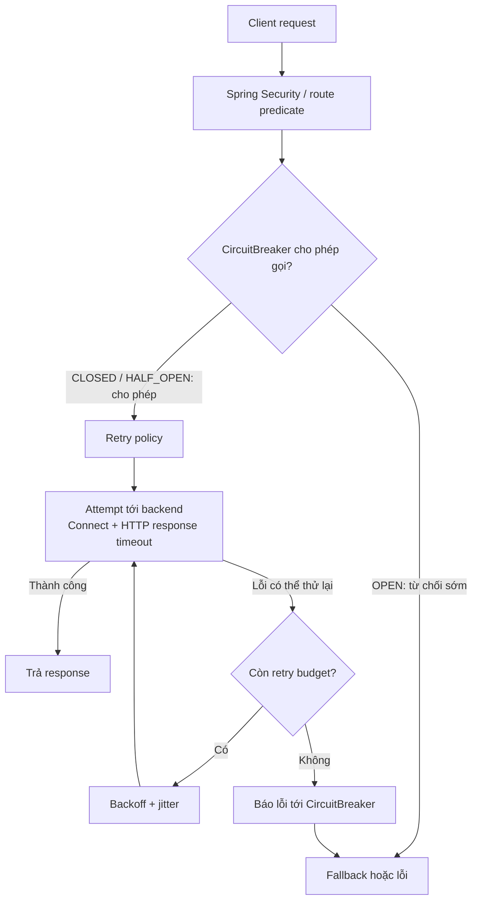
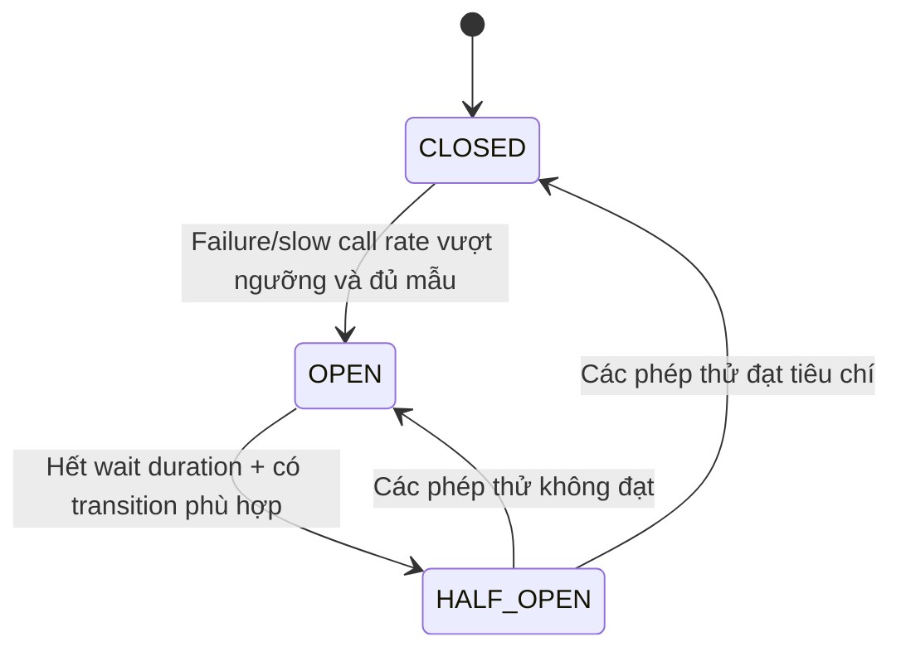
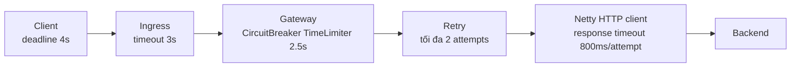
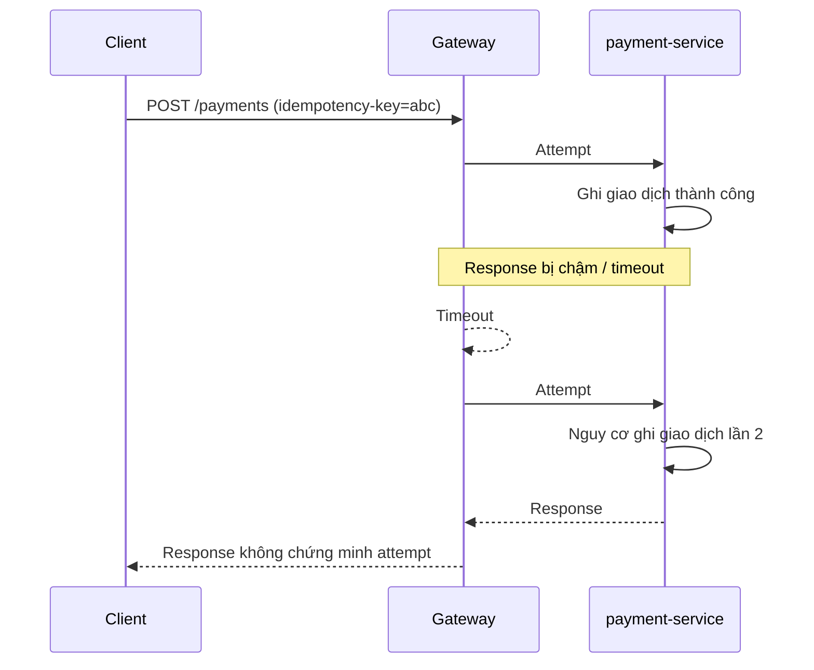
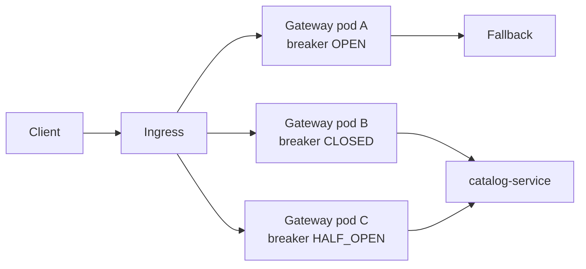

# Phối hợp circuit breaker với timeout và cơ chế thử lại

Trong một hệ thống microservices, một request đi qua **Spring Cloud Gateway** có thể gặp nhiều kiểu sự cố: kết nối tới backend không thiết lập được, upstream phản hồi quá chậm, backend trả `503 Service Unavailable` hoặc một lỗi mạng chỉ kéo dài vài trăm mili giây. Nếu gateway luôn thử lại, sự cố nhỏ có thể biến thành **retry storm**. Nếu gateway chờ mãi, connection pool và tài nguyên bị giữ quá lâu. Nếu circuit breaker mở quá nhạy, request hợp lệ bị từ chối ngay cả khi backend đã hồi phục.

Ba cơ chế **timeout**, **Retry** và **CircuitBreaker** giúp giải quyết ba phần khác nhau của bài toán:

- **Timeout:** giới hạn thời gian chờ ở một lớp xử lý, chẳng hạn TCP connect hoặc HTTP response.
- **Retry:** thử lại một lỗi *có khả năng tạm thời*, với số lần và thời gian chờ được kiểm soát.
- **Circuit breaker:** quan sát tỷ lệ lỗi/độ chậm, **ngừng gửi request mới** khi upstream có dấu hiệu mất khả dụng và thăm dò khi phục hồi.

Bài thuộc chương **Ngắt mạch và dự phòng** trong module **SPRING_CLOUD_GATEWAY**. Khi xây dựng API Gateway qua route predicate, filter chain, biến đổi đường dẫn/header và khám phá dịch vụ, ba cơ chế này phải phối hợp với xác thực, giới hạn lưu lượng, TLS và observability. Mục tiêu không phải “cứ retry nhiều là ổn” mà là **giới hạn tác động của lỗi**, bảo vệ upstream và trả phản hồi trung thực cho client.

Sau bài học, bạn có thể:

1. Phân biệt timeout của **HTTP client**, **Resilience4j TimeLimiter** và giới hạn toàn bộ request.
2. Hiểu trạng thái **CLOSED / OPEN / HALF_OPEN** cùng failure rate, slow-call rate và mẫu số tối thiểu của circuit breaker.
3. Cấu hình `CircuitBreaker`, `Retry`, route metadata timeout và `fallbackUri` bằng Gateway Server WebFlux.
4. Dự đoán ảnh hưởng của **thứ tự filter**: circuit breaker bao ngoài retry hay retry bao ngoài circuit breaker.
5. Lập ngân sách thời gian end-to-end, tính số lần gọi upstream tối đa và tránh retry những thao tác không idempotent.
6. Thiết kế test gây lỗi có kiểm soát, quan sát breaker state, số attempts, fallback, lỗi TLS và mất service instance.

> **Phạm vi:** Ví dụ dùng **Spring Cloud Gateway Server WebFlux** với Reactor Netty, Spring Cloud CircuitBreaker và Resilience4j Reactor. Gateway 5.x sử dụng namespace `spring.cloud.gateway.server.webflux.routes` / `spring.cloud.gateway.server.webflux.httpclient`; Gateway WebFlux 4.3.x thường dùng `spring.cloud.gateway.routes` / `spring.cloud.gateway.httpclient`. API Server MVC và filter chain Servlet khác WebFlux. Hành vi chi tiết của retry, TimeLimiter, lỗi transport và mapping status cần được xác minh trên dependency phiên bản đang chạy.

## 1. Ba cơ chế xử lý ba câu hỏi khác nhau

Giả sử client gọi `GET /api/catalog/products/42`. Upstream có thể mất 2 giây để phản hồi nhưng trong điều kiện bình thường chỉ cần 100 ms.

| Cơ chế | Câu hỏi được giải quyết | Ví dụ |
| --- | --- | --- |
| **TCP connect timeout** | Chờ tối đa bao lâu để mở TCP connection mới tới backend? | 300 ms |
| **HTTP response timeout** | HTTP client của Gateway đợi phản hồi upstream bao lâu? | 800 ms |
| **Retry** | Với lỗi đủ điều kiện, có nên thực hiện thêm một lần gửi upstream? | Thêm 1 lần, backoff 100 ms |
| **Circuit breaker** | Có nên tiếp tục cho request đi tới upstream đang lỗi liên tục không? | OPEN khi failure rate đạt 50%, đủ số mẫu |
| **TimeLimiter** | Tác vụ reactive được circuit breaker bao quanh được phép kéo dài bao lâu? | 2,5 giây |
| **Fallback** | Khi request cuối cùng không thể hoàn tất, trả gì cho client? | JSON 503 hoặc dữ liệu cache có nhãn stale |

Một cơ chế **không tự thay thế** cơ chế khác. `Retry` không giới hạn tổng thời gian nếu cấu hình không có trần hợp lý. `CircuitBreaker` không buộc một request đang chạy phải kết thúc sớm. `Timeout` không biết sau bao nhiêu lần lỗi thì nên ngừng thử. `Fallback` không làm backend khỏe trở lại.



Sơ đồ thể hiện một **cách bố trí** với breaker bao ngoài retry. Nếu đảo thứ tự filter, câu trả lời “một circuit breaker call tính bao nhiêu attempts?” cũng thay đổi.

## 2. Vòng đời CircuitBreaker: CLOSED, OPEN và HALF_OPEN

Trong mô hình Resilience4j:

- **CLOSED:** cho phép các call và ghi nhận kết quả.
- **OPEN:** không gọi upstream cho các call mới, thường phát sinh `CallNotPermittedException` để fallback/handler xử lý.
- **HALF_OPEN:** sau khoảng chờ, cho phép **một số call thăm dò**. Nếu đủ khỏe, breaker về CLOSED; nếu tiếp tục lỗi/slow theo policy, trở lại OPEN.



Các tham số thường gặp:

| Tham số Resilience4j | Vai trò | Cảnh báo |
| --- | --- | --- |
| `slidingWindowType` | Đếm theo **COUNT_BASED** hoặc **TIME_BASED** | Không phải số request đang chạy đồng thời |
| `slidingWindowSize` | Kích thước cửa sổ đo | Cần phù hợp lưu lượng thực tế |
| `minimumNumberOfCalls` | Số kết quả tối thiểu trước khi đánh giá tỷ lệ | Tránh mở breaker quá sớm vì vài request đầu |
| `failureRateThreshold` | Ngưỡng phần trăm call thất bại để mở | Tùy loại exception/status được tính là failure |
| `slowCallRateThreshold` | Ngưỡng phần trăm call được xem là chậm | Chỉ có ý nghĩa cùng `slowCallDurationThreshold` |
| `slowCallDurationThreshold` | Thời gian một call bị đánh dấu slow | Khác với HTTP response timeout |
| `waitDurationInOpenState` | Thời gian trước khi được phép thăm dò | Không phải thời gian chờ của client |
| `permittedNumberOfCallsInHalfOpenState` | Số call thăm dò được phép trong HALF_OPEN | Tránh dồn quá nhiều tải khi phục hồi |

Ví dụ `minimumNumberOfCalls=10` và `failureRateThreshold=50`: chỉ sau khi có đủ ít nhất 10 call được ghi nhận, breaker mới có cơ sở đánh giá. Nếu 6 trong 10 call thất bại, tỷ lệ 60% có thể làm breaker mở; **không phải cứ một call lỗi là mở**.

**Quan trọng:** Circuit breaker **không phải bulkhead**. Khi CLOSED, nhiều request vẫn có thể chạy đồng thời. Nếu backend chỉ chịu được 20 request in-flight, cần bổ sung concurrency/bulkhead/connection pool limits và rate limiting.

## 3. Khi nào HTTP 500/503 được tính là lỗi CircuitBreaker?

Cần phân biệt **exception** với **HTTP response có status lỗi**.

- Lỗi kết nối, timeout hoặc một exception trong publisher thường có thể được breaker ghi nhận theo chính sách exception.
- Nếu backend **trả một HTTP response 503 hợp lệ**, luồng HTTP có thể vẫn hoàn tất bình thường ở cấp transport. Không nên mặc định breaker sẽ tự hiểu mọi `5xx` là exception.
- Gateway `CircuitBreaker` filter có tùy chọn **`statusCodes`** để biến các HTTP status được chỉ định thành kết quả gây lỗi cho circuit breaker.

Ví dụ:

```yaml
- name: CircuitBreaker
  args:
    name: catalogBreaker
    statusCodes:
      - 500
      - BAD_GATEWAY
      - SERVICE_UNAVAILABLE
      - GATEWAY_TIMEOUT
    fallbackUri: forward:/fallback/catalog
```

Đây là **mảnh cấu hình filter trong `routes[].filters`**, không phải YAML toàn ứng dụng. Chỉ định những status phản ánh sự cố upstream mà hệ thống thực sự muốn tính là failure. Nếu bỏ `statusCodes`, một chuỗi `503` được backend trả về có thể không được tính như kỳ vọng.

**Không nên** tính `400 Bad Request`, `401 Unauthorized` hoặc `403 Forbidden` là lỗi sức khỏe backend chỉ vì chúng làm client không hài lòng. Các response đó thường phản ánh dữ liệu request hoặc chính sách bảo mật. `404` cũng thường là “resource không tồn tại”, không phải backend down, trừ khi API contract có quy định khác.

Một breaker name có thể được dùng chung giữa nhiều routes; nếu cùng name, kết quả call có thể **gộp vào một circuit breaker instance** trong cùng tiến trình. Chỉ chia sẻ name khi các route thực sự cùng một failure domain và thống nhất chính sách; nếu không, một API chậm có thể khiến API khác bị OPEN theo.

## 4. HTTP client timeout: connect và response

Spring Cloud Gateway WebFlux cho phép đặt timeout global:

```yaml
spring:
  cloud:
    gateway:
      server:
        webflux:
          httpclient:
            connect-timeout: 1000  # milliseconds
            response-timeout: 5s    # java.time.Duration
```

Và ghi đè theo route bằng metadata:

```yaml
metadata:
  connect-timeout: 300     # milliseconds
  response-timeout: 800    # milliseconds
```

**Đơn vị phải nhớ:**

| Nơi đặt | `connect-timeout` | `response-timeout` |
| --- | --- | --- |
| Global HTTP client | **ms** — ví dụ `1000` | **Duration** — ví dụ `5s` |
| Route `metadata` | **ms** — ví dụ `300` | **ms** — ví dụ `800` |

Đặt `metadata.response-timeout: 5` với ý định 5 giây là lỗi nghiêm trọng: nó có nghĩa **5 ms**. Muốn 5 giây theo route, dùng `5000`.

### Timeout không cùng nghĩa

**Connect timeout** áp dụng cho việc mở kết nối TCP mới đến một instance. Nó không phải một “độ trễ bắt buộc”: `Connection refused` có thể thất bại ngay, trước khi ngưỡng timeout tới. DNS, load balancer, connection pool acquire và TLS handshake có giới hạn riêng.

**Response timeout** nằm ở HTTP client khi đợi upstream trả dữ liệu. Đừng coi nó là deadline tuyệt đối bao phủ cả route matching, filter custom, retry backoff và thời gian client nhận byte cuối. Đối với streaming/SSE, hành vi timeout/idle cần test riêng.

**Response timeout route âm**, ví dụ `response-timeout: -1`, được tài liệu Gateway mô tả là **vô hiệu hóa response timeout global cho route đó**. Điều này không tự vô hiệu hóa Resilience4j TimeLimiter, timeout ingress, TLS hay giới hạn client.

## 5. Resilience4j TimeLimiter là một đồng hồ khác

Khi tích hợp **`spring-cloud-starter-circuitbreaker-reactor-resilience4j`**, Spring Cloud CircuitBreaker có thể sử dụng cả **Resilience4j CircuitBreaker** và **TimeLimiter** cho một execution reactive.

```yaml
resilience4j:
  timelimiter:
    instances:
      catalogBreaker:
        timeoutDuration: 2500ms
        cancelRunningFuture: true
```

Tham số `timeoutDuration` là một **Duration**, không phải `metadata.response-timeout` của Gateway. Theo tài liệu Spring Cloud CircuitBreaker, TimeLimiter **được bật theo mặc định** trừ khi bị vô hiệu hóa qua các property tương ứng; nếu không cấu hình riêng, một giá trị mặc định của TimeLimiter có thể vẫn ảnh hưởng request.

### Hai giới hạn có thể cùng tồn tại

Giả sử:

- HTTP response timeout của một attempt là `800ms`.
- Retry cho phép **1 lần thử lại**, tức có thể có **2 attempts**.
- Backoff giữa hai attempts là khoảng `100ms`.
- CircuitBreaker TimeLimiter giới hạn execution được nó bao quanh ở `2500ms`.

Nếu breaker nằm **bên ngoài** retry, một execution breaker có thể chứa **cả hai attempts và thời gian backoff**. TimeLimiter khi đó có thể cắt execution đó ngay cả khi mỗi attempt chưa vượt giới hạn HTTP response.

Nếu breaker nằm **bên trong** retry, mỗi lần retry có thể gọi lại breaker và chịu một budget TimeLimiter **riêng cho lần đó**; tổng thời gian nhìn từ client vẫn có thể dài hơn một TimeLimiter đơn lẻ.

**Không suy ra thứ tự bao bọc chỉ từ tên filter.** Xem thứ tự của route `GatewayFilter`, các `GlobalFilter` được sắp theo order và kiểm chứng bằng test thực tế. Các phiên bản và custom filters có thể ảnh hưởng vòng đời.

### Cẩn trọng với cancelRunningFuture

Trong reactive flow, cancellation thường hủy subscription hoặc tín hiệu đang được theo dõi. Nó **không đảm bảo một giao dịch đã bắt đầu ở backend sẽ được rollback**. Nếu Gateway timeout sau khi backend đã nhận `POST /payments`, backend có thể vẫn hoàn tất thanh toán.

## 6. Retry: chọn loại lỗi, method và ngân sách thử lại

`Retry` GatewayFilter Factory hỗ trợ các lựa chọn như:

| Tham số | Tác dụng |
| --- | --- |
| `retries` | Số lần **thử lại** bổ sung, không phải tổng số attempts |
| `statuses` | Danh sách HTTP status được phép retry |
| `series` | Nhóm status như 5xx |
| `methods` | HTTP methods được phép retry |
| `exceptions` | Các exception được phép retry |
| `backoff` | Khoảng chờ tăng dần giữa các attempts |
| `jitter` | Dao động ngẫu nhiên để tránh nhiều client retry đồng bộ |
| `timeout` | Giới hạn liên quan tới cơ chế retry theo version; không đồng nghĩa HTTP client response timeout |

Ví dụ lọc retry chỉ cho `GET` khi backend trả một số mã lỗi tạm thời:

```yaml
- name: Retry
  args:
    retries: 1
    statuses:
      - BAD_GATEWAY
      - SERVICE_UNAVAILABLE
      - GATEWAY_TIMEOUT
    methods:
      - GET
    backoff:
      firstBackoff: 100ms
      maxBackoff: 100ms
      factor: 1
      basedOnPreviousValue: false
    jitter:
      randomFactor: 0.2
```

Với `retries: 1`, tối đa có thể có **2 outbound attempts** cho một request nếu đúng điều kiện retry. Nếu đặt `retries: 3`, có thể có đến **4 attempts**. Nếu không có điều kiện lỗi phù hợp hoặc response đã bị commit, retry không nhất thiết xảy ra.

Tài liệu Gateway mô tả các mặc định quen thuộc của Retry như **3 retries**, method **GET**, series **5XX** và các nhóm exception I/O/timeout, với backoff mặc định tắt; tuy nhiên ví dụ production nên **ghi rõ chính sách mong muốn**, không dựa vào tất cả mặc định giữa các phiên bản.

**Chỉ retry lỗi có khả năng tạm thời** và trên request mà việc lặp lại được chấp nhận. Không retry mọi `4xx`, không retry lỗi dữ liệu, thiếu quyền, JWT không hợp lệ hoặc request mà server đã phản hồi thành công.

## 7. Thứ tự filter: CircuitBreaker → Retry hay Retry → CircuitBreaker?

Đây là quyết định trọng tâm của bài.

Spring Cloud Gateway xử lý GatewayFilter và GlobalFilter thành chuỗi có order; các filter ở pha **pre** chạy trước và bao bọc việc gọi `chain.filter(exchange)` của các filter phía sau. Đặc biệt, tài liệu `Retry` nói rõ: **Retry chạy lại những filter đứng sau nó**. Cách hai filter được lồng nhau quyết định số lần breaker quan sát call và cách fallback xảy ra.

### Phương án A: CircuitBreaker ở ngoài, Retry ở trong

```yaml
filters:
  - name: CircuitBreaker
    args:
      name: catalogBreaker
      statusCodes:
        - BAD_GATEWAY
        - SERVICE_UNAVAILABLE
        - GATEWAY_TIMEOUT
      fallbackUri: forward:/fallback/catalog
  - name: Retry
    args:
      retries: 1
      statuses:
        - BAD_GATEWAY
        - SERVICE_UNAVAILABLE
        - GATEWAY_TIMEOUT
      methods: GET
```

Luồng khái niệm:

```text
CircuitBreaker
  └── Retry
        ├── HTTP attempt #1
        └── HTTP attempt #2 (nếu đủ điều kiện)

CircuitBreaker ghi nhận kết quả của toàn bộ hoạt động Retry
sau khi Retry thành công hoặc cạn số attempts.
```

**Hệ quả:**

- Một **logical request** có thể tạo nhiều outbound attempts.
- Breaker bên ngoài thường quan sát kết quả cuối cùng của hoạt động retry, thay vì coi từng attempt như một call breaker độc lập.
- Nếu attempt thứ hai thành công, breaker bên ngoài có thể ghi nhận **logical call thành công**, dù attempt đầu đã lỗi. Nếu cần biết backend đang lỗi từng lần, phải theo dõi metrics retry/upstream riêng.
- TimeLimiter gắn với breaker bên ngoài có thể giới hạn **toàn bộ retry sequence**.
- Fallback được áp dụng sau khi Retry không khắc phục được lỗi, hoặc khi circuit đang OPEN.

Đây thường là phương án dễ lý giải khi muốn “thử lại ngắn có điều kiện, rồi mới fallback”, nhưng **không mặc nhiên là đúng cho mọi hệ thống**.

### Phương án B: Retry ở ngoài, CircuitBreaker ở trong

```yaml
filters:
  - name: Retry
    args:
      retries: 1
      statuses:
        - BAD_GATEWAY
        - SERVICE_UNAVAILABLE
      methods: GET
  - name: CircuitBreaker
    args:
      name: catalogBreaker
      statusCodes:
        - BAD_GATEWAY
        - SERVICE_UNAVAILABLE
```

Luồng khái niệm:

```text
Retry
  ├── CircuitBreaker → HTTP attempt #1
  └── CircuitBreaker → HTTP attempt #2
```

**Hệ quả:**

- Breaker có thể thấy **từng attempt** như một call riêng; tỷ lệ lỗi/slow được ghi nhận khác phương án A.
- Breaker có thể OPEN sớm hơn nếu nhiều attempts liên tiếp đều lỗi.
- Khi breaker OPEN, Retry phía ngoài có thể gặp `CallNotPermittedException`; có retry tiếp hay không phụ thuộc `exceptions` và error handling.
- Nếu thêm `fallbackUri` vào CircuitBreaker bên trong và fallback trả `200` hoặc status không retry, Retry bên ngoài có thể coi attempt đã hoàn tất và **không thử lại upstream**.
- TimeLimiter bên trong có thể được cấp lại cho từng attempt, khiến tổng request latency vượt giá trị TimeLimiter một lần.

**Khuyến nghị thực hành:** Với một route `GET` đơn giản, hãy bắt đầu bằng **CircuitBreaker bên ngoài + Retry bên trong**, đặt số retry nhỏ và một ngân sách thời gian tổng, rồi dùng integration test xác minh breaker thực sự đếm những gì. Khi cần đánh giá chất lượng **từng attempt**, có thể cân nhắc phương án B nhưng phải tránh retry fallback và retry khi breaker đã OPEN.

### Bảng so sánh nhanh

| Khía cạnh | Breaker → Retry | Retry → Breaker |
| --- | --- | --- |
| Phạm vi một breaker call | Thường bao gồm toàn bộ attempts | Thường một attempt cho mỗi lần gọi breaker |
| Khi attempt đầu lỗi, attempt sau thành công | Breaker có thể ghi thành công cuối cùng | Breaker có thể ghi cả lỗi rồi thành công |
| TimeLimiter của breaker | Có thể bao toàn bộ retry sequence | Có thể áp dụng mỗi attempt |
| Fallback | Thường sau khi retry kết thúc | Có thể được Retry nhìn như một response trung gian |
| Rủi ro | Giấu tỷ lệ lỗi attempt nếu chỉ xem breaker metrics | Đếm lỗi nhanh/open sớm, retry fallback hoặc open breaker |
| Cần kiểm chứng | Route filter order, statuses, retry count | Exceptions, fallback status và resubscribe behavior |

> **Không nên** dựa vào trực giác về thứ tự khai báo YAML để suy ra mọi thứ trong các custom filter. Gateway có cơ chế order tổng giữa `GlobalFilter` và `GatewayFilter`; hãy xác minh những filter cụ thể có order/pha xử lý mong đợi qua trace và test backend.

## 8. Ngân sách thời gian: tránh cộng nhiều timeout một cách mù quáng

Một request có thể đi qua nhiều lớp:



Ví dụ một **bộ giá trị để học cách tính**:

| Lớp | Giá trị minh họa |
| --- | --- |
| Client tổng thời gian chờ | 4 s |
| Ingress response timeout | 3 s |
| Resilience4j TimeLimiter trên logical call | 2,5 s |
| HTTP connect timeout theo route | 300 ms cho kết nối TCP mới |
| HTTP response timeout theo route | 800 ms cho phản hồi upstream |
| Retry | 1 lần retry, backoff khoảng 100 ms |
| Breaker | Ngoài Retry |

Một phép cộng gần đúng cho tình huống **mỗi attempt phải kết nối mới rồi chờ gần hết timeout**:

```text
2 attempts × (300ms connect + 800ms response)
+ 100ms backoff
≈ 2300ms

Chưa gồm:
- route matching / auth / custom filters
- DNS, connection pool acquisition, TLS handshake
- load-balancing, scheduling, network overhead
- xử lý response cuối
```

**2300 ms chỉ là dự tính thành phần**, không phải một guarantee về deadline. Nếu connection pool tái sử dụng kết nối, có thể không mất connect timeout; nếu TLS handshake hoặc pool acquire chậm, tổng latency có thể lớn hơn. Một TimeLimiter 2,5 giây có thể trở thành “hàng rào ngoài” cho logical call nếu thứ tự bao bọc đúng, nhưng không bảo đảm backend dừng side effect khi cancel.

### Chọn timeout theo ngân sách, không theo cảm giác

1. Bắt đầu từ latency SLO nhìn từ client và timeout của ingress/mobile.
2. Trừ thời gian mạng, authentication, routing, header transformation và xử lý response.
3. Xác định **attempt budget** cho upstream, gồm connect/HTTP response/TLS/pool.
4. Chỉ phân bổ **1–2 retries** khi thật sự có ích, có backoff và jitter.
5. Chọn TimeLimiter cho sequence nằm trong tổng ngân sách còn lại.
6. Test lúc upstream chậm, không có instance, bị từ chối kết nối và client hủy request.

Nếu client timeout sau 2 giây nhưng Gateway còn retry tới 10 giây, phần việc còn lại có thể chỉ làm backend quá tải thêm mà không giúp người gọi. Ngược lại, TimeLimiter 500 ms khi backend p99 800 ms sẽ biến nhiều request hợp lệ thành lỗi.

## 9. Ví dụ YAML hoàn chỉnh: GET có Retry, CircuitBreaker, timeout và fallback

Giả sử:

- Gateway Server WebFlux 5.x chạy tại `localhost:8080`.
- Catalog backend thử nghiệm tại `localhost:8081`.
- Public URL `GET /api/catalog/products/42`.
- Backend nhận `GET /catalog/products/42` sau `StripPrefix=1`.
- Fallback được xử lý bởi controller nội bộ của Gateway tại `/fallback/catalog`.

```yaml
spring:
  cloud:
    gateway:
      server:
        webflux:
          httpclient:
            connect-timeout: 1000  # ms
            response-timeout: 5s    # Duration, global

          routes:
            - id: catalog-read
              uri: http://localhost:8081
              predicates:
                - Path=/api/catalog/**
                - Method=GET
              metadata:
                connect-timeout: 300     # ms
                response-timeout: 800    # ms
              filters:
                - StripPrefix=1

                # CircuitBreaker nằm ngoài Retry
                - name: CircuitBreaker
                  args:
                    name: catalogBreaker
                    fallbackUri: forward:/fallback/catalog
                    statusCodes:
                      - INTERNAL_SERVER_ERROR
                      - BAD_GATEWAY
                      - SERVICE_UNAVAILABLE
                      - GATEWAY_TIMEOUT

                - name: Retry
                  args:
                    retries: 1
                    statuses:
                      - BAD_GATEWAY
                      - SERVICE_UNAVAILABLE
                      - GATEWAY_TIMEOUT
                    methods: GET
                    backoff:
                      firstBackoff: 100ms
                      maxBackoff: 100ms
                      factor: 1
                      basedOnPreviousValue: false
                    jitter:
                      randomFactor: 0.2

resilience4j:
  circuitbreaker:
    instances:
      catalogBreaker:
        slidingWindowType: COUNT_BASED
        slidingWindowSize: 20
        minimumNumberOfCalls: 10
        failureRateThreshold: 50
        slowCallRateThreshold: 50
        slowCallDurationThreshold: 2s
        waitDurationInOpenState: 10s
        permittedNumberOfCallsInHalfOpenState: 3

  timelimiter:
    instances:
      catalogBreaker:
        timeoutDuration: 2500ms
        cancelRunningFuture: true
```

**Giải thích các lớp:**

- `metadata.response-timeout: 800` là **800 ms**, không phải 800 giây.
- `CircuitBreaker` tên `catalogBreaker` được gắn cùng tên trong `resilience4j.circuitbreaker.instances` và `resilience4j.timelimiter.instances`.
- `Retry` chỉ áp dụng cho `GET` và các status cụ thể; exception retry vẫn chịu policy của factory và các mặc định/cấu hình liên quan.
- `retries: 1` tối đa thêm **một attempt** sau lần ban đầu khi đủ điều kiện.
- `statusCodes` của CircuitBreaker gồm cả `500` để HTTP response lỗi có thể được breaker ghi nhận; danh sách này **không nhất thiết phải trùng** danh sách Retry.
- `slowCallDurationThreshold` là ngưỡng **ghi nhận slow call**, không phải timeout tự cắt request. Nếu breaker bao ngoài Retry, logical call mất 2 giây có thể bị xem là slow dù từng attempt riêng nhanh hơn.
- `TimeLimiter` 2,5 giây là giới hạn riêng của Resilience4j, **không đồng nghĩa** `response-timeout` của Netty.

**Dependency cần thiết:** Bên cạnh Gateway Server WebFlux, phải thêm starter **`spring-cloud-starter-circuitbreaker-reactor-resilience4j`** tương thích với Spring Cloud BOM. Nếu đổi URI sang `lb://catalog-service`, cần thêm Spring Cloud LoadBalancer và nguồn service instances. Không mặc định có circuit breaker chỉ vì đã dùng Gateway starter.

### Maven dependencies minh họa

```xml
<dependency>
  <groupId>org.springframework.cloud</groupId>
  <artifactId>spring-cloud-starter-gateway-server-webflux</artifactId>
</dependency>

<dependency>
  <groupId>org.springframework.cloud</groupId>
  <artifactId>spring-cloud-starter-circuitbreaker-reactor-resilience4j</artifactId>
</dependency>
```

Không tự chọn version của từng starter khi dự án đã dùng Spring Cloud BOM; phải có cặp Spring Boot/Spring Cloud/Resilience4j tương thích.

### Gateway WebFlux 4.3.x

Ở nhánh Gateway WebFlux 4.3.x, đổi namespace HTTP client/routes tương ứng:

```yaml
spring:
  cloud:
    gateway:
      httpclient:
        connect-timeout: 1000
        response-timeout: 5s
      routes:
        - id: catalog-read
          uri: http://localhost:8081
          predicates:
            - Path=/api/catalog/**
            - Method=GET
          metadata:
            connect-timeout: 300
            response-timeout: 800
          filters:
            - StripPrefix=1
            - name: CircuitBreaker
              args:
                name: catalogBreaker
                fallbackUri: forward:/fallback/catalog
            - name: Retry
              args:
                retries: 1
                statuses: BAD_GATEWAY
                methods: GET
```

Đây là bản rút gọn để minh họa **khác namespace**; các property `resilience4j.*` có thể giữ theo Resilience4j/Spring Cloud CircuitBreaker version. Khi đổi từ 4.3 sang 5.x, kiểm tra lại effective config, custom global filters và statusCodes thực tế.

## 10. Fallback phải trả dữ liệu trung thực và có giới hạn

Trong Spring Cloud Gateway WebFlux, `CircuitBreaker` có thể dùng `fallbackUri`, với scheme được hỗ trợ trong tài liệu là **`forward:`**. Nó thường forward tới một handler/controller **bên trong Gateway**, ví dụ `forward:/fallback/catalog`.

Một controller WebFlux tối giản:

```java
import java.util.Map;

import org.springframework.cloud.gateway.support.ServerWebExchangeUtils;
import org.springframework.http.HttpHeaders;
import org.springframework.http.HttpStatus;
import org.springframework.http.MediaType;
import org.springframework.http.ResponseEntity;
import org.springframework.web.bind.annotation.GetMapping;
import org.springframework.web.bind.annotation.RestController;
import org.springframework.web.server.ServerWebExchange;

import reactor.core.publisher.Mono;

@RestController
class CatalogFallbackController {

    @GetMapping(
        path = "/fallback/catalog",
        produces = MediaType.APPLICATION_JSON_VALUE)
    Mono<ResponseEntity<Map<String, String>>> fallback(
            ServerWebExchange exchange) {

        Throwable cause = exchange.getAttribute(
            ServerWebExchangeUtils
                .CIRCUITBREAKER_EXECUTION_EXCEPTION_ATTR);

        // Chỉ dùng cause cho metrics/log đã che dữ liệu.
        // Không trả stack trace, URL nội bộ hoặc message thô cho client.
        return Mono.just(ResponseEntity
            .status(HttpStatus.SERVICE_UNAVAILABLE)
            .header(HttpHeaders.CACHE_CONTROL, "no-store")
            .body(Map.of(
                "code", "CATALOG_TEMPORARILY_UNAVAILABLE",
                "message", "Dịch vụ tạm thời gián đoạn")));
    }
}
```

**Tại sao trả `503` thay vì `200 OK`?** Đây là catalog không có dữ liệu thay thế đáng tin; trả “thành công” sẽ khiến client nghĩ có dữ liệu thật. Một fallback đọc từ cache đã xác minh có thể trả `200` nếu contract cho phép, nhưng nên công bố rõ dữ liệu đã cũ bằng metadata/header và không làm lộ dữ liệu của tenant khác.

**Không dùng fallback thành công giả cho thao tác ghi** như thanh toán, chuyển tiền hoặc tạo đơn hàng khi chưa xác minh trạng thái thực tế. Nếu backend đã xử lý nhưng response bị timeout, fallback không được khẳng định “chắc chắn thất bại” hoặc “chắc chắn thành công”.

### Tránh vòng lặp fallback

- Fallback path không nên lại được route vào **chính upstream/circuit breaker đang lỗi**.
- Nếu fallback gọi thêm một service qua HTTP, nó tạo dependency mới và có thể thất bại tiếp; giới hạn timeout và bảo vệ riêng.
- Kiểm tra security/route matching cho `/fallback/catalog` để tránh bị lạm dụng trực tiếp. Một fallback công khai chỉ nên trả thông tin không nhạy cảm.
- Đừng để fallback vô tình thực thi side effect hoặc làm thay đổi response đã commit.

### FallbackHeaders khi fallback ở ứng dụng khác

Gateway có `FallbackHeaders` filter để chuyển thông tin về exception khi forward sang fallback service theo thiết kế. Hãy tránh đưa class name, stacktrace hoặc exception message thô ra client/internet; nếu cần phân tích, chuyển qua kênh nội bộ được tin và ghi log an toàn.

## 11. Không phải lỗi nào cũng nên Retry hoặc mở CircuitBreaker

Lựa chọn retryable statuses và breaker failure statuses là **policy nghiệp vụ/kỹ thuật**, không chỉ là code.

| Sự kiện | Retry? | Ghi nhận breaker? | Lý do |
| --- | --- | --- | --- |
| TCP connect timeout thoáng qua | Có thể, nếu request idempotent | Thường có, nếu phản ánh upstream failure | Có thể là sự cố mạng tạm thời |
| HTTP response timeout | Có điều kiện, cần biết side effect | Thường có | Backend có thể vẫn đang xử lý |
| `502 Bad Gateway` từ upstream/proxy | Có thể với GET và budget | Thường có | Có thể là lỗi transient |
| `503 Service Unavailable` | Có thể, có backoff/jitter | Thường có | Dịch vụ quá tải hoặc bảo trì |
| `504 Gateway Timeout` | Có điều kiện | Thường có | Timeout ở một intermediary |
| `500 Internal Server Error` | Chỉ khi hiểu lỗi và request an toàn | Có thể | Retry mù quáng có thể khuếch đại bug |
| `429 Too Many Requests` | Client nên tôn trọng `Retry-After`, không retry ngay tại Gateway | Thường **không** tính là backend failure | Đây là thông báo giới hạn lưu lượng |
| `400 Bad Request` | Không | Không | Client gửi dữ liệu sai |
| `401 Unauthorized` | Không | Không | Token thiếu/hết hạn/sai |
| `403 Forbidden` | Không | Không | Thiếu quyền, không phải backend yếu |
| `404 Not Found` | Thông thường không | Thông thường không | Resource không tồn tại |
| Lỗi xác thực TLS/certificate | Không retry liên tục | Cần cảnh báo riêng, không chỉ tăng breaker threshold | Sai trust/hostname cần sửa cấu hình |
| RedisRateLimiter trả `429` trước routing | Không thuộc upstream retry | Không phải call backend | Gateway chưa gửi upstream |

**Đừng bật retries cho toàn bộ `5xx` chỉ vì đó là mặc định tiện lợi.** Với `503` do overload, retry ngay có thể làm overload nặng hơn. Đôi khi phương án đúng là trả lỗi nhanh và để client retry sau với backoff; đôi khi chọn instance khác nhờ LoadBalancer sẽ hữu ích. Phải kiểm tra lỗi có thật sự transient và idempotent hay không.

## 12. Idempotency và request body: rủi ro cao nhất của Retry

Với `GET` không có side effect, retry thường dễ chấp nhận hơn. Với `POST /orders`, `POST /payments`, `PATCH` hay thao tác upload, kết quả khác hẳn.

### Tình huống timeout nhưng backend đã làm xong



Một timeout ở gateway **chỉ nói rằng gateway không nhận kịp response**, không chứng minh backend không hoàn thành xử lý.

Nếu bắt buộc retry request ghi:

1. Thiết kế **idempotency key** có phạm vi, TTL và lưu trạng thái ở backend.
2. Backend phải **atomically** bảo đảm cùng key không thực thi side effect hai lần.
3. Kiểm tra khả năng replay request body, kích thước và việc cache body của Retry.
4. Giới hạn retries, backoff và tổng deadline, giữ nguyên idempotency key xuyên attempts.
5. Khi trạng thái không chắc chắn, dùng endpoint tra cứu trạng thái giao dịch thay vì giả trả “thất bại”.

Tài liệu Gateway lưu ý **Retry với HTTP method có body sẽ cache body**, làm tăng sử dụng bộ nhớ; dữ liệu được lưu qua `ServerWebExchangeUtils.CACHED_REQUEST_BODY_ATTR` với `DataBuffer` tương ứng. Do đó **không bật retry rộng cho upload/streaming lớn**. Cần giới hạn request size, concurrency và xem xét khả năng giữ/release DataBuffer an toàn.

### Response đã commit thì sao?

Nếu Gateway đã gửi status/headers/body một phần tới client, không thể đơn giản “đổi ý” rồi retry và trả response thứ hai. Tài liệu đặc biệt cảnh báo với `forward:` handler: nếu controller đã commit response lỗi, Retry có thể không thực hiện được như ý. Khi cần retry, xử lý lỗi dưới dạng **exception/reactive error signal** trước khi response commit và test luồng thực tế.

## 13. Khi CircuitBreaker mở trong hệ thống có nhiều Gateway replicas

Resilience4j CircuitBreaker thông thường giữ **trạng thái trong bộ nhớ của từng tiến trình**. Nếu Gateway có ba pods, ba pods có thể quan sát những mẫu lỗi khác nhau.



Hệ quả:

- Một pod có thể trả fallback ngay khi breaker OPEN, pod khác vẫn gửi request upstream.
- Không phải lỗi, nếu Resilience4j breaker state **không được chia sẻ**; dữ liệu không đồng bộ theo từng pod là điều cần dự trù.
- Đặt cùng `name` không biến nó thành circuit breaker phân tán giữa các JVM.
- Rolling deployment có thể làm các pods mới có breaker state/metrics chưa đủ dữ liệu.
- Nếu lưu lượng thấp, `minimumNumberOfCalls` có thể chưa đạt ngưỡng trên từng pod, breaker chưa mở dù tổng lỗi toàn hệ thống đáng kể.

Khi cần kiểm soát tải toàn cụm, hãy kết hợp **Redis rate limiter, autoscaling, global ingress policy hoặc service mesh**; không dựa vào breaker in-memory như một “cầu dao chung” bảo đảm tuyệt đối.

### HALF_OPEN cần thăm dò có kiểm soát

Sau `waitDurationInOpenState`, breaker có thể chuyển từ OPEN sang HALF_OPEN khi có call tiếp theo (tùy cấu hình). Chỉ một số lượng call thăm dò được phép, ví dụ 3; những call khác bị từ chối cho đến khi có đủ kết quả.

Nếu mỗi call HALF_OPEN lại kích hoạt nhiều retries, tổng số **outbound attempts** từ một số call thăm dò có thể vượt số permit logic. Đây là lý do phải kiểm soát retry khi backend vừa phục hồi và test lượng traffic thực tế.

## 14. CircuitBreaker không thay thế RateLimiter và security

Trong một API Gateway public, luồng xử lý có thêm những lớp sau:

| Lớp | Khi nào nên chạy? | Mục đích |
| --- | --- | --- |
| Spring Security WebFlux | Trước khi cho truy cập API cần bảo vệ | Xác thực JWT/session, kiểm tra quyền route |
| RequestRateLimiter | Trước khi proxy upstream, theo key tin cậy | Chặn client/tenant gửi quá nhanh |
| CircuitBreaker | Bao quanh call tới upstream phù hợp | Chặn tạm thời khi backend lỗi nhiều |
| Retry | Bên trong hoặc bên ngoài breaker có chủ đích | Khắc phục lỗi thoáng qua |
| HTTP timeout | Tại Netty HTTP client và các lớp riêng | Giới hạn chờ kết nối/phản hồi |
| LoadBalancer | Trước HTTP routing `lb://` | Chọn service instance |
| Backend authorization | Khi service xử lý tài nguyên | Kiểm tra ownership/tenant/resource |
| Metrics & tracing | Xuyên suốt pipeline | Phân biệt lỗi bảo mật, quota và upstream |

**Không retry authentication failure**: một token sai chữ ký không trở nên hợp lệ sau ba lần thử. **Không fallback dữ liệu nhạy cảm** khi user thiếu quyền. Nếu circuit breaker được cấu hình bao quanh cả một filter chain quá rộng, cần xác minh nó không tính `401/403` hoặc lỗi RateLimiter thành lỗi sức khỏe upstream.

Bảo vệ **TLS** cả inbound và outbound, đặc biệt khi dùng `lb://` với metadata service instance. Certificate verification failure phải được xử lý như lỗi cấu hình/trust, không chữa bằng retry vô hạn hoặc tắt xác minh hostname.

## 15. Kiểm thử lỗi và quan sát CircuitBreaker trong staging

### 15.1. Backend thử nghiệm có thể trì hoãn hoặc trả lỗi

Ví dụ controller Spring WebFlux chạy tại `localhost:8081`:

```java
import java.time.Duration;
import java.util.Map;
import java.util.concurrent.atomic.AtomicInteger;

import org.springframework.http.HttpStatus;
import org.springframework.http.ResponseEntity;
import org.springframework.web.bind.annotation.GetMapping;
import org.springframework.web.bind.annotation.PathVariable;
import org.springframework.web.bind.annotation.RequestMapping;
import org.springframework.web.bind.annotation.RestController;

import reactor.core.publisher.Mono;

@RestController
@RequestMapping("/catalog")
class CatalogTestController {

    private final AtomicInteger counter = new AtomicInteger();

    @GetMapping("/products/42")
    Mono<ResponseEntity<Map<String, Object>>> flaky() {
        int call = counter.incrementAndGet();
        if (call % 3 != 0) {
            return Mono.just(ResponseEntity
                .status(HttpStatus.SERVICE_UNAVAILABLE)
                .body(Map.of("attempt", call, "status", "temporary-failure")));
        }
        return Mono.just(ResponseEntity
            .ok(Map.of("attempt", call, "status", "ok")));
    }

    @GetMapping("/delay/{millis}")
    Mono<ResponseEntity<Map<String, Object>>> delay(
            @PathVariable long millis) {
        if (millis < 0 || millis > 20000) {
            return Mono.just(ResponseEntity
                .badRequest()
                .body(Map.of("error", "invalid delay")));
        }
        return Mono.delay(Duration.ofMillis(millis))
            .map(tick -> ResponseEntity
                .ok(Map.<String, Object>of("delayedMs", millis)));
    }
}
```

Đây là test controller **cố ý tạo lỗi**, chỉ chạy trong môi trường test. Đừng xuất bản endpoint gây delay/lỗi có thể bị gọi tùy ý ra Internet. `Mono.delay` giúp mô phỏng upstream chậm mà không dùng `Thread.sleep` trên event loop.

### 15.2. Quan sát Retry khi breaker chưa mở

```bash
curl -i http://localhost:8080/api/catalog/products/42
```

Với backend trả `503` ở hai lần gọi đầu, `Retry` cho thêm một attempt có thể giúp vượt lỗi **nếu lần thử lại trúng thời điểm backend phản hồi khỏe**. Trong controller trên, mỗi ba call có một call thành công nên số attempts/backend counter giúp xác minh thực tế, nhưng kết quả còn phụ thuộc breaker state, các request test khác và thứ tự filter.

Dùng trace ID hoặc backend marker ở staging để đo **một request client tương ứng mấy request upstream**. Đừng chỉ xem response `200` rồi kết luận retry đã hoạt động.

### 15.3. Test response timeout

```bash
# Backend chờ 300 ms: dưới metadata.response-timeout=800 ms
curl -i --max-time 5 \
  http://localhost:8080/api/catalog/delay/300

# Backend chờ 1500 ms: dài hơn mỗi attempt 800 ms
curl -i --max-time 5 \
  http://localhost:8080/api/catalog/delay/1500
```

Với route cấu hình như mục 9, response thứ hai có thể bị timeout, Retry có thể thử lại theo loại exception được bật và breaker có thể ghi failure/fallback. **Không khẳng định HTTP status cuối luôn là 504**: fallback controller trong ví dụ trả `503`, còn error handler và proxy khác có thể ánh xạ khác.

### 15.4. Test OPEN và HALF_OPEN

1. Gửi đủ số request thất bại để đạt `minimumNumberOfCalls=10` và failure rate threshold.
2. Xác minh breaker chuyển `CLOSED → OPEN` qua metrics/events; **đừng** suy ra trạng thái chỉ từ `503`.
3. Trong OPEN, gọi thêm và kiểm tra backend **không** nhận request mới, fallback xảy ra nhanh.
4. Đợi qua `waitDurationInOpenState=10s` trong môi trường test.
5. Chuyển backend sang trả thành công, gửi một số request thăm dò và quan sát `HALF_OPEN → CLOSED`.
6. Gửi kịch bản backend tiếp tục lỗi để quan sát `HALF_OPEN → OPEN`.

Lưu ý `minimumNumberOfCalls` và `slidingWindowSize` là cấu hình số mẫu/cửa sổ, không phải số attempts một request. Nếu breaker bao ngoài retry, cần tạo đủ **logical calls** được ghi nhận.

### 15.5. Test bộ đếm của hai thứ tự filter

Lặp lại các test khi đảo `Retry` và `CircuitBreaker` trong staging:

| Điều đo | Breaker → Retry | Retry → Breaker |
| --- | --- | --- |
| Backend attempt count | Có thể >1 per client request | Có thể >1 per client request |
| CircuitBreaker recorded calls | Thường 1 per logical request | Có thể nhiều per client request |
| Fallback được gọi | Sau retry kết thúc / breaker OPEN | Có thể xuất hiện trong từng attempt |
| Thời gian tới fallback | Có thể gồm retries + backoff | Tùy status fallback/exceptions và retry |
| OPEN có thể ngăn attempts | Ở đầu logical call | Trong từng call attempt |

Đây là **hành vi kỳ vọng khái niệm**; hãy xác thực bằng events/metrics trên đúng version.

### 15.6. Quan sát trên Actuator và Micrometer

Khi Resilience4j/Micrometer/Actuator được tích hợp phù hợp, có thể theo dõi:

- Breaker state: OPEN/CLOSED/HALF_OPEN.
- Failure rate, slow-call rate, số buffered calls.
- `CallNotPermittedException`/rejected calls.
- Retry attempts, retry success/failure, backoff.
- Gateway route ID, HTTP status, request latency `p95/p99`.
- Netty connection errors/timeouts, active/pending connections.
- Fallback count và thời gian phục hồi upstream.

Metric names cụ thể phụ thuộc Resilience4j/Micrometer/Gateway version; không hard-code tên metric mà chưa kiểm tra. Actuator endpoints cần được **bảo vệ bằng quyền và mạng quản trị**, không public breaker controls hoặc route information.

## 16. Chẩn đoán lỗi cấu hình thường gặp

| Triệu chứng | Nguyên nhân khả dĩ | Cách kiểm tra |
| --- | --- | --- |
| `CircuitBreaker` filter không nhận diện được | Thiếu `spring-cloud-starter-circuitbreaker-reactor-resilience4j` | Kiểm tra dependency và auto-configuration |
| Backend luôn trả 503 mà breaker không OPEN | Status 503 không được tính là failure; chưa đủ minimum calls | Bổ sung `statusCodes` và quan sát recorded outcomes |
| Breaker OPEN quá nhanh | Retry → Breaker đếm nhiều attempts; minimum calls quá thấp | Xác minh order/metrics và ngưỡng |
| Breaker không OPEN dù backend chậm | Chưa cấu hình `slowCallRateThreshold` hoặc chỉ thấy response chậm nhưng chưa vượt threshold | Phân biệt slow-call duration với timeout |
| Request bị timeout trước khi Retry hoàn tất | TimeLimiter quá ngắn hoặc ingress/client timeout | Dựng timeline và đo từng lớp |
| Gateway retry mãi khiến backend quá tải | Retry count/backoff/timeout sai, client cũng retry | Giảm attempts, jitter và có retry budget |
| POST tạo đơn trùng | Retry request ghi không idempotent | Dùng idempotency key và endpoint tra cứu trạng thái |
| Retry không hoạt động sau HTTP error | Response đã commit, status không nằm trong Retry policy | Kiểm tra statuses, methods, error signal |
| Backend 404 nhưng breaker ghi lỗi | Cấu hình `statusCodes` chứa 404 không phù hợp | Chỉ tính status phản ánh sức khỏe upstream |
| Fallback luôn trả 200 giả | Controller fallback chọn sai status/contract | Trả 503 hoặc dữ liệu stale có nhãn rõ |
| Fallback không được gọi | Sai `fallbackUri` scheme/path, handler không match, response committed | Dùng `forward:` và test handler/route |
| CircuitBreaker với tên chung mở cả nhiều route | Các route chia sẻ cùng breaker name trong JVM | Tách tên theo failure domain |
| Gateway A OPEN, B CLOSED | Breaker state in-memory khác nhau giữa pods | Theo dõi từng pod, không giả định distributed state |
| `metadata.response-timeout: 5` làm lỗi tức thì | Nhầm 5 ms với 5 s | Dùng `5000` cho 5 giây theo route |
| Tăng response-timeout không chữa lỗi TLS | TLS trust/SNI/handshake riêng | Kiểm tra certificate chain và TLS config |
| 503 từ `lb://` không có instance | LoadBalancer không chọn được backend | Kiểm tra registry/instance, không quy mọi 503 cho breaker |
| 401/403 biến thành fallback | Security/filter scope sai hoặc lỗi bị bắt nhầm | Không fallback authentication/authorization failure |
| SSE/streaming bị ngắt | TimeLimiter/response timeout không phù hợp stream | Test streaming semantics, heartbeat và cancellation |

### Quy trình điều tra nhanh

1. Xác nhận **request đã match đúng route ID**; security có chặn trước không?
2. Xem **CircuitBreaker state** và số call đã ghi, đặc biệt minimum calls.
3. Xem **thứ tự Retry và CircuitBreaker** cùng policy `statuses`/`exceptions`.
4. Tách thời gian **connect, HTTP response, TimeLimiter, backoff, ingress/client**.
5. Đếm **backend attempts** trên mỗi request client và xác minh retry budget.
6. Nếu response lỗi, phân biệt **backend HTTP status**, transport exception, lỗi service discovery và lỗi TLS.
7. Kiểm tra fallback/status cuối có đúng contract và không che mất sự cố thật.
8. Giám sát hồi phục qua HALF_OPEN và xác minh không có retry storm.

## 17. Bài tập thiết kế và câu hỏi củng cố

### Bài tập 1: Tính số outbound attempts

Route `GET /api/catalog/**` có `retries: 2`, chỉ retry `503`, backend liên tục trả 503. Không có circuit OPEN, không có response commit sớm.

**Đáp án:** Có thể có tối đa **3 attempts** (một ban đầu + hai lần retry). Nếu breaker OPEN sớm, client hủy, TimeLimiter kích hoạt hoặc retry bị hạn chế, số attempts thực tế ít hơn.

### Bài tập 2: HTTP 503 có tự mở breaker?

Một route có CircuitBreaker tên `catalogBreaker` nhưng không khai báo `statusCodes`. Backend trả HTTP `503` hợp lệ ở mọi request.

**Đáp án:** Không nên mặc định breaker ghi tất cả response 503 thành failure. Cần cấu hình `statusCodes` phù hợp và kiểm tra recorded outcomes.

### Bài tập 3: Lỗi đơn vị timeout

Developer muốn response timeout route **2 giây** nhưng đặt:

```yaml
metadata:
  response-timeout: 2
```

**Đáp án:** Giá trị trên là **2 ms**; cần dùng `2000`. Nếu global dùng `response-timeout: 2s`, đó lại là cách viết Duration hợp lệ.

### Bài tập 4: Fallback cho thanh toán

`POST /payments` timeout sau khi backend đã ghi tiền, nhưng gateway fallback trả `200 {"paid": false}`.

**Vấn đề:** Gateway không biết giao dịch đã rollback. Client có thể gửi lại gây thanh toán trùng. Cần idempotency key, API tra cứu trạng thái và kết quả phản ánh **unknown/pending** khi chưa đối soát; không trả thành công giả.

### Bài tập 5: Breaker mở không đều giữa pods

Pod A thấy 15/20 call lỗi nên OPEN; pod B mới restart, chỉ thấy 2 call.

**Đáp án:** Resilience4j CircuitBreaker thường có state và rolling metrics **riêng theo JVM**. Pod B có thể chưa đủ `minimumNumberOfCalls` nên vẫn CLOSED. Phải quan sát từng pod và dùng rate limiting/load shedding ở lớp khác khi muốn kiểm soát tải toàn cụm.

### Câu hỏi nhanh

**1. CircuitBreaker OPEN có tiếp tục gửi request mới tới backend không?**

> Thông thường không. Nó từ chối sớm bằng `CallNotPermittedException`/fallback. Các request đã chạy trước đó có thể vẫn còn tác vụ upstream.

**2. TimeLimiter 2 giây có đảm bảo backend hủy transaction sau 2 giây không?**

> Không. Cancellation phía Gateway không chứng minh rollback ở backend.

**3. Retry đặt trước CircuitBreaker có thể làm breaker ghi nhiều call cho một request client không?**

> Có. Tùy filter ordering/resubscription, mỗi retry attempt có thể là một circuit breaker call.

**4. Retry có giúp request `401 Unauthorized` thành công không?**

> Thông thường không. `401` là vấn đề xác thực, không phải lỗi backend transient; không nên đưa vào retry policy.

**5. Vì sao `fallbackUri` dùng `forward:` chứ không viết tùy ý `http://...`?**

> Gateway CircuitBreaker filter hỗ trợ `forward:` fallback; nếu fallback ở service khác, cần thiết kế route/handler forward riêng và bảo mật phù hợp.

**6. Mở CircuitBreaker có thay thế bulkhead/concurrency limit không?**

> Không. CLOSED có thể cho nhiều call cùng chạy; cần cơ chế kiểm soát đồng thời nếu backend nhạy với in-flight requests.

**7. Hai Gateway pods có cùng breaker name có chung trạng thái không?**

> Không mặc định. Trạng thái Resilience4j breaker thường local trong từng JVM.

**8. Khi fallback trả 200, có phải upstream đã khỏe không?**

> Không. Fallback có thể chỉ che một lỗi của upstream. Phải quan sát metrics và ghi rõ contract dữ liệu dự phòng.

## 18. Checklist đưa cấu hình vào production

- [ ] Dùng đúng **Spring Cloud Gateway Server WebFlux** và starter Reactor Resilience4j phù hợp phiên bản.
- [ ] Chọn scope breaker name theo **failure domain**; tránh gom các upstream độc lập vào cùng breaker không chủ đích.
- [ ] Cấu hình `statusCodes` cho những HTTP status thật sự phản ánh sự cố upstream.
- [ ] Phân biệt `minimumNumberOfCalls`, `slidingWindowSize`, failure rate và slow-call rate.
- [ ] Đặt connect timeout, HTTP response timeout, TimeLimiter và timeout client/ingress trong một **latency budget** thống nhất.
- [ ] Nhớ đơn vị: global connect ms / global response Duration; route metadata connect/response đều ms.
- [ ] Xác định thứ tự `CircuitBreaker → Retry` hay `Retry → CircuitBreaker` bằng integration test.
- [ ] Giới hạn số retries và backoff/jitter; tránh retry storm khi backend quá tải.
- [ ] Không retry HTTP 400/401/403/404 mặc định và không retry `429` ngay lập tức.
- [ ] Với request ghi, bắt buộc có idempotency/đối soát trước khi bật retry.
- [ ] Nếu có request body, đánh giá cache DataBuffer, memory và giới hạn request size.
- [ ] Fallback trả status/contract **trung thực**, không tiết lộ exception nội bộ hoặc làm giả kết quả tài chính.
- [ ] Fallback route/handler không tạo vòng lặp và được bảo vệ khỏi truy cập trái phép.
- [ ] CircuitBreaker không được biến lỗi security/rate-limit thành lỗi sức khỏe backend.
- [ ] Phân biệt lỗi TLS, DNS, connection pool, LoadBalancer không có instance và backend 5xx.
- [ ] Giám sát breaker state, allowed/rejected calls, retries, `p95/p99`, upstream attempts và fallback count.
- [ ] Kiểm tra HALF_OPEN khi phục hồi, đặc biệt nếu có nhiều retries cho mỗi probe.
- [ ] Với nhiều Gateway replicas, chấp nhận breaker state local hoặc bổ sung global load shedding phù hợp.
- [ ] Thử nghiệm slow upstream, timeout, 5xx, cancellation, client disconnect và rollout/rolling restart.
- [ ] Không dùng circuit breaker thay rate limiter, authentication, authorization, TLS, bulkhead hoặc service-level validation.

## Kết luận

Trong **Spring Cloud Gateway Server WebFlux**, **timeout**, **Retry** và **CircuitBreaker** là ba lớp bảo vệ bổ sung cho nhau. Timeout giới hạn thời gian chờ, Retry chỉ nên xử lý lỗi tạm thời trong một ngân sách hữu hạn, còn CircuitBreaker ngăn gửi thêm request tới upstream đang gặp sự cố. Kết hợp sai có thể làm hệ thống chậm hơn, nhân số attempts hoặc che lỗi thực bằng fallback thành công giả.

Điểm cốt lõi là **thứ tự filter**: breaker bao ngoài retry thường quan sát **kết quả cuối của logical request**, còn retry bao ngoài breaker có thể làm breaker ghi nhận **từng attempt**. HTTP client response timeout, Resilience4j TimeLimiter và timeout ingress/client phải được tính riêng; fallback phải phản ánh đúng trạng thái nghiệp vụ, đặc biệt với thao tác ghi không idempotent.

Hãy kiểm thử dưới lỗi có kiểm soát, đo số upstream attempts và breaker states, giữ hợp đồng bảo mật tại gateway/backend, áp dụng rate limiting và quan sát đầy đủ. Cách phối hợp này giúp API Gateway bảo vệ microservices an toàn hơn thay vì tự khuếch đại sự cố.

## Tài liệu tham khảo

- [Spring Cloud Gateway Server WebFlux — CircuitBreaker GatewayFilter Factory](https://docs.spring.io/spring-cloud-gateway/reference/spring-cloud-gateway-server-webflux/gatewayfilter-factories/circuitbreaker-filter-factory.html)
- [Spring Cloud Gateway Server WebFlux — Retry GatewayFilter Factory](https://docs.spring.io/spring-cloud-gateway/reference/spring-cloud-gateway-server-webflux/gatewayfilter-factories/retry-factory.html)
- [Spring Cloud Gateway Server WebFlux — HTTP Timeouts Configuration](https://docs.spring.io/spring-cloud-gateway/reference/spring-cloud-gateway-server-webflux/http-timeouts-configuration.html)
- [Spring Cloud Gateway Server WebFlux — Combined Global Filter and GatewayFilter Ordering](https://docs.spring.io/spring-cloud-gateway/reference/spring-cloud-gateway-server-webflux/global-filters.html)
- [Spring Cloud CircuitBreaker — Resilience4j Properties and TimeLimiter](https://docs.spring.io/spring-cloud-circuitbreaker/reference/spring-cloud-circuitbreaker-resilience4j/circuit-breaker-properties-configuration.html)
- [Resilience4j — CircuitBreaker Concepts](https://resilience4j.readme.io/docs/circuitbreaker)
