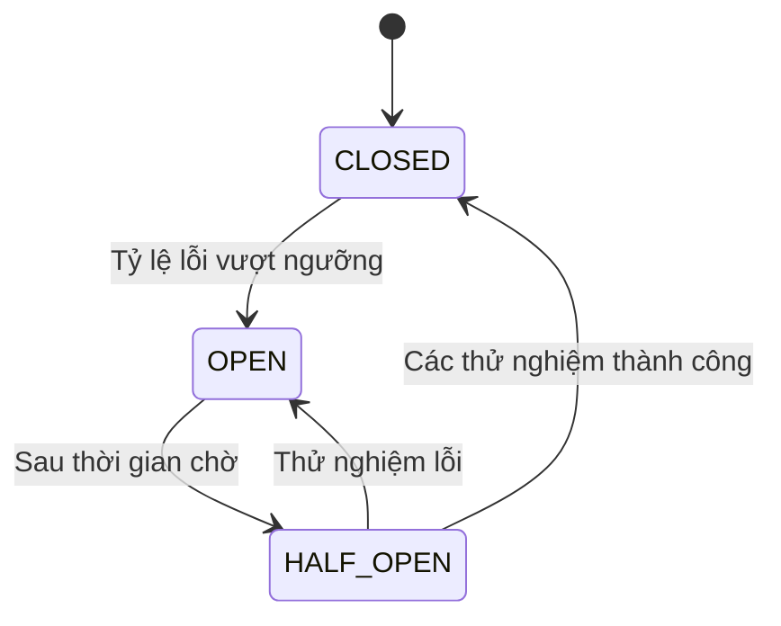
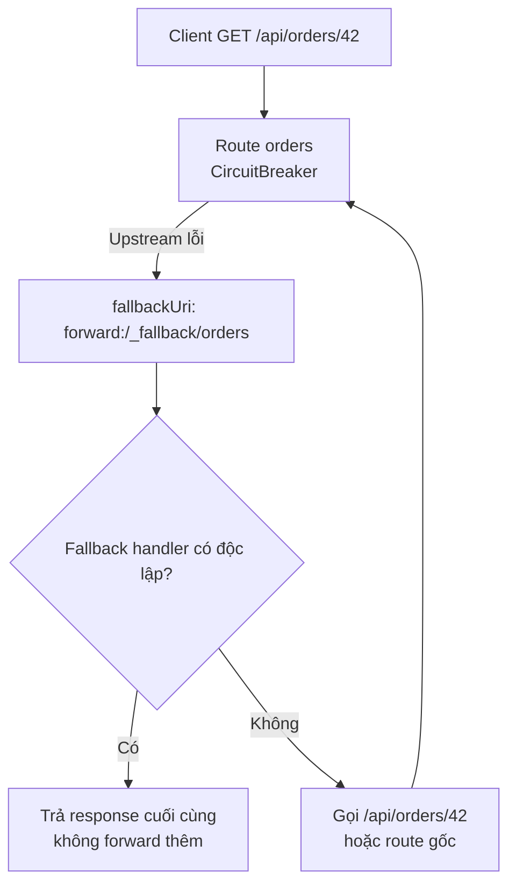
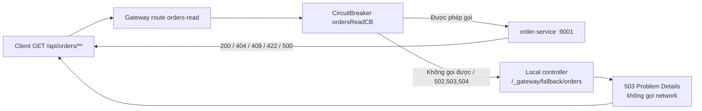

# Tránh fallback gây đệ quy hoặc che mất lỗi nghiệp vụ trong Spring Cloud Gateway

Trong hệ thống microservices, **Spring Cloud Gateway** có thể kết hợp route predicate, filter chain, định tuyến `lb://`, biến đổi path/header và các chính sách resilience để bảo vệ ứng dụng trước sự cố upstream. **Circuit breaker** giúp ngừng gọi một dịch vụ đang lỗi liên tục; **fallback** là hành vi được thực hiện khi cuộc gọi chính không thể thành công trong các điều kiện đã xác định.

Fallback rất hữu ích cho dữ liệu có thể thay thế, chẳng hạn trả thông tin catalog tạm thời từ cache. Nhưng nếu thiết kế sai, nó có thể biến lỗi nhỏ thành sự cố lớn hơn:

1. Fallback **gọi lại chính route** đang lỗi, từ đó kích hoạt circuit breaker và fallback lần nữa — tạo vòng lặp, tốn tài nguyên, timeout hoặc lỗi stack.
2. Fallback **bắt tất cả lỗi** rồi trả `200 OK` với dữ liệu giả, khiến client tin rằng thanh toán/đặt hàng đã thành công.
3. Fallback **đổi lỗi nghiệp vụ** như `404 Not Found`, `409 Conflict`, `422 Unprocessable Content` hoặc `403 Forbidden` thành `503`, che mất bản chất của vấn đề.
4. Fallback được dùng như service phụ nhưng có **circuit breaker, retry hoặc sự phụ thuộc vòng** khác, gây “bão retry” và lan truyền lỗi.
5. Fallback vô tình đưa **exception message, token, thông tin service nội bộ** ra response hoặc một header mà client có thể nhìn thấy.

Bài này thuộc chương **Ngắt mạch và dự phòng**, tập trung vào nguyên tắc **fallback có điểm dừng, không đệ quy, không giả mạo kết quả nghiệp vụ**. Các ví dụ sử dụng **Spring Cloud Gateway Server WebFlux 5.0.x**, Spring Cloud 2025.1.x và Spring Boot 4.x, với tiền tố YAML `spring.cloud.gateway.server.webflux.routes`. Server Web MVC và các phiên bản Gateway 4.x có API/prefix khác; không sao chép máy móc.

## 1. Mục tiêu học tập

Sau bài này, bạn có thể:

1. Giải thích khác biệt giữa **circuit breaker**, **retry**, **timeout** và **fallback**.
2. Phát hiện các chuỗi route/filter gây vòng lặp: `forward:` trỏ ngược vào route gốc, fallback phụ thuộc chính upstream đang lỗi, hoặc default filter áp dụng lại circuit breaker.
3. Sử dụng `CircuitBreaker` GatewayFilter, `fallbackUri` và `statusCodes` có chọn lọc.
4. Thiết kế fallback endpoint **riêng, có điểm dừng, không gọi mạng khi không cần**, trả status/body minh bạch.
5. Phân biệt lỗi **hạ tầng** với lỗi **nghiệp vụ**, bảo toàn `400`/`401`/`403`/`404`/`409`/`422` và `429` theo hợp đồng.
6. Kiểm thử tình huống upstream 200, 404, 422, 500, 503, timeout, circuit OPEN và fallback bị gọi trực tiếp.
7. Thiết kế logs/metrics để quan sát cả **lỗi gốc** và **kết quả fallback** thay vì chỉ thấy status cuối.

## 2. Circuit breaker và fallback giải quyết vấn đề nào?

### 2.1. Các trạng thái circuit breaker

Một circuit breaker thường có ba trạng thái cơ bản:

| Trạng thái | Ý nghĩa | Hành vi |
|---|---|---|
| **CLOSED** | Cho phép lời gọi qua upstream, ghi nhận kết quả | Nếu lỗi vượt chính sách, có thể chuyển OPEN |
| **OPEN** | Từ chối các lời gọi mới đến upstream để giảm tải | Có thể chạy fallback hoặc trả lỗi minh bạch |
| **HALF_OPEN** | Cho phép số lần thử hạn chế sau thời gian chờ | Thành công đủ điều kiện → CLOSED; lỗi → OPEN |

Các cấu hình như `failureRateThreshold`, `minimumNumberOfCalls`, `slidingWindowSize` và `waitDurationInOpenState` của Resilience4j ảnh hưởng đến thời điểm đổi trạng thái. Không hiểu OPEN là “backend đã chết chắc chắn”; OPEN nghĩa là **circuit breaker từ chối thử gọi theo chính sách**.



### 2.2. Retry không phải fallback

- **Retry**: thử lại thao tác, có thể vào cùng upstream nhiều lần. Phải có số lần thử, timeout tổng và backoff hữu hạn.
- **Circuit breaker**: quyết định có nên cho một lời gọi mới tới upstream hay không dựa trên trạng thái quan sát được.
- **Timeout/TimeLimiter**: giới hạn thời gian xử lý, tạo tín hiệu thất bại khi vượt thời gian.
- **Fallback**: lựa chọn đường thay thế khi lời gọi chính bị từ chối/thất bại theo chính sách.

**Fallback không có nghĩa “thử gọi lại chính endpoint ngay lập tức”.** Nếu gọi lại upstream y hệt, bạn đã biến fallback thành một retry không kiểm soát và có nguy cơ tự lặp.

### 2.3. Gateway có tự fallback với mọi HTTP 5xx không?

Không nên giả định. Với `CircuitBreaker` GatewayFilter, các **exception** trong chuỗi có thể kích hoạt circuit breaker. Nếu muốn **HTTP status code cụ thể** từ upstream cũng được tính như thất bại của breaker, Gateway hỗ trợ `statusCodes` trong cấu hình filter. Việc một upstream trả HTTP `503` hợp lệ không đồng nghĩa reactive pipeline phát `onError`.

Tài liệu Spring Cloud Gateway cho phép đưa vào `statusCodes` các số như `500` hoặc tên `HttpStatus` như `"NOT_FOUND"`. Tuy nhiên **hỗ trợ cấu hình không đồng nghĩa nên thêm tất cả mã lỗi**. Lỗi `404` thông thường thuộc nghiệp vụ, không phải dấu hiệu cần fallback.

## 3. Vòng lặp fallback hình thành như thế nào?

### 3.1. Vòng lặp qua route/forward

Xem chuỗi logic sau:



Nếu fallback lại gọi `/api/orders/42` qua chính Gateway, breaker có thể từ chối rồi quay về `/_fallback/orders`. Vòng lặp có thể xuất hiện qua HTTP call, internal forward hoặc qua chuỗi dịch vụ phụ thuộc nhau. Kết quả phụ thuộc thứ tự filter/handler mapping và cấu hình runtime, nhưng **thiết kế có chu trình phụ thuộc vẫn là lỗi**.

**Một cấu hình đáng ngờ (KHÔNG dùng):**

```yaml
# ANTI-PATTERN: fallback trỏ về chính path được bảo vệ.
filters:
  - name: CircuitBreaker
    args:
      name: ordersCB
      fallbackUri: forward:/api/orders/42
```

Khi `/api/orders/42` vẫn đi vào route `orders` và lại chạy CircuitBreaker, đường fallback có thể tự gọi lại. Việc framework có chặn ở một bước cụ thể không biến cấu hình thành thiết kế an toàn.

### 3.2. Vòng lặp qua fallback service

Ngay cả khi `fallbackUri` khác tên route, vẫn có nguy cơ:

```text
Client -> Gateway orders-route -> order-service (đang lỗi)
                         |
                         +-> fallback-service -> gọi Gateway orders-route
                                                 |
                                                 +-> fallback-service -> ...
```

Ví dụ một fallback service trả “đơn hàng gần nhất” nhưng lại lấy dữ liệu bằng cách gọi **public Gateway URL trỏ vào cùng order-service**. Về mặt tên endpoint thì khác; về mặt **đồ thị phụ thuộc** vẫn là vòng.

Hãy rà soát cả **HTTP clients trong code fallback**, ingress rewrite, service discovery `lb://`, mesh virtual service và các route có `default-filters`. Một fallback có tên độc lập chưa chắc độc lập về tài nguyên hay dữ liệu.

### 3.3. Vòng lặp qua default filters và route phụ

Nếu cấu hình CircuitBreaker thành `default-filter` áp dụng cho mọi route, kể cả route `/_fallback/**`, một request chuyển tới fallback route cũng có thể chịu **cùng hoặc một circuit breaker khác**. Không phải mọi trường hợp mặc định đều tái kích hoạt vì còn tùy handler/route được chọn, nhưng nó tạo **đường vòng khó quan sát**.

Quy tắc an toàn: **đừng áp dụng fallback-to-fallback mặc định**. Ưu tiên circuit breaker theo route chính, và để local fallback endpoint được xử lý bởi handler riêng không chứa CircuitBreaker của route đó.

### 3.4. Dấu hiệu vòng lặp trong production

- Một `requestId` tạo ra nhiều lần chuyển `/_fallback/...` hoặc nhiều cuộc gọi cùng upstream bất thường.
- Số request giữa Gateway và fallback service tăng nhanh hơn số request client.
- Log lặp đi lặp lại cùng `CircuitBreaker` name, `CallNotPermittedException` hoặc timeout.
- p99 latency tăng, thread/event-loop hoặc connection pool quá tải, trong khi backend ban đầu đã được circuit breaker bảo vệ.
- Một request fallback lại sinh **retry** làm vượt số lần gọi dự kiến.

**Đừng sửa bằng cách tăng timeout hoặc tăng số lần retry** trước khi loại bỏ vòng phụ thuộc.

## 4. Che mất lỗi nghiệp vụ: nguy hiểm ngang đệ quy

Không phải mọi non-2xx là lỗi hạ tầng. Ví dụ order-service trả:

| Upstream | Ý nghĩa | Có nên thay bằng fallback không? |
|---|---|---|
| `200 OK` | Dữ liệu hợp lệ | Không |
| `400 Bad Request` | Client gửi dữ liệu sai | **Không**, bảo toàn lỗi validation |
| `401 Unauthorized` | Thiếu/sai credentials | **Không**, giữ semantics xác thực |
| `403 Forbidden` | Đã xác thực nhưng thiếu quyền | **Không**, không bypass phân quyền |
| `404 Not Found` | Không có đơn hàng hoặc policy không công bố tồn tại | Thường **không** |
| `409 Conflict` | Xung đột trạng thái, version/idempotency | **Không**, cần client xử lý conflict |
| `422 Unprocessable Content` | Vi phạm quy tắc nghiệp vụ | **Không** |
| `429 Too Many Requests` | Hạn mức lưu lượng | Thường không; không né quota qua fallback |
| `500 Internal Server Error` | Lỗi nội bộ, có thể là bug hoặc outage | Cần phân loại; không mặc định trả thành công |
| `502`/`503`/`504` | Gateway/upstream không sẵn sàng hoặc timeout | Ứng viên fallback **nếu có dữ liệu thay thế an toàn** |

**Nguyên tắc:** Fallback chỉ nên đại diện một **đường xử lý thay thế được chấp thuận**. Nó không được thay đổi quyết định “user không có quyền”, “đơn hàng không tồn tại”, “thanh toán bị từ chối” thành “thành công”.

### 4.1. Anti-pattern: trả `200` với trạng thái giả

```java
// SAI về nghiệp vụ: chưa tạo được đơn hàng nhưng báo thành công.
return ResponseEntity.ok(Map.of(
    "orderId", "generated-later",
    "status", "CONFIRMED"));
```

Nếu upstream không xác nhận đã ghi đơn hàng, không được trả `CONFIRMED`. Client có thể gửi lại, gây ghi trùng, hoặc hiển thị một giao dịch không tồn tại.

Một `200` có dữ liệu cache **chỉ hợp lý** khi API là tác vụ đọc, hợp đồng cho phép dữ liệu cũ, có nguồn đã xác thực và client được thông báo rõ về chất lượng dữ liệu. Với API tạo/sửa dữ liệu quan trọng, thường phù hợp hơn là `503` với mã lỗi ổn định và không khẳng định thao tác đã thực hiện.

### 4.2. Fallback dùng status code phù hợp

Một đáp ứng `503 Service Unavailable` có thể có Problem Details:

```http
HTTP/1.1 503 Service Unavailable
Content-Type: application/problem+json
Cache-Control: no-store

{
  "type": "about:blank",
  "title": "Service Unavailable",
  "status": 503,
  "code": "UPSTREAM_UNAVAILABLE",
  "requestId": "9a53e7fa-e57b-4a0c-9d2e-042cedb7b389"
}
```

`code` và `requestId` là trường mở rộng do API quyết định; `status` phải khớp HTTP status. Tránh trả stacktrace, tên máy nội bộ, private DNS, access token, query nhạy cảm hoặc nguyên `Exception.getMessage()` cho client.

Nếu biết chắc thời điểm phục hồi, có thể trả `Retry-After` phù hợp; **không tự tuyên bố 3 giây** khi upstream chưa có dự báo. Fallback đơn giản nên là phản hồi cuối **không tiếp tục gọi upstream đang lỗi**.

### 4.3. Không coi fallback thành công là upstream thành công

Hai sự kiện khác nhau:

- **Kết quả chính**: upstream thất bại, circuit OPEN hoặc timeout.
- **Kết quả thay thế**: fallback handler chạy thành công và phát response.

Một fallback trả HTTP `200` từ cached read có thể khiến dashboard đo theo status chỉ thấy 200 và che khuất tỷ lệ lỗi của upstream. Cần metric/log phân biệt `primaryOutcome` với `fallbackOutcome`. Đặc biệt, không dùng số lượng fallback 200 để đánh giá “backend uptime”.

## 5. Mẫu an toàn: fallback nội bộ độc lập với route chính

Một cấu trúc dễ kiểm chứng:



**Ba bất biến thiết kế:**

1. **Không có cạnh quay về route gốc.** Fallback controller tạo response ngay tại Gateway, không `forward` thêm lần nữa và không gọi HTTP tới `/api/orders/**`.
2. **Không nuốt lỗi nghiệp vụ.** `statusCodes` chỉ chọn những status được xem là sự cố hạ tầng theo hợp đồng; ví dụ `502`, `503`, `504`. `404`/`409`/`422` phải đi nguyên đến client.
3. **Dự phòng có điểm kết thúc.** Nếu fallback handler có lỗi, lỗi ấy được xử lý theo error handling rõ ràng; không gọi tiếp fallback khác vô thời hạn.

Trong ví dụ, một HTTP `500` từ order-service được **giữ nguyên** để dễ phân biệt bug hoặc lỗi không nằm trong danh sách outage có thể dự phòng. Tùy hợp đồng dịch vụ, bạn có thể bổ sung `500` vào `statusCodes` nếu xác nhận đó là lỗi tạm thời đáng fallback. Không đưa `NOT_FOUND` vào `statusCodes` chỉ vì tài liệu cho phép.

### 5.1. Starter cho Gateway + Resilience4j reactive

Với Server WebFlux, thêm dependency Maven:

```xml
<dependencies>
    <dependency>
        <groupId>org.springframework.cloud</groupId>
        <artifactId>spring-cloud-starter-gateway-server-webflux</artifactId>
    </dependency>
    <dependency>
        <groupId>org.springframework.cloud</groupId>
        <artifactId>spring-cloud-starter-circuitbreaker-reactor-resilience4j</artifactId>
    </dependency>
</dependencies>
```

Đây là **một phần** của `pom.xml`; project vẫn cần Spring Boot parent/plugin và **Spring Cloud BOM tương thích**. Starter có chữ `reactor` dành cho stack reactive; starter Resilience4j không-reactive và Gateway Server Web MVC có API khác.

Class khởi động:

```java
import org.springframework.boot.SpringApplication;
import org.springframework.boot.autoconfigure.SpringBootApplication;

@SpringBootApplication
public class OrdersGatewayApplication {
    public static void main(String[] args) {
        SpringApplication.run(OrdersGatewayApplication.class, args);
    }
}
```

### 5.2. Route YAML an toàn, giới hạn scope theo path và method

Đặt trong `src/main/resources/application.yml`:

```yaml
server:
  port: 8080

spring:
  application:
    name: orders-gateway

  cloud:
    gateway:
      server:
        webflux:
          routes:
            - id: orders-read
              uri: http://localhost:9001
              predicates:
                - Path=/api/orders/**
                - Method=GET
              filters:
                - name: CircuitBreaker
                  args:
                    name: ordersReadCB
                    fallbackUri: forward:/_gateway/fallback/orders
                    statusCodes:
                      - 502
                      - 503
                      - 504
                - StripPrefix=2

resilience4j:
  circuitbreaker:
    instances:
      ordersReadCB:
        slidingWindowType: COUNT_BASED
        slidingWindowSize: 10
        minimumNumberOfCalls: 5
        failureRateThreshold: 50
        waitDurationInOpenState: 10s
        permittedNumberOfCallsInHalfOpenState: 2
  timelimiter:
    instances:
      ordersReadCB:
        timeoutDuration: 2s
```

Giải thích cấu hình:

| Thành phần | Ý nghĩa |
|---|---|
| `Path=/api/orders/**` và `Method=GET` | Chỉ áp dụng breaker cho API đọc đơn hàng |
| `uri: http://localhost:9001` | Backend lab sẽ nhận request sau rewrite |
| `name: CircuitBreaker` | GatewayFilter dùng Spring Cloud CircuitBreaker |
| `args.name: ordersReadCB` | Tên instance breaker và config Resilience4j |
| `fallbackUri: forward:/_gateway/fallback/orders` | Chuyển đến **handler nội bộ** khi breaker fallback |
| `statusCodes: 502,503,504` | Chọn các HTTP status cần tính là thất bại để fallback |
| `StripPrefix=2` | `/api/orders/42` → `/42` trước backend |
| `timeoutDuration: 2s` | TimeLimiter giới hạn thời gian trong pipeline reactive theo cấu hình tương ứng |

`statusCodes` chỉ áp dụng khi Gateway thấy các status trong **vùng xử lý mà CircuitBreaker bọc**. Không nên suy luận rằng mọi lỗi 5xx trong toàn hệ thống, kể cả lỗi security/ingress phát sinh trước filter, đều bị chuyển tới fallback.

### 5.3. Fallback controller không gọi upstream

Tạo file `OrdersFallbackController.java` trong package được `OrdersGatewayApplication` quét:

```java
import java.util.LinkedHashMap;
import java.util.Map;

import org.springframework.cloud.gateway.support.ServerWebExchangeUtils;
import org.springframework.http.CacheControl;
import org.springframework.http.HttpStatus;
import org.springframework.http.MediaType;
import org.springframework.http.ResponseEntity;
import org.springframework.web.bind.annotation.GetMapping;
import org.springframework.web.bind.annotation.RestController;
import org.springframework.web.server.ServerWebExchange;

@RestController
public class OrdersFallbackController {

    @GetMapping(
        path = "/_gateway/fallback/orders",
        produces = "application/problem+json")
    public ResponseEntity<Map<String, Object>> unavailable(
            ServerWebExchange exchange) {

        Throwable cause = exchange.getAttribute(
            ServerWebExchangeUtils.CIRCUITBREAKER_EXECUTION_EXCEPTION_ATTR);

        // Một request HTTP gọi thẳng endpoint fallback
        // không được coi là fallback hợp lệ.
        if (cause == null) {
            return ResponseEntity.status(HttpStatus.NOT_FOUND).build();
        }

        // Không gửi cause.getMessage(), stacktrace hay địa chỉ nội bộ ra client.
        String requestId = exchange.getRequest().getId();
        Map<String, Object> problem = new LinkedHashMap<>();
        problem.put("type", "about:blank");
        problem.put("title", "Service Unavailable");
        problem.put("status", 503);
        problem.put("code", "UPSTREAM_UNAVAILABLE");
        problem.put("requestId", requestId);

        return ResponseEntity
            .status(HttpStatus.SERVICE_UNAVAILABLE)
            .contentType(MediaType.parseMediaType(
                "application/problem+json"))
            .cacheControl(CacheControl.noStore())
            .header("X-Request-Id", requestId)
            .body(problem);
    }
}
```

**Vì sao đây là mẫu tránh vòng lặp?**

- Fallback controller nằm ở path `/_gateway/fallback/orders`, **không khớp** predicate `Path=/api/orders/**` của route `orders-read`.
- Controller **không gọi `WebClient`**, không làm `forward:` tiếp, không gửi request HTTP đến `localhost:8080` hoặc `localhost:9001`.
- Chỉ có một kết quả cuối: `503` và Problem Details trung thực với sự cố.
- Handler kiểm tra **exchange attribute do Gateway đặt ở phía server**, không tin header `X-Fallback: true` do client tự gửi. Trong tài liệu Gateway, `ServerWebExchangeUtils.CIRCUITBREAKER_EXECUTION_EXCEPTION_ATTR` cho biết nguyên nhân đã được CB lưu để fallback xử lý.
- Direct GET `/_gateway/fallback/orders` không mang attribute này nên nhận `404` trong lab. Đây là **lớp phòng vệ minh họa**, production còn cần policy routing/security chặn truy cập không cần thiết.

**Lưu ý phiên bản:** Bạn phải kiểm tra trạng thái fallback thực tế trên release đang chạy: nếu cơ chế được kích hoạt bằng HTTP `statusCodes` hoặc circuit OPEN, xem attribute có được đặt như mong đợi không. Nếu không, test sẽ phát hiện và bạn phải sửa hợp đồng/handler cho chính phiên bản đó. Đừng xóa kiểm tra bảo vệ chỉ để tạo response 503 cho một URL public tùy ý.

### 5.4. Không làm mới correlation ID tùy tiện

Trong ví dụ, `exchange.getRequest().getId()` được dùng làm ID kỹ thuật của WebFlux request tại Gateway. Với ứng dụng production, nên tạo/chuẩn hóa `X-Request-Id` ở **ingress hoặc một `WebFilter` sớm** để cả request chính, fallback, `401`/`403` và log đều dùng cùng định danh, rồi truyền ID đã kiểm soát sang backend.

Đừng nhận nguyên một `X-Request-Id` dài hoặc chứa dữ liệu nhạy cảm do client tự khai mà không chuẩn hóa. Không nhúng exception message vào `requestId` hoặc bất kỳ field của response.

### 5.5. Điểm cần chú ý với `forward:`

- Tài liệu Gateway Server WebFlux hiện mô tả `fallbackUri` với **scheme `forward:`**; đừng đặt trực tiếp `fallbackUri: http://other-service/fallback` và coi đó là cấu hình được hỗ trợ tương đương.
- `forward:/_gateway/fallback/orders` **không phải HTTP 302 redirect**: client vẫn nhận response của request ban đầu; Gateway chuyển request tới handler bên trong.
- Nếu muốn đưa fallback tới một external service, tài liệu minh họa **một route thứ hai** nhận path `/fallback` rồi proxy đến external backend. Cách đó mở thêm các điểm phụ thuộc/vòng lặp; chỉ dùng sau khi rà soát graph và giới hạn retry/breaker riêng.
- Khi cần dự phòng an toàn, **local handler trả response cố định** thường có ít nguy cơ đệ quy hơn external fallback.

## 6. Lab end-to-end: giữ lỗi nghiệp vụ, fallback cho lỗi hạ tầng

Để kiểm chứng chính sách, ta tạo một backend HTTP đơn giản có thể trả từng loại status. Lab này giúp chứng minh **Gateway không biến mọi lỗi thành fallback**, đồng thời quan sát số lần thật sự gọi upstream.

### 6.1. Backend Java giả lập order-service

Tạo file `OrderLabBackend.java` trong thư mục thực hành **của người học**:

```java
import com.sun.net.httpserver.HttpServer;
import java.net.InetSocketAddress;
import java.nio.charset.StandardCharsets;
import java.util.concurrent.Executors;
import java.util.concurrent.atomic.AtomicLong;

public class OrderLabBackend {
    public static void main(String[] args) throws Exception {
        HttpServer server = HttpServer.create(
                new InetSocketAddress("127.0.0.1", 9001), 0);
        AtomicLong requests = new AtomicLong();

        server.createContext("/", exchange -> {
            long count = requests.incrementAndGet();
            String path = exchange.getRequestURI().getRawPath();

            if ("/slow".equals(path)) {
                try {
                    Thread.sleep(3500);
                } catch (InterruptedException e) {
                    Thread.currentThread().interrupt();
                }
            }

            int status = switch (path) {
                case "/missing"  -> 404;
                case "/conflict" -> 409;
                case "/invalid"  -> 422;
                case "/broken"   -> 500;
                case "/down"     -> 503;
                default          -> 200;
            };

            String bodyText = switch (status) {
                case 404 -> "{\"code\":\"ORDER_NOT_FOUND\"}";
                case 409 -> "{\"code\":\"ORDER_STATE_CONFLICT\"}";
                case 422 -> "{\"code\":\"INVALID_ORDER_DATA\"}";
                case 500 -> "{\"code\":\"UPSTREAM_INTERNAL_FAILURE\"}";
                case 503 -> "{\"code\":\"UPSTREAM_UNAVAILABLE\"}";
                default -> "{\"orderId\":\"42\",\"status\":\"READY\"}";
            };

            byte[] bytes = bodyText.getBytes(StandardCharsets.UTF_8);
            exchange.getResponseHeaders().set(
                    "Content-Type", "application/json");
            exchange.getResponseHeaders().set(
                    "X-Lab-Upstream", "order-service");
            exchange.sendResponseHeaders(status, bytes.length);

            try (var out = exchange.getResponseBody()) {
                out.write(bytes);
            }
            System.out.println("upstream#" + count
                    + " path=" + path + " status=" + status);
        });

        server.setExecutor(Executors.newFixedThreadPool(4));
        server.start();
        System.out.println("Backend http://localhost:9001");
    }
}
```

Chạy backend bằng JDK 17+:

```bash
java --add-modules jdk.httpserver OrderLabBackend.java
```

Gọi trực tiếp backend để xác nhận response gốc:

```bash
curl -i http://localhost:9001/missing
curl -i http://localhost:9001/conflict
curl -i http://localhost:9001/down
```

Kết quả: `/missing` trả `404 ORDER_NOT_FOUND`, `/conflict` trả `409 ORDER_STATE_CONFLICT`, `/invalid` trả `422 INVALID_ORDER_DATA`, `/broken` trả `500`, `/down` trả `503`, còn `/slow` chờ khoảng 3,5 giây rồi mới trả `200`.

### 6.2. Khởi động Gateway và test theo thứ tự

Mở terminal riêng tại thư mục Gateway có dependencies, route và controller từ mục 5:

```bash
# Linux/macOS
./mvnw spring-boot:run

# Windows PowerShell
.\mvnw.cmd spring-boot:run
```

**Test thành công:**

```bash
curl -i http://localhost:8080/api/orders/ok
```

Dự kiến `200 OK`, header `X-Lab-Upstream: order-service` và body:

```json
{"orderId":"42","status":"READY"}
```

**Test lỗi nghiệp vụ:**

```bash
curl -i http://localhost:8080/api/orders/missing
curl -i http://localhost:8080/api/orders/conflict
curl -i http://localhost:8080/api/orders/invalid
```

Khi circuit đang CLOSED và không có filter khác can thiệp, ba phản hồi giữ nguyên `404`, `409`, `422` cùng `code` của backend. Đây là tiêu chí quan trọng nhất của bài: **không che mất lỗi nghiệp vụ**.

**Test lỗi 500 chưa được liệt kê:**

```bash
curl -i http://localhost:8080/api/orders/broken
```

Với `statusCodes` ở mục 5 gồm `502, 503, 504`, HTTP `500` **không tự chuyển thành fallback** trong demo; response `UPSTREAM_INTERNAL_FAILURE` đi về client theo hợp đồng gốc. Muốn thêm `500` vào breaker cần quyết định theo tính chất lỗi thực của backend.

**Test upstream không sẵn sàng:**

```bash
curl -i http://localhost:8080/api/orders/down
```

Do `503` có trong `statusCodes`, CircuitBreaker có thể chuyển sang fallback handler. Phản hồi cuối được handler tạo:

```http
HTTP/1.1 503 Service Unavailable
Content-Type: application/problem+json
Cache-Control: no-store

{
  "type": "about:blank",
  "title": "Service Unavailable",
  "status": 503,
  "code": "UPSTREAM_UNAVAILABLE",
  "requestId": "..."
}
```

Đây là **503 minh bạch**, không phải 200 giả. Backend trả body khác, nhưng Gateway không làm giả đơn hàng thành công. Khi điều tra cần ghi cả upstream status `503` và kết quả fallback.

**Test timeout:**

```bash
curl -i --max-time 8 http://localhost:8080/api/orders/slow
```

`/slow` chờ 3,5 giây, dài hơn TimeLimiter 2 giây. Nếu circuit đang CLOSED và timeout được áp dụng như dự kiến, một kết quả thường gặp là fallback `503`. Cấu hình khác về Netty/HTTP response timeout hoặc client timeout có thể thay đổi kết quả. `504` phù hợp hơn khi API muốn phân biệt timeout; trong demo fallback cố tình thống nhất lỗi tạm thời thành 503, nhưng log phải ghi **nguyên nhân timeout**.

### 6.3. Khi circuit breaker OPEN

Khi đủ nhiều lời gọi thất bại theo `minimumNumberOfCalls`, `failureRateThreshold` và sliding window, breaker chuyển OPEN. Một request sau đó tới cả `/api/orders/ok` có thể bị **từ chối trước khi đến backend**, rồi nhận response fallback.

Để quan sát:

1. Thử lỗi nghiệp vụ `404`/`409` trước, khi breaker chưa OPEN.
2. Gửi nhiều request `/api/orders/down` rồi xem logs/metrics trạng thái CB.
3. Quan sát backend có tiếp tục in dòng `upstream#...` khi circuit OPEN không.
4. Thử `/api/orders/ok` trong lúc OPEN; có thể nhận fallback dù endpoint bản thân khỏe.
5. Chờ qua `waitDurationInOpenState`, quan sát HALF_OPEN cho phép số lời gọi thử hữu hạn.

Không dự đoán chính xác số request gây OPEN trên mọi máy: trạng thái trước đó, request song song, minimum calls và timing đều ảnh hưởng. Khi muốn thử lại từ điều kiện ban đầu, dùng một instance CB/test environment sạch.

### 6.4. Chống gọi thẳng fallback bằng header giả

```bash
curl -i http://localhost:8080/_gateway/fallback/orders
curl -i http://localhost:8080/_gateway/fallback/orders \
  -H "X-Internal-Fallback: true"
```

Cả hai phải không được coi là fallback hợp lệ trong lab. Chúng không có server-side `CIRCUITBREAKER_EXECUTION_EXCEPTION_ATTR`, nên controller trả `404`. Header do client tự gửi **không tạo được exchange attribute** của Gateway.

Tại production cần thêm chính sách bảo vệ endpoint nội bộ và kiểm tra Spring Security/filter order, thay vì dựa duy nhất vào tên path có dấu gạch dưới.

### 6.5. Kiểm tra không có đệ quy bằng số upstream attempts

Trong code demo không cấu hình `Retry`. Với circuit CLOSED, một request client `/api/orders/down` tối đa gọi một lần tới backend trước khi fallback; với circuit OPEN có thể gọi **0 lần**.

Nếu chỉ một request client mà backend liên tục in thêm nhiều `upstream#...`, hãy kiểm tra:

- Có `Retry` filter hoặc client retry tự động không?
- Fallback handler có gọi HTTP về `localhost:8080/api/orders/**`?
- Có route `/_gateway/fallback/**` lại trỏ ngược vào route chính không?
- Default filters hoặc ingress/service mesh có chuyển vòng request không?
- Có HTTP client cấp dưới gọi lại public Gateway host thay vì backend dự phòng độc lập không?

Đừng tạo vòng lặp thật trên production để kiểm tra. Nếu cần test anti-pattern, dùng môi trường cô lập, số attempt hữu hạn, timeout thấp và theo dõi resource usage.

## 7. Những kiểu fallback cần lựa chọn theo nghiệp vụ

### 7.1. Fallback báo tạm thời không phục vụ được

Phù hợp khi:

- Dịch vụ không có dữ liệu thay thế đủ tin cậy.
- Request có side effect như tạo đơn hàng, thanh toán, cập nhật quyền.
- Không biết upstream đã xử lý thành công hay chưa trước khi timeout.
- Cần giữ tính minh bạch với client và hệ thống giám sát.

Phản hồi thường là `503` hoặc `504` với code như `UPSTREAM_UNAVAILABLE`/`UPSTREAM_TIMEOUT`, tuân theo hợp đồng API. Với `POST` không idempotent, **không nên khẳng định thao tác đã thất bại hoàn toàn chỉ vì client timeout**: upstream có thể đã ghi thành công trước khi kết nối bị ngắt. Thiết kế idempotency key, API truy vấn trạng thái hoặc quy trình đối soát là cần thiết.

### 7.2. Fallback trả dữ liệu cache có kiểm soát

Có thể dùng cho **GET đọc dữ liệu không nhạy cảm** nếu nghiệp vụ chấp nhận dữ liệu cũ. Ví dụ hiển thị danh sách sản phẩm gần nhất từ cache:

```http
HTTP/1.1 200 OK
Content-Type: application/json
Cache-Control: private, max-age=0
X-Response-Source: stale-cache

{"products":[...],"degraded":true}
```

Đây là **ví dụ hợp đồng**, không phải code chạy của lab. Nếu API công khai không cho phép stale data, phải trả lỗi thay vì bật fallback theo ý muốn.

Điều kiện để cache fallback an toàn:

1. Cache có **giới hạn tuổi** (TTL/staleness budget) và quy tắc invalidation phù hợp.
2. Key cache gồm **định danh tenant/user** khi dữ liệu có phân quyền; không lấy key từ header client tự giả mạo.
3. Response có nhãn nguồn (`degraded`, `X-Response-Source`) mà client/monitoring hiểu; không che lỗi upstream.
4. Không trả dữ liệu cũ cho giao dịch thanh toán, quyền truy cập, tồn kho tức thời hoặc trạng thái có thể gây thiệt hại khi stale.
5. Cache backend có timeout riêng và **không quay về order-service lỗi**; nếu cache cũng lỗi, kết thúc bằng response lỗi rõ ràng.
6. Khi trả 200 từ cache, metric phải ghi `primary=failed` và `fallback=cache` để không thổi phồng upstream availability.

`X-Response-Source` là ví dụ header ứng dụng, **không phải HTTP header chuẩn bắt buộc**. Với dữ liệu nhạy cảm, phải kiểm soát cách cache được phân vùng và những header nào được công bố.

### 7.3. Fallback trả dữ liệu mặc định theo chính sách

Một giá trị mặc định như `{"recommendations": []}` có thể chấp nhận được nếu **feature bổ trợ không quan trọng**, chẳng hạn mục “sản phẩm liên quan”. Nhưng nó phải được diễn đạt là “không có đề xuất khả dụng” chứ không được đánh tráo thành “thật sự không có sản phẩm” nếu UI cần phân biệt hai trạng thái.

**Không dùng giá trị mặc định** để lấp những quyết định như:

- `isAdmin = false` nếu policy cần từ chối khi không xác minh được quyền.
- `paymentStatus = SUCCESS` khi payment-service không xác nhận.
- `availableStock = 100` khi inventory-service lỗi.
- `riskScore = 0` khi fraud-service bị ngắt.
- `identityVerified = true` khi identity-service timeout.

Nguyên tắc: “fallback thành công” chỉ được phép khi kết quả **đủ an toàn để dùng**, không phải chỉ vì có thể tạo JSON hợp lệ.

## 8. Chọn loại lỗi để mở breaker: không suy diễn từ mã HTTP bề ngoài

### 8.1. `statusCodes` nên có phạm vi nhỏ và rõ ràng

Trong Gateway WebFlux, cấu hình sau **mở rộng** nhóm HTTP status được coi là thất bại trong vùng được CircuitBreaker bảo vệ:

```yaml
filters:
  - name: CircuitBreaker
    args:
      name: catalogCB
      fallbackUri: forward:/_gateway/fallback/catalog
      statusCodes:
        - 502
        - 503
        - 504
```

Không đặt `404` trong danh sách chỉ vì một backend có thể bị mất instance. **404 từ order-service** thường có nghĩa là “đơn hàng không tồn tại”; còn **503 từ LoadBalancer** có thể có nghĩa “không tìm thấy instance khả dụng”. Hai tình huống khác bản chất.

Nếu backend thật sự dùng `404` cho “dịch vụ tạm không tìm được”, đó là **hợp đồng HTTP gây hiểu nhầm**. Nên sửa backend/discovery và phân loại lỗi ở đúng lớp thay vì biến mọi 404 thành fallback.

### 8.2. Java exception và lỗi nghiệp vụ được ném ra từ custom filter

Không chỉ `statusCodes`: một **custom GatewayFilter** có thể ném exception trước khi upstream được gọi. Nếu một custom filter phát `IllegalArgumentException` do input không hợp lệ nhưng exception rơi vào vùng CircuitBreaker bao quanh, breaker có thể hiểu đây là lỗi xử lý cần fallback.

Cách giảm rủi ro:

- Validate request và xác thực/ủy quyền ở **lớp thích hợp trước khi bọc lời gọi upstream**.
- Trả HTTP `400`/`422` theo hợp đồng thay vì ném domain exception tự do từ một filter được CircuitBreaker bao quanh.
- Với Resilience4j, cân nhắc `recordExceptions`/`ignoreExceptions` hoặc predicate ghi nhận lỗi khi ứng dụng dùng exception có phân loại; **kiểm chứng trên exception class thực sự**.
- Các property phân loại **Java exception** không tự thay `statusCodes` của Gateway thành một rule hiểu `error.code` trong JSON backend. Khi backend gửi HTTP `200` chứa một body lỗi, cần sửa hợp đồng backend, không kỳ vọng CircuitBreaker phân tích ngữ nghĩa JSON tự động.

Ví dụ một lỗi nghiệp vụ từ upstream:

```http
HTTP/1.1 409 Conflict
Content-Type: application/problem+json

{"status":409,"code":"ORDER_ALREADY_CONFIRMED"}
```

Đây là một kết quả **có ý nghĩa nghiệp vụ**, không phải tín hiệu để gọi fallback cache hoặc thử đặt đơn hàng lại.

### 8.3. `resumeWithoutError` có thể khiến lỗi trông như thành công

Tài liệu Gateway 5.0 mô tả tùy chọn `resumeWithoutError: true` của `CircuitBreaker`, cho phép tiếp tục mà không truyền một số lỗi ra client. Tài liệu cũng nêu các ngoại lệ timeout và circuit OPEN vẫn được trả với mã tương ứng (ví dụ `504`/`503`), nhưng các lỗi không được xử lý khác có thể dẫn đến phản hồi trông như thành công.

Ví dụ cấu hình **phải cân nhắc kỹ, KHÔNG dùng mặc định**:

```yaml
filters:
  - name: CircuitBreaker
    args:
      name: optionalServiceCB
      resumeWithoutError: true
```

Đối với API quan trọng, **tránh bật để “hết 5xx”**, vì có nguy cơ che mất lỗi và khiến client không nhận đủ dữ liệu. Chỉ cân nhắc khi hợp đồng thật sự cho phép một tác vụ phụ không bắt buộc thất bại mà response chính vẫn hợp lệ. Khi dùng phải kiểm tra body/status cuối, không coi `resumeWithoutError` là phép thay thế cho fallback có trách nhiệm.

### 8.4. Không ghi đè error contract bằng một filter hậu xử lý tùy tiện

Một filter `SetStatus=200` đặt trên route để “chuẩn hóa” mọi phản hồi có thể che 404/409/503. Tương tự, `ModifyResponseBody` bắt mọi `4xx` và thay bằng payload thành công không phải resilience.

Nếu cần một contract đồng nhất, dùng **Problem Details** (RFC 9457) hoặc schema do tổ chức quy định, nhưng giữ nguyên **HTTP status và code nghiệp vụ** đã được phân loại. Với response đã commit/streaming, việc đổi body/status sau khi ghi ra mạng có thể không còn khả thi.

## 9. External fallback, `FallbackHeaders` và những rủi ro bảo mật

Spring Cloud Gateway cho phép dùng `fallbackUri: forward:/fallback` để forward tới **một route khác** và từ đó proxy đến **một service dự phòng**. Đây là lựa chọn nâng cao, có thêm rủi ro so với local handler:

```text
Client → orders-route → CircuitBreaker
                         └── forward:/_fallback/orders
                             → fallback-proxy-route
                             → fallback-service
```

Phải đảm bảo fallback-service **không gọi lại orders-route** hoặc bất kỳ service nào phụ thuộc order-service theo chu trình. Cũng phải giới hạn timeout, kết nối và độ trễ, vì fallback có thể bị gọi rất nhiều khi upstream chính đang lỗi.

### 9.1. `FallbackHeaders` là công cụ nội bộ, không phải header để công bố

`FallbackHeaders` GatewayFilter có thể đưa thông tin exception từ circuit breaker vào **request được forward tới external fallback service**, gồm loại exception, thông điệp và root cause. Mặc định các tên header trong tài liệu bao gồm:

- `Execution-Exception-Type`
- `Execution-Exception-Message`
- `Root-Cause-Exception-Type`
- `Root-Cause-Exception-Message`

**Cảnh báo:** Exception message có thể chứa hostname nội bộ, đường dẫn, query, token hoặc dữ liệu nhạy cảm. Không thêm `FallbackHeaders` cho external service không được tin cậy, và không phản chiếu nguyên các header này vào response client. Nếu thực sự cần truyền tín hiệu giữa các service, nên dùng **error code/trace ID đã chuẩn hóa** hơn là raw exception message.

Các header này cũng **không có giá trị chứng thực**. Client có thể tự gửi header trùng tên nếu ingress/Gateway không sanitize. Service dự phòng không được coi `Execution-Exception-Type` là bằng chứng tin cậy hoặc căn cứ phân quyền.

### 9.2. Tránh dùng cùng breaker name cho route chính và route fallback

Nếu cả route chính lẫn fallback route đều cấu hình:

```yaml
name: sharedCircuitBreaker
```

thì nhiều lời gọi không cùng backend có thể chia sẻ **state của cùng circuit breaker instance** theo cách tổ chức cấu hình, làm khó phân tích trạng thái và có thể cắt cả đường dự phòng. Dù đặt tên khác nhau, một fallback có breaker riêng vẫn cần có **điểm dừng cuối**, không lặp tiếp sang fallback của route chính.

Nếu có thật sự cần nhiều tầng fallback, hãy mô tả **đồ thị phụ thuộc không chu trình**, giới hạn độ sâu cố định và test thất bại của **mọi node trong đồ thị**. Đừng dùng chuỗi “fallback A → B → A” ngay cả khi mỗi node có timeout ngắn.

### 9.3. Giới hạn hop và nhận diện recursion

Ưu tiên **loại bỏ vòng lặp bằng thiết kế**, nhưng có thể thêm phòng vệ:

- Với forward nội bộ, lưu thông tin đã vào fallback trong **`ServerWebExchange` attribute do server đặt**; không dùng header do client tự khai làm bộ đếm đáng tin.
- Với HTTP hop giữa nhiều service, mỗi service phải xác minh nguồn, giới hạn số hop/attempt và chống spoofing. Một header `X-Fallback-Hop: 1` tự do từ Internet không đủ an toàn.
- Đặt trần timeout tổng, số retry, số route chuyển tiếp và số lời gọi dự phòng; khi vượt trần, trả lỗi có kiểm soát.
- Thêm structured tracing cho từng hop để tìm cạnh tạo vòng.
- Từ chối trực tiếp URL fallback nội bộ hoặc yêu cầu xác thực/policy tương ứng; không mở `/_gateway/fallback/**` như API public không kiểm soát.

**Guard chỉ là lớp phòng vệ thứ hai**. Thiết kế fallback không gọi lại upstream và không có chu trình phụ thuộc vẫn là biện pháp chính.

## 10. Retry, timeout, filter order và response commit

### 10.1. Retry có thể làm tăng số lời gọi trước khi fallback

Ví dụ khái quát:

```text
Client gửi 1 request
  -> Gateway Retry (tối đa 2 retries)
      -> gọi upstream lần 1: timeout
      -> gọi upstream lần 2: 503
      -> gọi upstream lần 3: 503
  -> CircuitBreaker/fallback trả lỗi tạm thời
```

Đây là **một kịch bản minh họa**, không mô tả thứ tự mặc định khi đặt các filter với order tùy ý. Trong Gateway, `Retry`, `CircuitBreaker` và các filter khác được lồng theo filter chain, nên **vị trí tương đối** quyết định bước nào được retry, bước nào được breaker tính một lần và số lần backend thật sự được gọi.

Để tránh bùng nổ tải:

1. Đặt **giới hạn retries nhỏ và hữu hạn** (có thể là 0 với API có side effect).
2. Dùng **backoff + jitter** nếu phải retry và giữ timeout tổng.
3. Không retry `401`, `403`, `404`, `409`, `422` hay `429` một cách vô điều kiện.
4. Kiểm tra trạng thái CLOSED/OPEN và số upstream attempts; không dùng Retry để vượt quyết định circuit OPEN.
5. Với request có body, đánh giá khả năng **replay body**, buffer/cache, idempotency và chi phí bộ nhớ.
6. Giới hạn retry cả ở **client, Gateway và backend client**, tránh nhiều tầng nhân số lần gọi.

Nếu ba tầng mỗi tầng cho phép ba lần thử, tổng số attempts có thể tăng theo tích khi các vòng lặp lồng nhau. Trước khi bật retry, phải vẽ đường gọi và kiểm tra thực tế bằng backend có counter.

### 10.2. Timeout tổng và timeout từng hop

Thường có nhiều đồng hồ:

- Timeout của client khi chờ Gateway.
- Connect timeout và response timeout của Gateway HTTP client tới upstream.
- `TimeLimiter` của CircuitBreaker/Resilience4j.
- Timeout của external fallback (nếu dùng).
- Deadline của backend gọi các service khác.

Không đặt timeout của từng bước một cách độc lập mà không có **deadline tổng**. Ví dụ client chờ 2 giây, Gateway chờ upstream 5 giây rồi fallback chờ thêm 5 giây, thì fallback không giúp cải thiện trải nghiệm: client đã ngắt từ trước.

**Timeout không chứng minh transaction chưa commit.** Nếu backend nhận `POST /payments`, ghi dữ liệu rồi chậm trả phản hồi, Gateway timeout có thể xảy ra **sau tác động nghiệp vụ**. Trả `200 PAYMENT_SUCCESS` tự tạo hoặc tự retry không idempotent đều nguy hiểm. Cần idempotency key, query status, reconciliation và hợp đồng kết quả không chắc chắn.

### 10.3. Response đã commit thì không thể “làm như chưa có gì”

Với SSE, chunked HTTP response hoặc file streaming, upstream có thể gửi header/status và một phần body trước khi kết nối lỗi. Khi response đã commit, Gateway không thể đơn giản thay toàn bộ nội dung thành JSON fallback hợp lệ mà không gây lỗi giao thức.

Những phương án cần cân nhắc:

- Nếu ứng dụng yêu cầu **all-or-nothing**, thiết kế protocol/response buffering có giới hạn, nhưng chấp nhận chi phí memory/latency.
- Với streaming, giao thức có thể yêu cầu event báo lỗi, đóng stream và client reconnect theo chính sách; không giả rằng `fallbackUri` luôn sửa được response đã phát một phần.
- Đo cả **response commit state** và tín hiệu `cancel`/`onError` trong tracing; một HTTP status 200 đã gửi không chứng minh stream hoàn tất.
- Không tự gom body lớn chỉ để cố chuyển lỗi cuối stream thành 503; điều này có thể gây `DataBufferLimitException` và áp lực bộ nhớ.

### 10.4. Fallback không được vượt qua xác thực hoặc rate limit

- **Spring Security** thường kiểm tra credentials và policy trước khi request đi vào Gateway route/filter; lỗi `401`/`403` không phải ứng viên của fallback hạ tầng.
- **RequestRateLimiter** có thể trả `429` để bảo vệ quota. Không route ngầm sang fallback có thể gọi cùng backend nhằm vượt hạn mức.
- **TLS/mTLS** lỗi ở client → Gateway có thể xảy ra trước HTTP, không có response để GatewayFilter xử lý.
- **Gateway → backend TLS** lỗi trust/hostname là vấn đề bảo mật hạ tầng; không “sửa” bằng cách tắt certificate validation hoặc dùng fallback route public không bảo vệ.
- **Service discovery** không có instance khả dụng có thể được Gateway diễn đạt thành `5xx`; cần phân biệt với business “resource 404” trong logs.

## 11. Kiểm thử hồi quy cho anti-recursion và domain errors

Một bộ test tối thiểu cho route `orders-read`:

| Ca kiểm thử | Điều kiện | HTTP/kết quả kỳ vọng | Điều cần chứng minh |
|---|---|---|---|
| S1 | Upstream khỏe, `/ok` | `200` với body gốc | Không fallback oan |
| S2 | `/missing` | `404`, `ORDER_NOT_FOUND` | Không che lỗi tài nguyên |
| S3 | `/conflict` | `409`, `ORDER_STATE_CONFLICT` | Không biến xung đột thành thành công |
| S4 | `/invalid` | `422`, `INVALID_ORDER_DATA` | Giữ lỗi validation |
| S5 | `/broken` | `500`, body gốc trong config lab | Không fallback status chưa được chọn |
| S6 | `/down`, breaker CLOSED | `503` Problem Details từ fallback | Fallback minh bạch |
| S7 | `/slow`, TimeLimiter kích hoạt | Response fallback theo hợp đồng lab | Phân biệt timeout với business error |
| S8 | Breaker OPEN | `503`, có thể không gọi upstream | Cắt mạch thực sự giảm tải |
| S9 | Gọi trực tiếp `/_gateway/fallback/orders` | `404` trong lab | Không mở endpoint dự phòng cho client |
| S10 | Một request gây fallback | Tối đa 1 upstream attempt nếu không Retry | Không có recursion |
| S11 | Fallback handler cố tình lỗi | Lỗi hữu hạn, không gọi lại route chính | Có điểm dừng |
| S12 | Backend trả 401/403 | Giữ semantics auth hoặc bị Security xử lý đúng lớp | Không bypass quyền |
| S13 | Backend trả 429 | Không retry hoặc bypass quota mù quáng | Bảo toàn rate limit |
| S14 | Response stream đã commit rồi lỗi | Client thấy hành vi stream/error phù hợp | Không gửi hai status/body xung đột |

### 11.1. Những điều cần assert ngoài status

Không chỉ kiểm tra `expectStatus().is5xxServerError()`. Nên assert:

- Body còn `code=ORDER_NOT_FOUND` sau 404, không thành `UPSTREAM_UNAVAILABLE`.
- Fallback chỉ được gọi khi đúng điều kiện hoặc breaker OPEN.
- Có dấu hiệu `fallbackInvoked=true` trong metric/log khi fallback thật sự chạy.
- Số backend attempts trong test không vượt ngưỡng cho phép.
- Direct fallback URL không hoạt động như API public.
- Không trả exception message/stacktrace/hostname nội bộ.
- Không rò dữ liệu cache giữa hai user/tenant.
- Request ID từ ingress/client response được nhất quán trong log theo hợp đồng.
- Sau khi backend hồi phục và breaker CLOSED, request quay lại đường chính.

### 11.2. Đừng kiểm thử bằng cách làm hỏng production

Những phép thử cố tình tạo vòng lặp, tắt backend hoặc làm circuit OPEN cần được thực hiện trong **môi trường cô lập** với giới hạn lưu lượng, timeout và khả năng cleanup. Chaos test production chỉ khi có quy trình được phê duyệt, blast radius được kiểm soát và dashboard/rollback sẵn sàng.

Có thể test tự động với `WebTestClient` và một mock HTTP server phản hồi các status, hoặc test end-to-end với backend lab. Phải kiểm tra **status lẫn payload**, **số upstream requests**, **state breaker**, và **security** chứ không chỉ xem có response hay không.

## 12. Quan sát: đo thất bại chính và kết quả fallback riêng

### 12.1. Log có cấu trúc

Ví dụ một sự kiện log:

```json
{
  "requestId": "9a53e7fa-e57b-4a0c-9d2e-042cedb7b389",
  "routeId": "orders-read",
  "breaker": "ordersReadCB",
  "breakerState": "OPEN",
  "primaryOutcome": "CALL_NOT_PERMITTED",
  "upstreamAttemptCount": 0,
  "fallbackInvoked": true,
  "fallbackOutcome": "HTTP_503",
  "durationMs": 12
}
```

Đây là **ví dụ schema log**, không khẳng định Gateway tự phát JSON này. Bạn cần tạo structured logging/metrics với instrumentation phù hợp. Với request HTTP 503 thực sự đã đi upstream, `primaryOutcome` có thể là `HTTP_503` và `upstreamAttemptCount=1`. Nếu breaker OPEN thì số lần gọi upstream có thể bằng 0.

**Không log** `Authorization`, raw `Cookie`, nguyên `Throwable` message chứa endpoint riêng hoặc body dữ liệu khách hàng. Nên ghi exception class/error category đã chuẩn hóa, không mở rộng metric label theo từng user ID/request ID.

### 12.2. Metrics và Actuator

Nếu có Spring Boot Actuator, các endpoint quản trị của Gateway có thể hỗ trợ kiểm tra route/filter đã nạp:

```yaml
management:
  endpoint:
    gateway:
      access: read-only
  endpoints:
    web:
      exposure:
        include: health,info,gateway,metrics
```

Với Spring Cloud Gateway 5.0.x, thử:

```bash
curl -i http://localhost:8080/actuator/gateway/routes
curl -i http://localhost:8080/actuator/gateway/routes/orders-read
curl -i http://localhost:8080/actuator/metrics
```

Khi có Micrometer/Resilience4j metrics được bật với dependency phù hợp, bạn có thể theo dõi circuit breaker states, số call success/failure/not-permitted, timeout và tần suất fallback. **Tên metric/availability thay đổi theo version và cấu hình registry**, nên liệt kê metrics thực tế bằng Actuator/Prometheus trước khi viết dashboard cứng.

Tín hiệu nên nhìn cùng nhau:

| Tín hiệu | Câu hỏi |
|---|---|
| `primary_5xx_rate` / lỗi kết nối | Upstream thực sự đang lỗi bao nhiêu? |
| `fallback_invocation_rate` | Bao nhiêu request phải dùng đường dự phòng? |
| `fallback_outcome` | Fallback trả 200 từ cache, 503 hay chính nó thất bại? |
| `breaker_state` và not-permitted calls | Có nhiều request bị cắt trước khi gọi upstream không? |
| `upstream_attempts_per_request` | Có retry/recursion gây bùng số request? |
| p95/p99 latency, timeout/cancel | Fallback có giảm thời gian chờ tổng không? |
| `domain_4xx_rate` | Có vô tình che `404`/`409`/`422` không? |
| Số request vào `/_gateway/fallback/**` từ nguồn ngoài | Có direct access/probing bất thường không? |

Một số báo cáo chỉ đo HTTP final status sẽ ghi nhận cache fallback 200 là “thành công”. Hãy tách **độ khả dụng của upstream**, **độ khả dụng có suy giảm của sản phẩm** và **chất lượng dữ liệu**.

Không đưa endpoint Actuator ra Internet công khai; route URI, filter name và config có thể tiết lộ kiến trúc nội bộ.

## 13. Quy tắc đánh giá fallback trước khi triển khai

Có thể dùng những câu hỏi sau trong code review:

1. **Fallback có đang gọi lại cùng route hoặc cùng upstream đang lỗi?** Nếu có, dừng thiết kế và vẽ lại dependency graph.
2. **Có đường từ fallback quay về chính nó qua ingress, mesh, service discovery hoặc HTTP client không?**
3. **Fallback có điểm dừng hữu hạn khi chính nó thất bại không?**
4. **Những HTTP status nào được fallback?** Có vô tình nuốt `400`/`401`/`403`/`404`/`409`/`422`/`429` không?
5. **Dữ liệu trả về có thật và được phép dùng không?** Có thể hợp lệ nhưng stale? Client được báo degraded chưa?
6. **POST/PUT/PATCH/DELETE** có idempotency, transaction uncertainty và policy riêng không?
7. **Timeout và retries** giữa client → Gateway → upstream → fallback có ngân sách tổng rõ ràng không?
8. **Response commit**: có request SSE/streaming mà fallback không thể thay status/body sau khi dữ liệu đã gửi không?
9. **Security**: fallback endpoint có thể bị gọi thẳng hoặc lộ dữ liệu giữa user/tenant không?
10. **Observability**: có phân biệt kết quả upstream và kết quả fallback hay chỉ có một dòng log HTTP 200?
11. **Rollback**: khi tăng tỷ lệ fallback, có thể tắt fallback bằng feature flag hoặc đổi route/policy an toàn không?
12. **Phiên bản**: config `CircuitBreaker`/`statusCodes`/`resumeWithoutError`/`fallbackUri` có khớp với Gateway đang triển khai không?

Nếu một câu hỏi chưa có đáp án, **đừng mặc định trả 200**. Đối với nghiệp vụ quan trọng, việc trả lỗi trung thực thường an toàn hơn một fallback “thành công” nhưng sai dữ liệu.

## 14. Bảng lỗi thường gặp và cách chẩn đoán

| Hiện tượng | Nguyên nhân thường gặp | Cách kiểm tra và khắc phục |
|---|---|---|
| Fallback gọi mãi không dừng | `fallbackUri`/fallback service trỏ lại route gốc | Vẽ dependency graph, dùng local handler không gọi upstream |
| Lỗi `StackOverflowError` hoặc connection tăng mạnh khi fallback | Internal forward hoặc HTTP client tạo chu trình | Ngừng route lỗi, kiểm tra path rewrite, service discovery, giới hạn hop |
| `404` của đơn hàng bị đổi thành `503` | `statusCodes` chứa `404` hoặc `NOT_FOUND` | Bỏ status nghiệp vụ khỏi danh sách outage |
| `409` từ order-service trở thành `200` | Fallback/controller trả success giả | Giữ conflict hoặc phản hồi nghiệp vụ thực |
| `422` bị tính là lỗi breaker | Custom filter ném domain exception trong vùng CB | Validate ở lớp thích hợp, phân loại exception/status trước breaker |
| `403` biến thành fallback “không có dữ liệu” | Authorization bị đặt sau fallback hoặc response mapping bừa bãi | Giữ Spring Security và ownership checks, không fallback auth |
| Backend trả `503` nhưng fallback không chạy | Status không nằm trong `statusCodes` hoặc route/filter chưa match | Kiểm tra đúng YAML, route ID, statusCodes và logs |
| HTTP `500` không fallback trong lab | Chỉ khai báo 502/503/504; đây là chủ đích | Phân loại 500, thêm có chọn lọc nếu policy yêu cầu |
| `/_gateway/fallback/orders` gọi trực tiếp trả 503 | Fallback handler không kiểm tra context hoặc bị mở công khai | Dùng server-side exchange attribute, chặn direct access |
| Gateway báo `404` khi fallback thật sự chạy | Handler không match hoặc attribute không có như dự đoán | Kiểm tra @RestController, path, Spring Security, attribute trên version thật |
| Fallback trả `200` nhưng dashboard báo backend khỏe | Metrics chỉ dùng HTTP status cuối | Ghi primary outcome và fallback outcome riêng |
| Cả upstream và fallback cùng thất bại | Fallback phụ thuộc upstream hoặc không có tài nguyên riêng | Đơn giản hóa fallback, fail fast và có điểm dừng |
| Fallback bị gọi cả khi circuit OPEN mà backend đã khỏe | Breaker còn trong thời gian OPEN | Theo dõi state/half-open, điều chỉnh config từ dữ liệu SLO |
| Số upstream calls nhiều hơn request clients | Retry nhiều tầng hoặc recursion | Tính số attempts, hạn chế retry, vẽ filter chain |
| Fallback chậm hơn upstream lỗi | Fallback phụ thuộc external network, timeout dài | Local fallback hoặc ngân sách thời gian ngắn, quan sát latency |
| Lỗi 503 do mTLS/PKIX | HTTP client không tin cert backend hoặc thiếu client cert | Sửa trust/identity, không bật insecure trust manager |
| Response stream gửi một phần rồi vỡ | Response đã commit trước lỗi | Thiết kế streaming/error protocol, không giả thay status sau commit |
| Fallback body tiết lộ hostname/stacktrace | Dùng `Throwable.getMessage()` hay `FallbackHeaders` không kiểm soát | Chỉ trả error code/trace ID công khai, giữ details ở logs an toàn |
| Cache fallback trả dữ liệu tenant khác | Cache key sai hoặc không xác minh identity | Phân vùng cache theo principal/tenant đã xác thực |
| Fallback trả response cho client nhưng request khác bị kẹt | Event-loop bị block trong controller/WebClient | Dùng non-blocking I/O, timeout và kiểm soát connection pool |

### 14.1. Quy trình điều tra sáu bước

1. **Xác định route:** request có match `orders-read` không? Có bị Spring Security từ chối trước route không?
2. **Xác định source status:** `503` do upstream trả, do circuit OPEN, do timeout hay do fallback tự tạo?
3. **Đọc cấu hình breaker:** `statusCodes`, `name`, Resilience4j instance, `TimeLimiter`, số attempts.
4. **Vẽ đường fallback:** local controller hay proxy service? Nó có gọi lại Gateway, upstream, fallback khác không?
5. **Đối chiếu domain codes:** `ORDER_NOT_FOUND`, `ORDER_STATE_CONFLICT` và `INVALID_ORDER_DATA` có được giữ nguyên không?
6. **Kiểm tra metric:** primary failure rate, fallback invocation, fallback outcome, attempts, latency, breaker state, response commit.

Một response `503` cuối cùng là **điểm khởi đầu điều tra**, không đủ để kết luận nguyên nhân gốc. Hãy đối chiếu structured logging với correlation ID và backend logs mà không ghi raw token/cookie.

## 15. Câu hỏi tự kiểm tra

**Câu 1.** Circuit breaker ở trạng thái OPEN có nghĩa là backend luôn không hoạt động không?

**Đáp án:** Không. Nó có nghĩa breaker đang từ chối lời gọi mới theo chính sách để giảm tải; backend có thể đã hồi phục nhưng breaker cần tiến vào HALF_OPEN rồi đánh giá lại.

**Câu 2.** Vì sao `fallbackUri: forward:/api/orders/42` có thể nguy hiểm nếu route gốc match `/api/orders/**`?

**Đáp án:** Internal forward có thể đưa request về route đang chứa CircuitBreaker, dẫn đến cùng fallback chạy lại. Cần chuyển tới handler riêng, không tự gọi upstream gốc.

**Câu 3.** Nếu backend trả `404 ORDER_NOT_FOUND`, có nên gửi sang fallback và trả `200` cùng một đơn hàng giả?

**Đáp án:** Không. `404` là một trạng thái nghiệp vụ có ý nghĩa; fallback không được biến dữ liệu không tồn tại thành thành công.

**Câu 4.** Trên Gateway Server WebFlux, `fallbackUri` có hỗ trợ trực tiếp `http://fallback-service` như `forward:` không?

**Đáp án:** Theo tài liệu CircuitBreaker GatewayFilter, `fallbackUri` dùng scheme `forward:`. Muốn external fallback có thể forward tới một route/handler rồi proxy; cần kiểm soát route và vòng phụ thuộc.

**Câu 5.** `statusCodes` có phải mọi mã 5xx đều tự nằm trong đó không?

**Đáp án:** Không. Bạn khai báo những mã cần được xem như lỗi để breaker kích hoạt; ví dụ demo chỉ chọn 502, 503, 504.

**Câu 6.** `fallbackUri` trỏ tới một path tên khác, vậy đã chắc chắn không có vòng lặp chưa?

**Đáp án:** Chưa. Handler hoặc service đích có thể gọi lại Gateway/route gốc qua HTTP, service discovery hoặc ingress rewrite; cần xét toàn bộ dependency graph.

**Câu 7.** Fallback GET trả cache với 200 có luôn sai không?

**Đáp án:** Không, nếu nghiệp vụ chấp nhận stale data, có phân quyền đúng, cache TTL rõ, client biết nguồn degraded và metrics ghi nhận upstream đã lỗi. Không áp dụng máy móc cho giao dịch quan trọng.

**Câu 8.** Khi `POST /payments` timeout, có thể dùng fallback để trả `PAYMENT_SUCCESS` không?

**Đáp án:** Không, vì chưa biết upstream đã commit giao dịch hay chưa. Cần idempotency key và cơ chế truy vấn/truy soát trạng thái.

**Câu 9.** Vì sao không nên đưa `401`, `403`, `409`, `422` vào status kích hoạt fallback?

**Đáp án:** Chúng thường mang ý nghĩa xác thực, phân quyền, conflict hoặc validation. Fallback sẽ che nguyên nhân, làm client retry sai hoặc gây lỗi bảo mật/nghiệp vụ.

**Câu 10.** `FallbackHeaders` có phù hợp để gửi nguyên exception message ra client không?

**Đáp án:** Không. Các header có thể chứa thông tin kỹ thuật nhạy cảm; chúng dành cho đường xử lý nội bộ có kiểm soát, không phải dữ liệu phản hồi công khai.

**Câu 11.** Một request client tạo ba upstream requests mặc dù route đã có circuit breaker. Có những nguyên nhân nào?

**Đáp án:** Retry filter, HTTP client retry, client gửi nhiều request, hoặc fallback tạo vòng. Kiểm tra trace, số attempts, filter order và dependency graph.

**Câu 12.** Nếu response SSE đã gửi 10 event rồi upstream lỗi, có thể thay response thành HTTP 503 JSON không?

**Đáp án:** Thường không, vì status/headers có thể đã commit. Cần xử lý lỗi theo protocol streaming và hành vi client reconnect.

**Câu 13.** Tại sao handler ví dụ kiểm tra `CIRCUITBREAKER_EXECUTION_EXCEPTION_ATTR` thay vì `X-Internal-Fallback: true`?

**Đáp án:** Exchange attribute được thiết lập phía server; header HTTP có thể do client giả mạo. Kiểm tra attribute giúp từ chối request trực tiếp tới URL fallback trong lab.

**Câu 14.** Vì sao `resumeWithoutError: true` cần được đánh giá rất kỹ?

**Đáp án:** Nó có thể khiến một số lỗi không được truyền tiếp như lỗi bình thường, làm response trông thành công dù upstream đã lỗi; nguy hiểm với các API có yêu cầu đúng đắn dữ liệu.

### Bài tập nâng cao

Từ lab `ordersReadCB`:

1. Thử `/missing`, `/conflict`, `/invalid` và ghi lại body/status, đảm bảo không bị chuyển thành fallback.
2. Thêm `404` vào `statusCodes` **chỉ trong lab**, quan sát điều gì xảy ra với `ORDER_NOT_FOUND`; sau đó bỏ thay đổi và giải thích tại sao đó là anti-pattern.
3. Gửi nhiều `/down` để breaker OPEN, sau đó gọi `/ok`. Quan sát số upstream attempts và fallback.
4. Thêm metric/structured log `primaryOutcome`, `fallbackOutcome`, `upstreamAttemptCount`; kiểm tra một request client không tạo chuỗi phụ thuộc vòng.
5. Mô phỏng cached GET hợp lệ với TTL ngắn, trả `degraded=true` và nguồn dữ liệu rõ ràng; thử dùng dữ liệu của tenant A để xác nhận tenant B không xem được.
6. Vẽ dependency graph khi fallback controller gọi một service phụ. Chỉ ra đường nào có thể quay về upstream gốc và thiết kế lại để đồ thị **không có chu trình**.
7. Nếu muốn dùng Resilience4j `ignoreExceptions`, mô tả exception class nào thực sự phát sinh ở Gateway và test rằng `409` từ backend không bị nhầm thành Java exception trong CB.

## 16. Tài liệu tham khảo chính thức

- [Spring Cloud Gateway Server WebFlux 5.0 — CircuitBreaker GatewayFilter Factory](https://docs.spring.io/spring-cloud-gateway/reference/5.0/spring-cloud-gateway-server-webflux/gatewayfilter-factories/circuitbreaker-filter-factory.html). Cấu hình `fallbackUri`, `statusCodes`, `resumeWithoutError` và exchange exception attribute.
- [Spring Cloud Gateway Server WebFlux 5.0 — FallbackHeaders GatewayFilter Factory](https://docs.spring.io/spring-cloud-gateway/reference/5.0/spring-cloud-gateway-server-webflux/gatewayfilter-factories/fallback-headers.html). Chỉ dùng exception headers qua ranh giới tin cậy được kiểm soát.
- [Spring Cloud CircuitBreaker — Resilience4j Reactive Starter](https://docs.spring.io/spring-cloud-circuitbreaker/reference/5.0/spring-cloud-circuitbreaker-resilience4j/starters.html).
- [Spring Cloud CircuitBreaker — Configuring Resilience4J Circuit Breakers](https://docs.spring.io/spring-cloud-circuitbreaker/reference/spring-cloud-circuitbreaker-resilience4j/configuring-resilience4j-circuit-breakers.html).
- [Spring Cloud Gateway Server WebFlux — How It Works](https://docs.spring.io/spring-cloud-gateway/reference/5.0/spring-cloud-gateway-server-webflux/how-it-works.html). Route matching và filter chain.
- [Spring Cloud Gateway Server WebFlux — Retry GatewayFilter Factory](https://docs.spring.io/spring-cloud-gateway/reference/5.0/spring-cloud-gateway-server-webflux/gatewayfilter-factories/retry-factory.html).
- [Spring Cloud Gateway Server WebFlux — Actuator API](https://docs.spring.io/spring-cloud-gateway/reference/5.0/spring-cloud-gateway-server-webflux/actuator-api.html).
- [Resilience4j — CircuitBreaker](https://resilience4j.readme.io/docs/circuitbreaker). Trạng thái và cấu hình breaker.
- [RFC 9110 — HTTP Semantics](https://www.rfc-editor.org/rfc/rfc9110). Ý nghĩa các mã HTTP.
- [RFC 9457 — Problem Details for HTTP APIs](https://www.rfc-editor.org/rfc/rfc9457). Cấu trúc JSON lỗi nhất quán.

**Ghi nhớ:** Một fallback đúng phải **kết thúc được**, **không gọi lại đường đang lỗi**, **không làm sai quyết định nghiệp vụ** và **không giấu nguyên nhân thật khỏi monitoring**. Trong Spring Cloud Gateway Server WebFlux, hãy giới hạn `CircuitBreaker.statusCodes` theo những lỗi hạ tầng phù hợp, dùng `forward:` tới handler dự phòng độc lập, giữ nguyên `401/403/404/409/422/429`, không trả `200` giả cho các lệnh có side effect, và kiểm chứng bằng status, body, số upstream attempts lẫn trạng thái circuit breaker.
