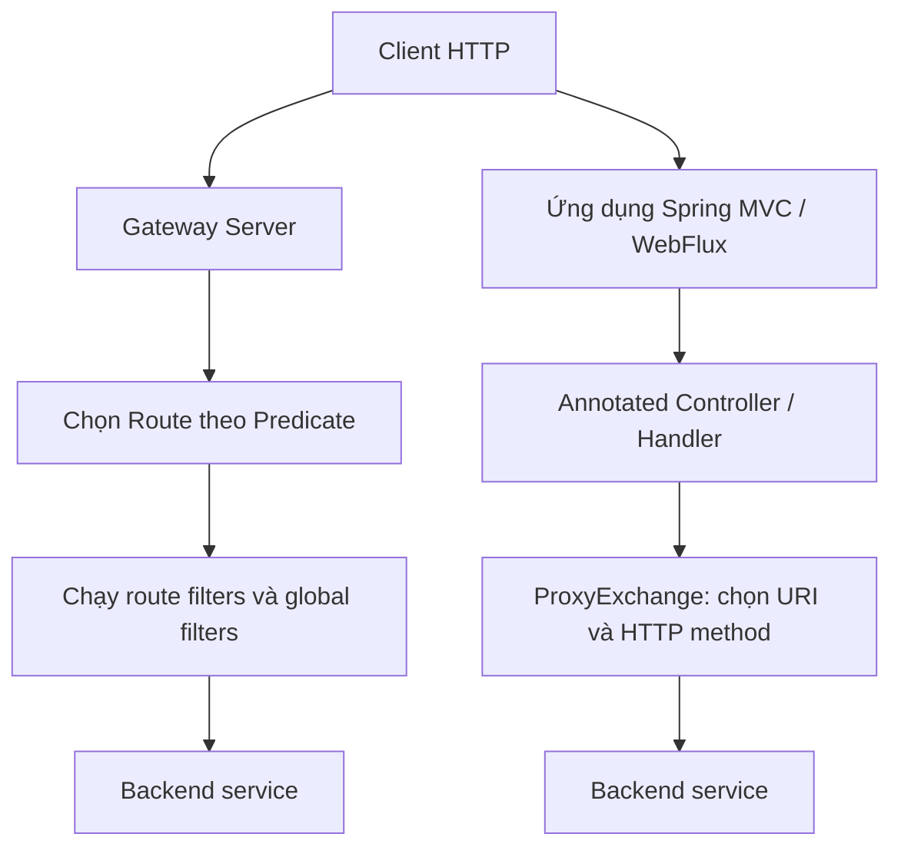

# Phân biệt Gateway Server và Proxy Exchange trong Spring Cloud Gateway

**Chương:** Phiên bản và biến thể  
**Phạm vi:** Spring Cloud Gateway — xây dựng cổng vào microservices bằng định tuyến, predicate, filter, biến đổi request/response, khám phá dịch vụ, xác thực và các cơ chế bảo vệ, quan sát lưu lượng.

## 1. Vì sao cần phân biệt hai biến thể?

Khi gặp cụm từ *Spring Cloud Gateway*, người học thường nghĩ ngay đến một dịch vụ gateway nhận mọi HTTP request, tìm route phù hợp rồi chuyển tiếp đến microservice. Đó là cách hoạt động của **Gateway Server**. Tuy nhiên, Spring Cloud Gateway còn cung cấp **Proxy Exchange**: một tiện ích giúp **một phương thức controller Spring MVC hoặc Spring WebFlux** chủ động gọi và chuyển tiếp HTTP request đến máy chủ khác.

Cả hai đều có thể đóng vai trò trung gian giữa client và backend, nhưng **điểm đặt logic chuyển tiếp, cách cấu hình và những tính năng tích hợp sẵn rất khác nhau**:

- **Gateway Server:** khai báo và quản lý route tập trung; framework tìm route bằng predicate, thực thi các filter liên quan rồi chuyển tiếp.
- **Proxy Exchange:** một handler có annotation như `@GetMapping` nhận tham số `ProxyExchange`; lập trình viên viết mã Java để chọn URI, gọi `get()`/`post()`... và trả về phản hồi.

Tài liệu Spring chính thức phân biệt hai *flavor* là **Server** và **Proxy Exchange**. **Mỗi flavor lại có lựa chọn WebFlux hoặc Web MVC**. Vì vậy, không nên đồng nhất “Server = WebFlux” hay “Proxy Exchange = MVC”.

### Mục tiêu sau bài học

1. Phân loại đúng bốn tổ hợp: Server WebFlux, Server Web MVC, Proxy Exchange WebFlux và Proxy Exchange Web MVC.
2. Giải thích được luồng request, cách viết route và cách xử lý header/path ở mỗi flavor.
3. Đọc được dependency, cấu hình và đoạn Java minh họa tương ứng; tránh áp dụng nhầm API của Server vào Proxy Exchange.
4. Lựa chọn giải pháp phù hợp khi cần xác thực, rate limiting, circuit breaker, retry, TLS, service discovery và observability.

## 2. Mô hình kiến trúc và luồng xử lý



### 2.1. Gateway Server: route là đơn vị trung tâm

Một **route** thường gồm:

| Thành phần | Ý nghĩa | Ví dụ |
|---|---|---|
| `id` | Định danh route để quản trị và quan sát | `catalog-route` |
| `uri` | Đích cần chuyển tiếp | `http://localhost:8081` hoặc `lb://catalog-service` |
| `predicates` | Điều kiện chọn route | `Path=/api/catalog/**`, `Method=GET` |
| `filters` | Thay đổi request/response hoặc áp dụng chính sách trên route | `StripPrefix=2`, `AddRequestHeader=...` |

Với **Server WebFlux**, route khớp sẽ được xử lý bởi hệ thống gateway dựa trên WebFlux; các `GlobalFilter` và `GatewayFilter` của route tạo thành chuỗi được sắp thứ tự. Filter có thể xử lý trước khi gửi downstream và sau khi nhận phản hồi. Với **Server Web MVC**, framework sử dụng mô hình `WebMvc.fn` và các filter của biến thể MVC; tuy cùng nhiệm vụ, API lập trình không giống hoàn toàn WebFlux.

Một API Gateway trung tâm có thể chịu trách nhiệm áp dụng chính sách chung cho nhiều route: chuẩn hóa đường dẫn/header, xác thực ở lớp biên, hạn mức request, điều hướng qua service discovery và theo dõi trạng thái các backend.

### 2.2. Proxy Exchange: handler là đơn vị trung tâm

Proxy Exchange dùng một controller hoặc handler **có annotation** (`@GetMapping`, `@PostMapping`, `@RequestMapping`...). Trong phương thức đó, Spring cung cấp đối tượng `ProxyExchange<T>` dưới dạng tham số. Mã của ứng dụng chọn URI đích và thực hiện HTTP exchange.

Ví dụ tư duy:

```text
GET /api/catalog/products/42
    -> Spring MVC @GetMapping("/products/{id}")
    -> ProxyExchange.uri("http://localhost:8081/products/42").get()
    -> ResponseEntity<?> trả về client
```

Proxy Exchange **không tự biến đoạn controller này thành một Server route**; các thiết lập `RouteLocator`, route predicate factories, `GatewayFilter`/`GlobalFilter` của Gateway Server **không tự động áp dụng**. Handler có thể tận dụng đầy đủ cơ chế routing annotation, tham số, validation, interceptor/filter và Spring Security tương ứng của ứng dụng MVC/WebFlux.

## 3. Bảng so sánh trực tiếp

| Tiêu chí | Gateway Server | Proxy Exchange |
|---|---|---|
| Vai trò chủ đạo | Cổng HTTP điều phối nhiều route và chính sách xuyên suốt | Chuyển tiếp HTTP có chủ đích từ một handler ứng dụng |
| Nơi định nghĩa chuyển tiếp | Route declaration trong YAML/properties hoặc Java DSL | Mã trong controller/handler có annotation |
| Cơ chế khớp request | Route predicates như `Path`, `Method`, `Header`, `Host` | `@RequestMapping`, `@GetMapping`, `@RequestParam`... |
| Cấu trúc xử lý | Route → filter chain → downstream | Handler → `ProxyExchange` → downstream |
| Biến đổi request/response | Các filter factory và filter tùy chỉnh theo flavor | Java trong handler; các hàm của `ProxyExchange`; filter/interceptor riêng của Spring |
| Service discovery | Route `lb://service-id` và tích hợp Spring Cloud LoadBalancer/DiscoveryClient | Không có cơ chế route `lb://` của Server một cách mặc định; cần tự tích hợp client/service resolution |
| Resilience | Có các filter chuyên dụng như circuit breaker, retry, rate limiter tùy module và cấu hình | Dùng giải pháp tương ứng ở tầng ứng dụng/client; không được thừa hưởng filter Server |
| Bảo mật | Có thể áp dụng chính sách chung tại gateway và bảo mật từng backend | Bảo mật controller/handler như ứng dụng web thông thường; kiểm soát việc chuyển tiếp thông tin nhạy cảm |
| Vận hành | Thuận tiện quản trị route, chính sách chung và metric gắn với route | Thuận tiện cho ít endpoint đặc thù; cần tự thiết kế metric và giám sát hoạt động proxy |
| Khả năng triển khai | Ứng dụng Boot độc lập **hoặc nhúng** trong ứng dụng Boot | Chạy bên trong ứng dụng Spring MVC hoặc WebFlux sử dụng annotated handler |
| Độ phù hợp | Nhiều service, nhiều đường dẫn, nhu cầu quản trị tập trung | Vài endpoint nối hệ thống cũ, logic chuyển tiếp cá biệt |

**Phân biệt quan trọng:** một Gateway Server có thể được triển khai thành service riêng, nhưng không bắt buộc. Một Proxy Exchange có thể được đặt trong ứng dụng biên, nhưng việc đặt ở biên không làm nó có mọi tính năng của Gateway Server.

## 4. Bốn tổ hợp thư viện và chuyện phiên bản

Hai trục độc lập:

| Flavor | WebFlux (reactive) | Web MVC (servlet) |
|---|---|---|
| **Gateway Server** | `spring-cloud-starter-gateway-server-webflux` | `spring-cloud-starter-gateway-server-webmvc` |
| **Proxy Exchange** | `spring-cloud-gateway-proxyexchange-webflux` | `spring-cloud-gateway-proxyexchange-webmvc` |

Tất cả có group ID `org.springframework.cloud`. Với Server, dùng **starter** tương ứng; với Proxy Exchange, thêm **module Proxy Exchange** vào ứng dụng WebFlux/MVC đang có. Chọn dependency dựa trên flavor lẫn web stack của ứng dụng; không hoán đổi tên vì chúng đều có chữ “gateway”.

Trong dòng Spring Cloud Gateway 5.x, tài liệu Spring mô tả hệ sinh thái Spring Framework 7, Spring Boot 4 và Project Reactor. Hãy quản lý các phiên bản tương thích thông qua **Spring Cloud Release Train/BOM** thay vì tự ghép version của Boot, Gateway và Cloud.

### 4.1. Vì sao ví dụ cũ khác tên?

Từ Spring Cloud 2025.0, tên artifact đã được làm rõ. Một số tên cũ thường gặp:

| Tên cũ trong ví dụ/nguồn tham khảo | Tên mới để nhận diện rõ flavor |
|---|---|
| `spring-cloud-starter-gateway` | `spring-cloud-starter-gateway-server-webflux` |
| `spring-cloud-starter-gateway-mvc` | `spring-cloud-starter-gateway-server-webmvc` |
| `spring-cloud-gateway-mvc` | `spring-cloud-gateway-proxyexchange-webmvc` |
| `spring-cloud-gateway-webflux` | `spring-cloud-gateway-proxyexchange-webflux` |

Các tên cũ có thể xuất hiện trong dự án đời trước hoặc được đánh dấu deprecated ở những dòng phát hành hỗ trợ chuyển tiếp. Cần đối chiếu đúng **phiên bản đang sử dụng**, vì tên thuộc dự án này có thể thay đổi giữa release trains.

Tương tự, prefix cấu hình Server cũng thay đổi:

```text
Trước chuyển đổi (Server WebFlux): spring.cloud.gateway.routes
Sau chuyển đổi (Server WebFlux):  spring.cloud.gateway.server.webflux.routes

Trước chuyển đổi (Server MVC):     spring.cloud.gateway.mvc.routes
Sau chuyển đổi (Server Web MVC):  spring.cloud.gateway.server.webmvc.routes
```

Ví dụ ở các phần tiếp theo dùng cách đặt tên của **dòng 2025.0+/Gateway 4.3+ và 5.x**. Không sao chép nguyên prefix này vào một ứng dụng Gateway 4.2 hoặc cũ hơn mà chưa kiểm tra tài liệu tương ứng.

## 5. Thực hành Gateway Server WebFlux

Giả sử có:

- Client gọi `GET http://localhost:8080/api/catalog/products/42`.
- Dịch vụ catalog ở `http://localhost:8081`, cung cấp `GET /products/42`.
- Gateway chịu trách nhiệm chọn route và loại bỏ hai đoạn tiền tố `api/catalog`.

Thêm starter WebFlux của Gateway Server vào ứng dụng đã cấu hình Spring Boot và Spring Cloud BOM:

```xml
<dependency>
    <groupId>org.springframework.cloud</groupId>
    <artifactId>spring-cloud-starter-gateway-server-webflux</artifactId>
</dependency>
```

Khai báo trong `application.yml`:

```yaml
server:
  port: 8080

spring:
  cloud:
    gateway:
      server:
        webflux:
          routes:
            - id: catalog-route
              uri: http://localhost:8081
              predicates:
                - Path=/api/catalog/**
                - Method=GET
              filters:
                - StripPrefix=2
                - AddRequestHeader=X-Gateway-Source, server
```

**Giải thích chính xác đường đi:**

1. Predicate `Path` chỉ khớp request có đường dẫn `/api/catalog/**`; `Method` tiếp tục giới hạn HTTP GET.
2. `StripPrefix=2` bỏ hai phân đoạn `api` và `catalog`: `/api/catalog/products/42` thành `/products/42`.
3. Filter `AddRequestHeader` gắn `X-Gateway-Source: server` vào request gửi downstream.
4. Gateway gọi `http://localhost:8081/products/42` và trả phản hồi downstream về client.

Khi backend là một service đã đăng ký với hệ thống service discovery, có thể thay `uri` bằng `lb://catalog-service` **sau khi** thêm và cấu hình Spring Cloud LoadBalancer cùng một `DiscoveryClient` hoặc cơ chế cung cấp các service instance thích hợp. `lb://` không có nghĩa là client tự khám phá được service nếu thiếu hạ tầng liên quan.

### 5.1. Filter chain giúp gì?

Với Gateway Server WebFlux, có thể tổ chức các quy tắc theo mức:

- **Route filter:** ví dụ `StripPrefix`, `RewritePath`, `AddRequestHeader`, `CircuitBreaker`, `Retry` hoặc `RequestRateLimiter` trên route liên quan (tùy module đi kèm).
- **Default filters:** dùng cho các route cùng chia sẻ filter.
- **GlobalFilter:** logic được tích hợp vào filter chain của Gateway WebFlux, có thể xử lý request/response quanh thao tác chuyển tiếp; thứ tự quyết định logic “trước” và “sau”.

Không nên mặc định mọi filter WebFlux đều có API và cách cấu hình giống hệt Server Web MVC: mỗi biến thể có phần tài liệu filter riêng.

### 5.2. Thay đổi đường dẫn bằng RewritePath

Nếu cần ánh xạ linh hoạt hơn `StripPrefix`, ví dụ `/api/orders/123` thành `/orders/123`, có thể dùng `RewritePath` với nhóm regex tên `remaining`. Trong `application.yml`, ký tự `$` ở phần replacement `${remaining}` cần escape thành `$\{remaining}` theo hướng dẫn của Gateway:

```yaml
filters:
  - RewritePath=/api/(?<remaining>.*), /$\{remaining}
```

Đây là cú pháp của filter Server; không chuyển hai dòng YAML này vào chương trình Proxy Exchange và trông chờ chúng chạy.

## 6. Thực hành Proxy Exchange Web MVC

Vẫn bài toán client gọi `GET /api/catalog/products/42`, nhưng lần này ứng dụng gateway là **Spring MVC với controller**. Thêm `spring-boot-starter-web` và module Proxy Exchange Web MVC; đảm bảo phiên bản được BOM quản lý.

```xml
<dependency>
    <groupId>org.springframework.boot</groupId>
    <artifactId>spring-boot-starter-web</artifactId>
</dependency>
<dependency>
    <groupId>org.springframework.cloud</groupId>
    <artifactId>spring-cloud-gateway-proxyexchange-webmvc</artifactId>
</dependency>
```

`application.yml`:

```yaml
server:
  port: 8080

catalog:
  base-url: http://localhost:8081
```

Controller:

```java
import org.springframework.beans.factory.annotation.Value;
import org.springframework.cloud.gateway.mvc.ProxyExchange;
import org.springframework.http.ResponseEntity;
import org.springframework.web.bind.annotation.GetMapping;
import org.springframework.web.bind.annotation.PathVariable;
import org.springframework.web.bind.annotation.RequestMapping;
import org.springframework.web.bind.annotation.RestController;

@RestController
@RequestMapping("/api/catalog")
public class CatalogProxyController {
    @Value("${catalog.base-url}")
    private String catalogBaseUrl;

    @GetMapping("/products/{id:[0-9]+}")
    public ResponseEntity<?> getProduct(
            @PathVariable long id,
            ProxyExchange<byte[]> proxy) {
        String target = catalogBaseUrl + "/products/" + id;
        return proxy.uri(target).get();
    }
}
```

**Điều gì xảy ra?** Spring MVC tìm method theo `@GetMapping`, trích `id` từ path, tiêm `ProxyExchange<byte[]>`, sau đó method tự xây URI đích và thực hiện `get()`. Phản hồi downstream được đưa vào `ResponseEntity<?>` trả cho client.

Ở ví dụ này:

- `{id:[0-9]+}` chỉ cho phép đoạn path là chữ số; ánh xạ vào `long`.
- Backend cố định theo cấu hình tin cậy; không nhận một URL tùy ý từ request để đem đi proxy.
- Không có `id` route trong YAML Gateway Server, không có `StripPrefix` hoặc route filter chain.
- Ứng dụng có thể thêm logic như kiểm tra quyền truy cập sản phẩm, kiểm tra tham số, thay đổi body hoặc xử lý lỗi bằng các cơ chế MVC quen thuộc.

**Lưu ý về dữ liệu request:** ví dụ chỉ thể hiện chuyển tiếp `GET` có một tham số đường dẫn. Khi thực hiện proxy cho POST/PUT, query string, body nhị phân, multipart hoặc streaming lớn, cần thiết kế và kiểm thử rõ cách chuyển body, content type và response. Đừng cho rằng một handler GET minh họa đã triển khai đầy đủ “transparent reverse proxy”.

### 6.1. Nếu ứng dụng dùng WebFlux?

Chọn module `spring-cloud-gateway-proxyexchange-webflux` (và web stack reactive thích hợp). Phương thức handler sử dụng `ProxyExchange` của WebFlux nhưng kết quả reactive:

```java
@GetMapping("/proxy/product/{id}")
public Mono<ResponseEntity<?>> getProduct(
        @PathVariable long id,
        ProxyExchange<byte[]> proxy) {
    return proxy.uri("http://localhost:8081/products/" + id).get();
}
```

Ví dụ này là **Proxy Exchange WebFlux**, vẫn dùng annotated handler và trả `Mono<ResponseEntity<?>>`; nó **không phải** Gateway Server WebFlux dù cả hai dùng Reactor. Hãy chọn import `ProxyExchange` theo đúng module và làm theo tài liệu của flavor tương ứng.

### 6.2. Những tiện ích của ProxyExchange

Ngoài `uri(...).get()`, Proxy Exchange hỗ trợ các thao tác tương ứng với HTTP methods, tiện ích xử lý URI/path, bổ sung header, và biến đổi kết quả bằng callback/mapping function. Bản MVC còn hỗ trợ `forward()` đến handler cục bộ. Các thao tác này là **API gọi bên trong handler**, không phải tên các GatewayFilter factories để khai báo dưới `routes`.

## 7. Khác nhau về xác thực, header và độ tin cậy

### 7.1. Header không được sao chép y nguyên

Proxy Exchange có cách xử lý riêng cho nhóm header:

| Nhóm | Ví dụ | Ý nghĩa mặc định của Proxy Exchange |
|---|---|---|
| **Sensitive** | `Cookie`, `Authorization` | Không tự chuyển tiếp downstream theo mặc định |
| **Skipped** | `Content-Length`, `Host` | Không sao chép nguyên trạng vì dễ sai sau khi proxy thay body/đích |
| **Proxy-related** | `X-Forwarded-*` | Có hỗ trợ xử lý header phục vụ thông tin proxy; phải hiểu mô hình proxy đáng tin cậy |

Không được suy ra rằng “client gửi `Authorization` thì backend chắc chắn sẽ nhận được nó” trong ví dụ `ProxyExchange`. Nếu nghiệp vụ cần chuyển danh tính, hãy xác thực request trước, quyết định rõ header/token nào được gửi đến backend và đặt chính sách tin cậy giữa các dịch vụ.

Với Gateway Server, header forwarding phụ thuộc vào cấu hình/filters/security cụ thể của Server flavor và phiên bản; cũng không nên giả định tất cả header sẽ được giữ hoặc loại bỏ y hệt Proxy Exchange.

### 7.2. Bảo vệ khỏi SSRF và giả mạo header

Một handler như dưới đây là **mẫu nguy hiểm**:

```java
// Tránh viết kiểu này: người gọi chọn URL mà server sẽ truy cập.
@GetMapping("/fetch")
public ResponseEntity<?> unsafe(
        @RequestParam String url,
        ProxyExchange<byte[]> proxy) {
    return proxy.uri(url).get();
}
```

Nếu không xác thực/chặn đích, client có thể biến ứng dụng thành công cụ gọi tới IP nội bộ hoặc metadata service. Cần dùng host/service cố định hay allowlist, kiểm soát scheme/port/redirect, validate dữ liệu đường dẫn và giữ giới hạn truy cập mạng phía server.

Ở Gateway Server cũng phải giới hạn ai được phép sửa route, endpoint actuator quản trị, URI đích và các header gắn với nguồn gốc request. Với `Forwarded`/`X-Forwarded-*`, chỉ tin những proxy đứng trước đã được xác định và cấu hình; các bản Gateway hiện đại yêu cầu khai báo trusted proxies để bật một số cơ chế forward-header nhất định.

### 7.3. Spring Security ở hai web stack

- **WebFlux:** thường tích hợp Spring Security bằng `SecurityWebFilterChain`.
- **Web MVC:** thường tích hợp Spring Security bằng servlet `SecurityFilterChain`.

Đây là phân biệt của **web stack**, độc lập với việc bạn chọn Gateway Server hay Proxy Exchange. Không lấy đoạn cấu hình security reactive áp thẳng vào servlet MVC và ngược lại.

## 8. Rate limiting, circuit breaker, retry, discovery và TLS

Những nhu cầu vận hành nêu trong phạm vi Spring Cloud Gateway thường là lý do mạnh để chọn Server:

| Nhu cầu | Gateway Server | Proxy Exchange |
|---|---|---|
| **Rate limiting** | Có cơ chế filter cho route (ví dụ `RequestRateLimiter` trong Server WebFlux, khi đã cấu hình limiter và dependency phù hợp) | Phải chủ động dùng rate limiter tại ứng dụng/handler hoặc tầng trước |
| **Circuit breaker** | Filter Gateway kết hợp Spring Cloud CircuitBreaker ở flavor/phiên bản hỗ trợ | Bọc HTTP call bằng circuit breaker ở tầng ứng dụng; không tự nhận circuit breaker filter của Server |
| **Retry** | Có filter retry theo route; cần xét method, mã lỗi và body | Thiết lập retry trên HTTP client hoặc trong service logic |
| **Service discovery** | `lb://service-id`, Spring Cloud LoadBalancer và DiscoveryClient | Tự chọn đích qua client, registry hoặc một lớp resolution riêng |
| **TLS** | Cấu hình TLS cho inbound gateway và chính sách TLS của kết nối outbound theo stack tương ứng | Cấu hình HTTPS cho ứng dụng MVC/WebFlux và HTTP client mà `ProxyExchange` sử dụng |
| **Quan sát request** | Dễ gắn route ID, metric gateway, actuator, tracing và policy chung | Cần gắn thông tin về handler/đích vào log, metric và trace của ứng dụng |

**Retry không luôn an toàn.** GET thường dễ cân nhắc lặp lại hơn một POST tạo đơn hàng hoặc thanh toán. Dù dùng flavor nào, cần xem *idempotency*, timeout, số lần retry, trạng thái lỗi nên retry và tổng tải tăng thêm lên backend.

**TLS không do tên flavor tự bảo đảm.** Cả hai có thể phục vụ HTTPS nếu cấu hình certificate/keystore cho server thích hợp; muốn gọi backend qua HTTPS cần kiểm tra truststore, hostname verification và chính sách chứng thư trên HTTP client của chính stack đó.

**Không có một lựa chọn nào thay thế cho bảo mật backend:** gateway là lớp bảo vệ ở biên, còn service phía sau vẫn nên có xác thực/ủy quyền và các biện pháp thích hợp với môi trường vận hành.

## 9. Khi nào chọn loại nào?

### Kịch bản A — Cổng trung tâm cho 30 microservices

Hệ thống có `catalog-service`, `order-service`, `payment-service`..., hàng chục tuyến API, cần tích hợp service discovery, cấu hình path/header thống nhất và theo dõi lỗi theo route. **Chọn Gateway Server**. Nếu triển khai reactive với Netty, chọn Server WebFlux; nếu dự án cần nền servlet/Tomcat/Jetty và các tích hợp MVC, cân nhắc Server Web MVC.

Lý do: chính sách thường lặp lại giữa nhiều route. Dùng Gateway Server sẽ giảm số controller/proxy method phải tự duy trì và giúp quản lý quy tắc định tuyến bằng mô hình nhất quán.

### Kịch bản B — Ứng dụng MVC chỉ cần gọi hộ hai endpoint của hệ thống cũ

Một ứng dụng Spring MVC đã có controller, cần `GET /legacy/users/{id}` và `POST /legacy/orders` để chuyển tới một dịch vụ cũ, có chút mapping dữ liệu/nghiệp vụ riêng. **Proxy Exchange Web MVC** là lựa chọn đơn giản nếu số endpoint ít và kiểm soát chuyển tiếp gắn chặt với code.

Lý do: dễ tận dụng validation, security, handler exception handling và mã xử lý chuyên biệt đang tồn tại, không phải thiết lập một lớp route server riêng chỉ cho vài điểm nối.

### Kịch bản C — Muốn gateway đầy đủ nhưng hệ thống dùng servlet

Yêu cầu route tập trung, filter và khả năng vận hành như một gateway thật, đồng thời buộc triển khai trên runtime servlet. **Gateway Server Web MVC** phù hợp để đánh giá trước; không nên chọn Proxy Exchange chỉ vì nhìn thấy chữ “MVC”.

### Kịch bản D — Handler cần tự quyết định đích theo nghiệp vụ

Nếu URI đích được chọn từ một tập backend **được phê duyệt** theo tenant, loại tài nguyên hoặc quyền đã kiểm tra, Proxy Exchange có thể giúp viết logic chuyển tiếp ngay trong handler. Cần tự chịu trách nhiệm về validation, SSRF, header, timeout, tracing và chính sách resilience. Nếu logic đó dần thành hàng trăm route và hàng loạt chính sách chung, nên đánh giá chuyển sang Gateway Server.

## 10. Đối chiếu hai cách trên cùng một request

```text
Request client: GET http://localhost:8080/api/catalog/products/42
Backend URL:    GET http://localhost:8081/products/42

Gateway Server:
  Path=/api/catalog/** + Method=GET
  -> StripPrefix=2
  -> http://localhost:8081/products/42

Proxy Exchange MVC:
  @RequestMapping("/api/catalog") + @GetMapping("/products/{id}")
  -> id = 42
  -> proxy.uri(baseUrl + "/products/" + id).get()
  -> http://localhost:8081/products/42
```

Để tự kiểm chứng, chạy backend tại cổng `8081` có endpoint `GET /products/42`, sau đó **lần lượt** chạy từng cách ở cổng `8080`. Không thể chạy cả hai mẫu cùng chiếm một cổng trên cùng host tại cùng thời điểm.

```bash
curl -i http://localhost:8080/api/catalog/products/42
curl -i http://localhost:8080/api/catalog/products/not-a-number
```

Kết quả kỳ vọng khi backend hoạt động:

- Với `42`, cả hai có thể trả nội dung sản phẩm do backend cung cấp; ở Server, backend còn có thể quan sát `X-Gateway-Source: server`.
- Với `not-a-number`, handler Proxy Exchange ví dụ không khớp regex số; ở Server, predicate `Path=/api/catalog/**` vẫn có thể khớp rồi chuyển request xuống backend. Đây là **khác biệt cấu hình khớp request**, không phải ưu/nhược điểm cố hữu của hai flavor.
- Khi backend bị tắt, cả hai đều có thể thất bại, nhưng mã lỗi và hình thức trả lỗi phụ thuộc vào stack, cấu hình và error handler; không nên cam kết cùng một mã HTTP nếu chưa kiểm chứng.

### Tiêu chí đánh giá một bài thực hành hoàn chỉnh

1. Request đúng path có đến backend với URL dự kiến?
2. Request sai method hoặc sai tham số có bị từ chối ở đúng lớp?
3. Header nào được giữ, bỏ qua hoặc thêm vào request downstream?
4. Khi backend chậm, timeout và retry có dẫn đến request treo hoặc gửi trùng?
5. Khi backend lỗi, client nhận gì và đội vận hành có đủ log/metric/trace để tìm ra route hoặc handler gây lỗi?

## 11. Những nhầm lẫn cần tránh

| Nhận định dễ nhầm | Cách hiểu đúng |
|---|---|
| “Server luôn là WebFlux, Proxy Exchange luôn là MVC.” | Cả **Server** và **Proxy Exchange** đều có biến thể WebFlux/Web MVC. |
| “Có `ProxyExchange` thì dùng được `GatewayFilter` trong YAML.” | Hai flavor có pipeline khác nhau; Server GatewayFilter không tự chạy trên annotated Proxy Exchange handler. |
| “Gateway Server bắt buộc tách thành microservice riêng.” | Server có thể đứng riêng hoặc được nhúng trong ứng dụng Spring Boot. |
| “Proxy Exchange mặc định forward toàn bộ header.” | Có cơ chế sensitive/skipped headers; không mặc định chuyển `Authorization` và `Cookie`. |
| “`lb://service` tự hoạt động khi thêm Gateway dependency.” | Cần cơ chế load balancing và nguồn service instances tương ứng. |
| “`spring-cloud-starter-gateway-mvc` là Proxy Exchange MVC.” | Theo tên mới, starter này tương ứng **Gateway Server Web MVC**; Proxy Exchange MVC là `spring-cloud-gateway-proxyexchange-webmvc`. |
| “Nếu cần servlet thì phải dùng Proxy Exchange.” | **Gateway Server Web MVC** cũng chạy với servlet runtime. |
| “Gateway có circuit breaker thì request sẽ không bao giờ thất bại.” | Circuit breaker hạn chế lỗi lan truyền; vẫn phải thiết kế fallback, timeout và quan sát lỗi. |

## 12. Ghi nhớ và nguyên tắc lựa chọn

Hãy hỏi **“ai quyết định route?”** trước khi hỏi đến “WebFlux hay MVC?”:

- Nếu **framework chọn route theo cấu hình/DSL rồi áp dụng chuỗi filter**, bạn đang nói về **Gateway Server**.
- Nếu **mã trong handler quyết định URI và gọi `ProxyExchange`**, bạn đang nói về **Proxy Exchange**.

Sau đó mới chọn **WebFlux** khi phù hợp với kiến trúc reactive, hoặc **Web MVC** khi phù hợp với nền servlet. Bốn lựa chọn hợp lệ không đồng nghĩa bốn API có thể dùng thay thế trực tiếp.

Trong thực tế, Gateway Server phù hợp với cổng vào microservices cần route predicate, filter chain, bảo mật, rate limiting, circuit breaker, retry, TLS, service discovery và quan sát lưu lượng **có tính hệ thống**. Proxy Exchange phù hợp với các điểm chuyển tiếp **có tính chương trình**, gắn với controller cụ thể và có phạm vi hẹp hơn. Quyết định cuối cùng vẫn phải dựa trên tải thực, yêu cầu công năng, khả năng vận hành và phiên bản Spring Cloud đang dùng.

## Tài liệu chính thức để tra cứu

1. [Spring Cloud Gateway — Tổng quan Server và Proxy Exchange](https://docs.spring.io/spring-cloud-gateway/reference/intro.html).
2. [Proxy Exchange Gateway with Spring Web MVC or WebFlux](https://docs.spring.io/spring-cloud-gateway/reference/spring-cloud-gateway-proxy-exchange.html).
3. [Gateway Server WebFlux — Cài đặt starter](https://docs.spring.io/spring-cloud-gateway/reference/spring-cloud-gateway-server-webflux/starter.html).
4. [Gateway Server Web MVC — Cài đặt starter](https://docs.spring.io/spring-cloud-gateway/reference/spring-cloud-gateway-server-webmvc/starter.html).
5. [Gateway Server WebFlux — Route Predicate Factories](https://docs.spring.io/spring-cloud-gateway/reference/spring-cloud-gateway-server-webflux/request-predicates-factories.html).
6. [Gateway Server WebFlux — Global Filters](https://docs.spring.io/spring-cloud-gateway/reference/spring-cloud-gateway-server-webflux/global-filters.html).
7. [Spring Cloud 2025.0 Release Notes — tên artifact và prefix cấu hình mới](https://github.com/spring-cloud/spring-cloud-release/wiki/Spring-Cloud-2025.0-Release-Notes).

> **Lưu ý phiên bản:** Khi áp dụng vào dự án thật, chọn tài liệu theo đúng release train Spring Cloud/Gateway đang chạy. Những ví dụ rất cũ với `spring.cloud.gateway.routes` hoặc tên artifact ngắn có thể thuộc nhánh cũ; cần đối chiếu trước khi sửa `pom.xml` và `application.yml`.
