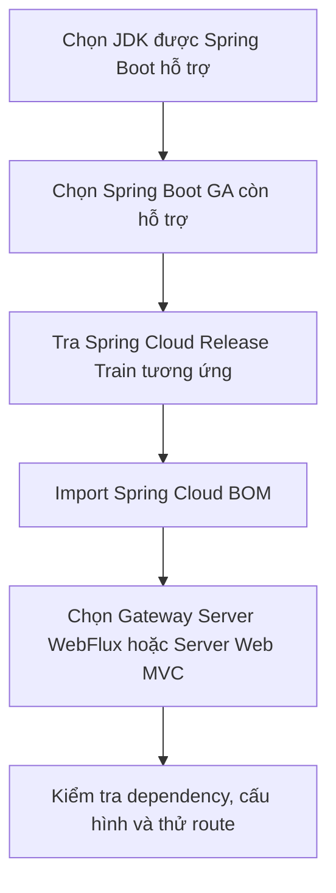

# Chọn phiên bản Java, Spring Boot và Spring Cloud Release Train tương thích

> **Phạm vi:** Spring Cloud Gateway — xây dựng API Gateway định tuyến request bằng route predicate, filter chain, biến đổi path/header, khám phá dịch vụ, xác thực, giới hạn lưu lượng, circuit breaker, retry, TLS và quan sát hệ thống. Bài này giải quyết bước nền tảng: chọn đúng bộ phiên bản trước khi cấu hình những chức năng đó.
>
> **Mốc tham chiếu:** 24/11/2026. Phiên bản và vòng đời hỗ trợ thay đổi theo thời gian; khi tạo dự án mới hoặc nâng cấp dự án đang chạy, cần đối chiếu lại nguồn chính thức ở cuối bài.

## 1. Vì sao phải chọn phiên bản theo cả bộ?

Một API Gateway không chỉ phụ thuộc vào Java. Ứng dụng Gateway còn chạy trên Spring Boot, sử dụng các thư viện nằm trong **Spring Cloud Release Train**, và chọn một biến thể **Spring Cloud Gateway** cụ thể. Chẳng hạn, một route `Path=/api/orders/**` có thể được viết đúng YAML nhưng ứng dụng vẫn khởi động lỗi vì ghép Spring Boot với Release Train không tương thích, hoặc route không được nạp vì dùng key cấu hình từ tài liệu phiên bản cũ.

Trong hệ sinh thái này, cần phân biệt bốn lớp:

| Thành phần | Vai trò | Ví dụ lựa chọn cho dự án mới |
| --- | --- | --- |
| **JDK** | Biên dịch và chạy bytecode Java; phụ thuộc yêu cầu tối thiểu/tối đa của Boot và thư viện | Java 21 LTS |
| **Spring Boot** | Nền ứng dụng, quản lý Spring Framework, runtime và nhiều phiên bản dependency | `4.2.0` |
| **Spring Cloud Release Train** | Bộ BOM (`spring-cloud-dependencies`) phối hợp phiên bản các dự án Spring Cloud | `2026.0.0` — Paddington |
| **Spring Cloud Gateway** | Thành phần Gateway thực tế và starter được chọn theo mô hình WebFlux hoặc Web MVC | Gateway `5.1.0`, Server WebFlux |



**Release Train không phải phiên bản Spring Boot hay Gateway.** Ví dụ, `2026.0.0` là phiên bản của Spring Cloud Release Train, trong khi phiên bản Spring Cloud Gateway do train đó quản lý là `5.1.0`. Không nên tự ghép các số giống nhau hoặc tự gắn `5.1.0` cho mọi dependency Spring Cloud.

## 2. Ma trận tương thích cần biết

Bảng sau dùng các nhánh GA đã được công bố tại mốc tham chiếu; các hàng cũ giúp đọc và bảo trì ứng dụng hiện hữu. Phiên bản `x` nghĩa là chọn **bản vá tương thích mới nhất** trong cùng nhánh, sau khi kiểm tra thông báo phát hành.

| Spring Boot | Spring Cloud Release Train | Gateway trong train | Java | Ghi chú |
| --- | --- | --- | --- | --- |
| **`4.2.x`** | **`2026.0.x` — Paddington** | **`5.1.x`** | Tối thiểu 17; Boot 4.2.0 hỗ trợ đến Java 27 | Cặp GA mới: Boot `4.2.0` + Cloud `2026.0.0` + Gateway `5.1.0` |
| `4.1.x` hoặc `4.0.x` | `2025.1.x` — Oakwood | `5.0.x` | Tối thiểu 17 | Hỗ trợ Boot 4.1 bắt đầu từ Cloud `2025.1.2`; chọn service release mới, ví dụ `2025.1.5` tại mốc tham chiếu |
| `3.5.x` | `2025.0.x` — Northfields | `4.3.x` | Tối thiểu 17 | Nhánh cũ; cần kiểm tra trạng thái hỗ trợ trước khi tiếp tục vận hành |
| `3.4.x` | `2024.0.x` — Moorgate | `4.2.x` | Tối thiểu 17 | Nhánh cũ, không nên chọn cho dự án mới |
| `3.2.x` hoặc `3.3.x` | `2023.0.x` — Leyton | `4.1.x` | Tối thiểu 17 | Boot 3.3 được hỗ trợ từ Cloud `2023.0.2`; nhánh cũ |

Theo trang dự án Spring Cloud tại thời điểm viết, các train đánh dấu `*` (gồm `2025.0.x` và cũ hơn) đã hết vòng đời hỗ trợ nguồn mở. **Có thể resolve dependency từ Maven Central không có nghĩa là đang nhận các bản vá bảo mật.** Để quyết định triển khai, cần xem chính sách hỗ trợ của cả Spring Boot và Spring Cloud, không chỉ xem phiên bản còn tải được hay không.

Một số tổ hợp cần nhận diện ngay:

- **Hợp lệ:** Java 21 + Spring Boot `4.2.0` + Spring Cloud `2026.0.0` + Gateway Server WebFlux thuộc nhánh `5.1.x`.
- **Hợp lệ:** Java 21 + Spring Boot `4.1.3` + Spring Cloud `2025.1.5` + Gateway Server Web MVC thuộc nhánh `5.0.x`.
- **Sai nhánh:** Spring Boot `4.2.0` + Spring Cloud `2025.1.x` — train `2025.1` nhắm Boot 4.0/4.1; chuyển sang `2026.0.x`.
- **Sai nhánh:** Spring Boot `3.5.x` + Spring Cloud `2026.0.x` — train mới nhắm Boot 4.2; không sửa bằng cách ép phiên bản từng thư viện Gateway.
- **Không đủ thông tin:** chỉ biết "Java 21 + Spring Cloud Gateway 5" — còn thiếu Spring Boot, Release Train, starter và bản vá cụ thể.

### Cách đọc số phiên bản

- Spring Boot `4.2.0` là **major.minor.patch**. Bản vá `4.2.1`, khi phát hành, vẫn thuộc nhánh `4.2.x` nhưng phải được kiểm tra với train và ghi chú phát hành tương ứng.
- Spring Cloud `2026.0.0` dùng kiểu **calendar versioning** cho Release Train; không có quy tắc lấy major của Boot ghép với năm của Cloud.
- Spring Cloud Gateway `5.1.0` là **phiên bản dự án con** do BOM của Spring Cloud điều phối.
- Hậu tố `-M1`, `-RC1`, `-SNAPSHOT` chỉ bản milestone, release candidate, snapshot; với môi trường sản xuất, ưu tiên bản **GA/stable** đã được hỗ trợ, trừ khi có chủ đích thử nghiệm.

## 3. Quy trình chọn bộ phiên bản cho một API Gateway

1. **Chốt yêu cầu Java thực tế.** Kiểm tra Java ở máy phát triển, CI, container và production. Spring Boot 4.2.0 yêu cầu ít nhất Java 17; chọn Java 21 LTS trong ví dụ để thống nhất toolchain. Java của runtime phải đủ để chạy bytecode được biên dịch, còn build tool cũng phải hỗ trợ JDK được chọn.
2. **Chọn Spring Boot theo trạng thái hỗ trợ.** Với ứng dụng mới, ưu tiên nhánh GA được hỗ trợ và đã qua kiểm thử trong hạ tầng của nhóm. Không chọn bản RC chỉ vì số phiên bản cao hơn.
3. **Tra ma trận Spring Cloud chính thức.** Nếu đã chốt Boot `4.2.x`, dùng Cloud `2026.0.x`; nếu Boot `4.1.x`, dùng Cloud `2025.1.x` từ `2025.1.2` trở lên. Kiểm tra **service release** mới nhất của train trước khi khóa version.
4. **Import BOM Spring Cloud.** Maven dùng `dependencyManagement`; Gradle dùng dependency management/BOM. Để BOM chọn phiên bản của Gateway, Spring Cloud LoadBalancer, CircuitBreaker... thay vì điền version thủ công vào từng dependency.
5. **Chọn biến thể Gateway theo mô hình chạy.** Server WebFlux sử dụng Reactor Netty và phù hợp luồng reactive; Server Web MVC chạy trên Servlet stack như Tomcat/Jetty. Các starter, filter API và key cấu hình không hoàn toàn giống nhau.
6. **Xác nhận build và request thực tế.** Kiểm tra dependency đã resolve, ứng dụng startup, một route mẫu, HTTP status/header và log; sau đó mới thêm OAuth2/JWT, rate limiting, retry, circuit breaker, TLS và observability.

### WebFlux hay Web MVC liên quan gì tới phiên bản?

Từ các tài liệu Gateway hiện hành, **Server WebFlux** sử dụng artifact `org.springframework.cloud:spring-cloud-starter-gateway-server-webflux`, trong khi **Server Web MVC** dùng `org.springframework.cloud:spring-cloud-starter-gateway-server-webmvc`.

| Tiêu chí | Gateway Server WebFlux | Gateway Server Web MVC |
| --- | --- | --- |
| Runtime | Reactor Netty, WebFlux, Project Reactor | Servlet runtime, Spring MVC/WebMvc.fn |
| Starter | `spring-cloud-starter-gateway-server-webflux` | `spring-cloud-starter-gateway-server-webmvc` |
| Nhánh cấu hình route hiện hành | `spring.cloud.gateway.server.webflux.routes` | `spring.cloud.gateway.server.webmvc.routes` |
| Tích hợp bảo mật thường gặp | `SecurityWebFilterChain` cho reactive security | `SecurityFilterChain` cho servlet security |
| Lưu ý | Không chạy như WAR truyền thống trong Servlet container | Không mặc nhiên áp dụng API filter reactive của WebFlux |

Đây là lựa chọn kiến trúc, không phải cách lách ma trận phiên bản. Trong cùng một release train, vẫn cần chọn đúng starter và đọc đúng tài liệu của biến thể đang dùng. Phần thực hành tiếp theo sử dụng **Gateway Server WebFlux**.

## 4. Ví dụ Maven: Java 21 + Boot 4.2.0 + Cloud 2026.0.0

Một `pom.xml` tối thiểu và rõ ràng cho ứng dụng Gateway mới:

```xml
<?xml version="1.0" encoding="UTF-8"?>
<project xmlns="http://maven.apache.org/POM/4.0.0"
         xmlns:xsi="http://www.w3.org/2001/XMLSchema-instance"
         xsi:schemaLocation="http://maven.apache.org/POM/4.0.0 https://maven.apache.org/xsd/maven-4.0.0.xsd">
    <modelVersion>4.0.0</modelVersion>

    <parent>
        <groupId>org.springframework.boot</groupId>
        <artifactId>spring-boot-starter-parent</artifactId>
        <version>4.2.0</version>
        <relativePath/>
    </parent>

    <groupId>com.example</groupId>
    <artifactId>edge-gateway</artifactId>
    <version>0.0.1-SNAPSHOT</version>

    <properties>
        <java.version>21</java.version>
        <spring-cloud.version>2026.0.0</spring-cloud.version>
    </properties>

    <dependencyManagement>
        <dependencies>
            <dependency>
                <groupId>org.springframework.cloud</groupId>
                <artifactId>spring-cloud-dependencies</artifactId>
                <version>${spring-cloud.version}</version>
                <type>pom</type>
                <scope>import</scope>
            </dependency>
        </dependencies>
    </dependencyManagement>

    <dependencies>
        <dependency>
            <groupId>org.springframework.cloud</groupId>
            <artifactId>spring-cloud-starter-gateway-server-webflux</artifactId>
        </dependency>
        <dependency>
            <groupId>org.springframework.boot</groupId>
            <artifactId>spring-boot-starter-actuator</artifactId>
        </dependency>
    </dependencies>

    <build>
        <plugins>
            <plugin>
                <groupId>org.springframework.boot</groupId>
                <artifactId>spring-boot-maven-plugin</artifactId>
            </plugin>
        </plugins>
    </build>
</project>
```

Điểm quan trọng: **không** gắn `<version>5.1.0</version>` trực tiếp vào starter Gateway. BOM `2026.0.0` đã quản lý phiên bản tương ứng của các module Spring Cloud. Parent Spring Boot quản lý nhóm dependency của Boot; BOM Cloud bổ sung phần quản lý dependency Spring Cloud. Import BOM **không tự thêm Gateway vào ứng dụng**: vẫn cần dependency starter trong `<dependencies>`.

Ví dụ application class:

```java
package com.example.gateway;

import org.springframework.boot.SpringApplication;
import org.springframework.boot.autoconfigure.SpringBootApplication;

@SpringBootApplication
public class EdgeGatewayApplication {
    public static void main(String[] args) {
        SpringApplication.run(EdgeGatewayApplication.class, args);
    }
}
```

Và `src/main/resources/application.yml`:

```yaml
server:
  port: 8080

spring:
  application:
    name: edge-gateway
  cloud:
    gateway:
      server:
        webflux:
          routes:
            - id: inventory-service
              uri: http://localhost:8081
              predicates:
                - Path=/api/inventory/**
              filters:
                - StripPrefix=1
                - AddRequestHeader=X-Gateway-Route, inventory-service

management:
  endpoints:
    web:
      exposure:
        include: health,info
```

Khi backend tại `localhost:8081` có endpoint `GET /inventory/items/42`, lệnh `curl -i http://localhost:8080/api/inventory/items/42` sẽ đi qua route `inventory-service`; `StripPrefix=1` bỏ segment `api`, vì thế backend nhận `GET /inventory/items/42` kèm header `X-Gateway-Route: inventory-service`. Cần khởi động backend trước: nếu nó chưa chạy, kết quả lỗi kết nối downstream **không phải bằng chứng** bộ phiên bản Spring không tương thích.

## 5. Ví dụ Gradle tương đương

Với Gradle Groovy DSL (`build.gradle`), giữ cùng bộ phiên bản:

```groovy
plugins {
    id 'java'
    id 'org.springframework.boot' version '4.2.0'
    id 'io.spring.dependency-management' version '1.1.7'
}

group = 'com.example'
version = '0.0.1-SNAPSHOT'

java {
    toolchain {
        languageVersion = JavaLanguageVersion.of(21)
    }
}

repositories {
    mavenCentral()
}

dependencyManagement {
    imports {
        mavenBom 'org.springframework.cloud:spring-cloud-dependencies:2026.0.0'
    }
}

dependencies {
    implementation 'org.springframework.cloud:spring-cloud-starter-gateway-server-webflux'
    implementation 'org.springframework.boot:spring-boot-starter-actuator'
}
```

Gradle cần bản tương thích với Spring Boot đã chọn; theo system requirements của Boot 4.2.0, hỗ trợ Gradle 8.x từ **8.14** và 9.x, hoặc Maven từ **3.6.3**. Hãy kiểm tra Gradle Wrapper/Maven Wrapper của dự án thay vì chỉ kiểm tra phiên bản `java` trên PATH.

### Các lệnh kiểm chứng phiên bản

Chạy trong một dự án ví dụ có Maven Wrapper:

```bash
java -version
./mvnw -version
./mvnw dependency:tree -Dincludes=org.springframework.cloud
./mvnw spring-boot:run
```

Windows có thể dùng `mvnw.cmd` thay `./mvnw`; với Gradle dùng `./gradlew dependencies --configuration runtimeClasspath` (hoặc `gradlew.bat` trên Windows). Khi xem dependency tree, đối chiếu Gateway với **phiên bản dự án con** thuộc BOM, không kỳ vọng nó mang số `2026.0.0`.

Sau khi chạy Gateway và backend thử nghiệm:

```bash
curl -i http://localhost:8080/actuator/health
curl -i http://localhost:8080/api/inventory/items/42
```

`/actuator/health` giúp xác nhận ứng dụng đã khởi động; `curl` qua route xác nhận thêm predicate, lọc đường dẫn và kết nối downstream. Kết quả chính xác của lời gọi route phụ thuộc phản hồi của backend thử nghiệm.

## 6. Xử lý khi các phiên bản không khớp

| Triệu chứng | Nguyên nhân cần kiểm tra | Cách xử lý |
| --- | --- | --- |
| Startup báo Spring Boot không tương thích với Spring Cloud Release Train | Boot/Cloud sai nhánh, hoặc đang bật compatibility verifier | Tra lại ma trận, sửa Boot hoặc train, đồng bộ BOM rồi rebuild |
| `UnsupportedClassVersionError` | Runtime Java thấp hơn bytecode/thư viện yêu cầu | So sánh `java -version`, JDK của IDE/CI/container và toolchain được cấu hình |
| `NoSuchMethodError`, `ClassNotFoundException` khi khởi động | Dependency bị ép version khác BOM hoặc tồn tại nhiều bản xung đột | Xem dependency tree, bỏ version override không cần thiết, giải quyết conflict |
| Ứng dụng chạy nhưng không có route như mong đợi | Dùng sai namespace cấu hình cho biến thể Gateway | Với Server WebFlux hiện hành kiểm tra `spring.cloud.gateway.server.webflux.routes`; với Web MVC dùng `spring.cloud.gateway.server.webmvc.routes` |
| Route trả lỗi kết nối/5xx | Downstream không chạy, URI sai, DNS/service discovery hay TLS lỗi | Kiểm tra backend, log và mạng trước khi kết luận lỗi dependency |
| Filter Java không compile sau nâng cấp | Khác biệt API giữa WebFlux/Web MVC hoặc giữa các major release | Chọn đúng starter, đọc migration notes và nâng cấp code tùy biến |

Spring Cloud Commons có cơ chế **compatibility verifier** để kiểm tra phiên bản Spring Boot. Nếu cơ chế này được bật, lỗi có thể chỉ rõ nhánh Boot được hỗ trợ. Các property liên quan gồm `spring.cloud.compatibility-verifier.enabled` và `spring.cloud.compatibility-verifier.compatible-boot-versions`. Mặc định của property có thể khác theo phiên bản, nên không giả định verifier đang bật trong mọi ứng dụng. **Không tắt verifier hoặc tự override danh sách phiên bản chỉ để bỏ qua lỗi** nếu chưa có bằng chứng tổ hợp đó được hỗ trợ.

### Tình huống: nâng từ Boot 3.5 lên Boot 4.2

Giả sử một Gateway cũ dùng Boot `3.5.x`, Cloud `2025.0.x`, Gateway `4.3.x`. Không nên chỉ sửa `<version>` Spring Boot thành `4.2.0` rồi giữ nguyên BOM Cloud.

Thứ tự nâng cấp có kiểm soát:

1. Lập danh sách starter, dependency có version override, JDK, plugin build và cấu hình đang dùng.
2. Đối chiếu release notes, chọn bộ Boot `4.2.0` + Cloud `2026.0.0` + Gateway `5.1.x`, cập nhật BOM, runtime và Gradle/Maven nếu cần.
3. Đối chiếu starter WebFlux/Web MVC; kiểm tra namespace route/filter. Ví dụ phổ biến trong tài liệu cũ là `spring.cloud.gateway.routes`, còn namespace của **Server WebFlux 5.1** là `spring.cloud.gateway.server.webflux.routes`.
4. Build, chạy smoke test cho route predicate và biến đổi path/header; kiểm tra riêng luồng xác thực, rate limiter, circuit breaker, retry, TLS, WebSocket nếu ứng dụng sử dụng.
5. Đánh giá log, metrics, trace và phản hồi 4xx/5xx trước khi rollout; lập cách rollback bằng image hoặc artifact đã kiểm thử.

Ví dụ này là **kế hoạch nâng cấp**, không phải lời hứa mọi API/thuộc tính cũ đều tương thích nguồn. Các thay đổi Spring Framework, Spring Security, Reactor Netty và Gateway custom filters cần được kiểm tra bằng hướng dẫn nâng cấp chính thức, đặc biệt khi chuyển major `3` sang `4` của Boot.

## 7. Bài tập ra quyết định

Một nhóm vận hành API Gateway với các yêu cầu: có route predicate `Path`, strip prefix, forward thêm header; sau đó bổ sung xác thực JWT, giới hạn lưu lượng, retry, circuit breaker và TLS. CI và production hiện đều chạy JDK 21; nhóm tạo ứng dụng Spring Boot mới.

**Quyết định đề xuất:** dùng Java 21, Spring Boot `4.2.0`, Spring Cloud `2026.0.0`, Spring Cloud Gateway Server WebFlux `5.1.x`, import Cloud BOM trong build và sử dụng `spring-cloud-starter-gateway-server-webflux`. Bộ này phù hợp với nhau theo thông báo GA ngày 20/11/2026. Khi thêm Spring Cloud CircuitBreaker/LoadBalancer hoặc dependency liên quan, vẫn để BOM quản lý phiên bản của chúng. Chỉ chọn Web MVC nếu yêu cầu Servlet stack của dự án rõ ràng và kiểm thử với API tương ứng.

Nếu nhóm bắt buộc giữ Spring Boot `4.1.x` vì nền tảng chưa xác nhận Boot 4.2, chọn Spring Cloud `2025.1.x` từ `2025.1.2` trở lên, ưu tiên service release còn được hỗ trợ (tại mốc viết là `2025.1.5`), và Gateway `5.0.x`. **Trì hoãn nâng cấp đồng bộ** là hợp lý hơn ghép Boot 4.1 với train 2026.0 chỉ vì train đó mới hơn.

**Tự kiểm tra:**

1. Một dự án Java 17 + Boot `3.5.x` có được import Cloud `2026.0.0` không? **Không**: Java đáp ứng mức tối thiểu nhưng cặp Boot/Cloud vẫn sai train.
2. Nếu đổi `spring-cloud-starter-gateway-server-webflux` thành `spring-cloud-starter-gateway-server-webmvc`, có thể giữ nguyên mọi filter reactive không? **Không**: khác programming model và filter API; cần xem lại code và cấu hình.
3. Vì sao không đặt version Gateway riêng trong từng dependency? **Vì** BOM khóa các phiên bản Spring Cloud được phát hành/kiểm thử cùng nhau, giảm nguy cơ lệch dependency.
4. Build thành công đã đủ chứng minh phiên bản phù hợp chưa? **Chưa**: phải startup, thử route, xác thực biến đổi request và các chức năng vận hành quan trọng.

## 8. Checklist trước khi chốt phiên bản

- [ ] Đã xác định JDK của local, CI, container và production; build tool hỗ trợ JDK đó.
- [ ] Đã chọn Spring Boot GA còn hỗ trợ; tra bảng Spring Cloud Release Train chính thức.
- [ ] Đã chọn bản service release mới nhất phù hợp trong train, kiểm tra advisories/security patches.
- [ ] Đã import BOM và tránh ép version Gateway/Cloud starter khi không có lý do cụ thể.
- [ ] Đã chọn đúng Server WebFlux hoặc Server Web MVC; đúng starter và namespace cấu hình.
- [ ] Đã kiểm tra dependency tree, application startup, `/actuator/health`, route predicate và filter mẫu.
- [ ] Đã có smoke test cho authentication, rate limiting, circuit breaker, retry, TLS và observability nếu chúng nằm trong phạm vi triển khai.
- [ ] Đã ghi lại bộ phiên bản, liên kết release notes và cách rollback để người khác bảo trì.

## Tài liệu chính thức để tra cứu và cập nhật

1. [Spring Cloud — Release Train compatibility, BOM và chính sách hỗ trợ](https://spring.io/projects/spring-cloud/).
2. [Spring Cloud 2026.0.0 (Paddington) GA — xác nhận Boot 4.2.0, Gateway 5.1.0](https://spring.io/blog/2026/11/20/spring-cloud-2026-0-0-has-been-released/).
3. [Spring Cloud Release Train Reference](https://docs.spring.io/spring-cloud-release/reference/index.html).
4. [Spring Cloud Gateway Reference — bản phát hành và các biến thể](https://docs.spring.io/spring-cloud-gateway/reference/index.html).
5. [Gateway Server WebFlux — starter](https://docs.spring.io/spring-cloud-gateway/reference/spring-cloud-gateway-server-webflux/starter.html) và [cấu hình route](https://docs.spring.io/spring-cloud-gateway/reference/spring-cloud-gateway-server-webflux/configuration.html).
6. [Gateway Server Web MVC — starter](https://docs.spring.io/spring-cloud-gateway/reference/spring-cloud-gateway-server-webmvc/starter.html).
7. [Spring Boot — System Requirements](https://docs.spring.io/spring-boot/system-requirements.html) và [Spring Cloud Commons — Compatibility Verification](https://docs.spring.io/spring-cloud-commons/reference/spring-cloud-commons/common-abstractions.html).

**Ghi nhớ:** Chọn **Java → Spring Boot → Spring Cloud Release Train → Gateway variant**, đưa Release Train vào BOM, rồi xác nhận với một request thật. Bộ phiên bản đúng là điều kiện tiên quyết để các bài route, filter, service discovery và bảo mật API Gateway hoạt động ổn định.
