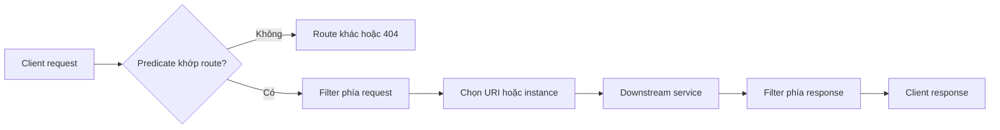

# Phạm vi hỗ trợ predicate, filter và giao thức của từng biến thể

## 1. Vì sao cần phân biệt các biến thể của Spring Cloud Gateway?

**Spring Cloud Gateway** là lớp cổng vào cho hệ thống microservices: nhận request từ client, chọn dịch vụ đích theo điều kiện, biến đổi request/response, và áp dụng các chính sách như xác thực, giới hạn lưu lượng, retry, circuit breaker và quan sát hệ thống. Tuy nhiên, **không phải mọi biến thể đều dùng cùng một bộ predicate, filter hay hỗ trợ giao thức theo cùng một cách**.

Ví dụ, một cấu hình `RequestRateLimiter` dựa trên Redis viết cho Gateway Server WebFlux không thể được sao chép nguyên xi sang Gateway Server Web MVC. Tương tự, `ProxyExchange` cho phép chuyển tiếp HTTP từ một controller, nhưng không tự biến controller ấy thành một gateway có danh mục route và filter chain cấu hình bằng YAML.

Sau bài học, bạn có thể:

- Phân biệt **Server WebFlux**, **Server Web MVC** và hai dạng **Proxy Exchange**.
- Chọn đúng predicate/filter, API mở rộng và namespace cấu hình cho từng runtime.
- Đánh giá phạm vi proxy HTTP(S), WebSocket, SSE, HTTP/2 và các yêu cầu đặc thù như gRPC.
- Quyết định biến thể phù hợp cho một bài toán API Gateway và xác minh tương thích khi nâng cấp phiên bản.

> **Phạm vi phiên bản:** Các ví dụ HTTP/predicate/filter sử dụng cách đặt tên trong tài liệu **Spring Cloud Gateway Server 5.0.x** (`spring.cloud.gateway.server.webflux` và `spring.cloud.gateway.server.webmvc`). **Ví dụ WebSocket cho Server Web MVC yêu cầu dòng 5.1.x**, nơi tính năng này được bổ sung. Tài liệu 4.x và các bản phát hành khác có thể thay đổi starter, tên thuộc tính, factory hoặc chức năng. Khi triển khai, luôn mở tài liệu **đúng phiên bản** của dependency đã khóa trong dự án.

## 2. Bốn lựa chọn triển khai trong hai nhóm sản phẩm

Spring Cloud Gateway chia thành **Server** (gateway đầy đủ) và **Proxy Exchange** (tiện ích proxy trong handler của ứng dụng web). Mỗi nhóm có lựa chọn WebFlux và Web MVC.

| Biến thể | Nền tảng thực thi | Cách khai báo | Đặc điểm chính |
|---|---|---|---|
| **Gateway Server WebFlux** | Spring WebFlux, Reactor, Reactor Netty; mô hình non-blocking | RouteDefinition qua YAML/properties hoặc Java `RouteLocatorBuilder` | Gateway đầy đủ; `RoutePredicateFactory`, `GatewayFilter`, `GlobalFilter`; phù hợp tải I/O đồng thời cao |
| **Gateway Server Web MVC** | Spring MVC, Servlet container như Tomcat/Jetty, WebMvc.fn | YAML/properties hoặc `RouterFunction<ServerResponse>` | Gateway đầy đủ; `RequestPredicate`, `HandlerFilterFunction`, `BeforeFilterFunctions`, `AfterFilterFunctions` |
| **Proxy Exchange WebFlux** | Ứng dụng WebFlux đang có | `ProxyExchange<T>` trong annotated controller | Proxy HTTP theo từng handler; tự quyết định logic xử lý bằng code |
| **Proxy Exchange Web MVC** | Ứng dụng Spring MVC đang có | `ProxyExchange<T>` trong annotated controller | Proxy HTTP theo từng handler; có thêm khả năng `forward()` tới handler nội bộ |

Các artifact thường dùng (group `org.springframework.cloud`):

```text
Gateway Server WebFlux : spring-cloud-starter-gateway-server-webflux
Gateway Server Web MVC: spring-cloud-starter-gateway-server-webmvc
Proxy Exchange WebFlux: spring-cloud-gateway-proxyexchange-webflux
Proxy Exchange Web MVC: spring-cloud-gateway-proxyexchange-webmvc
```

Không trộn ví dụ `GlobalFilter` của WebFlux vào Web MVC: hai stack có kiểu request/response, vòng đời và API filter khác nhau. Đặc biệt, **Server WebFlux cần Netty** và không chạy như một WAR trong Servlet container; **Server Web MVC chạy trên Servlet stack** và không tự kế thừa toàn bộ hành vi reactive. Hai cách này có thể cùng đáp ứng nhiều yêu cầu gateway phổ biến nhưng không phải những bản triển khai tương đương từng API.

### 2.1. Route, predicate và filter hoạt động thế nào?

- **Route** gồm ID, URI đích, điều kiện khớp và các filter áp dụng cho route đó.
- **Predicate** quyết định request có thuộc route hay không, dựa vào path, method, host, header, thời gian, v.v. Các predicate trong cùng một route khai báo bằng YAML thường được kết hợp theo logic **AND**.
- **Filter** thực hiện công việc trước và/hoặc sau khi gửi request xuống dịch vụ đích. Ví dụ: xóa prefix `/api`, thêm header truy vết, đặt timeout, giới hạn lưu lượng hoặc sửa header response.
- **Giao thức** mô tả cách gateway giao tiếp qua kết nối mạng; `lb://service-name` là cơ chế chọn service instance, **không phải** một giao thức mạng mới.



Với filter bao quanh lời gọi downstream, thứ tự logic thường là **vào theo thứ tự filter đã sắp xếp, ra theo chiều ngược lại**. Thứ tự cụ thể phụ thuộc cơ chế `order`/chain của từng stack, nên một filter xác thực, biến đổi body hay retry cần được đặt và kiểm thử ở vị trí thích hợp.

## 3. So sánh phạm vi route predicate

### 3.1. Các điều kiện thường gặp

| Predicate / mục đích | Server WebFlux | Server Web MVC | Proxy Exchange |
|---|---|---|---|
| `Path`, `Method` — đường dẫn và HTTP method | Factory của gateway | Predicate của WebMvc.fn / gateway MVC | Dùng `@GetMapping`, `@RequestMapping`, code controller |
| `Host`, `Header`, `Cookie`, `Query` — thông tin request | Có factory tích hợp | Có predicate tích hợp | Dùng mapping annotation hoặc kiểm tra thủ công |
| `After`, `Before`, `Between` — thời điểm nhận request | Có | Có | Tự viết logic nếu cần |
| `Weight` — chia traffic theo trọng số giữa các route | Có | Có | Không có RouteDefinition/weight tự động |
| `Version` — chọn route theo API version | Có trong các phiên bản tài liệu 5.x tương ứng | Có trong các phiên bản tài liệu 5.x tương ứng | Dựa vào khả năng versioning của framework/controller |
| `RemoteAddr`, `XForwardedRemoteAddr` — xét IP nguồn | Có factory được tài liệu WebFlux mô tả | Không giả định có cùng tên factory; đối chiếu tài liệu phiên bản hoặc dùng predicate/Servlet filter riêng | Logic ứng dụng, cần giải quyết trusted proxy đúng cách |
| `ReadBody` với lambda kiểm tra nội dung | WebFlux hỗ trợ qua Java DSL ở các phiên bản có factory này | Không mặc định có một factory YAML tương đương; có thể xây dựng điều kiện bằng code | Chủ động đọc/xử lý nội dung trong handler |

**Lưu ý về `Version`:** Đây là **predicate dùng phiên bản API của request**, khác với **phiên bản thư viện Spring Cloud Gateway**. Trong tài liệu Gateway 5.0.x, phiên bản API được trích từ một `ApiVersionStrategy` do Spring Framework cấu hình; WebFlux dùng `spring.webflux.apiversion.*`, Web MVC dùng `spring.mvc.apiversion.*`. Nếu chưa cấu hình cơ chế phát hiện version, việc có tên predicate chưa đủ để định tuyến đúng.

**Lưu ý về IP:** `RemoteAddr` thường phản ánh địa chỉ kết nối đi vào gateway. Khi nằm sau load balancer/reverse proxy, header `X-Forwarded-For` có thể bị client giả mạo nếu các proxy tin cậy chưa được xác định. Không dùng một giá trị header chưa xác thực làm căn cứ kiểm soát truy cập.

### 3.2. Ví dụ cùng một logic định tuyến trên hai Server variant

Yêu cầu: chỉ proxy `GET /api/catalog/**` tới `catalog-service`, bỏ hai segment đầu (`api`, `catalog`), thêm header để backend nhận biết request đi qua gateway.

**Gateway Server WebFlux — `application.yml`:**

```yaml
spring:
  cloud:
    gateway:
      server:
        webflux:
          routes:
            - id: catalog-webflux
              uri: http://localhost:8081
              predicates:
                - Path=/api/catalog/**
                - Method=GET
              filters:
                - StripPrefix=2
                - AddRequestHeader=X-Edge-Variant, webflux
                - AddResponseHeader=X-Edge, spring-cloud-gateway
```

**Gateway Server Web MVC — `application.yml`:**

```yaml
spring:
  cloud:
    gateway:
      server:
        webmvc:
          routes:
            - id: catalog-webmvc
              uri: http://localhost:8081
              predicates:
                - Path=/api/catalog/**
                - Method=GET
              filters:
                - StripPrefix=2
                - AddRequestHeader=X-Edge-Variant, webmvc
                - AddResponseHeader=X-Edge, spring-cloud-gateway
```

**Chạy riêng từng biến thể** với backend HTTP giả định đang lắng nghe ở `localhost:8081` và gateway ở `localhost:8080`. Hai đoạn YAML là hai phương án độc lập, không gộp cả hai vào cùng một bài demo.

```bash
curl -i 'http://localhost:8080/api/catalog/products?page=1'
```

Kết quả mong đợi của **việc định tuyến** (chưa khẳng định backend trả status/body nào): downstream nhận `GET /products?page=1`, có `X-Edge-Variant` tương ứng và response về client có `X-Edge`. Một `POST` đến cùng URL không khớp route trên; nếu không có route/handler khác, gateway trả `404`.

Muốn gọi qua service discovery, có thể đổi URI thành `lb://catalog-service` **sau khi** tích hợp Spring Cloud LoadBalancer và một nguồn `DiscoveryClient`/service instance thích hợp. Việc viết `lb://...` một mình không khiến gateway tự tìm thấy dịch vụ.

### 3.3. Khi nào dùng Java DSL?

YAML phù hợp với route có điều kiện và filter có tham số đơn giản. Dùng Java DSL khi cần predicate nhận lambda, filter tùy biến hoặc composition phức tạp:

- **WebFlux:** xây `RouteLocator` với `RouteLocatorBuilder`, viết `GatewayFilter`/`GlobalFilter` xử lý `ServerWebExchange` và `Mono<Void>`.
- **Web MVC:** xây `RouterFunction<ServerResponse>` với `HandlerFunctions.http()`; dùng `RequestPredicate`, `.before(...)`, `.after(...)`, `.filter(...)`, hoặc `HandlerFilterFunction`.
- **Proxy Exchange:** viết handler nhận `ProxyExchange<T>`. Không có bộ route factory cấu hình YAML giống hai Server variant.

Hai stack cho phép tạo điều kiện tương đương về **nghiệp vụ**, nhưng không thể chuyển nguyên class hay signature API giữa chúng.

## 4. So sánh filter và giới hạn tương thích

### 4.1. Các nhóm filter

| Nhóm tác vụ | Server WebFlux | Server Web MVC | Proxy Exchange |
|---|---|---|---|
| Đường dẫn: `StripPrefix`, `PrefixPath`, `RewritePath` | GatewayFilter factories | Filter functions tương ứng | Tự xây URI trong handler |
| Header/query: `AddRequestHeader`, `SetRequestHeader`, `RemoveRequestHeader`, `AddResponseHeader` | GatewayFilter factories | Filter functions tương ứng | `ProxyExchange.header(...)` và thao tác HTTP response trong code |
| Ghi lại request/response body | Có các filter như `ModifyRequestBody`, `ModifyResponseBody`; một số yêu cầu Java DSL | Có các body filter functions, với cách cấu hình và API riêng | Code controller tự xử lý/biến đổi body |
| Retry, timeout, circuit breaker | Có filter theo route, tùy dependency và chức năng | Có các filter tương ứng như `Retry`, `CircuitBreaker` trong tài liệu của MVC; semantics và dependency có thể khác | Tự bọc lời gọi proxy bằng chính sách trong code |
| Rate limit | `RequestRateLimiter` và các triển khai như Redis/Bucket4j theo dependency | `RateLimiter` dựa trên Bucket4j trong tài liệu MVC; key resolver tùy biến qua Java DSL | Tự tích hợp bộ giới hạn lưu lượng hoặc lớp filter khác |
| Chuyển OAuth2 token | `TokenRelay` khi tích hợp OAuth2 client | `TokenRelay` với cơ chế và dependency thích hợp của MVC | Tự trích xuất/đặt header qua bảo mật ứng dụng |
| Chuyển đổi JSON ↔ một lời gọi gRPC | Có `JsonToGrpc` GatewayFilter cho request/response theo descriptor protobuf; **không hỗ trợ streaming** | Không suy ra có filter tương đương từ tên `JsonToGrpc` WebFlux | Không tự có bộ chuyển JSON sang gRPC |
| Filter áp dụng rộng toàn gateway | `GlobalFilter` và `default-filters` theo cơ chế WebFlux | Servlet filter và cấu hình filter của MVC; không phải `GlobalFilter` WebFlux | Phạm vi controller hoặc filter của ứng dụng web |

Từ **"có"** trong bảng nghĩa là *được cung cấp ở những phiên bản tài liệu đã nêu*, không có nghĩa mọi chức năng hoạt động mặc định khi chỉ thêm starter. Bộ phụ thuộc Redis, Bucket4j, Spring Cloud CircuitBreaker/Resilience4j, OAuth2 và LoadBalancer thường phải được bổ sung/cấu hình đúng. Một số filter chỉ khả dụng bằng **Java DSL** vì chứa hàm/lambda không biểu diễn được trong YAML.

**Ví dụ rate limit không thể chuyển máy móc:**

```yaml
# Minh họa ý tưởng cho Server WebFlux, không dành cho Server Web MVC.
# Cần chọn và cấu hình RateLimiter (Redis hoặc Bucket4j) cùng key resolver phù hợp.
spring:
  cloud:
    gateway:
      server:
        webflux:
          routes:
            - id: public-api
              uri: http://localhost:8081
              predicates:
                - Path=/public/**
              filters:
                - name: RequestRateLimiter
                  args:
                    redis-rate-limiter.replenishRate: 10
                    redis-rate-limiter.burstCapacity: 20
                    redis-rate-limiter.requestedTokens: 1
```

Đoạn YAML này **chỉ minh họa cấu trúc**; để chạy cần dependency Redis reactive, Redis server và cách phân giải key có ý nghĩa với ứng dụng. `RequestRateLimiter` có thể trả `429 Too Many Requests` khi vượt quota; việc khóa theo IP/người dùng/API key phải cân nhắc proxy tin cậy và khả năng giả mạo. Trên **Server Web MVC**, hãy tra `RateLimiter`/`Bucket4jFilterFunctions` và cấu hình `keyResolver` bằng Java DSL theo tài liệu của chính phiên bản MVC, thay vì dán bộ `redis-rate-limiter.*` trên.

### 4.2. Quy tắc vận hành filter quan trọng

1. **Retry chỉ khi có thể thực hiện lại an toàn.** `GET` thường dễ retry hơn một `POST` thanh toán; với thao tác có tác dụng phụ, cần idempotency key và giới hạn số lần retry. Retry có body có thể cần cache body, làm tăng bộ nhớ sử dụng.
2. **Circuit breaker và retry có thứ tự và phạm vi.** Chọn timeout, ngưỡng lỗi và fallback hợp lý; tránh retry dồn tải vào backend đang suy giảm. Fallback chỉ hữu ích nếu trả phản hồi đúng nghiệp vụ.
3. **Body filter khác header filter.** Biến đổi JSON có thể phải đọc/buffer body; thử nghiệm với body lớn và streaming trước khi bật rộng rãi. Với WebSocket sau handshake, không coi filter HTTP thông thường là bộ xử lý từng frame.
4. **Xác thực và phân quyền là chức năng bảo mật.** Predicate `Header=X-Api-Key,...` chỉ so khớp một giá trị; nó **không xác minh JWT, chữ ký, hạn dùng hoặc quyền truy cập**. Sử dụng Spring Security phù hợp với stack hoặc một hệ thống xác thực được kiểm soát.
5. **Quan sát filter bằng dữ liệu thực.** Log route ID, request ID, latency, upstream status, số retry, số request bị từ chối; hạn chế log token, cookie, dữ liệu cá nhân và body nhạy cảm.

## 5. Phạm vi giao thức của từng biến thể

Gateway thường chạy ở tầng **HTTP**, không thay thế proxy TCP/UDP đa giao thức. Cần phân biệt tính năng được tài liệu xác nhận và tính năng phải chứng minh qua bài kiểm thử tích hợp.

| Giao thức / hình thức truyền | Server WebFlux | Server Web MVC | Proxy Exchange WebFlux/MVC |
|---|---|---|---|
| **HTTP/1.1 và HTTPS** | Proxy HTTP(S) chuẩn | Proxy HTTP(S) chuẩn | Proxy các request/response HTTP từ handler |
| **WebSocket (`ws`, `wss`)** | Có WebSocket routing filter; hỗ trợ URI `ws(s)://` và dạng cân bằng tải `lb:ws://...` | **Bổ sung từ Gateway Server MVC 5.1.x**, cần `spring-boot-starter-websocket`; hỗ trợ URI `ws(s)://` hoặc HTTP route được upgrade. Không áp dụng mô tả này cho MVC 5.0.x | Không có chuỗi route WebSocket tương đương Server mặc định; cần một cơ chế WebSocket riêng |
| **SSE (`text/event-stream`)** | Là HTTP streaming; kiến trúc reactive phù hợp cho kết nối dài, nhưng phải kiểm chứng end-to-end | Có thể sử dụng khả năng streaming/async của Servlet; phải kiểm thử buffering, timeout và flush khi proxy | Không mặc nhiên đảm bảo stream liên tục; kiểm chứng implementation/client của handler |
| **HTTP/2** | Tùy cấu hình HTTP server/client, TLS/ALPN, phiên bản stack và proxy trung gian | Tùy Servlet container, HTTP client và cấu hình | Tùy web runtime và HTTP client được dùng |
| **gRPC trên HTTP/2** | Có filter `JsonToGrpc` cho **JSON ↔ một lời gọi gRPC không streaming**; không suy từ HTTP/2 rằng mọi gRPC call được proxy đầy đủ | Không mặc định có filter chuyển đổi gRPC tương tự; cần kiểm chứng riêng | Không có cam kết proxy gRPC toàn diện chỉ vì hỗ trợ HTTP |
| **TCP/UDP thuần, MQTT, AMQP, raw database protocol** | Không phải chức năng gateway HTTP tổng quát | Không phải chức năng gateway HTTP tổng quát | Không phải chức năng tích hợp của `ProxyExchange` |

### 5.1. HTTP(S), TLS và `lb://`

- Client có thể gọi `https://gateway.example.com`; gateway **terminate TLS** tại điểm nhận (hoặc nhận HTTP từ một ingress đã terminate TLS).
- Gateway có thể tạo **kết nối TLS mới** tới upstream `https://...` hoặc `wss://...`. TLS giữa client và gateway **không tự bảo đảm** TLS giữa gateway và backend; cần cấu hình trust store/chứng chỉ và kiểm chứng danh tính server.
- Khi dùng `lb://inventory-service`, gateway nhờ Spring Cloud LoadBalancer chọn một instance đã được discovery cung cấp, sau đó thực hiện kết nối HTTP(S) thực tế tới instance đó.
- `forward:/some-path` chỉ luân chuyển request tới handler nội bộ nơi được hỗ trợ; nó không phải đường truyền HTTP ra một microservice khác.

### 5.2. WebSocket không phải HTTP request thông thường sau khi upgrade

WebSocket bắt đầu bằng **HTTP handshake**, sau đó kết nối được upgrade và truyền frame hai chiều. Với WebFlux, `WebSocketRoutingFilter` định tuyến đến `ws://`/`wss://`; ví dụ:

```yaml
spring:
  cloud:
    gateway:
      server:
        webflux:
          routes:
            - id: notification-ws
              uri: ws://localhost:8090
              predicates:
                - Path=/socket/**
```

Với **Server Web MVC 5.1.x**, thêm `spring-boot-starter-websocket` rồi khai báo route như sau (tính năng proxy WebSocket này **chưa có ở dòng MVC 5.0.x**):

```yaml
spring:
  cloud:
    gateway:
      server:
        webmvc:
          routes:
            - id: notification-ws
              uri: ws://localhost:8090
              predicates:
                - Path=/socket/**
```

Đây là hai cách cấu hình **riêng**. Trên MVC, các filter thay đổi header/path có thể tham gia **handshake**; chúng không biến thành bộ xử lý message WebSocket sau khi kết nối đã mở. Retry, circuit breaker và filter body của HTTP không xử lý được từng message WebSocket theo cùng semantics. Do WebSocket giữ tài nguyên trong suốt phiên, phải thử nghiệm connection limit, ping/pong, kích thước frame, timeout, bộ nhớ và đóng kết nối khi upstream lỗi.

**Bảo mật WebSocket:** kiểm soát `Origin` được cho phép và xác thực phiên kết nối; CORS của fetch/XHR không tự bảo vệ WebSocket handshake. Hãy kiểm tra cả **bản vá bảo mật của nhánh Gateway thực tế**, nhất là ở các nhánh cũ có cách kiểm tra Origin khác nhau. Khi dùng SockJS, fallback HTTP có thể cần route HTTP riêng.

### 5.3. HTTP/2, SSE và gRPC: cần thử nghiệm điều gì?

HTTP/2 là khả năng của **hai chặng kết nối** (client → gateway và gateway → downstream). Một phía dùng HTTP/2 không đồng nghĩa phía còn lại cũng dùng HTTP/2; proxy có thể chuyển đổi giữa các phiên bản HTTP. gRPC lại dựa vào HTTP/2, metadata, trailers và streaming, nên cần nhiều hơn cờ bật HTTP/2.

Đối với luồng SSE/gRPC streaming hoặc response lớn, hãy kiểm tra trực tiếp:

1. **Stream có được chuyển tiếp dần** hay bị buffer đến khi kết thúc? Thử gửi mỗi sự kiện cách nhau vài giây và quan sát thời điểm client nhận.
2. **Timeout** ở gateway, ingress, service mesh và backend có cho phép kết nối dài không?
3. **Header/trailer, mã lỗi, hủy kết nối và backpressure** có giữ đúng khi upstream bị ngắt giữa chừng không?
4. **Body-modifying filter, retry, cache và nén** có vô tình làm hỏng tính streaming không?
5. Với gRPC, có bảo toàn **`content-type: application/grpc`, `grpc-status`, trailers** và cả unary/server-streaming/client-streaming/bidirectional-streaming theo yêu cầu thực tế không?

Không gắn nhãn một biến thể là "hỗ trợ gRPC production" chỉ vì HTTP/2 handshake thành công; nếu yêu cầu gRPC phức tạp, cần phép thử tương thích và cân nhắc gateway/proxy được thiết kế chuyên cho gRPC.

**Trường hợp ngoại lệ cần phân biệt:** Gateway Server WebFlux có `JsonToGrpc` GatewayFilter Factory chuyển JSON HTTP sang một phương thức gRPC dựa trên protobuf descriptor, rồi chuyển response thành JSON. Tài liệu của filter ghi rõ **không hỗ trợ streaming**. Đây là khả năng **chuyển đổi JSON ↔ gRPC cho lời gọi phù hợp**, không phải lời cam kết transparent proxy mọi dạng gRPC, đặc biệt client/bidirectional streaming.

## 6. Proxy Exchange: linh hoạt ở controller nhưng khác Gateway Server

Với Proxy Exchange, một controller có thể chọn URI và gọi HTTP downstream thông qua `ProxyExchange<byte[]>`:

```java
@RestController
class CatalogProxyController {

    @GetMapping("/proxy/catalog")
    ResponseEntity<?> catalog(ProxyExchange<byte[]> proxy) throws Exception {
        return proxy.uri("http://localhost:8081/products").get();
    }
}
```

Ví dụ trên thuộc **Proxy Exchange Web MVC**. Với **Proxy Exchange WebFlux**, handler có thể trả `Mono<ResponseEntity<?>>`:

```java
@RestController
class CatalogReactiveProxyController {

    @GetMapping("/proxy/catalog")
    Mono<ResponseEntity<?>> catalog(ProxyExchange<byte[]> proxy) throws Exception {
        return proxy.uri("http://localhost:8081/products").get();
    }
}
```

Đây là các đoạn mã minh họa (lược import, annotation ứng dụng và dependency). Khi dùng Proxy Exchange:

- `@GetMapping`, `@RequestMapping` hoặc `RequestPredicate` của ứng dụng quyết định request vào handler nào; không tồn tại danh sách `spring.cloud.gateway.server.*.routes` dành riêng cho các controller này.
- Thao tác thay đổi URI, header, response và xử lý lỗi viết trong handler/những lớp hỗ trợ ứng dụng. Có thể áp dụng Spring Security, Servlet filter hoặc WebFlux filter của ứng dụng, nhưng không tự có tất cả route filter của Gateway Server.
- Proxy Exchange có khái niệm header **nhạy cảm** và header **bỏ qua** khi chuyển tiếp; cần kiểm tra chính sách truyền `Authorization`, `Cookie`, `Host`, `Content-Length`, `X-Forwarded-*` với tài liệu phiên bản tương ứng.
- Khi có vài endpoint cần proxy bên trong một ứng dụng đã có, Proxy Exchange thường đủ gọn. Khi cần nhiều route động, discovery, filter chain dùng chung và chính sách xuyên suốt microservices, **Gateway Server** phù hợp hơn.

## 7. Chọn biến thể cho tình huống thực tế

| Tình huống | Ưu tiên xem xét | Lý do / điều kiện |
|---|---|---|
| Gateway riêng cho nhiều REST microservice, load balancing, rate limit, resiliency | **Server WebFlux** | Mô hình reactive và bộ GatewayFilter phong phú; bảo đảm filter không blocking event loop |
| Đội ngũ có hệ sinh thái Spring MVC/Servlet và cần gateway tích hợp vào runtime đó | **Server Web MVC** | Sử dụng WebMvc.fn, Servlet filter, cách mở rộng quen thuộc; đo khả năng phục vụ kết nối dài |
| Chỉ vài endpoint cần proxy trong controller Spring MVC có sẵn | **Proxy Exchange Web MVC** | Logic HTTP proxy gắn trực tiếp vào controller, ít cấu hình gateway |
| Controller WebFlux có sẵn cần chuyển tiếp vài HTTP endpoint | **Proxy Exchange WebFlux** | API HTTP proxy tương thích kiểu trả về reactive của ứng dụng |
| Nhiều WebSocket đồng thời | **Đánh giá Server WebFlux và Server Web MVC 5.1.x** | Server WebFlux hỗ trợ từ trước; Server MVC mới hỗ trợ từ 5.1; đặc tính tài nguyên, Origin và filter handshake khác nhau |
| gRPC streaming hoặc proxy các giao thức ngoài HTTP | **PoC và xác minh sản phẩm chuyên dụng nếu cần** | Không thể kết luận chỉ từ khả năng HTTP/2 hay route `lb://` |

### Tình huống mẫu: cổng vào hệ thống bán hàng

Giả sử gateway nhận:

- `GET /api/products/**` → catalog-service, cần bỏ `/api/products`, thêm correlation ID.
- `POST /api/orders/**` → order-service, cần JWT hợp lệ, giới hạn lưu lượng theo tài khoản, **không retry tùy tiện**.
- `GET /socket/notifications` → notification-service qua WebSocket, cần kiểm soát Origin và số kết nối.
- `GET /api/reports/stream` → report-service qua SSE, cần timeout phù hợp và streaming không bị buffer.

Với mỗi luồng, hãy chọn **predicate để tìm đúng route**, **filter/security chain để thi hành chính sách**, rồi kiểm tra **giao thức end-to-end**. Đừng xem một điều kiện `Header` là biện pháp xác thực, cũng đừng dùng retry cho thao tác tạo đơn hàng khi chưa có bảo đảm idempotent.

## 8. Cách kiểm tra khả năng hỗ trợ trước khi triển khai hoặc nâng cấp

1. **Khóa phiên bản Spring Boot và Spring Cloud BOM tương thích**, xác định chính xác artifact Server WebFlux, Server Web MVC hoặc Proxy Exchange.
2. **Mở tài liệu theo nhánh phiên bản** thay vì chép từ blog cũ. Tìm đúng tên predicate/filter và namespace: `spring.cloud.gateway.server.webflux...`, `spring.cloud.gateway.server.webmvc...` hoặc các namespace legacy thuộc phiên bản đang dùng.
3. **Kiểm tra dependency bổ sung:** LoadBalancer/DiscoveryClient, CircuitBreaker, Redis/Bucket4j, OAuth2 client, WebSocket starter và TLS material theo chức năng.
4. **Tạo kiểm thử route:** request đúng/sai path, host, method, header, API version; xác minh downstream nhận đúng path, query, header và status.
5. **Kiểm tra lỗi và tải:** retry có giới hạn, circuit breaker mở/đóng, rate-limit phân tán nhiều instance, TLS upstream không đáng tin, WebSocket handshake Origin sai, streaming bị ngắt giữa phiên.
6. **Đo vận hành:** metrics, distributed tracing, log có route ID/request ID, status và latency; đánh giá HTTP client timeout, connection pool, giới hạn body và tải đồng thời.

### Một bộ kiểm thử thủ công tối thiểu

```bash
# Route đúng: gửi xuống /products?page=1 sau khi StripPrefix=2.
curl -i 'http://localhost:8080/api/catalog/products?page=1'

# Không khớp Method=GET của route ví dụ; nếu không có route khác sẽ 404.
curl -i -X POST 'http://localhost:8080/api/catalog/products'

# Xem response header do gateway thêm, nếu backend khả dụng.
curl -sD - -o /dev/null 'http://localhost:8080/api/catalog/products'
```

Các lệnh trên cần gateway và backend mẫu thực sự đang chạy; tài liệu này **không giả định** chúng đã được khởi động. Với route `lb://...`, kiểm chứng ít nhất hai service instance và hành vi khi một instance mất kết nối.

## 9. Câu hỏi tự kiểm tra

1. Vì sao `Path=/api/**` và `Header=X-Role, admin` không đủ để triển khai phân quyền truy cập?
2. Nếu copy `GlobalFilter` WebFlux sang Server Web MVC, khác biệt căn bản ở kiểu dữ liệu và lifecycle là gì?
3. Vì sao filter `RequestRateLimiter` WebFlux dựa Redis không thể được dùng nguyên cấu hình trên MVC?
4. Khi một route WebSocket đã upgrade thành công, những filter HTTP nào vẫn có ý nghĩa với handshake, và vì sao không nên giả định chúng xử lý từng frame?
5. Khi chạy dưới reverse proxy, sử dụng `X-Forwarded-For` để whitelist IP cần kiểm soát điều gì?
6. Với hệ thống cần gRPC bidirectional streaming, HTTP/2 đang bật có đủ chứng minh tương thích gateway không? Bạn sẽ thử những tình huống nào?

## Tài liệu tham khảo chính thức

- [Spring Cloud Gateway — giới thiệu và phân loại Server/Proxy Exchange](https://docs.spring.io/spring-cloud-gateway/reference/5.0/index.html).
- [Server WebFlux — Route Predicate Factories](https://docs.spring.io/spring-cloud-gateway/reference/5.0/spring-cloud-gateway-server-webflux/request-predicates-factories.html) và [GatewayFilter Factories](https://docs.spring.io/spring-cloud-gateway/reference/5.0/spring-cloud-gateway-server-webflux/gatewayfilter-factories.html).
- [Server Web MVC — Gateway Request Predicates](https://docs.spring.io/spring-cloud-gateway/reference/5.0/spring-cloud-gateway-server-webmvc/gateway-request-predicates.html) và [Handler Filter Functions](https://docs.spring.io/spring-cloud-gateway/reference/5.0/spring-cloud-gateway-server-webmvc/gateway-handler-filter-functions.html).
- [Server Web MVC 5.1 — WebSockets](https://docs.spring.io/spring-cloud-gateway/reference/5.1/spring-cloud-gateway-server-webmvc/websockets.html) và [Server Web MVC 5.0 — RateLimiter](https://docs.spring.io/spring-cloud-gateway/reference/5.0/spring-cloud-gateway-server-webmvc/filters/ratelimiter.html).
- [Server WebFlux — JsonToGrpc GatewayFilter Factory](https://docs.spring.io/spring-cloud-gateway/reference/5.0/spring-cloud-gateway-server-webflux/gatewayfilter-factories/jsontogrpc-factory.html).
- [Proxy Exchange với Web MVC hoặc WebFlux](https://docs.spring.io/spring-cloud-gateway/reference/5.0/spring-cloud-gateway-proxy-exchange.html) (tài liệu có thể chuyển hướng tới tên trang hiện hành).
- [Tài liệu Spring Cloud Gateway theo từng nhánh phiên bản](https://docs.spring.io/spring-cloud-gateway/reference/).
