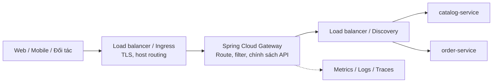
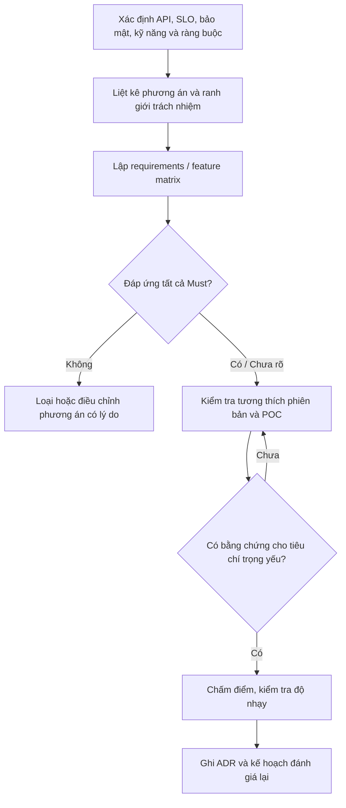

# Lập bảng tính năng trước khi chọn kiến trúc gateway

Chọn **API Gateway** không nên bắt đầu bằng câu hỏi “dùng Spring Cloud Gateway WebFlux hay MVC?” hoặc “có cần Kubernetes Ingress không?”. Cần bắt đầu bằng câu hỏi: **Hệ thống cần cổng vào làm gì, tiêu chí nào bắt buộc và chứng cứ nào cho thấy một phương án đáp ứng được?**

Trong hệ sinh thái **Spring Cloud Gateway**, các khả năng như route predicate, filter chain, biến đổi URL/header, khám phá dịch vụ, xác thực, rate limiting, circuit breaker, retry, TLS và quan sát request có thể liên quan đến nhiều dependency, thành phần triển khai và chính sách vận hành khác nhau. Một lựa chọn chạy được ví dụ định tuyến đơn giản chưa chắc đáp ứng được yêu cầu về bảo mật, tải, độ sẵn sàng hoặc khả năng bảo trì.

Bài này thuộc chương **Phiên bản và biến thể**. Mục tiêu là xây dựng một **bảng tính năng (feature matrix)** có thể kiểm chứng, sau đó dùng bảng ấy để lựa chọn kiến trúc gateway và phiên bản phù hợp với bối cảnh cụ thể.

## 1. Feature matrix là gì và vì sao cần lập trước?

**Feature matrix** là bảng đối chiếu từng yêu cầu của hệ thống với các phương án kiến trúc. Ngoài ô “có/không”, một bảng hữu ích còn ghi được mức quan trọng, điều kiện tiên quyết, giới hạn, bằng chứng và người chịu trách nhiệm xác minh.

Ví dụ, đánh dấu “hỗ trợ rate limiting” là chưa đủ. Cần trả lời:

- Giới hạn theo IP, tài khoản, API key hay route?
- Một người dùng gọi vào **nhiều instance gateway** có bị tính chung một hạn mức không?
- Hết quota trả status nào, có cần header thông báo hay không?
- Bộ đếm được lưu ở đâu, điều gì xảy ra nếu nơi lưu bộ đếm không sẵn sàng?
- Khả năng đó có sẵn trong biến thể và phiên bản định dùng hay cần thêm dependency, plugin hoặc tự phát triển?

Feature matrix giúp tránh bốn sai lầm phổ biến:

1. **So sánh theo tên sản phẩm:** thấy các tài liệu cùng ghi “có circuit breaker” rồi mặc định mức độ tích hợp và cách cấu hình giống nhau.
2. **Lẫn tính năng với khả năng vận hành:** cấu hình được JWT validation nhưng không có cơ chế xoay khóa, theo dõi lỗi xác thực hoặc xử lý khi nhà cung cấp danh tính gặp sự cố.
3. **Chọn biến thể trước khi khảo sát:** chọn reactive do nghĩ “nhanh hơn” dù đội ngũ chỉ vận hành MVC và không có yêu cầu về mô hình xử lý đó.
4. **Chốt kiến trúc khi chưa khóa phiên bản:** ví dụ cấu hình từ một bản hướng dẫn cũ được áp dụng vào bộ Spring Boot/Spring Cloud khác, dẫn đến starter, property hoặc filter không tương thích.

**Kết quả đầu ra mong muốn** của quá trình lập bảng là một quyết định có thể truy vết: yêu cầu nào dẫn đến lựa chọn nào, lựa chọn đó được kiểm chứng bằng gì và còn rủi ro nào.

## 2. Xác định đúng các phương án cần so sánh

Trước khi điền bảng, cần phân biệt **biến thể ứng dụng gateway** với **kiến trúc hạ tầng xung quanh gateway**. Hai quyết định này liên quan nhưng không đồng nhất.

### 2.1. Các lựa chọn ứng dụng và hạ tầng

| Phương án | Bản chất | Thường đáng xem xét khi |
| --- | --- | --- |
| **Spring Cloud Gateway Server WebFlux** | Gateway chạy trên ngăn xếp Spring WebFlux, xử lý HTTP theo mô hình reactive. | Muốn triển khai gateway tùy biến bằng Spring và có năng lực phát triển/vận hành ngăn xếp WebFlux. |
| **Spring Cloud Gateway Server Web MVC** | Gateway dùng ngăn xếp Spring MVC/Servlet, với hệ API và catalog tính năng theo dòng sản phẩm tương ứng. | Đội ngũ quen Spring MVC, có nhu cầu tích hợp theo servlet stack hoặc ưu tiên mô hình quen thuộc. |
| **Ingress/reverse proxy tại biên** | Thành phần hạ tầng tiếp nhận và phân tuyến HTTP(S), có thể đứng trước ứng dụng trong Kubernetes hoặc môi trường khác. | Chủ yếu cần TLS termination, host/path routing và phân phối lưu lượng; chính sách nâng cao phụ thuộc sản phẩm/controller. |
| **Dịch vụ API gateway được quản lý** | Nền tảng do nhà cung cấp quản lý, thường có routing, xác thực, quota và công cụ giám sát theo gói tính năng. | Muốn giảm gánh nặng vận hành hoặc cần cổng API cho đối tác, với điều kiện đáp ứng yêu cầu kiểm soát và chi phí. |
| **Kiến trúc kết hợp** | Load balancer/Ingress đứng trước các instance Spring Cloud Gateway; gateway đứng trước microservices. | Cần tách trách nhiệm hạ tầng biên khỏi chính sách API có logic riêng và cần scale các tầng độc lập. |

Phương án kết hợp có thể trông như sau:



Trong mô hình này, ingress hoặc load balancer không nhất thiết thay thế Spring Cloud Gateway. Cần phân chia rõ nơi thực hiện CORS, TLS, xác thực, giới hạn lưu lượng và gắn thông tin nguồn request để tránh triển khai lặp hoặc tạo lỗ hổng.

### 2.2. Những khác biệt cần hiểu giữa WebFlux và Web MVC

| Góc nhìn | Gateway Server WebFlux | Gateway Server Web MVC |
| --- | --- | --- |
| Ngăn xếp nền | Spring WebFlux, API reactive | Spring Web MVC, Servlet |
| Cách mở rộng xử lý tùy biến | Cần hiểu luồng reactive và tránh blocking trong event loop | Theo các điểm mở rộng phù hợp với mô hình MVC/servlet |
| Route và filter | Có cơ chế route/predicate/filter; cách đăng ký và catalog theo dòng WebFlux | Cũng có route/predicate/filter, nhưng API, tên filter và tính tương đương cần kiểm tra theo phiên bản MVC |
| Tích hợp Spring Security | Dùng cách cấu hình phù hợp ngăn xếp reactive | Dùng cách cấu hình phù hợp servlet |
| Lợi thế vận hành | Phù hợp khi đội ngũ đã có kinh nghiệm reactive và tải I/O đồng thời lớn là mục tiêu đo lường | Phù hợp khi đội ngũ đã chuẩn hóa vào MVC và muốn giảm rủi ro học công nghệ mới |
| Rủi ro chọn nhầm | Gọi thư viện blocking trực tiếp trong luồng xử lý reactive; đánh giá sai về debug và tracing | Sao chép mã DSL/filter của WebFlux; đánh giá hiệu năng dựa trên giả định thay vì benchmark |

Không được suy luận rằng WebFlux **luôn** nhanh hơn Web MVC hoặc MVC **không** hỗ trợ gateway phức tạp. Hiệu năng phụ thuộc cấu hình kết nối, tính chất tải, xử lý filter, tài nguyên máy, backpressure, hệ thống backend và cách đo. Tính năng cũng cần kiểm tra trên **đúng bản phát hành** được chọn.

## 3. Thu thập yêu cầu trước khi điền ô tính năng

Một feature matrix tốt bắt đầu từ yêu cầu có thể kiểm thử. Hãy ghi rõ **ai** cần tính năng, **vì sao** và **tiêu chí đạt** thay vì chỉ ghi tên kỹ thuật.

### 3.1. Ví dụ bối cảnh giả định

Một hệ thống bán hàng có:

- Web và mobile gọi một hostname API công khai: `api.shop.example`.
- Ba backend: `catalog-service`, `order-service` và `identity-service`.
- Nhiều instance `catalog-service`, thay đổi qua quá trình scale/deploy.
- API danh mục cho phép truy cập công khai; API đơn hàng yêu cầu JWT và phân quyền theo tài nguyên.
- Đội vận hành muốn giới hạn lưu lượng, biết upstream nào lỗi, đo độ trễ từng route và theo dõi một request xuyên nhiều dịch vụ.

Đây là **tình huống minh họa**, không phải số liệu của một hệ thống thật. Những chỉ tiêu tải và độ trễ dưới đây được đặt làm ví dụ về cách viết tiêu chí nghiệm thu; dự án thực tế phải thay bằng số đo và yêu cầu đã thống nhất.

### 3.2. Bảng yêu cầu gốc (requirements matrix)

| ID | Khả năng cần có | Tiêu chí nghiệm thu mẫu | Ưu tiên |
| --- | --- | --- | --- |
| R01 | Route predicate | `GET /api/catalog/**` đến đúng catalog; request sai method/path không đi nhầm. | **Must** |
| R02 | Biến đổi path/header | Bỏ prefix `/api/catalog`, giữ query string; header nội bộ được thêm/xóa đúng quy tắc. | **Must** |
| R03 | Service discovery/load balancing | Khi một instance catalog bị rút khỏi danh sách khả dụng, request mới được định tuyến tới instance còn hoạt động trong thời gian cho phép. | **Must** |
| R04 | Xác thực | JWT hợp lệ được chấp nhận theo chính sách; thiếu/sai token bị từ chối với phản hồi xác thực phù hợp. | **Must** |
| R05 | Phân quyền | User A không xem được đơn hàng của user B dù đã đăng nhập; kiểm tra tại dịch vụ nghiệp vụ. | **Must** |
| R06 | Rate limiting | Request vượt quota theo user/API key bị từ chối; quota nhất quán giữa nhiều gateway instance. | **Must** |
| R07 | Timeout/circuit breaker | Upstream chậm hoặc lỗi không giữ kết nối vô hạn; phản hồi và metrics thể hiện đúng loại lỗi. | **Must** |
| R08 | Retry | Chỉ thử lại với điều kiện và thao tác an toàn đã khai báo; có giới hạn số lần và tổng thời gian. | **Must** |
| R09 | TLS và bảo vệ header | HTTPS từ client; proxy headers và danh tính chỉ được tin khi đến từ nguồn đã kiểm soát. | **Must** |
| R10 | Quan sát request | Đo tỷ lệ lỗi, độ trễ theo route và liên kết trace gateway → backend. | **Must** |
| R11 | WebSocket/streaming | Chạy end-to-end với cơ chế kết nối dài nếu ứng dụng có nhu cầu thực tế. | **Should nếu phát sinh nhu cầu** |
| R12 | Khả năng thay đổi chính sách | Một route/filter mới được triển khai, kiểm thử, rollback và audit theo quy trình của đội. | **Should** |

**Must** là điều kiện không thể đánh đổi bằng điểm số ở tiêu chí khác. **Should** là nhu cầu ưu tiên, có thể điều chỉnh theo bối cảnh; **Could** là tiện ích chỉ thực hiện khi chi phí hợp lý. Một yêu cầu chỉ nên mang nhãn Must khi không đáp ứng sẽ khiến phương án không thể sử dụng.

Ví dụ với R05: gateway có thể xác thực token, nhưng chỉ `order-service` mới biết đơn hàng nào thuộc về user nào. Vì vậy không ghi sai “gateway bảo đảm toàn bộ phân quyền” trong bảng; cần xác định rõ **trách nhiệm của gateway** và **trách nhiệm của backend**.

### 3.3. Thêm tiêu chí phi chức năng có ngưỡng đo

Ngoài tính năng, nhóm cần bổ sung:

| Nhóm | Câu hỏi phải trả lời | Cách làm rõ |
| --- | --- | --- |
| **Hiệu năng** | Bao nhiêu request/giây, mức đồng thời, p95/p99 và kích thước payload nào? | Tải mẫu có đủ route, JWT, rate limit và filter như production. |
| **Độ sẵn sàng** | Chấp nhận downtime bao nhiêu, cần bao nhiêu instance, failover thế nào? | Chạy lỗi giả lập cho gateway và upstream. |
| **Phục hồi** | Timeout, retry, circuit breaker ảnh hưởng nhau ra sao? | Đặt ngân sách thời gian và đo lượng request bị khuếch đại. |
| **Bảo mật** | JWT lấy từ đâu, khóa được xoay ra sao, TLS kết thúc ở tầng nào? | Threat model, kiểm tra đường tin cậy và phản hồi lỗi. |
| **Vận hành** | Ai trực, theo dõi SLO, khôi phục sự cố, nâng cấp và rollback? | Xác định on-call, dashboard, runbook, quy trình deploy. |
| **Chi phí** | Chi phí hạ tầng, chứng chỉ, Redis, tracing, license, lưu lượng? | Ước tính theo tải hiện tại và khi tăng trưởng. |
| **Khả năng tương thích** | JDK, Spring Boot, Spring Cloud, Spring Security, discovery và observability có đồng bộ không? | Đối chiếu BOM, dependency và tài liệu đúng release train. |

Một ngưỡng minh họa có thể là “thêm không quá 30 ms vào p95 latency ở mức 3.000 request/giây trên tập request thử nghiệm đã mô tả”. Con số ấy **không phải bảo đảm của Spring Cloud Gateway**; phải đo trên môi trường cụ thể, kèm phần cứng, cấu hình, cache và phương pháp tính overhead.

## 4. Tạo bảng đối chiếu tính năng của từng phương án

Có thể bắt đầu với bảng sơ bộ dưới đây. Ký hiệu:

- **Nền tảng:** khả năng thuộc hướng tiếp cận, vẫn phải chọn dependency/cấu hình đúng.
- **Tích hợp:** cần thêm thư viện, dịch vụ phụ trợ hoặc cấu hình vận hành.
- **Kiểm chứng:** không mặc định các biến thể/sản phẩm có cùng API, hành vi hay mức hỗ trợ; xác minh bằng tài liệu và POC.
- **Theo sản phẩm:** phụ thuộc nhà cung cấp hoặc ingress controller cụ thể.

| Tiêu chí | Gateway WebFlux | Gateway Web MVC | Ingress / reverse proxy | Gateway được quản lý |
| --- | --- | --- | --- | --- |
| Route theo path/method/host | **Nền tảng** | **Nền tảng**, API khác | Host/path thường có; method **theo sản phẩm** | **Theo sản phẩm** |
| Route filter và chuỗi xử lý tùy biến | **Nền tảng** | **Nền tảng**, **kiểm chứng** filter cụ thể | Plugin/middleware **theo sản phẩm** | Policy/plugin **theo sản phẩm** |
| Strip/rewrite path, xử lý header | **Nền tảng** | **Nền tảng**, **kiểm chứng** cú pháp | **Theo sản phẩm/controller** | **Theo sản phẩm** |
| Tìm instance bằng service discovery | **Tích hợp** Spring Cloud LoadBalancer/discovery | **Tích hợp**, **kiểm chứng** theo release | Thường dùng upstream/service của hạ tầng | Dùng backend target/integration của provider |
| Xác thực JWT/OAuth 2.0 | **Tích hợp** Spring Security reactive | **Tích hợp** Spring Security servlet | **Theo controller/plugin** | **Theo sản phẩm/gói** |
| Quota/rate limit phân tán | **Tích hợp** limiter và kho trạng thái phù hợp | **Kiểm chứng** khả năng/filter và store ở phiên bản chọn | **Theo controller/plugin** | **Theo sản phẩm/gói** |
| Circuit breaker và timeout | **Tích hợp** và cấu hình | **Tích hợp/kiểm chứng** | **Theo sản phẩm** | **Theo sản phẩm** |
| Retry có điều kiện | **Có**, xác minh hành vi/filter | **Kiểm chứng** trên dòng MVC | **Theo sản phẩm** | **Theo sản phẩm** |
| TLS/mTLS theo từng chặng | Tùy server và topology | Tùy server và topology | Thường là nhiệm vụ của biên | **Theo sản phẩm** |
| Metrics, tracing, access log | **Tích hợp** Actuator/Micrometer/observability | **Tích hợp**, **kiểm chứng** tín hiệu | **Theo sản phẩm/controller** | **Theo sản phẩm/gói** |
| WebSocket/streaming | **Kiểm chứng** loại traffic và route tương ứng | **Kiểm chứng** loại traffic và phiên bản | **Theo controller** | **Theo sản phẩm** |
| Cách scale và độ sẵn sàng | Tự vận hành nhiều instance | Tự vận hành nhiều instance | Do tầng hạ tầng quản lý | Theo cam kết và cấu hình provider |

**Lưu ý:** Bảng này là danh mục cần khảo sát, **không phải tuyên bố rằng mọi phiên bản có đầy đủ mọi tính năng**. Ví dụ, việc WebFlux có `RequestRateLimiter` hay `Retry` trong một tài liệu không có nghĩa là có thể sao chép nguyên tên filter, bean, property hoặc hành vi sang Server Web MVC. Phải chốt đúng bản phát hành và kiểm thử các chính sách quan trọng.

### Ví dụ biến yêu cầu thành dữ liệu kiểm chứng

| Yêu cầu | Bằng chứng chấp nhận được | Kết luận chưa đủ |
| --- | --- | --- |
| R02 – rewrite path | POC chứng minh path, query string, encoding và header chính xác trên các case chuẩn/biên. | “Đã thấy ví dụ RewritePath trong tài liệu.” |
| R03 – discovery | Route tới 2 instance, loại 1 instance và quan sát hành vi theo health/discovery. | “Có `lb://` trong cấu hình.” |
| R04 – JWT | Thử token thiếu, sai chữ ký, hết hạn, sai issuer/audience (nếu chính sách yêu cầu). | “Đã thêm Spring Security.” |
| R06 – rate limit | Hai gateway instance áp dụng cùng quota với cùng identity; đo phản hồi khi store lỗi. | “Có filter tên RateLimiter.” |
| R07 – circuit breaker | Chủ động tạo lỗi/timeout; thấy transition, fallback nếu có, và trace/metrics phù hợp. | “Đã cấu hình một thư viện resilience.” |
| R09 – TLS | Xác định chính xác từng TLS hop, nguồn chứng chỉ, trust store và proxy tin cậy. | “URL public có `https://`.” |
| R10 – tracing | Một request có cùng trace context xuyên gateway và backend; dashboard gắn đúng route. | “Log có request ID ở gateway.” |

Nếu không có bằng chứng, dùng trạng thái **Chưa xác minh**. Không chấm “đạt” chỉ dựa trên sự tồn tại của một tính năng trong danh mục marketing.

## 5. Khóa phiên bản trước khi đánh giá khả năng

**“Phiên bản Spring Cloud Gateway” không thể xem xét tách khỏi “phiên bản Spring Boot và Spring Cloud”.** Spring Cloud có các **release train** quản lý bộ phiên bản tương thích; gateway là một phần của hệ sinh thái đó. JDK, starter, API, cấu hình và hỗ trợ dài hạn cũng là điều kiện lựa chọn.

### 5.1. Mẫu bảng kiểm tương thích

| Hạng mục | Thông tin cần ghi vào hồ sơ quyết định | Cách xác minh |
| --- | --- | --- |
| Spring Boot | Version dự kiến dùng cho runtime | Kiểm tra ma trận tương thích chính thức với Spring Cloud release train. |
| Spring Cloud release train | Train và trạng thái hỗ trợ/bảo trì | Đối chiếu thông báo phát hành, lịch hỗ trợ và BOM. |
| Spring Cloud Gateway | Phiên bản được BOM quản lý; Server WebFlux hay Server Web MVC | Đối chiếu tài liệu **đúng** dòng Gateway và starter tương ứng. |
| JDK | Phiên bản JDK được Spring Boot và các thư viện yêu cầu | Xem baseline/runtime, build tool và CI/CD. |
| Spring Security | Khả năng JWT/resource server và filter chain tương thích | Dùng dependency đúng stack reactive hoặc servlet. |
| LoadBalancer/discovery | Nguồn instance: static, Eureka/Consul/Kubernetes hoặc cơ chế khác | Kiểm tra starter, cấu hình, health và xử lý instance mất kết nối. |
| Rate limiter/resilience | Redis, CircuitBreaker/Resilience4j hay thành phần tương ứng | Kiểm tra bộ filter, API, dependency và hỗ trợ trong biến thể chọn. |
| Actuator/observability | Metrics, tracing, log correlation | Xác minh tên meter, context propagation, exporter và dashboard trên môi trường thử nghiệm. |
| Vòng đời & rủi ro | Hạn hỗ trợ, CVE, đường nâng cấp và rollback | Theo dõi bản vá tương thích, khả năng cập nhật không đứt API. |

**Không suy luận tương thích từ số version gần nhau.** Một bản Gateway mới có thể yêu cầu Spring Boot hoặc Spring Framework khác; bản MVC và WebFlux có thể thay đổi tên starter, tên property và cách cấu hình route/filter theo thời gian.

### 5.2. Quy trình chọn bộ phiên bản

1. Ghi ràng buộc môi trường: JDK, Spring Boot hiện tại, nền tảng triển khai, vòng đời hỗ trợ.
2. Chọn một Spring Cloud release train **chính thức hỗ trợ** bản Spring Boot đó và còn phù hợp với thời hạn vận hành mong muốn.
3. Sử dụng BOM/Dependency Management phù hợp để quản lý dependency Spring Cloud; tránh ghim lẻ từng thư viện dẫn đến phiên bản lệch nhau.
4. Chọn **Gateway Server WebFlux** hoặc **Gateway Server Web MVC** theo kiến trúc mong muốn; kiểm tra starter/DSL/property chính xác theo tài liệu của biến thể.
5. Trên nhánh POC, dựng các tình huống quan trọng như JWT, Redis limit, circuit breaker, discovery và tracing; sửa lại bảng nếu tính năng phụ thuộc phiên bản.
6. Ghi bộ phiên bản đã kiểm chứng trong hồ sơ quyết định và có kế hoạch kiểm tra lại khi nâng cấp.

Khi đọc ví dụ trên Internet, đừng tự động sao chép tên thuộc tính của một bài viết cũ. Spring Cloud Gateway đã có những thay đổi về cách tổ chức sản phẩm và tiền tố cấu hình qua các dòng phát hành; cần mở mục **Configuration Properties** và **Starter** tương ứng với phiên bản định dùng. Khóa môi trường bằng BOM và kiểm tra dependency thực tế trong build.

Nguồn đối chiếu chính thức cần lưu trong hồ sơ: [Spring Cloud Gateway Reference](https://docs.spring.io/spring-cloud-gateway/reference/), [Spring Cloud Project](https://spring.io/projects/spring-cloud), [Spring Boot Reference](https://docs.spring.io/spring-boot/reference/) và [Spring Cloud Supported Versions](https://github.com/spring-cloud/spring-cloud-release/wiki/Supported-Versions).

## 6. Chấm điểm có trọng số sau khi qua điều kiện bắt buộc

Tính năng **Must** nên được xét như **điều kiện loại trừ (hard gate)**. Chỉ đưa những phương án vượt qua tất cả hard gate có liên quan vào vòng chấm điểm. Ví dụ, nếu quy định bắt buộc giữ log trong vùng dữ liệu riêng mà một dịch vụ quản lý không cho phép, điểm hiệu năng cao cũng không giải quyết được.

Với các phương án còn hợp lệ, đặt trọng số cho từng tiêu chí theo mức ảnh hưởng đối với dự án. Có thể chấm điểm từ 1 đến 5:

- **1:** đáp ứng rất kém hoặc khó vận hành.
- **2:** có thể đáp ứng nhưng phải tùy biến/đầu tư lớn.
- **3:** đáp ứng ở mức chấp nhận được, còn rủi ro.
- **4:** đáp ứng tốt, phụ thuộc ít hoặc đã được kiểm thử.
- **5:** rất phù hợp với nhu cầu và đội ngũ trong bối cảnh đang xét.

Điểm tổng có trọng số:

```text
Điểm phương án = Σ(Trọng số tiêu chí × Điểm tiêu chí) / Σ(Trọng số)
```

### 6.1. Ví dụ bảng chấm điểm minh họa

Bảng sau **chỉ minh họa phương pháp**, với điểm số là giả định của nhóm dự án. Nó không phải kết quả benchmark, đánh giá khách quan về sản phẩm hoặc đề xuất mặc định.

| Tiêu chí | Trọng số (%) | WebFlux (1–5) | Web MVC (1–5) | Gateway quản lý giả định (1–5) |
| --- | ---: | ---: | ---: | ---: |
| Route/filter tùy biến | 20 | 5 | 4 | 3 |
| Bảo mật và kiểm soát truy cập | 15 | 4 | 4 | 4 |
| Timeout, retry, circuit breaker | 10 | 4 | 4 | 3 |
| Discovery và tích hợp backend | 10 | 5 | 5 | 3 |
| Metrics, tracing, quy trình vận hành | 15 | 4 | 4 | 5 |
| Kỹ năng hiện tại của đội | 10 | 3 | 5 | 4 |
| Mức phù hợp với yêu cầu tải | 10 | 5 | 3 | 4 |
| Chi phí và mức phụ thuộc nhà cung cấp | 10 | 4 | 4 | 3 |
| **Tổng trọng số** | **100** | **4,30/5** | **4,10/5** | **3,65/5** |

Ví dụ cách tính riêng WebFlux:

```text
(20×5 + 15×4 + 10×4 + 10×5 + 15×4 + 10×3 + 10×5 + 10×4) / 100
= 430 / 100
= 4,30 điểm
```

Trong tình huống giả định này, WebFlux cao hơn Web MVC **0,20 điểm**. Chênh lệch đó chưa đủ để tự động chọn WebFlux: nếu đội chưa có kinh nghiệm reactive, bài thử tải chưa chứng minh khác biệt hoặc khả năng rate limit đang “Chưa xác minh”, kết luận vẫn cần giữ mở.

### 6.2. Kiểm tra độ nhạy trước khi ra quyết định

Trọng số có thể thay đổi khi mục tiêu kinh doanh thay đổi. Hãy thử ít nhất hai kịch bản:

1. **Ưu tiên đưa sản phẩm ra nhanh:** tăng trọng số cho kỹ năng đội và công vận hành. MVC hoặc gateway quản lý có thể trở nên phù hợp hơn.
2. **Ưu tiên gateway tùy biến, tải I/O lớn:** tăng trọng số cho mở rộng filter, khả năng quan sát và chỉ số tải đã đo. WebFlux có thể được ưu tiên nếu các thử nghiệm xác nhận giả thuyết.

Nếu kết quả đảo chiều khi chỉ thay đổi một chút trọng số, nên coi đây là **quyết định nhạy cảm với giả định**. Cần POC bổ sung, hoặc chọn phương án dễ thay thế, thay vì trình bày một điểm số như sự thật tuyệt đối.

## 7. Thiết kế POC để biến ô “Chưa xác minh” thành bằng chứng

Một **Proof of Concept (POC)** cần đủ hẹp để triển khai nhanh nhưng đủ thực để phản ánh những tính năng có thể loại trừ phương án. Không cần xây toàn bộ ứng dụng bán hàng; có thể dùng hai backend giả lập với endpoint phản hồi bình thường, chậm và lỗi.

### 7.1. Bộ tình huống kiểm chứng tối thiểu

| Case | Thiết lập | Hành động | Kết quả cần quan sát |
| --- | --- | --- | --- |
| P01 – Route | Public path `/api/catalog/products/42` | Gửi GET và POST | Request đúng method/path đến đúng backend; route không khớp không đi nhầm. |
| P02 – Rewrite | Backend công bố `/products/42` | Gọi qua prefix public, có query string | Backend nhận path/query đúng sau rewrite/strip. |
| P03 – Discovery | Hai instance catalog | Gọi nhiều request, ngừng một instance | Gateway cập nhật nơi chuyển tiếp theo health/discovery; đo thời gian hội tụ. |
| P04 – Security | JWT đúng, sai, hết hạn, thiếu | Gọi API orders | Trường hợp không hợp lệ bị chặn; backend vẫn kiểm tra quyền đối với đơn hàng cụ thể. |
| P05 – Rate limit | Hai gateway instance, cùng một user/API key | Gửi burst vượt quota | Quota hoạt động theo policy tổng thể, ghi được trường hợp bị chặn, xem xét status 429. |
| P06 – Resilience | Upstream cố tình chậm, lỗi 5xx hoặc mất kết nối | Gọi endpoint an toàn để thử lỗi | Timeout/circuit breaker/retry đúng điều kiện, không nhân tải vô hạn. |
| P07 – TLS | Sơ đồ TLS và proxy trust rõ ràng | Thử HTTPS và header chuyển tiếp giả | Chứng chỉ đúng; header giả mạo từ client không được coi là nguồn tin cậy. |
| P08 – Observability | Tracing/metrics bật trên gateway + backend | Gọi một request qua nhiều bước | Liên kết được trace; phân biệt route, upstream, lỗi và độ trễ. |
| P09 – Performance | Tập request và tải mẫu đã thống nhất | Chạy load test định kỳ | Ghi throughput, p50/p95/p99, CPU, RAM, kết nối và lỗi trên cùng môi trường. |
| P10 – Deployment | Có ít nhất hai instance gateway | Tắt lần lượt từng instance | Load balancer/ingress chuyển tải; health/readiness và rollback đúng mong đợi. |

Các yêu cầu đặc biệt như WebSocket, streaming, gRPC hay mutual TLS phải có POC riêng nếu chúng thực sự tồn tại trong hệ thống. Không nên đưa chúng thành Must chỉ vì một ứng dụng khác có sử dụng.

### 7.2. Một kịch bản kiểm tra đường dẫn và xác thực

Giả sử public API là `http://localhost:8080/api/catalog/products/42` khi chạy local. Có thể kiểm tra định tuyến ban đầu bằng:

```bash
curl -i "http://localhost:8080/api/catalog/products/42?currency=VND"
```

Trong backend giả lập, log hoặc endpoint echo phải cho thấy request tương ứng đến `/products/42?currency=VND` nếu yêu cầu quy định bỏ hai phân đoạn đầu `api` và `catalog`.

Với endpoint bảo vệ:

```bash
# Thiếu Authorization: mong đợi bị từ chối theo chính sách bảo mật
curl -i "http://localhost:8080/api/orders/123"

# Token hợp lệ được cấp bởi hệ thống danh tính thử nghiệm
curl -i \
  -H "Authorization: Bearer <ACCESS_TOKEN_HOP_LE>" \
  "http://localhost:8080/api/orders/123"
```

Đặt biến/token thử nghiệm đúng cách trong môi trường POC; không commit token thật vào file hoặc log. Trạng thái 401/403 phụ thuộc trường hợp xác thực/phân quyền: token thiếu hoặc không hợp lệ thường dẫn đến **401** ở nơi bảo vệ; người dùng đã xác thực nhưng không có quyền xem tài nguyên thường nhận **403** từ chính sách của ứng dụng hoặc backend.

### 7.3. So sánh công bằng giữa biến thể

Khi benchmark, hai phương án phải dùng cùng:

- Phiên bản runtime và tài nguyên tương đương trong phạm vi có thể.
- Số lượng route, filter và cùng ngữ nghĩa JWT/rate limiting/retry.
- Backend giả lập, thời gian phản hồi, quy mô payload và đường mạng.
- Quy trình warm-up, số vòng lặp và công cụ đo.
- Tiêu chí báo cáo p95/p99, lỗi 4xx/5xx, mức tiêu thụ CPU/RAM, áp lực connection pool và ảnh hưởng đến upstream.

**Không so** gateway WebFlux chạy filter đơn giản với Gateway MVC đã bật JWT validation, tracing và Redis rate limiting rồi kết luận một bên nhanh hơn. Tương tự, một kết quả benchmark local không suy ra hiệu năng production.

### 7.4. Mẫu ghi bằng chứng cho từng ô

```text
REQ_ID: R06
PHUONG_AN: Spring Cloud Gateway Server WebFlux
PHIEN_BAN: [điền bộ JDK + Spring Boot + Spring Cloud + Gateway thực tế]
TINH_NANG: Rate limit phân tán theo identity
KET_QUA: PASS / FAIL / CHUA_XAC_MINH
BANG_CHUNG: [link run thử nghiệm, commit POC, dashboard hoặc log đã khử nhạy cảm]
DIEU_KIEN: [2 gateway instance, 1 kho lưu quota, kịch bản tải]
GIOI_HAN: [hành vi khi kho quota mất kết nối]
NGUOI_XAC_MINH: [owner]
NGAY_XAC_MINH: [ngày]
```

Một ô **PASS** chỉ đáng tin khi ghi rõ điều kiện đã kiểm tra. Khi nâng cấp release train, thay limiter hoặc thay topology ingress, cần xác định ô nào phải kiểm chứng lại.

## 8. Kết nối bảng tính năng với quyết định kiến trúc

Feature matrix không chỉ nhằm chọn WebFlux hay MVC; nó còn quyết định **chính sách thuộc tầng nào**. Lấy ví dụ kiến trúc kết hợp ingress + Spring Cloud Gateway:

| Trách nhiệm | Vị trí dự kiến | Lý do và điểm cần kiểm chứng |
| --- | --- | --- |
| TLS công khai, load balancing vào gateway | Ingress/load balancer | Thuận tiện quản lý chứng chỉ và scale các instance; xác định TLS hop tiếp theo. |
| Route theo public API và rewrite path | Spring Cloud Gateway | Gắn với contract của API dành cho client. |
| JWT validation tại biên API | Gateway hoặc lớp xác thực được chọn | Cần một chính sách nhất quán, tránh hai nơi diễn giải token trái nhau. |
| Phân quyền theo đơn hàng | `order-service` | Backend biết ownership và luật nghiệp vụ. |
| Rate limit theo user/API key | Gateway hoặc policy edge rõ ràng | Chọn một nơi giữ quota logic; có phương án đồng bộ giữa các instance. |
| Circuit breaker/retry | Ở tầng chịu trách nhiệm gọi upstream, theo ngân sách tổng | Tránh retry chồng nhiều tầng khiến request bị nhân lên. |
| Metrics/tracing | Xuyên ingress, gateway, backend | Phải nối được trace và phân biệt lỗi phát sinh ở từng lớp. |
| Discovery instance backend | Thành phần load balancing/discovery phù hợp nền tảng | Không phụ thuộc hostname/instance được ghi cứng nếu hệ thống cần scale động. |

Đặc biệt chú ý **retry ở nhiều tầng**. Nếu ingress retry 2 lần, gateway lại retry 3 lần, một request ban đầu có thể dẫn đến nhiều lần gọi backend hơn kỳ vọng. Với yêu cầu thay đổi trạng thái như đặt hàng hoặc thanh toán, điều này có thể tạo giao dịch trùng nếu không có cơ chế idempotency ở nơi xử lý nghiệp vụ.

### Quy trình quyết định tổng quát



## 9. Mẫu Architecture Decision Record (ADR)

Sau khi hoàn tất matrix và POC, ghi quyết định bằng một tài liệu ngắn, để người đến sau hiểu **vì sao** hệ thống dùng biến thể và topology đó. Ví dụ:

```markdown
# ADR-00X: Lựa chọn API Gateway cho hệ thống bán hàng

## Bối cảnh
- 3 backend, web/mobile dùng chung public API.
- Phải có JWT, rate limit phân tán, discovery, timeout và tracing.
- Ràng buộc JDK/Spring Boot/Spring Cloud: [điền]
- SLO/tải đo được: [điền]

## Phương án
- A: Spring Cloud Gateway Server WebFlux
- B: Spring Cloud Gateway Server Web MVC
- C: Ingress/reverse proxy hoặc gateway được quản lý
- Topology kết hợp nếu cần: [điền]

## Bằng chứng
- Feature matrix: [link]
- Kiểm tra hard gate: [PASS/FAIL theo yêu cầu]
- POC và benchmark: [link, điều kiện đo, kết quả]
- Kiểm tra support/compatibility: [link phiên bản]

## Quyết định
- Phương án được chọn: [điền sau khi kiểm chứng]
- Phiên bản/stack được khóa: [điền]
- Phân chia ingress/gateway/backend: [điền]

## Hệ quả và rủi ro
- Lợi ích: [điền]
- Rủi ro: [điền]
- Các điểm chưa xác minh và owner: [điền]
- Kế hoạch rollback, vận hành và nâng cấp: [điền]

## Xem xét lại khi
- Nâng Spring Boot/Spring Cloud/Gateway.
- Xuất hiện traffic mới như WebSocket/streaming.
- SLO/tải hoặc chính sách bảo mật thay đổi đáng kể.
```

Không phải lúc nào quyết định tối ưu cũng là phương án nhiều tính năng nhất. Nếu chỉ cần host/path routing, TLS, metrics cơ bản và đã có ingress đủ khả năng, việc thêm một gateway ứng dụng có thể tạo thêm một lớp vận hành không cần thiết. Ngược lại, khi cần filter tùy biến, phối hợp Spring Security/discovery và các chính sách API chuyên biệt, Spring Cloud Gateway có thể đáng giá hơn về tổng chi phí và khả năng bảo trì.

## 10. Các lỗi thường gặp khi lập bảng tính năng

### “Có/không” mà không có mức độ và bằng chứng

Một tính năng có thể tồn tại trong tài liệu nhưng chỉ hoạt động với cấu hình hoặc dependency nhất định. Ghi trạng thái **Có điều kiện**, **Chưa xác minh**, đường dẫn chứng cứ và người xác minh thay vì chấm mặc định “có”.

### Trộn biến thể với phiên bản

WebFlux và MVC là hai cách tổ chức/ngăn xếp triển khai; chúng không đồng nghĩa với “cũ” và “mới”. Cùng một tên filter hoặc mục đích có thể có API/cấu hình khác nhau trên hai ngăn xếp và giữa các release. Chốt biến thể, release train và starter trước khi đưa ví dụ cấu hình vào sản phẩm.

### Nhầm “hỗ trợ TLS” với “toàn hệ thống an toàn”

TLS từ browser đến load balancer chưa xác nhận kết nối từ load balancer đến gateway, rồi từ gateway đến backend có được bảo vệ hay không. Phải ghi rõ các TLS hop, trust boundary, chính sách forwarded header, quản lý bí mật và vị trí xác thực.

### Gộp bảo mật nghiệp vụ vào gateway

Gateway có thể xác thực và từ chối sớm; quyết định “người dùng này có được sửa đơn hàng đó không” cần kiểm tra trong dịch vụ có dữ liệu nghiệp vụ. Nếu matrix đánh dấu gateway là nơi duy nhất bảo vệ mọi API, thiết kế có nguy cơ bỏ qua các đường gọi nội bộ.

### Chấm điểm trước khi kiểm tra hard gate

Một phương án không đáp ứng yêu cầu bắt buộc không trở nên hợp lệ chỉ vì đạt điểm cao ở những tiêu chí khác. Tương tự, một ô chưa có bằng chứng không thể được cộng như đã đạt.

### Chỉ đánh giá ngày triển khai đầu tiên

Quy trình nâng cấp, hỗ trợ bảo mật, đổi chứng chỉ, backup phụ thuộc rate limiting, CI/CD, debugging và on-call tác động mạnh đến chi phí dài hạn. Feature matrix nên có hàng dành cho vận hành và thay đổi.

## 11. Checklist đầu ra trước khi chọn kiến trúc

Đến thời điểm ra quyết định, hãy kiểm tra:

- [ ] Đã mô tả client, backend, topology và lý do cần API Gateway.
- [ ] Đã lập danh sách yêu cầu route/predicate, filter, path/header, discovery, security, rate limit, resilience, TLS và observability.
- [ ] Mỗi yêu cầu quan trọng có người phụ trách, ưu tiên Must/Should/Could và tiêu chí nghiệm thu đo được.
- [ ] Đã phân biệt các phương án WebFlux, MVC, ingress/reverse proxy, gateway được quản lý và topology kết hợp.
- [ ] Đã ghi JDK, Spring Boot, Spring Cloud release train, Spring Cloud Gateway và dependencies tương thích cho từng phương án.
- [ ] Các ô Must có bằng chứng hoặc được đánh dấu Chưa xác minh, không mặc định PASS.
- [ ] Đã chạy POC các tình huống bảo mật, tải, retry, mất instance, TLS và truy vết request liên quan.
- [ ] Đã chấm điểm các phương án vượt hard gate và kiểm tra độ nhạy trọng số.
- [ ] Đã phân định trách nhiệm giữa ingress, gateway và backend.
- [ ] Đã ghi ADR, các rủi ro còn lại, kế hoạch vận hành, rollback và điều kiện xem xét lại.

## 12. Tự kiểm tra

1. Một dự án đã dùng Spring MVC nhiều năm, lưu lượng vừa phải và cần rewrite path, JWT, metrics cơ bản. Bạn sẽ đặt những tiêu chí gì để so sánh Gateway Server Web MVC với WebFlux?
2. Vì sao không thể kết luận một biến thể “hỗ trợ rate limiting phân tán” chỉ từ việc tài liệu có tên filter `RequestRateLimiter`?
3. Nếu ingress và gateway đều có chức năng retry, bảng tính năng cần ghi thêm rủi ro nào?
4. Vì sao phải chốt Spring Boot/Spring Cloud release train trước khi dùng một mẫu YAML cấu hình gateway được tìm thấy trên Internet?
5. Nếu hai phương án có điểm tổng gần nhau nhưng một phương án chưa qua POC bảo mật, có thể chọn theo điểm số ngay không?

**Điều cần ghi nhớ:** Hãy chọn kiến trúc Spring Cloud Gateway bằng một chuỗi quyết định có căn cứ: **yêu cầu kiểm thử được → phương án và phiên bản rõ ràng → bảng tính năng → điều kiện loại trừ → POC → chấm điểm → ADR**. Cách này giúp đội ngũ chọn cổng vào microservices phù hợp với nhu cầu hiện tại và có cơ sở để điều chỉnh an toàn khi hệ thống phát triển.
