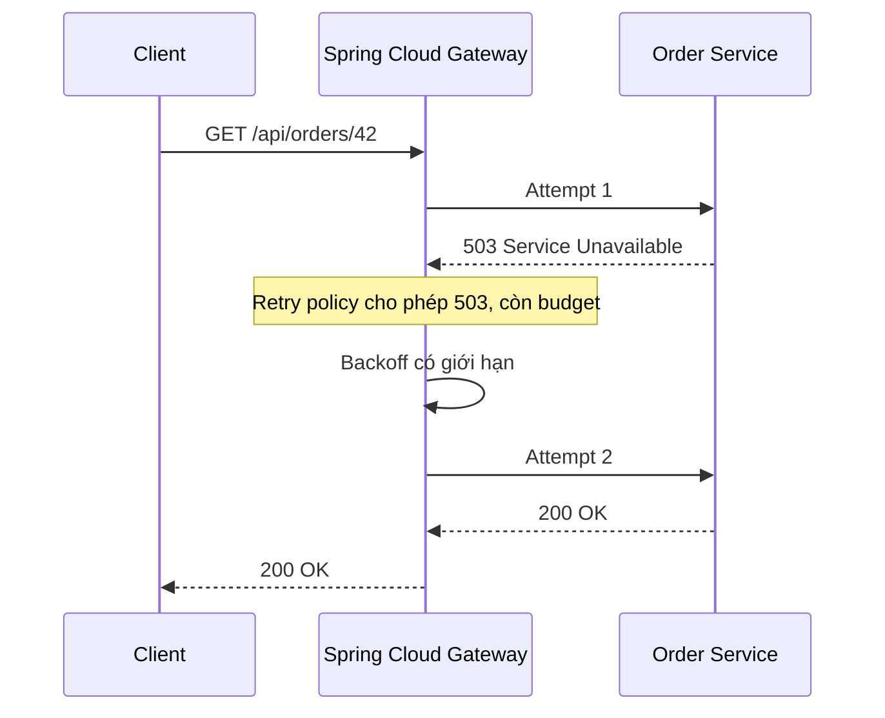
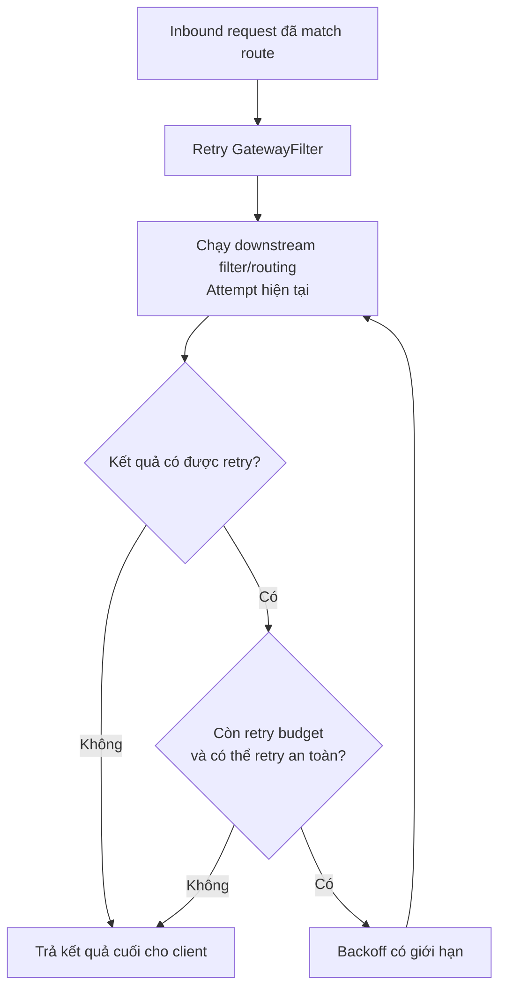

# Retry filter và các loại lỗi có thể thử lại

## Mục tiêu bài học

Trong chương **Thử lại yêu cầu**, bài này hướng dẫn sử dụng **`Retry` GatewayFilter Factory** của **Spring Cloud Gateway Server WebFlux** để phục hồi một số lỗi tạm thời khi Gateway gọi microservice. Người học sẽ hiểu **lỗi nào có thể retry, lỗi nào không nên retry, điều kiện để retry an toàn** và cách tránh việc một cơ chế phục hồi đơn giản biến thành tác nhân gây quá tải hoặc tạo giao dịch trùng.

Sau bài học, bạn có thể:

- Phân biệt **HTTP response status** với **exception của kết nối/reactive publisher** khi quyết định retry.
- Đọc và cấu hình các tham số `retries`, `statuses`, `series`, `methods`, `exceptions` và `backoff` của `Retry` filter.
- Giải thích vì sao **`retries: 2` là tối đa hai lần thử lại sau lần đầu**, không phải tổng hai lần gọi.
- Phân tích tính **safe/idempotent** của GET, HEAD, PUT, DELETE và rủi ro với POST/PATCH.
- Thiết kế **retry budget**, exponential backoff, deadline, timeout và phối hợp với `CircuitBreaker`.
- Hiểu giới hạn retry khi **response đã commit**, khi có **request body**, khi dùng `forward:` và với streaming.
- Quan sát **một inbound request tạo bao nhiêu outbound attempts**, đặc biệt khi có nhiều Gateway replicas, load balancing và client retry.
- Kiểm thử có kiểm soát trường hợp backend trả 503 rồi 200, lỗi kết nối, lỗi 400/401, timeout và thao tác ghi cần idempotency.

> **Phạm vi:** Spring Cloud Gateway **Server WebFlux** dùng Reactor và Netty routing. Server MVC có các cơ chế/lớp triển khai khác. Cú pháp YAML dùng namespace `spring.cloud.gateway.routes` phổ biến ở nhiều phiên bản Gateway Server WebFlux 4.x; các dòng mới có thể chuyển sang `spring.cloud.gateway.server.webflux.routes`. Phải đối chiếu phiên bản dependency đang chạy và xác minh route/filter được nạp thực tế.

## 1. Tại sao API Gateway cần retry?

Giả sử frontend gọi:

```http
GET /api/orders/42 HTTP/1.1
Host: api.example.com
Authorization: Bearer <access-token>
```

Gateway định tuyến tới `order-service`. Lúc này, một instance backend bị khởi động lại, kết nối mạng đứt ngắn hoặc service trả `503 Service Unavailable` do đang quá tải. Nếu **cùng thao tác có thể thực hiện lại an toàn**, thử lại sau một khoảng chờ ngắn có thể giúp user nhận kết quả mà không phải tự nhấn nút tải lại.



Ở góc nhìn client, có **một HTTP request gửi đến Gateway**. Ở góc nhìn backend, có **hai outbound HTTP attempts**. Retry xảy ra trong chuỗi filter/routing, vì vậy có thể chịu ảnh hưởng của các filter đứng trước hoặc sau nó.

Retry giúp với **lỗi thoáng qua**. Nó thường không giải quyết được:

- Sai mật khẩu, token hết hạn, thiếu quyền truy cập.
- URL không tồn tại hoặc request JSON sai định dạng.
- Lỗi logic trong code backend, tồn tại dai dẳng với mọi attempt.
- Database bị quá tải kéo dài nếu retry chỉ làm tải nặng thêm.
- Giao dịch POST đã được thực thi nhưng Gateway không nhận response; gửi lại có thể tạo **giao dịch thứ hai**.

**Nguyên tắc:** retry chỉ khi có **lý do tin rằng lần sau có thể thành công** và **hậu quả khi lặp lại thao tác được kiểm soát**.

## 2. Retry, timeout, circuit breaker và rate limiter khác nhau

| Cơ chế | Câu hỏi chính | Ví dụ |
| --- | --- | --- |
| **Retry** | Có nên **thử lại** một lời gọi thất bại? | Sau 503, đợi 100 ms rồi gọi lại |
| **Timeout** | Một lời gọi được phép **chờ bao lâu**? | Dừng chờ phản hồi quá 2 giây |
| **Circuit breaker** | Có nên **tiếp tục gọi upstream đang không khỏe**? | Khi tỷ lệ lỗi cao, OPEN và fail fast |
| **Rate limiter** | Một client/tenant được gửi request ở **tốc độ nào**? | 20 RPS trung bình, có burst |
| **Concurrency limit / bulkhead** | Có bao nhiêu tác vụ được xử lý **đồng thời**? | Tối đa 30 in-flight |
| **Idempotency** | Gọi lại cùng thao tác có tạo hậu quả ngoài ý muốn không? | Cùng key tạo tối đa một đơn hàng |

Một Gateway có thể dùng **tất cả các cơ chế trên**. Chúng không thay thế nhau:

```text
Client
  ↓
Gateway: xác thực, phân quyền và hạn mức
  ↓
Retry policy (số attempts + backoff)
  ↓
Circuit breaker / timeout theo kiến trúc
  ↓
Load balancing + HTTP routing
  ↓
Backend
```

Đây là **mô hình logic**, không phải thứ tự filter mặc định của mọi ứng dụng. Thứ tự thực tế phụ thuộc `Ordered`, route filters, `GlobalFilter` và phạm vi publisher mà mỗi filter bao bọc. Đặt Retry bên ngoài hay bên trong CircuitBreaker có thể thay đổi **circuit đếm từng attempt hay kết quả sau nhiều attempts**.

## 3. `Retry` GatewayFilter Factory hoạt động ở đâu?

Trong **Spring Cloud Gateway Server WebFlux**, một route có:

- **Predicates:** xác định request có thuộc route đó không (`Path`, `Method`, `Host`...).
- **Filters:** xử lý request/response, trong đó có `Retry`, `RewritePath`, `StripPrefix`, `RequestRateLimiter`, `CircuitBreaker`.
- **URI:** nơi định tuyến, ví dụ `http://localhost:9001` hoặc `lb://order-service`.

`Retry` filter được gắn vào **một route** hoặc cấu hình filter mặc định nếu có chủ đích. Khi một lần chạy **phần downstream** kết thúc với kết quả thỏa điều kiện retry, filter có thể tạo một subscription/attempt mới theo policy.



Một request bị **Spring Security WebFilterChain** chặn trước route matching có thể **không đi qua** `Retry` filter của route. Tương tự, một HTTP response đã commit hoặc một body stream đã được gửi một phần không thể tùy tiện được “thu hồi” để phát một response mới. Vì vậy retry không phải lớp phủ cho mọi lỗi phát sinh ở bất kỳ đâu trong hệ thống.

### 3.1. `retries` đếm lần thử lại, không đếm tổng attempts

Giả sử:

```yaml
retries: 2
```

Thì số attempts tối đa trong điều kiện mọi retry đều được phép là:

```text
Attempt 1: lần gọi đầu tiên
Attempt 2: retry lần 1
Attempt 3: retry lần 2

Tổng tối đa: 1 + 2 = 3 attempts
```

Không phải mọi request đều thực hiện ba attempts. Nếu attempt đầu thành công, chỉ có **một** call. Nếu lỗi không được retry, hoặc một hạn chế khác ngăn việc lặp lại, chuỗi có thể kết thúc sớm.

### 3.2. Đối tượng Retry quan sát là gì?

`Retry` thường dựa trên:

1. **HTTP status hoặc status series** của response downstream.
2. **Exception** được phát trong reactive chain.
3. **HTTP method** có nằm trong tập được phép retry không.
4. **Số retries còn lại** và chính sách backoff.

Một status 503 và một `ConnectException` **không phải cùng loại tín hiệu**:

```text
HTTP 503:
  Đã có response HTTP từ upstream/proxy,
  status code thông báo service không khả dụng.

ConnectException:
  Kết nối tới đích không thiết lập được,
  chưa chắc có response HTTP.
```

Điều này quan trọng khi viết policy: nếu chỉ cấu hình status mà lỗi thật là exception kết nối, hoặc ngược lại, request có thể không được retry như dự kiến.

## 4. Cấu hình Retry cơ bản cho API GET

Ví dụ route `orders-read` dành riêng cho request đọc:

```yaml
spring:
  cloud:
    gateway:
      routes:
        - id: orders-read
          uri: lb://order-service
          predicates:
            - Path=/api/orders/**
            - Method=GET
          filters:
            - StripPrefix=1
            - name: Retry
              args:
                retries: 2
                series:
                  - SERVER_ERROR
                methods:
                  - GET
                backoff:
                  firstBackoff: 100ms
                  maxBackoff: 1s
                  factor: 2
                  basedOnPreviousValue: false
```

Luồng mong đợi:

1. Client gọi `GET /api/orders/42`, route `orders-read` được chọn.
2. `StripPrefix=1` điều chỉnh path thành `/orders/42` để phù hợp với backend ví dụ.
3. `Retry` cho phép tối đa **hai lần thử lại** khi kết quả thuộc **status series 5xx** được filter xét và method thuộc tập cho phép.
4. `lb://order-service` được resolve qua LoadBalancer khi cấu hình có các dependency/instances thích hợp.
5. Với những lần thử lại, filter chờ backoff trước khi thử tiếp.
6. Client nhận response cuối cùng: có thể là 200 nếu phục hồi, hoặc response/lỗi cuối theo cách Gateway xử lý.

**Cần chuẩn bị môi trường:** dependency Spring Cloud Gateway Server WebFlux; nguồn danh sách instance cho `order-service` nếu dùng `lb://`; một backend có thể trả 503 để thử nghiệm. Nếu chỉ muốn học retry riêng, có thể thay `uri` bằng `http://localhost:9001` và dựng backend stub.

### 4.1. `series: SERVER_ERROR` nghĩa là gì?

`SERVER_ERROR` là nhóm **5xx**. Với cấu hình này, `Retry` có thể thử lại những lỗi trong nhóm server errors mà nó nhận diện được và chưa vượt budget. Điều này **rộng hơn** việc chỉ thử lại 502/503/504.

Một HTTP 500 có thể phát sinh từ **lỗi code/bug dữ liệu không thể tự phục hồi**. Retry mọi 5xx mà không quan sát thực tế có thể nhân tải trên backend. Với production, nên chọn từng status và exception có lý do, hoặc xem thật cẩn thận ý nghĩa của nhóm 5xx.

### 4.2. Ghi nhớ các trường trong `Retry` filter

| Trường | Chức năng | Ví dụ |
| --- | --- | --- |
| `retries` | Số **lần retry sau lần gọi đầu** | `2` |
| `statuses` | Những HTTP status cụ thể có thể retry | `BAD_GATEWAY`, `SERVICE_UNAVAILABLE` |
| `series` | Nhóm HTTP status có thể retry | `SERVER_ERROR` |
| `methods` | Những HTTP methods được phép retry | `GET`, `HEAD` |
| `exceptions` | Danh sách lớp exception có thể retry | `java.io.IOException` |
| `backoff.firstBackoff` | Khoảng chờ khởi đầu | `100ms` |
| `backoff.maxBackoff` | Giới hạn khoảng chờ | `1s` |
| `backoff.factor` | Hệ số tăng khoảng chờ | `2` |
| `backoff.basedOnPreviousValue` | Cách tính từ khoảng chờ trước đó | `false` |

Ở các phiên bản phổ biến, `Retry` có defaults cho số retries, status series, method và exception. **Không dựa vào default khi thiết kế chính sách có yêu cầu cụ thể.** Đặc biệt, khi muốn thử **chỉ** vài `statuses`, cần kiểm tra `series` còn được mặc định cho 5xx hay không và cấu hình tập rỗng hoặc override phù hợp với phiên bản.

### 4.3. Chỉ thử lại những status tạm thời cụ thể

Ví dụ chính sách nhằm nhắm vào `502`, `503` và `504`:

```yaml
filters:
  - name: Retry
    args:
      retries: 2
      statuses:
        - BAD_GATEWAY
        - SERVICE_UNAVAILABLE
        - GATEWAY_TIMEOUT
      series: []
      methods:
        - GET
      backoff:
        firstBackoff: 200ms
        maxBackoff: 1s
        factor: 2
        basedOnPreviousValue: false
```

`series: []` thể hiện **ý định không chọn thêm cả nhóm 5xx**. Việc bind danh sách rỗng và cách kết hợp `series`/`statuses` cần được kiểm tra với phiên bản factory đang chạy. Nếu hệ thống vẫn retry 500, hãy kiểm tra effective configuration, các `default-filters`, các route khác và những HTTP client tự retry bên trong.

**Đừng đưa 429 vào cùng danh sách một cách mặc định.** Rate limiting có semantics riêng, thường cần đọc `Retry-After`, quan sát ngưỡng tenant và không tạo thêm traffic khi hệ thống yêu cầu giảm tốc.

## 5. HTTP status nào có thể retry?

Không tồn tại danh sách retry an toàn tuyệt đối cho mọi API. Cần xem **ý nghĩa lỗi**, **khả năng phục hồi**, **method** và **hậu quả khi gọi lại**.

| Status | Ý nghĩa thường gặp | Khuyến nghị |
| --- | --- | --- |
| `200` / `201` / `204` | Thành công | Không retry |
| `400 Bad Request` | Request không hợp lệ | **Không retry** nguyên request |
| `401 Unauthorized` | Thiếu hoặc sai authentication | Không retry cùng token; làm mới credential ở cơ chế riêng nếu phù hợp |
| `403 Forbidden` | Không đủ quyền | Không retry; phải sửa permission/policy |
| `404 Not Found` | Resource không tồn tại | Thường không retry; chỉ cân nhắc nếu API có eventual consistency rõ |
| `408 Request Timeout` | Server không nhận được request hoàn chỉnh đúng hạn | Có thể cân nhắc; **phải đánh giá method và việc server có thực hiện gì chưa** |
| `409 Conflict` | Xung đột trạng thái | Thường cần thay đổi điều kiện/version, không lặp lại mù quáng |
| `412 Precondition Failed` | Điều kiện `If-Match` không thỏa | Không retry y nguyên; client cần đọc/đối chiếu phiên bản |
| `422 Unprocessable Content` | Nội dung không hợp lệ nghiệp vụ | Không retry |
| `425 Too Early` | Server không muốn xử lý request có nguy cơ replay sớm | Chỉ retry theo HTTP/TLS semantics phù hợp, không bỏ qua replay safety |
| `429 Too Many Requests` | Bị giới hạn lưu lượng | Có thể thử sau `Retry-After` **theo policy có giới hạn**; không retry ngay liên tục |
| `500 Internal Server Error` | Lỗi server chung | Có thể là lỗi tạm thời hoặc bug ổn định; không tự cho mọi 500 retry |
| `502 Bad Gateway` | Gateway/proxy upstream gặp phản hồi lỗi | **Ứng viên thường gặp** cho retry có giới hạn |
| `503 Service Unavailable` | Upstream tạm thời không khả dụng/quá tải | **Ứng viên thường gặp**, nhưng retry có thể khuếch đại tải |
| `504 Gateway Timeout` | Gateway/proxy không nhận kịp phản hồi upstream | Có thể retry nếu thao tác an toàn; **không biết chắc backend chưa thực thi** |

Điểm quan trọng: **mã trạng thái không thể tự chứng minh việc gọi lại không gây hậu quả**. Một POST trả 503 có thể đã ghi dữ liệu vào database rồi chỉ lỗi khi gửi response. Nếu Gateway retry POST mà không có idempotency protocol, client có thể nhận hai đơn hàng hoặc hai khoản thanh toán.

### 5.1. `503` không đồng nghĩa “retry lập tức”

Khi service quá tải:

```http
HTTP/1.1 503 Service Unavailable
Retry-After: 5
```

Ý nghĩa vận hành là server yêu cầu chờ trước khi thử lại. Tuy nhiên, cấu hình `Retry` với một exponential backoff cố định **không tự đảm bảo đọc và tuân thủ `Retry-After`** của mọi response theo mọi phiên bản. Nếu chính sách sản phẩm cần tôn trọng header đó, phải **thiết kế rõ cơ chế điều khiển retry** hoặc để client upstream xử lý phù hợp.

Không coi `Retry-After: 5` là lệnh phải thực hiện lại dù request đã hết deadline, đã bị client hủy hoặc không thể replay an toàn.

### 5.2. Vì sao 404 đôi khi cần cơ chế khác retry?

Một hệ thống vừa ghi dữ liệu rồi đọc từ replica có độ trễ đồng bộ có thể tạm thời trả 404. Tuy nhiên, dùng Retry filter cho **mọi 404** sẽ làm tăng traffic của các resource thực sự không tồn tại.

Thay vào đó, nên:

- Xác định read-after-write contract của API.
- Sửa cách định tuyến, consistency hoặc cache nếu đây là vấn đề phổ biến.
- Chỉ dùng retry có giới hạn trên một luồng nghiệp vụ rõ ràng, không trên cả route wildcard.
- Không chuyển 404 do **thiếu quyền** hoặc resource không có thật thành 200 giả.

## 6. Exception nào có thể retry?

Ngoài status, các lỗi ở tầng kết nối/reactive flow có thể phát sinh mà **chưa có HTTP response hợp lệ**.

| Loại tín hiệu | Ví dụ | Đánh giá |
| --- | --- | --- |
| Không thiết lập được kết nối | `ConnectException`, một số `IOException` | Thường là ứng viên retry ngắn nếu còn backend khác/điều kiện phục hồi |
| Kết nối bị reset/đóng bất thường | `IOException`, connection reset | Có thể retry request đọc; với write có khả năng backend đã xử lý một phần |
| Timeout kết nối/nhận response | `TimeoutException` hoặc exception riêng của HTTP client | Có thể retry có giới hạn; **không chứng minh operation chưa thực thi** |
| DNS/service discovery tạm thời không tìm được đích | Lỗi resolver/load balancer cụ thể | Cân nhắc thời gian phục hồi, không retry vô hạn khi không có instance |
| TLS handshake/trust failure | Certificate hết hạn, CA không tin cậy, hostname mismatch | **Không retry để chữa cấu hình cert**; phải sửa trust chain/TLS |
| JSON validation / business exception | Dữ liệu không hợp lệ | Không retry y nguyên |
| Authorization failure | `401`/`403` hoặc security exception | Không retry như lỗi hạ tầng |
| Cancellation từ client | Request đã bị hủy | Không tự mở công việc mới vượt lifecycle |
| Circuit OPEN | `CallNotPermittedException` | Thường **không nên retry liên tiếp** vào circuit đang OPEN |

Lỗi thực tế còn phụ thuộc Netty, Reactor, proxy, client và cách library wrap exception. Một exception được lồng trong nhiều lớp có thể **không khớp trực tiếp** với danh sách `exceptions` đơn giản; phải kiểm thử loại exception thực nhận thay vì chỉ suy ra từ tên log.

### 6.1. Cấu hình exceptions

Ví dụ minh họa:

```yaml
filters:
  - name: Retry
    args:
      retries: 2
      series:
        - SERVER_ERROR
      methods:
        - GET
      exceptions:
        - java.io.IOException
        - java.util.concurrent.TimeoutException
```

`java.io.IOException` có thể bao gồm nhiều lỗi I/O; `java.util.concurrent.TimeoutException` là một loại timeout phổ biến trong reactive flow, nhưng **không có nghĩa mọi lỗi timeout đều đúng class đó**.

Tùy đường đi, lỗi từ Resilience4j TimeLimiter, Netty connect timeout, read timeout hoặc proxy có thể được phát dưới những kiểu riêng. Nên:

1. Tạo backend stub có thể gây đúng loại lỗi cần thử.
2. Quan sát exception **class** đã được lọc thông tin nhạy cảm.
3. Cấu hình ngoại lệ cần retry theo hợp đồng.
4. Chạy test rằng request được retry **đúng số lần** và dừng đúng hạn.
5. Không thêm `Exception`/`Throwable` một cách rộng vô điều kiện.

### 6.2. Lỗi trước khi gửi request khác lỗi sau khi xử lý

Đối với một GET đọc thuần túy, retry sau kết nối reset thường khá an toàn. Đối với POST thanh toán:

```text
Gateway gửi POST /payments/charge
  ↓
Backend ghi thanh toán thành công
  ↓
Kết nối mất trước khi response quay về Gateway
  ↓
Gateway chỉ thấy timeout/connection reset
```

Gateway **không thể biết chắc** backend đã ghi hay chưa. Retry một POST giống hệt có thể gây thanh toán hai lần. Do đó cần idempotency key/backend deduplication hoặc một cơ chế kiểm tra trạng thái nghiệp vụ, không chỉ chọn `exceptions: IOException`.

## 7. HTTP methods: safe, idempotent và replayable

Không nên quyết định retry chỉ từ status/exception; phải xét **phương thức HTTP** và **hợp đồng API**.

| Method | Safe theo HTTP semantics? | Idempotent theo HTTP semantics? | Lưu ý khi retry |
| --- | --- | --- | --- |
| **GET** | Có | Có | Ứng viên tốt khi backend thực sự chỉ đọc |
| **HEAD** | Có | Có | Có thể retry khi không tạo tác dụng phụ |
| **OPTIONS** | Có | Có | Preflight CORS cần xử lý riêng, thường không nên tạo nhiều attempts tới backend |
| **PUT** | Không | Có | Có thể retry nếu operation thực sự idempotent và body replay an toàn |
| **DELETE** | Không | Có | Idempotent về hiệu ứng mong muốn, nhưng status các lần gọi có thể khác |
| **POST** | Không | Không mặc định | Chỉ retry khi có bảo đảm idempotency theo contract |
| **PATCH** | Không | Không mặc định | Chỉ retry nếu patch operation/condition có cơ chế chống lặp |

**Idempotent không đồng nghĩa không có tác dụng phụ.** PUT có thể ghi dữ liệu, DELETE có thể xóa; yêu cầu là lặp lại cùng thao tác không làm tăng **hiệu ứng mong muốn** vượt một lần. Một triển khai thực tế có side effects như gửi email hoặc trừ tiền vẫn cần được kiểm tra riêng, ngay cả khi dùng method HTTP vốn được định nghĩa idempotent.

### 7.1. Ví dụ nên retry

```http
GET /api/catalog/items/42
```

Giả định đây là API chỉ đọc. Backend trả 502 rồi 200 do network flap. Retry 1–2 lần có backoff có thể hợp lý khi latency budget cho phép.

### 7.2. Ví dụ không nên retry mặc định

```http
POST /api/payments/charge
Content-Type: application/json

{"orderId":"42","amount":500000}
```

Nếu timeout, Gateway chưa chắc biết đã thu tiền hay chưa. Không thêm `POST` vào `methods` chỉ để “giảm tỷ lệ lỗi” mà không có điều kiện bảo vệ chống giao dịch trùng.

### 7.3. Ví dụ POST có idempotency contract

```http
POST /api/orders
Idempotency-Key: <stable-operation-key>
Authorization: Bearer <access-token>
Content-Type: application/json

{"itemId":"BOOK-42","quantity":1}
```

Một hệ thống có thể cho phép retry POST **nếu backend thực sự thực thi** hợp đồng:

- Key duy nhất trong phạm vi **principal/tenant + operation** và có thời hạn lưu phù hợp.
- Kiểm tra/tạo bản ghi key **nguyên tử** trước thao tác ghi, không cho hai attempts đồng thời tạo hai đơn.
- Cùng key nhưng payload khác phải được từ chối hoặc xử lý theo contract rõ ràng.
- Sau khi operation hoàn thành, attempts lặp lại trả **kết quả đã lưu**, không thực hiện side effect lần hai.
- Phải tính đến request đầu đang xử lý, timeout, crash và khả năng một request từ client/Gateway khác tới cùng lúc.
- Cần authentication/authorization và bảo vệ key khỏi lộ trong logs/metrics.

**Chỉ gửi header `Idempotency-Key` không tự biến backend thành idempotent.** Nếu backend bỏ qua header, nguy cơ tạo dữ liệu trùng vẫn tồn tại.

## 8. Exponential backoff và retry budget

Nếu thử lại ngay lập tức khi backend đang quá tải, retry có thể làm sự cố trầm trọng hơn. **Backoff** chèn thời gian chờ giữa attempts.

Ví dụ:

```yaml
backoff:
  firstBackoff: 100ms
  maxBackoff: 1s
  factor: 2
  basedOnPreviousValue: false
```

Ý tưởng tăng khoảng chờ:

```text
Trước retry 1: khoảng 100ms
Trước retry 2: khoảng 200ms
Trước retry 3: khoảng 400ms
...
Không vượt quá maxBackoff theo cơ chế tính của phiên bản đang dùng.
```

Ví dụ dùng `retries: 2` thì chỉ có **hai khoảng backoff tối đa** theo logic retry; không cần tự tạo một lần chờ thứ ba sau khi đã hết retries.

### 8.1. Ước tính ngân sách thời gian

Nếu:

```text
Số lần retry = 2
Mỗi attempt có timeout tối đa = 1,5 giây
Backoff trước retry 1 = 0,1 giây
Backoff trước retry 2 = 0,2 giây
```

Trong một mô hình tuần tự, ngân sách thời gian xấu nhất có thể xấp xỉ:

\[
3 \times 1{,}5\ \mathrm{s}
+ 0{,}1\ \mathrm{s}
+ 0{,}2\ \mathrm{s}
= 4{,}8\ \mathrm{s}
\]

Con số chưa kể thời gian route matching, load balancing, serialize body, scheduling hoặc proxy phía trước. Nếu mobile client chỉ chờ **3 giây**, một policy có thể tốn **4,8 giây** đã không phù hợp.

**Đừng đặt timeout và retries độc lập.** Cần xác định:

- **Client deadline:** người dùng/client chờ được bao lâu?
- **Gateway overall budget:** tổng thời gian cho một inbound request.
- **Per-attempt timeout:** thời gian tối đa của một lần gọi upstream.
- **Retry count/backoff:** số lần thử thêm và khoảng chờ.
- **Circuit breaker TimeLimiter:** có bao trùm toàn bộ attempts hay từng attempt?

Khi deadline tổng gần hết, việc retry thêm có thể không còn ích lợi dù vẫn còn token retry. Không phải mọi `Retry` GatewayFilter đều tự áp dụng deadline tổng; đó cần là **một thành phần chính sách khác** được kiểm chứng.

### 8.2. Jitter giảm thundering herd

Hãy tưởng tượng 10.000 clients cùng gửi request, đều nhận 503 và cùng chờ chính xác 1 giây rồi retry. Khi đồng hồ chạm 1 giây, backend lại nhận một đợt lớn.

**Jitter** làm lệch ngẫu nhiên thời gian chờ giữa clients/requests:

```text
Không jitter: 100ms, 200ms, 400ms
Có jitter:    ~83ms, ~246ms, ~367ms  (ví dụ)
```

Các tham số `backoff` cơ bản của Gateway không nên được **mặc định diễn giải là có jitter đầy đủ** trong mọi phiên bản. Nếu hệ thống cần jitter theo chính sách, hãy xác minh implementation thực tế hoặc dùng thành phần retry có hỗ trợ jitter được cấu hình rõ và kiểm thử hành vi.

### 8.3. Retry budget theo tải

`retries: 2` giới hạn **mỗi request** nhưng không trực tiếp giới hạn **tổng số retry của hàng triệu requests**. Khi backend gặp sự cố rộng:

```text
1.000 requests/s vào Gateway
× tối đa 3 attempts/request
= tối đa ~3.000 outbound attempts/s
```

Đây là **trần lý thuyết khi mọi request đi đủ ba attempts**, không phải hệ thống luôn đạt đúng 3.000 RPS. Nó minh họa vấn đề **retry amplification**.

Một chính sách vận hành tốt có thể bổ sung:

- Giới hạn tổng retry attempts theo service, route hoặc thời gian.
- Circuit breaker/bulkhead để giảm số calls khi service lỗi kéo dài.
- Backoff có jitter và deadline tổng.
- Không retry trên các mã lỗi không hồi phục.
- Cache/stale data hoặc thông báo degrade thay vì vô hạn gọi lại.

## 9. Retry khi request có body: vấn đề replay và bộ nhớ

Với WebFlux, request body thường là **`Flux<DataBuffer>`** và không nhất thiết có thể đọc lại tùy ý. Khi retry một request có payload, Gateway cần **tái phát nội dung** cho attempt tiếp theo.

Nếu cố retry:

```http
POST /api/files/upload
Content-Type: multipart/form-data

<large multipart body>
```

thì không thể cứ giả định request body sẽ tự phát lại an toàn, không tốn bộ nhớ.

Một số đường xử lý của `Retry` filter có thể **cache request body** trong exchange attribute khi retry các HTTP methods có body, bao gồm khả năng dùng attribute như:

```java
ServerWebExchangeUtils.CACHED_REQUEST_BODY_ATTR
```

Hệ quả:

- Body lớn có thể chiếm nhiều memory khi số request đồng thời tăng.
- `DataBuffer` có lifecycle và reference counting; xử lý sai có thể gây leak hoặc lỗi đọc dữ liệu.
- Multipart upload/streaming có thể không phù hợp để buffer và phát lại.
- Content-Type, Content-Length và Content-Encoding phải nhất quán với bytes được gửi lại.
- `ModifyRequestBody`, custom decorators và retry order có thể quyết định **body được mã hóa một lần hay nhiều lần**, cũng như phần nào được replay.

**Đừng bật retry POST/PUT/PATCH rộng rãi chỉ vì cấu hình `methods` cho phép.** Trước tiên phải giải quyết **idempotency**, **body replay**, **giới hạn tài nguyên**, **timeout** và **semantics ứng dụng**.

### 9.1. Retry GET có request body thì sao?

Dù một số HTTP stacks có thể chấp nhận payload cùng GET, semantics của GET body không được định nghĩa như một hợp đồng phổ quát. Không dựa vào GET body để mang side effect hoặc giả định mọi proxy/router/cache có thể replay đúng payload đó.

Với API đọc, ưu tiên đặt điều kiện tìm kiếm ở URI/query trong phạm vi an toàn hoặc thiết kế một API POST search rõ contract, nếu dữ liệu quá lớn/nhạy cảm để đưa vào URL. Khi dùng POST search, chỉ cho phép retry nếu operation thật sự read-only/idempotent và body replay đã được kiểm chứng.

### 9.2. Request đã đi tới backend nhưng response bị mất

Một kịch bản khó:

```text
Attempt 1
  Gateway → gửi đủ POST body
  Backend → commit giao dịch
  Backend → ghi response 201
  Kết nối → reset trước khi Gateway nhận response

Retry
  Gateway → gửi lại POST body
```

Tầng HTTP không có đủ thông tin để biết backend đã commit hay chưa. Retry trong trường hợp này chỉ an toàn khi có **idempotency protocol từ đầu đến cuối**, hoặc thao tác được thiết kế thực sự idempotent.

## 10. Retry response khi chưa commit và các trường hợp streaming

Khi Gateway muốn retry dựa trên HTTP status, nó phải quyết định điều đó **trước khi phản hồi không thể thu hồi đã được gửi cho client**. Một response đã commit headers hoặc đã phát một phần body không thể được thay thế tùy ý bằng response của attempt khác.

| Tình huống | Retry có thích hợp? | Giải thích |
| --- | --- | --- |
| Backend trả 503 trước khi Gateway gửi response | Có thể | Filter còn cơ hội xử lý status và chạy lại downstream |
| Lỗi kết nối trước khi có response | Có thể | Cần policy exceptions và tính an toàn của method |
| Backend gửi một nửa file rồi ngắt | Thường **không** retry toàn response | Client đã nhận bytes; nối response mới có thể làm hỏng file |
| SSE `text/event-stream` lâu dài | Không bật retry HTTP response chung một cách mù quáng | Stream/offset/event ID cần chính sách reconnect riêng |
| WebSocket sau `101 Switching Protocols` | Không coi như HTTP GET response thông thường để retry | Đã chuyển sang giao thức frame hai chiều |
| HTTP/2 stream bị reset sau một phần dữ liệu | Cần policy tầng streaming/client cụ thể | Retry toàn request có thể tạo duplicate dữ liệu/side effects |

Nếu một service phát stream không kết thúc nhanh, retry ở Gateway có thể làm giữ buffer, kết nối và bộ nhớ lâu hơn dự kiến. Với SSE, giải pháp phục hồi thường liên quan `Last-Event-ID`, checkpoint và reconnect từ client; với file download, có thể liên quan **Range/ETag** thay vì bắt đầu toàn bộ body mới bên trong cùng response.

**Retry ở tầng HTTP Gateway không tự cung cấp exactly-once delivery hoặc stream resume.**

## 11. Cẩn thận khi Retry đi cùng `forward:`

Ngoài route tới HTTP backend, Gateway có thể dùng route `forward:` tới handler nội bộ. Với `Retry` và `forward:`, một chú ý quan trọng là **handler không nên commit error response trước khi cơ chế retry có cơ hội xử lý**.

Ví dụ sơ đồ:

```text
GET /api/test
  ↓
Gateway route + Retry
  ↓
forward:/internal/test
  ↓
WebFlux handler
```

Một handler trả `ResponseEntity.status(500)` có thể gây **response commit** tùy cách xử lý. Khi response đã commit, Gateway không thể gửi lại một bản phản hồi hoàn toàn khác dù code filter muốn retry.

Nếu cần thử lại khi handler lỗi, nên để handler **phát tín hiệu exception trong publisher** trước khi commit theo contract phù hợp, chẳng hạn:

```java
@GetMapping("/internal/test")
Mono<String> internalTest() {
    return Mono.error(new IllegalStateException("temporary failure"));
}
```

**Đây chỉ là ví dụ kiểm thử cách phát exception**, không phải lời khuyên ném lỗi giả trong production. Retry với forward rất dễ khác về hành vi so với HTTP routing vì WebFlux handler, error handling và response commit có thể tham gia.

Một lời gọi `forward:` không có nghĩa backend đã nhận HTTP request; hãy quan sát đúng vị trí được thử lại. Nếu forward handler có side effects, các rủi ro idempotency vẫn tồn tại như khi gọi service qua HTTP.

## 12. Thứ tự Retry với CircuitBreaker, load balancing và filter khác

### 12.1. Retry ngoài CircuitBreaker

Mô hình:

```text
Retry
  └─ CircuitBreaker
       └─ LoadBalancer
            └─ HTTP routing
```

Khi phần `CircuitBreaker → Routing` thất bại theo policy, retry bên ngoài có thể **chạy lại** một phần downstream. Circuit có thể ghi nhận kết quả của từng attempt được thực hiện.

Rủi ro: nếu circuit đã OPEN mà Retry vẫn lặp lại lời gọi bị `CallNotPermittedException`, hệ thống có thể tốn attempts mà không có cơ hội gọi backend thật. Không nên cấu hình `CallNotPermittedException` là lỗi có thể retry liên tục.

### 12.2. CircuitBreaker ngoài Retry

Mô hình:

```text
CircuitBreaker
  └─ Retry
       └─ LoadBalancer
            └─ HTTP routing
```

Circuit breaker phía ngoài có thể quan sát **kết quả cuối** của một nhóm attempts, thay vì mọi lỗi trung gian. Nếu lần thứ ba thành công, circuit có thể thấy một operation thành công mặc dù upstream đã thất bại hai lần.

Đây là cách diễn giải về **phạm vi publisher**. Với Gateway thực tế, chính xác filter nào bao bọc filter nào còn phụ thuộc thứ tự `GlobalFilter`/`GatewayFilter`, `Ordered` và phiên bản. Không chỉ nhìn thứ tự các dòng YAML mà khẳng định chắc chắn circuit được tính theo cách nào; hãy kiểm thử số `retry attempts`, `circuit recorded calls` và response cuối.

### 12.3. Retry có chọn instance backend khác không?

Với:

```yaml
uri: lb://order-service
```

Load balancer có thể chọn nhiều instances. Tuy nhiên, **không được mặc định Retry đảm bảo lần sau sẽ đi tới instance khác**.

Tùy kiến trúc:

- Load balancer có thể resolve instance cho từng attempt hoặc giữ một URI đã được quyết định ở giai đoạn trước.
- Chính sách chọn instance, cache service discovery và việc loại bỏ node lỗi có thể khác nhau.
- Retry cùng instance không giúp gì nếu instance đó lỗi ổn định.

Muốn failover đúng cần **policy lựa chọn instance** của LoadBalancer, health checks, service registry và integration test ghi lại instance ID nhận từng attempt. `Retry` filter riêng không tự là một thuật toán client-side failover đầy đủ.

### 12.4. Rate limiting và quota: inbound request hay outbound attempts?

```text
Client: 1 inbound request
  ↓
RequestRateLimiter: tính 1 lần theo user
  ↓
Retry: tối đa 3 attempts
  ↓
Order Service: 1–3 outbound calls
```

Nếu `RequestRateLimiter` nằm **bên ngoài** vùng retry và được chạy một lần, ngân sách khách hàng có thể được tính theo inbound request. Nếu limiter hoặc quota nằm **bên trong vùng được resubscribe**, mỗi attempt có thể bị tính lại.

Đối với quota tài chính:

- Định nghĩa một **logical operation ID**.
- Dùng atomic reserve/settle hoặc ledger có idempotency.
- Không trừ quota **ba lần** chỉ vì Gateway phải gọi lại backend ba lần.
- Riêng outbound attempt budget có thể cần tính mỗi lần để bảo vệ backend.

Không tự coi `Retry` là một phép tái tạo HTTP inbound request đầy đủ: chính xác bộ lọc nào chạy lại phụ thuộc phạm vi reactive chain.

### 12.5. Rewrite, authentication, CORS và TLS

- `RewritePath`/`StripPrefix` thay path request; phải kiểm tra URI mà **mỗi attempt** gửi tới backend, tránh rewrite lặp sai.
- Spring Security WebFlux thường xác thực trước Gateway route filters; retry outbound không tự xác thực lại một user bằng một JWT mới.
- CORS preflight OPTIONS là một request riêng; không nên lặp lại nó như một GET nghiệp vụ chỉ vì Route có `Retry`.
- TLS handshake hoặc CA/hostname lỗi ở outbound HTTP client không được “sửa” bằng retries vô hạn; phải sửa chứng chỉ/trust/endpoint.
- Các header `Authorization`/cookie/token không được ghi raw vào log mỗi attempt. Dữ liệu idempotency key cũng nên được bảo vệ.

## 13. Retry không phải giải pháp cho mọi HTTP error

### 13.1. Lỗi client 4xx

Ví dụ:

```http
HTTP/1.1 401 Unauthorized
WWW-Authenticate: Bearer ...
```

Nếu token sai, retry **cùng token** chỉ tạo thêm traffic. Client có thể cần một luồng làm mới token độc lập, nhưng đó không phải mục tiêu của `Retry` filter phục hồi backend.

`403` do thiếu scope không thay đổi khi thử lại. `400` do JSON sai cũng vậy. Với `404`, phải biết API có eventual consistency hay không; không biến mọi 404 thành lỗi tạm thời.

### 13.2. `429` khi có rate limiting

Khi backend hoặc Gateway trả 429, ý nghĩa là **giảm tốc**. Nếu Retry filter cứ tiếp tục gọi ngay, client có thể bị đếm và từ chối nhiều lần, hoặc gây tải thêm cho hệ thống vừa yêu cầu giới hạn.

Hãy xác định:

- Ai tạo 429: ingress, `RequestRateLimiter` của Gateway hay backend?
- Response có `Retry-After` không và deadline tổng còn đủ không?
- Retry filter có bao bọc đúng thành phần tạo 429 không?
- Có nên trả 429 nguyên vẹn để client tự điều chỉnh thay vì retry ngay tại Gateway?

Trong nhiều hệ thống, **trả 429 cho client** là lựa chọn đúng hơn so với retry bên trong Gateway.

### 13.3. `500` do lỗi logic ổn định

Nếu mỗi request tới `/api/reports/42` luôn làm backend ném `NullPointerException`, retry ba lần không sửa bug. Nó còn tăng tải, làm dày log, chiếm thêm connection và có thể mở circuit breaker nhanh hơn.

Đừng dùng `series: SERVER_ERROR` trên mọi route theo thói quen; cần thống kê mã lỗi nào thực sự tạm thời.

## 14. Kiểm thử Retry filter

Một test tốt phải biết **số outbound attempts thật sự**, không chỉ status cuối client nhận.

### 14.1. Backend stub có kịch bản định trước

Thiết kế stub cho endpoint:

```text
GET /orders/42

Call 1 -> 503
Call 2 -> 200 {"id":42}

Tổng calls của stub = 2
```

Với `retries: 2`, `statuses: [SERVICE_UNAVAILABLE]`, `methods: [GET]`, kết quả mong đợi:

- Client gửi **một** request tới Gateway.
- Backend stub nhận **hai** calls nếu route/policy có hiệu lực.
- Client nhận **200** với body từ attempt thành công.
- Thời gian xử lý có thể chứa một backoff.

Thử tiếp:

```text
Call 1 -> 503
Call 2 -> 503
Call 3 -> 503
```

Kỳ vọng **tối đa ba attempts**; response cuối có thể là 503 hoặc được xử lý qua error/fallback policy khác. Không khẳng định status luôn là 503 nếu Gateway còn `CircuitBreaker`, global exception handler hoặc custom filters.

### 14.2. Thử bằng curl

Giả sử Gateway đang chạy tại `localhost:8080` và stub có thể cấu hình sequence:

```bash
curl -i "http://localhost:8080/api/orders/42"
```

`curl` chỉ nhìn thấy response bên ngoài Gateway. **Không thể chứng minh filter đã retry** chỉ từ một response 200, vì backend có thể đã thành công ngay lần đầu. Cần nhìn counter/recorded requests của backend stub hoặc tracing outbound attempts.

Nếu route yêu cầu JWT, phải cung cấp một token **hợp lệ** trong môi trường test; request 401 trước route matching không chứng minh bất kỳ điều gì về Retry GatewayFilter.

### 14.3. Assertion với WebTestClient

Ví dụ test scaffold, giả định backend stub đã được đặt chế độ 503 rồi 200 và Gateway chạy:

```java
import org.junit.jupiter.api.Test;
import org.springframework.beans.factory.annotation.Autowired;
import org.springframework.test.web.reactive.server.WebTestClient;

class RetryGatewayIntegrationTest {

    @Autowired
    WebTestClient webTestClient;

    @Test
    void retriesTransient503ThenReturns200() {
        // Test setup: backend stub trả 503 cho call đầu,
        // sau đó trả 200 với JSON { "id": 42 }.
        webTestClient.get()
            .uri("/api/orders/42")
            .exchange()
            .expectStatus().isOk()
            .expectBody()
            .jsonPath("$.id")
            .isEqualTo(42);

        // Ngoài assertion HTTP, phải kiểm tra stub receivedCalls == 2.
    }
}
```

Đây **không phải lớp test có thể chạy độc lập**. Cần Spring Boot test context, route/config đúng phiên bản, backend stub có counter và authentication test tương ứng. Nếu dùng `lb://`, cần một nguồn service instances để test hoặc thay bằng URI HTTP tĩnh.

Không dùng các assertions mang tính thời gian chính xác từng mili-giây nếu backoff/scheduler và môi trường CI gây dao động; dùng timeout hợp lý và kiểm tra **số attempts**, status, body, method, path và headers thực nhận.

### 14.4. Ma trận kiểm thử tối thiểu

| Kịch bản | Attempt 1 | Kỳ vọng |
| --- | --- | --- |
| GET thành công | 200 | Một attempt, không retry |
| GET 503 rồi 200 | 503, 200 | Hai attempts; client nhận 200 |
| GET luôn 503 | 503 liên tục | Dừng khi hết retry budget |
| GET 400 | 400 | Không retry nếu policy chỉ chọn server errors |
| GET 401/403 | 401/403 | Không retry; security/authorization vẫn có hiệu lực |
| GET 404 | 404 | Không retry nếu 404 không được chọn |
| GET 500 khi chỉ chọn 502/503/504 | 500 | Không retry nếu `series` đã được tắt đúng |
| GET 502 | 502 rồi 200 | Retry khi status được chọn |
| GET 504 | 504 rồi 200 | Retry khi status được chọn, còn deadline |
| GET connection reset | Exception rồi 200 | Retry khi class exception khớp policy |
| GET TLS hostname mismatch | TLS error | Không retry theo chính sách an toàn |
| GET slow response | Timeout | Retry tối đa theo deadline và exception type |
| POST không idempotency | Timeout sau khi backend ghi | Không retry mặc định |
| POST có key và backend dedupe | Timeout rồi retry | Tác vụ nghiệp vụ chỉ xảy ra một lần |
| Response streaming đã gửi một phần | Mid-stream error | Không tự phát lại cả response trong cùng HTTP stream |
| `forward:` handler lỗi | Exception trước commit | Chỉ retry nếu factory/handler phối hợp đúng |
| Retry + CircuitBreaker | Backend 503 liên tiếp | Không retry vô ích khi circuit OPEN |
| Retry + rate/quota | Một inbound request, nhiều attempts | Không double charge logical request |
| Hai Gateway replicas | Cùng route/config | Budget theo request; quan sát attempts từng replica |

### 14.5. Test request body replay

Nếu team quyết định retry một PUT hoặc POST đã chứng minh idempotent:

1. Gửi body JSON có Unicode hoặc payload đủ lớn trong **giới hạn test an toàn**.
2. Cho backend nhận attempt 1 rồi chủ động reset connection theo kịch bản được kiểm soát.
3. Xác minh attempt 2 nhận **cùng bytes/semantics** theo contract.
4. Đo memory/buffering, `Content-Length`, `Content-Encoding` và tài nguyên DataBuffer.
5. Xác minh backend không tạo side effect trùng.
6. Kiểm tra cancellation và timeout: không còn buffer/permit bị giữ sau khi request kết thúc.

Với file upload/multipart/streaming, cân nhắc **không sử dụng Retry filter body replay** mà dùng một cơ chế upload có checkpoint/resumable protocol rõ ràng.

## 15. Observability: phân biệt request và attempts

Nhìn từ frontend:

```text
HTTP request tới Gateway = 1
```

Nhìn từ backend:

```text
Attempt 1: 503
Attempt 2: 503
Attempt 3: 200
```

Nếu chỉ đo status cuối ở Gateway, dashboard có thể ghi **100% request 200** và không thấy backend đã lỗi hai lần. Ngược lại, backend metrics có thể ghi ba requests và vô tình làm traffic trên dashboard cao gấp ba traffic client.

### 15.1. Những chỉ số quan trọng

| Tín hiệu | Cần trả lời |
| --- | --- |
| Inbound requests theo route | Client đã gửi bao nhiêu requests? |
| Outbound attempts theo backend/route | Mỗi request tạo bao nhiêu lần gọi? |
| Retry attempts / retry outcomes | Retry thành công hay hết budget? |
| Attempt status/exception category | Lỗi transient nào đang chiếm tỷ lệ lớn? |
| End-to-end latency p50/p95/p99 | Retry/backoff làm chậm người dùng bao nhiêu? |
| Backend latency theo instance | Một node lỗi hay cả service lỗi? |
| Circuit state/not-permitted | Có đang retry vào mạch OPEN không? |
| Rate limiter/quota denied count | Có request bị chặn trước Retry không? |
| Timeout/cancellation | Client có bỏ kết nối trước khi Retry hoàn tất không? |
| Request body buffering/memory | Retry non-GET có gây áp lực memory không? |

**Không** đặt user ID, JWT, cookie, toàn bộ URI/query hoặc exception message có bí mật làm metric labels. Chọn route ID, outcome, status class và nhóm exception đã chuẩn hóa.

### 15.2. Trace và log

Một trace hữu ích có thể là:

```text
trace: inbound GET /api/orders/42
  ├─ outbound attempt=1: 503
  ├─ retry backoff
  └─ outbound attempt=2: 200
```

Tùy instrumentation, các spans của outbound calls có thể khác nhau. Đừng coi `attempt=2` là một field tự có của mọi phiên bản Spring Cloud Gateway; nếu cần, hãy thiết kế instrumentation có kiểm soát hoặc dùng HTTP client/observability hooks tương ứng.

Một dòng log an toàn:

```text
route=orders-read outcome=retry-recovered
attempts=2 finalStatus=200 traceId=<trace-id>
```

Tránh:

```text
Authorization: Bearer ...
Cookie: SESSION=...
exceptionMessage=<raw-error-containing-sensitive-data>
```

### 15.3. Đánh giá lợi ích thực

Đừng chỉ đo “bao nhiêu request được retry thành công”. Cần so sánh:

- **Tỷ lệ request thất bại trước và sau Retry**.
- **Độ trễ p95/p99** có tăng quá SLO hay không.
- **Outbound traffic amplification** khi upstream có sự cố.
- **Tỷ lệ circuit OPEN, timeout và cache/fallback**.
- **Tác động của retry lên DB/CPU/thread pool/connection pool backend**.

Một policy giúp giảm lỗi 503 từ 3% xuống 1% nhưng tăng p99 latency từ 1 giây lên 15 giây và nhân đôi traffic backend có thể **không phải cải thiện tốt** theo mục tiêu sản phẩm.

## 16. Những lỗi cấu hình và cách khắc phục

### 16.1. Cấu hình Retry nhưng không thấy retry

**Nguyên nhân khả dĩ:** route không match, phương thức không có trong `methods`, lỗi không thuộc `statuses`/`series`/`exceptions`, default config bị hiểu sai hoặc response đã commit.

**Khắc phục:** kiểm tra route ID, `Method`/`Path` predicates, effective filters, status/exception thực, số attempts ở backend stub; đừng chỉ quan sát status client.

### 16.2. POST tạo hai đơn hàng

**Nguyên nhân:** Retry được bật cho POST nhưng backend thiếu deduplication/idempotency; attempt đầu đã tạo dữ liệu, response bị mất.

**Khắc phục:** dừng retry POST không an toàn, thêm idempotency protocol nguyên tử ở backend, lưu và trả kết quả lặp lại theo key, kiểm tra khả năng request đầu vẫn đang chạy.

### 16.3. Mọi 500 đều bị retry dù chỉ muốn 503

**Nguyên nhân khả dĩ:** `series: SERVER_ERROR` còn hiệu lực hoặc route/default filter khác cũng bật Retry.

**Khắc phục:** kiểm tra cấu hình `series`, `statuses`, danh sách filter thực tế; thử một stub trả lần lượt 500 và 503 để chứng minh policy. Có thể cần khai báo series rỗng tùy phiên bản.

### 16.4. Backend lỗi nặng hơn khi Retry được bật

**Nguyên nhân:** một lượng lớn requests tạo nhiều attempts, backoff quá ngắn, nhiều lớp retries chồng nhau (client → Gateway → service HTTP client), CircuitBreaker không giới hạn phù hợp.

**Khắc phục:** giảm retries, áp retry budget, timeout, jitter, circuit breaker/bulkhead và xem xét fallback an toàn. Xác định một nơi **sở hữu chính sách retry** cho từng chặng.

### 16.5. Retry không giải quyết lỗi TLS

**Nguyên nhân:** CA không tin cậy, chứng chỉ hết hạn, SAN sai, SNI không khớp hoặc upstream dùng HTTP thay vì HTTPS.

**Khắc phục:** sửa cấu hình chứng chỉ/keystore/trust, URI backend và chính sách TLS; không bỏ xác minh chứng chỉ hoặc retry vô hạn.

### 16.6. Retry cùng một instance lỗi

**Nguyên nhân:** load balancing selection không chuyển instance, hoặc URI đích được giữ xuyên attempts.

**Khắc phục:** điều tra LB/discovery/health checks, cấu hình failover phù hợp và ghi lại instance ID từng attempt. Không giả định `lb://` tự luôn chọn node mới khi retry.

### 16.7. Một phần response đã gửi, client nhận body hỏng

**Nguyên nhân:** custom retry/body filter chạy sau khi response commit, hoặc stream bị gián đoạn giữa chừng.

**Khắc phục:** đặt chính sách retry trước điểm commit và không cố phát lại response đã gửi một phần. Thiết kế resumable protocol riêng cho stream/download nếu cần.

### 16.8. Tắt Retry nhưng log vẫn thấy nhiều attempts

**Nguyên nhân:** client bên ngoài, ingress/service mesh, HTTP client trong backend hoặc LoadBalancer có chính sách retry riêng; hai chặng bị đo lẫn.

**Khắc phục:** lập sơ đồ **mọi lớp có thể retry**, xác định retry owner và so sánh inbound counts/outbound counts ở từng chặng.

## 17. Checklist triển khai production

| Hạng mục | Câu hỏi kiểm tra |
| --- | --- |
| **Route** | Predicate và URI backend có đúng; retry được áp riêng cho route cần thiết? |
| **Method** | Chỉ GET/HEAD hoặc các thao tác đã chứng minh idempotent/replayable? |
| **Status** | Chỉ lựa chọn 502/503/504 hoặc nhóm lỗi có lý do; không retry 400/401/403? |
| **Exception** | Kiểm tra đúng class exception thực tế, không catch/retry mọi `Throwable`? |
| **Budget** | `retries`, backoff và timeout nằm trong client/SLO deadline? |
| **Jitter** | Hệ thống có nguy cơ retry đồng bộ theo đợt; cơ chế jitter đã được xác minh? |
| **Retry-After** | Nếu server trả 429/503 với header này, policy xử lý rõ hay để client tự retry? |
| **Idempotency** | Backend chống duplicate atomic cho thao tác ghi, kể cả khi client resend? |
| **Body** | Request body có cần replay; codec/memory/streaming có được kiểm soát? |
| **Response** | Không retry sau khi response đã commit hoặc stream phát một phần? |
| **Security** | Không retry auth failures; headers/token không bị log; backend vẫn phân quyền? |
| **Load balancing** | Có đo instance đích mỗi attempt; policy không giả định đổi node? |
| **CircuitBreaker** | Retry không khuếch đại tải khi breaker OPEN; threshold/budget phối hợp? |
| **Rate/quota** | Một request logic không vô tình bị tính nhiều lần do retry? |
| **Observability** | Inbound requests, outbound attempts, retries, final status và latency được tách? |
| **Testing** | Có test 200, 503→200, luôn 503, 400/401, timeout, POST duplicate, cancellation? |
| **Version** | Namespace YAML, `Retry` factory và defaults đúng Spring Cloud Gateway release? |

## 18. Bài thực hành có đáp án

### Bối cảnh

Một API Gateway có hai route:

```text
GET  /api/catalog/items/42  → Catalog Service (chỉ đọc)
POST /api/payments/charge    → Payment Service (giao dịch ghi)
```

Ở route GET, có:

```yaml
filters:
  - name: Retry
    args:
      retries: 2
      statuses:
        - BAD_GATEWAY
        - SERVICE_UNAVAILABLE
      series: []
      methods:
        - GET
      backoff:
        firstBackoff: 100ms
        maxBackoff: 1s
        factor: 2
        basedOnPreviousValue: false
```

**Câu hỏi:**

1. Nếu Catalog Service lần đầu trả 503, lần hai trả 200, tổng tối đa và tổng thực tế attempts là bao nhiêu?
2. Nếu service trả 503 trong cả ba lần, Gateway có nên tiếp tục một lần thứ tư không?
3. Nếu service trả 400, có retry theo policy này không?
4. Nếu service trả 500 nhưng `series: []` được bind đúng và 500 không có trong `statuses`, có retry không?
5. Nếu một request POST thanh toán bị timeout sau khi backend đã trừ tiền, retry ngay có an toàn không?
6. Header `Idempotency-Key` có tự bảo đảm backend không trừ hai lần không?
7. Nếu Gateway có hai replicas, cùng một inbound request thường có thể tạo nhiều outbound attempts không?
8. Nếu CircuitBreaker đang OPEN, Retry liên tục `CallNotPermittedException` có giúp upstream phục hồi nhanh hơn không?
9. Trong mô hình mỗi attempt timeout tối đa 1,5 giây và hai backoff 0,1 + 0,2 giây, worst-case tuần tự xấp xỉ bao nhiêu?
10. Nếu frontend nhận 200 sau Retry, vì sao backend metrics vẫn có thể thấy 503?
11. Một stream đã gửi nửa nội dung có nên được tự retry từ đầu trong cùng HTTP response không?
12. Nếu API trả 429 có `Retry-After`, có nên gọi lại ngay mà bỏ qua header và deadline không?

**Gợi ý đáp án:**

1. `retries: 2` cho **tối đa ba attempts**, nhưng khi lần hai thành công thì thực tế **hai**.
2. **Không.** Hết retry budget sau lần đầu cộng hai retries.
3. **Không.** 400 là lỗi client, không nằm trong policy status và không nên retry request không hợp lệ.
4. **Không**, nếu danh sách series thực sự rỗng và chỉ chọn 502/503.
5. **Không mặc định.** Gateway không biết backend đã thực thi hay chưa; cần idempotency và đối soát.
6. **Không.** Backend phải lưu/kiểm tra key nguyên tử, giới hạn scope và tái sử dụng kết quả.
7. **Có thể** nếu retry được bật; state per-request không nhất thiết thay đổi vì có nhiều replicas, còn load balancing route có thể chọn node khác hoặc không.
8. **Không.** OPEN đang từ chối calls để bảo vệ backend; retry ngay thường chỉ tốn tài nguyên.
9. Khoảng **4,8 giây**, chưa tính các overhead khác.
10. Vì Gateway có thể đã gọi backend hai lần: 503 ở lần đầu, 200 ở lần sau; client thấy kết quả cuối.
11. **Không** theo cách thông thường; cần cơ chế resumable/reconnect riêng để tránh làm hỏng dữ liệu.
12. **Không.** Cần chính sách backoff/`Retry-After` và giới hạn deadline; thường trả 429 cho client là phù hợp.

## Tổng kết

**`Retry` GatewayFilter Factory** trong **Spring Cloud Gateway Server WebFlux** cho phép thử lại một phần xử lý downstream khi response có **`statuses`/`series`** phù hợp hoặc reactive chain phát **`exceptions`** được chọn, đồng thời giới hạn theo **`methods`**, **`retries`** và **`backoff`**. `retries: 2` nghĩa là **tối đa hai lần thử lại sau lần đầu**.

Điều quan trọng nhất không phải “retry được bao nhiêu lần” mà là **khi nào việc lặp lại an toàn và có ích**. Với GET thực sự read-only, một số lỗi 502/503/504 hoặc lỗi kết nối tạm thời có thể đáng retry trong ngân sách thời gian nhỏ. Với POST/PATCH/PUT/DELETE có side effects, phải kiểm chứng **idempotency, body replay, timeout và trạng thái response đã commit** trước khi bật. Khi kết hợp với Spring Security, load balancing, rate limiting, `CircuitBreaker`, TLS và observability, hãy đo riêng **inbound requests và outbound attempts**, tránh làm backend quá tải thêm hoặc tạo giao dịch trùng. Một retry policy có giới hạn, có mục đích và được kiểm thử trên lỗi thật mới giúp API Gateway phục hồi an toàn.
