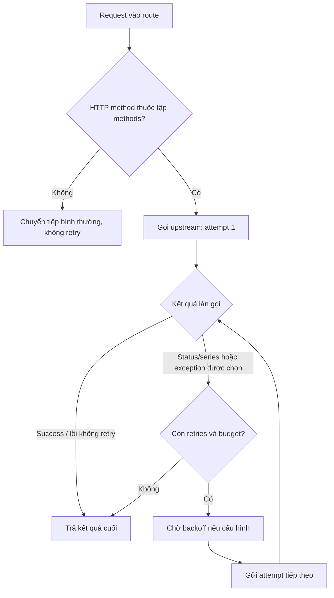
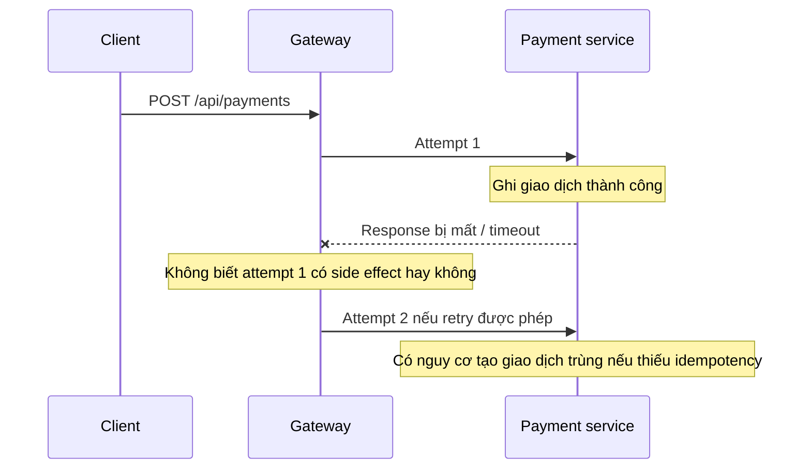

# Giới hạn số lần thử theo method, status và exception

Một request đi qua **Spring Cloud Gateway** có thể thất bại vì backend đang khởi động, một instance vừa rời cụm, kết nối TCP bị reset hoặc dịch vụ tạm trả `503 Service Unavailable`. Gửi lại request đôi khi giúp client có kết quả thành công mà không phải thao tác thủ công. Nhưng **retry không được phép là phản xạ mặc định cho mọi lỗi**: nó có thể lặp thao tác ghi dữ liệu, nhân tải lên backend đang quá tải và kéo dài thời gian phản hồi vượt deadline của client.

Trong chương **Thử lại yêu cầu**, bài này hướng dẫn cấu hình **`Retry` GatewayFilter Factory** theo ba nhóm điều kiện chính: **HTTP method**, **HTTP response status/series** và **exception**; đồng thời xác định **số lần thử lại tối đa**, backoff, ranh giới của request body và cách kiểm thử số request thực tế đi tới upstream. Các ví dụ dùng Spring Cloud Gateway trong kiến trúc microservices có route predicate, filter chain, discovery qua `lb://`, Spring Security, rate limiting, circuit breaker, TLS và observability.

> **Phạm vi:** Nội dung minh họa **Spring Cloud Gateway Server WebFlux**. Tên thuộc tính, giá trị mặc định và hành vi phối hợp filter có thể khác theo phiên bản Spring Cloud Gateway/Spring Framework. Các ngưỡng retry trong ví dụ là **chính sách thực hành**, không phải cấu hình production tối ưu cho mọi API.

## 1. Retry nghĩa là gì trong một request Gateway?

**Một lượt gọi của client** có thể tạo **nhiều lần gửi tới backend**. Ví dụ:

```text
Client: GET /api/catalog/items/42
    |
    v
Spring Cloud Gateway
    |-- Attempt 1 --> catalog-service --> HTTP 503
    |-- Attempt 2 --> catalog-service --> HTTP 502
    |-- Attempt 3 --> catalog-service --> HTTP 200
    |
    +--> Client nhận HTTP 200
```

Trong kịch bản trên:

- **Client request count = 1**.
- **Upstream attempt count = 3**.
- **Số retry thực hiện = 2** (sau attempt đầu tiên).
- Kết quả cuối gửi client là `200` dù hai lần gọi upstream trước đó đã lỗi.

### Tham số `retries` không phải tổng số lần gọi

Trong cấu hình `Retry` của Gateway, `retries` diễn tả **số lần thử lại** bên cạnh lần gọi đầu tiên.

\[
\text{Số attempts tối đa} = 1 + \text{retries}
\]

Với `retries: 2`, số attempts tối đa dự kiến là **3** nếu mỗi lần lỗi đều thuộc điều kiện cho retry và request chưa bị timeout/cancel/chặn bởi filter khác.

| `retries` | Attempt ban đầu | Số lần retry tối đa | Tổng attempts tối đa |
| ---: | ---: | ---: | ---: |
| 0 | 1 | 0 | 1 |
| 1 | 1 | 1 | 2 |
| 2 | 1 | 2 | 3 |
| 3 | 1 | 3 | 4 |

**Không phải mọi request đều được gửi đủ số attempts tối đa.** Nếu lần đầu thành công, Gateway kết thúc ngay. Nếu method không đủ điều kiện hoặc status/exception không nằm trong chính sách, request cũng không retry. Khi client hủy, deadline hết, response đã commit hoặc filter khác từ chối sớm, số attempts thực tế có thể thấp hơn.

## 2. Ba nhóm điều kiện: method, status và exception

Có thể hình dung Retry filter ra quyết định theo hai tầng:

1. **Method có được phép retry không?** `GET`, `HEAD` hay một method khác đã được cấu hình?
2. **Lần gọi thất bại theo cách được chọn không?** Response có status/series cần retry **hoặc** publisher kết thúc bằng exception phù hợp?



Sơ đồ là mô tả **logic quyết định**; thực thi reactive có thể dùng subscriber lại chuỗi xử lý và chịu ảnh hưởng thứ tự filter. Không suy ra rằng mỗi retry luôn chọn một backend instance khác hoặc luôn tạo một kết nối TCP mới.

### Bảng tổng hợp ba nhóm

| Nhóm | Cấu hình của Retry filter | Ý nghĩa |
| --- | --- | --- |
| Method | `methods` | **Giới hạn request nào** được phép retry |
| Status chính xác | `statuses` | Những HTTP status cụ thể có thể kích hoạt retry |
| Nhóm status | `series` | Những nhóm HTTP status như `SERVER_ERROR` có thể kích hoạt retry |
| Exception | `exceptions` | Những kiểu exception từ phần xử lý được retry có thể kích hoạt retry |
| Số lần | `retries` | Tối đa bao nhiêu retry sau attempt ban đầu |
| Thời gian đợi | `backoff` | Khoảng chờ trước lần retry tiếp theo, nếu được cấu hình |

**Đừng nhầm các tập điều kiện:** `methods` là cổng giới hạn tính đủ điều kiện, còn `statuses`/`series`/`exceptions` xác định **lỗi nào đáng thử lại**. Trong những phiên bản thông dụng, `statuses` và `series` là các cách khớp HTTP status có thể **cùng tồn tại**; chỉ thêm `statuses` không bảo đảm vô hiệu hóa `series` đã có giá trị mặc định.

## 3. Cấu hình Retry tối thiểu cho một route đọc

Giả sử Gateway nhận `GET /api/catalog/items/42` và chuyển tới `catalog-service`:

```yaml
spring:
  cloud:
    gateway:
      routes:
        - id: catalog-read
          uri: lb://catalog-service
          predicates:
            - Path=/api/catalog/**
            - Method=GET,HEAD
          filters:
            - StripPrefix=1
            - name: Retry
              args:
                retries: 2
                methods:
                  - GET
                  - HEAD
                series:
                  - SERVER_ERROR
```

Ý nghĩa:

1. `Path` và `Method` predicate chọn route cho `GET`/`HEAD` công khai.
2. `StripPrefix=1` biến `/api/catalog/items/42` thành `/catalog/items/42`.
3. `Retry` cho phép tối đa **hai retry** (tối đa ba attempts) với hai HTTP method được liệt kê.
4. `series: SERVER_ERROR` chọn nhóm HTTP `5xx` làm điều kiện status.
5. `lb://catalog-service` được phân giải qua Spring Cloud LoadBalancer; cần dependency và nguồn service instances tương ứng.

**Vì sao chỉ cho GET/HEAD ở bài mở đầu?** Chúng là các HTTP method có hợp đồng **safe** về mặt ngữ nghĩa (không chủ đích tạo side effect). Retry chúng nhìn chung ít rủi ro hơn `POST` tạo resource hoặc thu tiền, nhưng vẫn phải giới hạn backoff/deadline, vì GET lỗi hàng loạt cũng có thể gây quá tải.

### Cấu hình phụ thuộc phiên bản

`spring.cloud.gateway.routes` là prefix quen thuộc của các phiên bản Gateway Server WebFlux truyền thống. Một số phiên bản/starter mới chuyển sang `spring.cloud.gateway.server.webflux.routes`. Cần đối chiếu dependency và metadata cấu hình thực tế, đồng thời xác nhận route/filter đã được nạp.

**Giá trị mặc định có thể quan trọng:** Một số bản Retry GatewayFilter Factory có default cho `retries`, `methods`, `series` và `exceptions`. Vì vậy khi yêu cầu kiểm soát chặt, hãy **khai báo rõ từng nhóm cần áp dụng và kiểm tra nhóm còn lại**; đừng chỉ dựa vào một dòng `statuses` rồi cho rằng các cơ chế mặc định khác biến mất.

## 4. Giới hạn theo HTTP method

Mỗi HTTP method có đặc tính khác nhau về **an toàn** và **tính idempotent**:

| Method | Ngữ nghĩa HTTP thông thường | Retry khi nào? |
| --- | --- | --- |
| `GET` | Đọc tài nguyên, safe và idempotent | Có thể retry có giới hạn với lỗi tạm thời |
| `HEAD` | Đọc headers, safe và idempotent | Tương tự GET |
| `OPTIONS` | Hỏi khả năng giao tiếp hoặc CORS preflight | Thường để CORS layer xử lý; không retry mù quáng |
| `PUT` | Thay thế/tạo trạng thái resource, được định nghĩa idempotent | Chỉ khi backend thực thi đúng hợp đồng và chịu được attempt lặp |
| `DELETE` | Xóa resource, được định nghĩa idempotent về hiệu ứng mong muốn | Cần xét contract/status khi lặp và race với tác vụ khác |
| `POST` | Thường tạo resource/kích hoạt nghiệp vụ | Chỉ khi có idempotency policy và kiểm thử cụ thể |
| `PATCH` | Cập nhật một phần; không mặc định idempotent | Phải chứng minh operation có thể phát lại an toàn |

**Idempotent không có nghĩa các response luôn giống nhau.** Ví dụ `DELETE /items/42` lần đầu có thể trả `204`, lần hai trả `404`; trạng thái mong muốn vẫn có thể là đã xóa. Ngược lại, một ứng dụng hiện thực `GET` sai chuẩn bằng thao tác làm thay đổi trạng thái có thể không an toàn dù HTTP method được định nghĩa safe.

### Hai lớp Method hoạt động ở hai thời điểm khác nhau

Ví dụ:

```yaml
predicates:
  - Path=/api/catalog/**
  - Method=GET,POST
filters:
  - name: Retry
    args:
      retries: 2
      methods:
        - GET
```

- `Method=GET,POST` ở **route predicate** cho phép cả GET và POST **chọn route**.
- `methods: [GET]` ở **Retry filter** chỉ cho phép **GET có cơ hội retry**.
- `POST` vẫn được proxy bình thường, nhưng không thuộc nhóm retry của filter.

Đổi `Method` predicate thành GET-only sẽ làm POST **không vào route**, chứ không chỉ bỏ retry. Đây là sai sót thường gặp khi muốn giới hạn retry nhưng lại sửa nhầm route predicate.

### Ví dụ tách chính sách theo endpoint

```yaml
spring:
  cloud:
    gateway:
      routes:
        - id: catalog-read
          uri: http://localhost:8081
          predicates:
            - Path=/api/catalog/**
            - Method=GET,HEAD
          filters:
            - StripPrefix=1
            - name: Retry
              args:
                retries: 2
                methods: [GET, HEAD]
                series: [SERVER_ERROR]

        - id: orders-create
          uri: http://localhost:8082
          predicates:
            - Path=/api/orders
            - Method=POST
          filters:
            - StripPrefix=1
```

Route tạo đơn `orders-create` **không được gắn Retry filter**. Đây là điểm khởi đầu an toàn cho thao tác ghi, trước khi có idempotency key và logic đối soát được chứng minh.

## 5. Giới hạn theo HTTP status: `statuses` và `series`

### HTTP response status không phải exception

Backend có thể trả:

```http
HTTP/1.1 503 Service Unavailable
Retry-After: 10
Content-Type: application/json

{"code":"TEMPORARY_UNAVAILABLE"}
```

Đây là **response HTTP thực** với status `503`. Reactor Netty có thể nhận response mà publisher không ném một exception kết nối. Vì vậy `statuses`/`series` là cách chọn retry theo **HTTP response status**, khác với `exceptions`.

Các mã cần cân nhắc:

| HTTP status | Ngữ nghĩa điển hình | Có nên retry? |
| --- | --- | --- |
| `500 Internal Server Error` | Lỗi ứng dụng/backend | Chỉ khi xác định có khả năng tạm thời; bug logic có thể luôn lặp |
| `502 Bad Gateway` | Proxy/gateway phía sau nhận response không hợp lệ | Có thể retry giới hạn cho thao tác an toàn |
| `503 Service Unavailable` | Backend tạm không sẵn sàng | Thường là ứng viên cho retry có backoff/deadline |
| `504 Gateway Timeout` | Proxy không nhận response kịp | Có thể retry thao tác an toàn, nhưng backend có thể đã xử lý |
| `429 Too Many Requests` | Đã vượt quota | Không retry ngay; xem `Retry-After` và chính sách client/quota |
| `408 Request Timeout` | Timeout gắn với request trong ngữ cảnh server | Chỉ theo hợp đồng/khả năng phát lại body |
| `400 Bad Request` | Request sai | Không; sửa input thay vì thử lại |
| `401 Unauthorized` | Chưa xác thực/credential lỗi | Không retry nguyên token mà không xử lý auth |
| `403 Forbidden` | Thiếu quyền | Không; retry không tự tạo quyền |
| `404 Not Found` | Không tìm thấy resource | Thường không; chỉ thử lại nếu API có hợp đồng eventual consistency cụ thể |
| `409 Conflict` | Xung đột trạng thái | Cần logic nghiệp vụ, không retry vô điều kiện |

### `series: SERVER_ERROR` có thể quá rộng

Nếu cấu hình:

```yaml
filters:
  - name: Retry
    args:
      retries: 2
      methods: [GET]
      series: [SERVER_ERROR]
```

thì bộ điều kiện status theo nhóm **5xx**, không riêng `502`/`503`. Một lỗi code `500` lặp đều đặn có thể bị thử lại hai lần dù retry không giúp gì.

Khi muốn chính sách **chỉ một số mã**, có thể mô tả:

```yaml
filters:
  - name: Retry
    args:
      retries: 2
      methods: [GET, HEAD]
      series: []
      statuses:
        - BAD_GATEWAY
        - SERVICE_UNAVAILABLE
        - GATEWAY_TIMEOUT
```

**Cần xác minh phiên bản và binding:** Cấu hình `series: []` biểu diễn mục đích không chọn thêm nhóm status nào. Với các phiên bản có default `SERVER_ERROR`, phải chắc rằng property binder thực sự thay default bằng danh sách rỗng. Kiểm thử cả `500` (không retry theo status whitelist) và `503` (có retry) để xác minh. Nếu phiên bản không hỗ trợ cách override này như mong muốn, cần dùng cấu hình/programmatic customization được hỗ trợ, thay vì giả định YAML đã siết điều kiện.

### `statuses` và `series` không phải quan hệ giao nhau

Nếu cùng có:

```yaml
series: [SERVER_ERROR]
statuses: [TOO_MANY_REQUESTS]
```

thì điều kiện retry theo response có thể bao gồm **5xx hoặc 429**, chứ không phải chỉ “429 thuộc 5xx” (vốn không đúng). Cấu hình hai nhóm phải được hiểu như những nguồn trigger độc lập theo cách factory hiện thực.

**Không mặc định retry mọi 429.** Header `Retry-After` của backend có thể chỉ thời gian chờ trước khi thử lại; không nên giả định `Retry` GatewayFilter Factory sẽ tự phân tích và tuân thủ header đó ở mọi phiên bản. Với rate limiting, nhiều khi đúng hơn là trả `429` cho client để chính client áp chính sách retry.

## 6. Giới hạn theo exception

Có những lỗi xảy ra **trước khi nhận được HTTP status hợp lệ**, ví dụ DNS lookup thất bại, TCP connect timeout, connection reset hoặc timeout do reactive chain ném exception.

```text
Client -> Gateway -> HTTP client -> upstream
                           |
                           +-- ConnectException trước khi có response
                           +-- TimeoutException trước/giữa response
                           +-- IOException hoặc wrapper do thư viện tạo
                           |
                           v
                    onError (exception)
```

`Retry` có thể chọn retry theo danh sách exception class:

```yaml
filters:
  - name: Retry
    args:
      retries: 2
      methods:
        - GET
        - HEAD
      exceptions:
        - java.io.IOException
        - java.util.concurrent.TimeoutException
```

**Chú ý:** Các exception trên chỉ là ví dụ minh họa. Exception thực tế mà Retry filter nhìn thấy phụ thuộc Reactor Netty, WebFlux, load balancer, filter order và cách exception được **wrap**. Chẳng hạn lỗi kết nối có thể xuất hiện dưới kiểu Netty-specific hoặc nằm trong cause. Không được khẳng định mọi timeout đều là `java.util.concurrent.TimeoutException` hoặc mọi connection reset đều đúng lớp `java.io.IOException` trong toàn bộ chain.

### Ba điểm cần kiểm tra

1. **Exception có tới Retry filter dưới dạng `onError` không?** Nếu đã được một filter khác xử lý bằng fallback `200` hoặc một response HTTP `503`, chính sách `exceptions` không nhìn thấy lỗi ban đầu.
2. **Kiểu exception có khớp danh sách không?** Kiểm tra exception class mà filter thực tế nhận, cả wrapper và cause theo cách matcher của phiên bản đang dùng.
3. **Method có được phép retry không?** Một lỗi connect timeout ở `POST` không tự động được thử lại nếu `methods` chỉ chứa GET/HEAD.

### Tránh cấu hình quá rộng

Không nên mặc định thêm:

```yaml
exceptions:
  - java.lang.Exception
```

Lý do: cấu hình quá rộng có thể retry cả lỗi lập trình, lỗi validation, lỗi authorization hoặc các lỗi không thể phục hồi, khiến client chờ lâu và gây tải thừa. Hãy chọn các exception thể hiện **sự cố tạm thời** đã được kiểm chứng và có khả năng thành công khi thử lại.

Nếu thực sự cần retry lỗi DNS tạm thời, xác định loại exception và **negative DNS cache** trước; retry liên tiếp vẫn có thể nhận cùng kết quả sai từ cache. Nếu lỗi TLS certificate không hợp lệ hoặc sai hostname, retry nhanh không làm chứng chỉ trở nên đúng.

### Status error khác error signal

| Lần gọi upstream | Kết quả lớp HTTP/reactive | Nhóm điều kiện cần xem |
| --- | --- | --- |
| Backend gửi `503` rồi đóng response bình thường | Có response HTTP `503` | `statuses`/`series` |
| Không kết nối được cổng backend | `onError` connection exception | `exceptions` |
| Backend trả `401` hợp lệ | HTTP `401` | Thường **không retry** |
| Circuit breaker từ chối lời gọi vì OPEN | `CallNotPermittedException` hoặc fallback theo integration | Không mặc định retry |
| Response bị một filter biến thành `200` fallback | HTTP `200` phía sau filter | Retry có thể không còn thấy lỗi gốc |
| Browser hủy request | `cancel` trong reactive pipeline | **Cancellation không tự là một exception đủ điều kiện retry** |

Đối với streaming response, một số byte có thể đã được gửi tới client trước khi phát sinh lỗi. Khi response đã commit, Gateway **không thể đảm bảo làm lại toàn bộ HTTP response** mà không phá giao thức; tránh coi retry là cơ chế sửa lỗi sau commit.

## 7. Phối hợp các điều kiện: bảng quyết định chính xác

Giả sử một route có:

```yaml
filters:
  - name: Retry
    args:
      retries: 2
      methods: [GET, HEAD]
      series: []
      statuses: [BAD_GATEWAY, SERVICE_UNAVAILABLE]
      exceptions:
        - java.io.IOException
```

Mục tiêu là chỉ retry GET/HEAD khi HTTP `502`/`503` hoặc một `IOException` được nhận dạng trong ranh giới Retry. Bảng sau giả định cấu hình rỗng `series` được phiên bản hỗ trợ như mong muốn:

| Method đầu vào | Kết quả attempt đầu | Retry? | Lý do |
| --- | --- | --- | --- |
| `GET` | HTTP `503` | **Có** | Method và status đều đủ |
| `HEAD` | HTTP `502` | **Có** | Method và status đều đủ |
| `GET` | HTTP `500` | Không | Không nằm trong statuses; series rỗng |
| `GET` | HTTP `404` | Không | Không phải lỗi được chọn |
| `POST` | HTTP `503` | Không | Method không được cho retry |
| `POST` | `IOException` | Không | Method không được cho retry |
| `GET` | `IOException` | **Có** | Exception thuộc tập được chọn |
| `GET` | `IllegalArgumentException` không được match | Không | Exception không thuộc tập được chọn |
| `GET` | HTTP `200` | Không | Attempt đã thành công |
| `GET` | Bị Security chặn `401` trước route | Không | Retry của route không được chạy |

**Mẹo test quan trọng:** Kiểm tra **cả trường hợp không retry**. Một test chỉ chứng minh `503` được thử lại không phát hiện cấu hình vô tình retry toàn bộ 5xx hoặc mọi exception.

## 8. Backoff: không retry ngay lập tức

Nếu mỗi lần retry được gửi ngay khi backend vừa trả `503`, Gateway có thể vô tình tạo thêm tải đúng lúc backend thiếu tài nguyên nhất. **Backoff** làm giãn cách giữa các attempts.

Một cấu hình minh họa:

```yaml
filters:
  - name: Retry
    args:
      retries: 2
      methods: [GET, HEAD]
      series: [SERVER_ERROR]
      backoff:
        firstBackoff: 100ms
        maxBackoff: 500ms
        factor: 2
        basedOnPreviousValue: false
```

Giải thích:

| Thuộc tính | Ý nghĩa |
| --- | --- |
| `firstBackoff` | Khoảng chờ khởi đầu trước lần retry |
| `maxBackoff` | Giới hạn trên cho khoảng chờ do cấu hình backoff |
| `factor` | Hệ số tăng khoảng chờ |
| `basedOnPreviousValue` | Điều khiển cách tính khoảng chờ tiếp theo trong cơ chế backoff của phiên bản đang dùng |

Một chuỗi backoff lý tưởng dễ hình dung với first = 100 ms, factor = 2, max = 500 ms là **100 → 200 → 400 → 500 ms** nếu có đủ nhiều retry. Tuy nhiên công thức chính xác và cách diễn giải `basedOnPreviousValue` của Gateway factory cần đối chiếu source/docs phiên bản, không dùng bảng minh họa làm khẳng định timer chạy đúng từng mili-giây.

### Deadline tổng và backoff phải đi cùng nhau

Ví dụ một request có:

- 1 attempt ban đầu + 2 retries.
- Mỗi attempt có thể chờ đến 2 giây trước timeout.
- Backoff giữa attempts là 100 ms và 200 ms.

Một chuỗi thất bại nặng có thể tiêu tốn gần:

\[
T_{\text{tổng}} \approx 3 \times 2\,\text{s} + 0{,}1\,\text{s} + 0{,}2\,\text{s} = 6{,}3\,\text{s}
\]

Chưa kể DNS, scheduling, serialization và filter overhead. Nếu frontend chỉ chờ 4 giây, một chính sách như trên có thể tạo các attempts vô ích sau khi client không còn cần kết quả.

Thiết kế cần gồm **connection timeout**, **response timeout**, **retry count**, **backoff** và **request deadline tổng**. Không coi `retries: 2` tự giới hạn tổng thời gian response.

### Retry storm

Giả sử Gateway nhận 1.000 request/giây và tất cả backend attempts đầu tiên trả `503`. Khi cấu hình `retries: 2`, mức tải lý thuyết có thể tăng tới gần **3.000 upstream attempts/giây** nếu mọi request đều đi tới ngưỡng, chưa tính backoff, cancellation và circuit breaker.

Backoff với jitter, rate limiting, circuit breaker, admission control và budget là những công cụ giảm **thundering herd**. Không tăng `retries` chỉ để che backend đang mất khả năng phục vụ; đó có thể là cách khuếch đại sự cố.

## 9. Khi nào được retry POST, PUT, PATCH hoặc DELETE?

### Trường hợp nguy hiểm: thanh toán tạo một lần

Client gửi:

```http
POST /api/payments HTTP/1.1
Content-Type: application/json

{"orderId":"o-42","amount":250000}
```

Attempt 1 có thể đã đến backend và tạo giao dịch, nhưng Gateway mất kết nối **trước khi nhận response**. Nếu Gateway gửi attempt 2, backend có thể tạo giao dịch thứ hai. Timeout ở Gateway **không chứng minh nghiệp vụ đã rollback**.



### Idempotency key và hợp đồng chống lặp

Một phương án an toàn hơn cho API hỗ trợ idempotency:

```http
POST /api/payments HTTP/1.1
Content-Type: application/json
Idempotency-Key: pay-o-42-attempt-group-1

{"orderId":"o-42","amount":250000}
```

Backend phải lưu/đối soát kết quả dựa trên **key + principal/tenant + fingerprint của request** theo hợp đồng, kiểm soát concurrency và TTL, trả kết quả tương đương cho attempt cùng khóa và không thực hiện side effect lần hai.

**Chỉ thêm header `Idempotency-Key` không tự tạo idempotency.** Backend phải có cơ chế nguyên tử, chống race và handling “đang xử lý”/“đã xong”. Gateway cần **giữ nguyên key** cho tất cả attempts của cùng một request và không sinh key mới ở mỗi retry.

### Điều kiện để cân nhắc bật POST retry

1. Backend cam kết hỗ trợ idempotency, hoặc thao tác cụ thể là idempotent theo nghiệp vụ.
2. Body có thể được phát lại nguyên vẹn.
3. Mã lỗi/exception được chọn thật sự có khả năng phục hồi.
4. Retry count và deadline bị giới hạn.
5. Có tracing cùng request ID/idempotency key qua các attempts.
6. Test chứng minh một client request không tạo nhiều side effects dù response của attempt đầu bị mất.

`PUT` và `DELETE` có tính idempotent theo định nghĩa HTTP, nhưng backend thực tế vẫn có thể thực hiện thêm side effect như gửi email, tạo event, tính phí hoặc điều chỉnh counter. **Phải kiểm chứng implementation**, không chỉ nhìn tên method.

## 10. Request body và bộ nhớ khi retry

WebFlux request body thường được biểu diễn bằng `Flux<DataBuffer>`. Đây có thể là luồng chỉ tiêu thụ một lần. Để thử lại một `POST`/`PUT` có body, Gateway cần có nguồn dữ liệu **phát lại được**.

Spring Cloud Gateway Retry filter có thể **cache request body** cho các phương thức có body để phục vụ việc phát lại, tùy phiên bản và cơ chế factory. Điều này làm tăng áp lực trên heap/direct memory, nhất là khi nhiều request lớn đang chờ backoff hoặc retry.

Ví dụ: 500 request đồng thời, body trung bình 2 MiB, riêng dữ liệu body có thể gần **1 GiB** trước overhead. Tỷ lệ request retry cao sẽ khiến dữ liệu được giữ lâu hơn.

| Nguy cơ | Biểu hiện | Biện pháp |
| --- | --- | --- |
| Body không phát lại được | Attempt 2 nhận body rỗng/thiếu | Dùng cơ chế caching/replay chính thức, test upstream byte-for-byte |
| Buffer retained quá lâu | Direct memory tăng, Netty leak warnings | Quản lý ownership/DataBuffer lifecycle đúng framework |
| Body lớn và concurrency cao | Gateway OOM hoặc throughput giảm | Giới hạn size/concurrency, tránh retry upload lớn |
| Retry sau response commit | Client nhận response dở dang/connection reset | Không cố retry sau khi đã gửi dữ liệu tới client |
| JSON body đổi giữa attempts | Idempotency key không còn khớp fingerprint | Đảm bảo payload/headers liên quan ổn định |
| Client cancel trong backoff | Task/buffer vẫn giữ tài nguyên nếu code sai | Trả về reactive chain, xử lý cancellation đúng |

Không tự gọi `subscribe()` trong custom Gateway filter để lưu body ngoài pipeline. Không tùy tiện `retain`/`release` các pooled `DataBuffer` do filter Retry/caching nội bộ sở hữu. Khi cần biến đổi body trước retry, dùng `ModifyRequestBody`/body filter phù hợp, hiểu thứ tự và kiểm thử mọi nhánh success/error/cancel.

**Giới hạn body không tự xuất hiện vì có Retry.** Sử dụng policy giới hạn payload ở ingress/Gateway/codec theo ngữ cảnh, và cân nhắc **không retry** upload/streaming hoặc nội dung quá lớn.

## 11. Retry kết hợp CircuitBreaker: thứ tự ảnh hưởng dữ liệu đo

Giả sử có cả `Retry` và `CircuitBreaker` trên route. Nếu backend trả lỗi hai lần rồi thành công, hệ thống có hai cách nhìn:

```text
Client request: GET /api/catalog/items/42

Upstream:
  Attempt 1 -> 503
  Attempt 2 -> 503
  Attempt 3 -> 200

Client cuối cùng: 200
```

Breaker có thể ghi nhận:

- **Một outcome cuối** nếu Retry nằm hoàn toàn **bên trong phần được CircuitBreaker bảo vệ**.
- **Ba outcomes** nếu mỗi attempt lại đi qua CircuitBreaker như một protected call riêng.

Chi tiết thực tế phụ thuộc thứ tự filter, reactive re-subscription và cách integration Spring Cloud CircuitBreaker/Resilience4j bao bọc đoạn xử lý. **Không khẳng định chỉ nhìn thứ tự liệt kê YAML đã đủ chứng minh** breaker đếm 1 hay 3; xác minh bằng metrics/event test.

### Sự cố thường gặp khi breaker đã OPEN

Nếu CircuitBreaker từ chối attempt bằng `CallNotPermittedException`, Retry filter cấu hình `exceptions: [java.lang.Exception]` quá rộng có thể cố retry ngay một request **đã bị breaker từ chối**. Điều đó không khôi phục backend; chỉ lặp thao tác vô ích và có thể tạo thêm fallback churn.

Đừng mặc định coi `CallNotPermittedException` là một lỗi mạng có khả năng phục hồi. Một breaker OPEN cần policy phục hồi riêng qua HALF_OPEN/fallback, không phải hàng loạt retry lập tức.

### RateLimiter và retry attempts

Rate limiter theo client/principal đặt trước retry có thể đếm **một incoming request** trong khi backend nhận ba attempts. Nếu hệ thống định quota theo số upstream operations, phải cân nhắc vị trí đếm/metrics. Không coi `429` do Gateway từ chối quota là dấu hiệu nên retry ngay lập tức.

## 12. Service discovery và load balancing không bảo đảm retry sang instance khác

Với route `lb://catalog-service`, giả sử có A/B/C:

```text
Discovery nhìn thấy: [A, B, C]
Attempt 1: A -> 503
Attempt 2: ? 
Attempt 3: ?
```

Một attempt sau có thể được cân bằng tới B, C hoặc thậm chí A, tùy cách Gateway filter chain được gọi lại, LoadBalancer, sticky/session affinity và dữ liệu instance cache.

**Không có cam kết “retry sẽ đổi node” chỉ từ `Retry`.** Nếu mục tiêu là tránh instance vừa lỗi, cần cơ chế instance-aware retry hoặc health-aware load balancing được tích hợp và kiểm thử cụ thể. Giảm TTL discovery, thay DNS hoặc thay `lb://` không tự bảo đảm attempt tiếp theo tránh A.

Nếu LoadBalancer không tìm được instance và Gateway tạo lỗi, xác định đó là **response HTTP status** hay **exception** trong ranh giới Retry thực tế; route matching và discovery/cache là lớp riêng. Retry không thay thế readiness/connection draining khi pod scale-in hoặc rolling deploy.

## 13. Timeout, TLS và Security trong quá trình retry

### Timeout và phân loại exception

Có thể xảy ra nhiều giai đoạn lỗi:

| Giai đoạn | Dạng lỗi | Có thể thử lại? |
| --- | --- | --- |
| DNS resolution | Unknown host, DNS query timeout | Chỉ khi tạm thời; cache âm/tên sai khiến retry vô ích |
| TCP connect | Connect timeout/refused | Có thể thử lại có giới hạn nếu request chưa được gửi và method phù hợp |
| TLS handshake | Chứng chỉ sai SAN/truststore | Không; phải sửa bảo mật, không bỏ verification |
| HTTP request write | Connection reset giữa lúc gửi body | Có thể backend đã nhận một phần; cần replay/idempotency |
| HTTP response wait | Response timeout | Backend **có thể đã xử lý**; thận trọng với side effects |
| HTTP response status | `503`/`502` | Retry theo `statuses`/`series` và backoff nếu được chọn |
| Client cancel | Subscriber hủy | Không tự tạo attempts mới sau khi user đã hủy |

Điều quan trọng là phân biệt **khả năng phục hồi** và **khả năng lặp lại an toàn**. Một lỗi có khả năng hết khi thử lại vẫn có thể không an toàn với POST.

### Security và OAuth2 TokenRelay

Spring Security thường xác thực trước Gateway route matching. Một response `401` do thiếu JWT không đi vào Retry filter của route. Nếu upstream trả `401` do token sai audience/expired, không retry nguyên request ba lần; cần giải quyết token validation/authorization hoặc refresh/relay theo OAuth2 policy.

Không ghi raw `Authorization`, session cookie hoặc token vào logs để chẩn đoán retry. Đừng dùng `AddRequestHeader=Authorization` vô điều kiện để “sửa lỗi 401” giữa các attempts.

### TLS failure không thể chữa bằng tăng retry

Nếu backend có certificate hết hạn, host/SNI không khớp hoặc mTLS client certificate không hợp lệ, các attempts tiếp theo rất có thể cùng thất bại. Retry không thay thế TLS hostname verification, service discovery, DNS và cấu hình truststore.

## 14. Java DSL minh họa điều kiện retry

Ngoài YAML, Gateway Server WebFlux có route builder DSL hỗ trợ Retry filter. Ví dụ ở mức minh họa:

```java
@Configuration
public class CatalogRetryRoutes {

    @Bean
    RouteLocator catalogRoutes(RouteLocatorBuilder builder) {
        return builder.routes()
            .route("catalog-read", route -> route
                .path("/api/catalog/**")
                .filters(filters -> filters
                    .stripPrefix(1)
                    .retry(config -> config
                        .setRetries(2)
                        .setMethods(HttpMethod.GET, HttpMethod.HEAD)
                        .setStatuses(
                            HttpStatus.BAD_GATEWAY,
                            HttpStatus.SERVICE_UNAVAILABLE)))
                .uri("http://localhost:8081"))
            .build();
    }
}
```

Đây là ví dụ **API DSL theo một số phiên bản Gateway WebFlux**; tên overload/phương thức trên `RetryConfig` cần kiểm tra với version đang sử dụng, đặc biệt khi muốn điều chỉnh `series` và danh sách exceptions mặc định. Java DSL không thay đổi phép phân biệt quan trọng: `retries=2` là **hai retry**; `methods` quyết định method được phép, còn `statuses` và `exceptions` là các trigger của failure.

Nếu cần kiểm soát chặt danh sách status, đảm bảo cấu hình `series`/`exceptions` khác không vô tình mở rộng chính sách trong RetryConfig được tạo bởi builder; hãy viết integration test chứng minh điều đó.

## 15. Kiểm thử bằng curl và upstream giả lập

Để đánh giá retry, chỉ xem response `200` là **không đủ**. Phải biết upstream đã nhận **bao nhiêu lần** và trong điều kiện nào.

Giả sử Gateway chạy tại `http://localhost:8080` và một upstream giả lập chạy tại `http://localhost:8081`. Route `/api/catalog/**` có `StripPrefix=1` và Retry tối đa 2 lần trên GET với `503`.

### Kịch bản A — `503 → 200`

```text
Attempt 1: GET /catalog/items/42 -> 503
Attempt 2: GET /catalog/items/42 -> 200

Kỳ vọng:
  Client nhận 200
  Upstream nhận đúng 2 GET requests
  Số retries thực hiện = 1
```

Một test WireMock/WebTestClient minh họa:

```java
@Test
void retriesGetAfterTemporary503() {
    wireMockServer.stubFor(
        get(urlEqualTo("/catalog/items/42"))
            .inScenario("recover")
            .whenScenarioStateIs(Scenario.STARTED)
            .willReturn(aResponse().withStatus(503))
            .willSetStateTo("ready"));

    wireMockServer.stubFor(
        get(urlEqualTo("/catalog/items/42"))
            .inScenario("recover")
            .whenScenarioStateIs("ready")
            .willReturn(aResponse()
                .withStatus(200)
                .withBody("{\"id\":42}")));

    webTestClient.get()
        .uri("/api/catalog/items/42")
        .exchange()
        .expectStatus().isOk();

    wireMockServer.verify(2,
        getRequestedFor(urlEqualTo("/catalog/items/42")));
}
```

Đây là **mảnh test minh họa** cần cấu hình route tương ứng, `WebTestClient`, WireMock, `wireMockServer`, static imports và test fixture. Nếu Gateway dùng `lb://`, test còn cần discovery/LoadBalancer được thiết lập để trỏ tới WireMock. Với Spring Security, request phải có danh tính test hợp lệ; `401` trước route không phải bài test Retry.

### Kịch bản B — `503 → 503 → 503`

Với `retries: 2`, nếu cả ba responses đều `503` thuộc tập retry:

```text
Attempt 1: 503
Attempt 2: 503
Attempt 3: 503
=> Hết retry budget, upstream nhận 3 requests
=> Client nhận kết quả lỗi cuối theo HTTP/filter policy
```

Nếu có fallback/circuit breaker khác, status cuối có thể khác `503`; assertion cần bám **hợp đồng response cuối cùng** và đếm upstream calls.

### Kịch bản C — GET trả 400

```bash
curl -i 'http://localhost:8080/api/catalog/items/bad-id'
```

Nếu policy chỉ retry 5xx, backend trả `400` thì upstream chỉ nhận **1 request**. Có thể kiểm tra WireMock journal sau lần gọi. Một `400` là lỗi input; retry nguyên dữ liệu không làm nó hợp lệ.

### Kịch bản D — POST trả 503 nhưng không được retry

Giả sử route vẫn cho POST đi qua nhưng Retry `methods: [GET]`:

```bash
curl -i -X POST 'http://localhost:8080/api/catalog' \
  -H 'Content-Type: application/json' \
  -d '{"name":"new-item"}'
```

Nếu backend trả `503`, kỳ vọng **không có lần POST thứ hai** từ Retry filter. Kiểm tra request count ở upstream, thay vì chỉ xem status trả về.

### Kịch bản E — exception được chọn

Làm backend giả lập đóng kết nối sớm hoặc gây timeout có kiểm soát. Test phải xác nhận:

1. Exception thật sự đi vào Retry filter với type phù hợp.
2. Method được phép retry.
3. Đúng số attempts tối đa.
4. Deadline/cancellation không làm request vượt budget.
5. Không có buffer leak hoặc request body hỏng.

Đừng chỉ ném exception từ một stub Java rồi cho rằng nó tương đương một lỗi TCP của Reactor Netty; nếu mục tiêu là kiểm tra network exception matching, cần test đi qua HTTP client thật hoặc fixture mô phỏng sát lớp network.

## 16. Ma trận kiểm thử đủ để phát hiện cấu hình mở rộng ngoài ý muốn

| Test | Method | Kết quả upstream lần đầu | Kỳ vọng với policy chỉ GET/HEAD, 502/503 và `IOException` |
| --- | --- | --- | --- |
| T1 | GET | `200` | 1 attempt |
| T2 | GET | `503` rồi `200` | 2 attempts |
| T3 | GET | `502` rồi `502` rồi `200` | 3 attempts |
| T4 | GET | `503` liên tiếp | Tối đa 3 attempts khi retries=2 |
| T5 | GET | `500` | 1 attempt **nếu series đã vô hiệu đúng** |
| T6 | HEAD | `503` rồi `200` | 2 attempts |
| T7 | POST | `503` | 1 attempt nếu route cho POST nhưng Retry không cho |
| T8 | PUT | `503` | 1 attempt |
| T9 | GET | `404` | 1 attempt |
| T10 | GET | `429` | 1 attempt nếu không whitelist 429 |
| T11 | GET | `IOException` rồi success | Retry nếu kiểu exception khớp |
| T12 | GET | Exception khác không match | Không retry |
| T13 | GET | Client cancel giữa backoff | Không tiếp tục attempts ngoài lifecycle |
| T14 | POST có idempotency key, policy riêng | Timeout sau khi backend ghi dữ liệu | Nếu cho retry, không tạo hai side effects |
| T15 | GET sau CircuitBreaker OPEN | Breaker rejection | Không biến thành retry loop |
| T16 | GET, upstream response streaming đã commit | Stream sau đó lỗi | Không tạo response mới sau commit |
| T17 | GET, LoadBalancer không có instance | No-instance error | Phân biệt status/exception và logic retry |
| T18 | GET, backend IP đổi trong rollout | Connect exception/503 tạm | Quan sát instance được chọn mỗi attempt |

**Mỗi test nên assert ít nhất:** client status, upstream call count, method/path/body, retry timing (nếu test backoff), exception class/status trigger và kết quả bảo vệ tài nguyên.

## 17. Quan sát retry trong production

Một route có Retry sẽ khiến metrics ở Gateway và backend **không tự cân bằng 1:1**. Nếu 100 client requests tạo 160 backend attempts, đó có thể là dấu hiệu nhiều retries.

Những trường cần quan sát:

| Trường/metric | Ý nghĩa |
| --- | --- |
| Gateway route ID | Request đi theo route nào |
| HTTP method | Method nào đang bị retry |
| Kết quả cuối ở client | Client thực sự thấy 200, 503 hay 504 |
| Upstream status theo attempt | Những lỗi nào kích hoạt retry |
| Exception class/cause theo attempt | Lỗi network/timeout hay ứng dụng |
| Tổng attempts của một client request | `1 + retries thực tế` |
| Backoff delay | Thời gian chờ đã tiêu tốn |
| End-to-end latency | Deadline người dùng chịu ảnh hưởng |
| Selected service instance | Attempts có đi đến cùng instance không |
| Circuit breaker state/not-permitted | Có request bị chặn trước upstream không |
| Retry exhausted count | Bao nhiêu request đã dùng hết retry budget |
| Client cancellation | Có attempts đang chờ bị hủy không |
| Request ID/trace ID | Ghép nhiều attempts vào một request logic |

Tên metric thực tế phụ thuộc phiên bản Gateway, Micrometer/Actuator và custom instrumentation; không mặc định mọi chỉ số trên đều sẵn có từ một starter. Tracing nên giữ **cùng correlation ID** cho request logic nhưng tạo span/attribute phân biệt attempt nếu hạ tầng cho phép.

**Không đưa user ID, token, full URL/query có PII hoặc idempotency key thô vào metric labels**: tăng cardinality hoặc lộ thông tin. Không ghi `Authorization`, cookie và request body vào debug logs chỉ để đếm retries.

### Tách retry count với error rate

Giả sử 1.000 client requests:

- 900 thành công ngay attempt 1.
- 80 thành công sau một retry.
- 20 thất bại sau tổng ba attempts.

Số backend attempts có thể là:

\[
900 \times 1 + 80 \times 2 + 20 \times 3 = 1\,120
\]

Trong khi đó client thấy **980 success, 20 failure**. Nếu chỉ nhìn tỷ lệ client success 98%, ta có thể bỏ qua 120 attempts bổ sung, nguồn chi phí và dấu hiệu backend bất ổn.

Không tính mọi retry thành “một user request mới” khi đo tỉ lệ lỗi theo người dùng, cũng không tính một client request thành “một backend call” khi đánh giá capacity.

## 18. Các tình huống dễ cấu hình sai

| Triệu chứng | Nguyên nhân có thể | Cách xử lý |
| --- | --- | --- |
| `retries: 2` nhưng thấy 3 backend requests | Đang đếm **attempt ban đầu + 2 retry** | Diễn giải đúng tham số |
| GET `500` vẫn retry dù chỉ khai báo statuses 503 | `series: SERVER_ERROR` còn hiệu lực | Kiểm tra/ghi đè series và viết test 500 |
| POST không retry | `methods` không chứa POST | Xác nhận đó là policy chủ động, không vội bật POST |
| POST retry tạo dữ liệu trùng | Không có idempotency | Thiết kế backend idempotency và kiểm soát body |
| Upstream trả 503 nhưng không retry | Route/Method không khớp, status chưa được chọn, response đã commit hoặc filter khác can thiệp | Kiểm tra chain và response |
| Connect timeout không retry | Exception khác class được cấu hình hoặc bị wrapper/fallback | Log class an toàn, test exception matching |
| Retry lặp cả lỗi authentication | Exception matcher quá rộng / 401 được chọn | Siết trạng thái và exception, sửa token policy |
| Client chờ rất lâu | Attempts + timeout + backoff vượt deadline | Đặt tổng retry budget và timeout |
| Gateway tăng bộ nhớ sau khi bật POST retry | Request body bị cache/replay nhiều đồng thời | Giới hạn payload/concurrency, ưu tiên không retry POST |
| CircuitBreaker luôn CLOSED dù backend lỗi | Retry có thể che lỗi hoặc breaker đo outcome cuối | Xem filter order và protected call metrics |
| CircuitBreaker OPEN nhưng Retry vẫn tạo thêm noise | Retry matcher bao gồm breaker rejection | Không retry `CallNotPermittedException` |
| Retried request vẫn đi cùng node lỗi | LB không bắt buộc đổi instance | Đo instance/attempt, dùng health-aware policy |
| Curl trả 200 nhưng user thấy lỗi CORS | Response cuối thiếu CORS headers đúng | Kiểm tra browser/preflight/error response |
| Client cancel nhưng backend vẫn xử lý | Request đã được gửi; cancel không rollback nghiệp vụ | Dùng idempotency/đối soát |
| DNS/TLS lỗi lặp mãi | Lỗi cấu hình không thể phục hồi bằng retry | Sửa resolver, certificate, trust/SNI, đừng mở retry vô hạn |

## 19. Runbook khi Retry không hoạt động như mong đợi

1. **Xác nhận route được chọn:** route ID, `Path`/`Method`/`Host` predicates và Security có chặn trước không.
2. **Xác nhận Retry filter đã nạp:** đúng tên, đúng cú pháp, đúng prefix cấu hình của phiên bản.
3. **Đọc cấu hình thực tế:** `retries`, `methods`, `statuses`, `series`, `exceptions`, `backoff`, cùng các default chưa được ghi đè.
4. **Tái hiện một request có kiểm soát:** dùng upstream stub trả chính xác chuỗi `503 → 200`, sau đó `500`, `400` và các exception đã chọn.
5. **Đếm upstream attempts:** không dựa chỉ vào status client vì retry có thể che lỗi đầu.
6. **Nếu exception không retry:** xác định class đi tới retry operator; kiểm tra wrapper/cause, filter order, response status đã được tạo hay chưa.
7. **Nếu số attempts vượt mong đợi:** kiểm tra retry ở **nhiều tầng** — client SDK, Gateway, HTTP mesh/ingress, backend client, không chỉ một Gateway route.
8. **Nếu latency cao:** cộng timeout mỗi attempt, backoff, DNS/TLS và tổng deadline; xét cancellation.
9. **Nếu body/POST lỗi:** kiểm tra replay payload, idempotency key, buffer cache, concurrency và side effects.
10. **Nếu CircuitBreaker/LoadBalancer liên quan:** xác nhận protected call scope, breaker state, selected instance, health/discovery cache.
11. **Khi hoàn tất:** chạy lại cả positive và negative tests; quan sát error rate, retries, backend attempts và tài nguyên dưới tải.

### Retry ở nhiều tầng có thể nhân số attempts

Giả sử ứng dụng mobile tự retry **hai lần** sau request đầu tiên, còn Gateway được cấu hình `retries: 2`. Trong trường hợp xấu khi mọi lần đều thất bại và mọi tầng đều thử đủ số:

\[
\text{Upstream attempts} \le (1+2)_{\text{client}} \times (1+2)_{\text{Gateway}} = 9
\]

Nếu còn service mesh retry, số attempts có thể tăng tiếp. Đây là **ước lượng trường hợp xấu** khi tất cả policy đều cho phép và không bị deadline/cancel/breaker chặn; không phải hệ thống nào cũng thực hiện đúng 9 lần.

Quy tắc vận hành: **phân quyền chủ sở hữu retry theo từng lớp** và áp một ngân sách attempts/deadline chung. Không để client, Gateway và mesh cùng retry vô giới hạn mà không biết tổng số lần gửi thực tế.

## 20. Bài tập thực hành: bảo vệ catalog và thanh toán

Một Gateway phục vụ:

- `GET /api/catalog/items/{id}` → `catalog-service`, có thể retry `502/503` và lỗi kết nối tạm thời.
- `POST /api/payments` → `payment-service`, có hiệu ứng tạo giao dịch.
- `catalog-service` chạy nhiều instance qua `lb://` và đôi khi rollout gây connect reset.
- `payment-service` hỗ trợ idempotency key nhưng cần bảo đảm request body và principal không thay đổi giữa các attempts.
- Gateway dùng Spring Security JWT và CircuitBreaker trên một số route; có giới hạn timeout và request body size.

### Yêu cầu thiết kế

1. Dùng `Retry` cho catalog GET tối đa **hai retry**, giới hạn status cụ thể và exception được kiểm thử.
2. Không gắn Retry cho payments POST cho tới khi backend có contract idempotency, payload replay và đối soát kết quả.
3. Đặt backoff có giới hạn và tổng deadline nhỏ hơn timeout hữu ích của client.
4. Không retry `400`/`401`/`403`/`404` hoặc `429` vô điều kiện.
5. Dùng thử nghiệm WireMock để xác nhận `503 → 200` có đúng 2 backend calls, còn `500` không bị retry nếu chưa nằm trong policy.
6. Với retry khi circuit breaker tồn tại, xác nhận metric breaker tính theo attempt hay logical call đúng như thiết kế.
7. Đo backend attempt count ở nhiều Gateway replicas, không chỉ số request ở edge.

### Câu hỏi tự kiểm tra

1. `retries: 3` có nghĩa tối đa bao nhiêu HTTP attempts, tính cả lần đầu?
2. `Method=GET,POST` route predicate khác `methods: [GET]` trong Retry filter thế nào?
3. Nếu `series: [SERVER_ERROR]` còn hiệu lực, khai báo `statuses: [SERVICE_UNAVAILABLE]` có chắc giới hạn chỉ 503 không?
4. HTTP `503` khác `ConnectException` ở cách Retry xác định điều kiện nào?
5. Vì sao `401` và `403` thường không cần retry nguyên request?
6. Tại sao timeout sau POST không chứng minh backend chưa tạo giao dịch?
7. `Idempotency-Key` có ngăn tạo dữ liệu trùng chỉ bằng sự hiện diện của header không?
8. Điều gì xảy ra với `Flux<DataBuffer>` khi muốn phát lại request body lớn?
9. Vì sao `slowCallDurationThreshold` của CircuitBreaker không thay thế response timeout và retry budget?
10. Khi hai filters Retry và CircuitBreaker cùng có mặt, vì sao cần kiểm tra cách đếm protected calls?
11. `Retry-After` của backend có được một policy backoff cố định tự động tuân thủ không?
12. Vì sao một retry trên `lb://` không đảm bảo chọn instance mới?
13. Nếu client hủy trong thời gian backoff, request có nên được tiếp tục thử lại độc lập không?
14. Những metric nào giúp phân biệt **một client request thành công sau retry** và **ba backend attempts**?
15. Khi số retry tăng đột biến, làm sao phân biệt lỗi DNS/TLS cố định với upstream 503 tạm thời?
16. Một request bị Spring Security từ chối trước routing có được Retry filter của route thử lại không?
17. Nếu client, Gateway và mesh đều retry, tổng attempts có thể tăng theo quy luật nào?
18. Vì sao cần test **không retry** GET `500`, GET `400` và POST `503`, ngoài test retry thành công?

**Ghi nhớ:** `Retry` GatewayFilter Factory chỉ an toàn khi kiểm soát đồng thời **method được phép**, **status/series hoặc exception kích hoạt**, **số retry tối đa**, **backoff và tổng deadline**. `retries` đếm những lần thêm sau attempt đầu; `statuses` không mặc định xóa `series`, và `exceptions` phải khớp lỗi reactive thực tế. Với request có body hoặc side effect, cần **replay dữ liệu đúng và idempotency nghiệp vụ**. Muốn biết policy có hoạt động như thiết kế hay không, phải đo **upstream attempts**, không chỉ HTTP status cuối cùng mà client nhìn thấy.

