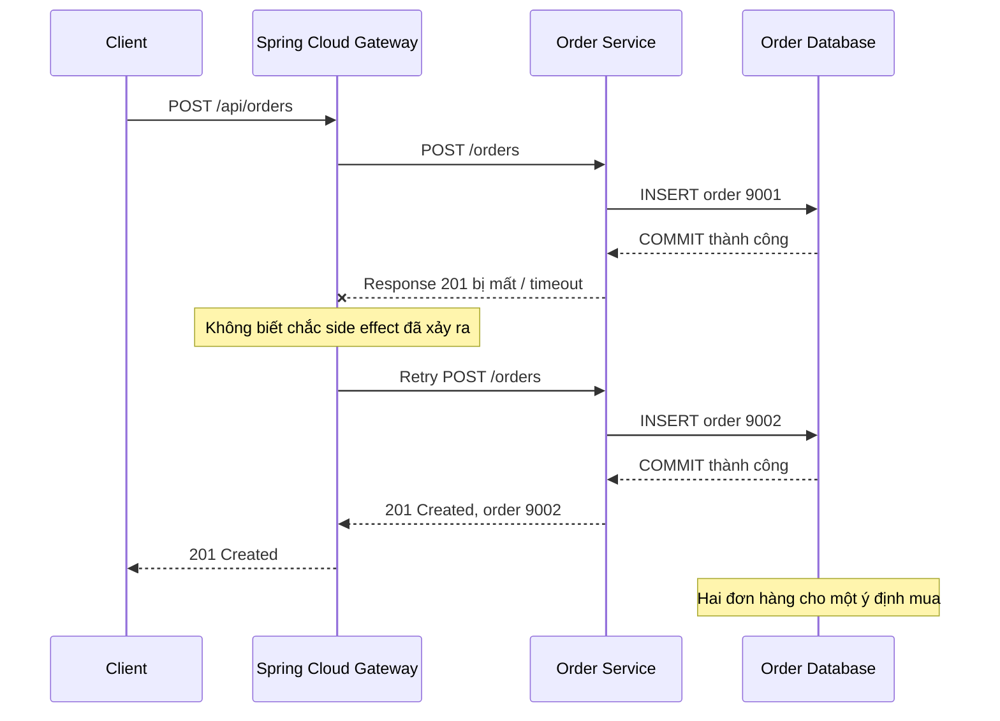
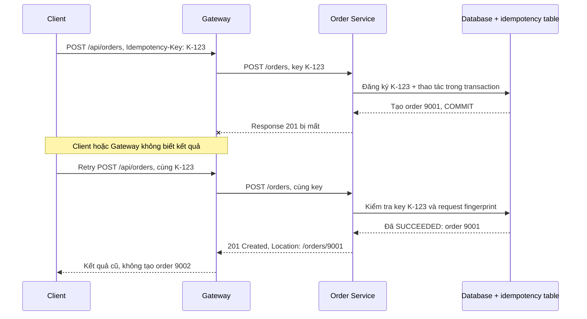
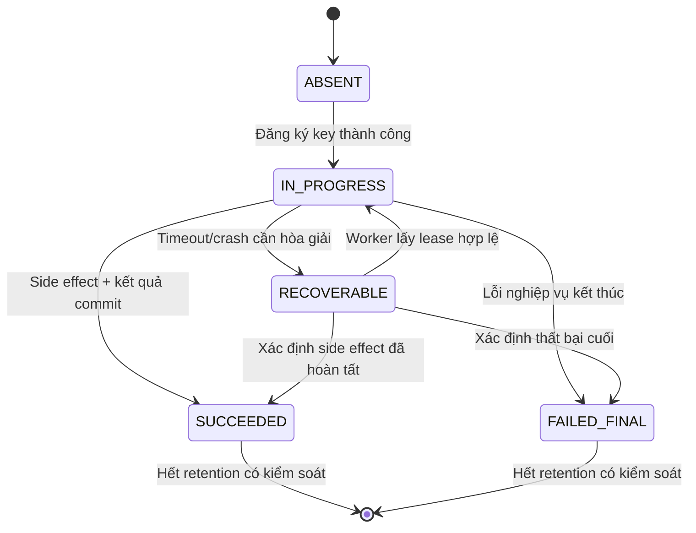
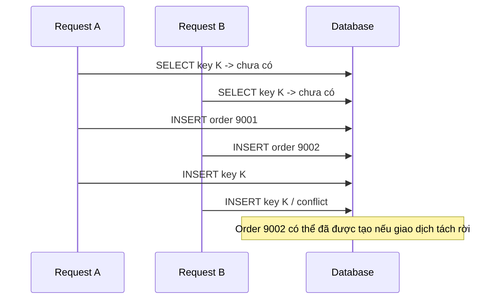
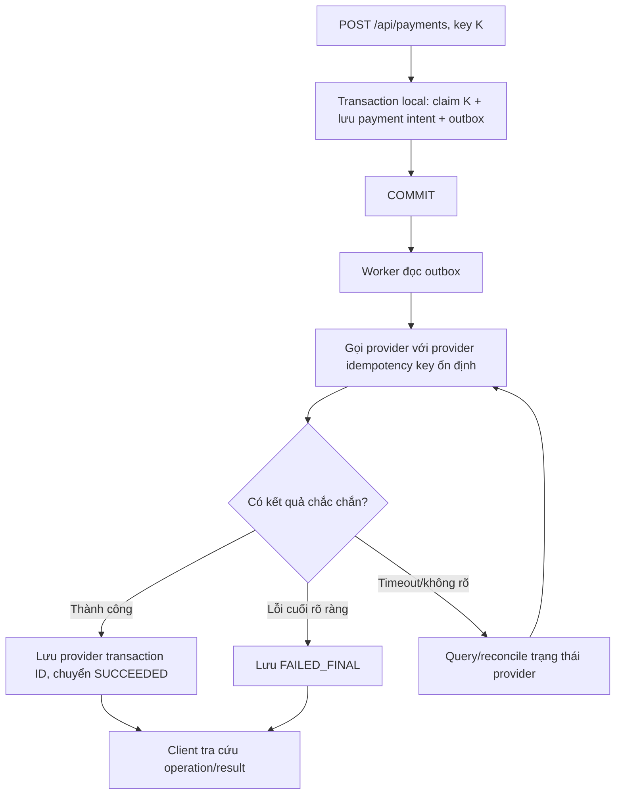
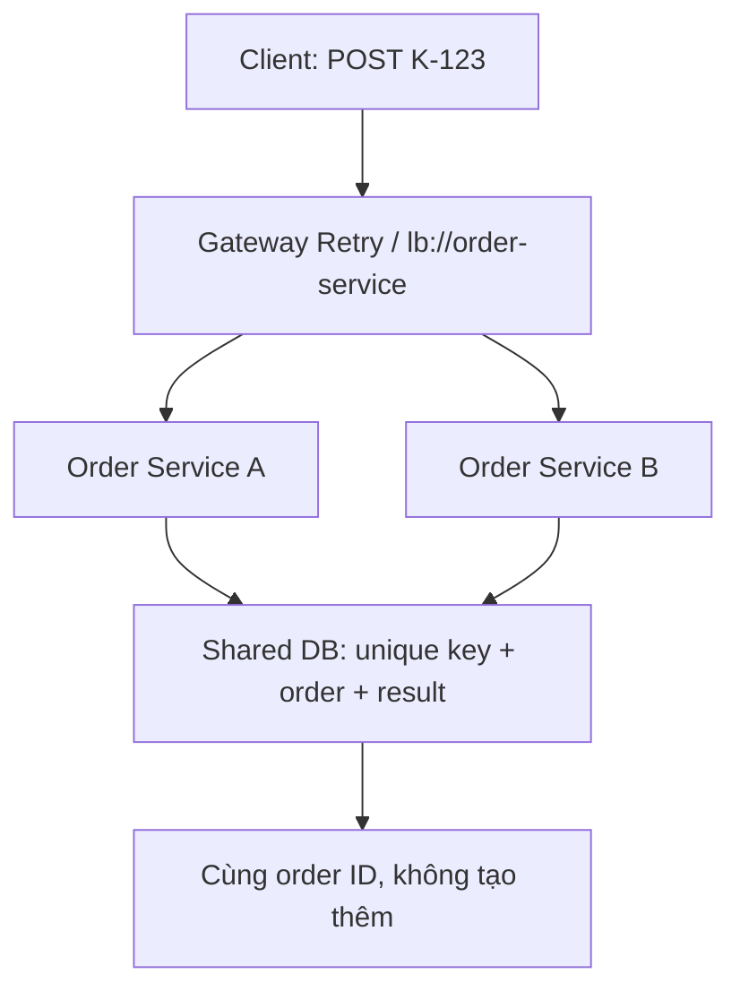

# Idempotency key cho nghiệp vụ có nguy cơ thực hiện lặp trong Spring Cloud Gateway

Trong kiến trúc microservices, retry là công cụ quan trọng để vượt qua một số lỗi mạng ngắn hạn. Nhưng một request **gửi lại** không nhất thiết đồng nghĩa với một thao tác **an toàn để thực hiện lại**. Ví dụ, client gửi `POST /api/orders`, Order Service đã lưu đơn hàng thành công nhưng response bị mất trên đường về. Gateway hoặc client thấy timeout rồi gửi lại POST; nếu backend không nhận biết hai request đại diện **cùng một ý định nghiệp vụ**, người dùng có thể nhận **hai đơn hàng**, **hai giao dịch thanh toán** hoặc **hai email xác nhận**.

**Idempotency key** là một định danh ổn định của **một lần thực hiện nghiệp vụ có chủ đích**. Client gửi cùng key khi phải thử lại cùng một thao tác, và backend dùng key đó để **không thực hiện lặp tác dụng phụ** khi request bị gửi nhiều lần. Đây không phải khả năng tự động phát sinh từ Spring Cloud Gateway `Retry` filter: Gateway có thể gửi lại HTTP request, còn việc đảm bảo “một lần tạo đơn” phải nằm ở hệ thống sở hữu nghiệp vụ và kho trạng thái có cơ chế cạnh tranh an toàn.

Bài học thuộc chương **Thử lại yêu cầu** của module `SPRING_CLOUD_GATEWAY`. Nội dung kết nối trực tiếp với route predicate, filter chain, biến đổi đường dẫn/header, khám phá dịch vụ, xác thực, rate limiting, circuit breaker, retry, TLS và quan sát request để vận hành cổng vào microservices an toàn.

**Kết quả mong đợi:** Bạn biết thiết kế hợp đồng header `Idempotency-Key`, chọn nơi lưu và khóa duy nhất, xử lý request đồng thời và response bị mất, phân biệt các trạng thái chờ/thành công/xung đột, phối hợp Gateway Retry với backend, đồng thời kiểm thử trường hợp lỗi nguy hiểm nhất: **nghiệp vụ đã hoàn tất nhưng caller không biết kết quả**.

> **Phạm vi:** Các ví dụ tập trung vào **Spring Cloud Gateway Server WebFlux** và backend Java/Spring. Mã minh họa được thiết kế để giải thích ranh giới giao dịch; không phải một ứng dụng thanh toán có thể đưa thẳng lên production. API và namespace cấu hình Gateway có thể khác nhau giữa các phiên bản Spring Boot/Spring Cloud; cần đối chiếu phiên bản đang triển khai.

## 1. Vấn đề cốt lõi: request thành công nhưng response thất bại

Giả sử người dùng bấm **Đặt hàng** một lần:

```http
POST /api/orders HTTP/1.1
Host: api.example.com
Authorization: Bearer <access-token>
Content-Type: application/json

{"cartId":"CART-42","shippingAddressId":"ADDR-7"}
```

Một tình huống lỗi:



Gateway chỉ có thể biết lần gọi trước **không nhận được kết quả đúng hạn**. Nó không thể suy ra backend chưa xử lý request. Đặc biệt, timeout sau khi đã gửi body và timeout khi kết nối chưa được thiết lập có **mức độ không chắc chắn khác nhau**; không nên gộp tất cả thành “an toàn thử lại”.

Nếu client cũng có retry riêng, nếu reverse proxy tự retry và nếu message broker redeliver event, một ý định nghiệp vụ còn có thể xuất hiện nhiều hơn hai lần ở nhiều tầng.

### 1.1. Retry nâng tính sẵn sàng, nhưng cũng tạo cơ hội nhân đôi

Một request có thể lặp vì:

- Người dùng bấm nút nhiều lần hoặc giao diện tự submit lại.
- Browser, mobile app hoặc SDK retry khi kết nối bị reset.
- Gateway `Retry` filter được cấu hình retry theo lỗi hoặc status.
- Service-to-service HTTP client retry.
- Queue/message broker giao lại message vì chưa nhận được acknowledgment.
- Load balancer chuyển request sang instance mới sau lỗi kết nối.
- Hệ thống khôi phục sau crash và xử lý lại một task chưa biết kết quả.

**Idempotency key không triệt tiêu retry**; nó cung cấp cách để hệ thống nhận ra **các bản gửi lặp của cùng một ý định** và đưa ra kết quả nhất quán.

## 2. Phân biệt HTTP idempotency với idempotency key nghiệp vụ

Theo ngữ nghĩa HTTP, một phương thức **idempotent** khi việc gửi nhiều request giống nhau có *tác động dự kiến* lên trạng thái server tương đương gửi một lần. Một số method có tính chất này theo định nghĩa giao thức, nhưng không có nghĩa mọi implementation đều đúng hoặc mọi side effect phụ như log/email đều giống hệt.

| HTTP method | Ngữ nghĩa giao thức | Rủi ro cần lưu ý |
| --- | --- | --- |
| `GET` | Safe và idempotent về tác động dự kiến. | Không nên sửa dữ liệu; endpoint GET có side effect là thiết kế không tốt. |
| `HEAD` | Safe và idempotent. | Vẫn có lỗi mạng/cache/authorization. |
| `PUT` | Idempotent khi dùng đúng semantics đặt trạng thái tài nguyên đích. | Server phải triển khai đúng; có thể có side effect phụ và concurrency. |
| `DELETE` | Idempotent về tác động dự kiến. | Lần đầu có thể 204, lần sau 404; status không nhất thiết giống nhau. |
| `POST` | Không được đảm bảo idempotent bởi method. | Tạo đơn, thu tiền, gửi email có thể nhân đôi khi retry. |
| `PATCH` | Không mặc định idempotent. | `increment balance by 10` lặp hai lần làm tăng 20; `set status=paid` có thể idempotent nếu thiết kế đúng. |

**Điểm quan trọng:** “Idempotent” không có nghĩa mọi response HTTP của các lần gọi phải giống từng byte. Nó nói về **tác động dự kiến** trên hệ thống. Với idempotency key nghiệp vụ, nhiều API còn chọn **phát lại kết quả đã ghi nhớ** để client có cùng status/resource khi lặp request.

### 2.1. Retry POST không tự an toàn vì có HTTP 5xx

Một response `502 Bad Gateway` hoặc `504 Gateway Timeout` không chứng minh “POST chưa được thực hiện”. Nếu service đã commit rồi response mới thất bại, retry có thể tạo giao dịch lặp.

Với POST tạo tài nguyên, **đừng bật retry chỉ dựa trên status 5xx**. Phải có hợp đồng idempotency và kiểm thử cả trường hợp “commit thành công, response biến mất”.

### 2.2. Idempotency key khác request ID và trace ID

| Định danh | Được tạo cho mục đích gì? | Có nên thay thế idempotency key? |
| --- | --- | --- |
| **Idempotency key** | Gắn với một **ý định nghiệp vụ** có thể được gửi lại. | Là khóa quyết định deduplication. |
| **Request ID** | Nhận diện một HTTP request/attempt cụ thể. | Không. Mỗi attempt có thể có request ID mới. |
| **Trace ID** | Liên kết nhiều span của một luồng quan sát. | Không. Trace có thể thay đổi giữa những lần client gửi lại. |
| **Order ID** | Nhận diện tài nguyên nghiệp vụ đã tạo. | Có thể là kết quả lưu sau xử lý; không luôn có trước lần POST đầu. |
| **Message ID** | Nhận diện message trong hàng đợi. | Hữu ích cho inbox dedup, nhưng khác key của API nếu không có mapping rõ. |

Một HTTP retry có thể có **trace ID mới** nhưng phải giữ **idempotency key cũ**. Ngược lại, hai lần mua hàng thật sự của cùng user cần **hai key khác nhau**, dù body giống nhau.

## 3. Hợp đồng `Idempotency-Key` của API

Một cách thiết kế phổ biến là client gửi header:

```http
POST /api/orders HTTP/1.1
Host: api.example.com
Authorization: Bearer <access-token>
Content-Type: application/json
Idempotency-Key: 86a1cd08-0f18-48bb-afcc-2ea3b2f0d7a8

{"cartId":"CART-42","shippingAddressId":"ADDR-7"}
```

Nếu client không nhận được kết quả rõ ràng và quyết định retry, nó phải gửi **cùng key** và **cùng nội dung nghiệp vụ**:

```http
POST /api/orders HTTP/1.1
Idempotency-Key: 86a1cd08-0f18-48bb-afcc-2ea3b2f0d7a8
Content-Type: application/json

{"cartId":"CART-42","shippingAddressId":"ADDR-7"}
```

**Lưu ý về chuẩn hóa:** `Idempotency-Key` là tên header được nhiều API sử dụng và được thảo luận trong đặc tả IETF liên quan. Cú pháp/semantics cuối cùng, thời gian lưu và mã lỗi có thể khác theo API/provider; không nên tuyên bố Gateway tự áp một hợp đồng chung chỉ vì thấy header này. Nếu tổ chức sử dụng một header khác, cần tài liệu hóa nhất quán.

### 3.1. Ai nên sinh key?

Thường là **client khởi tạo thao tác nghiệp vụ** hoặc một BFF đại diện cho client. Key nên:

- Được tạo mới cho mỗi **ý định nghiệp vụ**.
- Có entropy đủ lớn, không đoán được dễ dàng; UUID v4 ngẫu nhiên là một lựa chọn thông dụng.
- Ổn định qua các lần retry của cùng thao tác.
- Không chứa email, số điện thoại, access token hoặc nội dung nhạy cảm.
- Có độ dài/định dạng được server giới hạn và kiểm tra.

Nếu client đã gửi POST nhưng bị timeout, rồi **tự tạo key mới ở lần thử lại**, backend sẽ coi đó là ý định mới và có thể tạo thêm một đơn.

### 3.2. Một key không được tái sử dụng cho ý định khác

Ví dụ:

- Lần mua thứ nhất: `KEY-A`, mua 2 cuốn sách.
- Retry của lần mua thứ nhất: **vẫn `KEY-A`**, cùng payload.
- Người dùng chủ động đặt đơn lần thứ hai: **`KEY-B`**, dù vẫn mua 2 cuốn sách.

Đừng dùng mã user, session, ngày hiện tại hoặc một giá trị cố định như `order-create` làm idempotency key cho mọi giao dịch. Chúng không phân biệt được hai ý định khác nhau.

### 3.3. Server cần công bố gì trong API contract?

Một API có idempotency nên tài liệu hóa rõ:

1. Endpoint/method nào **bắt buộc** có key.
2. Format, giới hạn độ dài và nguồn tạo key.
3. Phạm vi duy nhất (*scope*): theo user, tenant, operation, endpoint hay toàn tài khoản.
4. Khi cùng key và cùng payload được gửi lại sau thành công, server trả gì.
5. Khi cùng key nhưng payload khác, server trả mã lỗi nào.
6. Khi request đầu **đang xử lý**, server trả 202, 409, 425 hoặc chờ theo policy nào.
7. TTL/retention của key và tác động khi hết hạn.
8. Trường hợp lỗi 4xx/5xx nào được ghi nhớ kết quả.
9. Cách client tra cứu trạng thái khi không chắc thao tác đã thành công.
10. Chính sách auth/authorization ở mọi lần retry.

Không nên để client phải đoán những điểm trên dựa vào một bài blog hoặc body lỗi ngẫu nhiên.

## 4. Một luồng an toàn từ client qua Gateway đến backend

Giả sử API tạo đơn có hợp đồng: cùng key và cùng payload chỉ tạo tối đa một đơn trong khoảng retention, và request lặp sau thành công trả lại tham chiếu đơn đã tạo.



**Trọng tâm an toàn nằm ở Order Service và database**, không nằm ở việc Gateway đã giữ header. Gateway có thể retry hợp lý, nhưng backend phải xử lý **hai request đồng thời cùng key**, request sau crash và request tới nhiều backend instance.

### 4.1. Những bất biến cần giữ

Đối với mỗi cặp `(scope, operation, idempotencyKey)`:

- **Một ý định hợp lệ** không tạo hai tài nguyên/thanh toán vì retry.
- **Hai key khác nhau** có thể biểu diễn hai ý định thật dù payload giống.
- **Một key với payload khác** không được âm thầm tái sử dụng kết quả của payload cũ.
- **Request đồng thời cùng key** không cùng vượt qua bước “chưa thấy key” và cùng thực thi.
- **Kết quả đã commit** có thể được truy lại sau response bị mất.
- **Quyền truy cập** được kiểm tra cho mỗi request; key không phải chứng chỉ xác thực.

## 5. Chọn phạm vi deduplication và fingerprint của request

Lưu mỗi key như một chuỗi duy nhất toàn hệ thống đôi khi quá rộng. Hai tenant độc lập có thể cùng sinh ngẫu nhiên một key; hơn nữa, nếu key bị lộ hoặc đoán được, không được cho phép một tenant lấy lại response của tenant khác.

Một khóa lưu trữ thường có cấu trúc khái niệm:

```text
dedupKey =
    tenantId + operationName + idempotencyKey

operationName = "create-order:v1"
```

Nếu hệ thống không có tenant, có thể dùng định danh account/client **đã xác thực**. Cần chọn scope theo hợp đồng sản phẩm: có API muốn toàn bộ một tài khoản chia sẻ key, có API muốn mỗi endpoint có scope riêng.

### 5.1. Fingerprint giúp phát hiện key bị dùng sai

Giả sử lần đầu:

```json
{"sku":"BOOK-42","quantity":2}
```

Lần lặp dùng cùng key nhưng:

```json
{"sku":"BOOK-42","quantity":200}
```

Nếu chỉ nhìn key và trả lại kết quả cũ, client có thể nhầm rằng đã mua 200 sản phẩm. Backend nên lưu một **request fingerprint** và so sánh:

```text
fingerprint =
    SHA-256(canonicalBusinessOperation)
```

Các trường nên tham gia fingerprint có thể gồm:

- Method và **operation** đã chuẩn hóa, không chỉ path raw sau rewrite.
- Các field body quyết định tác dụng phụ: sản phẩm, số lượng, currency, amount, người nhận...
- Những header nghiệp vụ ảnh hưởng kết quả, nếu có.
- API contract/version khi thay đổi semantics.
- Tenant/account/actor cần ràng buộc nếu không nằm trong scope khóa.

**Không đơn giản hash nguyên JSON text rồi mặc định hai body logic tương đương cho cùng fingerprint**: thứ tự field, whitespace, escaping hoặc chuẩn hóa số có thể khiến byte khác dù nghiệp vụ như nhau. Có thể canonicalize dữ liệu sau validation; nếu hợp đồng yêu cầu “exact same bytes”, phải tài liệu hóa điều đó rõ ràng.

### 5.2. Không đưa bí mật thô vào fingerprint hoặc logs

Nếu fingerprint chứa password/token/payment secret thì ít nhất phải tránh lưu raw payload, và cần đánh giá khả năng suy đoán dữ liệu ít entropy khi chỉ dùng hash thông thường. Với dữ liệu nhạy cảm, có thể dùng HMAC theo khóa server hoặc lưu reference an toàn tới request chuẩn hóa theo retention; phải quản lý khóa và quyền truy cập phù hợp.

**Fingerprint không thay thế xác thực:** người giữ được key và body vẫn phải có credential và quyền đúng mới được phép truy vấn/replay kết quả.

### 5.3. Cùng key, khác payload → xung đột

Một hợp đồng phổ biến là:

```http
HTTP/1.1 409 Conflict
Content-Type: application/problem+json
Cache-Control: no-store

{
  "type": "https://api.example.com/problems/idempotency-conflict",
  "title": "Idempotency key already used",
  "status": 409,
  "detail": "Khóa này đã được dùng cho một thao tác khác."
}
```

Ví dụ là **response được thiết kế bởi backend**, không phải Spring Cloud Gateway tự sinh. Không trả nội dung giao dịch cũ hoặc fingerprint bí mật trong lỗi nếu caller không có quyền.

## 6. Cần lưu những trạng thái gì?

Một bản ghi idempotency có thể theo dõi:

| Trường | Ví dụ | Mục đích |
| --- | --- | --- |
| `tenant_id` | `shop-7` | Scope của quyền/quota. |
| `operation` | `create-order:v1` | Phân biệt API nghiệp vụ. |
| `idempotency_key` | `K-123` | Nhận diện cùng một ý định. |
| `request_hash` | SHA-256 của request chuẩn hóa | Phát hiện dùng cùng key cho payload khác. |
| `state` | `IN_PROGRESS`, `SUCCEEDED`, `FAILED_FINAL` | Tránh thực thi lặp và biết kết quả. |
| `resource_id` | `order-9001` | Tham chiếu tài nguyên đã tạo. |
| `http_status` | `201` | Phục hồi status khi replay. |
| `response_ref` | Reference body/metadata được lưu an toàn | Phát lại kết quả khi cần. |
| `created_at` / `updated_at` | Timestamp server | Truy vết và dọn dẹp. |
| `expires_at` | Timestamp hết hạn | Xác định retention/TTL của key. |
| `owner_version` / `lease_token` | Fencing token khi dùng lease | Ngăn hai worker cùng hoàn tất một operation. |

Các trạng thái khái niệm:



Đây là **state machine minh họa**, không phải API built-in của Spring. Quy tắc chuyển trạng thái phải thiết kế theo transaction, lease và tác dụng phụ cụ thể; không cần dùng tất cả trạng thái nếu nghiệp vụ thuần database đơn giản.

### 6.1. Đang xử lý: chờ, 202 hay 409?

Khi request thứ hai dùng cùng key đến trong lúc request đầu chưa hoàn tất, một số chiến lược:

| Chiến lược | Phản hồi | Điều cần cân nhắc |
| --- | --- | --- |
| **Chờ kết quả** trong giới hạn thời gian | Nếu lần đầu hoàn tất, trả kết quả đã ghi nhận. | Không giữ kết nối vô hạn; đặt timeout/budget. |
| **202 Accepted** + operation status URL | Cho client biết đang xử lý và cách kiểm tra. | Cần endpoint/status representation rõ ràng. |
| **409 Conflict** / mã lỗi riêng cho in-progress | Báo client không gửi thêm cùng key ngay. | Phân biệt với `409` khi payload khác; có thể dùng problem code. |
| **425 Too Early** ở một số hợp đồng chuyên biệt | Chỉ dùng khi được thiết kế/được client hỗ trợ. | Không coi đây là status bắt buộc của idempotency key. |

Không có một status in-progress phù hợp cho mọi hệ thống. **Đặc tả API phải quy định rõ**, tránh để frontend nhận 409 rồi tự đổi key và tạo giao dịch mới.

### 6.2. Lỗi nào nên được ghi nhớ?

Không nên mặc định **mọi** lỗi phải được replay vĩnh viễn:

- **Validation 400/422 trước tác dụng phụ:** có thể từ chối ngay; tùy hợp đồng có lưu key hay không. Nếu đã giữ key, việc sửa payload cùng key phải có quy tắc rõ.
- **Thất bại nghiệp vụ cuối cùng:** có thể lưu kết quả `FAILED_FINAL` khi chắc chắn không có side effect còn treo.
- **Timeout/500 mà chưa biết kết quả bên ngoài:** **không** được tự coi “chưa xảy ra” rồi tái thực hiện mù quáng.
- **401/403:** nên kiểm tra bảo mật mỗi request; không replay response chứa thông tin của principal khác chỉ vì key trùng.
- **Lỗi transient trước khi side effect bắt đầu:** có thể cho phép thử lại theo policy.

Một số payment provider ghi nhớ cả lỗi 500 cho cùng key; hệ thống khác cho phép retry sau lỗi xác định. Cần tuân theo semantics provider, không áp một giả định cho mọi tích hợp.

## 7. Chống race condition: chỉ SELECT rồi INSERT là không đủ

Mẫu code sai:

```text
if NOT EXISTS idempotency_key:
    createOrder()
    INSERT idempotency_key
```

Hai request cùng key đến gần đồng thời:



Thậm chí nếu bảng idempotency có unique index, việc **thực hiện side effect trước khi chiếm quyền sở hữu key** vẫn có thể tạo tác dụng phụ lặp. Không được coi thao tác “check then act” không có khóa/giao dịch là an toàn dưới concurrency.

### 7.1. Unique constraint phải nằm ở kho có tính nguyên tử

Ví dụ bảng PostgreSQL:

```sql
CREATE TABLE api_idempotency (
    tenant_id        text        NOT NULL,
    operation        text        NOT NULL,
    idempotency_key  text        NOT NULL,
    request_hash     text        NOT NULL,
    state            text        NOT NULL,
    resource_id      text,
    http_status      integer,
    response_ref     text,
    created_at       timestamptz NOT NULL DEFAULT now(),
    updated_at       timestamptz NOT NULL DEFAULT now(),
    expires_at       timestamptz NOT NULL,
    PRIMARY KEY (tenant_id, operation, idempotency_key)
);

CREATE INDEX api_idempotency_expiry_idx
    ON api_idempotency (expires_at);
```

Unique/primary key bảo đảm hai transaction không cùng tạo **hai bản ghi khóa** ở cùng scope. Nhưng chưa đủ để bảo đảm side effect chỉ một lần: cần quy tắc **claim key trước khi thực hiện** và **transaction/claim protocol** an toàn.

### 7.2. Mô hình một transaction cho nghiệp vụ thuần database

Nếu đơn hàng và bản ghi idempotency nằm **cùng database**, có thể dùng một transaction để atomically ghi:

```text
BEGIN TRANSACTION

1. Thử đăng ký (tenant, operation, key) bằng
   INSERT ... ON CONFLICT DO NOTHING.

2. Nếu chính transaction này tạo bản ghi:
   - Thực hiện kiểm tra nghiệp vụ còn hiệu lực.
   - INSERT đơn hàng.
   - UPDATE bản ghi key = SUCCEEDED,
     lưu order_id và kết quả cần replay.
   - COMMIT cả đơn hàng và trạng thái idempotency.

3. Nếu key đã tồn tại:
   - Đọc bản ghi ở thời điểm nhất quán.
   - So request_hash; nếu khác, trả conflict.
   - Nếu SUCCEEDED, trả kết quả đã lưu.
   - Nếu IN_PROGRESS, xử lý theo hợp đồng.

ROLLBACK nếu transaction của nhánh tạo mới thất bại.
```

Với PostgreSQL, `INSERT ... ON CONFLICT DO NOTHING` và unique constraint có thể làm một transaction thứ hai **chờ** transaction sở hữu key kết thúc trước khi xác định có conflict. Cần đặt timeout phù hợp và đọc lại state sau khi transaction cạnh tranh commit. Đừng tự coi `ON CONFLICT DO NOTHING` là toàn bộ giải pháp; **phải giữ việc tạo đơn và ghi kết quả trong cùng transaction** nếu muốn tránh “đã tạo đơn nhưng key chưa được ghi”.

Ví dụ câu lệnh đăng ký key:

```sql
INSERT INTO api_idempotency (
    tenant_id, operation, idempotency_key, request_hash,
    state, expires_at
)
VALUES (
    :tenantId, 'create-order:v1', :idempotencyKey, :requestHash,
    'IN_PROGRESS', now() + interval '24 hours'
)
ON CONFLICT (tenant_id, operation, idempotency_key)
DO NOTHING;
```

**Đọc số hàng được chèn** để xác định transaction có quyền xử lý hay không. Nếu không chèn được, truy vấn key đã có và kiểm tra fingerprint/trạng thái. Thời gian retention 24 giờ chỉ là ví dụ, không phải giá trị mặc định bắt buộc.

### 7.3. Vì sao transaction bảo vệ được “đã commit nhưng response mất”?

Nếu Order Service đã commit cả **order** và **idempotency result** trong một transaction:

- Response bị mất không làm mất dữ liệu kết quả.
- Retry tìm thấy key đã `SUCCEEDED`.
- Service trả lại ID/status của **order cũ**, không chạy lại lệnh INSERT tạo đơn.
- Nếu transaction bị rollback trước commit, order không tồn tại và key cũng không được ghi trạng thái thành công; lần sau có thể thử lại an toàn theo contract.

**Điều kiện quan trọng:** Không phát sinh side effect **ngoài transaction** (thanh toán, email, gọi dịch vụ khác) trong nhánh tạo đơn mà không có cơ chế bù/đảm bảo riêng.

## 8. Spring WebFlux: ví dụ cấu trúc xử lý idempotency

Ở backend Spring WebFlux, handler có thể yêu cầu `Idempotency-Key` và ủy quyền cho service chuyên trách:

```java
import org.springframework.http.HttpStatus;
import org.springframework.http.ResponseEntity;
import org.springframework.web.bind.annotation.PostMapping;
import org.springframework.web.bind.annotation.RequestBody;
import org.springframework.web.bind.annotation.RequestHeader;
import org.springframework.web.bind.annotation.RestController;
import reactor.core.publisher.Mono;

@RestController
public class OrderController {

    private final IdempotentOrderService service;

    public OrderController(IdempotentOrderService service) {
        this.service = service;
    }

    @PostMapping("/orders")
    public Mono<ResponseEntity<OrderReceipt>> create(
            @RequestHeader("Idempotency-Key") String key,
            @RequestBody Mono<CreateOrderCommand> body) {

        return body
            .flatMap(command -> service.createOnce(key, command))
            .map(result -> ResponseEntity
                .status(result.httpStatus())
                .header("Location", "/orders/" + result.orderId())
                .body(result.receipt()));
    }
}
```

Trong đó `IdempotentOrderService`, `CreateOrderCommand`, `OrderReceipt` và kiểu kết quả `result` là các thành phần **do ứng dụng tự xây dựng**, không phải API có sẵn của Spring Cloud Gateway. Ví dụ chỉ mô tả cách nối controller đến service. Ứng dụng thật phải:

- Lấy **tenant/user scope** từ `Authentication` đã xác minh, không từ header do client tự khai.
- Validate key (độ dài, ký tự, entropy policy) và body.
- So fingerprint trong cùng transaction/protocol claim.
- Ánh xạ rõ trường hợp 409, 202 và kết quả đã lưu.
- Không thao tác database blocking trên Reactor event loop; dùng R2DBC/reactive driver hoặc chuyển sang execution model phù hợp.

### 8.1. Service cần bao kín transaction

Pseudocode mức service:

```text
createOnce(key, command):
    scope = trustedAuthentication.tenantId
    operation = "create-order:v1"
    hash = canonicalFingerprint(command)

    return transaction:
        inserted = tryInsertIdempotency(scope, operation, key, hash)
        if inserted:
            order = createOrderRow(command, trustedAuthentication)
            saveResult(scope, operation, key,
                       state=SUCCEEDED,
                       orderId=order.id,
                       httpStatus=201)
            return receipt(order)

        existing = readExisting(scope, operation, key)
        if existing.hash != hash:
            return 409 IDEMPOTENCY_CONFLICT
        if existing.state == SUCCEEDED:
            return existing.savedReceipt
        if existing.state == IN_PROGRESS:
            return policyForInProgress(existing)
        return recoveryPolicy(existing)
```

Pseudocode này cần triển khai với **transaction semantics thực** của kho dữ liệu; không chỉ đặt annotation `@Transactional` lên một hàm gọi nhiều hệ thống rồi mặc định tất cả có chung transaction. Với R2DBC, có thể dùng `TransactionalOperator` và đảm bảo mọi thao tác database tham gia cùng reactive transaction context. Không gọi `block()` để xử lý request trong WebFlux.

### 8.2. Replay response có thể cần mã hóa lại

Khi trả kết quả cũ:

- Giữ status hợp đồng (ví dụ `201 Created`) và `Location` tới **cùng order ID**.
- Chỉ trả dữ liệu mà caller hiện tại có quyền đọc.
- Không phát lại response phụ thuộc trạng thái bảo mật cũ nếu quyền đã thay đổi.
- Với body lớn, có thể lưu **resource ID + status/reference**, rồi xây response an toàn thay vì cache nguyên hàng MB.
- Xem `ETag`, version và content negotiation nếu response biến đổi theo thời gian.

Không nhất thiết phải trả **byte-for-byte identical** nếu hợp đồng chỉ yêu cầu cùng tác dụng và cùng resource. Tuy nhiên, nếu API hứa “replay original response”, server phải lưu đủ thông tin để thực hiện đúng lời hứa.

## 9. Side effect ngoài database: bài toán thanh toán khó hơn

Với thanh toán, việc dùng transaction ở cơ sở dữ liệu Order Service **không tự bao trùm** HTTP call tới Payment Service hoặc payment provider.

Tình huống:

1. Order Service đánh dấu key `IN_PROGRESS` trong database.
2. Gửi yêu cầu trừ tiền sang payment provider.
3. Provider **đã trừ tiền** nhưng response về bị mất.
4. Worker/Order Service crash trước khi lưu kết quả.
5. Một request retry thấy `IN_PROGRESS` đã cũ và muốn thực hiện lại thanh toán.

Nếu bước 5 gọi một **payment instruction mới**, người dùng có thể bị trừ tiền hai lần.

### 9.1. Outbox và provider idempotency

Một mô hình an toàn hơn:



Các nguyên tắc:

- Ghi **payment intent** và **outbox event** trong cùng transaction nội bộ.
- Worker có thể thực hiện lại message, nên provider call cần **idempotency key ổn định** theo *cùng payment intent*.
- Sau timeout không thể tự kết luận “chưa thu tiền”; cần **query/reconcile** bằng provider transaction/reference hoặc endpoint được hỗ trợ.
- Provider có thể có **TTL và quy tắc key** riêng; retention của hệ thống nội bộ cần xét cả khoảng này.
- Nếu provider không hỗ trợ idempotency hoặc tra cứu giao dịch đáng tin, cần thiết kế quy trình hòa giải/bồi hoàn và hạn chế auto retry.

Đây là ví dụ mô hình, không phải bảo đảm “exactly once” toàn cầu: sự kiện, network, database và provider nằm ở các hệ thống khác nhau, nên phải thiết kế **at-least-once delivery + idempotent effect + reconciliation**.

### 9.2. Dùng cùng key ở mọi tầng có luôn đúng?

Không mặc định. Một client key có thể cần được ánh xạ sang **payment intent ID** hoặc một key theo phạm vi provider đã xác minh. Ví dụ:

```text
Client intent key: K-CLIENT-17
Internal payment intent: PAYINT-9001
Provider idempotency key: HMAC(providerKey, PAYINT-9001)
```

Đây là **một lựa chọn thiết kế**, không phải yêu cầu chung của mọi provider. Cần bảo đảm retry cùng payment intent luôn sử dụng **cùng provider key**, còn payment intent khác dùng key khác. Không làm lộ secret qua header/log hoặc dùng trực tiếp dữ liệu nhạy cảm làm key.

### 9.3. Lease, fencing và worker chết giữa chừng

Với operation dài, có thể dùng lease để một worker giữ quyền xử lý trong thời gian nhất định. Nhưng **lease hết hạn không chứng minh side effect chưa xảy ra**.

Nếu worker A chậm, lease hết hạn và worker B lấy lại công việc, A có thể hoàn tất sau B. Cần **fencing token/version** và conditional update để ngăn worker cũ ghi kết quả sai; với provider bên ngoài, còn cần idempotency/reconciliation vì database fencing không thể ngăn một HTTP call đã gửi đi.

## 10. Gateway có trách nhiệm gì đối với Idempotency-Key?

Spring Cloud Gateway có thể:

- Chọn route `POST /api/orders` bằng predicate.
- Giữ nguyên và chuyển tiếp header `Idempotency-Key` khi không có filter loại bỏ.
- Xác thực JWT ở Spring Security trước khi chuyển request.
- Áp `RequestRateLimiter` để giới hạn tần suất.
- Áp `Retry` filter trong phạm vi đã chọn.
- Đặt timeout/circuit breaker và quan sát request.

Nhưng **Gateway không biết transaction của Order Service đã commit chưa** chỉ nhờ nhìn HTTP status. Nó không được coi là nguồn duy nhất bảo đảm idempotency nghiệp vụ.

### 10.1. Route chỉ chuyển tiếp, không tự retry POST

Một cấu hình WebFlux minh họa:

```yaml
spring:
  cloud:
    gateway:
      server:
        webflux:
          routes:
            - id: order-api
              uri: lb://order-service
              predicates:
                - Path=/api/orders/**
              filters:
                - StripPrefix=1
```

Ở các nhánh Spring Cloud Gateway Server WebFlux cũ, namespace có thể là `spring.cloud.gateway.routes`. Trên route này, Gateway có thể chuyển header `Idempotency-Key` tới Order Service mà **không tự tạo logic deduplication**. Nếu client bỏ header, backend phải quyết định reject hay xử lý theo hợp đồng riêng.

### 10.2. Không tạo key mới cho từng attempt trong GatewayFilter

Một lỗi thiết kế nguy hiểm:

```java
// Ý tưởng sai cho retry cùng một nghiệp vụ:
String key = UUID.randomUUID().toString();
// Chạy lại filter hoặc gửi lại request có thể sinh key mới!
```

Ngay cả khi Gateway sinh key ổn định trong **một** HTTP exchange, nó không thể biết hai HTTP request độc lập của client sau timeout có thuộc cùng ý định hay không. Vì thế client/BFF thường là nơi có đủ ngữ cảnh để tạo và giữ key xuyên các lần thử.

Nếu Gateway làm **BFF thực sự** và tự sở hữu ý định nghiệp vụ, nó có thể quản lý key như một phần workflow bền vững. Nhưng đó là **stateful business design**, không phải chỉ thêm `AddRequestHeader` hay random UUID vào mỗi request.

### 10.3. Không dùng route ID làm idempotency key

Nếu mọi POST tới `order-api` cùng nhận key `order-api`, tất cả khách hàng bị coi là cùng một thao tác. Route ID hữu ích để **phân loại operation/scope**, không thay thế định danh duy nhất của mỗi business intent.

## 11. Gateway Retry filter: vì sao phải cấu hình có chủ đích?

`Retry` GatewayFilter Factory có thể retry các request dựa trên **HTTP status, status series, method, exceptions và backoff** theo cấu hình/phiên bản hỗ trợ.

Ví dụ **chỉ minh họa** cách cấu hình retry GET an toàn hơn POST:

```yaml
spring:
  cloud:
    gateway:
      server:
        webflux:
          routes:
            - id: catalog-read
              uri: lb://catalog-service
              predicates:
                - Path=/api/catalog/**
                - Method=GET
              filters:
                - StripPrefix=1
                - name: Retry
                  args:
                    retries: 2
                    methods: GET
                    statuses:
                      - BAD_GATEWAY
                      - SERVICE_UNAVAILABLE
                      - GATEWAY_TIMEOUT
                    backoff:
                      firstBackoff: 100ms
                      maxBackoff: 500ms
                      factor: 2
                      basedOnPreviousValue: false
```

Đây là một **route đọc** để diễn giải các tham số Retry; không có nghĩa mọi GET luôn an toàn nếu endpoint bị triển khai sai semantics. Việc retry có xảy ra còn phụ thuộc kiểu lỗi/status, request routing và thứ tự filter của phiên bản.

### 11.1. Nếu muốn retry POST thì sao?

Chỉ cân nhắc sau khi Order Service đã:

1. Yêu cầu hoặc nhận key theo hợp đồng.
2. Có atomic deduplication khi request cùng key chạy đồng thời.
3. Lưu kết quả/tham chiếu để replay sau commit.
4. Phân biệt payload khác và request in-progress.
5. Có cơ chế phục hồi sau crash và side effect ngoài database.
6. Kiểm thử mất response sau commit, timeout và retry xuyên các service instances.

Một fragment minh họa **policy được bảo vệ** cho route chuyên dụng:

```yaml
- id: order-create
  uri: lb://order-service
  predicates:
    - Path=/api/orders
    - Method=POST
  filters:
    - StripPrefix=1
    - name: Retry
      args:
        retries: 1
        methods: POST
        statuses:
          - BAD_GATEWAY
          - SERVICE_UNAVAILABLE
        backoff:
          firstBackoff: 200ms
          maxBackoff: 200ms
          factor: 1
          basedOnPreviousValue: false
```

**Cảnh báo:** Đoạn trên **không tự kiểm tra hoặc bắt buộc `Idempotency-Key`**. Chỉ triển khai nếu backend đã có bảo đảm cần thiết và client/API contract tương ứng. Không bật retry POST chỉ vì có dòng `methods: POST` trong tài liệu này.

### 11.2. Retry status và exception khác nhau

- **Status-based retry:** upstream trả response status được cấu hình, nếu request còn nằm trong pha có thể retry.
- **Exception-based retry:** một lỗi trong pipeline thuộc nhóm exception được cấu hình/kích hoạt; có thể xảy ra trước hoặc sau khi request đã gửi tới backend.
- **Không phải mọi lỗi đều retry:** nếu response đã commit, body không replay được hoặc exception không thuộc policy, Gateway không thể đơn giản gửi lại.
- **Không có kết quả cuối sau thời hạn:** cần trả lỗi có hợp đồng và hỗ trợ client tra cứu status; không buộc phải retry nhiều lần.

Một `500 Internal Server Error` có thể xuất hiện **sau khi transaction đã commit**, tùy đường lỗi; kể cả status-based retry cũng không được xem là bằng chứng thao tác trước đó chưa xảy ra.

### 11.3. POST body replay và áp lực bộ nhớ

Với method có body, một số đường đi Retry của Gateway có thể cần **cache request body** để phát lại. JSON lớn hoặc multipart upload có thể tạo áp lực bộ nhớ/`DataBuffer`, đặc biệt khi nhiều request retry đồng thời. Cần:

- Giới hạn kích thước body và tổng retry budget.
- Xác minh request có thể replay an toàn sau subscription đầu.
- Không đưa body nhạy cảm vào log.
- Tránh tự `block()` hoặc `subscribe()` trong GatewayFilter.
- Kiểm thử cancellation, Netty backpressure, response commit và timeout.

Một header idempotency đúng **không giải quyết được** lỗi kỹ thuật “body đã bị tiêu thụ”. Hai vấn đề cần được xử lý độc lập.

## 12. Hai tầng retry và nguy cơ nhân số lần gọi

Giả sử SDK retry 3 lần và Gateway retry 2 lần trên mỗi attempt. Nếu con số này được hiểu là *số lần thử tổng* theo mỗi tầng, số upstream attempts có thể lên tới tích của các tầng; nếu là *số lần retry thêm*, còn phải cộng lần đầu cho đúng.

Ví dụ dùng cách tính minh bạch:

```text
Client: 1 lần đầu + tối đa 2 retries = 3 attempts
Gateway: 1 lần đầu + tối đa 2 retries mỗi attempt = 3 attempts

Số upstream attempts tiềm năng = 3 × 3 = 9
(chưa tính retry service-to-service bên trong)
```

Bài toán không chỉ là số HTTP calls: một thao tác có side effect có thể được thực hiện nhiều lần nếu backend thiếu idempotency. Một hệ thống có thể cần **retry budget chung**, giới hạn tổng elapsed time và chỉ một tầng chịu trách nhiệm retry chính.

### 12.1. Backoff, jitter và retry storm

Nếu hàng nghìn client cùng retry sau đúng 1 giây, upstream có thể chịu một đợt tải mới đúng lúc nó đang phục hồi. Nên dùng:

- Exponential backoff hoặc lịch retry có giới hạn.
- **Jitter** để phân tán thời điểm thử lại.
- Tổng số lần và deadline hợp lý.
- Tuân thủ `Retry-After` khi server cung cấp có căn cứ.
- Circuit breaker và load shedding để tránh retry khi backend rõ ràng không phục vụ được.

Idempotency key giúp tránh **tác dụng phụ trùng**, không khiến retry storm trở nên miễn phí về CPU, I/O hay database lock.

### 12.2. HTTP 429 không nên được retry ngay

Khi Gateway `RequestRateLimiter` trả `429 Too Many Requests`, client nên giảm tần suất và chờ theo policy. Tự gửi lại POST cùng key liên tục vẫn tiêu tốn network và có thể làm cạn quota/Redis. Idempotency **không thay thế rate limiting**.

## 13. Multi-instance backend: phải chia sẻ trạng thái idempotency

Một Gateway có thể định tuyến request đầu tới Order Service instance A và retry tới instance B:



Nếu mỗi instance chỉ có một `ConcurrentHashMap` hoặc Caffeine cache riêng, instance B không biết instance A đã tạo đơn. **Idempotency key cần trạng thái dùng chung theo đúng scope**, hoặc cơ chế phân vùng có bảo đảm tương đương.

### 13.1. Có nên dùng Redis thay database?

Redis có thể dùng làm kho khóa/trạng thái cho những bài toán phù hợp, nhưng phải hiểu tính nhất quán:

- `SET NX` hoặc atomic script giúp một request chiếm key, nhưng **chưa atomically commit một đơn hàng trong database khác**.
- Nếu Redis ghi `IN_PROGRESS` rồi Order Service crash, cần policy recovery/TTL.
- Nếu database đã tạo đơn nhưng Redis mất bản ghi key, retry có thể tạo trùng.
- Redis failover/eviction/TTL có thể gây mất idempotency state.
- Kết quả yêu cầu độ bền cao, đặc biệt thanh toán, thường cần **unique constraint và transaction trong hệ thống sở hữu dữ liệu** hoặc cơ chế workflow bền vững.

Dùng Redis để tối ưu lookup/lock có thể hữu ích, nhưng **không dựa chỉ vào một distributed lock ngắn hạn để bảo đảm thanh toán đúng một lần**.

### 13.2. Lock không thay unique constraint

Distributed lock có thể hết hạn hoặc bị mất khi process tạm dừng. Hai worker có thể cùng tin mình sở hữu quyền xử lý ở những thời điểm khác nhau. Unique constraint/conditional writes và fencing token vẫn quan trọng.

## 14. Idempotency với message broker: outbox và inbox

Giả sử Order Service tạo đơn rồi phát event `OrderCreated` cho Inventory Service. Broker có thể gửi lại event do consumer crash trước acknowledgment. Nếu Inventory Service trừ kho mỗi lần nhận event, tồn kho có thể bị giảm hai lần.

Một **inbox deduplication** ở consumer có thể dùng:

```sql
CREATE TABLE processed_messages (
    consumer_name text NOT NULL,
    message_id    text NOT NULL,
    processed_at  timestamptz NOT NULL DEFAULT now(),
    PRIMARY KEY (consumer_name, message_id)
);
```

Mô hình:

```text
Trong cùng transaction của Inventory Service:
  1. Thử INSERT (consumer_name, message_id).
  2. Nếu đã tồn tại -> bỏ qua tác dụng phụ lặp.
  3. Nếu INSERT thành công -> cập nhật tồn kho.
  4. COMMIT cả dấu dedup và thay đổi tồn kho.
```

Nếu dấu `processed_messages` được commit **trước** cập nhật tồn kho trong một transaction khác, consumer có thể đánh dấu đã xử lý dù chưa thật sự cập nhật; ngược lại, cập nhật trước rồi ghi dấu sau có thể trừ kho lần nữa. Cần **atomicity** giống bài toán API idempotency.

### 14.1. Idempotency key xuyên HTTP và event không nhất thiết giống nhau

Request key có thể biểu diễn một lần tạo đơn; event `OrderCreated` có message ID riêng. Hệ thống nên giữ correlation giữa chúng để điều tra nhưng mỗi consumer cần dedup theo **định danh event/side effect phù hợp**, không sao chép một key cho mọi operation kế tiếp.

### 14.2. Exactly-once là mục tiêu ở cấp tác dụng nghiệp vụ

Nhiều hạ tầng chỉ cung cấp at-least-once delivery. Có thể đạt **tác dụng nghiệp vụ không bị nhân đôi** nhờ unique constraint, transaction, inbox/outbox và provider idempotency, nhưng không nên gọi đây là một bảo đảm “mỗi byte HTTP chỉ được gửi đúng một lần” xuyên toàn hệ thống.

Phân biệt:

- **Exactly-once delivery** ở cấp giao thức truyền (khó bảo đảm xuyên các hệ thống độc lập).
- **Exactly-once effect** trong phạm vi operation đã được thiết kế (có thể đạt bằng dedup/transaction với các điều kiện rõ ràng).
- **Idempotent response**: nhiều request cho cùng ý định nhận kết quả nhất quán.

## 15. Retry với circuit breaker và service discovery

Spring Cloud Gateway có thể dùng `Retry`, `CircuitBreaker` và `lb://service-id` trên cùng tuyến, nhưng thứ tự filter/loại lỗi ảnh hưởng kết quả. Không mặc định circuit breaker sẽ mở/đóng hoặc retry được gọi ở mọi trường hợp no-instance.

Một số tình huống:

| Sự cố | Backend đã thực thi side effect? | Hành động nên cân nhắc |
| --- | --- | --- |
| Không tìm được instance trước khi gửi HTTP request | Chưa gửi tới instance qua nhánh đó. | Kiểm tra discovery/readiness; retry ngắn chỉ khi có cơ sở phục hồi. |
| Connection refused trước khi gửi request body | Thường chưa xử lý ở instance đó. | Có thể retry tùy phương thức, body và policy; quan sát chính xác. |
| Timeout sau khi gửi body | **Không biết chắc.** | Cần idempotency/reconciliation trước khi gửi lại. |
| Backend trả 503 | Có thể chưa hoặc đã xử lý một phần. | Không dựa riêng vào status để kết luận an toàn retry. |
| Backend commit rồi mất response | **Đã xảy ra.** | Dùng cùng key, trả kết quả cũ hoặc tra cứu trạng thái. |
| Circuit breaker đang open | Request có thể chưa tới backend. | Fallback phải trung thực; không trả `201 Created` nếu chưa tạo đơn. |
| Rate limiter trả 429 | Request có thể bị chặn tại Gateway trước routing. | Client backoff; không tự đổi key để vượt quota. |

Khi fallback của `CircuitBreaker` trả “thành công” cho một thao tác chưa được thực thi, client có thể tin sai rằng thanh toán đã hoàn tất. Với nghiệp vụ tài chính, fallback thường nên trả trạng thái **chưa chắc chắn** hoặc lỗi phù hợp kèm cách tra cứu, thay vì giả lập success.

## 16. API status và response replay

Một hợp đồng tham khảo cho `POST /api/orders`:

| Tình huống | Status minh họa | Hành vi |
| --- | --- | --- |
| Request đầu, key mới, đơn tạo thành công | `201 Created` | Trả `orderId` và `Location`; lưu kết quả. |
| Retry cùng key, fingerprint giống, lần đầu đã thành công | `201 Created` hoặc response replay theo hợp đồng | **Không tạo đơn mới**; cùng `orderId`. |
| Retry cùng key khi lần đầu còn xử lý | `202 Accepted` hoặc `409 Conflict` theo API | Cung cấp trạng thái và hướng dẫn chờ/tra cứu. |
| Cùng key nhưng fingerprint khác | `409 Conflict` | Từ chối tái sử dụng key cho payload khác. |
| Thiếu key ở endpoint bắt buộc | `400 Bad Request` hoặc mã policy rõ ràng | Không thực thi side effect; client phải gửi key hợp lệ. |
| Key sai định dạng/quá dài | `400 Bad Request` | Validate trước khi ghi state. |
| Không có quyền truy cập | `401/403` | Bảo mật áp dụng mỗi lần, không replay dữ liệu trái quyền. |
| Vượt rate limit | `429 Too Many Requests` | Gateway/client theo policy rate limiting. |
| Kết quả bên ngoài không xác định | `202` hoặc `5xx` với mã lỗi/truy vấn trạng thái tùy hợp đồng | Không khẳng định thất bại hay thành công khi chưa đối soát. |

Các mã trên là **lựa chọn thiết kế**, không phải defaults tự động của Spring Cloud Gateway.

### 16.1. Tránh trả một đơn khác chỉ vì cache key sai

Nếu scope chỉ là `key`, hai tenant có thể nhìn thấy cùng bản ghi replay. Nếu operation không được phân biệt, một key từng dùng cho `create-order` có thể bị áp vào `charge-payment`. Kho lưu trữ phải khóa theo scope đã xác minh và operation tương ứng.

### 16.2. Xử lý thời hạn key sau khi hết TTL

Giả sử retention là 24 giờ, nhưng một mobile client offline trong 48 giờ rồi retry. Nếu server đã xóa bản ghi key, nó có thể coi request là mới và tạo thêm đơn.

Cần lựa chọn rõ:

- Retention dài đủ cho **cửa sổ retry tối đa** và đặc thù nghiệp vụ.
- API hỗ trợ **truy vấn operation/resource** bằng ID ổn định thay cho retry vô hạn.
- Với thanh toán, thời gian retention phải xét provider key TTL, quy trình settlement và các cửa sổ duplicate risk.
- Có thể lưu một dấu **tombstone/unique business reference** lâu hơn response cache để không tái tạo side effect nguy hiểm.
- TTL phải được công bố; đừng hứa bảo vệ vĩnh viễn nếu kho đã dọn key.

Đặc biệt, “cache 24 giờ” không đồng nghĩa đủ cho mọi ngành hoặc mọi user journey.

## 17. Bảo mật Idempotency-Key và response replay

Idempotency key có thể là một **mã tham chiếu nhạy cảm về luồng nghiệp vụ**, dù bản thân nó không phải access token. Phải bảo vệ khỏi key poisoning, leak và replay xuyên quyền.

### 17.1. Không dùng key làm credential

Một người biết `Idempotency-Key: K-123` **không được tự động xem** kết quả đơn hàng của người khác. Mỗi request phải đi qua authentication/authorization thích hợp, và key phải gắn với tenant/account/operation đáng tin.

### 17.2. Key guessing và cross-tenant replay

Nếu key do client đặt có thể đoán được, attacker có thể thử các key đã tồn tại. Dùng key đủ entropy, giới hạn độ dài và rate limit; **không trả response nhạy cảm** từ scope khác. Nếu cần log key, cân nhắc hash/masking với quyền truy cập kiểm soát.

### 17.3. Không đặt key trong query URL

Header thích hợp hơn query vì URL thường đi vào browser history, proxy access log, analytics hoặc referrer. Đừng đưa raw key vào public URL nếu API không có lý do rõ ràng.

### 17.4. Bảo vệ payload fingerprint

Không lưu raw JSON có chứa mật khẩu, token, giấy tờ hoặc payment details chỉ để so fingerprint. Dùng biểu diễn chuẩn hóa tối thiểu, hash/HMAC phù hợp, encryption at rest khi cần, retention hữu hạn và chính sách xóa dữ liệu.

### 17.5. Quyền thay đổi theo thời gian

Một user có thể bị thu hồi quyền sau khi lần POST đầu hoàn tất. Một request retry dùng cùng key không nên bypass authorization chỉ vì “đã có kết quả cache”. Kiểm tra danh tính/quyền theo chính sách hiện hành trước khi trả dữ liệu; có thể trả resource reference hoặc lỗi phù hợp thay vì lộ body cũ.

## 18. CORS, TLS và API Gateway headers

Với frontend SPA tại `https://app.example.com` gửi `POST` tới `https://api.example.com` kèm Bearer JWT và `Idempotency-Key`, browser thường gửi **preflight OPTIONS** vì headers không thuộc nhóm CORS-safelisted.

Ví dụ preflight:

```http
OPTIONS /api/orders HTTP/1.1
Origin: https://app.example.com
Access-Control-Request-Method: POST
Access-Control-Request-Headers: authorization, content-type, idempotency-key
```

Phản hồi CORS theo policy có thể bao gồm:

```http
Access-Control-Allow-Origin: https://app.example.com
Access-Control-Allow-Methods: POST
Access-Control-Allow-Headers: Authorization, Content-Type, Idempotency-Key
Vary: Origin
```

Nếu không cho phép header `Idempotency-Key` trong cấu hình CORS, browser có thể từ chối **trước khi gửi POST thật**. Tuy vậy, CORS **không phải authentication**, và request từ curl/backend không bị hạn chế bởi browser CORS policy.

Nếu response trả `Location` hoặc `Operation-Id` mà JavaScript cần đọc, có thể phải cấu hình `Access-Control-Expose-Headers` tương ứng. Preflight và các response 201/202/409/429/503 cần được kiểm thử trên browser, không chỉ curl.

### 18.1. TLS và thông tin bảo mật

- Dùng HTTPS từ client tới Gateway; bảo vệ kết nối Gateway tới backend theo trust model.
- Không log toàn bộ `Authorization`, cookie hoặc payload thanh toán.
- Không cho client thay đổi header danh tính nội bộ để đổi idempotency scope.
- Đừng coi token hợp lệ là bằng chứng có thể đọc mọi order ID.
- Nếu dùng mTLS/service identity, backend vẫn phải kiểm tra scope/resource authorization phù hợp.

## 19. Client giữ key ổn định qua retry như thế nào?

Ví dụ JavaScript của một ứng dụng web **chủ động tạo ý định đặt hàng**:

```javascript
// Tạo key MỘT LẦN khi người dùng bắt đầu một ý định đặt hàng.
// Giữ key và payload trong state/workflow của ứng dụng nếu cần resume.
const intent = {
  idempotencyKey: crypto.randomUUID(),
  body: {
    cartId: "CART-42",
    shippingAddressId: "ADDR-7"
  }
};

async function submitOrder(intent, accessToken) {
  return fetch("https://api.example.com/api/orders", {
    method: "POST",
    headers: {
      "Authorization": "Bearer " + accessToken,
      "Content-Type": "application/json",
      "Idempotency-Key": intent.idempotencyKey
    },
    body: JSON.stringify(intent.body)
  });
}

// Lần gửi đầu:
const first = await submitOrder(intent, accessToken);

// Nếu kết quả không chắc chắn vì lỗi mạng:
// KHÔNG tạo crypto.randomUUID() mới trong hàm retry.
// Kiểm tra quy tắc timeout/backoff/tra cứu của API trước khi gọi:
const again = await submitOrder(intent, accessToken);
```

Đoạn code là **minh họa cách giữ key**, không phải client production hoàn chỉnh: nó không xử lý ngoại lệ từ `fetch`, điều kiện retry, status/body, token refresh, duplicate click hoặc lưu state an toàn. **Không tự gọi `again` sau mọi response**: nếu response 201 đã nhận rõ, thao tác hoàn tất; nếu 409 khác payload, phải sửa lỗi thiết kế; nếu 429, cần backoff.

### 19.1. Nếu reload trang hoặc app khởi động lại?

Client có thể cần lưu key và payload gắn với intent ở tầng state bền vững phù hợp, hoặc lưu operation ID để tra cứu. Không tùy tiện ghi Bearer token hay dữ liệu thẻ thanh toán vào `localStorage` chỉ để hỗ trợ retry. Trong BFF, server có thể quản lý workflow/idempotency key thay frontend theo kiến trúc bảo mật.

### 19.2. Tránh double-click không đủ

Vô hiệu hóa nút “Đặt hàng” sau click giúp trải nghiệm người dùng và giảm duplicate submission, nhưng **không bảo vệ** trường hợp mạng retry, refresh, hai tab, mobile reconnect hoặc Gateway Retry. Idempotency key và backend atomicity vẫn cần thiết.

## 20. Quan sát retry mà không đánh đồng attempts với operations

Một sự cố lặp nghiệp vụ cần đo được **số HTTP attempts** và **số business operations thực sự được commit**.

Các metric nên cân nhắc:

| Metric/telemetry | Ý nghĩa |
| --- | --- |
| Requests theo Gateway route ID, HTTP method, status | Biết lưu lượng qua cổng vào. |
| Retry attempts theo route/status/error class | Đánh giá số lần phát lại ở tầng Gateway. |
| Idempotency first-seen / replay-hit / conflict / in-progress | Đo hành vi dedup tại backend. |
| Unique orders/payments committed | Đo tác dụng nghiệp vụ thực tế. |
| Idempotency key lookup/transaction latency | Phát hiện khóa nóng, contention, DB stress. |
| Number of stale IN_PROGRESS / reconciliation backlog | Phát hiện operation mắc kẹt. |
| Provider duplicate/declined/unknown outcomes | Giúp đối soát payment. |
| Redis/DB/storage errors, TTL evictions | Biết state idempotency có bị mất/đổi không. |

**Tránh metric label theo raw idempotency key, order ID hay user ID có cardinality cao.** Nếu cần điều tra một operation, dùng log có cấu trúc với correlation/reference được bảo vệ, retention và truy cập phù hợp.

### 20.1. Không chỉ đo tỷ lệ 2xx

Một API có nhiều response 201 không đồng nghĩa “nhiều đơn hàng khác nhau” nếu response 201 được replay. Ngược lại, một request client nhận 504 có thể tương ứng với một order đã commit thành công.

Hãy so sánh:

```text
HTTP attempts      = 8
Distinct intent keys = 3
Created orders      = 3
Replayed responses  = 5
```

Con số trên là ví dụ về hệ thống dedup tốt. Mục tiêu là **operations ≈ số ý định hợp lệ**, không phải orders = số HTTP requests.

### 20.2. Trace một retry có thể không giữ cùng trace ID

Nếu client gửi lại request sau timeout với trace context mới, trace ID có thể khác. Muốn nối các attempts theo ý định, nên dùng operation reference/key đã bảo vệ trong log hoặc correlation table mà không tiết lộ bí mật. Không biến idempotency key thô thành tag của mọi span/metric.

## 21. Ma trận kiểm thử bắt buộc

Một thiết kế idempotency tốt phải được chứng minh bằng **tác dụng phụ trong database/provider**, không chỉ bằng hai response HTTP giống nhau.

| Bài kiểm thử | Điều kiện | Bất biến cần xác minh |
| --- | --- | --- |
| Key mới | POST đầu tiên, payload hợp lệ | Tạo đúng một tài nguyên/giao dịch; lưu kết quả. |
| Retry sau success | Cùng key, cùng payload | Không tạo tài nguyên mới; trả kết quả theo contract. |
| Response mất sau commit | Cắt kết nối sau khi backend commit | Retry vẫn tham chiếu tài nguyên cũ. |
| Hai request đồng thời | Cùng key, cùng payload, gửi cùng lúc | Chỉ một side effect; request còn lại chờ/in-progress/replay. |
| Cùng key, khác payload | Quantity/amount thay đổi | 409 hoặc lỗi hợp đồng; không silently dùng kết quả cũ. |
| Khác key, payload giống | Người dùng chủ động tạo hai đơn giống nhau | Có thể tạo hai operation độc lập nếu nghiệp vụ cho phép. |
| Request từ tenant khác | Cùng key string | Không xem/replay dữ liệu tenant kia. |
| Token bị thu hồi | Replay với credential không còn quyền | Không bypass authorization. |
| DB rollback trước commit | Transaction tạo order thất bại | Không ghi kết quả success giả; retry an toàn. |
| Crash sau commit | Ứng dụng dừng sau DB COMMIT, trước HTTP response | Kết quả vẫn truy xuất được. |
| Payment provider timeout | Provider có thể đã thu tiền | Reconcile hoặc provider key ngăn thu lặp. |
| Worker lease expired | Worker cũ và mới cạnh tranh | Fencing/conditional update, không nhân side effect. |
| TTL hết | Client retry sau retention | Behavior được tài liệu hóa; không bất ngờ tạo trùng nguy hiểm. |
| Multi-instance | Retry đi vào hai backend instances | Shared unique state; không tạo hai đơn. |
| Gateway Retry | POST configured retry trong test | Bảo toàn key/body, request count có giới hạn. |
| Redis/DB outage | Kho idempotency không khả dụng | Không tự tạo side effect khi không còn khả năng dedup mà policy yêu cầu. |
| CORS preflight | Header `Idempotency-Key` từ browser | OPTIONS hợp lệ và response lỗi đọc được. |
| HTTP 429 | RateLimiter từ chối | Client không đổi key để né quota và không retry dồn dập. |
| Message redelivery | Consumer nhận cùng event ID hai lần | Inbox dedup, side effect xảy ra một lần. |
| Request body khác thứ tự JSON field | Cùng ý định logic | Fingerprint theo chính sách canonicalization của API. |

### 21.1. Kiểm thử concurrency bằng nhiều worker

Để phát hiện race, không chỉ gửi hai request tuần tự. Trong test environment, cho nhiều request cùng key được dispatch đồng thời vào nhiều Order Service replicas. Sau đó **đếm bản ghi order/payment**, kiểm tra unique constraint và logs transaction. Nếu thấy một response 409 nhưng database vẫn có hai đơn, ứng dụng vẫn sai.

### 21.2. Fault injection phải đặt đúng chỗ

Các điểm nên mô phỏng:

1. Trước khi claim idempotency key.
2. Sau claim nhưng trước side effect.
3. Sau tạo order nhưng trước transaction commit.
4. **Sau commit nhưng trước gửi response** (quan trọng nhất).
5. Sau provider charge nhưng trước khi lưu provider transaction ID.
6. Trong giai đoạn worker lease hết hạn, nhiều worker cùng hoạt động.

Mỗi điểm có chính sách phục hồi khác nhau. Test duy nhất “backend trả 500 trước khi làm gì” không chứng minh retry POST đã an toàn.

### 21.3. Tách kiểm thử Gateway và backend

- **Gateway test:** predicate/route, header forwarding, Retry config, số upstream attempts, body replay, CORS/error handling.
- **Backend idempotency test:** unique constraint, transaction, fingerprint, trạng thái, replay và bảo mật.
- **End-to-end fault test:** Gateway retry tới nhiều replicas, provider timeout, crash và reconciliation.
- **Load test:** cùng key burst, khác key burst, tỷ lệ cache-hit, lock contention, DB/Redis latency.

Không kết luận “đã có `Idempotency-Key` trong request” là đủ nếu chưa kiểm tra số side effects cuối cùng.

## 22. Những sai lầm thường gặp và cách sửa

| Sai lầm | Hậu quả | Hướng sửa |
| --- | --- | --- |
| Gateway tự tạo key mới cho mỗi HTTP attempt. | Retry trở thành ý định mới, tạo trùng. | Client/BFF giữ một key xuyên các attempts. |
| Lấy trace ID làm idempotency key. | Trace mới hoặc nhiều nghiệp vụ chung trace gây sai scope. | Tách business intent ID khỏi tracing. |
| Cùng key với payload khác vẫn trả success cũ. | Client hiểu nhầm quantity/amount. | Lưu fingerprint và trả conflict có kiểm soát. |
| `SELECT` thấy chưa có key rồi mới tạo order. | Hai request đồng thời cùng tạo. | Unique constraint + atomic claim/transaction. |
| Ghi idempotency record **sau** side effect. | Crash khiến effect tồn tại nhưng không có dedup state. | Đặt claim và effect/result trong cùng transaction, hoặc workflow bền vững. |
| Lưu key trong in-memory map của mỗi backend pod. | Retry sang instance khác tạo trùng. | Shared/persistent store với atomicity phù hợp. |
| Redis lock là bảo đảm thanh toán đúng một lần. | Lease hết hạn, failover, DB commit độc lập. | Unique business reference, provider idempotency, reconciliation. |
| Xem timeout là backend chưa xử lý. | Double charge/create order. | Coi kết quả là unknown; tra cứu hoặc retry cùng key theo hợp đồng. |
| Retry mọi POST khi gặp 500. | Nhân side effect. | Bảo vệ backend bằng idempotency trước; chọn policy lỗi phù hợp. |
| Client đổi key mỗi lần bấm “Thử lại”. | Mỗi retry tạo operation mới. | Giữ key và payload của intent. |
| Reuse cùng key cho hai đơn thật. | Đơn thứ hai bị xem là duplicate/conflict. | Tạo key mới cho **ý định mới**. |
| TTL quá ngắn. | Retry sau expiration tạo giao dịch lặp. | Retention >= retry/reconciliation window hoặc tombstone/ref lookup. |
| Lưu raw token/body nhạy cảm trong idempotency table. | Rò rỉ dữ liệu và tốn dung lượng. | Scope/fingerprint tối thiểu, encryption/retention. |
| Replay response không kiểm tra quyền. | Lộ dữ liệu cross-tenant. | Authentication/authorization trên mọi attempt, scope key tin cậy. |
| Dùng same idempotency key qua nhiều nghiệp vụ không phân biệt operation. | Xung đột không liên quan. | Scope theo operation/version. |
| Tự gửi 201 cho payment fallback chưa chắc thành công. | Khách hàng hiểu sai, reconciliation rối. | Trả trạng thái pending/unknown và đường tra cứu. |
| Bật Gateway Retry với body lớn nhưng không đo memory. | Buffer/cache tăng mạnh. | Giới hạn body, retry budget và kiểm thử replay. |
| Frontend chỉ báo CORS error khi 409/429. | Che giấu lỗi API thật. | CORS policy đúng trên cả success/error responses. |
| Đánh đồng HTTP request count với số order tạo. | Billing, vận hành và audit sai. | Đo distinct intents và committed effects. |

## 23. Bài tập thực hành có đáp án

### Bài 1 — Timeout sau khi tạo đơn

Client gửi `POST /api/orders` kèm key `K1`. Order Service commit order `9001` nhưng Gateway timeout. Client gửi lại cùng body và `K1`.

**Đáp án:** Backend phải nhận ra `K1` đã `SUCCEEDED`, trả lại tham chiếu `9001` theo contract và **không** tạo order `9002`.

### Bài 2 — Một key cho hai ý định

Người dùng mua hai cuốn sách lần đầu thành công, rồi chủ động mua thêm lần thứ hai với cùng body và cùng key `K1`.

**Đáp án:** Đây là **ý định mới** nên cần key **K2**. Cùng body không có nghĩa cùng nghiệp vụ; reuse K1 có thể khiến server trả kết quả đơn trước.

### Bài 3 — Vì sao check-then-insert sai?

Hai worker cùng đọc database “chưa có K1”, rồi đồng thời tạo payment. Sau đó một worker bị unique-key conflict khi chèn K1.

**Đáp án:** Conflict ở bản ghi idempotency đến **sau** khi side effect đã xảy ra. Phải claim key và đảm bảo side effect nằm trong transaction/protocol an toàn trước khi thực hiện.

### Bài 4 — Cùng key, khác số tiền

Lần đầu `K1` dùng amount 100.000 VND; lần hai `K1` dùng amount 1.000.000 VND. Nên trả payment kết quả cũ như thành công không?

**Đáp án:** Không. Phải phát hiện fingerprint khác, từ chối bằng conflict hoặc status lỗi theo hợp đồng và không tiến hành charge mới với cùng key.

### Bài 5 — Backend A và B

Retry từ Gateway được load balancer gửi đến instance B, còn lần đầu được instance A xử lý. Nếu A/B dùng in-memory key map riêng, có bảo đảm idempotency không?

**Đáp án:** Không. Cần shared database/state với unique constraint và atomicity phù hợp hoặc cơ chế phân vùng có bảo đảm tương đương.

### Bài 6 — Timeout từ payment provider

Provider đã trừ tiền nhưng HTTP response bị mất. Worker thấy timeout rồi tạo provider idempotency key mới và charge lại.

**Đáp án:** Sai. Cần giữ provider key ổn định cho cùng payment intent và **reconcile** trạng thái giao dịch trước khi gửi lại theo semantics provider; tránh double charge.

### Bài 7 — Lỗi 409 khi request vẫn đang xử lý

Client nhận 409 với mã `OPERATION_IN_PROGRESS`, rồi sinh key mới và gửi ngay.

**Đáp án:** Sai. Nó có thể tạo operation thứ hai. Phải giữ key, dùng status polling/backoff hoặc hành vi được API contract hướng dẫn.

### Bài 8 — Mất bản ghi sau TTL

Server dọn mọi key sau 10 phút, trong khi app mobile có thể offline một ngày rồi retry một lệnh thanh toán.

**Đáp án:** Rủi ro double charge. Cần retention/operation reference phù hợp với cửa sổ retry và provider reconciliation; không hứa idempotency lâu hơn khả năng lưu trữ.

### Bài 9 — Retry và số lượng attempts

Client tối đa 3 attempts, Gateway tối đa 3 upstream attempts trên mỗi client attempt. Trong trường hợp cực đoan có bao nhiêu upstream attempts?

**Đáp án:** Có thể lên tới **9**, chưa tính retry nội bộ ở các service. Cần retry budget và idempotency để tránh nhân tác dụng phụ.

### Bài 10 — Token bị thu hồi

Một user đã tạo order với key K1 rồi bị mất quyền trên order. Sau đó user gửi lại K1 để lấy body response đã lưu.

**Đáp án:** Key không thay thế authorization. Backend phải kiểm tra quyền hiện hành và không phát lại dữ liệu trái quyền; có thể trả 403/404 theo contract.

### Bài 11 — CORS với Idempotency-Key

SPA gửi header `Idempotency-Key` trong POST, nhưng preflight `OPTIONS` trả `Access-Control-Allow-Headers: Authorization, Content-Type` mà không có `Idempotency-Key`.

**Đáp án:** Browser có thể chặn request POST. Cần cấu hình CORS cho phép header cần thiết, đồng thời giữ authentication/authorization trên request thật.

### Bài 12 — Exactly-once delivery và exactly-once effect

Một message broker redeliver `OrderCreated` hai lần. Consumer có inbox table unique `(consumer, message_id)` và cập nhật tồn kho trong cùng transaction.

**Đáp án:** Broker vẫn có thể giao nhiều lần, nhưng consumer có thể đảm bảo **tác dụng nghiệp vụ chỉ một lần** trong phạm vi transaction/consumer được thiết kế. Đừng tuyên bố toàn bộ mạng có exactly-once delivery.

### Bài 13 — Retry POST với body lớn

Một route Gateway bật `Retry` cho POST multipart upload. Header `Idempotency-Key` đã đúng; có thể kết luận an toàn cả về hiệu năng?

**Đáp án:** Không. Idempotency xử lý business duplicate, còn body replay, memory buffer, streaming và resource budget là vấn đề riêng. Cần giới hạn dung lượng và test Netty/DataBuffer/cancellation.

## 24. Checklist trước khi bật retry cho nghiệp vụ ghi

- [ ] Đã xác định rõ các endpoint có side effect và **không** tự coi POST/PATCH là idempotent.
- [ ] Client/BFF tạo **một key cho một ý định**, giữ nguyên xuyên retry, không tái sử dụng cho ý định khác.
- [ ] API contract công bố format key, scope, fingerprint, in-progress, conflict, retention và replay behavior.
- [ ] Không nhầm idempotency key với request ID, trace ID hoặc route ID.
- [ ] `KeyResolver`/authentication/rate limiting độc lập với idempotency nhưng dùng cùng ranh giới danh tính tin cậy khi cần.
- [ ] Backend validate key và body; scope theo tenant/account/operation đã xác thực.
- [ ] Có **unique constraint/atomic claim**; không dùng check-then-act không khóa.
- [ ] Với nghiệp vụ thuần DB, tác dụng phụ và kết quả idempotency được **commit trong cùng transaction**.
- [ ] Với payment/email/message, có outbox/inbox hoặc provider idempotency và reconciliation tương ứng.
- [ ] Cùng key, cùng fingerprint sau success **không tạo side effect mới**.
- [ ] Cùng key, khác fingerprint có lỗi conflict rõ ràng.
- [ ] Request đồng thời cùng key được xử lý có kiểm soát; không có race giữa replicas.
- [ ] `IN_PROGRESS`/timeout/crash có đường hồi phục; lease có fencing khi cần.
- [ ] Key retention/TTL đủ cho cửa sổ retry và rủi ro duplicate theo nghiệp vụ.
- [ ] Dữ liệu replay không lộ cross-tenant, không bypass authorization mới.
- [ ] Gateway giữ đúng header qua `StripPrefix`, `RewritePath`, load balancing và Retry.
- [ ] Không sinh key mới trong GatewayFilter cho mỗi retry attempt.
- [ ] Gateway `Retry` chỉ bật POST sau khi bảo đảm idempotency phía backend; retry statuses/exceptions/budget được chọn có chủ đích.
- [ ] Body có thể replay; giới hạn memory, request size, timeouts và cancellation.
- [ ] Client/backoff/jitter, `Retry-After`, 429 và circuit breaker không tạo retry storm.
- [ ] Browser CORS cho phép `Idempotency-Key`; response 201/202/409/429/503 được kiểm thử.
- [ ] Traces/logs phân biệt HTTP attempts, business intents, replay hits và committed effects.
- [ ] Có fault injection **sau commit trước response**, concurrency test, multi-instance test và provider timeout test.
- [ ] Không dùng idempotency state tạm thời như nguồn duy nhất cho billing/audit dài hạn.

## 25. Tổng kết

**Idempotency key** biến các lần gửi lặp của **cùng một ý định nghiệp vụ** thành một thao tác có tác dụng được kiểm soát, dù client, Gateway hoặc service-to-service client thử lại request. Điều này đặc biệt quan trọng với `POST` tạo đơn hàng, thanh toán, đặt chỗ và các workflow có side effect. **Cùng key và cùng fingerprint** nên quy về cùng operation; **key khác** có thể đại diện cho ý định mới; **cùng key nhưng payload khác** cần được phát hiện xung đột.

**Spring Cloud Gateway `Retry` không tự cung cấp idempotency nghiệp vụ.** Gateway chọn route, chuyển tiếp header/body, áp timeout, retry và circuit breaker. **Backend** phải giữ state bền vững, có unique constraint/transaction hoặc protocol claim an toàn, lưu kết quả và phục hồi sau crash. Với hệ thống phân tán, outbox/inbox, provider idempotency, fencing và reconciliation giúp đạt **tác dụng nghiệp vụ không bị nhân đôi** mà không hứa hẹn HTTP chỉ được gửi đúng một lần.

Thiết kế đúng phải xử lý trường hợp khó nhất: **backend đã commit nhưng response bị mất**. Khi kết hợp key ổn định, fingerprint, authorization, TTL phù hợp, body replay an toàn, retry budget, CORS, TLS và observability, `SPRING_CLOUD_GATEWAY` có thể cải thiện khả năng phục hồi microservices mà không biến một lần thử lại thành hai lần tính tiền hoặc tạo đơn.
