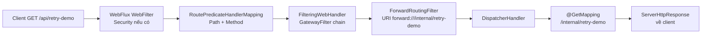
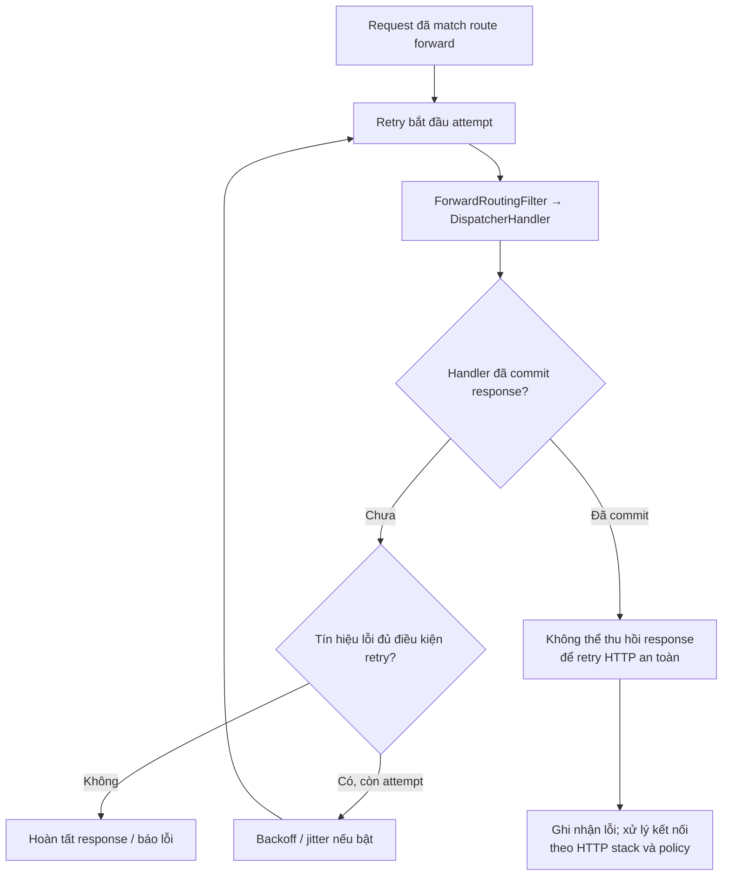

# Thử lại với forward nội bộ và điều kiện response chưa commit

Một API Gateway có thể gặp lỗi tạm thời khi gọi downstream: timeout, kết nối bị đóng hoặc phản hồi `503 Service Unavailable`. Để tăng khả năng phục hồi, **Spring Cloud Gateway** cung cấp **`Retry` GatewayFilter Factory**. Với route dùng `http://`, `https://` hoặc `lb://`, việc thử lại thường liên quan đến một lần gọi backend khác. Tuy nhiên, Gateway còn hỗ trợ đích **`forward:`**, chuyển request đến một handler **ngay trong ứng dụng WebFlux đang chạy Gateway**. Khi kết hợp `Retry` với `forward:`, xuất hiện một ràng buộc đặc biệt: **phải giữ HTTP response ở trạng thái chưa commit nếu còn muốn thử lại**.

Giả sử controller nội bộ xử lý một yêu cầu, phát hiện lỗi rồi trả `ResponseEntity.status(503).body(...)`. Nếu framework đã ghi status/header/body ra response, nó **không thể quay ngược** các byte đã gửi để thử lại handler và thay thế bằng một response thành công. Trong trường hợp `forward:`, cách an toàn hơn cho lỗi **còn có thể thử lại** là **phát tín hiệu lỗi** (`throw` hoặc `Mono.error(ex)`) **trước khi ghi response**, để `Retry` có cơ hội nhận lỗi, áp dụng điều kiện và tái thực hiện phần xử lý phù hợp.

Bài thuộc chương **Thử lại yêu cầu** của module **SPRING_CLOUD_GATEWAY**. Chủ đề gắn với route predicate, filter chain, biến đổi path/header, service discovery, xác thực, rate limiting, circuit breaker, retry, TLS và quan sát request. Mục tiêu là triển khai retry không gây gửi phản hồi hai lần, không vô tình lặp tác dụng phụ và không nhầm một lỗi đã commit với một lỗi còn khả năng khôi phục.

> **Phạm vi:** Ví dụ dùng **Spring Cloud Gateway Server WebFlux** và **Spring Security Reactive** khi nói tới bảo mật. Các bản Gateway mới dùng namespace `spring.cloud.gateway.server.webflux.routes`, còn nhiều phiên bản 4.x dùng `spring.cloud.gateway.routes`. Tài liệu chính thức về `Retry` nêu trực tiếp cảnh báo: khi đích có tiền tố `forward:`, handler lỗi không nên làm bất cứ việc gì khiến response được gửi tới client và commit; đối với annotated controller, không nên trả `ResponseEntity` có status lỗi, mà nên ném exception hoặc phát `Mono.error(ex)` để retry filter xử lý.

## 1. Forward nội bộ là gì và khác proxy đến backend ra sao?

Spring Cloud Gateway Server WebFlux có nhiều cơ chế định tuyến. Hai đường đi cần phân biệt:

| Đặc điểm | Route HTTP/HTTPS hoặc `lb://` | Route `forward:` |
| --- | --- | --- |
| Đích | Một backend HTTP từ xa, có thể sau load balancer | Handler WebFlux trong **chính tiến trình Gateway** |
| Thành phần định tuyến | `NettyRoutingFilter` cho HTTP(S), thêm load balancing nếu cần | `ForwardRoutingFilter` phối hợp `DispatcherHandler` |
| Kết nối outbound HTTP mới | Có thể cần TCP/TLS và connection pool | **Không có thêm một HTTP network hop** chỉ để forward |
| Cách tìm handler | URI host/port, instance discovery | Ánh xạ controller/functional endpoint WebFlux nội bộ |
| Retry thực hiện gì? | Có thể lặp gọi downstream theo policy | Có thể lặp xử lý handler/filter phía sau Retry khi gặp lỗi đủ điều kiện |
| Nguy cơ đặc biệt | Timeout, response chưa đến, kết quả side effect không rõ | Controller/handler có thể **commit trực tiếp response** trước khi Retry quyết định |

Ví dụ cấu hình hướng một public URL sang handler cùng ứng dụng:

```yaml
spring:
  cloud:
    gateway:
      server:
        webflux:
          routes:
            - id: local-retry-demo
              uri: forward:///internal/retry-demo
              predicates:
                - Path=/api/retry-demo
                - Method=GET
```

Client gọi `GET /api/retry-demo`. Gateway chọn route `local-retry-demo`; `ForwardRoutingFilter` nhận URI có scheme `forward` và chuyển việc xử lý qua `DispatcherHandler` với path mục tiêu `/internal/retry-demo`. Không cần đăng ký service discovery hoặc tìm backend TCP cho bước forward này.

**Ba điểm dễ nhầm:**

1. `forward:///internal/retry-demo` là **forward nội bộ trên server**, **không phải HTTP `302` redirect**. Client không được yêu cầu tự gửi request thứ hai tới URL khác.
2. `forward:` của **Gateway routing filter** không đồng nghĩa việc trả tên view `"forward:..."` trong một controller WebFlux. Spring WebFlux thông thường không hỗ trợ Servlet-style view forwarding theo cách MVC; Gateway có cơ chế `ForwardRoutingFilter` riêng.
3. `forward:` không tự là fallback. **CircuitBreaker fallbackUri** có thể dùng đích `forward:` nhưng ý nghĩa “trả fallback sau khi circuit breaker kích hoạt” **khác** “Retry thử lại cùng xử lý một số lần”.

### 1.1. Một route forward có thể được match như thế nào?



Forward là một **nhánh xử lý trong ứng dụng Gateway**. Controller nội bộ vẫn chạy trong cùng tài nguyên CPU, memory và event loop của Gateway; dùng nó để thực hiện tác vụ nặng có thể khiến chính cổng vào bị quá tải. Retry nhiều lần sẽ làm tăng tải trên **Gateway process**, chứ không chỉ trên microservice phía sau.

## 2. Trạng thái response: “đã chọn status” khác “đã commit”

Trong WebFlux, response được quản lý qua `ServerHttpResponse` và các API reactive của `ReactiveHttpOutputMessage`.

**Response chưa commit** nghĩa là các metadata/body chưa được ghi xuống lớp HTTP theo cách khiến chúng không thể thay đổi nữa. Framework có thể vẫn đang dựng status, headers và body.

**Response đã commit** nghĩa là quá trình ghi response vào HTTP layer đã bắt đầu tới mức không thể rút lại để gửi một response mới với status/header/body khác. Sau commit, một retry không thể bảo đảm trả về một phản hồi HTTP hợp lệ duy nhất cho request ban đầu.

| Trạng thái/sự kiện | Ý nghĩa với Retry |
| --- | --- |
| Handler vừa được gọi, chưa ghi gì | Có thể thử lại nếu phần xử lý phát lỗi đủ điều kiện |
| Handler phát `Mono.error(ex)` **trước khi response được ghi** | Retry có thể nhận tín hiệu lỗi rồi resubscribe/reinvoke phù hợp |
| Response đã có status cấu hình tạm thời nhưng **chưa commit** | Chưa đồng nghĩa không thể retry, nhưng phải kiểm chứng filter có thể xử lý/an toàn reset state |
| Handler trả `ResponseEntity.status(503).body(...)` | Có nguy cơ renderer ghi response 503 và **commit**, khiến retry không thể thực hiện an toàn |
| Handler gọi `response.writeWith(...)` và phát ra bytes | Có thể commit; không thể “thu hồi” bytes để gửi lại toàn bộ body |
| Handler gọi `response.setComplete()` | Hoàn tất response; không được giả định có thể hồi sinh để retry |
| SSE/streaming đã gửi vài sự kiện rồi lỗi | Response đã bắt đầu truyền; retry HTTP toàn request không khôi phục trạng thái client |

### 2.1. Vì sao `ResponseEntity.status(503)` không phải tín hiệu retry an toàn?

Đối với một HTTP backend từ xa, Gateway có thể nhìn thấy status 503 trước khi nó ghi response cuối cùng cho client, rồi áp dụng retry theo status. Nhưng với **handler forward nội bộ**, chính annotated controller và HTTP message writer của WebFlux có thể xây và **gửi response** trên cùng exchange mà Retry đang quản lý.

Ví dụ cần tránh nếu mục tiêu là **thử lại lỗi nội bộ**:

```java
@GetMapping("/internal/retry-demo")
public Mono<ResponseEntity<String>> unsafeForForwardRetry() {
    return Mono.just(
        ResponseEntity.status(503).body("temporary failure")
    );
}
```

Đoạn code có thể dẫn đến việc HTTP status/body lỗi được viết ra client trước khi retry filter có cơ hội tạo một lần thực thi khác. Vì thế **không xem `statuses: SERVICE_UNAVAILABLE` là phép “hoàn tác” của một response forward đã commit**.

Trái lại, controller cần **phát lỗi reactive** khi chưa có response:

```java
@GetMapping("/internal/retry-demo")
public Mono<String> retryableFailure() {
    return Mono.error(
        new IllegalStateException("transient local processing error")
    );
}
```

Ở đây method **chưa trả một body thành công hoặc response lỗi ra HTTP layer**; nó trả publisher kết thúc bằng tín hiệu `onError`. Retry có thể bắt lỗi **nếu** loại exception, HTTP method và số lần thử phù hợp với cấu hình.

**Lưu ý:** `Mono.error(...)` không tự bảo đảm retry nếu một `@ControllerAdvice`, `onErrorResume` hoặc error handler khác đã bắt lỗi và chuyển thành response lỗi **trước khi Retry nhận được tín hiệu**. Hãy kiểm thử đường đi thật và thứ tự các bộ xử lý lỗi.

### 2.2. Khi nào response thực sự commit?

Trong Spring WebFlux, những thao tác có thể dẫn đến commit gồm:

- Bắt đầu viết body bằng `writeWith(...)` hoặc `writeAndFlushWith(...)`.
- Hoàn tất response bằng `setComplete()`.
- Để response renderer ghi `ResponseEntity`/JSON/status/headers.
- Bắt đầu truyền streaming response, SSE, file download hoặc phát HTTP headers.

API `exchange.getResponse().isCommitted()` cho biết trạng thái **tại thời điểm kiểm tra**; nó hữu ích khi chẩn đoán nhưng **không phải cơ chế rollback**. `beforeCommit(...)` cho phép đăng ký hành động trước commit, không cho phép thực hiện “uncommit” sau khi bytes đã gửi.

Vì vậy, thiết kế tốt không phải “cứ để controller commit, nếu `isCommitted() == true` thì reset lại”. Thiết kế đúng là **tránh commit trước khi biết kết quả có thể retry**.

## 3. Vì sao retry phải xảy ra trước ranh giới commit?

HTTP response đi tới client theo một chiều. Khi server đã gửi status line/headers hoặc một phần body, việc thay status từ `503` thành `200` là không còn khả thi trên cùng response.



**Mấu chốt:** Tín hiệu retry (status/exception) và khả năng **phát response mới cho client** là hai điều kiện khác nhau. Dù exception thỏa `exceptions`, retry một request đã commit **không bảo đảm tính đúng của protocol** và có thể gây log lỗi “response already committed”.

Nếu controller đã xuất `200 OK` và một phần JSON rồi mới phát `onError`, cố retry toàn bộ sẽ không thể biến response đã phát thành một JSON liền mạch khác. Với streaming, phải dùng **giao thức khôi phục ở cấp ứng dụng** (resume token, sequence ID, offset, reconnect) thay vì “HTTP retry sau commit”.

### 3.1. Điều kiện cần nhưng chưa đủ cho retry an toàn

Một attempt mới chỉ nên thực hiện khi:

1. Lỗi hoặc status **được chính sách Retry lựa chọn**.
2. Số attempt chưa vượt giới hạn.
3. HTTP method và nghiệp vụ cho phép thực hiện lại mà không tạo tác dụng phụ nguy hiểm.
4. **Response vẫn chưa commit**; không có bytes đã trả client.
5. Request body và các đối tượng cần tái sử dụng (nếu có) còn ở trạng thái thích hợp.
6. Thời gian còn lại trong **timeout/deadline budget** cho phép.
7. Hệ thống không đang ở trạng thái retry storm, circuit breaker open hoặc quá tải cần dừng sớm.

**Chưa commit không đồng nghĩa nghiệp vụ chưa có side effect.** Một handler có thể đã ghi database rồi phát lỗi trước response. Retry có thể **ghi lần hai** nếu không có idempotency/transaction semantics.

## 4. Cấu hình Retry GatewayFilter Factory cho forward

Theo tài liệu Spring Cloud Gateway Server WebFlux, factory `Retry` hỗ trợ:

| Tham số | Vai trò | Ví dụ |
| --- | --- | --- |
| **`retries`** | Số **lần thử lại** sau lần đầu tiên. | `2` → tối đa **3 attempts** |
| **`statuses`** | Danh sách mã HTTP cụ thể có thể retry. | `BAD_GATEWAY`, `SERVICE_UNAVAILABLE` |
| **`series`** | Nhóm status được retry. | `SERVER_ERROR` tương ứng 5xx |
| **`methods`** | HTTP methods đủ điều kiện thử lại. | `GET` |
| **`exceptions`** | Những loại exception đủ điều kiện retry. | `java.lang.IllegalStateException` cho bài test |
| **`backoff`** | Độ trễ giữa các lần retry, có thể tăng theo cấp số nhân. | `firstBackoff: 50ms`, `factor: 2` |
| **`jitter`** | Biến thiên ngẫu nhiên cho backoff, nếu phiên bản hỗ trợ. | `randomFactor: 0.5` |
| **`timeout`** | Giới hạn thời gian retry theo semantics phiên bản hỗ trợ. | `200ms` trong ví dụ tài liệu mới |

Tài liệu Server WebFlux mới nêu mặc định thường là:

- `retries`: **3** lần thử lại (có thể tổng cộng 4 attempts).
- `series`: **5xx**.
- `methods`: **GET**.
- `exceptions`: **`IOException`** và **`TimeoutException`**.
- `backoff`: tắt; `jitter`: tắt; `timeout`: không giới hạn theo tham số retry của phiên bản mới.

**Các mặc định có thể thay đổi theo phiên bản.** Với bài forward, **khai báo rõ** exception cần retry sẽ dễ hiểu hơn dựa vào mặc định. `IllegalStateException` trong demo **không mặc nhiên nằm trong danh sách mặc định `IOException`/`TimeoutException`**.

### 4.1. Route Server WebFlux với retry theo exception

```yaml
spring:
  cloud:
    gateway:
      server:
        webflux:
          routes:
            - id: forward-retry-demo
              uri: forward:///internal/retry-demo
              predicates:
                - Path=/api/retry-demo
                - Method=GET
              filters:
                - name: Retry
                  args:
                    retries: 2
                    methods:
                      - GET
                    exceptions:
                      - java.lang.IllegalStateException
                    backoff:
                      firstBackoff: 50ms
                      maxBackoff: 200ms
                      factor: 2
                      basedOnPreviousValue: false
```

Diễn giải:

1. Gateway chỉ áp dụng route khi client gửi `GET /api/retry-demo`.
2. `forward:///internal/retry-demo` là đích handler WebFlux trong Gateway.
3. `Retry` cho phép **2 retries** sau attempt đầu. Nếu handler lần 1, 2 phát `IllegalStateException` rồi lần 3 thành công **trước commit**, client nhận response thành công của lần 3.
4. `backoff` tránh thử lại tất cả attempts ngay trong cùng một thời điểm. Các khoảng thực tế phụ thuộc thứ tự retry, đồng hồ scheduler, phương pháp backoff và phiên bản framework.
5. Với `GET` không có request body, ví dụ tách được vấn đề **commit và exception** khỏi rủi ro bộ nhớ do caching body.

**Vì sao không chỉ cấu hình `statuses: SERVICE_UNAVAILABLE`?** Trường hợp forward nội bộ cần phát lỗi **trước khi response được viết**. Với controller trả response lỗi, status có thể không còn ở trạng thái an toàn để Retry can thiệp. Đặt `exceptions` tường minh giúp điều khiển tình huống demo một cách phù hợp hơn.

### 4.2. Namespace thường gặp ở Spring Cloud Gateway 4.x

Trên các bản 4.x cũ, cấu hình tương ứng có thể là:

```yaml
spring:
  cloud:
    gateway:
      routes:
        - id: forward-retry-demo
          uri: forward:///internal/retry-demo
          predicates:
            - Path=/api/retry-demo
            - Method=GET
          filters:
            - name: Retry
              args:
                retries: 2
                methods: GET
                exceptions:
                  - java.lang.IllegalStateException
                backoff:
                  firstBackoff: 50ms
                  maxBackoff: 200ms
                  factor: 2
                  basedOnPreviousValue: false
```

Chọn **một namespace** theo BOM và starter của dự án. Nếu route không được nạp, startup báo không tìm thấy filter hoặc cấu hình không bind được `exceptions`/`methods`, kiểm tra đúng tài liệu cho phiên bản và biến thể Server WebFlux. Không sao chép filter retry của **Gateway Server MVC** rồi mặc định API và semantics giống hệt.

### 4.3. Ưu tiên lựa chọn lỗi có thể phục hồi

Retry mọi `RuntimeException` là chính sách **rộng và nguy hiểm**. Các lỗi như vi phạm invariant, lỗi mapping dữ liệu, bug lập trình hoặc quyền truy cập không đúng thường **không biến mất** sau vài mili giây.

Trong production, hãy dùng exception type **biểu thị lỗi tạm thời thật sự**, ví dụ exception từ một thư viện có thể phục hồi hoặc một loại exception do ứng dụng định nghĩa. Chọn `IllegalStateException` trong bài chỉ để demo đơn giản và kiểm chứng đường bắt exception.

**Không retry `401`/`403`/`404` mặc định**: xác thực, phân quyền và route không tìm thấy thường không được giải quyết bằng lặp vô điều kiện. Với `429`, phải tôn trọng backoff/quota và `Retry-After` nếu contract yêu cầu; không thêm `429` vào danh sách retry chung chỉ để “hy vọng lần sau được phép”.

## 5. Ví dụ controller đúng: lỗi trước commit, lần thứ ba thành công

Controller dưới đây dành **riêng cho môi trường thực hành**. Nó dùng `AtomicInteger` để ghi số attempts và `Mono.defer(...)` để bảo đảm logic tạo kết quả được thực thi tại **mỗi lần subscription**, kể cả khi Retry tái subscription trên reactive publisher.

```java
package com.example.gateway.demo;

import java.util.Map;
import java.util.concurrent.atomic.AtomicInteger;

import org.springframework.web.bind.annotation.GetMapping;
import org.springframework.web.bind.annotation.RestController;
import reactor.core.publisher.Mono;

@RestController
public class InternalRetryDemoController {

    private final AtomicInteger attempts = new AtomicInteger();

    @GetMapping("/internal/retry-demo")
    public Mono<Map<String, Object>> retryDemo() {
        return Mono.defer(() -> {
            int attempt = attempts.incrementAndGet();

            // Hai lần đầu: báo lỗi, KHÔNG ghi response.
            if (attempt <= 2) {
                return Mono.error(new IllegalStateException(
                    "Temporary failure at attempt " + attempt
                ));
            }

            // Lần tiếp theo: trả response thành công.
            return Mono.just(Map.of(
                "result", "ok",
                "attempt", attempt
            ));
        });
    }

    public int attemptCount() {
        return attempts.get();
    }
}
```

Giả sử route có `retries: 2` và `exceptions: [java.lang.IllegalStateException]`, một lần gọi công khai mới trong test có trạng thái bộ đếm ban đầu bằng 0:

```text
Client GET /api/retry-demo
  Attempt 1 -> Mono.error(IllegalStateException) -> chưa commit
  Backoff
  Attempt 2 -> Mono.error(IllegalStateException) -> chưa commit
  Backoff
  Attempt 3 -> Mono.just({result: "ok", attempt: 3})

Client:
  HTTP 200
  {"result":"ok","attempt":3}
```

**Đây là controller test**, không phải endpoint production. Một bộ đếm toàn process chia sẻ giữa mọi người dùng sẽ tạo kết quả phụ thuộc thứ tự request; test thật nên reset/isolate state giữa các test cases. Khi dùng nhiều request đồng thời, không kỳ vọng attempt #1/#2/#3 thuộc cùng một request nếu chia sẻ counter. Hãy thiết kế bộ tạo lỗi theo **request ID test được kiểm soát**, hoặc dùng stub có sequence/counter riêng cho mỗi kịch bản.

### 5.1. Vì sao dùng Mono.defer?

Một publisher reactive có thể là **cold publisher**, nhưng những câu lệnh chạy **trước lúc tạo publisher** không tự động được chạy lại chỉ vì có một subscription mới.

Ví dụ không tốt khi muốn đếm **mỗi retry attempt**:

```java
@GetMapping("/internal/retry-demo")
public Mono<String> fragileCounter() {
    int attempt = attempts.incrementAndGet();
    if (attempt <= 2) {
        return Mono.error(new IllegalStateException("temporary"));
    }
    return Mono.just("ok");
}
```

Nếu retry **tái subscription cùng publisher** mà không gọi lại method controller theo cách người viết kỳ vọng, `attempts.incrementAndGet()` có thể không chạy thêm. `Mono.defer(...)` chuyển logic có side effect phục vụ test vào thời điểm subscription, giúp quan sát rõ hành vi được thực thi lại. Tuy nhiên, code nghiệp vụ production vẫn phải **idempotent**; `defer` không phải cơ chế chống ghi trùng.

### 5.2. Controller phát exception cụ thể, tránh biến thành 503 sớm

Nên giữ lỗi dưới dạng tín hiệu reactive:

```java
return service.performRead()
    .onErrorMap(
        TemporaryBackendException.class,
        ex -> new RetryableLocalException("temporary", ex)
    );
```

Trong đó `RetryableLocalException` phải được định nghĩa và khai báo trong `exceptions` của Retry, nếu muốn dùng làm điều kiện. Đoạn trên là **mã khung** cho cách phân loại lỗi, không phải class hoàn chỉnh.

Tránh:

```java
return service.performRead()
    .onErrorResume(ex -> Mono.just(
        ResponseEntity.status(503).body("temporary")
    ));
```

Đoạn thứ hai **nuốt tín hiệu lỗi** và xây response 503; nếu renderer commit response, retry không thể áp dụng an toàn cho forward.

## 6. Ví dụ sai: commit lỗi trước khi retry

### 6.1. Trả ResponseEntity với status lỗi

```java
@GetMapping("/internal/retry-status")
public Mono<ResponseEntity<Map<String, String>>> wrongForForwardRetry() {
    return Mono.just(
        ResponseEntity.status(503).body(
            Map.of("error", "temporarily unavailable")
        )
    );
}
```

Với route `uri: forward:///internal/retry-status` và filter có `statuses: SERVICE_UNAVAILABLE`, người học có thể kỳ vọng Gateway thử lại. **Không nên dựa vào giả định này:** tài liệu chính thức cảnh báo annotated controller trả `ResponseEntity` status lỗi có thể khiến response được gửi và commit. Cách này **không phải thiết kế retry forward được khuyến nghị**.

### 6.2. Ghi một phần body rồi phát lỗi

```java
@GetMapping(
    value = "/internal/partial",
    produces = "text/event-stream"
)
public Flux<String> streamingThenFail() {
    return Flux.concat(
        Flux.just("event: start\n\n"),
        Flux.error(new IllegalStateException("after first event"))
    );
}
```

Đây là tình huống **không phù hợp với HTTP Retry toàn response**: nếu sự kiện đầu đã được flush tới client, phần response đã commit và **không thể thay bằng một response mới bắt đầu từ đầu**. Đối với SSE/WebSocket/streaming, cần cơ chế resume/reconnect có sequence ID và contract rõ ràng, không dùng Retry để tự động tua ngược dữ liệu.

### 6.3. Ghi header, cookie hoặc redirect quá sớm

Trong một số handler, việc sửa response metadata có thể dẫn đến commit sau đó:

```java
// Mã khung minh họa rủi ro, không phải ví dụ retry đúng.
exchange.getResponse().getHeaders().add("X-Attempt", "1");
return exchange.getResponse().setComplete();
```

Nếu handler đã gọi `setComplete()` thì **không còn nội dung response nào chờ xử lý**. Retry không thể biến response đã hoàn tất thành kết quả khác.

Tương tự, không gửi cookie đăng nhập/logout, một phần file hoặc redirect `302` rồi mới quyết định thử lại. Đối với thao tác có side effect trên client, tốt nhất hoàn tất mọi kiểm tra có thể retry **trước khi** viết response.

## 7. Status-based retry và exception-based retry trong forward khác nhau thế nào?

### 7.1. Retry theo status

Khi HTTP backend từ xa trả `503`, Gateway có thể nhận status như một kết quả của quá trình routing, nhận biết `statuses`/`series` và **chưa viết response cuối cùng cho client**; tùy pipeline, retry có thể được thực hiện hợp lệ.

```yaml
# Ví dụ dùng cho backend HTTP từ xa, không phải mẫu ưu tiên cho forward nội bộ.
routes:
  - id: orders-upstream
    uri: http://localhost:9090
    predicates:
      - Path=/api/orders/**
    filters:
      - name: Retry
        args:
          retries: 2
          statuses:
            - SERVICE_UNAVAILABLE
          methods:
            - GET
```

Với `forward:///internal/...`, controller xử lý **cùng ServerHttpResponse** của Gateway. Nếu controller dựng và gửi status/body 503, cơ hội retry bằng status có thể đã qua. Vì vậy tài liệu Spring khuyến nghị **throw exception hoặc `Mono.error(ex)` thay vì `ResponseEntity` error**.

### 7.2. Retry theo exception

Tín hiệu exception chưa được chuyển thành response thường phù hợp hơn cho forward:

```yaml
filters:
  - name: Retry
    args:
      retries: 2
      methods:
        - GET
      exceptions:
        - java.lang.IllegalStateException
```

Tuy nhiên, exception có thể xuất hiện **quá muộn**, sau khi một bộ lọc/controller đã ghi response. Chỉ khai báo đúng `exceptions` **không cứu được** trường hợp đã commit.

### 7.3. Bảng quyết định

| Diễn biến | Tín hiệu mà Retry có thể nhìn thấy | Retry an toàn không? |
| --- | --- | --- |
| Handler forward phát `Mono.error` ngay, chưa ghi response | Exception | Có thể, nếu match policy và còn attempts |
| Handler forward ném exception trước khi viết response | Exception | Có thể, nếu lỗi truyền tới Retry |
| Handler forward trả `ResponseEntity.status(503).body(...)` | Status được renderer xử lý | **Không nên dựa vào retry**; nguy cơ commit |
| Handler forward trả `Mono.error` nhưng `@ExceptionHandler` đổi thành JSON 503 | Lỗi có thể đã bị chuyển thành response | Phải xác minh; có thể không còn tín hiệu exception |
| Handler forward gửi một phần SSE rồi `onError` | Exception sau khi response bắt đầu | Không thể retry toàn bộ HTTP response an toàn |
| Backend HTTP từ xa trả status 503 trước khi Gateway ghi client response | Status | Có thể retry theo `statuses`/`series` |
| Client đã ngắt kết nối | Cancellation/lỗi kết nối | Không nên tiếp tục retry một response không còn người nhận |

**Quy tắc thực tế:** Một handler nội bộ có thể lỗi, nhưng **phải báo lỗi trước commit** để Retry có cơ hội làm việc. Nếu đã tạo response cuối cùng, hãy chấp nhận/ghi nhận lỗi theo protocol thay vì tìm cách giả lập một “retry” bên trong response đã gửi.

## 8. Retry bao nhiêu lần, backoff thế nào và có gây bùng tải không?

Một cấu hình:

```yaml
filters:
  - name: Retry
    args:
      retries: 2
      exceptions:
        - java.lang.IllegalStateException
      methods:
        - GET
      backoff:
        firstBackoff: 50ms
        maxBackoff: 200ms
        factor: 2
        basedOnPreviousValue: false
```

nghĩa là **1 attempt ban đầu + tối đa 2 retries**. Nếu 100 request cùng lỗi ở lần đầu, số lần handler được thực thi **có thể tới 300**, chưa tính các retries tầng khác.

\[
\text{Tối đa attempts} = 1+\text{retries}
\]

\[
\text{Tổng attempts lý thuyết}
=\text{Số request được admit}\times(1+\text{retries})
\]

Công thức là **upper bound** khi mọi request đi qua cùng retry policy và không bị cancellation/timeout/early success; không có nghĩa mỗi request đều retry đến hết.

### 8.1. Backoff và jitter

Exponential backoff cho phép tách các retries theo thời gian. Với `firstBackoff=50ms` và `factor=2`, khoảng chờ theo mô hình có thể tăng 50 ms → 100 ms → 200 ms (bị chặn bởi `maxBackoff`), nhưng thứ tự chính xác và cách tính theo giá trị trước phụ thuộc tham số/phiên bản.

**Jitter** thêm biến thiên ngẫu nhiên để giảm việc hàng nghìn requests cùng retry vào một mốc thời gian. Trong các bản Gateway mới có tham số `jitter.randomFactor` và `timeout`; chỉ khai báo khi phiên bản hỗ trợ, không mặc định áp dụng y nguyên cho mọi 4.x.

Đối với retry forward:

- Backoff chậm có thể làm một request giữ tài nguyên Gateway lâu hơn.
- Handler nội bộ bị lỗi hàng loạt có thể được gọi nhiều lần trong cùng process.
- Deadline tổng của client phải đủ hoặc hệ thống cần dừng retries khi không còn thời gian.
- Nếu Retry thực sự che một lỗi lập trình không tạm thời, backoff chỉ làm hệ thống chậm hơn.

### 8.2. Không retry vĩnh viễn

Một vòng lặp retry vô hạn có thể gây:

- Nhiều subscriptions/handler invocations ngoài dự kiến.
- CPU/memory pressure trong Gateway process.
- Tăng độ trễ p95/p99 và request client timeout.
- Tác dụng phụ lặp khi handler ghi Redis/database hoặc gửi message.
- Áp lực lên cùng dependency lỗi, làm quá trình phục hồi khó hơn.

Giới hạn `retries`, timeout/deadline, idempotency và circuit breaker là các phần **bổ sung** cho nhau; không phải chọn một trong bốn.

## 9. Filter order: những filter nào bị chạy lại?

Tài liệu Spring Cloud Gateway nêu rõ: **Retry filter sẽ retry tất cả filters đứng sau nó trong filter chain**.

Điều này ảnh hưởng tới những filter:

- Thêm/sửa headers và request attributes.
- Ghi access logs, tracing spans, metrics.
- Đọc/cache request body.
- Giới hạn lưu lượng.
- Gọi backend, ghi dữ liệu hoặc thực hiện side effect.
- Đóng/mở circuit breaker hoặc thực hiện fallback.

Ví dụ minh họa ý định:

```yaml
filters:
  - name: RequestRateLimiter
    args:
      key-resolver: "#{@principalKeyResolver}"
      redis-rate-limiter.replenishRate: 5
      redis-rate-limiter.burstCapacity: 10
  - name: Retry
    args:
      retries: 2
      methods:
        - GET
      exceptions:
        - java.lang.IllegalStateException
```

Nếu rate limiter nằm **trước Retry trong thứ tự thực thi thật**, nó có thể tính một lần cho một request từ client, trong khi các filters/handler phía sau Retry được thực thi lại. Nếu đặt một limiter hoặc custom filter **sau Retry**, nó có thể bị thực thi nhiều lần và tính thêm quota theo attempts.

**Đừng chỉ đọc thứ tự các dòng YAML** khi có `GlobalFilter`, filter order tường minh hoặc custom factories. Gateway kết hợp filters và sắp xếp theo `Ordered`; phải xác minh thứ tự runtime. Quyết định rõ metrics đang đếm **inbound requests** hay **attempts**.

### 9.1. Side effect ở custom filters

Một custom filter có thể chứa:

```java
// Mã khung mang tính cảnh báo.
auditCounter.incrementAndGet();
return chain.filter(exchange);
```

Nếu nằm trong đoạn filter chain được Retry chạy lại, `auditCounter` có thể tăng nhiều lần cho một inbound request. Đối với audit nghiệp vụ hoặc thanh toán, điều này có thể là lỗi nếu tác giả ngầm coi mỗi lần filter chạy là một request độc lập.

**Thiết kế tốt:** tách **request-level instrumentation** khỏi **attempt-level instrumentation** và ghi nhận rõ các events `retry_scheduled`, `attempt_started`, `attempt_failed`, `attempt_succeeded`. Không ghi trực tiếp JWT/cookie hoặc dữ liệu nhạy cảm vào logs.

### 9.2. Exchange attributes có thể tồn tại qua attempts

Trong WebFlux, `ServerWebExchange` chứa request, response và attributes. Khi một phần xử lý được thử lại trên cùng exchange, những attribute hoặc trạng thái do custom filter đã sửa có thể ảnh hưởng attempt tiếp theo.

Không giả định mỗi retry là một HTTP request mới với một exchange sạch hoàn toàn. Cần test:

- Header được thêm bằng `AddRequestHeader` có bị nhân đôi?
- Dữ liệu custom filter lưu trong `exchange.getAttributes()` có bị cộng dồn?
- Security context được thiết lập trước Gateway có cần/được tái kiểm tra không?
- Response header `Set-Cookie` hoặc `Content-Length` có bị ghi từ attempt lỗi?
- Các bộ đếm tracing có tách inbound request và retry attempts đúng không?

## 10. Retry với POST/PUT và request có body: giới hạn an toàn

Tài liệu Gateway WebFlux cảnh báo rằng khi bật Retry với **bất kỳ HTTP method có request body**, body có thể được **cache trong bộ nhớ** dưới dạng `DataBuffer` để phát lại. Đối với body lớn và nhiều request đồng thời, đây là một rủi ro đáng kể cho Gateway.

### 10.1. Tại sao phải cache body?

HTTP request body trên WebFlux là reactive stream. Một stream đã được tiêu thụ **không tự nhiên có thể phát lại** trên attempt thứ hai. Retry cần cơ chế replay/caching để gửi cùng body lần nữa nếu policy cho phép.

Các nguy cơ:

- Dùng thêm memory theo kích thước body và số request đồng thời.
- Lỗi codec/buffer limit hoặc OOM khi nhiều payload lớn cùng retry.
- Upload/streaming không phù hợp với toàn bộ body được giữ trong memory.
- Body có thể chứa dữ liệu nhạy cảm không nên nằm trong log hoặc dump.
- Attempt thứ nhất đã ghi side effect trước khi báo lỗi, attempt thứ hai lặp lại dữ liệu.

### 10.2. POST không tự an toàn dù response chưa commit

Ví dụ:

```text
POST /api/payments
  Attempt 1: trừ tiền thành công, nhưng lỗi trước khi ghi response
  Retry:
  Attempt 2: trừ tiền thêm lần nữa
```

Không commit HTTP response **không đồng nghĩa transaction trước đó đã rollback**. Với các tác vụ có tác dụng phụ, phải có **idempotency key**, deduplication và transaction/business semantics vững chắc ở nơi thực thi nghiệp vụ.

Đối với endpoint forward nội bộ, nên giới hạn retry ban đầu ở **GET/read-only/idempotent handler**. Chỉ mở rộng sang method ghi khi đã kiểm soát replay body, quyền truy cập, idempotency và tác động bộ nhớ. Các HTTP methods mang tên `PUT`/`DELETE` có ngữ nghĩa idempotent theo chuẩn, nhưng triển khai cụ thể vẫn cần kiểm chứng tác dụng phụ.

### 10.3. Khi nào không nên dùng Retry?

Không nên tự động retry toàn request khi:

- Response đã commit hoặc bắt đầu streaming.
- Lỗi là sai dữ liệu đầu vào, thiếu quyền, sai token hoặc bug lập trình.
- Handler đã thực hiện side effect **không thể lặp lại an toàn**.
- Request body rất lớn hoặc không phát lại được.
- Client đã ngắt kết nối hoặc hết deadline.
- Dependency đang overload và retries làm khuếch đại tải.
- Một fallback đã phát response và contract xác định kết quả cuối cùng.

## 11. Forward nội bộ và CircuitBreaker fallback: đừng đánh đồng

Spring Cloud Gateway cũng có thể dùng **CircuitBreaker** filter với `fallbackUri: forward:/fallback`. Đây là một trường hợp **forward đến handler fallback** sau khi circuit breaker quyết định sử dụng fallback, khác với Retry cố thực hiện lại cùng phần xử lý nhiều lần.

| Cơ chế | Khi kích hoạt | Hành động |
| --- | --- | --- |
| **Retry** | Một attempt lỗi phù hợp policy | Thử lại phần chuỗi xử lý theo số lần/thời gian cho phép |
| **CircuitBreaker** | Tỷ lệ lỗi/điều kiện mở circuit theo policy | Chặn bớt lệnh gọi, có thể trả lỗi/fallback |
| **Forward route** | Gateway chọn route có `forward:` | Chuyển xử lý sang handler nội bộ WebFlux |
| **Fallback forward** | Bộ lọc CircuitBreaker chọn đường fallback | Chuyển sang handler để tạo response thay thế |

Ví dụ khái niệm:

```yaml
# Ví dụ minh họa chức năng khác Retry:
filters:
  - name: CircuitBreaker
    args:
      name: ordersCircuit
      fallbackUri: forward:/fallback/orders
```

Khi dùng fallback, controller có thể **trả một response fallback** với status/body đã được thiết kế. Điều đó **không có nghĩa** một controller dùng làm đích **Retry forward** cũng được tùy ý commit response lỗi rồi mong Retry rollback. Phải phân biệt mục tiêu **kết thúc bằng fallback** với mục tiêu **còn muốn thử thêm attempt**.

### 11.1. Không tạo vòng lặp forward

Một lỗi cấu hình nghiêm trọng là forward đến một path mà chính path đó lại match cùng route Gateway:

```text
Path=/api/**
uri=forward:///api/internal

Forward /api/internal
  -> lại khớp Path=/api/**
  -> forward thêm lần nữa ...
```

Tùy cơ chế dispatch/điều kiện routing, có thể tạo vòng lặp, stack/resource pressure hoặc lỗi khó chẩn đoán. **Chọn path nội bộ nằm ngoài vùng route công khai**, ví dụ `/internal/retry-demo`; kiểm thử routing thực tế, chống gọi trực tiếp và tránh cho bất kỳ route catch-all nào chuyển tiếp vô hạn.

## 12. Security: handler nội bộ không tự trở thành private

Controller có mapping `/internal/retry-demo` vẫn là **handler WebFlux** trong cùng ứng dụng. Nếu client trực tiếp gọi `GET /internal/retry-demo`, WebFlux **có thể** định tuyến tới handler đó nếu không có security/route policy ngăn cản.

**Không coi prefix `/internal/` là một firewall.** Khi dùng forward cho logic nhạy cảm:

- Spring Security phải bảo vệ **URL công khai** bằng authentication/authorization phù hợp.
- **Đường gọi trực tiếp** tới path handler nội bộ cũng cần được chặn hoặc giới hạn bằng security/ingress policy đã kiểm thử.
- Không tin `X-Internal-Call: true` do client tự gửi như chứng cứ request được forward.
- Không phơi bày endpoint debug/reset counter hoặc Actuator nhạy cảm ra Internet.
- Nếu handler truy cập database, message broker hay remote API, nó phải có quyền tối thiểu và kiểm tra tài nguyên/tenant.

### 12.1. Vị trí thực thi Spring Security WebFilter

Trong mô hình WebFlux thông dụng, **Spring Security WebFilter** xử lý inbound request ở trước Gateway route filters. Route forward nội bộ dùng `DispatcherHandler` để điều phối handler, không nhất thiết tạo một **HTTP inbound request mới** từ client hoặc một lượt chạy security chain hoàn toàn độc lập.

Do đó cần kiểm chứng cả:

1. `GET /api/retry-demo` **không có token** → bị chặn theo policy của public API.
2. `GET /api/retry-demo` **có quyền** → được forward và retry như dự kiến.
3. `GET /internal/retry-demo` **gọi trực tiếp từ client** → không được vô ý mở công khai.
4. Các route catch-all hoặc handler mapping khác không tạo đường đi vòng (*bypass*) tới cùng chức năng.

Không đặt một rule cho `/api/retry-demo` rồi tự suy luận handler `/internal/retry-demo` chắc chắn không truy cập được trực tiếp. Cần thiết kế rule riêng cho đường trực tiếp và test end-to-end.

### 12.2. Giới hạn tài nguyên và rủi ro DoS

Vì Retry forward lặp **công việc cùng process**, kẻ tấn công có thể khai thác endpoint gây exception nhanh để ép Gateway lặp code nhiều lần. Hệ thống cần:

- Giới hạn số retries và timeout.
- Rate limiting ở biên cho request inbound.
- Không cho một handler bất kỳ sinh `RetryableException` vô hạn.
- Không log stacktrace đầy đủ cho mọi attempt ở mức lưu lượng cao.
- Circuit breaker/bulkhead phù hợp khi handler gọi một dependency khác.
- Giới hạn body, CPU, memory và request concurrency.

**Một Gateway còn khả dụng là tài nguyên chung** cho nhiều services; không để logic retry của một route chiếm event loop hoặc saturate thread pool và làm toàn bộ API bị ảnh hưởng.

## 13. Kiểm thử tích hợp: đo retries và response commit

Không nên chỉ assert HTTP status 200. Để chứng minh Retry **thực sự** hoạt động, cần đo số lần handler chạy, loại lỗi và thời điểm commit.

### 13.1. Kịch bản A — Hai lỗi trước commit rồi thành công

Sử dụng route ở mục 4.1, controller ở mục 5 và một test context mới có counter bằng 0:

```java
// Đoạn trong @SpringBootTest integration test (minh họa).
// Cần cấu hình WebTestClient với Gateway đang chạy thật.

webTestClient.get()
    .uri("/api/retry-demo")
    .exchange()
    .expectStatus().isOk()
    .expectBody()
    .jsonPath("$.result").isEqualTo("ok")
    .jsonPath("$.attempt").isEqualTo(3);

assertThat(internalRetryDemoController.attemptCount())
    .isEqualTo(3);
```

Điều kiện:

- `@SpringBootTest` nạp đầy đủ Gateway route/filter và controller.
- Không có filter/security/route khác chặn request trước demo.
- Mỗi phép thử dùng counter riêng hoặc reset/isolate đúng cách.
- Không có nhiều requests đồng thời dùng chung counter làm số attempts bị trộn.

Nếu test chỉ dựng controller mà không nạp Gateway filter chain, nó không kiểm tra đúng vấn đề. Nếu counter chỉ tăng một lần nhưng response thành công, có thể do controller không hề lỗi hoặc test bỏ qua Retry.

### 13.2. Kịch bản B — Vượt hết số lần thử

Đổi handler test để **luôn phát lỗi** trước commit:

```java
return Mono.defer(() ->
    Mono.error(new IllegalStateException("always failing")));
```

Với `retries: 2`, số attempts dự kiến là **3** trước khi lỗi cuối cùng đi vào cơ chế xử lý exception và tạo response cho client. **Mã status cuối cùng** phụ thuộc `WebExceptionHandler`, error mapping và security/HTTP stack; trong cấu hình thông thường có thể là `500`, nhưng test cần bám contract thực tế.

Nếu handler luôn lỗi mà hệ thống thử vô hạn hoặc counter tăng nhiều hơn mong đợi, kiểm tra retries lồng nhau, filter order, route khác, circuit breaker hoặc client tự retry.

### 13.3. Kịch bản C — Controller trả ResponseEntity lỗi

Đổi handler thành:

```java
return Mono.just(
    ResponseEntity.status(503).body("temporary")
);
```

Kỳ vọng về **học thuật**: đây là kiểu handler tài liệu Spring **cảnh báo không nên dùng** với Retry + `forward:`. Test cần kiểm tra:

- Response có bị commit trước khi filter có thể xử lý retry không?
- Handler có được gọi lại như người viết kỳ vọng không?
- Có log lỗi khi cố sửa response đã commit không?
- Có gửi ra body/status không nhất quán hoặc bị ngắt không?

**Không viết test dựa trên giả định trường hợp này nhất định trả ba lần 503** hay nhất định retry thành công. Mục tiêu là nhận diện **anti-pattern**, không bảo đảm một hành vi sai ổn định giữa các phiên bản.

### 13.4. Kịch bản D — Error handler nuốt tín hiệu lỗi

Đặt một `@RestControllerAdvice` hoặc `onErrorResume` chuyển exception thành JSON `500`/`503` trước khi Retry có thể xử lý. Quan sát xem Retry có còn nhìn thấy exception không và response đã commit chưa.

Điều cần rút ra: error handler thiết kế cho UI/API thông thường có thể thay đổi **thời điểm exception trở thành HTTP response**. Muốn forward retry, phải có **ranh giới rõ** giữa lỗi có thể retry và lỗi đã được biến thành response cuối cùng.

### 13.5. Kịch bản E — Ghi một phần stream rồi lỗi

Cho handler streaming gửi một chunk đầu, sau đó `onError`. Kiểm tra:

- Client có nhận một phần bytes trước khi kết nối bị lỗi/đóng không?
- Gateway ghi nhận response `isCommitted()==true` khi lỗi không?
- Có dấu hiệu cố viết response lần hai không?
- Retry policy có bị kích hoạt không, và nếu có thì có nguy cơ sai protocol không?

Trường hợp này dùng để **phát hiện hành vi không an toàn** và quyết định loại trừ streaming khỏi Retry; không xem việc tiếp tục nối dữ liệu sau lỗi là “retry thành công”.

### 13.6. Ma trận kiểm thử đầy đủ

| ID | Tình huống | Điều cần xác nhận |
| --- | --- | --- |
| F1 | `GET` forward, `Mono.error` hai lần rồi thành công | 3 attempts, một response thành công |
| F2 | `GET` forward, luôn phát exception đủ điều kiện | Dừng sau 1 + retries, response cuối theo error policy |
| F3 | Exception không nằm trong `exceptions` | Không retry do exception đó |
| F4 | `POST` không nằm trong `methods` | Không retry chỉ vì có exception |
| F5 | Controller trả `ResponseEntity.status(503)` | Nhận diện nguy cơ commit, không mặc định retry |
| F6 | Controller `Mono.error` nhưng `@ExceptionHandler` đổi thành 503 | Kiểm tra exception có bị hấp thụ trước Retry |
| F7 | Handler ghi body chunk rồi lỗi | Không được tạo response HTTP “thành công” bằng restart |
| F8 | `ServerHttpResponse.isCommitted()` sau khi ghi dữ liệu | Không có khả năng rollback |
| F9 | Forward target path trùng route tổng quát | Phát hiện nguy cơ forward loop/route shadowing |
| F10 | Gọi trực tiếp `/internal/retry-demo` | Security/ingress phải ngăn truy cập không mong muốn |
| F11 | Client thiếu JWT/scope cho public path | 401/403; handler không bị gọi |
| F12 | Retry + RequestRateLimiter ở vị trí khác nhau | Phân biệt một quota/inbound và quota/attempt |
| F13 | Retry + custom logging/headers filter | Không nhân đôi headers/log sự kiện không mong muốn |
| F14 | Request body lớn và bật Retry cho POST | Đo memory pressure/cached DataBuffer; giới hạn |
| F15 | Handler ghi database rồi lỗi | Ngăn tác dụng phụ trùng bằng idempotency |
| F16 | Nhiều Gateway replicas cùng chạy forward | Attempts là state cục bộ mỗi request, không dựa trên counter chung |
| F17 | Jitter/backoff, burst 100 requests | Không tạo retry storm, p99 trong SLA |
| F18 | Client disconnect/timeout | Dừng công việc khi có thể; không tiếp tục retry vô ích |

## 14. Quan sát commit state và attempt count

Một bài test/production dashboard nên phân biệt **request client** với **retry attempts**:

| Chỉ số/nhật ký | Vì sao cần? |
| --- | --- |
| `routeId` và public path | Biết route nào được chọn |
| `forward target` đã làm sạch | Biết handler nội bộ nào chạy |
| Inbound request count | Có bao nhiêu request khách hàng gửi |
| Attempt count theo route/lỗi | Retry làm tăng bao nhiêu lần thực thi |
| Retry reason: status vs exception | Chẩn đoán đúng điều kiện Retry |
| Final HTTP status và response size | Kết quả mà client thực sự nhận |
| Response committed flag khi exception | Phát hiện lỗi phát sinh sau khi bắt đầu gửi response |
| p95/p99 latency và backoff time | Đánh giá tác động đến SLA |
| CPU/memory/event-loop pressure | Tránh retry gây quá tải chính Gateway |
| Backend/database side-effect count | Phát hiện hoạt động lặp ngoài dự kiến |

### 14.1. Ví dụ đọc response committed state khi debug

Ở một custom filter hoặc WebExceptionHandler có quyền truy cập exchange, có thể quan sát:

```java
boolean committed = exchange.getResponse().isCommitted();
```

Đây chỉ là **một quan sát tại thời điểm đọc**, không phải kiểm thử đầy đủ cho mọi trường hợp timing hoặc protocol. Nếu log được ghi trước khi renderer commit, giá trị `false` chưa bảo đảm response vẫn uncommitted tại lần retry tiếp theo. Test phải kiểm tra **response cuối cùng, logs và số attempts**.

**Không tự gọi `setStatusCode(...)` sau commit** rồi cho rằng đã sửa được status. `ServerHttpResponse` đã chuyển sang trạng thái committed không thể trở lại một HTTP response chưa gửi.

### 14.2. Instrumentation với Micrometer/Tracing

Có thể quan sát metrics Gateway cùng custom counters cho retries, nhưng phải:

- Tránh label theo raw JWT, session ID hoặc PII.
- Ghi rõ **request-level** hay **attempt-level** để không đếm nhầm.
- Gắn route ID ổn định và loại exception đã chuẩn hóa, tránh cardinality lớn.
- Theo dõi `503`/`5xx` cuối cùng tách biệt với exception được Retry xử lý nội bộ.
- Cảnh báo khi retries/initial attempts tăng cao hoặc khi `isCommitted=true` đi kèm lỗi.

Tài liệu Spring Cloud Gateway/Actuator cung cấp các chỉ số request và route; số metric retry chi tiết phụ thuộc phiên bản và việc instrument thêm. Không khẳng định cứ bật Actuator là tự có mọi counter ở bảng trên.

## 15. Chẩn đoán các sự cố thường gặp

### 15.1. “Đã cấu hình retries=2 nhưng handler chỉ chạy một lần”

Kiểm tra theo thứ tự:

1. Request có đi vào **đúng route ID** có Retry filter không?
2. HTTP method có nằm trong `methods` không?
3. Handler phát **exception type** nào? Có khớp `exceptions` không?
4. `@ExceptionHandler` hoặc `onErrorResume` có biến exception thành response không?
5. Response có bị commit trước khi Retry can thiệp không?
6. Controller có dùng code chạy bên ngoài `Mono.defer` khiến test đếm attempts sai không?
7. Có cấu hình sai namespace hoặc một route khác được ưu tiên trước không?

### 15.2. “Attempt 2 báo response already committed”

Đây là dấu hiệu rất đáng chú ý khi forward. Handler hoặc filter có thể đã viết status/header/body trong attempt 1, khiến attempt 2 không thể tạo response độc lập. Xem lại:

- `ResponseEntity.status(503)`/`ResponseEntity.body(...)`.
- `response.writeWith(...)`, `setComplete()`, SSE.
- `@ExceptionHandler`/`WebExceptionHandler`/custom `GlobalFilter`.
- `Content-Length`, `Set-Cookie`, redirect headers.

**Khắc phục căn bản:** Đổi lỗi có thể retry thành exception **trước khi commit**, không cố reset/clear response sau khi đã gửi bytes.

### 15.3. “Retry mãi nhưng vẫn lỗi”

Nếu lỗi là bug lập trình, sai validation hoặc dependency không phục hồi, retry chỉ tiêu tốn tài nguyên. Chọn exception phù hợp, giảm số lần thử, đặt deadline, dùng circuit breaker và điều tra nguyên nhân gốc.

### 15.4. “Một request ghi dữ liệu nhiều lần”

Không phải response commit gây ra mọi duplicate: dữ liệu có thể đã ghi xong trước khi handler phát lỗi. Cần idempotency key, transaction boundary và chính sách rollback/de-dup. Chỉ cho retry khi các attempts có semantics an toàn.

### 15.5. “Truy cập /internal/retry-demo không qua Gateway vẫn được”

Handler WebFlux nội bộ có thể tự nhận HTTP request trực tiếp. Thiết lập Spring Security/ingress protection, test đường trực tiếp và không coi tiền tố `/internal/` là xác thực. Nếu cần một helper **không phải HTTP handler**, cân nhắc gọi component/service nội bộ trực tiếp thay vì expose một controller có mapping công khai.

### 15.6. “429 tăng trong lúc retry”

Nếu `RequestRateLimiter` nằm trong phần filter chain bị Retry chạy lại, nó có thể tính thêm quota cho từng attempt. Hoặc nhiều client cùng retry vì lỗi downstream. Phải xác nhận filter order, count/attempt, và quyết định quota per inbound request hay per attempt.

### 15.7. “Retry forward bị route catch-all bắt nhầm”

Kiểm tra `Path` và `order` của routes. Một route `/api/**` tổng quát có thể thắng route demo và không gắn Retry. Nội bộ `/internal/**` cũng cần được tách khỏi các route forward khác. Đừng suy đoán từ URL client mà không xem route runtime.

## 16. Quy trình triển khai an toàn

1. **Xác định thật sự cần forward hay không.** Nếu chỉ gọi helper nội bộ, có thể dùng service method; chỉ dùng `forward:` khi cần HandlerMapping/DispatcherHandler của WebFlux.
2. **Chọn endpoint idempotent.** Ưu tiên GET/read-only cho Retry; nghiệp vụ ghi cần idempotency/transaction semantics.
3. **Giới hạn kiểu lỗi.** Chỉ retry lỗi tạm thời, exception type rõ ràng, không lấy `RuntimeException` làm ngoại lệ mặc định trong production.
4. **Thiết kế trước-commit.** Handler lỗi phát exception/`Mono.error`, không trả `ResponseEntity` lỗi để Retry tự xử lý sau khi đã commit.
5. **Tránh side effects trước retry.** Không ghi cookie/status/body/redirect sớm; không thực hiện thao tác ghi lặp không bảo vệ.
6. **Cấu hình số attempts/backoff/deadline.** Tránh retry storm; dùng jitter khi framework hỗ trợ và workload cần.
7. **Kiểm tra filter order.** Biết filter nào chạy lại, quota và metrics có tính theo attempts hay inbound requests.
8. **Bảo vệ handler nội bộ.** Security trên public path, hạn chế đường trực tiếp tới target, TLS và policy hạ tầng phù hợp.
9. **Kiểm thử tích hợp.** Lỗi trước commit, lỗi sau commit, retry không match exception, always-fail, body streaming, concurrent traffic và cancellation.
10. **Giám sát & rollback.** Theo dõi attempt count, commit errors, 5xx cuối cùng, p99, CPU/memory và điều chỉnh/disable Retry khi có dấu hiệu quá tải.

## 17. Tình huống tự kiểm tra

### Tình huống A — Controller trả 503 có body

Route dùng `forward:///internal/check` và filter `Retry` cấu hình `statuses: SERVICE_UNAVAILABLE`. Controller trả `ResponseEntity.status(503).body("fail")`.

**Hỏi:** Có nên tin Retry sẽ chạy lại sau response lỗi?

**Giải thích:** **Không.** Tài liệu Spring cảnh báo controller forward không nên trả `ResponseEntity` status lỗi vì có thể commit response trước khi Retry can thiệp. Cần chuyển lỗi có thể phục hồi thành exception/`Mono.error` trước khi viết response.

### Tình huống B — Hai exception rồi thành công

Handler `Mono.defer` phát `IllegalStateException` ở hai subscriptions đầu, rồi trả JSON thành công ở lần thứ ba. Retry cấu hình `retries: 2` và có `IllegalStateException` trong `exceptions`.

**Giải thích:** Khi đúng route/method và response chưa commit, có thể thực hiện tối đa ba attempts; client có thể nhận một response thành công ở lần thứ ba.

### Tình huống C — Đã gửi một phần stream

Handler phát một sự kiện SSE rồi gặp lỗi. **Hỏi:** Có thể retry toàn HTTP response để thay SSE thành một JSON mới không?

**Giải thích:** Không an toàn. Sau khi bytes đã phát, không thể uncommit response. Cần reconnect/resume ở cấp protocol/application.

### Tình huống D — Lỗi không nằm trong exceptions

Retry mặc định chỉ cấu hình `IOException`/`TimeoutException` ở phiên bản đang dùng, handler lại phát `IllegalStateException`.

**Giải thích:** Lỗi không nhất thiết đủ điều kiện retry; phải khai báo exception phù hợp hoặc dùng một loại lỗi tạm thời được hỗ trợ. Không gộp mọi exception chỉ để vượt bài test.

### Tình huống E — POST tạo đơn hàng

Handler đã lưu đơn hàng nhưng phát exception trước response; Retry gọi lại và tạo đơn hàng lần nữa.

**Giải thích:** Response chưa commit **không bảo đảm idempotency**. Cần dedup/idempotency key hoặc không retry thao tác ghi.

### Tình huống F — RateLimiter phía sau Retry

Một inbound request được retry ba attempts; limiter thuộc phần chuỗi bị retry.

**Giải thích:** Nó có thể tính quota nhiều lần cho một inbound request. Phải xác định thứ tự chain và policy quota được mong muốn.

### Tình huống G — Direct access vào target

API public `/api/retry-demo` được bảo vệ JWT, nhưng client gọi thẳng `/internal/retry-demo` vẫn nhận JSON.

**Giải thích:** Path handler nội bộ là WebFlux endpoint và cần bảo vệ đường trực tiếp; forward không tự làm nó private.

### Tình huống H — Response đã commit, isCommitted=true

Một custom filter phát hiện `exchange.getResponse().isCommitted() == true` sau khi handler gửi lỗi.

**Giải thích:** Không thể dùng `setStatusCode(200)` hoặc retry để xóa response đã phát. Phải thay thiết kế để phát lỗi trước commit hoặc xử lý lỗi sau-commit theo semantics HTTP.

## 18. Ghi nhớ

1. **`forward:` định tuyến đến handler WebFlux trong chính Gateway**, không phải redirect client và không phải gọi backend qua Netty HTTP client.
2. **Retry và response commit là hai điều kiện độc lập.** Muốn retry an toàn phải phát lỗi đủ điều kiện **trước khi response được commit**.
3. **Với forward, ưu tiên `throw` hoặc `Mono.error(ex)` cho lỗi có thể retry**, không trả `ResponseEntity` status lỗi rồi kỳ vọng Retry hoàn tác response.
4. **`retries=2` nghĩa là thêm tối đa hai lần**, tổng tối đa ba attempts trong trường hợp không có lỗi khác/cancellation.
5. **Cấu hình `exceptions`, `methods`, backoff rõ ràng**; không retry mọi exception, mọi method hoặc mọi status một cách mù quáng.
6. **Retry chạy lại các filters nằm sau nó**; đặt quota, logs và side effects đúng phạm vi inbound request hay retry attempts.
7. **Response chưa commit không đồng nghĩa không có side effect.** POST/PUT cần idempotency, request body caching có thể gây memory pressure.
8. **Handler forward không tự private**, cần xác thực/phân quyền URL public và bảo vệ đường gọi trực tiếp tới target.
9. **Kiểm thử được cả trường hợp tốt và xấu:** Mono.error rồi thành công, all-fail, ResponseEntity lỗi, partial-stream, mismatch exception và filter order.

**Kết luận thực hành:** Với Spring Cloud Gateway, Retry của một route `forward:` chỉ có giá trị khi ứng dụng **giữ response chưa commit** cho đến khi quyết định có cần thử lại hay không. Hãy thiết kế handler phát tín hiệu lỗi reactive trước khi ghi status/body, chỉ thử lại các lỗi tạm thời, giữ số attempts có giới hạn và bảo vệ mọi tác dụng phụ. Nếu response đã gửi tới client, không có cấu hình Retry nào có thể biến nó thành một response “chưa gửi”; khi đó phải xử lý lỗi theo protocol hoặc thiết kế một cơ chế khôi phục cấp ứng dụng.

### Tài liệu tham khảo

- [Spring Cloud Gateway Server WebFlux — Retry GatewayFilter Factory](https://docs.spring.io/spring-cloud-gateway/reference/spring-cloud-gateway-server-webflux/gatewayfilter-factories/retry-factory.html): tham số Retry, mặc định, cảnh báo dùng `forward:` và `ResponseEntity` lỗi, filter order và cache body.
- [Spring Cloud Gateway 4.2 — Retry GatewayFilter Factory](https://docs.spring.io/spring-cloud-gateway/reference/4.2/spring-cloud-gateway/gatewayfilter-factories/retry-factory.html): cú pháp cấu hình với namespace `spring.cloud.gateway.routes`.
- [Spring Cloud Gateway Server WebFlux — Global Filters](https://docs.spring.io/spring-cloud-gateway/reference/spring-cloud-gateway-server-webflux/global-filters.html): `ForwardRoutingFilter`, `DispatcherHandler`, khác biệt với `NettyRoutingFilter`.
- [Spring Framework — ReactiveHttpOutputMessage API](https://docs.spring.io/spring-framework/docs/6.1.21/javadoc-api/org/springframework/http/ReactiveHttpOutputMessage.html): `isCommitted()`, `beforeCommit()`, `writeWith()` và `setComplete()`.
- [Spring Framework — WebFlux DispatcherHandler](https://docs.spring.io/spring-framework/reference/web/webflux/dispatcher-handler.html): cơ chế dispatch reactive, phân biệt view forwarding với routing nội bộ.
