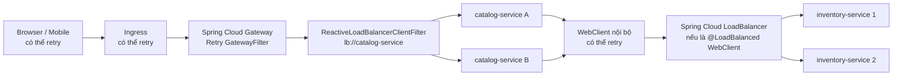
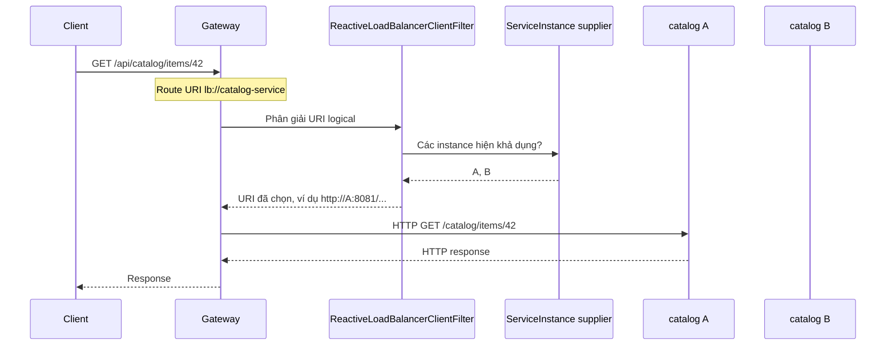
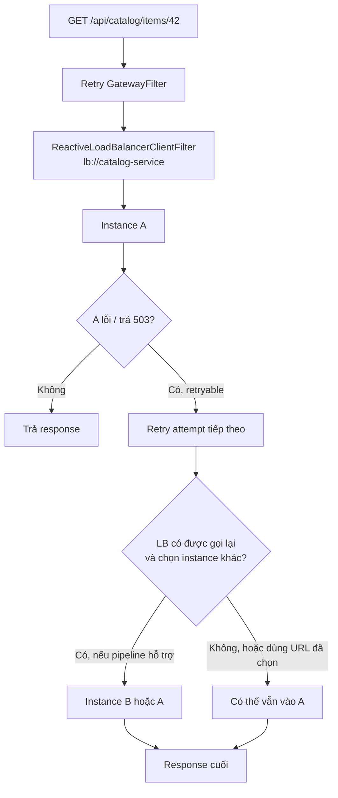
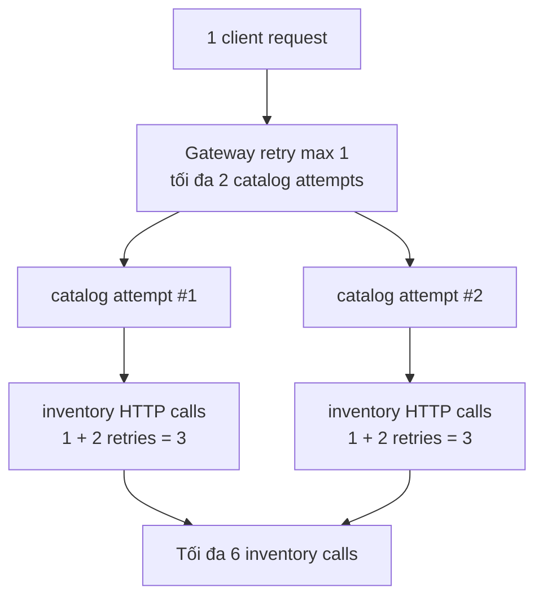
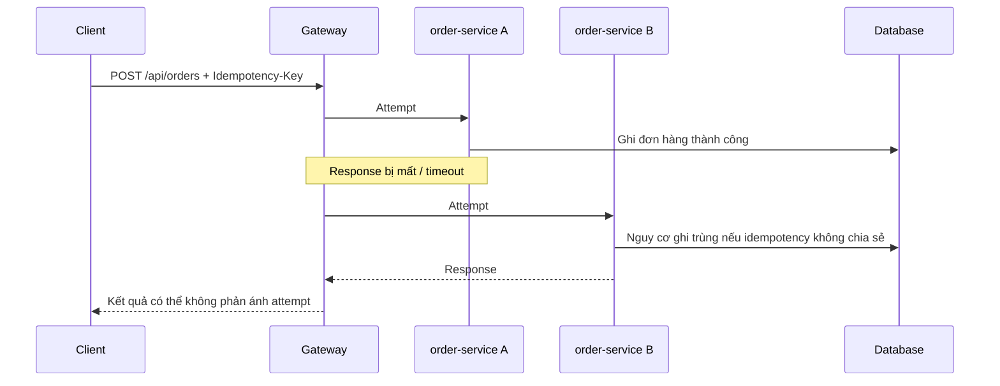

# Tương tác với load balancer và cơ chế thử lại của dịch vụ

Trong hệ thống microservices, một request đến API Gateway có thể được gửi tới một trong nhiều instance của cùng service. Nếu instance đang được chọn lỗi, ta có thể nghĩ rằng **retry sẽ tự động chuyển sang instance khỏe hơn**. Nhưng thực tế có nhiều tầng thử lại khác nhau: **`Retry` GatewayFilter**, **retry của Spring Cloud LoadBalancer dành cho HTTP clients**, **retry do chính microservice thực hiện** và thậm chí **retry từ client hoặc ingress**. Chúng có phạm vi, điều kiện và cách chọn instance khác nhau.

Ví dụ client gọi `GET /api/catalog/items/42` tới **Spring Cloud Gateway Server WebFlux**; route trỏ đến `lb://catalog-service`. Gateway có thể dùng `Retry` để gửi lại HTTP request. Bản thân `catalog-service` còn gọi `inventory-service` qua một `WebClient` có retry riêng. Nếu các tầng này cùng retry nhiều lần, một request của client có thể tạo nhiều truy cập tới hệ thống nội bộ và làm sự cố quá tải trầm trọng hơn.

Bài thuộc chương **Thử lại yêu cầu** của module **SPRING_CLOUD_GATEWAY**. Trong quá trình xây dựng API Gateway qua route predicates, filter chain, biến đổi path/header và khám phá dịch vụ, việc phối hợp retry với load balancing, xác thực, giới hạn lưu lượng, circuit breaker, timeout, TLS và observability là thiết yếu để giữ cổng vào microservices đáng tin cậy.

**Mục tiêu bài học:**

1. Phân biệt `Retry GatewayFilter`, retry của **Spring Cloud LoadBalancer** và retry ở **service/client nội bộ**.
2. Hiểu luồng `lb://serviceId`, việc chọn `ServiceInstance` và giới hạn của giả định “retry luôn sang instance khác”.
3. Thiết kế retry theo `statuses`, `methods`, `exceptions`, `backoff` và ngân sách tổng.
4. Nhận diện **retry amplification** khi có nhiều tầng retry; biết cách giảm các tầng chồng lấn.
5. Xử lý request có body, tính idempotency, lỗi `503` do thiếu instance và tình huống backend vẫn thực thi dù gateway timeout.
6. Viết cấu hình và kiểm thử có đối chiếu **số outbound attempts, instance được gọi, route ID và độ trễ**.

> **Phạm vi phiên bản:** Bài dùng **Spring Cloud Gateway Server WebFlux** và **Spring Cloud LoadBalancer**. Gateway WebFlux 5.x dùng namespace route `spring.cloud.gateway.server.webflux.routes`; Gateway WebFlux 4.3.x thường dùng `spring.cloud.gateway.routes`. Phần load-balanced `WebClient` theo Spring Cloud Commons **không tự động đồng nhất** với cơ chế proxy Reactor Netty của Gateway. Hành vi chính xác của filter ordering, cache request body, retry đối với từng instance và lớp HTTP client phụ thuộc version và cấu hình; cần xác minh bằng integration test, đặc biệt trước khi cam kết khả năng chuyển instance trong mỗi lần retry.

## 1. Bốn nơi có thể thực hiện retry

Sơ đồ sau biểu diễn một luồng đọc sản phẩm và kiểm tra tồn kho:



Không có một “retry engine duy nhất” kiểm soát toàn bộ các lớp trong sơ đồ.

| Tầng | Ai thực hiện? | Khi nào được kích hoạt? | Có kiểm soát instance? |
| --- | --- | --- | --- |
| Client ngoài | Browser, mobile SDK, HTTP client | Timeout/status mà client quyết định thử lại | Có thể đổi gateway pod qua ingress |
| Ingress / reverse proxy | NGINX, Envoy, mesh, cloud LB | Theo retry policy tại edge | Có thể đổi gateway pod, không trực tiếp chọn instance Java |
| **Gateway Retry** | `RetryGatewayFilterFactory` trong route | Khi filter chain sau nó trả status/exception phù hợp | **Không bảo đảm** tự đổi `ServiceInstance` |
| **Spring Cloud LoadBalancer retry** | Load-balanced `WebClient`/`RestTemplate` theo tích hợp Commons | Khi HTTP client được cấu hình dùng retry tương ứng | Có tham số thử lại **same/next ServiceInstance** trong phạm vi tích hợp hỗ trợ |
| **Service-level retry** | `retryWhen`, Resilience4j Retry, SDK, database client | Do code và policy trong service | Tùy HTTP client và discovery của chính service |

**Điểm cốt lõi:** Có route `lb://catalog-service` **không có nghĩa** các property `spring.cloud.loadbalancer.retry.*` tự thay thế hoặc điều khiển đầy đủ `Retry` của Gateway. Đây là hai lớp với mục đích khác nhau.

## 2. lb:// làm gì khi không có retry?

Khi route có `uri: lb://catalog-service`, Gateway WebFlux dùng `ReactiveLoadBalancerClientFilter` và Spring Cloud `ReactorLoadBalancer` để tìm một instance cho service ID `catalog-service`. Nó thay URI logical thành host/port thực tế trước khi HTTP routing.



Trong Gateway WebFlux, `ReactiveLoadBalancerClientFilter` đọc `ServerWebExchangeUtils.GATEWAY_REQUEST_URL_ATTR`. Khi URI có scheme `lb`, nó chọn instance rồi cập nhật lại thuộc tính này thành URI `http://` hoặc `https://` phù hợp. `NettyRoutingFilter` tiếp tục gửi HTTP request tới URI đã chọn.

### Phân biệt route match và chọn instance

| Bước | Câu hỏi | Lớp liên quan |
| --- | --- | --- |
| Route selection | Request `/api/catalog/**` khớp route nào? | `RoutePredicateHandlerMapping` |
| Path transform | Backend nhận `/catalog/items/42` hay path gốc? | `StripPrefix` / `RewritePath` |
| Service resolution | `catalog-service` có những instance nào? | Discovery / `ServiceInstanceListSupplier` |
| Load balancing | Chọn A hay B cho lần gửi này? | `ReactorLoadBalancer` |
| Outbound transport | Mở TCP/TLS connection và chờ HTTP response | Reactor Netty HTTP client |
| Retry decision | Có tiếp tục một attempt nữa không? | Retry policy ở tầng được bật |

Nếu **không có instance**, Gateway thường trả `503 Service Unavailable` theo mặc định ở bước load balancing; có cấu hình cho phép sử dụng `404`. Nếu **có instance nhưng port từ chối kết nối**, đây là lỗi transport khác. Nếu backend trả **HTTP 503**, tức đã liên lạc được với một upstream có thể phản hồi; ba tình huống này không hoàn toàn tương đương.

### TLS không phải chỉ một kết nối

Client truy cập `https://api.example.com` không đảm bảo Gateway dùng HTTPS tới backend. Scheme outbound `lb://` có thể chịu tác động từ `ServiceInstance.isSecure` và cấu hình route/filter. Lỗi TLS handshake/certificate có thể làm request thất bại dù instance được tìm thấy; **retry không phải cách sửa sai truststore hay hostname certificate**.

## 3. Retry GatewayFilter: chính sách thử lại trên route

Gateway WebFlux có **`Retry` GatewayFilter Factory**. Các tham số chính:

| Tham số | Ý nghĩa | Ghi chú |
| --- | --- | --- |
| `retries` | **Số lần thử lại bổ sung** | `1` nghĩa là có thể có **2 attempts**, không phải 1 |
| `statuses` | HTTP status cụ thể được phép retry | `BAD_GATEWAY`, `SERVICE_UNAVAILABLE`, v.v. |
| `series` | Cả một nhóm status | `SERVER_ERROR` / `5XX` theo enum được hỗ trợ |
| `methods` | HTTP methods được retry | Mặc định thông thường là `GET` |
| `exceptions` | Loại exception kích hoạt retry | Ví dụ transport/timeouts tùy version |
| `backoff` | Khoảng chờ tăng dần giữa attempts | `firstBackoff`, `maxBackoff`, `factor` |
| `jitter` | Thêm dao động vào backoff | Giảm request lặp đồng bộ |
| `timeout` | Giới hạn liên quan đến hoạt động Retry theo implementation | Không được xem là thay thế cho HTTP client timeout hoặc deadline toàn hệ thống |

Các mặc định được tài liệu Gateway 5.x mô tả khi bật `Retry` gồm **3 retries**, nhóm **5xx**, method **GET**, exceptions `IOException`/`TimeoutException`, backoff và jitter tắt, retry timeout không giới hạn. Để có policy kiểm soát được, **khai báo tường minh các điều kiện quan trọng** thay vì dựa hoàn toàn vào defaults.

### Một attempt và một retry khác nhau

```text
Client request #1
   ├── outbound attempt #1  ← luôn có nếu request được proxy
   └── outbound attempt #2  ← nếu retries=1 và điều kiện retry khớp

Tổng attempts tối đa trong một lượt retry:
   1 + retries
```

Nếu `retries: 2`, route có thể gửi tối đa **3 attempts** trong điều kiện lý tưởng, trừ khi client hủy, breaker OPEN, response commit hoặc lỗi không retryable xảy ra.

### Retry áp dụng cho những filter sau nó

Tài liệu chính thức nói rõ: `Retry` **thử lại tất cả filter nằm sau nó** trong chuỗi. Vì thế:

- Một custom GatewayFilter phía sau có side effect (ghi audit, tính phí, gọi API) **có thể chạy nhiều lần**.
- Một filter phía trước `Retry` thường chỉ tham gia một lượt bao ngoài, tùy logic/reactive signals.
- Thứ tự giữa `Retry` và `CircuitBreaker` quyết định breaker đếm **mỗi attempt** hay **kết quả cuối của logical request**.
- GlobalFilter và GatewayFilter được kết hợp rồi sắp theo `Ordered`; không chỉ nhìn thứ tự dòng YAML mà bỏ qua order của custom/global filters.

Đừng tự thêm custom filter tăng đếm giao dịch hoặc tạo hóa đơn phía sau Retry. Những hành động có side effect phải có ranh giới idempotency.

## 4. Gateway Retry có tự chuyển sang ServiceInstance khác không?

**Không nên đưa ra bảo đảm đó.** Gateway `RetryGatewayFilterFactory` và lựa chọn instance trong `ReactiveLoadBalancerClientFilter` là hai phần khác nhau của filter chain.



Lý do cần thận trọng:

1. Khi chọn instance, Gateway **ghi lại URI đã phân giải** trên `ServerWebExchange`. Một retry có thể resubscribe filter chain nhưng không nhất thiết reset mọi exchange attribute về `lb://` theo cùng cách ở mọi version.
2. Gateway `Retry` không được mô tả trong tài liệu là một API “retry next service instance” có bảo đảm.
3. Danh sách instance mà LoadBalancer nhìn thấy có thể bị **cache/stale**: instance A đã down nhưng DiscoveryClient chưa loại khỏi danh sách.
4. Ngay cả khi chọn lại, thuật toán round-robin/weighted/zone/sticky session có thể chọn **chính instance A**.
5. Khi chỉ còn một instance, chắc chắn không có “instance mới” để failover.

Một vấn đề đã từng được ghi nhận với Gateway WebFlux: **RetryGatewayFilterFactory retry vào cùng instance khi dùng `lb://` và gặp `UnknownHostException`**. Điều này là bằng chứng cần **kiểm thử theo version**, không phải khẳng định phiên bản nào cũng có bug đó.

> **Quy tắc triển khai:** Nếu yêu cầu nghiệp vụ thực sự là **“lỗi instance A thì attempt tiếp theo phải xét instance B”**, cần thiết kế retry có nhận biết `ServiceInstance` trong lớp HTTP client thích hợp, kiểm thử provider/danh sách instance và xác minh không có quay lại A ngoài dự kiến. Không chỉ đặt `Retry=2` với URI `lb://` rồi coi failover là hoàn thành.

## 5. Spring Cloud LoadBalancer retry: same instance và next instance

Spring Cloud Commons có cơ chế retry cho những **load-balanced HTTP clients** được tích hợp, đặc biệt `@LoadBalanced WebClient` reactive hoặc `RestTemplate`. Tài liệu nêu các property:

| Property dưới `spring.cloud.loadbalancer.retry` | Vai trò |
| --- | --- |
| `enabled` | Bật/tắt cơ chế retry của LoadBalancer theo tích hợp được hỗ trợ |
| `max-retries-on-same-service-instance` | Số lần thử thêm trên cùng `ServiceInstance` |
| `max-retries-on-next-service-instance` | Số lần thử lại với việc chọn `ServiceInstance` mới |
| `retryable-status-codes` | Những HTTP status cho phép retry ở lớp này |
| `retryable-exceptions` | Những exception cho phép retry |
| `retry-on-all-exceptions` | Cho phép retry mọi exception nếu có chủ đích |
| `retry-on-all-operations` | Mở rộng retry ngoài những HTTP methods mặc định được phép |
| `avoid-previous-instance` | Khi supplier hỗ trợ, ưu tiên tránh instance đã chọn trước |
| `backoff.enabled` | Bật/tắt backoff của reactive retry |
| `backoff.min-backoff` / `max-backoff` / `jitter` | Khoảng chờ và jitter cho reactive retry |

Ví dụ cấu hình **dành cho load-balanced HTTP client có retry tích hợp**, không phải lời gọi trực tiếp đến `RetryGatewayFilterFactory`:

```yaml
spring:
  cloud:
    loadbalancer:
      retry:
        enabled: true
        max-retries-on-same-service-instance: 0
        max-retries-on-next-service-instance: 1
        retryable-status-codes:
          - 503
        retry-on-all-operations: false
        avoid-previous-instance: true
        backoff:
          enabled: true
          min-backoff: 100ms
          max-backoff: 300ms
          jitter: 0.3
```

Theo ý nghĩa policy: không thử thêm trên cùng instance, cho phép một lần theo hướng chọn instance tiếp theo, xem `503` là retryable và giới hạn vào những operations mà integration cho phép theo mặc định. **Đây không phải cam kết route Gateway `lb://` sẽ dùng chính sách trên.**

### RetryAwareServiceInstanceListSupplier

Spring Cloud LoadBalancer có `RetryAwareServiceInstanceListSupplier`, có thể ưu tiên loại bỏ instance từng được chọn ở attempt trước **nếu danh sách có lựa chọn khác**. Property `avoid-previous-instance` liên quan tới hành vi này.

Nhưng có các điều kiện:

- HTTP client phải đang dùng **cơ chế LB retry có cung cấp retry context**.
- Cơ chế supplier được tạo và hoạt động theo integration/version hỗ trợ.
- Danh sách service instances phải có ít nhất một instance thay thế phù hợp với zone/health/weight.
- Một lần chọn khác không chứng minh request sẽ thành công; instance B cũng có thể lỗi.

Nếu chỉ đặt `avoid-previous-instance: true` nhưng request thực tế không đi qua LB retry context, không có cơ sở khẳng định rằng Gateway Retry đã chuyển instance.

### Kiểm tra khả năng tùy chỉnh theo service

Spring Cloud Commons còn cho phép nhiều property của LoadBalancer theo client, dưới tiền tố `spring.cloud.loadbalancer.clients.<clientId>.*`; một số công tắc như `spring.cloud.loadbalancer.retry.enabled` là global. Khi cần hạn mức retry riêng cho từng service, kiểm tra cơ chế merge và ngoại lệ property theo đúng version.

**Không thiết kế “bật toàn bộ retry của LoadBalancer trên Gateway”** rồi giả định không ảnh hưởng WebClient beans khác trong cùng tiến trình.

## 6. Retry của Gateway, retry của LB và retry của service không dùng chung bộ đếm

So sánh ba policy:

| Câu hỏi | Gateway `Retry` | LoadBalancer retry | Retry trong service |
| --- | --- | --- | --- |
| Chạy ở đâu? | Gateway route filter chain | Load-balanced HTTP client có integration tương ứng | Code/SDK ở service |
| Thường nhận diện ai? | Route ID, status, method, exception | Client/service ID, selected instance, retry context | Endpoint phụ thuộc, exception và contract |
| Biết instance vừa lỗi? | Không phải contract chính | Có thể biết previous ServiceInstance trong retry context | Tùy client và tracing |
| Chọn next instance? | Không được bảo đảm | Có tham số same/next nếu client hỗ trợ | Có thể qua load-balanced WebClient hoặc client custom |
| Thời gian chờ | Gateway HTTP client + retry backoff/timeout | Client timeout + LB retry backoff | Client của service + retry backoff |
| Rủi ro | Gửi lại toàn bộ downstream filter, cache request body | Retry network / quay vòng instance, tăng request count | Khuếch đại calls đến dependency tiếp theo |
| Observability | Gateway route/status/attempt | LB client/instance/attempt | Service span, downstream HTTP call count |

**Một request có thể đi qua cả ba loại**, nhưng không có tác nhân nào tự động thấy hết attempts của các tầng còn lại. Gateway có thể ghi nhận **một thành công cuối cùng** trong khi inventory-service đã phải nhận nhiều calls.

## 7. Cơ chế retry ở service và hiệu ứng nhân số requests

Giả sử:

- Client gửi **1 logical request**.
- Gateway cấu hình `retries=1`, nên có thể gửi tối đa **2 attempts** tới `catalog-service`.
- Mỗi lần catalog xử lý request, nó gọi `inventory-service` và có `retryWhen` cho thêm **2 retries**, tổng tối đa **3 attempts**.
- Nếu các attempt ở inventory đều thất bại theo điều kiện retry, số calls tới inventory có thể xấp xỉ **2 × 3 = 6** cho một request ban đầu.



Công thức ước lượng **trần số attempts trên một chuỗi có thể tái thực thi đầy đủ**:

```text
A_gateway = 1 + gatewayRetries
A_service = 1 + serviceRetries

maxInventoryCalls ≈ A_gateway * A_service
```

Nếu HTTP client bên trong service **còn** có LB retry (ví dụ một retry thêm cùng/khác instance), số attempts có thể tiếp tục tăng, **nếu** mỗi lớp thật sự chạy cho từng attempt của lớp ngoài:

```text
maxInventoryCalls ≈ A_gateway * A_service * A_lb
```

Công thức là **giới hạn lý tưởng hóa để thiết kế ngân sách**, không phải cam kết số calls sẽ xảy ra. Một attempt có thể bị chặn bởi breaker, timeout, auth, lack of instances, response commit hoặc cancellation; một số retry library cũng chỉ retry exception chứ không retry status theo mặc định.

### Nếu client hoặc ingress cũng retry?

Nếu mobile client gửi lại **2 lần** tổng cộng và mỗi lần đi qua toàn bộ chuỗi trên, backend có thể nhận nhiều calls hơn nữa. Điều quan trọng là đặt một **retry budget xuyên hệ thống**, không coi retry ở mỗi service là một lựa chọn độc lập vô hại.

**Khuyến nghị:** Chọn tầng có nhiều ngữ cảnh nhất để retry cho từng loại lỗi. Không bật retry cùng một loại sự cố ở gateway, ingress, service và SDK nếu không có lý do rõ ràng.

## 8. Phân biệt lỗi nào nên thử lại

Không phải lỗi nào cũng được sửa bằng một attempt nữa.

| Sự kiện | Có nên retry ở Gateway? | Có nên chuyển sang instance khác? |
| --- | --- | --- |
| TCP connect timeout thoáng qua | Có thể, với GET/HEAD và budget nhỏ | Có ích nếu A thật sự lỗi, nhưng cần cơ chế chọn lại phù hợp |
| Kết nối bị từ chối | Có điều kiện | Có thể, nếu registry có instance khác |
| Backend trả `502`/`503` tạm thời | Có thể với backoff, method an toàn | Có thể; trước hết cần xác định 503 là do service nào |
| Backend trả `504` từ proxy phía sau | Có điều kiện | Có thể nếu proxy/instance khác khỏe |
| Không có instance cho `lb://serviceId` | Retry ngay thường ít ích nếu registry chưa thay đổi | Không có “next instance” khi danh sách rỗng |
| DNS không phân giải được host instance | Retry cùng host thường không ích | Chỉ có ích khi thực sự chọn host khác còn hoạt động |
| TLS certificate không tin cậy | **Không** retry để chữa cấu hình | Không nếu mọi instance dùng cùng cert/trust lỗi |
| `400 Bad Request` | Không | Không |
| `401 Unauthorized` / `403 Forbidden` | Không | Không |
| `404 Not Found` | Thông thường không | Thông thường không |
| `429 Too Many Requests` | Client nên dùng `Retry-After`, không retry ngay | Chuyển instance để né quota có thể phá chính sách |
| `500` do bug deterministic | Thông thường retry không giúp | Đổi instance có thể vẫn lỗi nếu code giống nhau |
| Timeout với `POST /payments` | Không mặc định, dễ trùng side effect | Chuyển instance cũng không giải quyết idempotency |

**Phân biệt nguồn của 503:**

1. Gateway `ReactiveLoadBalancerClientFilter` không tìm được instance.
2. Gateway chọn A nhưng A trả 503 vì overload/maintenance.
3. Ingress/proxy trung gian trả 503.
4. Circuit breaker/fallback trả 503.
5. Backend service gọi dependency khác lỗi rồi ánh xạ 503.

Đừng chỉ nhìn status cuối để kết luận “instance A lỗi nên retry sang B”.

## 9. Các phương thức HTTP, idempotency và request body

### GET/HEAD

`GET` và `HEAD` được thiết kế **safe** theo HTTP semantics (trừ các hệ thống triển khai sai contract). Retry thường ít rủi ro side effect hơn. Tuy nhiên, một GET vẫn có thể tốn tài nguyên lớn và tạo burst load; đặt retry limit/budget rõ.

### PUT/DELETE

`PUT` và `DELETE` được mô tả là **idempotent** ở ngữ nghĩa HTTP khi triển khai đúng: lặp lại cùng request có ý nghĩa trạng thái mong muốn như nhau. Dù vậy, audit events, email hoặc queue messages trong implementation sai có thể vẫn bị nhân bản. Không nên bật retry PUT/DELETE rộng mà chưa xác minh contract.

### POST/PATCH

`POST` và `PATCH` không mặc nhiên idempotent. Ví dụ:



Ngay cả khi retry sang **instance B**, transaction từ instance A có thể **đã commit**. Vì vậy “retry trên next instance” còn nguy hiểm hơn nếu idempotency state chỉ giữ cục bộ trên A.

Nếu buộc retry request ghi:

- Client gửi một **Idempotency-Key** ổn định qua tất cả attempts.
- Backend ghi nhận key và kết quả theo cách **atomic**, trong một kho chia sẻ giữa instances.
- Key được giới hạn theo principal/tenant, endpoint và request fingerprint để tránh trùng key cho payload khác.
- Khi backend không chắc request trước hoàn thành hay chưa, cung cấp endpoint kiểm tra trạng thái hoặc response “unknown/pending” thích hợp.
- Không dùng fallback báo “chắc chắn thất bại” chỉ vì gateway không nhận phản hồi trước timeout.

### Retry request có body và rủi ro bộ nhớ

Tài liệu Gateway WebFlux lưu ý: khi sử dụng `Retry` với HTTP method mang body, request body được **cache**, liên quan `ServerWebExchangeUtils.CACHED_REQUEST_BODY_ATTR` và `DataBuffer`. Như vậy:

- Body lớn có thể tăng memory consumption cho gateway.
- Các filter phía sau Retry có thể đọc/ghi body nhiều lần theo cách phải được kiểm chứng.
- Upload file/multipart và các luồng streaming lớn **không phù hợp** để retry mù quáng.
- Cần giới hạn request size, concurrency, memory và kiểm tra giải phóng DataBuffer.
- Khi retry, phải giữ `Content-Type`, framing và body bytes hợp lệ; không giữ `Content-Length` cũ nếu body đã đổi.

**Retry request body không làm thao tác POST tự trở nên idempotent.**

## 10. Thiết kế một chính sách Gateway Retry không nhân thêm quá nhiều attempts

Với Gateway public, một chính sách khởi điểm an toàn cho route đọc dữ liệu có thể là:

- Chỉ áp dụng `GET`.
- Chỉ retry một số lỗi transient (ví dụ 502/503/504 hoặc exceptions được kiểm soát).
- Một lần retry hoặc rất ít retries.
- Backoff ngắn với jitter; không retry đồng loạt ngay lập tức.
- Có HTTP connect/response timeout, TimeLimiter hoặc deadline tổng hợp lý.
- Có circuit breaker và rate limiting để không dồn tải vào backend đang suy yếu.
- Đo **số attempts** và upstream instance thực tế.
- Tránh retry cùng lỗi ở service nội bộ nếu không có nhu cầu.

### Ví dụ Gateway WebFlux 5.x

Giả sử Gateway chạy ở `localhost:8080`; catalog-service có ít nhất một instance được đăng ký. Client dùng `GET /api/catalog/items/42`; backend nhận `GET /catalog/items/42`.

```yaml
spring:
  cloud:
    gateway:
      server:
        webflux:
          httpclient:
            connect-timeout: 1000  # ms
            response-timeout: 5s    # Duration

          routes:
            - id: catalog-read
              uri: lb://catalog-service
              predicates:
                - Path=/api/catalog/**
                - Method=GET
              metadata:
                connect-timeout: 400     # ms
                response-timeout: 1200   # ms
              filters:
                - StripPrefix=1
                - name: Retry
                  args:
                    retries: 1
                    methods:
                      - GET
                    statuses:
                      - BAD_GATEWAY
                      - SERVICE_UNAVAILABLE
                      - GATEWAY_TIMEOUT
                    series: []
                    backoff:
                      firstBackoff: 100ms
                      maxBackoff: 300ms
                      factor: 2
                      basedOnPreviousValue: false
                    jitter:
                      randomFactor: 0.3

            - id: order-write-no-retry
              uri: lb://order-service
              predicates:
                - Path=/api/orders/**
                - Method=POST
              filters:
                - StripPrefix=1
```

**Ý nghĩa:**

1. `catalog-read` có một lần retry thêm, tức có thể tối đa **2 attempts Gateway** với lỗi phù hợp.
2. `series: []` thể hiện chủ đích không mở rộng retry theo toàn bộ nhóm 5xx; cần xác minh việc bind danh sách rỗng của version thực tế. Tham số `exceptions` có chính sách riêng và có thể vẫn cho retry lỗi I/O/timeout.
3. `response-timeout: 1200` trong route metadata là **1200 mili giây**, không phải 1200 giây.
4. `uri: lb://catalog-service` chọn instance theo tích hợp LoadBalancer; **không đảm bảo** attempt thứ hai sẽ dùng một instance khác.
5. Route `order-write-no-retry` chỉ minh họa tách GET và POST: **không có Retry filter** ở route ghi, tránh vô tình retry lệnh tạo đơn.
6. `StripPrefix=1` bỏ segment `api`; backend nhận `/catalog/items/42` hoặc `/orders/**`.

**Dependency:** Gateway Server WebFlux starter, Spring Cloud LoadBalancer và một nguồn service instances (DiscoveryClient hoặc SimpleDiscoveryClient). Có thể cần Eureka/Consul/Kubernetes discovery starter đúng môi trường. Không phải thêm starter Resilience4j chỉ để dùng `Retry GatewayFilter Factory`; circuit breaker là tính năng riêng.

### Vì sao vẫn có thể retry khi gặp exception dù series rỗng?

`statuses`/`series` quyết định retry theo **HTTP response status**; `exceptions` là điều kiện khác. Nếu muốn thu hẹp retry transport, cấu hình `exceptions` và kiểm thử theo đúng factory/version. Đừng tưởng `series: []` tự làm cho Retry chỉ retry đúng 3 status trên trong mọi tình huống.

### WebFlux 4.3.x

Đổi prefix route/HTTP client sang namespace tương ứng:

```yaml
spring:
  cloud:
    gateway:
      httpclient:
        connect-timeout: 1000
        response-timeout: 5s
      routes:
        - id: catalog-read
          uri: lb://catalog-service
          predicates:
            - Path=/api/catalog/**
            - Method=GET
          metadata:
            connect-timeout: 400
            response-timeout: 1200
          filters:
            - StripPrefix=1
            - name: Retry
              args:
                retries: 1
                methods: GET
                statuses: BAD_GATEWAY,SERVICE_UNAVAILABLE,GATEWAY_TIMEOUT
```

Đây là **mẫu rút gọn** cho 4.3.x, không tự suy diễn rằng tất cả defaults của 5.x và 4.3.x giống hoàn toàn. Đặc biệt, version khác nhau có thể có khả năng retry/backoff/jitter và filter ordering khác; hãy đo thực tế.

## 11. Chủ động quản lý LoadBalancer retry trong ứng dụng

Spring Cloud LoadBalancer có retry cho một số HTTP client integrations, nhưng nếu ứng dụng vừa dùng Gateway Retry vừa có `@LoadBalanced WebClient` gọi dependency nội bộ, phải đặt policy minh bạch.

Ví dụ **tắt LB retry toàn cục** trong một ứng dụng mà bạn muốn giữ quyền quyết định retry ở lớp khác:

```yaml
spring:
  cloud:
    loadbalancer:
      retry:
        enabled: false
```

**Ranh giới:** Property này quản lý **LoadBalancer retry**, không phải công tắc tắt `Retry GatewayFilter Factory` trên một route. Ngược lại, bật `enabled: true` không có nghĩa Gateway Retry sẽ dùng `max-retries-on-next-service-instance`.

Nếu cần LB retry cho một `@LoadBalanced WebClient` trong backend, có thể chọn bật rõ và đặt số lần thử thấp theo docs. Nhưng đừng đặt cùng policy ở mọi tầng:

```yaml
spring:
  cloud:
    loadbalancer:
      retry:
        enabled: true
        max-retries-on-same-service-instance: 0
        max-retries-on-next-service-instance: 1
        retry-on-all-operations: false
```

Đây là ví dụ **cho ứng dụng có load-balanced HTTP client retry tương ứng**, không phải đoạn config cần dán vào Gateway chỉ để “bắt buộc attempt #2 sang instance khác”.

### Đặt per-client policy

Spring Cloud LoadBalancer hỗ trợ phần lớn property dưới `spring.cloud.loadbalancer.clients.<clientId>.*`. Những công tắc global có ngoại lệ; ví dụ `retry.enabled` có ràng buộc toàn cục/per-client khác nhau tùy version.

Khi có nhiều downstream services với đặc tính khác nhau, nên kiểm tra docs và cấu hình binding thực tế thay vì để một default retry áp dụng đồng loạt cho payment, inventory và search. Với API nhạy cảm, chọn **retry owner** rõ ràng: Gateway, BFF hoặc service cụ thể.

## 12. Service-level retry qua WebClient: một ví dụ an toàn hơn

Trong `catalog-service`, có thể cần gọi `inventory-service` để đọc số lượng tồn kho. Nếu business contract cho phép và request là GET, service có thể retry khi downstream trả HTTP `503`.

Ví dụ service-level code minh họa:

```java
import java.time.Duration;

import org.springframework.web.reactive.function.client.WebClient;
import org.springframework.web.reactive.function.client.WebClientResponseException;

import reactor.core.publisher.Mono;
import reactor.util.retry.Retry;

public class InventoryClient {

    private final WebClient client;

    public InventoryClient(WebClient.Builder builder) {
        this.client = builder
            .baseUrl("http://inventory-service")
            .build();
    }

    public Mono<String> fetchInventory(String sku) {
        return client.get()
            .uri("/inventory/{sku}", sku)
            .retrieve()
            .bodyToMono(String.class)
            .retryWhen(
                Retry.backoff(1, Duration.ofMillis(100))
                    .maxBackoff(Duration.ofMillis(300))
                    .jitter(0.3)
                    .filter(ex ->
                        ex instanceof WebClientResponseException err
                        && err.getStatusCode().value() == 503));
    }
}
```

**Lưu ý quan trọng:** Để URL logical `http://inventory-service` được phân giải qua Spring Cloud LoadBalancer, `WebClient.Builder` truyền vào phải là **load-balanced builder** được cấu hình bởi Spring Cloud, chẳng hạn bean `@LoadBalanced WebClient.Builder`. Nếu dùng builder bình thường, hostname `inventory-service` cần phân giải bằng DNS/network, và không có bảo đảm nào về LoadBalancer. Ví dụ trên là mảnh client class, cần tích hợp bean và dependency phù hợp.

Với `Retry.backoff(1, ...)`, service cho phép **1 lần retry sau attempt đầu**. Nó chỉ retry `WebClientResponseException` với HTTP status 503 trong minh họa; các loại connection errors khác phải có policy riêng, không nên mở rộng sang mọi exception vô điều kiện.

**Nếu LB retry cũng đang bật**, service có thể tạo thêm nhiều requests ngoài một lần `retryWhen` này. Đây là ví dụ tại sao phải kiểm tra cả **Reactor operator retry** lẫn **Spring Cloud LoadBalancer retry** bên trong cùng HTTP client.

### Không dùng block() để thử lại

Trong WebFlux, tránh:

```java
// Anti-pattern trong reactive request path
for (int i = 0; i < 3; i++) {
    String body = client.get()
        .uri("/inventory/42")
        .retrieve()
        .bodyToMono(String.class)
        .block(); // Giữ thread, làm nghẽn reactive pipeline
}
```

Đây là đoạn **anti-pattern** để minh họa, không phải code nên chạy. Hãy để `Mono`/`Flux` và các operators quản lý retry/cancellation; không gọi `subscribe()` thủ công trong service request handler để che lỗi.

## 13. Đặt retry budget và timeout xuyên tầng

Một request có thể có nhiều đồng hồ:

- Timeout phía client/mobile.
- Timeout phía ingress/reverse proxy.
- TCP connect timeout và HTTP response timeout của Gateway.
- Retry backoff của Gateway.
- Resilience4j TimeLimiter (nếu có CircuitBreaker).
- Connection pool acquire, DNS, TLS handshake.
- Timeout và retry của `catalog-service` khi gọi `inventory-service`.

Ví dụ:

| Cơ chế | Giá trị minh họa |
| --- | --- |
| Client deadline | 4s |
| Ingress timeout | 3,5s |
| Gateway breaker TimeLimiter trên logical call | 3s |
| Gateway HTTP response timeout per attempt | 1,2s |
| Gateway retry thêm | 1 lần |
| Backoff Gateway | Khoảng 100ms |
| Catalog → Inventory HTTP timeout | 400ms per attempt |
| Inventory service retry thêm | 1 lần, backoff 100ms |

Phân tích khái niệm:

```text
Gateway có thể thực hiện:
  attempt #1: chờ response tới 1.2s
  backoff: ~0.1s
  attempt #2: chờ response tới 1.2s

Thời gian chỉ cho các phần đó ≈ 2.5s

Chưa tính:
  TCP/TLS setup, connection pool acquire,
  load balancer lookup, auth/filter processing,
  gateway response write, ingress và client network.

Trong mỗi Gateway attempt:
  catalog-service có thể còn đang thực hiện 2 inventory attempts.
```

**Tuy nhiên:** Nếu catalog thực hiện các retries nội bộ trong 1,2 giây, Gateway có thể timeout trước khi catalog trả kết quả; catalog **có thể vẫn đang xử lý**. Nếu Gateway retry lần hai, hai requests catalog có thể cùng tồn tại, dẫn tới số inventory requests thực tế cao hơn số “attempt nối tiếp” ta tưởng.

### Quy tắc lập ngân sách

1. Xác định **deadline end-to-end** mà client thực sự chấp nhận.
2. Phân bổ thời gian cho Gateway và từng hop phụ thuộc, không cho mọi hop cùng lấy toàn bộ budget.
3. Retry chỉ khi còn đủ thời gian để một attempt mới có cơ hội thành công.
4. Chọn backoff + jitter để tránh đồng bộ nhiều clients.
5. Giới hạn **tổng số attempts** và **số attempts trên một request**; theo dõi cả hai.
6. Với request ghi, idempotency là điều kiện trước retry, không phải phần bổ sung sau khi xảy ra giao dịch trùng.
7. Nếu CircuitBreaker OPEN, không cấu hình Retry cứ liên tục cố gọi breaker.
8. Tôn trọng cancellation/client disconnect theo cơ chế reactive, nhưng không giả định backend tự rollback side effects.

**Không nhân toàn bộ timeout một cách máy móc**: một connection có thể tái sử dụng, một attempt có thể thất bại ngay, hoặc TimeLimiter có thể cắt toàn bộ chuỗi trước. Hãy đo trace thực tế.

## 14. Kết hợp CircuitBreaker và Retry để tránh khuếch đại lỗi

`CircuitBreaker` có thể ghi nhận failure rate/slow calls và từ chối request mới khi backend gặp sự cố kéo dài. Khi kết hợp `Retry`, thứ tự bao bọc có ảnh hưởng.

### CircuitBreaker bao ngoài Retry

```yaml
filters:
  - name: CircuitBreaker
    args:
      name: catalogBreaker
      statusCodes:
        - SERVICE_UNAVAILABLE
      fallbackUri: forward:/fallback/catalog
  - name: Retry
    args:
      retries: 1
      statuses:
        - SERVICE_UNAVAILABLE
      methods:
        - GET
```

Breaker thường nhìn **kết quả cuối của logical request sau retry**, nếu filter ordering đúng như thiết kế. Một attempt lỗi rồi attempt sau thành công có thể khiến breaker ghi nhận một logical call thành công. TimeLimiter của breaker có thể bao quanh toàn bộ retry sequence.

### Retry bao ngoài CircuitBreaker

```yaml
filters:
  - name: Retry
    args:
      retries: 1
      statuses:
        - SERVICE_UNAVAILABLE
      methods:
        - GET
  - name: CircuitBreaker
    args:
      name: catalogBreaker
      statusCodes:
        - SERVICE_UNAVAILABLE
```

Khi breaker nằm bên trong Retry, mỗi attempt có thể được breaker ghi nhận. Nếu fallback trả response thành công, Retry phía ngoài có thể không thử lại vì không còn lỗi phù hợp.

**Không có thứ tự đúng cho mọi API**. Hãy chọn phạm vi đo lỗi mong muốn rồi test. Đặc biệt tránh để Retry lặp **fallback**, lặp call khi breaker đã OPEN hoặc che đi việc upstream có nhiều 503.

### 429, 401, 403 không phải tín hiệu lỗi sức khỏe backend

`RequestRateLimiter` thường trả `429` ngay tại Gateway. Spring Security có thể trả `401/403` trước routing. Không nên retry các response này để né quota, authentication hoặc authorization; cũng không nên tính chúng là failure của breaker bảo vệ backend.

## 15. Quan sát một request đi qua những instance nào

**Không thể chứng minh failover từ HTTP `200` cuối cùng.** Cần biết các outbound attempts đã xảy ra và backend instance nào nhận request.

Các dữ liệu nên thu thập:

| Tín hiệu | Nguồn | Dùng để phân biệt |
| --- | --- | --- |
| Request ID/trace ID ở Gateway | Tracing filter / Micrometer | Một logical request bên ngoài |
| Route ID | Gateway | `catalog-read` có match thật không? |
| Attempt index | Gateway instrumentation hoặc test stub | Bao nhiêu outbound attempts? |
| Service ID | LoadBalancer / route metadata | `catalog-service` hay service khác? |
| Selected instance ID, host/port | LB metrics/log/tracing đã chuẩn hóa | Attempt #1 và #2 có đổi instance không? |
| HTTP status của từng attempt | Netty HTTP client / backend test | `503` từ backend nào? |
| Network/timeout exception | Gateway/client logs | Connect error, timeout, TLS hay DNS |
| Attempts catalog → inventory | Service tracing | Có amplification ở service không? |
| Breaker state và retries | Resilience4j/Micrometer | OPEN/HALF_OPEN và attempts bị chặn |
| Redis rate limiter state / 429 | Gateway/Redis metrics | Lỗi vì quota hay upstream? |

**Không đưa raw Authorization/token, cookie, user ID tùy ý hay địa chỉ instance nhạy cảm vào public response**. Với staging, có thể dùng header `X-Test-Instance`, nhưng production thường chỉ ghi marker an toàn vào trace/log.

### Quan sát route và filter order

Actuator Gateway có thể hiển thị route definitions, filter và global filter order. Bảo vệ endpoint ở mạng quản trị và dùng quyền read-only khi chỉ cần quan sát.

```bash
# Chỉ dành cho môi trường quản trị đã bật/bảo vệ Actuator
curl -s http://localhost:8080/actuator/gateway/routes
curl -s http://localhost:8080/actuator/gateway/globalfilters
```

Dùng response và logs để kiểm tra `Retry`, `ReactiveLoadBalancerClientFilter`, `NettyRoutingFilter` và custom filters thực tế. Đừng dùng số order hard-code từ một tài liệu cũ khi version hiện tại khác.

## 16. Thực hành: hai instances catalog, một instance lỗi

### 16.1. Mục tiêu

Chạy hai bản `catalog-service`:

- **Instance A** tại `localhost:8081`: cố ý trả HTTP `503`.
- **Instance B** tại `localhost:8082`: trả HTTP `200`.
- Gateway tại `localhost:8080`: route `lb://catalog-service` với `Retry` như mục 10.

Mục tiêu là **xác minh thực tế**: attempt nào tới A/B, có retry và có **chuyển instance** hay không. Đây là điều quan trọng hơn việc chỉ thấy client cuối cùng nhận 200 hay 503.

### 16.2. Dùng SimpleDiscoveryClient để test local

Trong Gateway test, không cần khởi động Eureka/Consul nếu đã có SimpleDiscoveryClient và LoadBalancer phù hợp. Có thể khai báo hai instance qua properties:

```properties
spring.cloud.discovery.client.simple.instances.catalog-service[0].uri=http://localhost:8081
spring.cloud.discovery.client.simple.instances.catalog-service[1].uri=http://localhost:8082
```

Các dòng trên dành cho `application.properties`, không phải syntax YAML. Chúng minh họa nguồn service instances tĩnh. Cần kiểm tra SimpleDiscoveryClient có được sử dụng trong ứng dụng đang test (nếu có discovery provider khác trên classpath, cấu hình có thể thay đổi).

Dependencies tối thiểu theo release train tương thích:

```xml
<dependency>
  <groupId>org.springframework.cloud</groupId>
  <artifactId>spring-cloud-starter-gateway-server-webflux</artifactId>
</dependency>
<dependency>
  <groupId>org.springframework.cloud</groupId>
  <artifactId>spring-cloud-starter-loadbalancer</artifactId>
</dependency>
```

### 16.3. Backend stub nhận diện instance

Ví dụ controller WebFlux đặt trong ứng dụng backend demo; chạy một bản với environment `DEMO_INSTANCE=A`, `DEMO_FAIL=true` và port 8081; bản còn lại `DEMO_INSTANCE=B`, `DEMO_FAIL=false` và port 8082:

```java
import java.util.Map;
import java.util.concurrent.atomic.AtomicInteger;

import org.springframework.http.HttpStatus;
import org.springframework.http.ResponseEntity;
import org.springframework.web.bind.annotation.GetMapping;
import org.springframework.web.bind.annotation.PathVariable;
import org.springframework.web.bind.annotation.RequestMapping;
import org.springframework.web.bind.annotation.RestController;

import reactor.core.publisher.Mono;

@RestController
@RequestMapping("/catalog")
class CatalogStubController {

    private final AtomicInteger attempts = new AtomicInteger();

    @GetMapping("/items/{id}")
    Mono<ResponseEntity<Map<String, Object>>> item(
            @PathVariable String id) {

        String instance =
            System.getenv().getOrDefault("DEMO_INSTANCE", "A");

        boolean fail = "true".equalsIgnoreCase(
            System.getenv().getOrDefault("DEMO_FAIL", "false"));

        int sequence = attempts.incrementAndGet();

        Map<String, Object> body = Map.of(
            "instance", instance,
            "attemptOnInstance", sequence,
            "itemId", id);

        if (fail) {
            return Mono.just(ResponseEntity
                .status(HttpStatus.SERVICE_UNAVAILABLE)
                .header("X-Test-Instance", instance)
                .body(body));
        }

        return Mono.just(ResponseEntity
            .ok()
            .header("X-Test-Instance", instance)
            .body(body));
    }
}
```

Đây là test controller cố ý trả dữ liệu instance/attempt. **Không đưa lên môi trường public**. Khi retry dẫn tới instance A nhiều lần, backend counter sẽ tăng nhiều lần; khi thay instance, response body/trace/log từ B sẽ cho biết.

### 16.4. Gọi Gateway và quan sát

```bash
curl -i http://localhost:8080/api/catalog/items/42
```

Dự kiến có thể gặp các kịch bản:

| Instance được chọn ban đầu | Khi có Retry | Response có thể thấy |
| --- | --- | --- |
| B khỏe | Không cần retry | 200 từ B |
| A lỗi; Retry vẫn gọi A | Có retry nhưng không failover | Cuối cùng 503 hoặc response fallback |
| A lỗi; Retry chọn lại B | Có retry, đổi instance | Có thể 200 từ B |
| Không có instance nào trong danh sách | LB không tìm được đích | Thường 503 từ Gateway; cần xem Retry có tạo thêm attempts không |
| Registry vẫn trả A nhưng A đã down | Kết nối/host lỗi | Có thể fail nhiều lần, không tự chứng minh LB đã loại A |

**Cảnh báo:** Đừng khẳng định mặc định Gateway round-robin sẽ cho kết quả A rồi B trên mọi request. Nếu initial attempt tới B thì không có retry để quan sát; hãy gọi nhiều request/điều khiển health/instance selection trong staging hoặc dùng fault injection có quản lý.

### 16.5. So sánh với load-balanced WebClient retry

Dựng một client test **riêng** sử dụng `@LoadBalanced WebClient` và cấu hình retry của Spring Cloud LoadBalancer như mục 5. Trong test, log `ServiceInstance` được chọn ở mỗi attempt. So sánh với route Gateway `lb://catalog-service`:

- Cả hai có dùng cùng `ServiceInstanceListSupplier`/discovery không?
- Có retry context và tránh previous instance không?
- Có cùng behavior khi A trả 503 không?
- Có cùng behavior khi A bị `ConnectException` hoặc `UnknownHostException` không?
- Cấu hình `spring.cloud.loadbalancer.retry.*` có thực sự ảnh hưởng Gateway proxy attempts không?

Đây là cách phân biệt **điều tài liệu Commons bảo đảm cho load-balanced HTTP client** với hành vi của **Gateway retry/filter chain**.

### 16.6. Test service-level retry amplification

Cho catalog-service gọi một inventory stub có thể trả 503 ở 1–2 lần đầu. Bật `retryWhen` trong catalog-service, sau đó bật thêm `Retry` ở Gateway. Đo:

```text
logicalClientRequests
gatewayCatalogAttempts
catalogInventoryAttempts
inventoryActualCalls

ratio1 = gatewayCatalogAttempts / logicalClientRequests
ratio2 = inventoryActualCalls / logicalClientRequests
```

Nếu `ratio2` tăng nhiều so với `ratio1`, hệ thống có thêm retry/batching bên trong service. Phải tính từng lớp retry, không chỉ xem `retries` của Gateway.

## 17. Sự cố nào không giải quyết được bằng thử lại instance?

### Discovery stale và instance vừa bị gỡ

Trong rolling deployment, Eureka/Consul/Kubernetes discovery có thể cập nhật chậm. Instance A đã shutdown nhưng vẫn nằm trong cache của `ServiceInstanceListSupplier`. Chọn lại theo cùng danh sách có thể vẫn trả A. Cần xem cache TTL, health check, deregistration, readiness và graceful shutdown.

Không dùng số lần retry lớn để bù cho registry stale lâu: nó tăng tải Gateway và latency client. Ưu tiên **readiness, preStop/graceful shutdown, health filtering và cache refresh** đúng quy trình.

### LoadBalancer không có instance

Nếu danh sách rỗng, một retry ngay sau 50 ms có thể vẫn gặp danh sách rỗng. Tăng retries không tạo ra backend mới. Cần kiểm tra service ID, namespace/zone, source discovery, health và network; trả 503 thích hợp, có thể cho client retry sau nếu hợp đồng cho phép.

### Sticky session và routing constraints

Nếu client cần session affinity, một attempt mới có thể cố ở cùng instance. Nếu có zone/weighted/metadata filtering, số instance thay thế thực sự có thể ít hơn tổng số instances trong registry. “Có hai pods” không đồng nghĩa request này có hai lựa chọn hợp lệ.

### Failover không thay thế bảo mật

Chuyển từ A sang B không được:

- Bỏ qua JWT validation hoặc quyền tài nguyên.
- Tin identity header do client tự khai báo.
- Hạ cấp HTTPS/mTLS hoặc tắt hostname verification.
- Gọi đến hostname do client đưa qua header/query mà chưa kiểm soát (SSRF/open proxy).
- Truy cập dữ liệu của tenant/region khác ngoài policy.

Service instances chỉ nên được chọn từ nguồn tin cậy, cùng yêu cầu bảo mật và data residency phù hợp.

## 18. Kết hợp Gateway Retry với rate limiting và circuit breaker

Một hệ thống có cả `RequestRateLimiter`, `Retry` và `CircuitBreaker` cần thiết kế thứ tự filter có chủ đích.

| Cơ chế | Mối quan hệ với retry |
| --- | --- |
| `RequestRateLimiter` | Nếu nằm **sau** Retry và bị resubscribe, có thể tiêu hạn mức nhiều lần; nếu nằm trước, thường giới hạn logical request |
| `CircuitBreaker` | Có thể đo logical request hoặc từng attempt tùy thứ tự |
| `Retry` | Tái thực thi downstream filters, có thể tăng số outbound calls |
| `NettyRoutingFilter` | Gửi HTTP request tới URI hiện có/đã phân giải |
| `ReactiveLoadBalancerClientFilter` | Có thể chọn instance trong quá trình xử lý `lb://` khi pipeline thực thi |
| Custom auth/audit filter | Không được ghi side effect nhiều lần ngoài ý muốn |

**Không dùng Retry để né `429`**. Nếu client đã vượt quota tại Gateway, việc retry ngay chỉ tạo áp lực lên gateway/Redis. Với `Retry-After` từ một downstream service, hãy dùng backoff phía client hoặc một retry policy có budget đúng; không áp dụng mặc định cho mọi status.

Một cấu hình thường dễ vận hành cho `GET` là:

1. Spring Security xác thực và kiểm tra route permissions.
2. Rate limiter áp dụng trên **logical request** với key tin cậy.
3. Circuit breaker bao ngoài một chuỗi Retry giới hạn.
4. Gateway Retry chỉ thử lại lỗi transient có chủ đích.
5. HTTP client có connect/response timeouts và LoadBalancer chọn instance theo nguồn discovery.
6. Backend không thêm retry cho cùng một lỗi nếu không cần.

Đây là **mô hình thiết kế**, không phải bảo đảm từ thứ tự dòng YAML; cần xem order thực tế của GlobalFilters/GatewayFilters và đo attempts.

## 19. Chẩn đoán lỗi và sự nhầm lẫn thường gặp

| Hiện tượng | Nguyên nhân khả dĩ | Cách điều tra |
| --- | --- | --- |
| `lb://` có hai instances nhưng retry vẫn vào A | Gateway Retry không đổi selected URI hoặc LB chọn lại A | Ghi instance marker theo từng attempt; xác minh version/order |
| `spring.cloud.loadbalancer.retry.*` thay đổi nhưng Gateway Retry không khác | Cấu hình LB retry áp dụng cho client integration khác, không điều khiển Gateway factory | Phân biệt Gateway Retry và `@LoadBalanced WebClient` |
| 503 ngay, không thấy outbound request | Không có instance cho service ID | Kiểm tra discovery, health, ServiceInstance supplier |
| 503 sau khi đã gọi backend | Backend hoặc proxy trả 503 | Xem backend logs/trace, không quy lỗi cho registry |
| Lỗi `Connection refused` | Host/port không lắng nghe | Kiểm tra readiness/port, không chỉ tăng timeout |
| Lỗi `UnknownHostException` sau rolling update | Registry/DNS stale, selected instance đã biến mất | Kiểm tra deregistration, cache và DNS |
| Lỗi TLS handshake | Certificate/SNI/truststore sai | Sửa TLS, không retry liên tục |
| Số calls inventory cao hơn dự kiến | Gateway + service + LB retries chồng nhau | Đo theo trace ID/attempts từng hop |
| Một POST tạo 2 đơn hàng | Retry request ghi không idempotent | Idempotency key + shared backend deduplication |
| Gateway có status 200 nhưng instance A lỗi | Retry hoặc fallback đã che thất bại trước đó | Xem upstream attempt metrics, fallback label |
| Gateway trả 429 nhiều hơn khi bật Retry | RateLimiter downstream filter bị chạy lại hoặc client retry storm | Kiểm tra filter ordering và quota scope |
| Circuit breaker OPEN quá nhanh | Đếm attempts thay vì logical calls, retry nhiều | Chỉnh thứ tự/names/thresholds và xem events |
| Response timeout trước khi retry hết | TimeLimiter/ingress/client deadline ngắn hơn tổng budget | Vẽ timeline theo từng hop |
| Retry không chạy trên response đã commit | Không thể thay HTTP response đã gửi | Sửa error signaling trước khi commit |
| Payload POST chiếm nhiều bộ nhớ | Gateway cache body để replay | Giới hạn body size, tránh retry upload lớn |
| HTTP 401 bị retry | Status/exception policy quá rộng | Loại auth failure khỏi retry, sửa token/security |
| Metrics không thấy attempt riêng | Chỉ đo logical request ở ingress/Gateway | Thêm backend/test instrumentation và tracing |
| Route ID đổi sau deploy làm policy khác | Route config và filter khác nhau giữa replicas | Kiểm tra effective routes/versions |

### Quy trình tìm nguyên nhân theo thứ tự

1. Xác minh Gateway đã chọn **đúng route ID**, method và path.
2. Xác minh RequestRateLimiter/Spring Security không chặn từ trước.
3. Xem `Retry` factory có thực sự được gắn vào route, status/exception có match không.
4. Đếm số attempts Gateway bằng backend markers và tracing.
5. Ghi instance được chọn cho từng attempt; đừng mặc định retry = failover.
6. Kiểm tra registry/health/cache và nguyên nhân 503/ConnectException/UnknownHostException.
7. Đo retry của service-level WebClient/SDK và của client/ingress.
8. So sánh tổng retry budget, timeout, circuit breaker và kết quả idempotency.

## 20. Câu hỏi củng cố

**1. `uri: lb://catalog-service` có tự bật Gateway Retry không?**

> Không. `lb://` yêu cầu LoadBalancer chọn instance; Retry cần chính sách riêng nếu muốn Gateway thử lại.

**2. Gateway `retries: 2` có nghĩa tổng hai outbound attempts?**

> Không. Đây là **hai lần thử thêm**, nên tối đa ba attempts nếu điều kiện retry phù hợp và không bị cắt sớm.

**3. Retry Gateway có chắc chắn chọn instance khác trong lần thứ hai?**

> Không. Có thể chọn lại instance cũ hoặc không có bước chọn lại theo pipeline/version. Phải kiểm thử và quan sát selected instance.

**4. `max-retries-on-next-service-instance` là property của Gateway Retry hay LoadBalancer retry?**

> Là property của **Spring Cloud LoadBalancer retry**. Không được coi là công tắc đảm bảo Gateway `RetryGatewayFilterFactory` chọn next instance.

**5. Nếu Gateway retries=1 và catalog service retries=2 khi gọi inventory, inventory có thể nhận bao nhiêu calls?**

> Trong tình huống cả hai lớp đều thực thi đầy đủ, có thể tới `(1+1) × (1+2) = 6` inventory attempts cho một request ngoài. Nếu có LB retry hay client retry thêm, con số có thể cao hơn.

**6. Gateway được phép retry POST/payment sang instance B nếu A timeout không?**

> Không mặc định. A có thể đã commit giao dịch; B cần cơ chế idempotency chia sẻ và kiểm tra trạng thái trước khi thực thi lại.

**7. Vì sao Retry thường không giúp khi không có instance trong registry?**

> Chưa có backend hợp lệ để chọn. Retry ngay có thể chỉ lặp lại cùng tình huống; cần sửa discovery/readiness/health hoặc đợi phục hồi có kiểm soát.

**8. CircuitBreaker ở ngoài Retry có thể “không thấy” một attempt lỗi rồi retry thành công không?**

> Có. Nó có thể ghi nhận kết quả thành công cuối của một logical call; vì vậy cần metrics attempts riêng để thấy lỗi trung gian.

**9. Vì sao không retry `429` để tìm một instance có quota còn lại?**

> Rate limit thường là policy của client/tenant, không phải lỗi instance. Retry để né quota có thể phá công bằng và tăng tải.

**10. Có nên dùng `WebClient.retryWhen(Retry.backoff(...))` và LoadBalancer retries cùng lúc không?**

> Chỉ khi đã tính tổng budget và biết cơ chế từng lớp. Nếu không, retry chồng lên nhau có thể nhân requests và latency.

## 21. Checklist trước khi triển khai

- [ ] Phân biệt **Gateway Retry**, **Spring Cloud LoadBalancer retry**, **service retry** và **client/ingress retry**.
- [ ] Dùng URI `lb://serviceId` với Spring Cloud LoadBalancer và nguồn instances đáng tin; không mặc định có failover.
- [ ] Xác nhận các property `spring.cloud.loadbalancer.retry.*` có hiệu lực tại **HTTP client integration** mong muốn.
- [ ] Với Gateway WebFlux, chọn đúng namespace 4.3.x hoặc 5.x và kiểm tra effective route config.
- [ ] Đặt `retries` thấp, hiểu `retries=1` nghĩa là tối đa **2 attempts**.
- [ ] Chọn `statuses`, `series`, `methods`, `exceptions` có chủ đích; không retry auth/validation/quota errors.
- [ ] Có backoff/jitter và retry budget; tránh retry storm do nhiều clients/pods cùng thất bại.
- [ ] Đo số **outbound attempts** và **selected instances**; không chỉ nhìn status cuối.
- [ ] Kiểm thử Gateway Retry có thực sự chọn lại `ServiceInstance` theo version hay không.
- [ ] Kiểm tra registry stale, health/readiness, DNS, zone/weight và sticky session.
- [ ] Tính amplification từ Gateway, LoadBalancer, service, ingress và client; giới hạn tổng.
- [ ] Đặt connect/response timeout và end-to-end deadline theo một latency budget thống nhất.
- [ ] Với POST/PATCH/PUT/DELETE, xác minh contract idempotency trước khi retry; với payment/order cần shared deduplication.
- [ ] Tránh retry upload/streaming lớn; có giới hạn request body và memory.
- [ ] Không để custom filter sau Retry tạo side effect lặp ngoài ý muốn.
- [ ] Đặt CircuitBreaker/RequestRateLimiter đúng phạm vi logical request hoặc attempt như thiết kế.
- [ ] Không retry để né HTTP 429, 401, 403 hoặc lỗi TLS certificate.
- [ ] Bảo vệ access token, headers định danh, TLS/mTLS và network policy giữa Gateway và service instances.
- [ ] Quan sát route ID, instance ID, exception/status từng attempt, latency p95/p99, retries, breaker và Redis errors.
- [ ] Test trên nhiều Gateway replicas, rolling deployment, instance down, registry stale và upstream timeout.
- [ ] Không public debug Actuator hay backend instance markers trong môi trường production.

## Kết luận

**Tương tác giữa load balancing và retry** trong Spring Cloud Gateway không chỉ là đặt `uri: lb://serviceId` và thêm `Retry`. `ReactiveLoadBalancerClientFilter` chọn instance cho HTTP routing; `RetryGatewayFilterFactory` quyết định khi nào thực thi lại filter chain; Spring Cloud LoadBalancer lại có chính sách retry same/next instance cho **những load-balanced HTTP clients được tích hợp**. Retry của service và client bên ngoài là những tầng khác nữa.

Bài học quan trọng nhất là **Gateway retry không bảo đảm tự chuyển sang instance khác** và **retry chồng tầng có thể nhân số requests**. Thiết kế an toàn cần biết rõ ai sở hữu retry, chọn lỗi/method phù hợp, giới hạn attempts/backoff/deadline, bảo đảm idempotency với thao tác ghi và đo selected instance thực tế dưới lỗi có kiểm soát.

Kết hợp retry có chủ đích với service discovery, filter ordering, xác thực, rate limiting, circuit breaker, TLS và observability giúp API Gateway bảo vệ backend trong sự cố thay vì biến một lỗi tạm thời thành quá tải dây chuyền.

## Tài liệu tham khảo

- [Spring Cloud Gateway Server WebFlux — Retry GatewayFilter Factory](https://docs.spring.io/spring-cloud-gateway/reference/spring-cloud-gateway-server-webflux/gatewayfilter-factories/retry-factory.html)
- [Spring Cloud Gateway Server WebFlux — ReactiveLoadBalancerClientFilter và Global Filter Ordering](https://docs.spring.io/spring-cloud-gateway/reference/spring-cloud-gateway-server-webflux/global-filters.html)
- [Spring Cloud Gateway Server WebFlux — HTTP Timeouts](https://docs.spring.io/spring-cloud-gateway/reference/spring-cloud-gateway-server-webflux/http-timeouts-configuration.html)
- [Spring Cloud Commons — Retrying Failed Requests](https://docs.spring.io/spring-cloud-commons/reference/spring-cloud-commons/common-abstractions.html)
- [Spring Cloud Commons — LoadBalancer Configuration](https://docs.spring.io/spring-cloud-commons/reference/spring-cloud-commons/loadbalancer.html)
- [Spring Cloud Commons — Configuration Properties](https://docs.spring.io/spring-cloud-commons/reference/configprops.html)
- [Spring Cloud Gateway Issue #2809 — RetryGatewayFilterFactory với lb:// retry cùng instance trong một phiên bản cũ; chỉ làm cảnh báo lịch sử](https://github.com/spring-cloud/spring-cloud-gateway/issues/2809)
- [RFC 9110 — HTTP Semantics / Idempotent Methods](https://www.rfc-editor.org/rfc/rfc9110.html)
