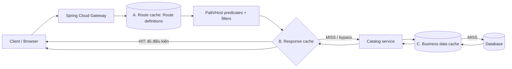
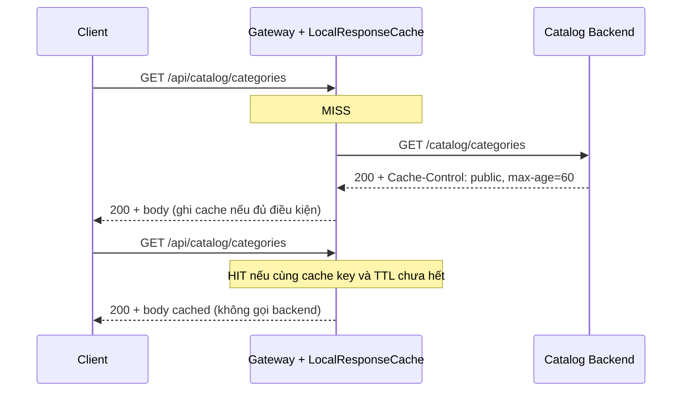
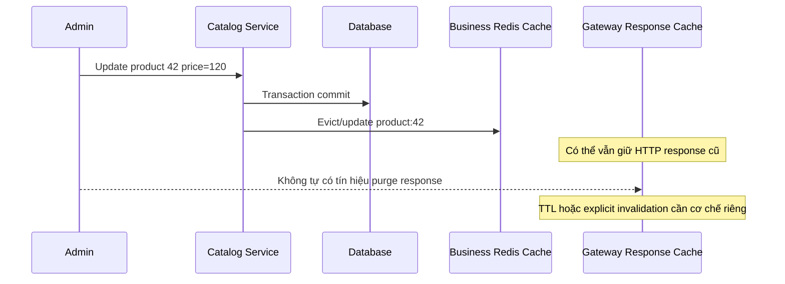

# Phân biệt cache tuyến, cache phản hồi và cache dữ liệu nghiệp vụ trong Spring Cloud Gateway

## 1. Ba thứ cùng gọi là “cache”, nhưng giải quyết ba bài toán khác nhau

Trong kiến trúc microservices, **Spring Cloud Gateway** là cổng HTTP vào hệ thống: chọn đường đi bằng **route predicate**, chạy **filter chain**, biến đổi path/header, định tuyến qua service discovery/load balancing và áp dụng xác thực, rate limiting, circuit breaker, retry, TLS cùng quan sát request. Khi nói “bật cache ở Gateway”, phải xác định chính xác **đang lưu cái gì**.

Ví dụ cửa hàng trực tuyến có Gateway, `catalog-api`, `orders-api` và `pricing-service`:

- **Cache tuyến (*route cache*):** Gateway giữ các route đã dựng như `catalog-route: Path=/api/catalog/** → lb://catalog-api`. Cache này hỗ trợ **chọn đường đi**, không lưu danh sách sản phẩm.
- **Cache phản hồi (*HTTP response cache*):** Gateway có thể lưu status, headers và body của `GET /api/catalog/categories` để lần gọi sau không cần tới Catalog. Trong Gateway WebFlux có filter `LocalResponseCache` dựa trên Caffeine.
- **Cache dữ liệu nghiệp vụ (*business data cache*):** chính `catalog-api` lưu đối tượng `Product(id=42)` hoặc kết quả truy vấn từ database vào Redis/Caffeine, để giảm truy vấn lặp lại. Gateway không tự hiểu “sản phẩm đã đổi giá”.

Ba loại cache khác nhau về **nội dung, vị trí, khóa, thời hạn, cách vô hiệu hóa và trách nhiệm bảo mật**. Bật một loại **không tự kích hoạt** hai loại còn lại.

**Mục tiêu bài học:** phân biệt đúng ba lớp cache, cấu hình cache tuyến/response ở Gateway Server WebFlux, mô tả cache nghiệp vụ ở backend, bảo vệ dữ liệu cá nhân, hiểu các tình huống nhiều Gateway replicas, thử nghiệm cache hit/miss và biết khi nào phải refresh/purge/evict.

> **Phiên bản:** ví dụ chính dùng **Spring Cloud Gateway Server WebFlux 4.3+/5.x** với prefix `spring.cloud.gateway.server.webflux.*`. Gateway WebFlux 4.2 trở về trước thường dùng `spring.cloud.gateway.*`. Web MVC có cấu hình và filter APIs riêng. Đặc biệt, những bản Gateway cũ có **cảnh báo bảo mật liên quan LocalResponseCache công bố tháng 11/2026**; xem mục 11.

## 2. Sơ đồ vị trí của ba lớp cache



Sơ đồ thể hiện luồng logic. **Route cache** được Gateway sử dụng để dựng/chọn route, không nhất thiết là một “bước truy vấn database” trên từng HTTP request. **Response cache** có thể chặn đường tới backend khi HIT. **Business cache** chỉ có ý nghĩa nếu request thực sự đến service (hoặc service khác sử dụng cùng dữ liệu).

| Tiêu chí | Cache tuyến | Cache phản hồi | Cache dữ liệu nghiệp vụ |
|---|---|---|---|
Lưu nội dung gì? | Route objects/definitions, predicates, filters, URI/order | HTTP status, headers, body | Entity, DTO, giá trị tính toán, truy vấn |
Nằm ở đâu? | Gateway route locator, thường trong JVM | Gateway `LocalResponseCache`, Caffeine mỗi JVM; hoặc CDN/proxy khác | Ở backend, local Caffeine hoặc Redis/cache store riêng |
Khóa về mặt khái niệm | Tập route từ nguồn cấu hình/discovery | HTTP request identity và những headers ảnh hưởng representation | Business key như `productId` + tenant + version |
Đơn vị “HIT” | Lấy được route đã nạp để route matching | Có thể trả HTTP response mà không gọi backend | Backend không cần truy cập DB/tác vụ đắt |
Thay đổi khi nào? | Sửa route/refresh/restart/cấu hình nguồn | TTL, eviction, purge, process restart | TTL, cập nhật/xóa dữ liệu, domain event |
Ai quản lý logic đúng/sai? | Đội vận hành Gateway | Đội Gateway/API contract và Security | Chủ sở hữu dịch vụ/dữ liệu nghiệp vụ |
Có tự lan qua nhiều replicas? | Không mặc nhiên | `LocalResponseCache`: **không** | Tùy store: Redis chia sẻ, local Caffeine không |
Rủi ro đặc trưng | Route cũ, định tuyến nhầm service | Phục vụ dữ liệu cũ hoặc rò rỉ dữ liệu giữa users/routes | Stale data, invalidation race, không nhất quán với DB |

## 3. Cache tuyến: tối ưu bảng định tuyến, không cache HTTP body

Spring Cloud Gateway Server WebFlux sử dụng các `RouteDefinitionLocator`/`RouteLocator` để lấy và dựng các route; ở cấu hình thông thường có `CachingRouteLocator` lưu snapshot các `Route` đã dựng. Một route có thể gồm:

```text
Route ID: public-catalog
Predicate: Path=/api/catalog/**
URI: lb://catalog-api
GatewayFilter: StripPrefix=1
Order: 0
```

Mỗi lần client gọi `GET /api/catalog/products/42`, Gateway kiểm tra bảng route hiện có để chọn `public-catalog`, rồi mới xét các filters/định tuyến xuống backend. **Cache route không tự trả JSON**; nó không biết body của `GET /products/42` đã có kết quả gì.

### 3.1. Ví dụ route tường minh

```yaml
# application.yml — Gateway Server WebFlux 4.3+/5.x
spring:
  cloud:
    gateway:
      server:
        webflux:
          routes:
            - id: public-catalog
              uri: lb://catalog-api
              predicates:
                - Path=/api/catalog/**
                - Method=GET
              filters:
                - StripPrefix=1
```

Ở ví dụ này, việc nạp và cache route cho phép Gateway dùng định nghĩa `public-catalog` để chọn backend. Nhưng nếu response của backend là:

```http
HTTP/1.1 200 OK
Content-Type: application/json
Cache-Control: no-store

{"id":"42","price":100}
```

thì **cache tuyến không thể biến response này thành cache HIT ở HTTP layer**. Một trăm request có thể dùng cùng một route definition nhưng vẫn gây một trăm lần gọi backend.

### 3.2. Refresh route cache

Theo Actuator API của Gateway, endpoint quản trị:

```http
POST /actuator/gateway/refresh
```

được dùng để **làm mới cache route**. Nó không phải `PURGE /api/catalog/products/42` và **không xóa `LocalResponseCache` hay Redis business cache**. Chỉ làm refresh có ý nghĩa nếu nguồn route có dữ liệu mới; thay đổi YAML trên đĩa không đồng nghĩa mọi process đang chạy đã nạp file mới hoặc property binding đã được cập nhật.

Với Spring Cloud Gateway 5.x, endpoint `/actuator/gateway` **mặc định không cho phép quản trị qua HTTP**. Để cho người vận hành xem routes ở chế độ đọc:

```yaml
management:
  endpoint:
    gateway:
      access: read-only
  endpoints:
    web:
      exposure:
        include: health,info,gateway
```

`read-only` **không cho phép gọi refresh**. Nếu thực sự cần `POST /actuator/gateway/refresh`, phải bật quyền quản trị phù hợp (ví dụ `access: unrestricted` trong môi trường vận hành được kiểm soát) và đặt **Spring Security, mạng quản trị, audit, phân quyền thao tác** chặt chẽ. Không mở endpoint sửa route ra Internet để tiện thực hành.

Lệnh quan sát khi được cấp quyền:

```bash
# Chỉ từ mạng/quyền quản trị hợp lệ.
curl -i http://localhost:8080/actuator/gateway/routes

# Chỉ trong môi trường quản trị CÓ quyền refresh đã cấu hình:
curl -i -X POST http://localhost:8080/actuator/gateway/refresh
```

Việc refresh được tài liệu mô tả dưới dạng thao tác bất đồng bộ; HTTP 200 không bảo đảm tức thì mọi Gateway replica đã đồng bộ route mới. Một số phiên bản cho phép refresh một nhóm route bằng metadata filter, nhưng phải đối chiếu tài liệu version và xác minh route list sau thao tác.

### 3.3. Discovery/LoadBalancer không thay đổi bản chất route cache

Khi dùng DiscoveryClient, Gateway có thể sinh các route `/{serviceId}/**` hoặc giải quyết `lb://catalog-api` sang một instance. Đây là **route/discovery state**, không phải business data. Không nên dùng cache tuyến như cơ chế “kết quả sản phẩm” và không giả định `/actuator/gateway/refresh` tự làm mới mọi service instance, mọi DNS record hay mọi Redis key.

Một thay đổi nhạy cảm như rút lại quyền công bố service cần kiểm soát **route nguồn, các Gateway replicas, lớp network và backend**. Refresh một pod không phải biện pháp thu hồi quyền tức thì trên cả cluster.

## 4. Cache phản hồi: lưu kết quả HTTP ở Gateway

Khác cache tuyến, **response cache** có thể làm request thứ hai **không phải gọi backend**. Gateway Server WebFlux cung cấp `LocalResponseCache`, một cache **cục bộ theo JVM**, dựa trên **Caffeine**.

Ví dụ hai lần gọi cùng public endpoint:



### 4.1. Điều kiện cache theo tài liệu Gateway

`LocalResponseCache` chỉ xem xét những request/response thỏa điều kiện cụ thể:

1. Request là **GET không có request body**.
2. Response có status **200 OK**, **206 Partial Content**, hoặc **301 Moved Permanently**.
3. Request không có chỉ thị `Cache-Control: no-store`.
4. Response không có chỉ thị `Cache-Control: no-store` hoặc `private`.
5. Cache phải **được bật và cấu hình đúng phạm vi**.

Đây là phạm vi của **filter này**, không phải danh sách tất cả HTTP statuses có thể cache theo RFC. Ví dụ, một API `POST` tạo đơn hoặc `GET` trả response `204` **không thuộc tập status/HTTP method được filter công bố để cache**.

Tài liệu Gateway cũng mô tả trường hợp cache đã có entry và request mới mang `Cache-Control: no-cache` có thể nhận phản hồi **304 Not Modified không body**. Cần kiểm chứng với phiên bản và request conditions cụ thể; đừng suy rằng `no-cache` đồng nghĩa `no-store` hoặc mặc định mọi `no-cache` đều tạo cache MISS.

### 4.2. Bật cache **riêng cho route public**, không bật đại trà

Trong Gateway Server WebFlux **5.1** có các tên property kiểm chứng được từ `configprops`:

```yaml
spring:
  cloud:
    gateway:
      server:
        webflux:
          # Tránh dùng một global cache chia sẻ trên mọi route.
          global-filter:
            local-response-cache:
              enabled: false
          # Cho phép sử dụng filter này trên những route được chọn.
          filter:
            local-response-cache:
              enabled: true
          routes:
            - id: public-catalog-cached
              uri: http://localhost:8081
              predicates:
                - Path=/api/catalog/categories
                - Method=GET
              filters:
                - StripPrefix=1
                - LocalResponseCache=30s,10MB

            - id: private-orders
              uri: http://localhost:8082
              predicates:
                - Path=/api/orders/**
              filters:
                - StripPrefix=1
                # Không thêm LocalResponseCache.
```

`LocalResponseCache=30s,10MB` cấu hình TTL **30 giây** và giới hạn kích thước cache của route **10 MB**, không phải kết nối HTTP response timeout hay thời gian sống của object trong database.

**Vì sao không cấu hình global?** Global response cache có bề mặt rủi ro lớn vì cache key và route predicates có thể tương tác ngoài mong đợi. Ngay cả khi một phiên bản đã vá lỗi bảo mật, ưu tiên cho phép cache **từng route public đã được review**; không áp dụng filter này cho Orders, profile, billing hoặc endpoints trả dữ liệu theo danh tính.

Các property trong một số đoạn tài liệu 4.x/đời cũ còn ghi `spring.cloud.gateway.filter.local-response-cache.enabled` và `spring.cloud.gateway.global-filter.local-response-cache.enabled`. Khi dùng **4.3+/5.x**, đối chiếu **configprops thực của release train** để tránh đặt sai prefix rồi tưởng cache đã tắt hoặc bật đúng.

### 4.3. Dependencies cho `LocalResponseCache`

Tài liệu chính thức yêu cầu Caffeine và Spring Boot cache starter:

```xml
<!-- Trong pom.xml, version do BOM/Dependency Management quản lý -->
<dependency>
    <groupId>org.springframework.cloud</groupId>
    <artifactId>spring-cloud-starter-gateway-server-webflux</artifactId>
</dependency>
<dependency>
    <groupId>org.springframework.boot</groupId>
    <artifactId>spring-boot-starter-cache</artifactId>
</dependency>
<dependency>
    <groupId>com.github.ben-manes.caffeine</groupId>
    <artifactId>caffeine</artifactId>
</dependency>
```

Với Gradle:

```groovy
dependencies {
    implementation 'org.springframework.cloud:spring-cloud-starter-gateway-server-webflux'
    implementation 'org.springframework.boot:spring-boot-starter-cache'
    implementation 'com.github.ben-manes.caffeine:caffeine'
}
```

Không cần `spring-boot-starter-data-redis-reactive` **chỉ để dùng LocalResponseCache**: filter này dùng **Caffeine cục bộ**, không tự chuyển thành distributed Redis cache. Nếu dự án có nhiều `CacheManager` tùy chỉnh, tài liệu Gateway yêu cầu xử lý bean selection bằng `@Primary` hoặc `@Qualifier` phù hợp.

### 4.4. Java DSL tương đương

```java
package com.example.gateway.routes;

import java.time.Duration;
import org.springframework.cloud.gateway.route.RouteLocator;
import org.springframework.cloud.gateway.route.builder.RouteLocatorBuilder;
import org.springframework.context.annotation.Bean;
import org.springframework.context.annotation.Configuration;

@Configuration(proxyBeanMethods = false)
public class CatalogCacheRoute {
    @Bean
    RouteLocator catalogRoute(RouteLocatorBuilder builder) {
        return builder.routes()
            .route("public-catalog-cached", r -> r
                .path("/api/catalog/categories")
                .filters(f -> f
                    .stripPrefix(1)
                    .localResponseCache(Duration.ofSeconds(30), "10MB"))
                .uri("http://localhost:8081"))
            .build();
    }
}
```

Ví dụ Java thay thế route YAML cùng ID, không đăng ký cả hai đồng thời. Chú ý cách tạo `RouteLocatorBuilder` khác với Gateway Server **Web MVC**. Để chạy thử, backend ở `8081` phải có `GET /catalog/categories`, và response đủ điều kiện cache.

## 5. HTTP cache semantics: headers ảnh hưởng việc có được lưu response không?

**Cache phản hồi không chỉ là “giữ JSON 30 giây”**. Nó còn liên quan đến hợp đồng HTTP, response headers, request headers, cách phân biệt từng representation và thời điểm dữ liệu không còn mới.

### 5.1. `Cache-Control`: các chỉ thị quan trọng

| Header/chỉ thị | Ý nghĩa về mặt HTTP | Tác động thực hành |
|---|---|---|
`Cache-Control: public, max-age=60` | Cho phép lưu ở shared cache khi đáp ứng những điều kiện HTTP khác; fresh khoảng 60 giây | Phù hợp với **dữ liệu công khai**, được review |
`Cache-Control: private` | Không cho **shared cache** lưu response | Thích hợp với dữ liệu user-specific |
`Cache-Control: no-store` | Không được lưu request/response theo chỉ thị | Ưu tiên trên thông tin nhạy cảm |
`Cache-Control: no-cache` | Có thể lưu nhưng phải kiểm tra lại trước khi tái sử dụng theo semantics HTTP chuẩn | **Không đồng nghĩa** `no-store` |
`Cache-Control: max-age=0` | Response cần tái kiểm tra trước khi sử dụng lại theo semantics chuẩn | Không làm response mặc nhiên bí mật |
`Cache-Control: s-maxage=60` | Chỉ thị freshness cho shared caches | Cần kiểm tra support thực tế của từng cache |
`ETag` / `If-None-Match` | Định danh version của representation và conditional request | Có thể giúp revalidation, response 304 khi hợp lệ |
`Vary: Accept-Language` | Representation phụ thuộc request header `Accept-Language` | Cache phải phân biệt biến thể tiếng Việt/tiếng Anh |
`Set-Cookie` / `Authorization` | Dữ liệu/credential nhạy cảm về session/user | Không bật shared response cache mặc định |
`Age` | Tuổi của cached representation theo semantics của HTTP cache | Hữu ích khi điều tra nhiều lớp CDN/proxy/cache |

Ví dụ response danh mục **công khai, không cá nhân hóa**:

```http
HTTP/1.1 200 OK
Content-Type: application/json
Cache-Control: public, max-age=60
Vary: Accept-Language
ETag: "categories-vi-v12"

{"locale":"vi","categories":["Sách","Điện tử"]}
```

Nếu cùng URL hỗ trợ `Accept-Language: en`, cache **không được trả response tiếng Việt cho client tiếng Anh** chỉ vì URL giống nhau. Không tự cho rằng mọi cache layer hỗ trợ mọi `Vary`/headers giống nhau; cần test cache key thực tế. Đối với route có thể trả dữ liệu theo user/tenant, **không dùng LocalResponseCache** thay vì cố ghép hàng loạt header vào key và hy vọng không rò rỉ.

### 5.2. `max-age` của LocalResponseCache và TTL có quan hệ thế nào?

Tài liệu `LocalResponseCache` nói rằng filter có thể **điều chỉnh `Cache-Control: max-age`** của response được cache theo TTL đã cấu hình **nếu response gốc có `max-age`**. Ở các lần HIT tiếp theo, giá trị được điều chỉnh theo thời gian còn lại.

Ví dụ:

```text
Backend:       Cache-Control: public, max-age=120
Gateway route: LocalResponseCache=30s,10MB

Tại lúc lưu: max-age biểu diễn TTL do Gateway áp dụng.
Sau khoảng 10 giây: max-age trên response HIT có thể giảm tương ứng.
Sau khoảng 30 giây: cache entry hết hạn; lần sau cần backend.
```

Đừng suy ra **Gateway tự thêm `Cache-Control: public`** nếu backend không cho phép. Cũng không mặc định `max-age` của browser/CDN, TTL của local cache và TTL của business Redis cache phải giống nhau; chúng phục vụ các lớp riêng.

### 5.3. Status 206, Range và biểu diễn

`LocalResponseCache` liệt kê cả **HTTP 206 Partial Content**, nhưng cache partial responses đòi hỏi xử lý đúng `Range`, `Content-Range`, validators, encoding và cache key. Với file lớn hoặc video, nên xem xét CDN/object-storage và HTTP range support thực tế, thay vì cho LocalResponseCache giữ các đoạn file một cách thiếu kiểm thử.

Các response `404` hoặc `500` **không nằm trong danh sách cacheable statuses của LocalResponseCache** ở tài liệu Gateway hiện hành. Nhưng ở **business cache**, một đội có thể chọn **negative caching** (ví dụ “product ID không tồn tại” trong thời gian ngắn) khi đã phân tích rủi ro và vô hiệu hóa chính xác; đừng trộn hai semantics này.

## 6. Cache dữ liệu nghiệp vụ: chủ sở hữu dữ liệu quyết định consistency

Cache nghiệp vụ thường nằm trong **backend**, không phải Gateway. Backend hiểu product ID, tenant, thời điểm cập nhật giá, quyền truy cập, đơn hàng và transaction nên có thể quyết định:

- Giá trị nào có thể cache theo **domain key**, ví dụ `productId=42`.
- Cần bao nhiêu độ trễ dữ liệu (TTL/staleness) thì chấp nhận được.
- Khi nào phải **evict hoặc update** cache sau lệnh ghi.
- Quyền user/tenant phải xuất hiện trong key hoặc **tuyệt đối không cache chung**.
- Trường hợp nào data cache phải bị bỏ qua để bảo đảm tính đúng của nghiệp vụ.

### 6.1. Ví dụ Spring Cache tại backend Catalog

Ví dụ sau nằm trong **Catalog service**, không phải trong Gateway. Dùng Spring Cache abstraction cho **phương thức đồng bộ**:

```java
package com.example.catalog;

import java.math.BigDecimal;
import org.springframework.cache.annotation.CacheEvict;
import org.springframework.cache.annotation.Cacheable;
import org.springframework.stereotype.Service;

@Service
public class ProductService {
    private final ProductRepository repository;

    public ProductService(ProductRepository repository) {
        this.repository = repository;
    }

    @Cacheable(cacheNames = "catalog-products", key = "#productId")
    public ProductDto findById(String productId) {
        // Được gọi khi cache MISS.
        return repository.loadProduct(productId);
    }

    @CacheEvict(cacheNames = "catalog-products", key = "#productId")
    public void updatePrice(String productId, BigDecimal price) {
        repository.updatePrice(productId, price);
    }
}
```

`ProductRepository`, `ProductDto` và `loadProduct/updatePrice` là **các thành phần nghiệp vụ giả định**, phải được hiện thực trong ứng dụng Catalog. Ví dụ minh họa logic: nếu `findById("42")` cache HIT, backend có thể trả DTO mà không gọi repository. Khi `updatePrice("42", ...)` hoàn tất thành công, `@CacheEvict` hướng tới entry `"42"`.

**Cảnh báo consistency:** nếu update chạy trong transaction, thứ tự commit DB và evict cache cần được thiết kế. `@CacheEvict` không mặc nhiên đảm bảo invalidate chỉ **sau transaction commit** ở mọi cách sắp xếp Spring advice. Với nghiệp vụ quan trọng, cân nhắc synchronization sau commit, transaction-aware cache, domain event/outbox hoặc phiên bản dữ liệu. Đừng coi TTL ngắn là thay thế cho transactional correctness.

Spring Cache dùng proxy/AOP ở cấu hình phổ biến: gọi `this.findById(...)` ngay trong cùng bean có thể **bỏ qua annotation proxy**. Bài tập production phải xác minh cache interception hoạt động thật, không chỉ thấy `@Cacheable` trong source.

### 6.2. Bật Spring Cache và Redis tại backend

Khi muốn nhiều Catalog replicas dùng cache chung, có thể dùng Redis CacheManager ở **Catalog service**, không phải `LocalResponseCache` của Gateway:

```java
package com.example.catalog;

import org.springframework.cache.annotation.EnableCaching;
import org.springframework.context.annotation.Configuration;

@Configuration(proxyBeanMethods = false)
@EnableCaching
public class CatalogCacheConfig {
}
```

```yaml
# application.yml của Catalog service, không phải file Gateway.
spring:
  cache:
    type: redis
    cache-names:
      - catalog-products
    redis:
      time-to-live: 60s
      cache-null-values: false
  data:
    redis:
      host: redis.internal.example
      port: 6379
```

Backend cần dependency Spring cache và Redis thích hợp, Redis host/ACL/TLS thực tế, và `CacheManager` do Spring Boot autoconfigure hoặc tự định nghĩa. `spring.cache.redis.time-to-live` chỉ điều khiển **business cache TTL**, **không điều khiển LocalResponseCache hoặc route cache**.

Không mặc định mọi `@Cacheable` trên method trả `Mono`/`Flux` đều có cùng semantics với ví dụ đồng bộ: Spring Framework hỗ trợ reactive return types theo phiên bản nhất định nhưng aggregation/lifecycle và cache provider có giới hạn riêng. Nếu backend là WebFlux thuần, cần thiết kế cache reactive tương thích, không `block()` Redis trên Netty event loop.

### 6.3. Ví dụ một thay đổi giá qua ba tầng

Giả sử lúc 10:00 product 42 có giá **100**, và:

- Gateway route `public-catalog` đang được cache trong route locator.
- Gateway có cache response `GET /api/catalog/products/42` TTL 30 giây.
- Catalog service có Redis business cache `product:42` TTL 60 giây.

Lúc 10:05, một admin cập nhật giá thành **120** trong database.



Ngay cả khi Catalog đã cập nhật Redis, Gateway **có thể vẫn trả HTTP body cũ** từ `LocalResponseCache` cho tới khi TTL hết hoặc được invalidated bằng một cơ chế mà hệ thống thật sự triển khai. **Refresh route cache không giải quyết việc này.**

Vì vậy, dữ liệu biến động mạnh như giá/tồn kho theo thời gian thực có thể **không nên cache response ở Gateway**, hoặc cần TTL rất ngắn và cơ chế purge được kiểm chứng. Quota, thanh toán và phân quyền thường cần consistency mạnh hơn danh sách category tĩnh.

## 7. Khi nào chọn cache nào? Các tình huống sát nghiệp vụ

| Tình huống | Lớp cache phù hợp | Vì sao? |
|---|---|---|
Gateway khớp `Path=/api/catalog/**` hàng nghìn lần | **Route cache** | Không phải đọc/lắp route definition liên tục |
`GET /api/public/categories` giống nhau cho mọi user | **Response cache** có kiểm soát | Giảm lượt gọi backend và network khi trả cùng HTTP representation |
`GET /api/orders/me` có Bearer/cookie | **Không dùng shared LocalResponseCache** | Nội dung có thể theo người dùng |
Catalog đọc product từ DB nhiều lần qua nhiều clients | **Business cache** tại Catalog | Giảm DB load; service kiểm soát domain key/eviction |
Giá/tồn kho cần đúng ngay sau update | Business cache có invalidation chặt; thường **không cache HTTP response lâu** | Giảm staleness giữa các lớp |
`POST /api/orders` tạo đơn | Không dùng LocalResponseCache | Filter chỉ cache GET không body; mutation phải được thực thi |
RedisRateLimiter cần giữ token bucket | **Quota state store**, không phải business response cache | Redis được dùng cho rate-limit; không có nghĩa body được cache |
CircuitBreaker fallback dùng snapshot public | Cache dữ liệu dự phòng với contract riêng | Không coi fallback response là backend success mặc định |
SSE/live feed | **Streaming**, tránh full-response cache | Stream có thể không kết thúc, độ tươi từng event |
Browser/CDN cache static assets | HTTP cache ở CDN/browser | Đó là lớp khác `LocalResponseCache` trong Gateway |

### 7.1. Không dùng cache như một cơ chế authorization

Không được nghĩ “đường dẫn Orders đã bị che sau Gateway nên cache chung cũng an toàn”. Gateway có thể không gọi backend trên **cache HIT**; nếu phần trả response cache không áp dụng đúng trust boundary/route key, dữ liệu riêng tư có thể bị lộ mà backend không có cơ hội kiểm tra quyền.

Đối với mọi API có identity, tenant, role, subscription level hay consent thay đổi nội dung:

- Ưu tiên **không cache shared HTTP response** tại Gateway.
- Backend vẫn xác thực/phân quyền cả khi Gateway có Security.
- Dùng `Cache-Control: private, no-store` theo API contract khi cần.
- Không đặt `Vary: Authorization` như giải pháp duy nhất bảo vệ dữ liệu bí mật; phải xem xét cache implementation và CVEs ở mục 11.
- Bảo vệ phía network để client không thể bypass Gateway và truy cập backend chỉ bằng header giả.

## 8. Vòng đời và invalidation: ba nút “xóa cache” hoàn toàn khác nhau

**Cache invalidation** là hành động khiến một entry/snapshot cũ không còn được dùng. Trong ba lớp cache, trigger và công cụ quản trị **không giống nhau**:

| Thay đổi thật | Cache cần xử lý | Cơ chế phù hợp | **Không** giải quyết bằng |
|---|---|---|---|
Đổi route `catalog-api` sang URI mới | **Route cache** | Cập nhật route source, refresh/republish route theo quy trình | Xóa Redis `product:42` |
Rút lại public route nội bộ | **Route cache + policy mạng** | Disable route, refresh các replicas, kiểm tra route list và backend ACL | Đợi TTL của response |
Đổi danh sách category public | **Response cache** | TTL ngắn, invalidation/purge có kiểm soát, versioned URL | Chỉ gọi `/actuator/gateway/refresh` |
Đổi giá product trong DB | **Business cache** | Evict/update domain key sau transaction commit | Chỉ restart Gateway |
Đổi giá nhưng Gateway vẫn lưu HTTP response cũ | **Response cache** **và** business cache (nếu có) | Điều phối TTL/version/invalidation tại từng lớp | Chỉ evict business Redis |
Thay RedisRateLimiter quota của user | **Quota state** | Chính sách rate-limit/Redis key riêng | Clear `LocalResponseCache` |
Redeploy một Gateway pod | Route/response cache **cục bộ pod đó** được dựng lại | Kiểm tra trạng thái các pods còn lại | Suy rằng toàn cluster đã xóa cache |

### 8.1. Chiến lược TTL, version và event

- **TTL:** đơn giản; stale tối đa tùy thời điểm entry lưu và kiểu cache. Phù hợp dữ liệu công khai chấp nhận chậm cập nhật.
- **Versioned path/query:** `/api/catalog/v3/categories` hoặc content hash cho tài nguyên tĩnh. URL mới giúp tách representation mà không đợi cache cũ hết hạn.
- **Event-driven invalidation:** khi `catalog-api` commit dữ liệu, phát sự kiện `ProductChanged`; service làm mới business cache, và một cơ chế riêng có thể purge response cache/CDN. Cần quan sát lost/replayed events.
- **Write-through/update cache:** cập nhật cache cùng quy trình ghi khi có thể; vẫn phải xử lý race và rollback.
- **Cache-aside:** đọc cache trước, MISS thì truy vấn nguồn; ghi dữ liệu xong invalidate cache. Đây là mô hình phổ biến cho business data.

**Quan trọng:** `LocalResponseCache` không được trình bày như một cache có API purge domain keys mặc định. Không tự tạo endpoint `DELETE /cache/products/42` trong tài liệu rồi khẳng định Gateway đã hỗ trợ. Nếu cần invalidation chủ động theo object ID, phải xây/triển khai một cơ chế được kiểm soát hoặc chọn lớp cache khác phù hợp hơn.

### 8.2. Không nối tất cả TTL thành một con số

Giả sử:

```text
Business Redis TTL:        60s
Gateway LocalResponseCache: 30s
CDN edge TTL:              120s
Browser max-age:           60s
```

Ngay cả khi Catalog cập nhật Redis ngay sau write, một người dùng vẫn có thể nhận bản sao ở **CDN/browser** trong thời gian còn freshness. Staleness có thể tích lũy hoặc phụ thuộc thời điểm các lớp cache được nạp; **không lấy giá trị nhỏ nhất làm SLA độ tươi**. Cần xác định **nguồn dữ liệu đúng**, đường invalidation, headers và TTL cuối cùng qua cả chuỗi.

## 9. Phạm vi nhiều replicas, bộ nhớ và hành vi khi rollout

Giả sử production có **3 Gateway pods**, mỗi pod sử dụng `LocalResponseCache=30s,10MB` cho một public route.

```text
Gateway Pod A: local Caffeine cache (tối đa khoảng 10 MB theo cấu hình)
Gateway Pod B: local Caffeine cache (tối đa khoảng 10 MB theo cấu hình)
Gateway Pod C: local Caffeine cache (tối đa khoảng 10 MB theo cấu hình)

Catalog Pod 1/2/3 --> Redis business cache chung --> Database
```

Các pods Gateway **không tự chia sẻ response entries**. Ví dụ A vừa được request GET đầu tiên và cache HIT lần thứ hai, trong khi B chưa từng thấy URL đó nên vẫn MISS và gọi backend.

| Vấn đề | Route cache | Local response cache | Backend business Redis |
|---|---|---|---|
Một pod restart | Nạp/dựng lại route | **Mất entries cục bộ** | Vẫn có thể còn entries Redis |
Ba pods đều xử lý một URL | Mỗi pod có route snapshot riêng | Mỗi pod có hit/miss riêng | Các backend có thể chia sẻ Redis keys |
Config route đổi trên một pod | Có thể tạo drift giữa pods | TTL cũ có thể vẫn tồn tại trên pod khác | Không tự ảnh hưởng dữ liệu sản phẩm |
Memory tăng theo số Gateway pods | Route metadata mỗi pod | **Tổng local cache memory tăng theo replicas** | Memory nằm ở Redis |
Rollback app Gateway | Route/config version thay đổi | Cache mới/cũ theo lifecycle mỗi pod | Redis key schema có thể vẫn giữ phiên bản cũ |

**Tính gần đúng:** ba pod với 10 MB local response cache/route có thể giữ khoảng **30 MB response entries** cho route đó trên toàn cluster, **chưa tính** Caffeine overhead, byte buffers, JVM heap và các route khác. Đừng gọi `10MB` là “trần 10 MB cho cả cluster”.

Với rolling deployment, Gateway A có thể chạy một version/route mới trong khi B còn route cũ; nếu global HTTP cache không phân biệt được route/một số predicates, sự khác biệt có thể nguy hiểm. Cần versioned routes, config rollout, kiểm tra runtime route list, tách cache scope và xác minh security trong suốt quá trình triển khai.

## 10. Bảo mật response cache: không cache nhầm dữ liệu người dùng

### 10.1. Các loại dữ liệu không nên đưa vào shared Gateway cache

**Không bật `LocalResponseCache`** trên các API sau trừ khi có thiết kế bảo mật chuyên biệt, được review và kiểm chứng:

- `GET /api/orders/me`, `/api/profile`, `/api/billing/invoices` hoặc kết quả có thông tin cá nhân/thanh toán.
- Response phụ thuộc `Authorization`, session cookie, tenant, role, region, permission, feature flags riêng user.
- Response chứa `Set-Cookie`, access token, refresh token, signed download URL hoặc dữ liệu nhạy cảm.
- API mà việc thu hồi quyền phải có hiệu lực ngay, không được trả bản sao từng được phép cho người gọi đã mất quyền.

Một response có `Cache-Control: public` nhưng thực ra chứa thông tin cá nhân **vẫn là cấu hình sai**. HTTP header không tự kiểm tra dữ liệu nghiệp vụ. Chính backend/API owner phải chọn khả năng cache sau khi phân tích trust boundary.

### 10.2. Đừng coi `Vary: Authorization` là cơ chế phân quyền

`Vary` giúp cache phân biệt representations theo một số request headers. Nó **không thay thế**:

1. Xác minh JWT/issuer/audience/expiry/scope.
2. Kiểm tra user/tenant có quyền trên tài nguyên tại backend.
3. Kiểm soát cache route selection và cache key của implementation.
4. Đảm bảo response private/no-store không bị lưu.

Nếu Gateway trả cache HIT **trước khi backend kiểm tra quyền hiện tại**, hoặc cache key không mang đủ ngữ cảnh route/authorization, dữ liệu có thể bị lộ. Khi không chắc chắn, **bỏ response cache khỏi endpoint riêng tư** là hướng an toàn hơn cố sửa `Vary` cho vừa.

## 11. Cảnh báo bảo mật thực tế: CVE-2026-59426 và CVE-2026-59427

Ngày **19/11/2026**, Spring công bố **hai advisories mức High** liên quan `LocalResponseCache` ở một số dòng Spring Cloud Gateway. Đây không phải rủi ro giả định và cần được xem trong review dependency trước khi bật cache HTTP.

### 11.1. CVE-2026-59426 — Global cache có thể trả nhầm response giữa routes

**Bản chất:** global `LocalResponseCache` trong các phiên bản ảnh hưởng có thể dùng cùng một cache cho các route không khai báo cache riêng. Khi hai routes có **cùng request URI** nhưng được phân biệt bằng `Host`, `Header`, `Cookie`, `RemoteAddr` hoặc predicate khác **không nằm trong cache key**, một response của route hạn chế có thể được trả cho người chỉ match route công khai.

Ví dụ kiến trúc cần đặc biệt tránh:

```text
GET /reports/summary
  + Header X-Partner-Tier=premium -> Route PREMIUM -> report riêng
  + Không có header             -> Route PUBLIC  -> report công khai

Global cache không phân biệt route ID trong key ở bản bị ảnh hưởng
-> Có thể trả nhầm response của route này cho request đi route kia.
```

**Phòng ngừa:** cập nhật sang phiên bản có bản vá; tắt global `LocalResponseCache`; chỉ cache từng route public đã được review. Advisories nêu **per-route LocalResponseCache** sử dụng cache riêng và không chịu **riêng lỗi cross-route global** này, nhưng vẫn cần cập nhật cho các rủi ro cache khác.

### 11.2. CVE-2026-59427 — Sai cách đọc chỉ thị `private/no-store` kết hợp

**Bản chất:** ở những phiên bản ảnh hưởng, filter có thể so sánh **toàn bộ giá trị header `Cache-Control`** với một chuỗi đơn `private` hoặc `no-store`, thay vì tách các directives bằng dấu phẩy. Khi upstream gửi:

```http
Cache-Control: private, no-store
```

hoặc header nhiều directives mặc định của một số Spring Security responses, cache có thể **lưu response dù upstream cấm lưu**. Request sau có khả năng nhận dữ liệu riêng tư từ cache thay vì backend, tùy các yếu tố cache key/`Vary`.

**Phòng ngừa:** nâng cấp Gateway lên phiên bản được Spring đánh dấu đã vá. **Chỉ thay đổi `Cache-Control` không đủ** để coi một hệ thống chưa vá đã an toàn, đặc biệt nếu endpoint chứa dữ liệu riêng; tốt nhất không bật cache route đó và vẫn áp dụng bản vá.

### 11.3. Phạm vi ảnh hưởng theo advisories công bố ngày 19/11/2026

| Nhánh Gateway | Dải bị liệt kê là ảnh hưởng | Phiên bản sửa được advisory nêu |
|---|---|---|
5.0.x | **5.0.0–5.0.4** | **5.0.5** (OSS); 5.0.4.1 (Enterprise Support Only) |
4.3.x | **4.3.0–4.3.6** | **4.3.7** (Enterprise Support Only) |
4.0–4.2 | **4.0.0–4.2.10** | **4.2.11** (Enterprise Support Only) |

Đây là danh sách công bố tại thời điểm bài được viết, **không có nghĩa mọi nhánh/phiên bản đều được phát hành rộng rãi trên mọi kênh**. Hãy kiểm tra BOM thực tế, release notes, security support và khả năng nhận bản vá của tổ chức. Gateway 5.1.0 không nằm trong **các dải affected được advisories liệt kê**, nhưng vẫn cần kiểm tra các security updates mới và không áp dụng cache phản hồi cho dữ liệu nhạy cảm một cách mặc định.

**Các nguồn chính thức:**

- [Spring Security Advisory — CVE-2026-59426: Global LocalResponseCache Leaks Responses Across Routes](https://spring.io/security/cve-2026-59426/)
- [Spring Security Advisory — CVE-2026-59427: LocalResponseCache Stores private and no-store Responses](https://spring.io/security/cve-2026-59427/)

**Thứ tự ưu tiên khi đang dùng bản ảnh hưởng:** rà soát routes có `LocalResponseCache`, tắt global HTTP caching, loại cache khỏi API private, cập nhật phiên bản được hỗ trợ và thực hiện negative tests cho route overlap/Cache-Control. Không chờ tới khi đã thấy dữ liệu thực bị lộ mới xử lý.

## 12. Thực hành end-to-end: chứng minh response cache HIT/MISS

### 12.1. Chuẩn bị môi trường

Bạn cần:

1. Một **Gateway Server WebFlux** chạy ở `http://localhost:8080`, dùng route `public-catalog-cached` ở mục 4.2, Caffeine/cache starter và các properties bật per-route filter.
2. Một **backend Catalog** chạy ở `http://localhost:8081`, trả public response `GET /catalog/categories`.
3. Có thể dùng Spring Boot Actuator ở Gateway để quan sát route ID, nhưng **không cần mở endpoint sửa route** để test cache HIT.

Không cấu hình global `LocalResponseCache` trong bài thực hành. Không thêm authentication/user profile vào response kiểm thử. Nếu ứng dụng Gateway có Spring Security, tạo **permit rule riêng cho public categories**; không bỏ Security của toàn Gateway chỉ để test caching.

### 12.2. Controller backend với bộ đếm request

Trong **ứng dụng backend Catalog**, thêm controller minh họa:

```java
package com.example.catalog.demo;

import java.time.Duration;
import java.util.HashMap;
import java.util.List;
import java.util.Map;
import java.util.concurrent.atomic.AtomicInteger;

import org.springframework.http.CacheControl;
import org.springframework.http.ResponseEntity;
import org.springframework.web.bind.annotation.GetMapping;
import org.springframework.web.bind.annotation.RestController;

@RestController
public class PublicCategoriesController {
    private final AtomicInteger backendCalls = new AtomicInteger();

    @GetMapping("/catalog/categories")
    ResponseEntity<Map<String, Object>> categories() {
        Map<String, Object> body = new HashMap<>();
        body.put("categories", List.of("Books", "Electronics"));
        body.put("backendInvocation", backendCalls.incrementAndGet());

        return ResponseEntity.ok()
            .cacheControl(CacheControl.maxAge(Duration.ofSeconds(120))
                .cachePublic())
            .body(body);
    }
}
```

Controller này dùng `AtomicInteger` để **đếm số lần backend thật sự nhận HTTP request** trong process đó. Nó không phải business cache và không phù hợp để đo số request phân tán trên nhiều backend replicas. `backendInvocation` là dữ liệu **demo**, không nên thêm bộ đếm này vào API public production.

Vì Gateway route `StripPrefix=1`, client gọi `/api/catalog/categories` còn backend nhận `/catalog/categories`.

### 12.3. Gọi trực tiếp và gọi qua Gateway

```bash
# Gọi trực tiếp: mỗi lần đều đến backend, counter tăng.
curl -i http://localhost:8081/catalog/categories
curl -i http://localhost:8081/catalog/categories

# Gọi qua Gateway, cùng URL và cùng Gateway instance:
curl -i http://localhost:8080/api/catalog/categories
curl -i http://localhost:8080/api/catalog/categories
```

| Thao tác | Kỳ vọng khi cấu hình đúng | Điều chứng minh |
|---|---|---|
Gọi backend trực tiếp hai lần | `backendInvocation` tăng ở cả hai | Backend demo không tự cache response |
Gọi Gateway lần đầu | MISS, backend count tăng | Response được lấy từ downstream |
Gọi Gateway lần tiếp theo trong 30 giây | Có thể HIT; body/counter giữ nguyên | Gateway phục vụ response cache |
Chờ hơn 30 giây rồi gọi lại | Cache entry hết TTL, backend count tăng | Gateway response cache TTL có hiệu lực |
Đổi TTL route rồi refresh route | **Không tự xóa** data cache cũ theo semantics route refresh | Route cache và response cache khác nhau |

Khi có lỗi, đừng suy ra từ một response 200 rằng cache HIT. Dấu kiểm chứng mạnh hơn là **backendInvocation không tăng** hoặc backend access log không có request tương ứng. Một cache HIT cũng có thể làm thay đổi cách quan sát tracing; downstream span sẽ vắng mặt vì request không đi qua backend.

### 12.4. Kiểm thử `Cache-Control` không cho lưu

Trong profile test **riêng biệt**, đổi backend endpoint để trả:

```java
return ResponseEntity.ok()
    .header("Cache-Control", "private, no-store")
    .body(body);
```

Đây là **đoạn thay thế phần return** trong controller, không thêm vào cùng lúc với `cacheControl(...)` của ví dụ trước. Hãy kiểm thử trên bản Gateway **đã vá CVE-2026-59427**, dùng cache chưa có entry cũ (đường dẫn riêng hoặc Gateway test process mới), rồi gọi qua Gateway nhiều lần.

Kỳ vọng: backendInvocation tăng mỗi lần vì response private/no-store **không được cache**. Nếu Gateway thuộc dải chưa vá hoặc có filter/cache khác can thiệp, **không dùng bài test này với dữ liệu người dùng thật**.

### 12.5. `no-cache`, `no-store` và conditional response

```bash
# Request nêu không được lưu dữ liệu theo chỉ thị no-store:
curl -i \
  -H 'Cache-Control: no-store' \
  http://localhost:8080/api/catalog/categories

# Request yêu cầu kiểm tra lại theo no-cache;
# hành vi 304 cụ thể phụ thuộc filter/version.
curl -i \
  -H 'Cache-Control: no-cache' \
  http://localhost:8080/api/catalog/categories
```

`no-cache` theo HTTP là **phải revalidate khi dùng lại**, không phải từ đồng nghĩa của `no-store`. Spring Cloud Gateway documentation có mô tả LocalResponseCache trả `304` không body trong một tình huống entry đã cached; thực tế phải quan sát cả status, `ETag`/`Cache-Control` và số request vào backend để hiểu cache implementation. **Không lấy một response 304 làm bằng chứng tuyệt đối** rằng backend đã hay chưa được gọi.

### 12.6. Kiểm thử khác biệt giữa route cache và response cache

Khi Gateway Actuator ở chế độ `read-only` và có quyền truy cập:

```bash
curl -i http://localhost:8080/actuator/gateway/routes
```

Response của Actuator cho biết những route definitions đang có, ví dụ `public-catalog-cached`, predicate `Path`, URI và filters. Nó **không chứa bộ đếm `backendInvocation`** như dữ liệu business. Endpoint route cache management `/actuator/gateway/refresh` **không phải** endpoint purge Caffeine response cache.

Trong production, đừng thử `POST /actuator/gateway/refresh` khi chưa có quyền và change window. Nếu muốn minh họa route refresh, tạo một môi trường sandbox riêng, đổi route source có chủ đích, refresh theo API quản trị đã bảo vệ rồi kiểm tra route list/hành vi định tuyến.

### 12.7. Kiểm thử multi-replica

Chạy Gateway A trên cổng `8080` và Gateway B trên cổng `8083`, cùng route nhưng **mỗi instance có Caffeine riêng**:

```bash
curl -i http://localhost:8080/api/catalog/categories
curl -i http://localhost:8080/api/catalog/categories
curl -i http://localhost:8083/api/catalog/categories
```

Gateway B có thể gọi backend lần đầu ngay cả khi Gateway A đang HIT. Đây là **hành vi đúng của local cache**, không phải bug đồng bộ Redis. Nếu cần shared HTTP response cache giữa edge nodes, đánh giá CDN/reverse proxy/cache service chuyên dụng và kiểm soát keys, security, invalidation theo contract; `LocalResponseCache` không tự biến thành distributed cache.

## 13. Quan sát hiệu quả và chi phí của từng cache

| Cache | Chỉ số cần quan sát | Cách xác minh |
|---|---|---|
Route cache | Route IDs, nguồn route, thời điểm refresh, drift giữa Gateway pods | `/actuator/gateway/routes` từ endpoint quản trị, logs và config revision |
Response cache | HIT/MISS, TTL, số entries, bytes giữ, eviction, backend request reduction | Instrumentation phù hợp, backend request count, latency trước/sau |
Business cache | HIT/MISS theo cache name, DB query count, eviction, stale read, Redis memory/latency | Spring Cache/Redis metrics, repository counters, transaction/event traces |
CDN/browser cache | `Age`/`Cache-Control`/`ETag`, CDN HIT/MISS, regional stale content | CDN dashboard, HTTP headers, thử nhiều vùng |

Không phải mọi `LocalResponseCache` version đều xuất sẵn cache hit/miss metrics ở cùng một tên. **Đừng tự bịa metric name**; nếu cần dashboard, kiểm tra Actuator/Micrometer bindings trên đúng Gateway version, bổ sung instrumentation có kiểm soát hoặc đo từ backend và reverse proxy.

### 13.1. TTL không phải mục tiêu duy nhất

Những câu hỏi vận hành quan trọng:

1. Cache có giảm **số lần backend gọi** và DB load đáng kể không?
2. Bao nhiêu request trả **stale** so với SLA nghiệp vụ?
3. Cache có giữ **private response** hoặc nội dung có cookie không?
4. Các Gateway replicas có route/cấu hình khác nhau khi rollout không?
5. Khi invalidation event bị mất, hệ thống phục hồi bằng TTL/version/reconciliation ra sao?
6. Caching có làm che lỗi `401/403` hoặc bỏ qua việc kiểm tra quyền mới nhất không?
7. Khi backend `500`/CircuitBreaker OPEN, client có nhận cached content mà API contract cho phép không?

Gateway cache HIT giúp giảm latency backend nhưng **không tự đảm bảo database consistency hoặc authorization freshness**.

## 14. Lỗi thường gặp và cách xử lý

| Triệu chứng | Nguyên nhân khả dĩ | Hướng xử lý |
|---|---|---|
Gọi `/actuator/gateway/refresh` nhưng JSON vẫn như cũ | Bạn chỉ refresh route cache, không HTTP response cache | Kiểm tra TTL/purge đúng lớp hoặc tắt response cache |
Gateway vẫn gọi backend mỗi GET | Thiếu Caffeine/starter, filter chưa enable, response không đạt status/header điều kiện | Kiểm tra dependencies, `LocalResponseCache` và `Cache-Control` |
Lỗi khi gọi `LocalResponseCache` | Sai prefix config, thiếu bean/CacheManager hoặc sai stack WebFlux/MVC | Đối chiếu starter và configprops version |
Cache HIT ở pod A, MISS ở pod B | Cache cục bộ từng JVM | Đây là expected; kiểm tra load balancing nếu cần |
Response `private,no-store` vẫn bị cache | Có thể dùng Gateway bản ảnh hưởng CVE-2026-59427 | Ngừng cache route nhạy cảm, cập nhật bản vá, negative test |
Response từ route restricted xuất hiện trên route public | Global cache key/route mismatch ở bản ảnh hưởng CVE-2026-59426 | Tắt global cache, dùng per-route và cập nhật Gateway |
Giá sản phẩm cũ sau update DB | Business cache và/hoặc response cache còn stale | Evict đúng domain key **và** xét response TTL/invalidation |
`@Cacheable` không hoạt động | Thiếu `@EnableCaching`/CacheManager, self-invocation hoặc key sai | Kiểm tra cache proxy và backend metrics |
Cache product của tenant A hiện cho tenant B | Key business không bao gồm tenant/security context hoặc sai authorization | Thiết kế tenant-qualified key và backend checks |
Browser vẫn thấy dữ liệu cũ khi Gateway đã MISS | CDN/browser còn cache theo `max-age` | Kiểm tra toàn chuỗi HTTP cache layers |
Header `Vary` không hoạt động như mong đợi | Cache key không phân biệt representation hoặc client header không nhất quán | Kiểm thử theo `Accept-Language`/encoding, xem implementation |
Upload/POST không cache | `LocalResponseCache` chỉ hỗ trợ GET không body | Đây là giới hạn thiết kế; không workaround bằng cache response cho mutation |
Memory Gateway tăng sau khi bật caching | Giới hạn cache/TTL quá lớn hoặc quá nhiều routes/replicas | Đo heap, entry size, eviction và concurrency |
Route đã bị xóa vẫn thấy ở một số pods | Route snapshot/refresh chưa đồng bộ | Rà route source và refresh/rollout tất cả replicas |
HTTP status 304 gây hiểu nhầm | Điều kiện HTTP và cache revalidation chưa được đối chiếu | Quan sát response headers, validators, backend request count |

## 15. Bài tập tình huống và đáp án

**Bài 1 — Phân loại.** Gateway giữ `Path=/api/catalog/** → lb://catalog-api` trong một cache. Nó có giúp trả JSON sản phẩm mà không gọi backend không?

**Đáp án:** không. Đó là **cache tuyến**, chỉ giúp duy trì route state và chọn đường đi. Muốn tránh một lần gọi HTTP backend, phải có response cache HIT hoặc một lớp cache khác nằm trước backend.

**Bài 2 — Response cache.** Hai `GET /api/catalog/categories` giống nhau, response public 200 có cache TTL 30 giây và đủ điều kiện. Lần hai có thể không đến backend không?

**Đáp án:** có, nếu cùng Gateway instance/cache key, entry còn hạn và không có điều kiện bypass; `LocalResponseCache` có thể phục vụ response đã lưu.

**Bài 3 — Business cache.** `catalog-api` dùng `@Cacheable(cacheNames="catalog-products", key="#productId")`. Có làm Gateway tự cache HTTP 200 không?

**Đáp án:** không. Backend có thể tránh DB query, nhưng Gateway vẫn có thể gọi backend qua HTTP mỗi lần.

**Bài 4 — Refresh.** Admin gọi `POST /actuator/gateway/refresh` để đổi route sang service mới. Nó có xóa cache `product:42` ở Redis backend không?

**Đáp án:** không. Đây là thao tác với **route cache**, không phải Redis domain cache hoặc LocalResponseCache của Gateway.

**Bài 5 — Security.** Route `/api/orders/me` trả thông tin riêng tư và có JWT. Có nên bật global `LocalResponseCache` rồi dùng `Vary: Authorization` để đảm bảo an toàn?

**Đáp án:** không nên. Authorization vẫn phải được kiểm tra; cache key/global routes từng có lỗ hổng rò rỉ. Với API user-specific, ưu tiên **không cache HTTP response ở Gateway**, dùng `private/no-store` và bản Gateway đã vá.

**Bài 6 — Phiên bản.** Một Gateway 5.0.4 có LocalResponseCache. Có nên giả định Spring đã xử lý đúng `Cache-Control: private, no-store`?

**Đáp án:** không. 5.0.4 nằm trong dải ảnh hưởng CVE-2026-59427 (và CVE-2026-59426 khi dùng global cache). Cần cập nhật lên phiên bản được Spring công bố đã vá hoặc tắt cache nhạy cảm theo hướng dẫn.

**Bài 7 — Multiple pods.** Ba Gateway pods mỗi pod cho route cache response tối đa 10 MB. Có nghĩa tổng chỉ giữ 10 MB không?

**Đáp án:** không. Cache Caffeine **cục bộ mỗi JVM**; tổng có thể xấp xỉ 30 MB entries cho route đó, chưa tính overhead và các routes khác.

**Bài 8 — Price update.** Admin đã thay `price=100` thành `price=120`, backend evict Redis. Vì sao client có thể vẫn thấy 100?

**Đáp án:** vì Gateway response cache/CDN/browser có thể còn giữ HTTP representation cũ. Business cache eviction không tự invalidate tất cả cache ở lớp ngoài.

**Bài 9 — HTTP status.** `LocalResponseCache` có mặc định cache `GET` trả `500` không?

**Đáp án:** không theo tài liệu: danh sách statuses của filter là 200, 206 và 301. Lỗi 500 cần được xử lý bằng cơ chế resilience/observability, không nên cache bừa.

**Bài 10 — Chọn lớp.** Service tốn nhiều thời gian tính giá theo tenant. Nên lưu kết quả ở Gateway global cache hay business cache?

**Đáp án:** ưu tiên **business cache** với key được xác thực bao gồm tenant và những tham số ảnh hưởng giá, có TTL/invalidation chặt. Không cache chung HTTP response của tenant A/B ở Gateway global cache.

**Bài 11 — TTL.** Business Redis TTL 60s, Gateway response TTL 30s, CDN TTL 120s. Client chắc chắn nhận giá mới chậm nhất 30 giây sau update?

**Đáp án:** không. CDN/browser có thể giữ representation lâu hơn. Độ tươi thực tế phụ thuộc mỗi lớp và quy trình invalidation, không chỉ TTL của Gateway.

**Bài 12 — Quản trị.** `management.endpoint.gateway.access: read-only` có cho `POST /actuator/gateway/refresh` không?

**Đáp án:** không. Read-only phục vụ quan sát; muốn refresh phải cấp quyền quản trị phù hợp và bảo vệ endpoint nghiêm ngặt, không mở public.

## 16. Checklist triển khai và tài liệu chính thức

Trước khi bật cache cho một route, cần xác nhận **ai sở hữu dữ liệu**, route có public hoàn toàn không, response có phụ thuộc user/tenant/header không, contract cache headers ra sao, cache tồn tại tại Gateway/CDN/backend nào, chiến lược invalidation và cách kiểm thử negative cases.

Checklist ngắn:

1. **Route cache:** biết nguồn route và quy trình refresh, bảo vệ Actuator; đừng coi route refresh là purge response.
2. **Response cache:** chỉ bật cho public GET phù hợp, hạn chế per-route, đặt TTL/size nhỏ và kiểm tra HTTP status/Cache-Control.
3. **Business cache:** chọn key theo nghiệp vụ và tenant, TTL/eviction theo transaction, quan sát DB query reduction và stale reads.
4. **Security:** rà CVE của dependency, không cache dữ liệu người dùng, test combined `private/no-store`, route overlap và false cache HIT.
5. **Multi-replica:** kiểm tra local cache per JVM, rolling deployment, route drift và cache invalidation không tự lan giữa pods.
6. **Observability:** xác minh backend request count, cache hit/miss nếu có instrumentation, memory, latency, staleness và quyền truy cập.
7. **Operational ownership:** có runbook refresh route, rollback/disable response cache, purge CDN (nếu dùng) và evict business cache theo quyền riêng.

### Tài liệu tham khảo

- [Spring Cloud Gateway 5.1 – LocalResponseCache GatewayFilter](https://docs.spring.io/spring-cloud-gateway/reference/spring-cloud-gateway-server-webflux/gatewayfilter-factories/local-cache-response-filter.html): GET không body, statuses 200/206/301, cache directives, Caffeine và route TTL/size.
- [Spring Cloud Gateway 5.1 – Global Filters](https://docs.spring.io/spring-cloud-gateway/reference/spring-cloud-gateway-server-webflux/global-filters.html): global/per-route LocalResponseCache và nguyên tắc hoạt động filter chain.
- [Spring Cloud Gateway 5.1 – Configuration Properties](https://docs.spring.io/spring-cloud-gateway/reference/5.1/configprops.html): `server.webflux.filter.local-response-cache.*` và `global-filter.local-response-cache.*`.
- [Spring Cloud Gateway 5.1 – Actuator API](https://docs.spring.io/spring-cloud-gateway/reference/spring-cloud-gateway-server-webflux/actuator-api.html): xem routes, quyền read-only/unrestricted và refresh route cache.
- [Spring Framework – Cache Abstraction](https://docs.spring.io/spring-framework/reference/integration/cache.html): `@Cacheable`, `@CacheEvict`, key generation và interceptor.
- [Spring Boot – Caching](https://docs.spring.io/spring-boot/reference/io/caching.html): Caffeine, Redis và cache auto-configuration cho backend.
- [RFC 9111 – HTTP Caching](https://www.rfc-editor.org/rfc/rfc9111): freshness, `Cache-Control`, validators, shared/private caches và `Vary`.
- [Spring Advisory CVE-2026-59426](https://spring.io/security/cve-2026-59426/) và [CVE-2026-59427](https://spring.io/security/cve-2026-59427/): rò rỉ response qua global cache và xử lý sai các directives riêng tư ở bản ảnh hưởng.

**Ghi nhớ:** **cache tuyến lưu đường đi**, **cache phản hồi lưu HTTP status/headers/body**, còn **cache dữ liệu nghiệp vụ lưu đối tượng do backend hiểu và quản lý**. Refresh routes không xóa response; evict Redis business không tự purge HTTP response; một cache cục bộ cũng không tự chia sẻ giữa Gateway replicas. Với Spring Cloud Gateway production, chỉ cache những public responses thực sự phù hợp, luôn kiểm tra phiên bản và advisories, thiết kế invalidation tại đúng lớp và bảo vệ authorization trước mọi lợi ích hiệu năng.
