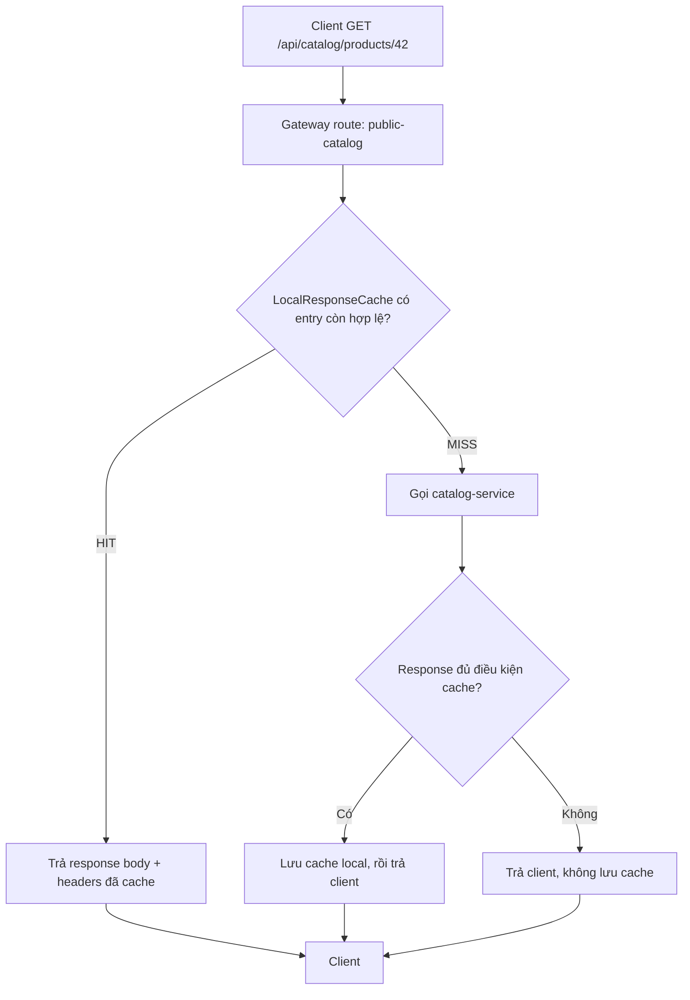
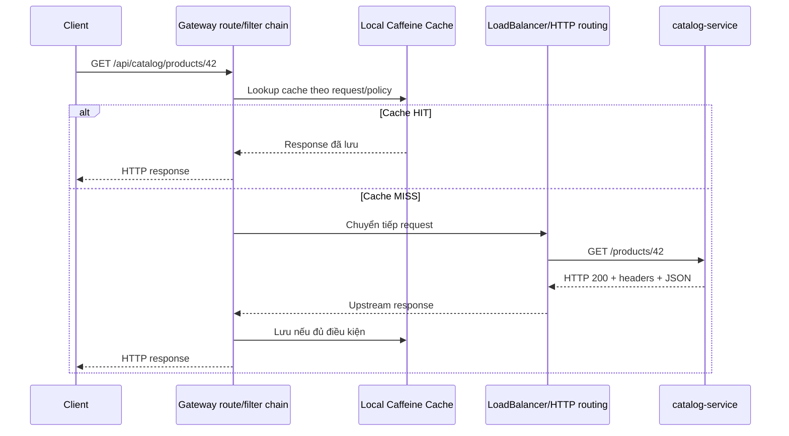
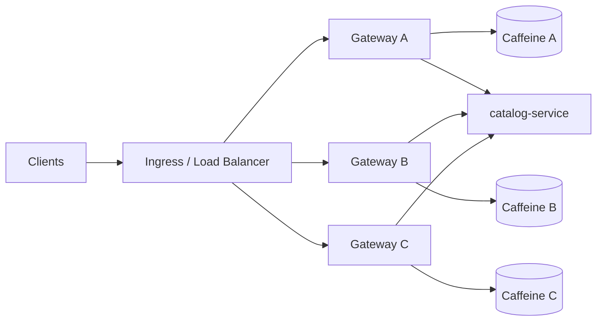
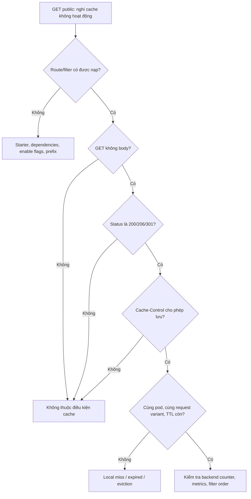

# LocalResponseCache và các dependency cần thiết

Một **Spring Cloud Gateway** phục vụ hàng nghìn request đọc danh mục sản phẩm có thể phải chuyển tiếp nhiều lần cùng một nội dung đến `catalog-service`. Nếu dữ liệu được phép cache và không thay đổi quá thường xuyên, Gateway có thể tái sử dụng response trong một khoảng thời gian ngắn, giảm số lượt gọi backend và độ trễ cho client.

Trong Spring Cloud Gateway Server WebFlux, **`LocalResponseCache`** cung cấp khả năng cache **HTTP response body và headers** tại chính tiến trình Gateway, sử dụng **Caffeine**. Tên *Local* rất quan trọng: cache nằm trong phạm vi một **Gateway instance/pod**, không phải Redis, database hay bộ nhớ chung giữa nhiều bản sao. Cùng một URL đi vào hai Gateway pods có thể có hai bản cache với thời điểm hết hạn khác nhau.

Bài thuộc chương **Bộ nhớ đệm** của module **SPRING_CLOUD_GATEWAY**. Chúng ta sẽ xác định đúng dependency, bật cache có chủ đích theo route, hiểu điều kiện cache và `Cache-Control`, đo hit/miss, xử lý dữ liệu riêng tư, quan sát tác động khi có route predicate, filter chain, rewrite path/header, service discovery, xác thực, rate limiting, circuit breaker, retry, TLS và nhiều Gateway replicas.

> **Phạm vi:** Bài tập trung vào **Spring Cloud Gateway Server WebFlux**. Server Web MVC có công nghệ xử lý request/response và cấu hình filter khác; không sao chép nguyên route DSL hoặc tên starter từ WebFlux sang MVC. Các ví dụ dưới đây sử dụng namespace property của dòng Gateway WebFlux mới; với Gateway 4.x hoặc bản cũ hơn, phải đối chiếu Configuration Properties của **đúng release train**.

## 1. Bài toán: cache ở Gateway để làm gì?

Giả sử có API:

```http
GET /api/catalog/products/42 HTTP/1.1
Host: api.shop.example
Accept: application/json
```

Ở trạng thái không cache, mỗi request đi qua chuỗi:

```text
Client
  → Gateway: route predicate / gateway filters
  → LoadBalancer: chọn catalog-service instance
  → catalog-service: truy vấn dữ liệu
  → Gateway: nhận response
  → Client: trả JSON
```

Nếu cache response **phù hợp hợp đồng HTTP**, sau request đầu tiên Gateway có thể trả nội dung đã lưu cho những request tiếp theo mà không gọi backend.



Đây là **luồng khái niệm**, không mô tả chi tiết từng callback/filter của mọi phiên bản. Sự tồn tại của route, Caffeine và HTTP response phù hợp mới tạo điều kiện; **không phải mọi GET đều được cache**.

### Lợi ích và chi phí

| Lợi ích tiềm năng | Đánh đổi |
| --- | --- |
| Giảm số request backend đối với response lặp lại. | Tốn bộ nhớ trên mỗi Gateway replica. |
| Có thể giảm độ trễ khi cache hit. | Có thể phục vụ dữ liệu cũ trong thời gian TTL. |
| Giảm phụ thuộc tức thời vào backend cho các cache hit. | Có nguy cơ lỗi bảo mật nếu cache response cá nhân. |
| Phù hợp cache ngắn hạn cho tài nguyên công khai. | Cache bị phân mảnh giữa replicas và mất khi restart. |
| Có thể giảm áp lực DB do những GET phổ biến. | Cần theo dõi hit ratio, memory, eviction và tính đúng cache key. |

### Ba loại “cache” khác nhau

| Cơ chế | Dữ liệu được lưu | Phạm vi |
| --- | --- | --- |
| **`LocalResponseCache`** | HTTP response body và headers đủ điều kiện. | Trong **một Gateway process/pod**. |
| **`CacheRequestBody`** | Request body đã đọc/giải mã để filter tiếp theo sử dụng. | Trong vòng đời **một request** tại exchange. |
| **Redis / distributed cache do ứng dụng thiết kế** | Data object/response/quota tuỳ kiến trúc và key do ứng dụng định nghĩa. | Có thể dùng chung giữa nhiều ứng dụng/pods. |

`RedisRateLimiter` dùng Redis để phối hợp **token bucket quota**, không tự làm Redis trở thành nơi lưu response của `LocalResponseCache`.

## 2. LocalResponseCache nằm ở đâu trong Gateway WebFlux?

Sau khi `RoutePredicateHandlerMapping` chọn route, `FilteringWebHandler` chạy chuỗi kết hợp `GlobalFilter` và `GatewayFilter` của route, được sắp xếp theo `Ordered`. Response cache tương tác với phần HTTP routing/write-response để có thể trả nội dung đã lưu hoặc lưu response mới.



**Đừng suy luận** cache hit bắt buộc bỏ qua tất cả `GlobalFilter`, Spring Security hoặc mọi bước logging. Một số thành phần có thể chạy **trước** lookup cache, một số thành phần sau đó có thể không chạy nếu response được trả sớm. Cần quan sát thứ tự thực tế khi tích hợp authentication, rate limiting và tracing.

### Cache hit khác HTTP 304

- **Cache hit:** Gateway lấy response từ cache, có thể trả body HTTP 200 từ cache nếu request/semantics cho phép.
- **HTTP 304 Not Modified:** response **không có body**, cho biết client có thể tiếp tục dùng bản đã lưu theo hợp đồng HTTP caching. Đây không phải một response JSON bình thường.
- **Backend trả HTTP 304:** cần hiểu conditional requests và các validator như `ETag`/`Last-Modified`; không mặc định LocalResponseCache thay thế mọi cơ chế revalidation.

Phần `Cache-Control: no-cache` ở mục 4 giải thích một hành vi `304` được tài liệu Gateway mô tả.

## 3. Điều kiện nào khiến response được cache?

Theo tài liệu `LocalResponseCache` của Gateway Server WebFlux ở các dòng hỗ trợ, bộ lọc chỉ xem xét lưu response nếu **đồng thời** thỏa những điều kiện sau:

1. Request là **GET không có request body** (*bodiless GET*).
2. Response status nằm trong nhóm **HTTP 200 OK, 206 Partial Content hoặc 301 Moved Permanently**.
3. Request **không** có `Cache-Control: no-store`.
4. Response **không** có `Cache-Control: no-store` và **không** có `Cache-Control: private`.
5. Filter đã bật, dependency hiện diện, cache đủ chỗ/khả dụng và request/response đáp ứng các điều kiện thực thi tương ứng.

### Ma trận cơ bản

| Request | Response | Cache theo các điều kiện nêu trên? | Lý do |
| --- | --- | --- | --- |
| GET không body | `200`, `Cache-Control: public, max-age=60` | **Có thể** | Tài nguyên được phép lưu. |
| GET không body | `206`, không bị cấm cache | **Có thể**, cần kiểm tra `Range` thực tế | Partial content có rủi ro nếu cache key thiếu byte range. |
| GET không body | `301`, không bị cấm cache | **Có thể** | Redirect vĩnh viễn thuộc nhóm status hỗ trợ. |
| GET không body | `404` | Không theo rule status này | Không thuộc 200/206/301. |
| GET không body | `500` | Không theo rule status này | Không cache lỗi backend bằng cơ chế này. |
| POST JSON | `200` | Không | Request không phải bodiless GET. |
| GET có request body | `200` | Không | Vi phạm điều kiện bodiless GET. |
| GET, header `Cache-Control: no-store` | `200` | Không | Client yêu cầu không lưu. |
| GET không body | `200`, response `Cache-Control: private` | Không | Response chỉ dành cho ngữ cảnh riêng tư. |
| GET không body | `200`, response `Cache-Control: no-store` | Không | Upstream cấm lưu. |

**Không chỉ nhìn status** để quyết định an toàn. Một response HTTP 200 cho `GET /api/me` chứa thông tin tài khoản, session hoặc đơn hàng của user A vẫn phải được chặn cache bằng **chính sách route và response headers**; `LocalResponseCache` không tự trở thành engine kiểm tra quyền tài nguyên.

### Cache-Control directives được xét độc lập

Ví dụ một response:

```http
Cache-Control: max-age=60, private
```

vẫn **không được cache** bởi filter do có `private`, dù có `max-age`.

Tương tự:

```http
Cache-Control: no-cache, no-store, max-age=0
```

có `no-store` nên không cache. Directive không nhất thiết đứng một mình, và tài liệu mới mô tả cách nhận diện theo từng directive, không phân biệt chữ hoa/thường.

## 4. TTL, Cache-Control và những header cần hiểu rõ

### 4.1. TTL (time to live)

**TTL** của LocalResponseCache là giới hạn thời gian một entry được giữ hợp lệ theo chính sách cấu hình. Chẳng hạn:

```text
TTL = 30 giây

T=0s   GET đầu tiên → MISS → backend → lưu response
T=8s   GET tương tự → có thể HIT
T=25s  GET tương tự → có thể HIT
T=31s  GET tương tự → có thể MISS do entry hết hạn
```

Đây là timeline minh họa; cache có thể bị evict **trước TTL** vì giới hạn kích thước, áp lực bộ nhớ hoặc cấu hình. TTL hết hạn **không tự đẩy thông báo** đến mọi client hoặc các Gateway pods khác.

### 4.2. Response Cache-Control: max-age

Tài liệu Gateway WebFlux mô tả khả năng **tính lại `max-age`**:

- Nếu response gốc **đã có `Cache-Control: max-age=...`**, giá trị được rewrite theo TTL cấu hình.
- Các lần lấy từ cache tiếp theo có thể nhận `max-age` đã giảm theo **số giây còn lại đến khi entry hết hạn**.
- Nếu response gốc **không có `max-age`**, không nên mặc định filter sẽ tự thêm mọi header cache mà ứng dụng cần.

Ví dụ response gốc:

```http
HTTP/1.1 200 OK
Cache-Control: public, max-age=3600
Content-Type: application/json

{"id":42,"name":"Keyboard"}
```

Nếu route cache TTL là `30s`, khi lưu/đọc response, `max-age` có thể được tính lại tương ứng với TTL thay vì giữ nguyên `3600`. Khi kiểm thử, quan sát giá trị thực tế trên request đầu, request cache hit và sau khi TTL hết hạn.

**TTL của Gateway không bằng thời hạn cache của browser/CDN.** Browser/proxy dùng các response headers nhận được để đưa ra quyết định riêng. Khi nhiều tầng cache cùng tồn tại, hãy định nghĩa rõ ai làm mới, ai phục vụ stale data và cách vô hiệu hóa khi thông tin thay đổi.

### 4.3. No-store khác no-cache

| Directive | Ý nghĩa vận hành | Cần lưu ý với LocalResponseCache |
| --- | --- | --- |
| `no-store` | Không lưu bản sao theo chính sách HTTP. | Là điều kiện **không cache** được tài liệu Gateway nêu. |
| `private` (response) | Chỉ phù hợp cache riêng tư, không lưu ở shared cache. | Là điều kiện **không cache** của LocalResponseCache. |
| `no-cache` | Có thể lưu trong cache nhưng cần revalidation trước khi tái sử dụng theo HTTP semantics. | **Không đồng nghĩa `no-store`**; cần kiểm tra hành vi phiên bản. |
| `max-age=N` | Định nghĩa freshness cho HTTP caches. | Có thể bị rewrite theo TTL LocalResponseCache. |
| `public` | Cho phép shared cache theo HTTP semantics khi các điều kiện khác đúng. | Chỉ nên dùng khi response thực sự không chứa nội dung dành riêng một user. |

Ở một số dòng Gateway WebFlux, tài liệu `LocalResponseCache` mô tả: nếu response **đã có trong cache** và request mới mang `Cache-Control: no-cache`, filter có thể trả **`304 Not Modified` không có body**. Điều này đáng chú ý vì không giống một JSON 200 thông thường. **Không thiết kế client bằng cách giả định mọi phiên bản/validator/ETag đều hoạt động như nhau**; phải test trực tiếp trên phiên bản đang triển khai. Một số dòng có thêm property về **`request.no-cache-strategy`**; kiểm tra Config Props trước khi dùng.

### 4.4. Vary, ETag và Last-Modified

Nếu response thay đổi theo:

- `Accept-Language`;
- `Accept-Encoding`;
- `Origin`/CORS;
- `Authorization`/cookie;
- query string, hostname hoặc tenant context;

thì **cache key và HTTP `Vary` semantics** phải phân biệt các biến thể một cách đúng đắn. Không tự khẳng định rằng một bản Gateway cụ thể luôn đưa mọi header này vào cache key. Hãy **kiểm thử sự tách biệt từng biến thể** hoặc tránh cache các response phụ thuộc danh tính/ngữ cảnh.

`ETag` và `Last-Modified` là validators hữu ích cho conditional GET, nhưng không phải bằng chứng rằng LocalResponseCache luôn tự phát sinh hoặc xác minh validator. Backend cần định nghĩa semantics của nó; Gateway/CDN/browser phải được kiểm tra để không trả biến thể sai.

## 5. Dependency bắt buộc: Gateway, Spring Cache và Caffeine

Trong các phiên bản Gateway Server WebFlux có LocalResponseCache, tài liệu chính thức yêu cầu thêm hai dependency **ngoài Gateway starter**:

1. **`org.springframework.boot:spring-boot-starter-cache`** — tích hợp Spring Cache và auto-configuration.
2. **`com.github.ben-manes.caffeine:caffeine`** — thư viện cache in-memory Caffeine làm nền lưu response local.

### Ví dụ Maven

Với dự án đã dùng Spring Boot parent/Dependency Management và Spring Cloud BOM tương thích:

```xml
<dependencies>
    <dependency>
        <groupId>org.springframework.cloud</groupId>
        <artifactId>spring-cloud-starter-gateway-server-webflux</artifactId>
    </dependency>
    <dependency>
        <groupId>org.springframework.boot</groupId>
        <artifactId>spring-boot-starter-cache</artifactId>
    </dependency>
    <dependency>
        <groupId>com.github.ben-manes.caffeine</groupId>
        <artifactId>caffeine</artifactId>
    </dependency>
    <!-- Tùy nhu cầu quan sát -->
    <dependency>
        <groupId>org.springframework.boot</groupId>
        <artifactId>spring-boot-starter-actuator</artifactId>
    </dependency>
</dependencies>
```

Đây là **đoạn dependency**, không phải file `pom.xml` hoàn chỉnh. Không tự đặt version ngẫu nhiên cho Gateway/Caffeine khi dùng BOM; chọn bộ Spring Boot/Spring Cloud release train được hỗ trợ và xem dependency tree thực tế.

### Ví dụ Gradle

```groovy
dependencies {
    implementation "org.springframework.cloud:spring-cloud-starter-gateway-server-webflux"
    implementation "org.springframework.boot:spring-boot-starter-cache"
    implementation "com.github.ben-manes.caffeine:caffeine"
    implementation "org.springframework.boot:spring-boot-starter-actuator"
}
```

Với các dòng Gateway cũ, starter có thể là `spring-cloud-starter-gateway` thay vì `spring-cloud-starter-gateway-server-webflux`. Dùng starter đúng phiên bản WebFlux; **không đưa MVC starter vào chỉ để “bổ sung” tính năng caching**.

### Vì sao hai dependency đều cần?

| Thiếu thành phần | Hệ quả/điểm kiểm tra |
| --- | --- |
| Thiếu Gateway Server WebFlux | Không có route/filter runtime đang minh họa. |
| Thiếu `spring-boot-starter-cache` | Tính năng LocalResponseCache có thể không được khởi tạo/kích hoạt như tài liệu yêu cầu. |
| Thiếu Caffeine | Không có nhà cung cấp local cache phù hợp cho tính năng này. |
| Có dependency nhưng không bật filter | Request vẫn có thể đi thẳng backend, không có cache route mong đợi. |
| Có nhiều `CacheManager` tùy biến | Bean ambiguity hoặc cache manager được chọn không như mong muốn; cần `@Primary`/`@Qualifier` theo tài liệu. |

Nếu ứng dụng **đã có một `CacheManager` custom**, đừng thêm một bean `CacheManager` khác với tên/priority tùy ý để “sửa” LocalResponseCache. Tài liệu Gateway lưu ý cần xử lý bean selection, ví dụ đánh dấu đúng bean `@Primary` hoặc dùng `@Qualifier` khi injection; phải xác minh bean mà filter thực sự dùng và ảnh hưởng đến những cache khác của ứng dụng.

### Caffeine không tự biến cache thành distributed cache

Thêm Caffeine chỉ cung cấp **bộ nhớ local hiệu quả**. Khi Gateway chạy ba pods, mỗi process vẫn có cache và lifecycle riêng. Không có invalidation broadcast, shared key space hoặc consistency liên pod chỉ nhờ thêm dependency này.

## 6. Hai cách kích hoạt: global và route-specific

Spring Cloud Gateway Server WebFlux có hai tầng cấu hình liên quan:

| Kiểu | Mục đích | Rủi ro nếu bật sai |
| --- | --- | --- |
| **Global local-response-cache filter** | Cho phép cache ở phạm vi nhiều/toàn bộ routes phù hợp điều kiện. | Dễ vô tình đụng đến GET cá nhân/nhạy cảm nếu headers và policy backend chưa chặt. |
| **`LocalResponseCache` GatewayFilter theo route** | Bật cache có chủ đích trên một route, có thể đặt TTL/kích thước riêng. | Cần đúng route ID, property enable và các dependency. |

Ở các dòng Gateway mới, **Configuration Properties** liệt kê những nhánh như:

```text
spring.cloud.gateway.server.webflux.global-filter.local-response-cache.enabled
spring.cloud.gateway.server.webflux.filter.local-response-cache.enabled
spring.cloud.gateway.server.webflux.filter.local-response-cache.time-to-live
spring.cloud.gateway.server.webflux.filter.local-response-cache.size
```

Trong tài liệu một số bản cũ, chúng nằm dưới:

```text
spring.cloud.gateway.global-filter.local-response-cache.enabled
spring.cloud.gateway.filter.local-response-cache.enabled
spring.cloud.gateway.filter.local-response-cache.time-to-live
spring.cloud.gateway.filter.local-response-cache.size
```

**Đặc biệt cần kiểm tra phiên bản:** một số trang tài liệu GatewayFilter mới vẫn nhắc tên enable property cũ trong phần mô tả, trong khi bảng Configuration Properties của Gateway WebFlux mới có prefix `server.webflux`. **Ưu tiên bảng cấu hình thực tế, metadata binding và kiểm thử startup của đúng artifact** đang chạy; không khai báo song song hai nhánh chỉ để đoán.

### Cấu hình an toàn cho bài lab

Ví dụ sau **tắt cache global** và chỉ bật filter trên route public catalog:

```yaml
spring:
  cloud:
    gateway:
      server:
        webflux:
          global-filter:
            local-response-cache:
              enabled: false
          filter:
            local-response-cache:
              enabled: true
          routes:
            - id: public-catalog
              uri: http://localhost:8081
              predicates:
                - Path=/api/catalog/**
                - Method=GET
              filters:
                - StripPrefix=2
                - LocalResponseCache=30s,16MB
```

**Ý nghĩa:**

- `global-filter.local-response-cache.enabled: false` tránh vô tình cache các route khác.
- `filter.local-response-cache.enabled: true` bật khả năng dùng `LocalResponseCache` theo route trong dòng hỗ trợ.
- `LocalResponseCache=30s,16MB` là cú pháp shortcut: tham số thứ nhất là TTL 30 giây, thứ hai là giới hạn cache 16 MB cho route theo cơ chế filter.
- Predicate `Method=GET` ngăn route test xử lý POST; điều kiện nội tại của filter còn đòi GET không có body.
- `StripPrefix=2` làm backend nhận `/products/42` từ URL public `/api/catalog/products/42`.
- Backend cần trả response đủ điều kiện, đặc biệt không có `no-store`/`private`.

**Lưu ý:** Một route chỉ định `LocalResponseCache` chưa phải chính sách bảo mật hoàn chỉnh. Nên xác định rõ endpoint là công khai, response không biến thiên theo người dùng, có giới hạn size và cách invalidation.

### Có nên bật global để “mọi route nhanh hơn”?

Không nên bật chỉ vì kỳ vọng tăng hiệu năng. Một GET `/api/me` có thể trả 200 và không có `private/no-store` do backend cấu hình thiếu. Khi global cache bật, response **có nguy cơ được lưu ngoài dự kiến**, đặc biệt nếu cache key không phân biệt toàn bộ yếu tố danh tính.

Thiết kế thực tế nên bắt đầu với **allowlist routes công khai** và các HTTP cache headers đúng, sau đó đo hiệu quả. Chỉ dùng global khi toàn bộ public API contract và safety review đảm bảo không có dữ liệu cá nhân/bí mật bị lưu chung.

## 7. Java RouteLocatorBuilder và LocalResponseCache

Trong các dòng Gateway Server WebFlux cung cấp Java DSL tương ứng, có thể cấu hình:

```java
import java.time.Duration;
import org.springframework.cloud.gateway.route.RouteLocator;
import org.springframework.cloud.gateway.route.builder.RouteLocatorBuilder;
import org.springframework.context.annotation.Bean;
import org.springframework.context.annotation.Configuration;

@Configuration
public class CatalogCacheRoutes {

    @Bean
    RouteLocator catalogRoutes(RouteLocatorBuilder builder) {
        return builder.routes()
            .route("public-catalog", route -> route
                .path("/api/catalog/**")
                .filters(filters -> filters
                    .stripPrefix(2)
                    .localResponseCache(Duration.ofSeconds(30), "16MB"))
                .uri("http://localhost:8081"))
            .build();
    }
}
```

Trong ví dụ Java, `Duration.ofSeconds(30)` và `"16MB"` thể hiện cùng ý tưởng như YAML. Tên phương thức `localResponseCache` và API builder **phải kiểm tra bằng dependency/IDE của phiên bản đang dùng**; đây là DSL WebFlux, không phải MVC.

Đừng khai báo **cùng route ID `public-catalog` trong cả YAML và Java DSL** nếu chưa có chủ đích; xung đột route definitions có thể gây hành vi khó đoán. Chọn một nguồn quản lý route hoặc xác định rõ cơ chế nạp/ưu tiên.

## 8. Cách chọn TTL và giới hạn kích thước

### TTL theo đặc tính dữ liệu

| API ví dụ | Có nên cache local? | TTL khởi đầu để thử nghiệm | Lý do |
| --- | --- | --- | --- |
| Danh mục sản phẩm công khai ít đổi | Có thể | 15–60 giây | Giảm backend traffic nhưng chấp nhận stale ngắn hạn. |
| Cấu hình UI công khai có version | Có thể | Phụ thuộc cơ chế publish/version | Cache key có version thường dễ quản trị hơn. |
| Tỷ giá/giá bán thay đổi nhanh | Cần rất thận trọng | Theo SLA freshness chặt | Dữ liệu cũ có thể gây quyết định sai. |
| `/api/me`, giỏ hàng, đơn hàng theo user | **Tránh** | Không áp dụng | Chứa dữ liệu riêng từng principal. |
| Dữ liệu thanh toán, token, PII | **Không dùng shared response cache** | Không áp dụng | Rủi ro bảo mật nghiêm trọng. |
| Download lớn hoặc video/range | Cần POC chuyên biệt | Theo đặc điểm nội dung | Kích thước, `206`, `Range` và buffer pressure. |

Những TTL ở bảng là **giá trị giả định để thảo luận**, không phải mặc định của framework hay SLO thực tế. Freshness phải là quyết định của chủ dữ liệu và người vận hành API.

### Kích thước và áp lực bộ nhớ

Giả sử mỗi Gateway replica có cache limit thử nghiệm `16MB` trên route catalog. Với ba replicas, về nguyên tắc có thể có **ba tập entry độc lập**, mỗi tập giới hạn riêng. Không suy luận “toàn cluster chỉ dùng 16 MB”.

Ngoài dung lượng cached bodies còn có overhead của Caffeine entries/metadata, JVM heap/direct buffers, request/response processing, Netty connection pool, TLS, route metadata và các cache khác.

**Bộ nhớ thực tế cần đo bằng metrics/profiling**, không tính đơn giản `cached response bytes = toàn bộ RAM của cache`. Một số phiên bản có eviction policy/ước lượng kích thước và cách đếm bytes khác nhau; kiểm tra giới hạn được thực thi thực tế khi test với body nhỏ/lớn.

### Giới hạn kích thước không thay backend body limit

`16MB` ở `LocalResponseCache` không phải giới hạn HTTP response tối đa của backend và **không** tự chặn request upload lớn. Request size, response buffering, codec và ingress/server constraints là các cơ chế khác.

## 9. Cache key: khi nào hai request thật sự tương đương?

Cache chỉ đúng khi hai request được coi là **cùng một tài nguyên với cùng một biểu diễn HTTP**. Một URL có thể thay đổi response bởi path, query, hostname, ngôn ngữ, nội dung `Accept` hoặc danh tính user.

Ví dụ:

```http
GET /api/catalog/products/42?currency=VND
Accept-Language: vi
```

và:

```http
GET /api/catalog/products/42?currency=USD
Accept-Language: en
```

không nhất thiết được phép dùng chung bản cache. Tương tự, `GET /api/orders/123` với token của user A và user B **không được dùng chung response** chỉ vì đường dẫn giống nhau.

### Những chiều cần xét khi thiết kế

| Chiều biến thiên | Trường hợp | Cách xử lý |
| --- | --- | --- |
| **Path** | `/products/42` khác `/products/43`. | Kiểm tra route + key thực tế phân biệt path. |
| **Query** | `currency=VND` khác `currency=USD`. | Test các query variants; không tự khẳng định key luôn bao gồm tất cả query. |
| **Host/tenant** | `shop-a.example` và `shop-b.example` dùng cùng path. | Cô lập route/host hoặc tắt cache nếu thiếu bảo đảm phân tách. |
| **`Accept-Language`** | Nội dung tiếng Việt và tiếng Anh. | Dùng `Vary` đúng nghĩa; kiểm thử cache key thực tế. |
| **`Accept-Encoding`** | Response nén/không nén. | Kiểm thử content encoding/body/header không bị tráo biến thể. |
| **`Origin`/CORS** | CORS response headers phụ thuộc allowed origin. | Đặt chính sách CORS ở tầng phù hợp, kiểm tra `Vary: Origin` và response từ cache. |
| **`Authorization`/Cookie** | API trả dữ liệu theo user. | **Không cache shared response**; dùng `private, no-store` và loại route. |
| **Backend release/version** | Dữ liệu/contract thay đổi khi deploy. | Dùng URL có version hoặc TTL/invalidation phù hợp. |

Tài liệu `LocalResponseCache` đưa ra điều kiện cache và cấu hình TTL/size, nhưng **không nên suy ra** từ đó một cam kết tổng quát về mọi chiều của cache key ở tất cả phiên bản. Trước khi đưa API đa ngôn ngữ, đa tenant hoặc CORS phức tạp vào cache, phải kiểm chứng bằng **hai request khác nhau có response khác nhau** xem có bị dùng nhầm bản cache không.

### Không sửa URL rồi quên cache semantics

`StripPrefix`, `RewritePath`, `SetPath` và `RewriteRequestParameter` có thể biến đổi URL trước khi gửi upstream. Cache key có thể được xây dựng trong một pha khác với path cuối cùng. **Đừng mặc định** đổi path ở Gateway sẽ luôn làm cache key biến đổi đúng như backend path.

Với API cần xử lý nhiều query/path variants, hãy viết test matrix theo URL **client thực gửi**, query, header, thứ tự filter và response backend. Nếu một biến thể không được phân biệt chắc chắn, hãy tắt cache cho route đó hoặc chuyển sang giải pháp cache có key policy được xác định rõ.

## 10. Bảo mật: không cache response cá nhân ở một shared edge

LocalResponseCache có thể lưu dữ liệu từ nhiều request khác nhau trong cùng một Gateway process. Dù cache không được chia sẻ giữa Gateway replicas, nó vẫn là **shared response cache giữa nhiều client đi vào cùng pod**.

### Tình huống rò rỉ cần tránh

Giả sử một backend có endpoint:

```http
GET /api/me HTTP/1.1
Authorization: Bearer <user-A-token>
```

và trả:

```http
HTTP/1.1 200 OK
Content-Type: application/json

{"userId":"A","email":"user-a@example.invalid"}
```

Nếu bật global cache, backend không gửi `Cache-Control: private`/`no-store` và cache key không có phân tách an toàn theo user, response có nguy cơ **bị tái sử dụng cho user B**. Đây là sự cố bảo mật, không phải lỗi hiệu năng nhỏ.

**Phòng vệ ưu tiên:**

1. Không bật LocalResponseCache trên route có **response theo user/session/account/tenant**, trừ khi thiết kế được thẩm định đặc biệt.
2. Backend trả `Cache-Control: private, no-store` cho thông tin nhạy cảm; không chỉ kỳ vọng Gateway nhìn thấy cookie/JWT và tự loại.
3. Không thêm `public` hoặc `max-age` cho response cá nhân chỉ để tăng hit ratio.
4. Hạn chế cache global; sử dụng **explicit allowlist routes**.
5. Kiểm thử các user A/B, token khác nhau, query khác nhau và cả status lỗi.

### Headers kiểm soát cache ở backend

**Dữ liệu công khai có thể stale ngắn:**

```http
HTTP/1.1 200 OK
Content-Type: application/json
Cache-Control: public, max-age=60

{"id":42,"name":"Keyboard"}
```

**Dữ liệu cá nhân hoặc nhạy cảm:**

```http
HTTP/1.1 200 OK
Content-Type: application/json
Cache-Control: private, no-store

{"userId":"A","email":"user-a@example.invalid"}
```

Ví dụ là chính sách response do **backend hoặc tầng có thẩm quyền định nghĩa**. Nếu Gateway rewrite/loại `Cache-Control` hoặc một response modifier chuyển private thành public trước khi cache đánh giá eligibility, lớp bảo vệ này có thể mất hiệu lực. Vì vậy, cần kiểm tra **response headers cuối cùng** và thứ tự filter.

### Set-Cookie, Authorization và token

Không coi “response có `Set-Cookie` thì chắc chắn tự bị loại khỏi cache” như một đảm bảo mặc định. Điều kiện công bố của `LocalResponseCache` nhấn mạnh method, status và `Cache-Control`; hãy **chủ động không cache** các response session/token, login redirect, reset password, thanh toán và định danh cá nhân.

Tránh để `Authorization`, cookie, access token, refresh token, session ID hoặc dữ liệu cá nhân xuất hiện trong cache key/log/metric tags. Ngay cả cache key “an toàn” cũng không biến lưu response chứa token thành một thiết kế nên dùng.

### Spring Security vẫn cần phân quyền backend

Nếu Gateway dùng OAuth2 Login/Resource Server, Security thường kiểm tra request trong `WebFilter` chain; cache hit **không phải lý do** bỏ qua authentication/authorization. Nhưng một filter Security chỉ kiểm tra “user đã đăng nhập” vẫn chưa bảo đảm user được đọc **tài nguyên của user khác**.

Backend cần xác minh quyền theo tài nguyên và response private phải không đi qua shared cache. **Không gửi nội dung cached của một user cho người khác chỉ vì cả hai đều có bearer token hợp lệ.**

## 11. GlobalFilter, GatewayFilter và thứ tự response transformations

Một hệ thống có thể dùng:

- `RequestRateLimiter` để giới hạn request.
- `TokenRelay` để gắn access token xuống backend.
- `StripPrefix`/`RewritePath` để biến đổi đường dẫn.
- `ModifyResponseBody` để đổi JSON response.
- `SetResponseHeader`/`AddResponseHeader` để đặt HTTP headers.
- `LocalResponseCache` để tái sử dụng response.

### Điều gì xảy ra khi bật cache cùng ModifyResponseBody?

Ví dụ backend trả:

```json
{"price":100}
```

Một filter tùy chỉnh chuyển thành:

```json
{"price":100,"currency":"VND"}
```

Muốn cache đúng, phải xác định **bản nào được lưu**: response gốc backend hay response đã rewrite; khi cache hit, liệu transformation có được áp lại hay không? Kết quả phụ thuộc **thứ tự các filter và implementation cụ thể**.

Không mặc định chỉ vì YAML liệt kê `ModifyResponseBody` trước `LocalResponseCache` mà mọi phase sẽ theo đúng trình tự đọc từ trên xuống. Trong Gateway WebFlux, filter có **pre/post phases**; filter có độ ưu tiên cao chạy trước ở pre-phase và sau ở post-phase.

**Kiểm thử cần làm:** gửi hai GET liên tiếp, so response body, content type, content length, ETag, Vary và custom response headers; xác minh request thứ hai không bị rewrite hai lần hoặc trả dữ liệu khác. Nếu cần cache response đã chuyển đổi, kiểm tra đúng thứ tự thực thi và compatibility của các filters.

### Rate limit khi cache hit

Một câu hỏi sản phẩm quan trọng: **cache hit có tiêu tốn quota của khách hàng không?**

- Nếu quota đo **số incoming HTTP requests**, cache hit nên vẫn được tính.
- Nếu quota đo **backend workload**, cache hit có thể không phải tiêu thụ cùng ngân sách, nhưng nên có giới hạn abuse ở edge.
- Nếu dùng hai filter với ordering khác nhau, có thể filter limiter không chạy trên một số cache hits.

Vì vậy, phải đo thực tế `incoming requests`, `limiter decisions`, `cache hits` và `backend requests`; không suy luận từ file YAML rằng mọi request đều bị tính một token.

### CircuitBreaker, Retry và response cache

Khi cache hit, có thể không cần gọi backend; vì thế một số cơ chế `CircuitBreaker`, `Retry` hoặc HTTP client timeout downstream không được kích hoạt. Nhưng **cache không thay cơ chế phục hồi**:

- Khi entry hết hạn/miss, backend vẫn có thể lỗi.
- Nếu upstream trả HTTP 5xx, status đó không thuộc danh sách eligible của LocalResponseCache nêu trên.
- `Retry` trên GET miss có thể tăng số backend attempts; cần giới hạn latency/tải.
- Không mặc định LocalResponseCache có chế độ `stale-if-error` hoặc `stale-while-revalidate` như CDN; chỉ dùng nếu phiên bản/cơ chế thật sự hỗ trợ và đã kiểm thử.

### Route predicate quyết định áp cache ở đâu

Nếu route `public-catalog` chỉ match `Method=GET`, những POST hay OPTIONS không khớp route sẽ không dùng LocalResponseCache của route này. Preflight CORS nên được xử lý theo chính sách Gateway/Spring Security phù hợp; cache filter không phải công cụ xử lý CORS.

## 12. Local cache khi có nhiều Gateway replicas

Một triển khai thực tế thường có nhiều pods sau ingress:



**Mỗi pod có cache riêng.** Nếu request đầu tiên vào pod A, pod A có thể lưu response. Request tiếp theo vào B có thể vẫn là **cache miss**, vì B chưa có entry. Khi pod C restart, cache của C rỗng; các pod khác không tự đồng bộ cho nó.

### Hệ quả cần dự kiến

| Hiện tượng | Nguyên nhân | Ý nghĩa |
| --- | --- | --- |
| Sau deployment backend RPS tăng mạnh | Các Gateway pods bị cold cache đồng thời. | Cần capacity cho warm-up; tránh cache stampede. |
| Cùng URL lúc thấy dữ liệu cũ, lúc mới | Các cache entry tạo tại thời điểm khác nhau giữa pods. | Cần chấp nhận stale theo TTL hoặc chiến lược invalidation khác. |
| Pod A hit nhiều, pod B miss nhiều | Phân phối traffic/sticky session/rollout khác. | Đo theo pod và tổng cluster, không chỉ một instance. |
| Xóa cache tại pod A nhưng B còn dữ liệu | Không có broadcast invalidation mặc định. | Không dùng local cache khi cần xóa đồng bộ tức thì. |
| Tăng replica làm giảm hit ratio ngắn hạn | Một tập traffic bị chia vào nhiều cache lạnh. | Đánh giá trước khi scale hoặc test warm-up. |

### Không tự cung cấp “một cache chung” bằng Redis

Trong những ví dụ trước, Redis được dùng để chia quota `RedisRateLimiter` giữa replicas. **Điều đó không làm `LocalResponseCache` dùng Redis**. Nếu hệ thống yêu cầu shared response cache toàn cụm, hãy thiết kế công cụ khác: reverse proxy/CDN cache, API management cache hoặc một distributed cache chuyên biệt với key/TTL/invalidation được kiểm soát.

Mỗi lựa chọn có chi phí mạng, độ trễ và tính nhất quán khác nhau. Caffeine local phù hợp khi chấp nhận cache ở từng pod, TTL ngắn và phản hồi công khai; không phù hợp làm “nguồn sự thật thống nhất” cho dữ liệu thay đổi liên tục.

## 13. Invalidation: khi dữ liệu thay đổi trước TTL

Giả sử sản phẩm 42 thay giá từ 100 thành 90 ngay sau khi Gateway lưu response. Nếu TTL 30 giây, gateway có thể tiếp tục trả giá cũ trong thời gian còn lại. Nếu đây là một ứng dụng thương mại có giá cần chính xác ở checkout, **không nên dùng dữ liệu cached của API catalog để tự quyết định giá cuối cùng của giao dịch**.

### Chiến lược phù hợp với từng loại dữ liệu

| Chiến lược | Cách làm | Đánh đổi |
| --- | --- | --- |
| **TTL ngắn** | Cho entry tự hết hạn sau vài giây/phút. | Có cửa sổ stale được chấp nhận. |
| **URL có version** | Ví dụ `/api/catalog/v2026-11/products/42`. | Client biết version, cần quản lý versioning. |
| **Không cache endpoint nhạy freshness** | Để backend trả dữ liệu hiện hành. | Backend chịu tải lớn hơn. |
| **Purge qua tầng cache chuyên biệt** | Dùng CDN/shared cache với invalidation có API đã kiểm soát. | Phụ thuộc hệ thống cache khác; cần quản lý quyền purge. |
| **Event-driven invalidation tự xây** | Đồng bộ sự kiện thay đổi đến các pod. | Phức tạp; LocalResponseCache không tự cung cấp broadcast như vậy. |

**Không mặc định** endpoint `/actuator/gateway/refresh` sẽ xóa mọi response entries trên mọi pod. Endpoint này phục vụ refresh **route cache** khi được bật; route-definition cache và LocalResponseCache body/headers là hai vòng đời độc lập. Nếu cần clear response cache, phải xác minh API/cache manager hỗ trợ và thiết kế cơ chế riêng.

### Khi TTL dài tạo rủi ro

- Giá, tồn kho hoặc khuyến mại thay đổi nhanh.
- Quyền truy cập user/tenant vừa bị thu hồi.
- Backend sửa dữ liệu vì lỗi pháp lý hoặc bảo mật.
- Đổi schema/contract JSON sau rollout.
- Chứng chỉ/token/cookie bị revoke nhưng response cũ vẫn có thể được dùng.

Những trường hợp liên quan danh tính/bảo mật nên **tránh local shared response cache**, thay vì dựa hoàn toàn vào invalidation không đồng bộ.

## 14. Phối hợp LocalResponseCache với browser cache, CDN và backend

Một request có thể gặp nhiều tầng:

```text
Browser cache
    ↓
CDN / edge cache (nếu có)
    ↓
Gateway LocalResponseCache ở từng pod
    ↓
Backend HTTP cache / application data cache
    ↓
Database
```

Mỗi tầng có scope và policy riêng. Một response header `Cache-Control: public, max-age=60` có thể được browser/CDN sử dụng; LocalResponseCache còn có **TTL riêng** và có thể rewrite `max-age`. Nếu một tầng giữ response lâu hơn dự kiến, client vẫn thấy stale data dù Gateway đã hết hạn entry.

### Hợp đồng caching cần được chủ dữ liệu phê duyệt

| Hợp đồng | Ví dụ câu hỏi |
| --- | --- |
| **Eligibility** | Tài nguyên nào thực sự public và GET response có thể dùng chung? |
| **Key** | Path, query, language, content encoding và host nào tạo biến thể? |
| **Freshness** | Nội dung có thể cũ tối đa bao lâu? |
| **Invalidation** | Khi cập nhật dữ liệu quan trọng, làm sao hết stale? |
| **Personalization** | Response có phụ thuộc JWT, cookie, tenant hay user không? |
| **HTTP headers** | `Cache-Control`, `ETag`, `Vary`, `Set-Cookie` được định nghĩa ra sao? |
| **Failure** | Backend lỗi thì cache có được dùng, với điều kiện nào? |
| **Observability** | Đo hit ratio/eviction/response age ở tầng nào? |

### CORS và cache

Gateway có thể trả `Access-Control-Allow-Origin` khác nhau theo `Origin` nếu dùng allowlist. Response cache phải không khiến **CORS header của origin A** bị trả nhầm cho origin B. Nếu response thay đổi theo `Origin`, `Vary: Origin` là một tín hiệu HTTP quan trọng cho các caches.

Tuy nhiên, **có `Vary: Origin` không tự chứng minh LocalResponseCache hiện tại dùng Origin trong key**. Hãy test với ít nhất hai origins được phép và một origin bị từ chối, đặc biệt khi CORS filter và LocalResponseCache chạy ở hai phase khác nhau. Ưu tiên chính sách CORS đặt đúng tầng và tắt cache đối với response phức tạp/không thể chứng minh an toàn.

## 15. Bài thực hành A: xác nhận hit/miss trên một Gateway process

### 15.1. Chuẩn bị

| Thành phần | Địa chỉ giả định | Nhiệm vụ |
| --- | --- | --- |
| Gateway WebFlux | `http://localhost:8080` | Route `public-catalog` có `LocalResponseCache=30s,16MB`. |
| Backend mock | `http://localhost:8081` | Nhận GET, tăng bộ đếm và trả JSON public. |
| Caffeine | In-memory trong Gateway | Lưu response đã đủ điều kiện. |
| `curl` | Máy thử nghiệm | Đo response headers/status và thời gian. |

Backend mock cần triển khai:

```text
GET /products/42
    -> tăng counter của endpoint khi backend THỰC SỰ nhận request
    -> trả Content-Type: application/json
    -> trả Cache-Control: public, max-age=120
    -> trả JSON có counter + productId
```

Ví dụ output do mock tạo:

```http
HTTP/1.1 200 OK
Cache-Control: public, max-age=120
Content-Type: application/json

{"productId":42,"backendCounter":1}
```

**Không phải response mặc định của framework.** Bộ đếm trong body dùng để minh họa backend có được gọi lại hay không; trong production không nên thêm dữ liệu debug có tính nhạy cảm để chứng minh cache hit.

### 15.2. Bật dependencies và route

1. Thêm `spring-boot-starter-cache` và `caffeine` vào classpath cùng Gateway WebFlux starter.
2. Cấu hình filter theo route như mục 6; **tắt global cache**, bật local-response-cache route filter.
3. Đảm bảo backend mock lắng nghe `8081` và trả đúng `/products/42` sau `StripPrefix=2`.
4. Khởi động Gateway, kiểm tra log startup/route config; không có bean conflict `CacheManager`.

### 15.3. GET lần thứ nhất

```bash
curl -i \
  -H "Accept: application/json" \
  "http://localhost:8080/api/catalog/products/42"
```

Kỳ vọng khi cache ban đầu rỗng:

- Gateway chọn route `public-catalog`.
- Backend nhận GET `/products/42`.
- Response là HTTP `200`, có `Cache-Control` cho phép cache.
- Mock trả `backendCounter: 1`.
- Cache lưu bản phù hợp với chính sách và giới hạn.

### 15.4. GET lần thứ hai trong TTL

```bash
curl -i \
  -H "Accept: application/json" \
  "http://localhost:8080/api/catalog/products/42"
```

Nếu cache hit đúng:

- Response body vẫn có `backendCounter: 1`.
- Backend counter **không tăng** cho lần gọi này.
- `Cache-Control: max-age` có thể giảm so với lần đầu, theo thời gian TTL còn lại.
- Gateway có thể có độ trễ thấp hơn, nhưng cần đo nhiều lần và loại trừ keep-alive/JIT/backend cache để kết luận.

**Quan trọng:** chỉ nhìn body giống nhau **không đủ** để khẳng định cache hit; backend có thể trả dữ liệu y hệt. Hãy kiểm tra số lần backend được gọi hoặc instrumentation đáng tin.

### 15.5. Sau TTL

Đợi qua thời gian TTL của bài lab rồi gọi lại:

```bash
curl -i \
  "http://localhost:8080/api/catalog/products/42"
```

Nếu entry hết hạn và không có cache tầng khác, backend counter sẽ tăng. Nếu không tăng, cần kiểm tra:

- Có CDN/proxy/browser cache hay không.
- TTL mới thực tế có đúng 30 giây không.
- Lệnh test đang gọi đúng Gateway port/route.
- Backend có cache riêng hoặc đang trả một counter được reset/không thay đổi không.
- Có nhiều Gateway replicas/proxies làm lệch dữ liệu quan sát không.

Để test trạng thái cache tại Gateway, hãy gọi **trực tiếp bằng `curl -i`** thay vì chỉ quan sát browser, vì browser có thể cache response riêng.

## 16. Bài thực hành B: kiểm tra điều kiện không cache và HTTP headers

Giữ Gateway và backend mock trong môi trường lab; chỉnh backend trả status/headers khác nhau theo một **mock endpoint riêng**, không thay policy của API thật.

### 16.1. Client gửi no-store

```bash
curl -i \
  -H "Cache-Control: no-store" \
  "http://localhost:8080/api/catalog/products/42"
```

Theo các điều kiện đã nêu, request có `no-store` **không được dùng để lưu response vào cache**. Nhưng để đánh giá chính xác hành vi của request no-store khi đã có cached entry, cần đo cả backend counter, body, headers và phiên bản cụ thể. Đừng chỉ nhìn một request rồi suy luận về cache từ mọi đường đi.

### 16.2. Response private hoặc no-store

Cho backend trả:

```http
Cache-Control: private, no-store
```

Gửi nhiều GET cùng URL và kiểm tra backend nhận request mỗi lần theo điều kiện cache. Test cả:

```http
Cache-Control: max-age=60, private
```

vì directive `private` xuất hiện sau `max-age` vẫn phải ngăn lưu. Cần cô lập endpoint khỏi **entry đã lưu trước đó** bằng URL mới/bucket mới hoặc restart Gateway lab để tránh nhầm kết quả.

### 16.3. Response 404 hoặc 500

Cho backend trả `404` hoặc `500` thay vì `200`, cùng điều kiện GET. Những status này không nằm trong nhóm `200/206/301` của LocalResponseCache; cần quan sát những request sau có tiếp tục được chuyển đến backend không.

**Không nhầm** HTTP 404 từ backend với 404 do Gateway không khớp route. Kiểm tra route ID và backend log.

### 16.4. HEAD và POST không phải bodiless GET

```bash
curl -i -X HEAD \
  "http://localhost:8080/api/catalog/products/42"

curl -i -X POST \
  "http://localhost:8080/api/catalog/products/42"
```

Vì route mẫu có `Method=GET`, các request này có thể không khớp route; điều đó **khác** với “request khớp route nhưng filter không cache”. Để test nội tại filter, cần thiết kế route lab cho phép method đó rồi xác minh nó không tạo entry.

**Không dùng `curl -I` để kiểm chứng cache của bodiless GET**, vì `-I` gửi HEAD chứ không phải GET.

### 16.5. Request Cache-Control: no-cache

Sau khi đã tạo một entry hợp lệ bằng GET trước đó:

```bash
curl -i \
  -H "Cache-Control: no-cache" \
  "http://localhost:8080/api/catalog/products/42"
```

Theo mô tả LocalResponseCache ở một số dòng Gateway WebFlux, request này có thể nhận **`304 Not Modified` với body rỗng** nếu response đã có trong cache. Cần xác minh trên bản đang chạy và kiểm tra `ETag`/validator nếu client có dùng conditional requests; không dựa vào POC này để kết luận mọi bản WebFlux xử lý `no-cache` giống nhau.

### 16.6. Response 206 và 301

Đây là hai status được tài liệu LocalResponseCache liệt kê là **có thể cache**, nhưng có đặc thù:

- **`206 Partial Content`:** phải bảo đảm `Range`, `Content-Range` và byte ranges được phân biệt/đáp ứng đúng. Trả nhầm một đoạn byte cho request range khác có thể gây corruption. Nên thực hiện test riêng hoặc không cache download/range route nếu chưa chứng minh an toàn.
- **`301 Moved Permanently`:** redirect có thể được cache. Không cache redirect chứa token, dữ liệu phiên hoặc Location phụ thuộc user; cần kiểm tra `Location`, hostname và cách browser cache redirect.

Những thử nghiệm này nên làm trên **mock/fixture riêng** vì một API catalog JSON bình thường không tự trả 206/301.

## 17. Bài thực hành C: hai Gateway replicas, cache không đồng bộ

### Môi trường

| Process | Port | Tài nguyên |
| --- | --- | --- |
| Gateway replica A | 8080 | `LocalResponseCache` Caffeine A. |
| Gateway replica B | 8083 | `LocalResponseCache` Caffeine B. |
| Backend catalog mock | 8081 | Bộ đếm request chung cho cả A/B. |

Cả hai Gateway replicas dùng **cùng route ID, TTL, size và backend**, nhưng là **hai JVM/process độc lập**.

### Các bước

1. Khởi động cả A và B để cache đều rỗng.
2. Gọi GET qua A **hai lần trong TTL**; xác nhận backend nhận khoảng một request nếu cache hit.
3. Gọi cùng URL qua B; kỳ vọng **miss đầu tiên ở B** vì B chưa có entry.
4. Gọi lại qua B trong TTL; kiểm tra cache hit của B.
5. Đổi response ở backend mock (ví dụ `name=Keyboard v2`), **không đổi URL**.
6. Gọi qua A và B trước khi mỗi entry hết TTL; có thể thấy **stale response khác nhau** do chúng được lưu ở thời điểm khác nhau.
7. Restart B; cache B rỗng, A vẫn giữ cache nếu chưa hết hạn.
8. Ghi lại counters, elapsed time, response age/max-age và số lần backend được gọi.

### Cách gọi trực tiếp từng pod

```bash
curl -i "http://localhost:8080/api/catalog/products/42"
curl -i "http://localhost:8080/api/catalog/products/42"
curl -i "http://localhost:8083/api/catalog/products/42"
curl -i "http://localhost:8083/api/catalog/products/42"
```

Mục tiêu không phải chứng minh cache “đồng bộ”, mà chứng minh **nó là local**. Nếu yêu cầu nghiệp vụ cần xóa cache đồng thời trên mọi pods khi giá thay đổi, đừng chọn LocalResponseCache làm cơ chế consistency duy nhất.

### Ma trận nghiệm thu

| Mã | Tình huống | Điều cần quan sát |
| --- | --- | --- |
| L01 | GET public 200 khi cache rỗng | Backend được gọi, cache có thể lưu. |
| L02 | GET lặp lại trong TTL trên cùng pod | Backend có thể không được gọi thêm. |
| L03 | GET sau TTL | Backend được gọi lại khi entry hết hạn. |
| L04 | Request `Cache-Control: no-store` | Không lưu response theo rule. |
| L05 | Response `private`/`no-store` | Không cache dữ liệu này. |
| L06 | Response `404`/`500` | Không cache theo rule status đã công bố. |
| L07 | `POST`/`HEAD` | Không cache bằng bodiless GET filter. |
| L08 | `no-cache` khi đã có entry | Đối chiếu `304`/revalidation behavior theo phiên bản. |
| L09 | `206` với hai `Range` khác nhau | Không dùng nhầm đoạn byte/`Content-Range`. |
| L10 | `301` redirect | Kiểm tra cache redirect và `Location` theo chính sách. |
| L11 | Hai pods A/B | Hai cache độc lập, warm-up và TTL khác thời điểm. |
| L12 | Restart pod B | Cache của B cold; A không tự mất entry. |
| L13 | User A/B gọi URL private | Không bao giờ nhận dữ liệu của nhau qua cache. |
| L14 | Hai `Accept-Language` | Không tráo nội dung/ngôn ngữ nếu route được phép cache. |
| L15 | Hai `Origin` với CORS | Không trả sai CORS headers; `Vary` được xử lý đúng. |
| L16 | `ModifyResponseBody` + cache | Body/header không bị rewrite hai lần hoặc trả biến thể sai. |
| L17 | Gateway `RequestRateLimiter` | Cache hit/miss được tính quota theo policy đã định nghĩa. |
| L18 | Backend mất kết nối khi cache hit/miss | Phân biệt cache hit, miss, timeout và circuit breaker. |
| L19 | Body lớn nhiều request đồng thời | Bộ nhớ/pool/GC vẫn trong giới hạn. |
| L20 | Đổi cấu hình khi rolling deploy | Không vô tình bật global cache cho route nhạy cảm. |

## 18. Hiệu năng, memory và cache stampede

**Cache hit ratio cao không tự chứng minh cấu hình đúng hoặc an toàn.** Trước hết cần chứng minh eligibility, tính đúng dữ liệu và cách xử lý cá nhân hóa. Sau đó mới tối ưu hit ratio/memory.

### Chỉ số cần đo

| Nhóm | Ý nghĩa |
| --- | --- |
| **Cache hit/miss/eviction** | Cache có giúp giảm số lần gọi backend hay không? |
| **Backend request count/RPS** | Kết quả quan trọng nhất để chứng minh traffic upstream đã giảm. |
| **Gateway p50/p95/p99 latency** | Có giảm thời gian phản hồi và có thêm tail latency khi miss không? |
| **Heap/direct memory, GC** | Có tốn nhiều RAM do cached bodies hoặc response buffering? |
| **Entry size/TTL** | Có entry lớn chiếm phần lớn cache, có stale dài không? |
| **Error rate/Redis/auth/discovery** | Không trộn lỗi của các dependency khác với lỗi cache. |
| **Theo pod** | Replica nào hit/miss nhiều, có cùng config không? |

Nếu thư viện/framework/Actuator cung cấp số liệu Caffeine cache, hãy kiểm tra **đúng cache name và khả năng bật statistics**. Không mặc định mọi bản `LocalResponseCache` đều phát sẵn meter có tên `cache.hit` hoặc một header `X-Cache: HIT`.

### Cache stampede trên cold key

Nếu 500 clients cùng yêu cầu một sản phẩm chưa có trong cache, nhiều miss có thể cùng đi đến backend trước khi entry đầu tiên được lưu. Tương tự, khi ba Gateway pods restart đồng thời, tất cả cache đều cold.

Biện pháp:

- Chọn TTL/size để có hit ratio hợp lý mà không stale quá lâu.
- Giảm burst/concurrency của traffic công khai ở ingress/Gateway.
- Kiểm tra khả năng coalescing/single-flight của triển khai nếu cần; **không giả định filter mặc định gộp mọi concurrent miss**.
- Cân nhắc CDN/shared cache cho tài nguyên cực phổ biến, với key/invalidation an toàn.
- Load test cold cache và warm cache riêng.
- Bảo đảm backend vẫn chịu được một phần traffic cache miss/refresh.

### Ước lượng bộ nhớ ở nhiều pod

Nếu một route có budget cache `16MB` trên mỗi pod và chạy năm Gateway pods, tổng budget danh nghĩa có thể lên đến khoảng **5 × 16MB = 80MB** cho các entry của route trên năm tiến trình, **chưa tính overhead**. Đây chỉ là tính toán minh họa để thiết kế capacity; chính sách eviction và số byte thực dùng phải được đo trên bản triển khai.

Không nâng size từ `16MB` lên `2GB` chỉ để tăng hit ratio mà chưa kiểm tra JVM heap, direct memory, số routes cùng cache, số Gateway pods, traffic patterns và autoscaling.

## 19. Chẩn đoán lỗi thường gặp

| Triệu chứng | Nguyên nhân có thể | Kiểm tra |
| --- | --- | --- |
| Route có `LocalResponseCache` nhưng không khởi động | Thiếu dependency, filter chưa enable hoặc sai prefix. | Starter WebFlux, cache starter, Caffeine, config props và startup logs. |
| Lỗi bean `CacheManager` khi startup | Nhiều manager custom hoặc bean selection không rõ. | `@Primary`/`@Qualifier`, Spring Boot auto-configuration, bean wiring. |
| GET lặp lại vẫn gọi backend | Không đủ điều kiện, route khác, TTL ngắn, size quá nhỏ hoặc cache không bật. | Route ID, status, method, `Cache-Control`, eviction và backend counter. |
| Cache hit nhưng body không đúng | Cache key không phân biệt query/header/tenant, filter rewrite sai. | Test biến thể và filter order; tắt cache đến khi sửa. |
| User A thấy dữ liệu user B | Cache response private có nguy cơ rò rỉ. | **Ngắt cache route ngay**, kiểm tra policy/cache key, đánh giá sự cố bảo mật. |
| `Cache-Control: private` mà vẫn nghi cache | Entry cũ đã lưu, cache tầng khác hoặc header bị rewrite. | Test URL mới, direct gateway, response headers tại từng tầng. |
| Backend nhận ít request nhưng client vẫn thấy dữ liệu cũ | TTL, nhiều pods hoặc CDN/browser cache. | So cache age/TTL và từng cache layer. |
| `304` có body rỗng khi gửi `no-cache` | Hành vi LocalResponseCache/conditional GET ở bản đang chạy. | Đối chiếu reference, request headers/validators và strategy. |
| Browser báo CORS khi cache hit | Response chứa ACAO/Vary không phù hợp origin. | Test hai origins, CORS owner và cache key semantics. |
| Response có sai Content-Length/Content-Encoding | Filter body rewrite hoặc nén không tương thích thứ tự cache. | So response hit/miss, raw headers/body, filters. |
| Chỉ pod B không có cache hit | Cache local chưa warm, lệch config hoặc pod vừa restart. | Pod logs, route ID, TTL, size và backend counter. |
| Sau khi đổi product vẫn hiển thị cũ | Entry chưa hết TTL hoặc cache tầng khác. | Điều chỉnh freshness, versioned URL hoặc disable cache. |
| Backend trả `503` khi cache miss | Discovery/LoadBalancer/network; không phải cache luôn lỗi. | `lb://`, instance health, TLS, timeout, circuit breaker. |
| Gateway memory tăng sau bật cache | Cached entries, large bodies, Caffeine overhead hoặc GC. | Heap/direct memory, eviction, cache size, concurrency. |
| Cache không làm API nhanh hơn | Hit ratio thấp, backend vốn nhanh, proxy/cache khác chi phối. | Đo p95/p99, upstream RPS, cold/warm cache. |

### Sơ đồ debug ngắn



## 20. Checklist triển khai production

- [ ] Xác định **đúng route public** được phép cache; không bật global cache chỉ vì muốn tăng hiệu năng.
- [ ] Chọn phiên bản JDK, Spring Boot, Spring Cloud release train, Gateway **Server WebFlux** và dependency manager tương thích.
- [ ] Đã thêm `spring-boot-starter-cache` và `com.github.ben-manes.caffeine:caffeine`; xử lý `CacheManager` custom nếu có.
- [ ] Đã đối chiếu namespace `spring.cloud.gateway.server.webflux.*` hoặc namespace cũ của chính phiên bản chạy.
- [ ] Đã bật đúng `LocalResponseCache` theo route và xác nhận global cache không vô tình áp cho route private.
- [ ] Hiểu điều kiện bodiless GET, các status 200/206/301 và `Cache-Control` `no-store`/`private`.
- [ ] Chọn TTL theo freshness contract của dữ liệu, không theo “cảm giác backend đang nhanh/chậm”.
- [ ] Chọn giới hạn cache size theo memory budget **từng Gateway replica** và tổng số routes.
- [ ] Backend trả `Cache-Control: private, no-store` cho data cá nhân/token/session; có test user A/B chống cache bleed.
- [ ] Đã xác minh cache key/`Vary` cho query, Accept-Language, Accept-Encoding, Origin và các biến thể cần thiết.
- [ ] Không cache response `Set-Cookie`, OAuth login, `/api/me`, order detail/private data và redirect/token nhạy cảm.
- [ ] Đã test `ModifyResponseBody`, `SetResponseHeader`, compression, ETag/Last-Modified và filter order nếu kết hợp.
- [ ] Đã kiểm tra rate limiter/CORS/Spring Security vẫn được thực thi đúng với cache hit và response lỗi.
- [ ] Hiểu cache không tự thay Retry, CircuitBreaker, timeout, LoadBalancer/discovery và TLS.
- [ ] Đã test cold/warm cache, TTL expiry, eviction, backend downtime và tải đồng thời.
- [ ] Khi chạy nhiều replicas, chấp nhận cache local độc lập và có kế hoạch warm-up/cold start.
- [ ] Có chiến lược invalidation khi dữ liệu thay đổi, không xem route refresh là response cache purge.
- [ ] Nếu có CDN/browser cache, đã xác định `Cache-Control`/`Vary`, thứ tự các tầng và thời gian stale tổng.
- [ ] Có metrics/log/tracing theo route/pod, backend requests, hit/miss nếu có hỗ trợ, memory/GC và p95/p99.
- [ ] Không log access token, cookie, dữ liệu user hay raw cache key có PII.
- [ ] Có rollback/toggle để tắt nhanh cache route nếu phát hiện stale data sai hoặc nguy cơ lộ dữ liệu.

## 21. Câu hỏi tự kiểm tra

1. Vì sao `LocalResponseCache` dùng Caffeine mà vẫn không tạo một cache dùng chung cho nhiều Gateway pods?
2. Hai dependency ngoài Gateway WebFlux starter cần thêm để dùng LocalResponseCache là gì?
3. Trình bày các điều kiện request method/body, response status và `Cache-Control` để response có thể được lưu.
4. Vì sao `Cache-Control: max-age=60, private` không được cache dù có `max-age`?
5. `CacheRequestBody` và `LocalResponseCache` khác nhau về dữ liệu, vòng đời và mục tiêu như thế nào?
6. Khi request lặp trên cùng pod, tại sao response body giống nhau chưa đủ chứng minh cache hit?
7. `LocalResponseCache=30s,16MB` mô tả những giới hạn gì, và 16MB có phải giới hạn trên toàn cluster không?
8. Nếu có ba Gateway replicas, vì sao cùng URL có thể cache hit ở A nhưng miss ở B?
9. Vì sao không nên cache `GET /api/me` cho dù Spring Security đã xác thực mỗi request?
10. Khi response thay đổi theo `Accept-Language` hoặc `Origin`, cần kiểm tra những gì về cache key và `Vary`?
11. Vì sao route refresh không mặc nhiên đồng nghĩa purge LocalResponseCache?
12. Response 206 và request `Range` có rủi ro nào nếu cache không phân biệt byte ranges?
13. Với `Cache-Control: no-cache`, vì sao không thể đồng nhất với `no-store` và vì sao cần kiểm thử `304`?
14. Khi `RequestRateLimiter` đứng trước/sau phần cache, số token bị tính cho cache hits có thể khác nhau như thế nào?
15. Khi bật `ModifyResponseBody` cùng LocalResponseCache, làm sao xác minh response hit và miss không khác nhau?
16. Những metrics nào giúp chứng minh caching có hiệu quả thật mà không làm lộ dữ liệu?

## 22. Tài liệu tham khảo và đối chiếu phiên bản

Các nguồn chính thức sau hỗ trợ xác minh dependency, ví dụ cấu hình và giới hạn của LocalResponseCache. Hãy mở đúng dòng phát hành ứng với dependencies của ứng dụng:

- [Spring Cloud Gateway Server WebFlux — LocalResponseCache GatewayFilter Factory](https://docs.spring.io/spring-cloud-gateway/reference/spring-cloud-gateway-server-webflux/gatewayfilter-factories/local-cache-response-filter.html)
- [Spring Cloud Gateway Server WebFlux — Global Filters / Local Response Cache Filter](https://docs.spring.io/spring-cloud-gateway/reference/spring-cloud-gateway-server-webflux/global-filters.html)
- [Spring Cloud Gateway — Configuration Properties](https://docs.spring.io/spring-cloud-gateway/reference/configprops.html)
- [Spring Cloud Gateway Server WebFlux — GatewayFilter Factories](https://docs.spring.io/spring-cloud-gateway/reference/spring-cloud-gateway-server-webflux/gatewayfilter-factories.html)
- [Spring Cloud Gateway Server Web MVC — Reference](https://docs.spring.io/spring-cloud-gateway/reference/spring-cloud-gateway-server-webmvc/index.html)
- [Spring Boot — Caching](https://docs.spring.io/spring-boot/reference/io/caching.html)
- [Caffeine — Caching library](https://github.com/ben-manes/caffeine)
- [HTTP Caching — RFC 9111](https://www.rfc-editor.org/rfc/rfc9111)
- [HTTP Semantics — RFC 9110](https://www.rfc-editor.org/rfc/rfc9110)

**Ghi nhớ:** **`LocalResponseCache` là cache HTTP response cục bộ của Spring Cloud Gateway Server WebFlux**, dựa trên `spring-boot-starter-cache` và **Caffeine**. Nó chỉ cache các request/response đáp ứng điều kiện, đặc biệt **GET không có body, status 200/206/301 và `Cache-Control` cho phép**. Hãy bật cache có chủ đích cho route public, cấu hình TTL/size, bảo vệ dữ liệu cá nhân và kiểm thử cache key. Khi chạy nhiều Gateway replicas, **mỗi pod có cache riêng**: không có đồng bộ hoặc invalidation toàn cụm tự động. Tối ưu hiệu năng chỉ có ý nghĩa khi tính đúng dữ liệu, bảo mật và khả năng quan sát được bảo đảm.


