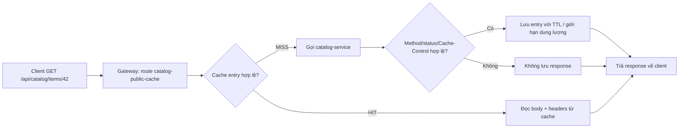
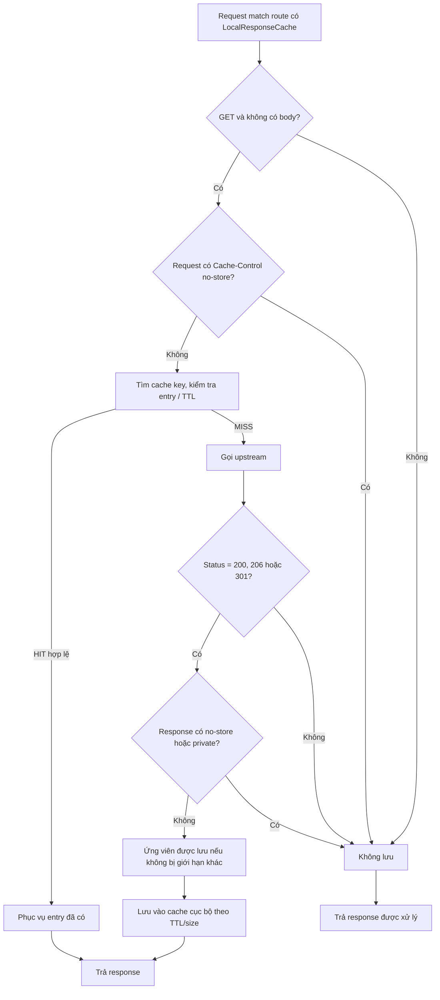

# Điều kiện cache theo HTTP method, status và Cache-Control

## 1. Vấn đề: không phải response nào đi qua Gateway cũng được lưu vào cache

Trong hệ thống microservices, **Spring Cloud Gateway** là cổng vào cho các API. Gateway chọn route bằng predicate, xử lý request/response qua filter chain, khám phá service instance và tích hợp xác thực, giới hạn lưu lượng, circuit breaker, retry, TLS cùng quan sát request. **Response caching** có thể giảm số lần gọi backend, độ trễ và chi phí xử lý cho những nội dung **được phép dùng lại**.

Ví dụ, `catalog-service` trả danh mục sản phẩm công khai và ít thay đổi. Gateway có thể giữ response của một request GET trong cache trong thời gian ngắn; request tiếp theo cùng dữ liệu không phải tới backend. Nhưng nếu API trả lịch sử giao dịch của một user, hoặc response mang `Cache-Control: private`, việc cache sai có thể gây **rò rỉ dữ liệu**.

Chủ đề trực tiếp của bài thuộc chương **Bộ nhớ đệm** là: **điều kiện cache theo HTTP method, status và Cache-Control**. Với **`LocalResponseCache` của Spring Cloud Gateway**, ba nhóm điều kiện này tạo thành một cổng kiểm tra. Chỉ khi đáp ứng các điều kiện và filter thực sự được bật/gắn vào route thì response mới có thể đi vào cache.

Sau bài học, bạn sẽ:

1. Giải thích vì sao **GET không có body** khác POST/PUT/DELETE/HEAD trong chính sách `LocalResponseCache`.
2. Nhớ chính xác các HTTP status **200, 206, 301** đủ điều kiện lưu theo filter; biết vì sao 404, 500, 503, 302 hoặc 204 không thuộc danh sách.
3. Phân biệt `Cache-Control` **trên request** với **trên response**, đặc biệt `no-store`, `private`, `no-cache` và `max-age`.
4. Cấu hình cache **theo route** trong Gateway Server WebFlux, đặt TTL/kích thước và kiểm thử bằng backend đếm số request.
5. Nhận ra khác biệt giữa **cache của Gateway**, cache của **browser/CDN** và cơ chế `ETag`/`304`.
6. Bảo vệ cache key, token/session, những route có cùng URI và môi trường nhiều Gateway instances.

> **Phiên bản và phạm vi:** Ví dụ chính dùng **Spring Cloud Gateway Server WebFlux 5.0.5** (nhánh 5.0.x đã vá lỗi liên quan cache toàn cục) và Spring Boot/Spring Cloud BOM tương thích. Namespace cấu hình là `spring.cloud.gateway.server.webflux`. Gateway Server Web MVC có filter cùng tên nhưng khác runtime/Java DSL. **Cấu hình học tập này ưu tiên cache theo route và tắt cache toàn cục** vì ranh giới cache là vấn đề bảo mật. Các ví dụ dùng HTTP nội bộ chỉ dành cho lab; production cần TLS và bảo vệ route phù hợp.

## 2. LocalResponseCache thực sự làm gì?

Spring Cloud Gateway cung cấp filter **`LocalResponseCache`** sử dụng cache **cục bộ trong tiến trình Gateway** (dựa trên Caffeine khi có các dependency cần thiết). Filter có thể lưu **response headers và body** của những request đủ điều kiện và trả lại chúng mà không phải mở thêm một request tới upstream.



Sơ đồ mô tả **cache eligibility và vòng đời cơ bản**. Thực tế còn có bước tra key, expiry, eviction, các điều kiện header, filter order và nhánh đặc biệt của request `Cache-Control: no-cache`.

### 2.1. Ba nơi cache khác nhau

| Bộ nhớ đệm | Nằm ở đâu? | Ai kiểm soát? | Tác động |
|---|---|---|---|
| **Browser HTTP cache** | Máy người dùng | Browser, HTTP caching headers | Có thể không gửi request đến Gateway |
| **CDN / reverse proxy cache** | Edge/ingress trước Gateway | CDN/proxy policy | Có thể không gửi request đến Gateway |
| **Gateway LocalResponseCache** | RAM/process của Gateway instance | Spring Cloud Gateway + Caffeine | Khi HIT có thể không gọi backend |
| **Cache ứng dụng backend** | Bên trong service hoặc Redis riêng | Backend | Gateway vẫn có thể gửi request đến service |

**Quan trọng:** một `Cache-Control: max-age=120` mà backend trả không đồng nghĩa Gateway chắc chắn cache response ấy. Filter vẫn phải thỏa method, status, chính sách lưu, kích thước, thời hạn, route và tình trạng cache. Đồng thời, nếu browser/CDN đã HIT trước Gateway, dùng backend call counter để đo cache Gateway cần kiểm soát các lớp cache phía trước.

### 2.2. Local cache không phải distributed cache

Nếu triển khai **3 pods Gateway**, mỗi pod có thể có một cache Caffeine riêng. Pod A MISS rồi lưu response không làm pod B có cùng entry. Restart pod làm mất cache trong RAM; eviction cũng có thể xảy ra khi thiếu chỗ hoặc hết TTL. Không giả định `LocalResponseCache` chia sẻ dữ liệu qua Redis, service discovery hay LoadBalancer.

## 3. Điều kiện thứ nhất: HTTP method phải là GET không có body

Tài liệu Spring Cloud Gateway 5.0.x xác định **`LocalResponseCache` chỉ cache request GET không có body** (*bodiless GET*). Đây là tiêu chí thực thi của filter, không chỉ là khuyến cáo REST.

| Request | Đủ điều kiện về method/body? | Nhận xét |
|---|---|---|
| `GET /items/42`, không có body | **Có** | Còn phải xét status và headers |
| `GET /items/42?lang=vi`, không có body | **Có** | Query có thể biểu thị representation khác; cần test cache key |
| `GET /items/42` kèm một request body | **Không** | Không đáp ứng điều kiện **bodiless GET** |
| `HEAD /items/42` | **Không** theo danh sách của filter | Dù HTTP HEAD có quan hệ với GET, filter này ghi rõ GET |
| `POST /items` | **Không** | Không cache nhờ filter này, kể cả POST chỉ đọc dữ liệu |
| `PUT /items/42`, `PATCH`, `DELETE` | **Không** | Request thay đổi trạng thái cần chiến lược invalidation khác |
| `OPTIONS /items/42` | **Không** | CORS preflight không được lưu bởi LocalResponseCache theo tiêu chí GET |

**Route predicate và cache filter là hai lớp khác nhau.** Ví dụ `Method=GET` giúp route chỉ match GET, nhưng **không tự bật cache**. Ngược lại, nếu một route match cả POST, filter `LocalResponseCache` vẫn chỉ đủ điều kiện lưu **GET không body**. Tốt nhất tạo route cache riêng cho endpoint đọc công khai để phạm vi dễ kiểm soát.

### 3.1. Vì sao cần tránh body trên GET?

Một hệ thống tự thiết kế GET có body có thể khiến nhiều proxy/cache không đưa body vào cache key hoặc hiểu khác nhau về semantics. Dù backend chấp nhận, `LocalResponseCache` **không cache GET có body** theo hợp đồng của filter. Đừng lách bằng cách gửi body trong query string chứa dữ liệu nhạy cảm: URL thường đi vào log, browser history và metrics.

### 3.2. Cache GET rồi có tự xóa khi POST không?

**Không có lời hứa tự vô hiệu hóa mọi entry GET khi POST/PUT/DELETE thay đổi sản phẩm.** LocalResponseCache là cache response có TTL/eviction; ứng dụng phải thiết kế invalidation/TTL phù hợp. Một request sửa sản phẩm có thể thành công ở backend trong khi người đọc vẫn nhận bản cũ từ cache Gateway cho đến expiry/eviction.

Với tồn kho, giá bán theo thời gian thực hay quyết định thanh toán, hãy cân nhắc **không cache**, dùng TTL rất ngắn, hoặc triển khai chiến lược cache invalidation có thể kiểm chứng ở tầng thích hợp.

## 4. Điều kiện thứ hai: chỉ các HTTP status 200, 206 và 301

Tài liệu `LocalResponseCache` nêu **ba status** mà response có thể được lưu:

| HTTP status | Có thể cache bởi filter? | Ví dụ | Rủi ro cần kiểm tra |
|---|---|---|---|
| **200 OK** | **Có** | JSON danh mục công khai, ảnh nhỏ | Phải không chứa dữ liệu cá nhân, response headers phù hợp |
| **206 Partial Content** | **Có** | Trả một khoảng bytes của file qua Range request | Cache key và phân đoạn `Range`/`Content-Range` rất nhạy cảm |
| **301 Moved Permanently** | **Có** | Chuyển đường dẫn cũ sang URL mới | Redirect cũ có thể tiếp tục tồn tại trong cache |
| 204 No Content | **Không** theo danh sách | Thao tác không trả body | Không coi đây là 200 |
| 302 Found / 307 / 308 | **Không** theo danh sách | Redirect tạm thời hay loại khác | Không áp suy luận “mọi 3xx đều cache” |
| 304 Not Modified | **Không** thuộc nhóm response được đưa vào cache | Kết quả đánh giá conditional request | Phân biệt 304 được filter **trả khi no-cache** (mục 6) |
| 400 / 401 / 403 / 404 / 429 | **Không** | Request sai, thiếu quyền, thiếu tài nguyên, quá quota | Không dùng filter này để negative-cache 404 |
| 500 / 502 / 503 / 504 | **Không** | Backend lỗi, timeout, không sẵn sàng | Không cache response lỗi do filter này |

**Lưu ý:** một status **nằm trong danh sách** chỉ là điều kiện **cần**, không phải **đủ**. Ví dụ response 200 kèm `Cache-Control: private` vẫn bị loại. Một request POST nhận 200 cũng không đủ điều kiện vì method sai.

### 4.1. Vì sao phải thận trọng với 206?

`206 Partial Content` thường đi cùng:

```http
HTTP/1.1 206 Partial Content
Accept-Ranges: bytes
Content-Range: bytes 0-999/100000
Cache-Control: public, max-age=60
```

Hai request cùng URL nhưng `Range` khác nhau **không được nhận nhầm bytes**. Tuy filter coi 206 là status có thể lưu, **đừng vội bật cache cho video/download hoặc range API** khi chưa kiểm chứng key/`Range`/`If-Range`/`ETag`, tính toàn vẹn từng đoạn và hành vi của client. Sự hỗ trợ 206 không đồng nghĩa mọi workload streaming lớn đều phù hợp với cache nội bộ.

### 4.2. Redirect 301 và Location

Một response 301 chứa `Location` có thể được lưu nếu các điều kiện khác hợp lệ. Khi thay đường dẫn hoặc đổi host, cache 301 có thể khiến client tiếp tục nhận redirect cũ cho tới lúc entry hết hạn. Hãy test `Location` tuyệt đối/tương đối, `Host`, `Forwarded` và quyền truy cập; **không cache redirect có Location được xây từ input Host chưa xác thực**.

## 5. Điều kiện thứ ba: Cache-Control của request và response

Hai chiều HTTP có thể có `Cache-Control`. **Chỉ thị trên request** mô tả mong muốn của bên gọi, còn **chỉ thị trên response** mô tả chính sách sử dụng lại của nội dung được trả. Để hiểu cơ chế filter, cần nhìn **đúng chiều và đúng directive**, không chỉ kiểm tra có hay không có header.

### 5.1. Request Cache-Control: no-store

Nếu request chứa `Cache-Control: no-store`, tài liệu Spring Cloud Gateway nói **response của request đó không được lưu**. Điều này hữu ích khi một request cần tránh tạo cache entry mới.

```http
GET /api/catalog/items/42 HTTP/1.1
Host: gateway.example.test
Cache-Control: no-store
```

**Không nhầm `no-store` với `no-cache`:** `no-store` hướng đến **không lưu**, còn `no-cache` trong HTTP caching nói đến việc **không sử dụng lại khi chưa xác minh**. Cách xử lý `no-cache` của filter có đặc điểm riêng (mục 6.3).

### 5.2. Response Cache-Control: no-store

Nếu backend trả:

```http
HTTP/1.1 200 OK
Content-Type: application/json
Cache-Control: no-store

{"id":"42","status":"sensitive"}
```

thì **không lưu response** bằng `LocalResponseCache`, dù request là GET không body và status 200. Đây là chính sách nên dùng cho access token, response cá nhân hóa, dữ liệu nhạy cảm hoặc response không phù hợp lưu ở shared cache.

### 5.3. Response Cache-Control: private

```http
HTTP/1.1 200 OK
Cache-Control: private, max-age=60
```

`private` là chỉ thị **không cho shared cache lưu nội dung** theo HTTP semantics. Gateway là một thành phần chia sẻ giữa nhiều người dùng; `LocalResponseCache` **loại response có `private`**. `max-age=60` đi kèm không làm response bỗng đủ điều kiện: **no-store/private chi phối việc không lưu**.

### 5.4. Response Cache-Control: public, max-age

```http
HTTP/1.1 200 OK
Cache-Control: public, max-age=120
Content-Type: application/json

{"id":"42","name":"Sản phẩm mẫu"}
```

Đây là **ứng viên** để cache nếu request là GET không body, status hợp lệ và route cache đang hoạt động. `public` giúp mô tả nội dung phù hợp shared cache, còn `max-age` giới hạn thời gian **freshness** theo HTTP.

Trong `LocalResponseCache`, TTL của filter còn quyết định **thời hạn cache entry**. Nếu upstream đã trả `Cache-Control` chứa `max-age`, filter **viết lại** giá trị `max-age` của response theo `timeToLive` của cache và giảm số giây còn lại ở các lần phục vụ tiếp theo. Vì vậy phải hiểu **hai con số**: freshness upstream công bố và TTL cache Gateway.

### 5.5. Tổng hợp các directive quan trọng

| Header và chiều | Điều kiện cache của `LocalResponseCache` 5.0.x | Ghi chú |
|---|---|---|
| **Request**: `Cache-Control: no-store` | **Không lưu** | Được nêu rõ trong tài liệu filter |
| **Response**: `Cache-Control: no-store` | **Không lưu** | Dù status 200 |
| **Response**: `Cache-Control: private` | **Không lưu** | Dù có thêm `max-age` |
| **Response**: `Cache-Control: private, max-age=120` | **Không lưu** | Phải đọc các directive **kết hợp** |
| **Response**: `Cache-Control: no-cache, no-store, max-age=0` | **Không lưu** | `no-store` vẫn có hiệu lực dù không đứng đầu |
| **Request**: `Cache-Control: no-cache` khi entry đã có | Có nhánh **304 không body** theo tài liệu filter | Xem mục 6.3 và test theo phiên bản |
| **Response**: `Cache-Control: public, max-age=120` | **Có thể lưu** | Còn phải xét method, status, TTL, key, policy |
| **Response**: `Cache-Control: max-age=120` | Không tự bị loại bởi ba directive trên | Phải xét dữ liệu có thực sự an toàn chia sẻ không |
| **Response**: không có `Cache-Control` | Không tự bị loại chỉ vì thiếu header này | Cache TTL/filter behavior vẫn cần kiểm chứng |
| **Response**: `Cache-Control: no-cache` (không có no-store/private) | Không được coi là đồng nghĩa `no-store` | HTTP yêu cầu revalidation; **đừng suy đoán** hành vi filter với từng phiên bản |

**Một lỗi nghiêm trọng:** kiểm tra bằng phép tìm chuỗi kiểu “Cache-Control bắt đầu bằng `no-store`” sẽ bỏ sót `Cache-Control: max-age=60, private` hoặc `Cache-Control: no-cache, no-store`. Tài liệu Spring 5.0.5 nói các directive chặn được kiểm tra **riêng rẽ, không phân biệt hoa/thường, ở bất kỳ vị trí nào trong header**.

### 5.6. Vary, Authorization, Cookie không được bỏ qua

Ngay cả khi `Cache-Control` không chặn lưu, một response phụ thuộc vào:

- `Authorization` và quyền của principal.
- `Cookie`, session/tenant.
- `Accept-Language`, `Accept-Encoding`, `Origin`.
- `Host` hoặc một route predicate dùng header/query/client IP.

vẫn có nguy cơ chia sẻ sai nếu cache key hoặc `Vary` không phản ánh đủ biến thể. **`Cache-Control: public` không thay authorization** và cũng không chứng minh mọi user được phép nhận cùng response. Mặc định an toàn: **không dùng LocalResponseCache cho API cá nhân hóa**; backend nên trả `Cache-Control: private, no-store` (hoặc chính sách tương đương phù hợp) nếu dữ liệu không được chia sẻ.

## 6. Cách ba điều kiện kết hợp và những phản hồi đặc biệt

### 6.1. Sơ đồ quyết định lưu response



Sơ đồ tập trung vào **điều kiện lưu**; có một nhánh **request `no-cache` với entry đã có** có thể trả 304 không body theo tài liệu, và còn những yếu tố như cache key/size/memory/eviction. **Không dùng sơ đồ để khẳng định rằng no-store request luôn bỏ qua mọi cache entry đã tồn tại ở mọi phiên bản**; muốn chứng minh bypass phải test thực nghiệm.

### 6.2. Ma trận nhanh

| Request | Response upstream | Kết luận theo điều kiện filter |
|---|---|---|
| GET không body, không `no-store` | 200, `public, max-age=120` | **Có thể lưu** |
| GET không body | 206, `public, max-age=120` | **Có thể lưu**, phải kiểm thử Range |
| GET không body | 301, `public, max-age=120` | **Có thể lưu** redirect |
| GET không body | 404, `public, max-age=120` | **Không lưu** vì status |
| GET không body | 503, `public, max-age=120` | **Không lưu** vì status |
| POST | 200, `public, max-age=120` | **Không lưu** vì method |
| HEAD | 200, `public, max-age=120` | **Không lưu** theo điều kiện bodiless GET |
| GET có body | 200, `public, max-age=120` | **Không lưu** vì có request body |
| GET không body, request `no-store` | 200, `public, max-age=120` | **Không lưu** do request directive |
| GET không body | 200, response `private` | **Không lưu** do response directive |
| GET không body | 200, response `no-store` | **Không lưu** do response directive |
| GET không body | 200, response `max-age=60, private` | **Không lưu**; không bị lừa bởi max-age |

### 6.3. Request no-cache với entry đã lưu: điểm rất dễ nhầm

Tài liệu Spring Cloud Gateway `LocalResponseCache` 5.0.5 mô tả một nhánh **đặc biệt**: khi entry đã có trong cache và request mới mang `Cache-Control: no-cache`, filter có thể trả **`304 Not Modified` không body**.

```http
GET /api/catalog/items/42 HTTP/1.1
Cache-Control: no-cache

HTTP/1.1 304 Not Modified
```

Không nhầm điều này với việc **304 là status có thể được lưu**: 304 **không có trong danh sách 200/206/301** để đưa response upstream mới vào cache. Cũng không coi `no-cache` đồng nghĩa `no-store`.

Theo HTTP caching nói chung, 304 thường gắn với **conditional request** (ví dụ `If-None-Match`/`If-Modified-Since`) và revalidation. Vì tài liệu filter mô tả hành vi đặc thù, **hãy kiểm thử đúng phiên bản, validator và client semantics trước khi phụ thuộc vào 304**. Các thuộc tính điều khiển chiến lược `no-cache` có thể khác theo nhánh phát hành (5.0.5 liệt kê `spring.cloud.gateway.server.webflux.filter.local-response-cache.request.no-cache-strategy`). Đừng đặt giá trị tùy đoán hoặc coi 304 là một cơ chế lấy lại dữ liệu mới từ backend.

## 7. TTL, max-age và kích thước cache

### 7.1. Ví dụ tính thời gian còn lại

Giả sử upstream trả:

```http
Cache-Control: public, max-age=120
```

Gateway bật `LocalResponseCache=30s,10MB`. Theo tài liệu filter, vì response **đã có `max-age`**, Gateway có thể viết lại `max-age` theo **TTL 30 giây**.

| Thời điểm | Trạng thái | Ví dụ `max-age` mà client thấy |
|---|---|---|
| Giây 0 | MISS, vừa lưu entry | Khoảng `30` giây |
| Giây 10 | HIT, entry còn hạn | Khoảng `20` giây |
| Giây 28 | HIT, entry gần hết hạn | Khoảng `2` giây |
| Sau giây 30 | Entry hết hạn → có thể gọi lại upstream | TTL tính lại với entry mới |

Các giá trị trên **minh họa**: làm tròn giây, thời điểm ghi response và chính sách eviction khiến kết quả thực tế có thể chênh chút ít. Nếu upstream **không có directive `max-age`**, đừng khẳng định filter chắc chắn thêm một directive `max-age`; tài liệu nói nó **chỉ viết lại khi response gốc có max-age**.

### 7.2. TTL không có nghĩa số byte không giới hạn

`LocalResponseCache` còn có **ngân sách size** (ví dụ `10MB`) để giới hạn tổng dung lượng cache/eviction theo cấu hình. Cache Caffeine có thể evict entry trước TTL nếu ngân sách đã đầy. Bên cạnh dữ liệu nén/serialized, JVM còn dùng bộ nhớ cho metadata, objects, buffers; **10MB không phải cam kết tổng RAM Gateway chỉ tăng đúng 10MB**.

Đối với workload có nhiều URL/query variants, cache key cardinality có thể tăng rất nhanh. Đừng cache các API trả dữ liệu lớn, SSE, WebSocket, stream liên tục, download nhiều Range hay body chứa PII chỉ vì request là GET.

### 7.3. Cache-Control, ETag và Age không phải cùng một thứ

| Thành phần | Ý nghĩa | Lưu ý |
|---|---|---|
| `max-age` | Freshness thời gian cho HTTP cache | Filter tính lại nếu upstream đã cung cấp |
| `time-to-live` của Gateway | Thời gian tồn tại entry trong Caffeine | Được cấu hình cho cache Gateway |
| `ETag` / `Last-Modified` | Validator để conditional request | Nếu body bị filter khác sửa, validator có thể không còn đúng |
| `Age` | Thời gian mà response đã ở trong cache/proxy theo HTTP | **Không tự suy** toàn bộ tuổi của entry chỉ từ header có/không có |
| `Vary` | Các request headers ảnh hưởng representation | Quan trọng cho `Accept-Language`, compression, origin, tenant |

Khi kết hợp `ModifyResponseBody`, `RewriteResponseHeader`, nén hoặc CDN, cần kiểm tra **filter order** và các header gắn với bản representation cuối cùng. Một ETag do backend tính từ JSON trước rewrite không nhất thiết hợp lệ với JSON đã bị biến đổi sau Gateway.

## 8. Bật LocalResponseCache cho một route WebFlux

### 8.1. Dependency và phiên bản

Để chạy lab, chuẩn bị ứng dụng **Gateway Server WebFlux** dùng Spring Cloud Gateway **5.0.5** (hoặc một nhánh đã vá tương ứng) và Spring Boot/Spring Cloud BOM tương thích. Trong `pom.xml`, khi BOM đã quản lý versions:

```xml
<dependencies>
    <dependency>
        <groupId>org.springframework.cloud</groupId>
        <artifactId>spring-cloud-starter-gateway-server-webflux</artifactId>
    </dependency>
    <dependency>
        <groupId>com.github.ben-manes.caffeine</groupId>
        <artifactId>caffeine</artifactId>
    </dependency>
    <dependency>
        <groupId>org.springframework.boot</groupId>
        <artifactId>spring-boot-starter-cache</artifactId>
    </dependency>
</dependencies>
```

Tài liệu Gateway yêu cầu **Caffeine** và **Spring Boot Cache starter** cho LocalResponseCache. Nếu dự án có `CacheManager` tùy biến, phải xem cơ chế bean selection (ví dụ `@Primary`/`@Qualifier`) để cache hoạt động đúng. Không suy ra dependency đã có chỉ vì route YAML được parse.

### 8.2. Tắt cache toàn cục, bật route-level cache

Trong `src/main/resources/application.yml` của **gateway-demo**:

```yaml
server:
  port: 8080

spring:
  application:
    name: gateway-demo
  cloud:
    gateway:
      server:
        webflux:
          # Không cache tất cả route; chỉ cache route công khai được duyệt.
          global-filter:
            local-response-cache:
              enabled: false
          filter:
            local-response-cache:
              enabled: true
          routes:
            - id: catalog-public-cache
              uri: http://localhost:8081
              predicates:
                - Path=/api/catalog/**
                - Method=GET
              filters:
                - StripPrefix=2
                - LocalResponseCache=30s,10MB
```

**Đọc đúng các tầng:**

- `server.port: 8080`: HTTP server inbound của Gateway. Phần này **không** điều khiển thời gian sống cache.
- `global-filter.local-response-cache.enabled: false`: **vô hiệu cache toàn cục**; không để những route khác vô tình dùng chung một cache response.
- `filter.local-response-cache.enabled: true`: bật **GatewayFilter factory** để route được gắn `LocalResponseCache`.
- `LocalResponseCache=30s,10MB`: TTL **30 giây** và size tối đa **10 MB** của cache route theo cú pháp shortcut.
- `Path=/api/catalog/**` + `Method=GET`: chỉ chọn route công khai này cho GET. Cache còn tự xét điều kiện **không có body**.
- `StripPrefix=2`: `GET /api/catalog/items/42` đi đến `GET /items/42` trên backend; đây là thay đổi path, không phải điều kiện cache.

**Lưu ý quan trọng:** ở bảng configuration properties 5.0.5, `spring.cloud.gateway.server.webflux.global-filter.local-response-cache.enabled` và `spring.cloud.gateway.server.webflux.filter.local-response-cache.enabled` là **hai cờ khác nhau**. Cấu hình global ở tài liệu cũ có thể dùng tiền tố `spring.cloud.gateway.global-filter.*`; đừng trộn namespace của 4.x với 5.0.x một cách tùy ý.

### 8.3. Java RouteLocatorBuilder tương đương

Nếu muốn cấu hình **route bằng Java thay YAML**, bạn có thể thay mục `routes` bằng một bean:

```java
package com.example.gateway;

import java.time.Duration;
import org.springframework.cloud.gateway.route.RouteLocator;
import org.springframework.cloud.gateway.route.builder.RouteLocatorBuilder;
import org.springframework.context.annotation.Bean;
import org.springframework.context.annotation.Configuration;
import org.springframework.http.HttpMethod;

@Configuration
public class CatalogCacheRoutes {

    @Bean
    RouteLocator cacheRoutes(RouteLocatorBuilder builder) {
        return builder.routes()
            .route("catalog-public-cache", r -> r
                .path("/api/catalog/**")
                .and()
                .method(HttpMethod.GET)
                .filters(f -> f
                    .stripPrefix(2)
                    .localResponseCache(Duration.ofSeconds(30), "10MB"))
                .uri("http://localhost:8081"))
            .build();
    }
}
```

Bean Java này **thay thế route `catalog-public-cache` trong YAML**, không đăng ký cùng ID ở cả hai nơi. Hai property `global-filter...enabled=false` và `filter...enabled=true` ở mục 8.2 vẫn phải được áp dụng. Khi dùng Java DSL, nên thống nhất nguồn route để tránh hai route cùng predicate nhưng chính sách cache khác nhau.

### 8.4. Nếu muốn cache toàn cục thì sao?

Global filter có thể giúp cấu hình cache cho nhiều route, nhưng **không phù hợp làm mặc định cho Gateway có cả endpoint công khai lẫn cá nhân hóa**. Đặc biệt, các bản Gateway 5.0.0–5.0.4 có lỗi bảo mật **CVE-2026-59426** trong tình huống một cache toàn cục phục vụ nhiều route trùng request URI nhưng phân biệt bằng predicate khác (mục 11).

Do đó, bài này **không đưa một cấu hình global cache bật `true` để copy sang production**. Chỉ xem xét nếu đã cập nhật bản vá, phân tích route/cache key và có test cách ly dữ liệu rõ ràng.

## 9. Backend Spring Boot mẫu: đếm số lần request thật

### 9.1. Hai ứng dụng trong bài lab

| Ứng dụng | Cổng | Dependency chính | Nhiệm vụ |
|---|---:|---|---|
| `catalog-demo` | 8081 | Spring Boot Web MVC | Cấp JSON, các status và Cache-Control theo kịch bản |
| `gateway-demo` | 8080 | Gateway Server WebFlux + Caffeine + Cache starter | Áp dụng `LocalResponseCache` theo route |

Trên Spring Boot 4.x, starter Servlet là `spring-boot-starter-webmvc`; với nhánh Boot 3.x thường là `spring-boot-starter-web`. **Không thêm Servlet starter vào chính Gateway WebFlux** khi không chủ đích thay đổi stack.

### 9.2. Controller backend có response header thử nghiệm

Tạo `CatalogApplication.java` trong dự án backend:

```java
package com.example.catalog;

import java.util.Map;
import java.util.concurrent.atomic.AtomicLong;
import org.springframework.boot.SpringApplication;
import org.springframework.boot.autoconfigure.SpringBootApplication;
import org.springframework.http.HttpHeaders;
import org.springframework.http.HttpStatus;
import org.springframework.http.ResponseEntity;
import org.springframework.web.bind.annotation.GetMapping;
import org.springframework.web.bind.annotation.PathVariable;
import org.springframework.web.bind.annotation.RequestParam;
import org.springframework.web.bind.annotation.RestController;

@SpringBootApplication
@RestController
public class CatalogApplication {

    private final AtomicLong calls = new AtomicLong();

    public static void main(String[] args) {
        SpringApplication.run(CatalogApplication.class, args);
    }

    @GetMapping("/items/{id}")
    public ResponseEntity<Map<String, Object>> item(
            @PathVariable String id,
            @RequestParam(name = "mode", defaultValue = "normal") String mode) {

        long n = calls.incrementAndGet();

        // Mỗi mode dùng một URL query khác để thử riêng từng điều kiện.
        HttpStatus status = switch (mode) {
            case "missing" -> HttpStatus.NOT_FOUND;
            case "error" -> HttpStatus.SERVICE_UNAVAILABLE;
            default -> HttpStatus.OK;
        };

        String cacheControl = switch (mode) {
            case "private" -> "private, max-age=120";
            case "no-store" -> "no-store";
            case "combined" -> "public, max-age=120, no-store";
            default -> "public, max-age=120";
        };

        return ResponseEntity.status(status)
            .header(HttpHeaders.CACHE_CONTROL, cacheControl)
            .header("X-Backend-Call", Long.toString(n))
            .body(Map.of(
                "id", id,
                "mode", mode,
                "backendCall", n,
                "message", "catalog demo"));
    }
}
```

File `application.yml` của **catalog-demo**:

```yaml
server:
  port: 8081
spring:
  application:
    name: catalog-demo
```

**Giải thích counter:** `backendCall` và `X-Backend-Call` tăng mỗi lần request tới controller. Gọi trực tiếp backend hai lần sẽ tăng. Khi gọi qua Gateway cùng một URL hai lần, nếu lần thứ hai là **cache HIT**, response đã lưu thường mang **cùng giá trị backendCall**. Counter trong RAM chỉ dành cho lab, không phải global metric của hệ thống phân tán.

Chế độ `normal` trả 200 + `public, max-age=120`, `private` trả 200 + `private, max-age=120`, `no-store` trả 200 + `no-store`; `missing` trả 404 và `error` trả 503. Mặc dù cả hai response lỗi có thể kèm `Cache-Control: public, max-age=120`, **status** vẫn khiến chúng không được filter lưu.

### 9.3. Cần chuẩn bị gì khi chạy?

Khởi động backend `8081` trước, Gateway `8080` sau. Để tránh kết luận nhầm, gọi thẳng:

```bash
curl -i 'http://localhost:8081/items/42'
curl -i 'http://localhost:8081/items/42?mode=private'
curl -i 'http://localhost:8081/items/42?mode=missing'
```

Nếu Gateway chạy trong container/pod, `localhost:8081` ở route là **loopback của chính container/pod Gateway**, không tự trỏ tới backend nằm ở máy host. Phải dùng DNS/Service phù hợp (ví dụ Kubernetes Service name), hoặc `lb://catalog-service` khi đã có LoadBalancer/DiscoveryClient.

> **Các lệnh trong bài là hướng dẫn tự kiểm thử, không phải log đã chạy.** JSON order, exact headers, Caffeine eviction và timing có thể khác theo bản Runtime.

## 10. Kiểm thử bằng curl: chứng minh HIT, MISS và các trường hợp không lưu

### 10.1. GET 200 công khai — lần đầu MISS, lần sau HIT

Khởi động hai ứng dụng như mục 8–9; dùng **cùng URL** hai lần trong thời gian dưới 30 giây:

```bash
# Request đầu qua Gateway; kỳ vọng MISS nếu cache còn trống.
curl --noproxy '*' -i \
  'http://localhost:8080/api/catalog/items/42'

# Request thứ hai tới ĐÚNG CÙNG URL trong vòng 30 giây.
curl --noproxy '*' -i \
  'http://localhost:8080/api/catalog/items/42'
```

Đối với entry chưa có và không bị eviction, kết quả minh họa:

```http
# Lần đầu:
HTTP/1.1 200 OK
Cache-Control: public, max-age=30
X-Backend-Call: 1
Content-Type: application/json

{"id":"42","mode":"normal","backendCall":1,"message":"catalog demo"}

# Lần hai trong TTL:
HTTP/1.1 200 OK
Cache-Control: public, max-age=26
X-Backend-Call: 1
Content-Type: application/json

{"id":"42","mode":"normal","backendCall":1,"message":"catalog demo"}
```

**Điều quan trọng không phải con số 26**, mà là `backendCall` **giữ nguyên** vì không có lượt xử lý backend mới. Sau 30 giây hoặc khi entry bị evict, một request mới có thể MISS và `backendCall` lại tăng. Nếu thấy 1 rồi 2, kiểm tra route/cache enable, query/headers, TTL, pod khác và response có `private/no-store` không.

### 10.2. GET 200 nhưng Cache-Control: private

```bash
curl --noproxy '*' -i \
  'http://localhost:8080/api/catalog/items/42?mode=private'
curl --noproxy '*' -i \
  'http://localhost:8080/api/catalog/items/42?mode=private'
```

Mỗi lần backend xử lý, `backendCall` tăng và response chứa `Cache-Control: private, max-age=120`. Dù body/status giống một response 200 khác, **private chặn LocalResponseCache lưu**. Nếu có CDN/browser cache phía trước, kết luận từ response cần tách các lớp ấy.

### 10.3. GET 200 nhưng Cache-Control: no-store

```bash
curl --noproxy '*' -i \
  'http://localhost:8080/api/catalog/items/42?mode=no-store'
curl --noproxy '*' -i \
  'http://localhost:8080/api/catalog/items/42?mode=no-store'

# Chế độ combined kiểm thử no-store không ở vị trí đầu.
curl --noproxy '*' -i \
  'http://localhost:8080/api/catalog/items/42?mode=combined'
curl --noproxy '*' -i \
  'http://localhost:8080/api/catalog/items/42?mode=combined'
```

`mode=combined` trả `public, max-age=120, no-store`; **no-store vẫn phải chặn lưu**. Đây là test chống lỗi logic tự xây chỉ kiểm tra directive đầu tiên. Không nên thử cache dữ liệu cá nhân thật để làm bài lab.

### 10.4. Request no-store — không tạo entry mới

Sử dụng URL chưa gọi trước đó, ví dụ ID `100`, và gửi `Cache-Control: no-store` trên request:

```bash
curl --noproxy '*' -i \
  -H 'Cache-Control: no-store' \
  'http://localhost:8080/api/catalog/items/100'

curl --noproxy '*' -i \
  -H 'Cache-Control: no-store' \
  'http://localhost:8080/api/catalog/items/100'
```

Dù backend trả `200 public, max-age=120`, **request no-store ngăn response được lưu vào cache** theo điều kiện của filter. Khi test, chọn URL chưa có entry từ trước để không trộn nhánh cache HIT với nhánh kiểm tra việc lưu **entry mới**.

### 10.5. Status 404/503 — không lưu dù Cache-Control cho phép

```bash
# Hai lần 404 cùng URI: không được cache bằng LocalResponseCache.
curl --noproxy '*' -i \
  'http://localhost:8080/api/catalog/items/42?mode=missing'
curl --noproxy '*' -i \
  'http://localhost:8080/api/catalog/items/42?mode=missing'

# Hai lần 503 cùng URI: không được cache bằng LocalResponseCache.
curl --noproxy '*' -i \
  'http://localhost:8080/api/catalog/items/42?mode=error'
curl --noproxy '*' -i \
  'http://localhost:8080/api/catalog/items/42?mode=error'
```

Trong mỗi cặp, response vẫn có `X-Backend-Call` tăng vì không có cache entry 404/503 từ filter. Nếu Gateway có **CircuitBreaker fallback**, Retry, RateLimiter hoặc custom filter, các status có thể bị thay đổi trước khi client nhận; khi đó cần đo backend access log và filter chain để biết chính xác response nào đã được xét lưu.

### 10.6. Request no-cache khi entry 200 đã tồn tại

Trước hết gửi một GET bình thường để làm ấm cache:

```bash
curl --noproxy '*' -i \
  'http://localhost:8080/api/catalog/items/777'

# Ngay sau đó, thử chỉ thị no-cache trên request.
curl --noproxy '*' -i \
  -H 'Cache-Control: no-cache' \
  'http://localhost:8080/api/catalog/items/777'
```

Theo mô tả chính thức của `LocalResponseCache`, trong trường hợp **đã có entry**, request `no-cache` có thể nhận **304 không body** thay vì một body JSON mới. Hãy ghi lại status, `ETag`/validator nếu có, cache entry age và số lần backend thật sự được gọi. Nếu hệ thống cần chuẩn HTTP conditional requests nghiêm ngặt hoặc freshness thời gian thực, phải test phiên bản cụ thể và cân nhắc không dùng filter này cho workload đó.

### 10.7. HEAD/POST không phải HIT của filter

```bash
# Route lab có Method=GET nên HEAD/POST có thể không match route.
curl --noproxy '*' -I \
  'http://localhost:8080/api/catalog/items/42'

curl --noproxy '*' -i -X POST \
  'http://localhost:8080/api/catalog/items/42'
```

Ở đây, nếu Gateway trả **404/405** hoặc một response khác, điều đó trước tiên liên quan **route matching**, không phải bằng chứng `LocalResponseCache` đã xử lý và từ chối lưu. Muốn test thuần điều kiện GET/HEAD/POST của filter, phải thiết kế **một route tạm thời match các method ấy** và một backend có handler phù hợp; dù thế, filter vẫn **chỉ cache bodiless GET**.

## 11. Ranh giới bảo mật cache key và CVE-2026-59426

### 11.1. Vì sao cache toàn cục từng dẫn đến rò rỉ giữa các route?

Ngày **19/11/2026**, Spring công bố advisory **CVE-2026-59426 — Spring Cloud Gateway Global LocalResponseCache Leaks Responses Across Routes**. Nó ảnh hưởng một số bản Gateway có **cache toàn cục** được bật và **nhiều route cùng match request URI** nhưng được phân biệt bởi các predicate không được phản ánh trong cache key.

Theo advisory, trong các bản bị ảnh hưởng, cache key toàn cục được tạo từ **request URI, Authorization, cookies và những request headers nằm trong `Vary`**, nhưng **không chứa route ID**. Ví dụ rủi ro:

```text
GET /api/report
Header: X-Segment: internal
    → route internal-report → upstream nội bộ, trả response A

GET /api/report
Header: X-Segment: public
    → route public-report → upstream công khai, cần trả response B

Nếu shared cache không phân biệt route/segment thích đáng,
caller public có nguy cơ nhận A từ cache và không tới backend B.
```

Các predicate có thể liên quan gồm `RemoteAddr`, `Host`, `Header`, `Cookie`, `Query` và predicate tùy biến. Kịch bản này **không đòi hỏi backend bị lỗi**: response bị trả nhầm ngay tại Gateway.

### 11.2. Phiên bản ảnh hưởng và hướng xử lý

Theo thông báo của Spring:

| Nhánh | Các bản ảnh hưởng | Bản vá được công bố |
|---|---|---|
| 5.0.x | **5.0.0–5.0.4** | **5.0.5** (OSS) |
| 4.3.x | **4.3.0–4.3.6** | **4.3.7** (Enterprise Support) |
| 4.0–4.2.x | **4.0.0–4.2.10** | **4.2.11** (Enterprise Support) |

Trong nhánh 5.0.x của bài, cần **nâng lên 5.0.5 hoặc bản đã vá cao hơn**, đồng thời **tắt global LocalResponseCache** và chỉ gắn `LocalResponseCache` vào **route đã được phê duyệt** nếu cần. Advisory nói **cache theo route có cache riêng**, không bị ảnh hưởng bởi lỗ hổng **cross-route global cache** này. Đây là lý do bài dùng:

```yaml
spring:
  cloud:
    gateway:
      server:
        webflux:
          global-filter:
            local-response-cache:
              enabled: false
          filter:
            local-response-cache:
              enabled: true
```

**Lưu ý giới hạn:** nâng bản và cách ly route **không bảo đảm an toàn mọi response bên trong cùng một route**. Một endpoint cá nhân hóa vẫn có thể bị cache sai nếu auth, tenant, `Vary`, `Cache-Control` hoặc thứ tự filter được thiết kế không đúng. **Không dùng cache làm biện pháp thay thế xác thực/authorization**.

### 11.3. Đừng dùng Vary như một “lá chắn” duy nhất

`Vary: Accept-Language` nói representation phụ thuộc request header `Accept-Language`; cache hỗ trợ Vary có thể phân biệt variant theo header ấy. Nhưng nếu response phụ thuộc tenant/entitlements trong token, có thể không có một header đơn giản và an toàn để biểu diễn mọi quyền truy cập.

Hãy **tách route**, giới hạn đối tượng được cache, không cache response riêng tư và giữ authorization kiểm tra ở đúng vị trí. Với token/cookie của user, ưu tiên `Cache-Control: private, no-store` và test với **ít nhất hai account/role/tenant** để bảo đảm không chia sẻ response.

## 12. Khi nào cache gây kết quả sai dù vẫn đúng ba điều kiện cơ bản?

Ba điều kiện method/status/Cache-Control là **bộ lọc ban đầu**. Chúng **không bảo đảm** mọi response có thể chia sẻ cho mọi client.

### 12.1. Cùng path nhưng khác ngôn ngữ hoặc encoding

Giả sử:

```text
GET /api/catalog/items/42
Accept-Language: vi
→ {"name":"Tai nghe"}

GET /api/catalog/items/42
Accept-Language: en
→ {"name":"Headphones"}
```

Nếu backend dùng `Accept-Language` để chọn ngôn ngữ, response nên khai báo `Vary: Accept-Language` và cache phải được kiểm thử có phân biệt variant này. Tương tự, với `Accept-Encoding`, cache không được trả bytes gzip cho client không hiểu gzip.

**Không chỉ nhìn URI rồi giả định hai request tương đương.** Các header `Vary` cần nhất quán với nội dung, nhưng một proxy/HTTP client còn có thể chuẩn hóa chúng. Trong production, thử song song những header khác nhau và so sánh cả body, `Content-Encoding`, `Content-Length` và status.

### 12.2. Cùng path nhưng khác quyền/người dùng

```text
GET /api/orders
Cookie: SESSION=alice
→ Đơn hàng của Alice

GET /api/orders
Cookie: SESSION=bob
→ Đơn hàng của Bob
```

Về mặt method và status, cả hai đều là `GET 200`, nhưng **không bao giờ được dùng chung cached response**. Một bug ở cache key, filter order, route selection hoặc cookie/session handling có thể nghiêm trọng. Hãy:

- Đặt `Cache-Control: private, no-store` trên response riêng tư.
- Không gắn `LocalResponseCache` vào route chứa dữ liệu user/tenant nếu chưa có thiết kế cách ly đã chứng minh bằng test.
- Kiểm tra Spring Security/TokenRelay và authorization vẫn chạy đúng khi cache HIT; một cache trả response **trước một bước bảo mật** có thể phá vỡ giả định bảo vệ.
- Không lưu raw access token/cookie trong log hay metrics để “debug cache key”.

### 12.3. Cache sau route rewrite và query parameter

Gateway có thể đổi path với `StripPrefix`/`RewritePath` hoặc thêm query parameter. Cache key phải phù hợp với **biểu diễn dữ liệu thật**; khi cùng URL public đi đến các upstream khác nhau theo `Host`, `Header`, `RemoteAddr`, `Cookie` hoặc custom predicates, đặc biệt thận trọng với **global cache** và advisory mục 11.

Một tham số như `?currency=USD` hay `?currency=VND` có thể thay nội dung hoàn toàn. Không tự gộp các URL khác query thành một cache entry nếu backend không bảo đảm cùng response.

### 12.4. Cache và response body filters

Nếu `ModifyResponseBody` xóa trường nội bộ hoặc biến đổi DTO, thứ tự giữa `LocalResponseCache` và body filter rất quan trọng: cache có thể lưu **representation trước hoặc sau khi biến đổi** tùy filter chain và lifecycle. Điều này ảnh hưởng:

- Cấu trúc body/`Content-Type`/`Content-Length` mà client nhận.
- `ETag` được backend tính từ body cũ.
- Những header được tạo sau khi cache đọc/ghi.
- Cách phân quyền theo tenant/user nếu response filter dựa vào SecurityContext.

Với API có biến đổi body phức tạp, hãy test **MISS và HIT**, so sánh body/headers một cách máy móc. Không tự cho rằng vì request MISS đúng nên cache HIT cũng đúng.

### 12.5. Fallback, retry, rate limit và circuit breaker

Trong một Gateway có nhiều filter:

- **CircuitBreaker fallback 503:** status 503 không thuộc danh sách cache của LocalResponseCache; nhưng nếu fallback **chủ động trả 200**, một bộ cache ở vị trí phù hợp có thể coi đó là response 200. Thiết kế fallback rõ `Cache-Control: no-store` khi không muốn lưu.
- **Retry:** một request MISS có thể gây nhiều upstream attempts, còn HIT có thể không gọi backend. Đừng coi số lần HTTP client gọi backend luôn đúng bằng số request Gateway nhận.
- **RateLimiter:** chính sách quota phải được xem xét trước khi trả cache HIT nếu quota được thiết kế giới hạn **mọi request**. Cache HIT không phải giấy phép bỏ qua auth/quota.
- **TokenRelay:** không cache response do bearer token cụ thể kiểm soát chỉ vì HTTP status 200. Audience/scope và user entitlements không biến mất khi proxy.

### 12.6. CORS và Cache-Control

Với nhiều frontend origin, response CORS có thể mang `Access-Control-Allow-Origin` cụ thể cùng `Vary: Origin`. Cache/CDN/Gateway cần giữ đúng variant để không trả CORS headers của origin này cho origin khác. **CORS là quyền browser đọc response**, không phải một cơ chế tách cache tenant hay xác thực client.

## 13. Cache theo route so với Gateway Server Web MVC

**Server WebFlux** của bài dùng Reactor Netty, `RouteLocatorBuilder` và namespace `spring.cloud.gateway.server.webflux`. **Gateway Server Web MVC** dựa trên Servlet/WebMvc.fn, có filter LocalResponseCache trong tài liệu Spring, nhưng **khác Java API/runtime**.

| Thuộc tính | Gateway Server WebFlux | Gateway Server Web MVC |
|---|---|---|
| Runtime | WebFlux, Reactor Netty | Servlet/WebMvc.fn |
| Route Java | `RouteLocatorBuilder` | `GatewayRouterFunctions.route(...)` |
| Cấu hình tuyến YAML | `spring.cloud.gateway.server.webflux.routes` | `spring.cloud.gateway.server.webmvc.routes` |
| Filter cache | `LocalResponseCache` GatewayFilter factory | Filter/HandlerFilterFunction tương ứng của MVC |
| Điều kiện nền tảng theo tài liệu | GET không body; status 200/206/301; không lưu với request no-store/response no-store/private | Cũng được mô tả trong tài liệu MVC |
| Đặc điểm vận hành | Cache Caffeine trong tiến trình reactive | Cache trong tiến trình Servlet, cấu hình/filter khác stack |

Trích đoạn YAML **riêng cho ứng dụng MVC**:

```yaml
spring:
  cloud:
    gateway:
      server:
        webmvc:
          routes:
            - id: mvc-catalog-cache
              uri: http://localhost:8081
              predicates:
                - Path=/api/catalog/**
              filters:
                - StripPrefix=2
                - LocalResponseCache=30s,10MB
```

**Không copy** các cờ `spring.cloud.gateway.server.webflux.filter...` vào MVC mà mặc định chúng có cùng cách bind. Hãy đối chiếu **configuration properties/implementation của phiên bản Gateway MVC thực tế**, thiết lập dependency Caffeine/Cache phù hợp và kiểm thử bằng cùng ma trận method/status/headers. Đây là cấu hình minh họa filter và route, **không phải file production hoàn chỉnh**.

## 14. Vận hành: local cache, bộ nhớ, scale-out và invalidation

### 14.1. Một request MISS không có nghĩa upstream lỗi

Cache MISS là tình huống bình thường:

- Lần đầu URL mới xuất hiện.
- Entry đã hết TTL.
- Cache bị evict vì giới hạn dung lượng.
- Gateway pod vừa restart hoặc request đi sang pod khác.
- Request/body/header không đủ điều kiện cache.
- Response upstream có status hoặc `Cache-Control` không cho lưu.
- Response phụ thuộc `Vary`/query khiến key khác.

**Không tự gán cache MISS cho circuit breaker hoặc service discovery lỗi.** Backend có thể trả 200 trong mọi lần dù Gateway không cache.

### 14.2. Nguy cơ bộ nhớ và bùng nổ cache keys

Với nhiều triệu URL khác nhau, chỉ 10MB mỗi cache route cũng có overhead. Giới hạn Caffeine đo theo cách implementation quản lý data weight; JVM còn có heap/direct buffers, object overhead, HTTP client connection pool và reactive exchange đang xử lý. Khi có nhiều route/pods, nhân tổng budget theo cấu hình thực và đo memory.

Khuyến nghị:

1. Chỉ cache **payload nhỏ, public, ít biến thể**; đừng dùng cho file download lớn hoặc response streaming.
2. Dùng TTL ngắn phù hợp độ mới cần thiết; tránh cache 301 quá lâu khi route có thể đổi.
3. Giới hạn số route được cache và budget tối đa cho từng route.
4. Theo dõi heap/direct memory, GC, CPU, hit ratio và thời gian phản hồi.
5. Test concurrent MISS cùng URL để phát hiện cache stampede; đừng mặc định cache tự hợp nhất mọi request đồng thời.

### 14.3. Invalidation khi dữ liệu thay đổi

Trong lab, update sản phẩm không tự xóa cache GET. Các phương án thiết kế tùy SLA:

| Chiến lược | Ưu điểm | Giới hạn |
|---|---|---|
| TTL ngắn | Đơn giản, không cần event invalidation | Có thể trả dữ liệu cũ trong TTL |
| Không cache dữ liệu cần nhất quán mạnh | Chính xác hơn | Tăng tải backend |
| Versioned URL/ETag với cache có validator đúng | Đơn giản hóa freshness một số loại nội dung | Cần cơ chế HTTP caching chuẩn và test client |
| Invalidation tập trung ở tầng CDN/Redis/service | Kiểm soát phiên bản tốt hơn khi thiết kế kỹ | Không phải feature mặc định của LocalResponseCache |
| Warm-up theo phiên bản deploy | Giảm MISS ban đầu | Có nguy cơ nạp dữ liệu sai/nhiều biến thể |

Nếu hệ thống cần **xóa ngay lập tức** entry trên tất cả Gateway pods khi sản phẩm đổi, `LocalResponseCache` không nên được xem là distributed cache/invalidation system. Cân nhắc đưa cache đến lớp có API invalidation được thiết kế riêng hoặc giảm TTL theo yêu cầu nghiệp vụ.

### 14.4. Nhiều instances và thống kê cache

Khi Gateway chạy N instances sau LoadBalancer, mỗi instance có **đường đời cache riêng**. Hai request cùng URL có thể lần lượt vào pod A/B và tạo hai MISS; khi pod A có HIT không bảo đảm pod B có HIT. Nếu muốn đo:

- Gắn **pod/instance ID** vào log và metrics.
- Quan sát backend request count/tần suất theo route.
- Dùng telemetry từ cache/Actuator nếu được phiên bản và configuration hỗ trợ.
- Không lấy riêng số request client chia cho số request upstream để khẳng định hit ratio khi còn Retry, auth rejects, circuit breaker hoặc CDN.

## 15. Chẩn đoán khi cache không như mong đợi

### 15.1. Bảng triệu chứng và nguyên nhân

| Hiện tượng | Nguyên nhân có thể | Kiểm tra cụ thể |
|---|---|---|
| Startup báo không tìm thấy `LocalResponseCache` | Chưa bật route-level factory, thiếu Caffeine/Cache starter, BOM không tương thích | Kiểm tra `filter.local-response-cache.enabled`, dependency, log khởi động |
| GET 200 nhưng backendCall luôn tăng | Response `private`/`no-store`, cache chưa bật, query/headers khác, entry hết hạn hoặc pod khác | Kiểm tra status, hai chiều `Cache-Control`, `X-Backend-Call`, route ID, TTL |
| GET 200 mà lần thứ hai HIT quá lâu | TTL vượt yêu cầu, response stale trong các cache nhiều lớp | Kiểm tra `time-to-live`, browser/CDN và từng Gateway instance |
| GET 404 hoặc 503 không được cache | **Hành vi đúng** theo danh sách status | Không thêm 404/503 vào điều kiện của LocalResponseCache bằng suy đoán |
| POST 200 không cache | **Hành vi đúng**: filter chỉ hỗ trợ bodiless GET | Thiết kế cache khác nếu thực sự cần POST response caching |
| GET có body không cache | **Hành vi đúng** theo điều kiện filter | Không dùng GET body để thiết kế cache key |
| HEAD trả 404 qua Gateway | Route `Method=GET` không match HEAD | Tách lỗi route predicate khỏi điều kiện cache |
| Request no-store nhưng response vẫn có `max-age` | Header request nói không **lưu**; response có thể vẫn phản ánh policy của upstream | Kiểm tra entry thực sự được tạo hay không, không chỉ nhìn header |
| Response `public, max-age=120, private` vẫn HIT | Cấu hình/phiên bản/filter khác hoặc cache ở browser/CDN | Gọi trực tiếp đúng Gateway pod; kiểm tra header chặn ở mọi hop |
| Request `no-cache` trả 304 không body | Nhánh đã được tài liệu LocalResponseCache mô tả cho cached entry | Kiểm tra validator, client semantics, phiên bản và `no-cache-strategy` |
| `max-age` của response nhỏ hơn upstream | Gateway ghi lại số giây còn TTL | Đối chiếu TTL route và số giây đã trôi |
| `X-Backend-Call` như cũ nhưng body khác | Filter khác sửa body, cache có nhiều lớp hoặc backend behavior không ổn định | So sánh raw body/headers tại từng hop, log theo request ID |
| Nội dung của user A xuất hiện ở user B | **Sự cố bảo mật nghiêm trọng**, cache key/route/user isolation lỗi | Dừng cache trên route nhạy cảm, chặn phục vụ, điều tra, cập nhật bản vá |
| Response route A xuất hiện ở route B | Global cache shared key, predicate phân biệt không có trong key; xem CVE | Tắt global cache, nâng bản vá, dùng cache theo route, test cùng URI |
| Thay dữ liệu backend nhưng client thấy cũ | Entry chưa hết TTL hoặc cache CDN/browser còn hạn | Xem TTL, `Age`, `Cache-Control` và luồng invalidation |
| Dữ liệu đúng ở pod A nhưng sai ở pod B | Mỗi pod có cache local, cấu hình/deploy không đồng bộ | So sánh instance ID, artifact version và config |
| Cache chiếm quá nhiều RAM | Nhiều URL/query variants, size quá lớn, concurrent MISS | Giảm TTL/size, giới hạn routes, theo dõi memory/GC |
| Cache không phục vụ SSE/large download tốt | LocalResponseCache không phải streaming cache tổng quát | Tắt cache theo route và chọn streaming/CDN được thiết kế phù hợp |

### 15.2. Quy trình điều tra có thể lặp lại

1. **Xác nhận đúng phiên bản và pod:** Spring Cloud Gateway 5.0.5 đã vá; đọc đúng `application.yml`/profile trên instance nhận traffic.
2. **Xác nhận route:** ID, URI, Path/Method predicates, `LocalResponseCache` được gắn và global cache đã tắt.
3. **Xác nhận dependency:** Caffeine, Cache starter, `CacheManager` phù hợp và cờ enable chính xác.
4. **Xác nhận request:** method GET, không có body, URL/query/headers và request `Cache-Control`.
5. **Xác nhận upstream response:** status **200/206/301**? Có `private`/`no-store` không? Có `Vary`/`ETag`?
6. **Thử HIT/MISS có kiểm soát:** gọi cùng URL trong TTL, kiểm tra `X-Backend-Call`; sau TTL, gọi lại.
7. **Tách các lớp cache:** gọi đúng Gateway pod từ network phù hợp, tránh đi qua CDN/browser khi điều tra cache Gateway.
8. **Thử trường hợp dữ liệu khác nhau:** nhiều account, header, origin, Host, locale, query và route trùng URI.
9. **Quan sát vận hành:** memory, eviction, backend call count, latency, failures, auth và response body integrity.
10. **Kết thúc bằng hồi quy:** method/status/Cache-Control từ chối cache vẫn hoạt động sau khi thay dependencies/filter order.

### 15.3. Actuator và metrics: bằng chứng nào là đủ?

Với Spring Boot Actuator, Gateway Server WebFlux có thể xuất thông tin routes/filters khi bật quyền đọc:

```yaml
management:
  endpoint:
    gateway:
      access: read-only
  endpoints:
    web:
      exposure:
        include: health,metrics,gateway
```

```bash
curl -sS 'http://localhost:8080/actuator/gateway/routes'
curl -sS 'http://localhost:8080/actuator/gateway/routes/catalog-public-cache'
curl -sS 'http://localhost:8080/actuator/metrics'
```

`/routes/{id}` giúp xác nhận route và filter đã được cấu hình; **không chứng minh** response cụ thể đã được lưu hoặc trả từ cache. Một metric về số request Gateway cũng không thay thế **hit/miss/eviction metrics** của cache nếu được instrumentation hỗ trợ. Kết hợp Actuator với backend counter, client response và trace ID. Bảo vệ endpoint quản trị bằng Spring Security/network policy; không phơi bày route nội bộ, token/cookie hay cache entries chứa dữ liệu nhạy cảm.

## 16. Checklist thiết kế cache an toàn

- [ ] Chỉ cache **GET không body** của những route phù hợp.
- [ ] Chỉ kỳ vọng **200, 206, 301**; không âm thầm cache 404/503.
- [ ] Đảm bảo request `no-store` và response `no-store`/`private` không được tạo cache entry mới.
- [ ] Phân biệt `no-cache` với `no-store`; test riêng behavior 304.
- [ ] Có `Cache-Control` phù hợp trên response công khai; không coi `public` là phân quyền.
- [ ] TTL và size được đặt theo SLA, biến động dữ liệu, QPS và ngân sách bộ nhớ.
- [ ] Global LocalResponseCache **tắt**, cache **theo route** được bật rõ.
- [ ] Sử dụng **Spring Cloud Gateway bản đã vá CVE-2026-59426** (nhánh 5.0.x tối thiểu 5.0.5).
- [ ] Test cùng URI trên nhiều route có predicates khác nhau (Header/Host/RemoteAddr/Query/Cookie).
- [ ] Test hai users/tenants và nhiều quyền; không cache response có PII.
- [ ] Kiểm thử `Vary`/locale/encoding/ETag/Content-Length khi body/filter khác thay đổi.
- [ ] Có chiến lược xử lý stale data, invalidation hoặc không-cache cho nghiệp vụ nhạy cảm.
- [ ] Hiểu local cache trên từng pod; không kỳ vọng chia sẻ Redis hay invalidate liên pod mặc định.
- [ ] Metrics/log không ghi cookies, bearer token hoặc dữ liệu riêng tư; theo dõi hit/miss/eviction và memory.

## 17. Bài tập thực hành

**Bài 1 — Method.** Gateway nhận GET không body, HEAD, POST và GET có body tới cùng một endpoint. Trong bốn request này, request nào **đủ điều kiện về method/body** cho LocalResponseCache?

**Bài 2 — Status.** Backend trả lần lượt 200, 206, 301, 302, 404 và 503 với `Cache-Control: public, max-age=60`. Những status nào **có thể được lưu** bởi filter?

**Bài 3 — Hai chiều Cache-Control.** So sánh (a) request có `Cache-Control: no-store`, (b) response có `Cache-Control: no-store`, (c) response có `Cache-Control: private, max-age=120` và (d) response có `Cache-Control: public, max-age=120`. Tình huống nào không lưu?

**Bài 4 — Thứ tự directive.** Response trả `Cache-Control: max-age=60, private`. Một người viết custom filter chỉ kiểm tra nếu header **bắt đầu bằng `private`**. Vì sao cách kiểm tra ấy sai?

**Bài 5 — Đếm request.** Cache TTL 30 giây và backend trả JSON có `backendCall=8` ở lần MISS đầu. Sau 5 giây, client gọi đúng URL, nhận `backendCall=8`. Tại sao đây là bằng chứng tốt hơn việc chỉ thấy HTTP 200?

**Bài 6 — max-age.** Upstream trả `Cache-Control: public, max-age=120`. Gateway cache với TTL 30 giây. Khi response gốc có `max-age`, Gateway có thể viết lại thành bao nhiêu ở lần đầu và sau 10 giây?

**Bài 7 — no-cache.** Tại sao request `Cache-Control: no-cache` khi entry đã tồn tại lại cần test riêng? Phân biệt hành vi 304 của filter với việc cache một response status 304.

**Bài 8 — Dữ liệu riêng tư.** Một route GET trả lịch sử đơn hàng với body khác nhau cho Alice và Bob, nhưng response ghi `Cache-Control: public, max-age=300`. Bạn có nên bật LocalResponseCache cho route ấy không? Những tầng bảo vệ cần thay đổi?

**Bài 9 — CVE.** Hai route cùng URI `/api/report` nhưng chọn upstream khác bằng `Header=X-Segment`. Trên Gateway 5.0.3 bật global cache, rủi ro gì đã được Spring công bố? Cách giảm thiểu nào?

**Bài 10 — HEAD và route predicate.** Route có `Method=GET`. `curl -I` trả 404. Có thể kết luận `LocalResponseCache` đã từ chối cache HEAD không? Vì sao?

**Bài 11 — Multi-pod.** Hai GET giống nhau lần lượt tới Gateway pod A và pod B. Dù pod A đã cache, request vào pod B vẫn tới backend. Đây có nhất thiết là lỗi không?

**Bài 12 — Query/locale.** Cùng URI path nhưng request khác `?currency=USD`/`?currency=VND` hoặc `Accept-Language`. Hãy thiết kế ma trận test để chứng minh cache không trả sai representation.

**Bài 13 — Status 206.** Nếu download file bằng `Range: bytes=0-999` và `Range: bytes=1000-1999`, vì sao phải kiểm tra key, Content-Range và ETag trước khi cache 206?

**Bài 14 — Fallback.** CircuitBreaker trả fallback 200 sau khi backend timeout. Vì sao một cache đặt sai vị trí có thể lưu thông báo fallback như dữ liệu bình thường? Nên dùng Cache-Control gì?

**Bài 15 — Kiến trúc.** Một bảng giá thay đổi mỗi giây và bắt buộc nhất quán trên mọi pod. Hãy quyết định có dùng cache local TTL 5 phút hay không; đề xuất cơ chế thích hợp hơn.

### Gợi ý đáp án

1. Chỉ **GET không body** đủ điều kiện theo method/body; còn phải xét status và Cache-Control.
2. **200, 206 và 301**. Các status khác không nằm trong danh sách cache của LocalResponseCache.
3. (a), (b), (c) **không lưu**; (d) có thể lưu nếu đủ các điều kiện khác.
4. Vì directive `private` có thể đứng sau `max-age`; parser phải đọc từng directive, không phân biệt hoa/thường và không phụ thuộc thứ tự.
5. HTTP 200 cũng xuất hiện khi MISS; `backendCall` giữ nguyên là dấu hiệu backend không xử lý thêm request đó. Vẫn cần tách các lớp CDN/browser cache nếu có.
6. Khoảng **30 giây** lúc lưu và **20 giây** sau 10 giây (chênh một ít do thời điểm/làm tròn).
7. Tài liệu mô tả response **304 không body** với cached entry và request `no-cache`; 304 **không** là status upstream nằm trong danh sách để lưu entry mới.
8. **Không** nên cache bằng filter công khai. Cần `Cache-Control: private, no-store`, authorization theo account và test cross-user; không coi public cache an toàn nhờ cookie.
9. **CVE-2026-59426**: shared global cache không phân biệt route ID có thể trả response của route nội bộ cho client thuộc route công khai. Nâng Gateway 5.0.5+, tắt global cache, chỉ cache per-route và test.
10. Không. Request HEAD có thể bị **Method predicate từ chối trước khi filter chạy**; đó là vấn đề route matching.
11. Không; LocalResponseCache là cache **riêng mỗi process/pod**, nên pod B có thể MISS.
12. Gửi mỗi variant hai lần trong TTL, so sánh JSON/header ở backend và Gateway, rồi gửi xen kẽ các variants; cần bảo đảm `Vary` và key phù hợp.
13. Hai Range trả hai đoạn dữ liệu khác nhau; nếu cache dùng sai key/validator, client có thể nhận bytes không đúng vị trí hoặc phiên bản file.
14. Fallback 200 có status đủ điều kiện nếu các tiêu chí khác đúng; nên trả status phản ánh nghiệp vụ và `Cache-Control: no-store` nếu không muốn lưu.
15. Không phù hợp với TTL dài trong RAM mỗi pod. Nên dùng nguồn dữ liệu nhất quán, cache có cơ chế invalidation/đồng bộ hoặc bỏ cache cho endpoint nhạy thời gian.

## Tài liệu tham khảo chính thức

- [Spring Cloud Gateway Server WebFlux 5.0.5 — LocalResponseCache GatewayFilter Factory](https://docs.spring.io/spring-cloud-gateway/reference/5.0/spring-cloud-gateway-server-webflux/gatewayfilter-factories/local-cache-response-filter.html) — bodiless GET, status 200/206/301, Cache-Control, 304 và cấu hình TTL/size.
- [Spring Cloud Gateway Server WebFlux 5.0.5 — Global Filters](https://docs.spring.io/spring-cloud-gateway/reference/5.0/spring-cloud-gateway-server-webflux/global-filters.html) — local cache toàn cục, TTL, auto max-age, Caffeine/Cache dependencies.
- [Spring Cloud Gateway 5.0.5 — Configuration Properties](https://docs.spring.io/spring-cloud-gateway/reference/5.0/configprops.html) — namespace `server.webflux.filter.local-response-cache.*` và `global-filter.*`.
- [Spring Security Advisory — CVE-2026-59426, 19/11/2026](https://spring.io/security/cve-2026-59426/) — nguyên nhân cache cross-route, các bản ảnh hưởng, bản vá và giảm thiểu.
- [Spring Cloud Gateway Server Web MVC — LocalResponseCache Filter](https://docs.spring.io/spring-cloud-gateway/reference/spring-cloud-gateway-server-webmvc/filters/local-cache-response-filter.html) — các điều kiện filter trên Servlet stack.
- [RFC 9111 — HTTP Caching](https://www.rfc-editor.org/rfc/rfc9111) — freshness, Cache-Control, Vary, shared/private cache, validators.
- [RFC 9110 — HTTP Semantics](https://www.rfc-editor.org/rfc/rfc9110) — phương thức GET/HEAD, status 200/206/301/304, conditional requests.
