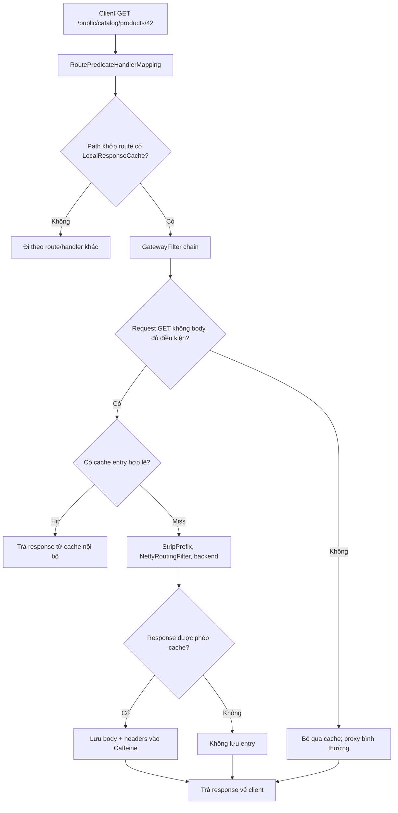

# Cấu hình dung lượng và thời gian sống theo tuyến

## 1. Vì sao phải đặt giới hạn cache riêng cho từng tuyến?

Trong **SPRING_CLOUD_GATEWAY**, client gửi request tới một cổng vào, Gateway chọn route bằng predicate, chạy filter chain để biến đổi đường dẫn/header, xác thực, giới hạn lưu lượng, áp dụng circuit breaker/retry và chuyển tiếp tới một microservice bằng HTTP(S) hoặc `lb://`. Với những nội dung công khai được đọc thường xuyên nhưng ít thay đổi, việc trả **response đã lưu trong bộ nhớ** giúp giảm độ trễ và số request đến backend.

Spring Cloud Gateway **Server WebFlux** có `LocalResponseCache` dựa trên **Caffeine**. Filter này có thể lưu **response body cùng response headers** cho những GET request phù hợp. Thay vì đặt một cache chung cho mọi đường dẫn, ta có thể chọn thời gian sống và giới hạn dung lượng **theo từng route**:

```text
Gateway :8080
  |
  +-- /public/catalog/**       -> catalog-public
  |      LocalResponseCache=10s,512KB
  |      -> Backend Catalog
  |
  +-- /public/announcements/** -> announcements-public
         LocalResponseCache=1m,2MB
         -> Backend Announcements
```

Ví dụ, danh mục giá/giỏ hàng cần tương đối mới nên chỉ giữ `10s`; thông báo công khai ít đổi có thể giữ `1m`. Nếu hai loại dữ liệu có lưu lượng và kích thước khác nhau, ta còn đặt **capacity** riêng để tránh route lớn chiếm toàn bộ cache của route nhỏ.

**Mục tiêu học tập:**

1. Phân biệt cache **theo route** và **global**, đặc biệt khi nhiều route trùng URI/path nhưng khác predicate.
2. Hiểu ý nghĩa và đơn vị của `LocalResponseCache=10s,512KB`, `time-to-live` và `size`.
3. Xác định request/response nào được cache theo HTTP method, status và `Cache-Control`.
4. Thiết lập Gateway Server WebFlux 4.3.x cùng các dependency Caffeine và Spring Cache.
5. Thực hành hai route với TTL/size khác nhau, kiểm thử cache hit, expiry, response `no-store` và tăng bộ đếm tại backend.
6. Phân tích ảnh hưởng của `max-age`, cache eviction, memory/replica, dữ liệu người dùng và thay đổi nội dung.
7. Nhận biết một lỗ hổng bảo mật đã được công bố về **global LocalResponseCache** trong các phiên bản Gateway bị ảnh hưởng.

> **Phiên bản minh họa:** Spring Boot 3.5.x + Spring Cloud 2025.0.x / **Spring Cloud Gateway Server WebFlux 4.3.x**. Dùng starter `spring-cloud-starter-gateway-server-webflux` và prefix mới `spring.cloud.gateway.server.webflux`. Ví dụ chọn **route-level cache** và chủ động **tắt global cache**. Các version `*.0` ở phần Maven chỉ minh họa release train tương thích; hãy chọn bản vá được hỗ trợ và xử lý advisory bảo mật trước khi triển khai production.

## 2. Cache được đặt ở đâu trong Gateway filter chain?



`LocalResponseCache` là một `GatewayFilterFactory`: chỉ những request đã **match route được gắn filter** mới có cơ hội sử dụng bộ cache của route đó. Trường hợp hit có thể **không gửi request mới** tới upstream. Trường hợp miss, Gateway tiếp tục routing như thông thường, gồm các filter biến đổi đường dẫn/header và có thể là LoadBalancer, TLS, Netty HttpClient.

Điều này rất khác `Cache-Control` của **trình duyệt/CDN**: `LocalResponseCache` giữ response **trong process Gateway**. Nó không lưu vào Redis/DB và không tự chia sẻ dữ liệu qua các Gateway replicas.

### 2.1. Những request/response nào đủ điều kiện?

Theo tài liệu chính thức Gateway WebFlux 4.3, filter cache phản hồi khi đáp ứng các điều kiện:

| Điều kiện | Được cache khi | Không được cache khi |
| --- | --- | --- |
| HTTP method | Request **GET không có body**. | POST, PUT, PATCH, DELETE; GET có body. |
| HTTP response status | **200 OK**, **206 Partial Content**, **301 Moved Permanently**. | Các status khác như 201, 302, 401, 403, 404, 429, 500, 503. |
| Request `Cache-Control` | Không chứa directive `no-store`. | Có `Cache-Control: no-store`. |
| Response `Cache-Control` | Không chứa `no-store` hoặc `private`. | Có `Cache-Control: no-store` hoặc `private`. |
| Entry đã hết hạn | Không: cần gọi upstream lại. | Entry cũ không được trả như một hit hợp lệ. |
| Cache còn capacity | Có thể lưu và đuổi entry khác theo chính sách Caffeine. | Không bảo đảm mọi response đều được giữ nếu cache đã đầy. |

`Cache-Control: no-cache` **không đồng nghĩa** `no-store`. Hơn nữa, tài liệu filter 4.3 mô tả trường hợp **đã có entry** mà client gửi request `Cache-Control: no-cache` có thể nhận **304 Not Modified không body**; hành vi chi tiết còn tùy cấu hình `request.no-cache-strategy` trong bản vá thực tế. Vì vậy **không dùng `no-cache` như cách bảo đảm bỏ qua local cache trong mọi phiên bản**. Khi buộc response không được lưu, phát `no-store` ở upstream và kiểm chứng.

> **An toàn dữ liệu:** các quy tắc trên là **điều kiện kỹ thuật**, không phải quyết định phân quyền. Response cá nhân hóa có thể mang status 200 và vô tình đủ điều kiện nếu thiếu `private`/`no-store`. Bài thực hành chỉ cache **nội dung công khai, giống nhau cho mọi người**.

### 2.2. `Cache-Control` của backend không phải cấu hình capacity

Ví dụ backend trả:

```http
HTTP/1.1 200 OK
Cache-Control: public, max-age=120
Content-Type: text/plain; charset=UTF-8
```

Header `max-age=120` là thông tin cache theo HTTP mà backend công bố. Nếu route Gateway cấu hình `LocalResponseCache=10s,512KB`, Gateway sử dụng **TTL 10 giây** cho entry của nó và, khi `max-age` có sẵn, có thể **viết lại** header `max-age` theo TTL đã đặt; ở các lần cache hit tiếp theo nó giảm xuống theo thời gian còn lại. Đừng mặc định `max-age=120` của backend luôn được giữ nguyên sau khi qua Gateway.

Dung lượng `512KB` **không phải** `max-age`, và nó cũng không nói một request được phép dùng tối đa 512KB băng thông. Đây là giới hạn **bộ nhớ cache** dùng để quyết định giữ/evict các entry của route.

## 3. Cache theo tuyến khác cache toàn cục

Spring Cloud Gateway có hai chế độ liên quan nhưng không tương đương.

| Thuộc tính | **Route-level** `LocalResponseCache` | **Global** local response cache |
| --- | --- | --- |
| Phạm vi áp dụng | Những route **có gắn** `LocalResponseCache`. | Có thể áp dụng rộng cho các route dùng global filter. |
| Khai báo TTL/size riêng | `LocalResponseCache=10s,512KB` hoặc DSL. | Dùng properties global/default; có thể phối hợp config theo route. |
| Cache storage | Caffeine local theo Gateway instance, phạm vi riêng theo filter route. | Caffeine local, có cơ chế chia sẻ toàn cục tùy version. |
| Kiểm soát public/private | Dễ review từng route rõ ràng. | Dễ bật nhầm cho những route nhạy cảm hoặc trùng predicates. |
| Khuyến nghị ví dụ này | **Bật riêng những route công khai, có danh sách allowlist.** | **Tắt** để tránh cache vô tình và các lỗi chia sẻ giữa route. |

Trong dòng WebFlux 4.3, các property quan trọng là:

```yaml
spring:
  cloud:
    gateway:
      server:
        webflux:
          global-filter:
            local-response-cache:
              enabled: false   # Không tự cache toàn cục
          filter:
            local-response-cache:
              enabled: true    # Cho phép dùng LocalResponseCache theo route
```

**Hai công tắc khác nhau**: tắt global filter không có nghĩa tự tắt route-level factory. Nếu route đã khai báo `LocalResponseCache=...` nhưng `filter.local-response-cache.enabled` chưa bật đúng, route cache có thể không hoạt động như kỳ vọng.

### 3.1. Cảnh báo bảo mật CVE-2026-59426 (19/11/2026)

Spring đã công bố advisory **[CVE-2026-59426](https://spring.io/security/cve-2026-59426/)**, mức **HIGH**, về việc **global LocalResponseCache có thể trả response giữa hai route khác nhau** khi chúng cùng khớp request URI nhưng được phân biệt bằng predicate không có trong cache key (chẳng hạn `Host`, `Header`, `Cookie`, `RemoteAddr`, `Query` hoặc predicate tùy chỉnh). Cache key của global filter trong các phiên bản bị ảnh hưởng **không bao gồm route đã chọn**. Hậu quả có thể là một client không có quyền nhận response của route hạn chế mà không cần chạm upstream.

Theo advisory ngày 19/11/2026:

- Bị ảnh hưởng: Gateway **4.3.0–4.3.6**, **5.0.0–5.0.4** và **4.0.0–4.2.10** trong những điều kiện triển khai được mô tả.
- Bản sửa tương ứng được nêu: **5.0.5 (OSS)**, **4.3.7 (Enterprise Support Only)** và một số nhánh hỗ trợ khác.
- Giảm thiểu: **tắt global LocalResponseCache** và chỉ cấu hình **route-level LocalResponseCache** ở các route thực sự cần cache. Theo advisory, route-level filter có cache riêng nên không chịu lỗi chia sẻ global cache vừa nêu.

Cấu hình giảm thiểu WebFlux 4.3:

```yaml
spring:
  cloud:
    gateway:
      server:
        webflux:
          global-filter:
            local-response-cache:
              enabled: false
```

**Đừng nhầm giảm thiểu CVE này với giấy phép cache mọi dữ liệu nhạy cảm.** Dù route-level đã cô lập cache giữa routes, response cá nhân hóa/tài chính/phiên đăng nhập vẫn cần `Cache-Control: no-store` hoặc chính sách không cache thích hợp; authorization phải được thực hiện đúng. Kiểm tra patch thực tế theo advisory tại thời điểm deploy.

### 3.2. Vì sao cùng URL vẫn có thể thuộc hai route?

```text
GET /catalog/42
  Route A: Header X-Channel=internal -> upstream nội bộ
  Route B: Header X-Channel=public   -> upstream công khai
```

Nếu global cache chỉ dùng URI/các header khác mà **không có thông tin route**, một response từ route A có thể bị dùng nhầm cho request được route B xử lý. Tên route `catalog-internal` và `catalog-public` không tự trở thành cache key cho global filter trong các phiên bản lỗi.

**Phương án an toàn trong bài** là dùng hai path công khai khác nhau **và** gắn route-level cache riêng, trong khi global cache tắt. Trong production, nếu dùng Host/header/tenant predicates, hãy kiểm thử ranh giới giữa routes và không phụ thuộc vào tính cô lập từ tên route khi chưa xác minh implementation.

## 4. Thời gian sống và kích thước có nghĩa gì?

### 4.1. TTL — `time-to-live`

`LocalResponseCache` nhận tham số đầu tiên là **thời gian tồn tại tối đa của một entry** theo đơn vị:

- `10s`: 10 giây.
- `30s`: 30 giây.
- `5m`: 5 phút.
- `1h`: 1 giờ.

Ví dụ:

```yaml
filters:
  - LocalResponseCache=10s,512KB
```

Request lần đầu bị cache miss, Gateway gọi upstream và lưu kết quả nếu hợp lệ. Request tiếp theo đến **trước khi TTL hết**, cùng định danh cache, có thể nhận response được lưu mà **không gọi upstream**. Khi TTL đã qua, lần request tiếp theo phải lấy nội dung mới rồi có thể lưu lại.

TTL **không phải lịch tự gọi backend để làm mới cache mỗi 10 giây**. Nó là hạn của entry; nếu không có request mới, không có lý do để Gateway chủ động fetch dữ liệu chỉ vì TTL vừa hết (trừ khi có giải pháp prefetch riêng do ứng dụng thiết kế).

### 4.2. Size — dung lượng cache của route

Tham số thứ hai là kích thước tối đa của **cache** được biểu diễn bằng đơn vị `KB`, `MB`, `GB`:

```yaml
filters:
  - LocalResponseCache=1m,2MB
```

`2MB` nhằm giới hạn tổng dung lượng entry được giữ cho route đó theo cách đo/eviction của Caffeine và implementation Gateway. Nó **không** là quy tắc giới hạn kích thước HTTP response gửi tới client; để chặn body quá lớn cần cơ chế size/routing phù hợp khác.

Khi dữ liệu cache vượt giới hạn, entries có thể bị **evict** theo chính sách Caffeine. Do đó một response đã lưu nhưng vừa bị đuổi có thể khiến request tiếp theo thành cache miss **trước cả lúc TTL hết**.

**Không suy ra cache size là hard limit của toàn JVM heap/RSS.** Cache cần overhead để lưu key, headers, metadata, objects và concurrent state. Nếu có N route, mỗi route `2MB`, và M Gateway replicas, tổng ngân sách được khai báo trên toàn hệ thống có thể lên đến khoảng `N × 2MB × M` (chưa tính overhead), chứ không có một quota dùng chung giữa các pod.

### 4.3. Cân bằng TTL, capacity, freshness và memory

| Loại response | TTL khởi điểm để thử nghiệm | Capacity khởi điểm | Rủi ro chính |
| --- | --- | --- | --- |
| Danh mục sản phẩm công khai cập nhật thường xuyên | 5–15 giây | 256KB–2MB/route | Giá/tồn kho thay đổi; không được dùng cache làm nguồn truth cuối cho giao dịch. |
| Thông báo công khai ít cập nhật | 1–5 phút | 1–8MB/route | Nội dung sửa/cần gỡ khẩn cấp nhưng TTL còn. |
| Cấu hình công khai, có version URL | Vài phút hoặc lâu hơn theo chính sách | Tính theo số phiên bản và body size | URL versioning và invalidation. |
| Dữ liệu đơn hàng, hồ sơ người dùng, token/session | **Không bật local response cache theo route công khai** | Không áp dụng | Rò dữ liệu giữa người dùng/tenant, quyền thay đổi. |
| Response stream/động liên tục | Thường không dùng bộ cache này | Không áp dụng | Bộ nhớ, độ trễ, dữ liệu stale. |

Các con số là **gợi ý lập kế hoạch**, không phải default thực thi hay SLA chắc chắn. Hãy đo backend update frequency, kích thước body, số URL biến thể, hit ratio, lượng heap sử dụng và yêu cầu nghiệp vụ rồi mới tối ưu.

### 4.4. Số lượng cache keys quan trọng hơn số route

Hai route có cùng size có thể có hành vi rất khác:

```text
Route A:
  100 đường dẫn công khai lặp đi lặp lại -> hit ratio cao

Route B:
  /public/report?requestId=<một UUID mới mỗi lần>
  -> rất nhiều keys, gần như không lặp -> cache churn
```

Bật cache cho URL mang query ngẫu nhiên hoặc request ID có thể làm **cache key cardinality** tăng mạnh, tốn memory mà không giảm backend traffic. Chỉ cache những tài nguyên có khóa ổn định, có nhu cầu đọc lặp và cho phép làm cũ trong khoảng TTL.

## 5. Cấu hình route-level cache theo phiên bản WebFlux 4.3

### 5.1. Các property cần nhớ

| Property | Chức năng | Thiết lập trong lab |
| --- | --- | --- |
| `spring.cloud.gateway.server.webflux.filter.local-response-cache.enabled` | Cho phép filter `LocalResponseCache` của route. | `true`. |
| `spring.cloud.gateway.server.webflux.global-filter.local-response-cache.enabled` | Bật/tắt local cache dùng cho các route theo cơ chế global. | `false` để tránh cache ngoài danh sách cho phép. |
| `spring.cloud.gateway.server.webflux.filter.local-response-cache.time-to-live` | Giá trị TTL mặc định cho filter nếu không override ở route. | Không cần đặt, vì route khai báo explicit. |
| `spring.cloud.gateway.server.webflux.filter.local-response-cache.size` | Giới hạn size mặc định nếu không override ở route. | Không cần đặt, vì route khai báo explicit. |
| `LocalResponseCache=<duration>,<size>` | Override **per-route**, tham số TTL trước, capacity sau. | `10s,512KB`, `1m,2MB`. |

Bảng properties chính thức của Gateway WebFlux 4.3 cho thấy default TTL `5m` ở nhóm filter. Một số trang mô tả global filter 4.3 còn trích các **prefix legacy** `spring.cloud.gateway.filter.local-response-cache.*` và `spring.cloud.gateway.global-filter.local-response-cache.*`. Khi dùng Spring Cloud **2025.0.x**, hãy ưu tiên namespace `server.webflux` được liệt kê trong **Configuration Properties của chính artifact** và kiểm tra startup/behavior. Không chỉ copy snippet của release train cũ.

### 5.2. YAML của hai route công khai

```yaml
server:
  port: 8080

spring:
  application:
    name: response-cache-gateway

  cloud:
    gateway:
      server:
        webflux:
          # Không bật cache global: áp dụng allowlist từng route.
          global-filter:
            local-response-cache:
              enabled: false

          # Cho phép factory LocalResponseCache trên những route khai báo.
          filter:
            local-response-cache:
              enabled: true

          routes:
            - id: catalog-public
              uri: http://127.0.0.1:9001
              predicates:
                - Path=/public/catalog/**
              filters:
                - LocalResponseCache=10s,512KB
                - StripPrefix=2

            - id: announcements-public
              uri: http://127.0.0.1:9001
              predicates:
                - Path=/public/announcements/**
              filters:
                - LocalResponseCache=1m,2MB
                - StripPrefix=2
```

Nhận xét:

1. Route `catalog-public` giữ các response eligible tối đa khoảng **10 giây**, capacity **512KB** cho cache của route đó.
2. Route `announcements-public` giữ tối đa khoảng **1 phút**, capacity **2MB**.
3. `StripPrefix=2` bỏ hai phân đoạn đầu: `/public/catalog/products/42` trở thành `/products/42`; `/public/announcements/release` trở thành `/release`.
4. Hai route có **hai path khác nhau** để dễ kiểm thử và tránh trùng predicate không cần thiết.
5. URI `http://127.0.0.1:9001` chỉ phù hợp cho bài local. Trong microservices thật có thể dùng HTTPS hoặc `lb://serviceId`; cache vẫn **local ở Gateway**, không có nghĩa backend nào cũng chứa cache giống nhau.

**Vì sao đặt `LocalResponseCache` trước `StripPrefix`?** Danh sách filter có thứ tự, và cache hit có thể ngắt phần proxy phía sau. Khi triển khai, cần kiểm tra thứ tự thực tế của `GatewayFilter`/ `GlobalFilter`, việc biến đổi request path và những điều kiện auth/rate limit chạy trước cache. Với nội dung public trong bài, cấu hình được chọn để dễ quan sát mà không dựa vào dữ liệu danh tính.

### 5.3. Java DSL thay cho YAML

Có thể tạo cùng ý tưởng bằng Java RouteLocator:

```java
package com.example.gateway;

import java.time.Duration;

import org.springframework.cloud.gateway.route.RouteLocator;
import org.springframework.cloud.gateway.route.builder.RouteLocatorBuilder;
import org.springframework.context.annotation.Bean;
import org.springframework.context.annotation.Configuration;

@Configuration
public class CachedRoutes {

    @Bean
    RouteLocator routeLocator(RouteLocatorBuilder builder) {
        return builder.routes()
                .route("catalog-public", r -> r
                        .path("/public/catalog/**")
                        .filters(f -> f
                                .localResponseCache(
                                        Duration.ofSeconds(10), "512KB")
                                .stripPrefix(2))
                        .uri("http://127.0.0.1:9001"))
                .route("announcements-public", r -> r
                        .path("/public/announcements/**")
                        .filters(f -> f
                                .localResponseCache(
                                        Duration.ofMinutes(1), "2MB")
                                .stripPrefix(2))
                        .uri("http://127.0.0.1:9001"))
                .build();
    }
}
```

**Đây là phương án thay thế** route YAML, không nên đăng ký trùng hai route ID/predicate cùng lúc trong một ứng dụng. Nếu dùng DSL, vẫn cần dependency cache và property cho phép route-level `LocalResponseCache`.

Phải đặc biệt kiểm tra mọi đường dẫn có yêu cầu đăng nhập: nếu câu trả lời phụ thuộc vào token/cookie/tenant, **không biến nó thành public-cached response** chỉ vì controller đã trả 200.

## 6. Thực hành: Gateway với hai TTL và hai giới hạn bộ nhớ

Bài thực hành dùng **một Gateway Server WebFlux** ở `127.0.0.1:8080` và **một HTTP backend Echo** ở `127.0.0.1:9001`. Backend in ra số thứ tự request và trả số đó trong response header/body. Khi Gateway có **cache hit**, số thứ tự từ backend không tăng — người học không cần suy đoán cache đang hoạt động chỉ từ độ trễ.

Kiến trúc local:

```text
Client curl
    |
    v
Gateway :8080
    |
    +-- /public/catalog/products/42
    |       LocalResponseCache: 10s,512KB
    |       StripPrefix=2 -> /products/42
    |
    +-- /public/announcements/release
            LocalResponseCache: 1m,2MB
            StripPrefix=2 -> /release
                    |
                    v
             EchoBackend :9001
             Counter + Cache-Control
```

### 6.1. Chuẩn bị dependency

Yêu cầu **JDK 17+**, Maven và `curl`. Tạo một project Maven độc lập của người học với `pom.xml` sau:

```xml
<?xml version="1.0" encoding="UTF-8"?>
<project xmlns="http://maven.apache.org/POM/4.0.0"
         xmlns:xsi="http://www.w3.org/2001/XMLSchema-instance"
         xsi:schemaLocation="http://maven.apache.org/POM/4.0.0
                             https://maven.apache.org/xsd/maven-4.0.0.xsd">
    <modelVersion>4.0.0</modelVersion>

    <parent>
        <groupId>org.springframework.boot</groupId>
        <artifactId>spring-boot-starter-parent</artifactId>
        <version>3.5.0</version>
        <relativePath/>
    </parent>

    <groupId>com.example</groupId>
    <artifactId>gateway-cache-lab</artifactId>
    <version>0.0.1-SNAPSHOT</version>

    <properties>
        <java.version>17</java.version>
    </properties>

    <dependencyManagement>
        <dependencies>
            <dependency>
                <groupId>org.springframework.cloud</groupId>
                <artifactId>spring-cloud-dependencies</artifactId>
                <version>2025.0.0</version>
                <type>pom</type>
                <scope>import</scope>
            </dependency>
        </dependencies>
    </dependencyManagement>

    <dependencies>
        <dependency>
            <groupId>org.springframework.cloud</groupId>
            <artifactId>spring-cloud-starter-gateway-server-webflux</artifactId>
        </dependency>

        <dependency>
            <groupId>org.springframework.boot</groupId>
            <artifactId>spring-boot-starter-cache</artifactId>
        </dependency>

        <dependency>
            <groupId>com.github.ben-manes.caffeine</groupId>
            <artifactId>caffeine</artifactId>
        </dependency>

        <dependency>
            <groupId>org.springframework.boot</groupId>
            <artifactId>spring-boot-starter-actuator</artifactId>
        </dependency>
    </dependencies>

    <build>
        <plugins>
            <plugin>
                <groupId>org.springframework.boot</groupId>
                <artifactId>spring-boot-maven-plugin</artifactId>
            </plugin>
        </plugins>
    </build>
</project>
```

Các điểm cần nhớ:

- `spring-cloud-starter-gateway-server-webflux` triển khai Gateway reactive trên Netty.
- `spring-boot-starter-cache` và `com.github.ben-manes.caffeine:caffeine` là **hai dependency** mà tài liệu `LocalResponseCache` yêu cầu.
- `spring-boot-starter-actuator` chỉ giúp quan sát trong lab; không tự bảo đảm mọi cache metric được xuất hiện trong mọi phiên bản.
- Spring Boot parent và Spring Cloud BOM quản lý version dependency; không tự đặt version của Gateway/Caffeine một cách tùy tiện.
- Không thêm `spring-boot-starter-web` Servlet vào Gateway WebFlux. Với dự án production, dùng release train/patch còn được hỗ trợ; các số `*.0` ở đây phục vụ minh họa compatibility.

Nếu ứng dụng có **custom `CacheManager` beans**, tài liệu Gateway lưu ý phải xác định `@Primary` hoặc `@Qualifier` phù hợp. Không tự tạo `CacheManager` thứ hai vô danh rồi mặc định LocalResponseCache sẽ dùng đúng cache mà bạn muốn.

### 6.2. Java entry point của Gateway

Tạo `src/main/java/com/example/gateway/GatewayApplication.java`:

```java
package com.example.gateway;

import org.springframework.boot.SpringApplication;
import org.springframework.boot.autoconfigure.SpringBootApplication;

@SpringBootApplication
public class GatewayApplication {
    public static void main(String[] args) {
        SpringApplication.run(GatewayApplication.class, args);
    }
}
```

Tạo `src/main/resources/application.yml` bằng YAML **đầy đủ ở mục 5.2**. Trong lab này **không** cần đăng ký thêm Java DSL ở mục 5.3: chọn **một** phương thức khai báo routes.

**Đặc biệt:** giữ cấu hình `global-filter.local-response-cache.enabled: false` và `filter.local-response-cache.enabled: true`. Đây là cách chủ động chọn route nào được phép cache.

### 6.3. Backend Echo: phản hồi công khai và bộ đếm

Tạo file `EchoBackend.java` **ngoài project Gateway**. Đây là server test bằng thư viện JDK, không phải dịch vụ production:

```java
import com.sun.net.httpserver.HttpServer;
import java.net.InetSocketAddress;
import java.nio.charset.StandardCharsets;
import java.util.concurrent.atomic.AtomicInteger;

public class EchoBackend {

    public static void main(String[] args) throws Exception {
        AtomicInteger counter = new AtomicInteger();

        HttpServer server = HttpServer.create(
                new InetSocketAddress("127.0.0.1", 9001), 0);

        server.createContext("/", exchange -> {
            int originNumber = counter.incrementAndGet();
            String method = exchange.getRequestMethod();
            String path = exchange.getRequestURI().getRawPath();
            String query = exchange.getRequestURI().getRawQuery();

            boolean noStore = path.equals("/uncacheable");
            boolean privatePolicy = path.equals("/private-policy");
            int status = path.equals("/missing") ? 404 : 200;

            String body = "origin-request=" + originNumber + "\n"
                    + "method=" + method + "\n"
                    + "path=" + path + "\n"
                    + "query=" + query + "\n";

            // Tạo entry lớn để thử sức chứa cache với route lab riêng.
            if (path.startsWith("/large/")) {
                body += "payload=" + "x".repeat(2048) + "\n";
            }

            var headers = exchange.getResponseHeaders();
            headers.set("Content-Type", "text/plain; charset=UTF-8");
            headers.set("X-Origin-Request-No",
                    Integer.toString(originNumber));

            if (noStore) {
                headers.set("Cache-Control", "no-store");
            } else if (privatePolicy) {
                headers.set("Cache-Control", "private, max-age=120");
            } else {
                headers.set("Cache-Control", "public, max-age=120");
            }

            byte[] bytes = body.getBytes(StandardCharsets.UTF_8);
            System.out.println("UPSTREAM #" + originNumber + " "
                    + method + " " + path + " status=" + status);

            exchange.sendResponseHeaders(status, bytes.length);

            try (var response = exchange.getResponseBody()) {
                response.write(bytes);
            }
        });

        server.start();
        System.out.println("EchoBackend started at 127.0.0.1:9001");
    }
}
```

Trong lab, backend phản hồi với `Cache-Control: public, max-age=120` cho các path thông thường để Gateway có thể lưu response và quan sát việc điều chỉnh `max-age`. Hai path `/uncacheable` và `/private-policy` trả directive cấm cache để kiểm tra negative cases. Path `/large/<id>` chỉ làm body lớn hơn; không chứa dữ liệu nhạy cảm.

**Không đưa các endpoint đặc biệt này ra môi trường production.** Chúng chỉ giả lập chính sách HTTP cache và cho người học biết request nào thực sự tới backend.

Mở **terminal A**:

```bash
java EchoBackend.java
```

Mở **terminal B** tại project có `pom.xml` và `application.yml`:

```bash
mvn spring-boot:run
```

Có Maven Wrapper: `./mvnw spring-boot:run` trên Linux/macOS hoặc `mvnw.cmd spring-boot:run` trên Windows. Trên Windows PowerShell cần điều chỉnh cách nối nhiều dòng trong các ví dụ Bash, nhưng từng lệnh `curl` cơ bản có thể chạy qua `curl.exe`.

### 6.4. Kiểm tra cache hit của tuyến Catalog

Mở **terminal C**, gửi hai request giống nhau trong vòng 10 giây:

```bash
curl -i "http://127.0.0.1:8080/public/catalog/products/42"
curl -i "http://127.0.0.1:8080/public/catalog/products/42"
```

Nếu cache hoạt động và request thứ hai đến trước TTL hết, bạn thường nhận:

```http
HTTP/1.1 200 OK
Cache-Control: public, max-age=10
X-Origin-Request-No: 1
Content-Type: text/plain; charset=UTF-8

origin-request=1
method=GET
path=/products/42
query=null
```

Ở response thứ hai, `X-Origin-Request-No` và `origin-request` **vẫn có giá trị 1** (với giả định đây là hai request đầu tiên tới backend). Header `max-age` thường đã giảm theo thời gian còn lại, có thể thấp hơn `10`. Vì body/headers được cache, thời điểm sinh response của backend không thay đổi trên cache hit.

Quan sát **terminal A**: với hai request cùng key trong TTL, chỉ xuất hiện **một** dòng `UPSTREAM` mới. Đây là bằng chứng đáng tin hơn việc chỉ thấy response nhanh: mạng local cũng có thể trả phản hồi nhanh khi cache miss.

### 6.5. Kiểm tra TTL hết hạn

Đợi khoảng 11 giây **sau lần tạo entry đầu tiên**, rồi gửi:

```bash
sleep 11
curl -i "http://127.0.0.1:8080/public/catalog/products/42"
```

Khi entry Catalog đã hết TTL, Gateway phải lấy response mới từ backend. `X-Origin-Request-No` tăng và terminal A xuất hiện một dòng `UPSTREAM` mới.

**Không suy rằng mọi request phải tới backend chính xác một lần mỗi 10 giây.** TTL tính từ thời điểm lưu entry, không có tác vụ refresh chủ động theo lịch. Cạnh tranh đồng thời, eviction sớm, request có `Cache-Control` và thay đổi key có thể ảnh hưởng số lần thực sự gọi upstream.

### 6.6. So sánh TTL của tuyến Announcements

Gửi request tới route thứ hai:

```bash
curl -i "http://127.0.0.1:8080/public/announcements/release"
curl -i "http://127.0.0.1:8080/public/announcements/release"
```

Ở đây `LocalResponseCache=1m,2MB` cho phép entry tồn tại lâu hơn Catalog. Sau khoảng 11 giây, Catalog đã có thể miss, nhưng entry Announcements vẫn có thể hit nếu chưa quá một phút:

```bash
sleep 11
curl -i "http://127.0.0.1:8080/public/announcements/release"
```

`X-Origin-Request-No` giữ nguyên trên cache hit, còn `Cache-Control: max-age` được tính lại theo số giây còn lại. Nếu đã đợi quá TTL hoặc entry bị evict vì capacity thì miss là hành vi đúng.

### 6.7. Response có `no-store` hoặc `private`

Trong EchoBackend, hai path này được cấu hình không cho cache:

```bash
curl -i "http://127.0.0.1:8080/public/catalog/uncacheable"
curl -i "http://127.0.0.1:8080/public/catalog/uncacheable"

curl -i "http://127.0.0.1:8080/public/catalog/private-policy"
curl -i "http://127.0.0.1:8080/public/catalog/private-policy"
```

Kỳ vọng các request lặp lại vẫn **chạm backend**, thể hiện bằng `X-Origin-Request-No` thay đổi. Trường hợp `/uncacheable` có response `Cache-Control: no-store`; `/private-policy` có `Cache-Control: private, max-age=120`. Trong hai trường hợp, LocalResponseCache không được lưu response.

Dù response thử nghiệm không chứa dữ liệu người dùng, nó minh họa cách backend chủ động truyền chính sách cache. Với token/session, đơn hàng, số dư và thông tin cá nhân, **khuyến nghị dùng `Cache-Control: no-store`** và **không gắn local cache cho route**, thay vì chỉ dựa vào header cuối cùng.

### 6.8. Request POST và response 404 không vào local cache

Gateway route dùng `Path` nên có thể match cả POST nếu không thêm `Method` predicate. `LocalResponseCache` chỉ cache **bodiless GET**; nó không làm việc như một cache cho POST/PUT/PATCH.

Thử trên backend giả lập không có side effect:

```bash
curl -i -X POST \
  "http://127.0.0.1:8080/public/catalog/products/42"

curl -i -X POST \
  "http://127.0.0.1:8080/public/catalog/products/42"
```

Bạn có thể thấy response 200 từ backend demo, nhưng `X-Origin-Request-No` tăng qua mỗi POST. **Trong API thật**, không được cho rằng POST trả 200 nghĩa là có thể cache: các thao tác ghi cần được thực thi theo quyền và có thể thay đổi dữ liệu. Nên bổ sung `Method=GET` predicate nếu route thực sự chỉ phục vụ GET.

Kiểm tra response 404 không được cache:

```bash
curl -i "http://127.0.0.1:8080/public/catalog/missing"
curl -i "http://127.0.0.1:8080/public/catalog/missing"
```

`EchoBackend` trả `404` cho `/missing`. Đây **không** thuộc bộ status mà LocalResponseCache 4.3 lưu mặc định, nên số request tại backend phải tăng.

### 6.9. Request có `Cache-Control: no-store`

Gửi GET tới **một URL chưa có entry** kèm yêu cầu không lưu:

```bash
curl -i -H "Cache-Control: no-store" \
  "http://127.0.0.1:8080/public/catalog/products/no-store-test"
```

Request có `no-store` không đủ điều kiện để được đưa vào cache. Gửi lại cùng URL không có directive này sẽ khiến Gateway cần gọi upstream nếu chưa có entry hợp lệ:

```bash
curl -i \
  "http://127.0.0.1:8080/public/catalog/products/no-store-test"
```

Trong thử nghiệm này, sử dụng một path mới để loại bỏ nhầm lẫn với entry đã lưu trước đó. Đừng dùng `Cache-Control: no-cache` làm phép thử tương đương `no-store`: theo tài liệu 4.3, request `no-cache` khi đã có cache entry có thể được xử lý bằng response **304 không body**, và biến thể behavior phụ thuộc phiên bản/strategy.

### 6.10. Kiểm tra giới hạn dung lượng: eviction không phải expiry

Để thấy size ảnh hưởng hit ratio, có thể **tạm sửa duy nhất file lab của người học**:

```yaml
filters:
  - LocalResponseCache=30s,4KB
  - StripPrefix=2
```

Áp dụng cho Catalog route, khởi động lại Gateway rồi gửi nhiều URL khác nhau dưới `/large/`:

```bash
curl -s -o /dev/null \
  "http://127.0.0.1:8080/public/catalog/large/1"
curl -s -o /dev/null \
  "http://127.0.0.1:8080/public/catalog/large/2"
curl -s -o /dev/null \
  "http://127.0.0.1:8080/public/catalog/large/3"
curl -i "http://127.0.0.1:8080/public/catalog/large/1"
```

Mỗi response `/large/<id>` chứa thêm khoảng **2KB body** và headers/cache metadata. Với ngân sách `4KB`, nhiều entries cạnh tranh khả năng giữ lại trong Caffeine; khi một entry bị evict, truy vấn lại `/large/1` sẽ gọi backend dù TTL 30 giây chưa hết.

**Không assert cứng số entry cụ thể hoặc thứ tự eviction**. Caffeine có chính sách/overhead và cách tính weight của implementation Gateway; thời điểm/điều kiện eviction có thể khác theo version. Mục đích test là nhận biết **capacity miss** khác **TTL expiry**, không dùng số request demo để kết luận chính xác mức RSS của JVM.

Sau thử nghiệm, **khôi phục cấu hình ban đầu** `LocalResponseCache=10s,512KB`.

## 7. Cách chọn TTL và capacity trong production

Không nên bắt đầu bằng `30m,500MB` cho mọi route chỉ vì đó là một ví dụ tài liệu. Hãy đo các đại lượng sau:

- **Độ mới cần thiết:** sau bao lâu nội dung thay đổi thì người dùng phải thấy bản mới?
- **Response size phân bố:** p50, p95, p99 kích thước body + headers.
- **Số cache key có thể có:** path/query/headers tạo ra bao nhiêu variants?
- **Lưu lượng lặp:** tỷ lệ request truy cập lại cùng key trong TTL.
- **Memory budget:** heap/Pod memory limit, số route, số replica, overhead.
- **Invalidation:** khi sửa/gỡ nội dung khẩn cấp, có thể chấp nhận stale đến hết TTL hay không?
- **Phân quyền:** dữ liệu có giống nhau cho mọi client hay phụ thuộc token/cookie/tenant?

### 7.1. Bắt đầu từ SLO về freshness

Nếu danh mục cập nhật mỗi phút nhưng business chấp nhận chậm 10 giây, TTL `10s` có thể là điểm xuất phát tốt. Nếu đổi giá/tồn kho phải có hiệu lực **ngay lập tức trong giao dịch**, không nên dùng cache HTTP ở Gateway làm nguồn giá hay quyền quyết định cuối cùng. Backend tại bước checkout phải kiểm tra giá và tồn kho thực tế.

Một bài toán gần đúng:

\[
\text{Hit ratio} =
\frac{\text{số request trả từ cache}}{\text{tổng request đủ điều kiện cache}}
\]

Một TTL quá ngắn có thể làm hit ratio thấp; quá dài gây stale data. Tối ưu phải cân bằng giảm tải backend với nghĩa vụ dữ liệu mới. **Hit ratio cao không phải mục tiêu độc lập** nếu response sai hoặc quá cũ.

### 7.2. Ước lượng dung lượng

Giả sử một route có khoảng `500` URL thường dùng, mỗi response được lưu cỡ `2KB` tính sơ bộ body + headers:

\[
500 \times 2\ \text{KB} \approx 1000\ \text{KB}
\]

Bạn có thể bắt đầu thử một ngân sách cache lớn hơn khoảng tính thô, ví dụ `2MB`, rồi quan sát eviction/hit ratio. Đây **không phải công thức bảo đảm**: Caffeine còn overhead, encoding, key variants và số entries thực tế có thể thay đổi.

Với `4` Gateway replicas và cache `2MB` cho cùng route, ngân sách được cấu hình trên toàn hệ thống có thể đạt khoảng **8MB** cho cache entries của route, nhưng **mỗi pod có thể giữ các entries khác nhau**. Không mặc định response vừa cache ở pod A sẽ hit ở pod B; một rolling restart làm mất cache của pod mới.

### 7.3. TTL không phải cơ chế invalidation theo sự kiện

Nếu backend cập nhật một bài thông báo, local cache của Gateway có thể tiếp tục trả bản cũ đến khi TTL hết. Nếu phải gỡ nội dung khẩn cấp do chính sách pháp lý/bảo mật, **đừng chỉ hy vọng TTL còn vài phút là chấp nhận được**. Có thể cần:

- Không cache nội dung cần thu hồi tức thời.
- Dùng versioned URL với cơ chế chuyển đường dẫn theo chính sách.
- Rút ngắn TTL hoặc áp dụng một hệ thống cache có invalidation/ban/purge được quản lý.
- Chủ động kiểm thử trạng thái nhiều Gateway pods sau deploy và khi đổi route.
- Đặt `Cache-Control: no-store` cho các response không được lưu, kể cả khi có fallback.

LocalResponseCache không phải hệ thống CDN có API purge phân tán hay nền tảng đồng bộ event giữa replicas. Nếu yêu cầu invalidation mạnh hơn TTL, chọn công nghệ cache khác hoặc thiết kế invalidate rõ ràng.

## 8. Những ranh giới bảo mật dễ bị bỏ sót

### 8.1. Không cache API cá nhân hóa

Những ví dụ **không nên** gắn `LocalResponseCache` theo kiểu public:

```text
GET /api/me
GET /api/orders/O-200
GET /api/billing/statement
GET /api/admin/dashboard
GET /api/session
```

Ngay cả khi mỗi request có token hợp lệ, **response có thể thay đổi theo principal/tenant và thời điểm kiểm tra quyền**. Một cache hit có thể tránh một số bước downstream, nên đừng tự giả định backend authorization luôn chạy lại khi response được trả từ Gateway cache.

- Gateway vẫn phải kiểm tra **authentication/authorization** theo chính sách ở tầng WebFlux trước khi route filter.
- Backend cần phát `Cache-Control: no-store` cho dữ liệu nhạy cảm; không chỉ tin Gateway config.
- Nếu có route cache public, đảm bảo response thật sự **không chứa dữ liệu cá nhân** và không thay đổi theo cookie/Authorization.
- Không dùng một request header tự đặt `X-User-Id` hoặc query `tenant` để tạo "cô lập dữ liệu" mà không có nguồn identity đáng tin.
- Không xem `Vary` hay nội dung cache key là lớp phòng vệ duy nhất thay cho phân quyền.

### 8.2. Route cache và rủi ro global cache

Theo **CVE-2026-59426**, trên các phiên bản bị ảnh hưởng, việc chọn route bằng `Host`, `Header`, `RemoteAddr` hoặc các predicates khác mà không ảnh hưởng cache key có thể khiến **global cache** trả response sai route. Vì thế:

1. **Tắt global local response cache** trên các phiên bản bị ảnh hưởng.
2. Dùng **route-level cache** cho từng route công khai có lý do rõ ràng.
3. Rà soát phiên bản Gateway đã được sửa hoặc biện pháp giảm thiểu theo advisory Spring.
4. Test hai requests có **cùng URI nhưng match hai routes khác nhau** và xác nhận không có dữ liệu trộn giữa chúng.
5. Không bật lại global cache chỉ vì performance tốt hơn nếu chưa đánh giá đầy đủ ảnh hưởng bảo mật.

Advisory mô tả một điều kiện khai thác cụ thể, không phải mọi deployment đều tự bị rò: nó cần global cache bật cùng các route/predicates phù hợp. Tuy nhiên, cách kiểm soát theo allowlist từng route vẫn là phương án dễ kiểm toán hơn.

### 8.3. Response `206 Partial Content` và `301`

Gateway 4.3 có thể cache response **206** và **301** khi các điều kiện khác thỏa. Điều đó đòi hỏi kiểm thử thêm:

- **206 Partial Content:** cần quan tâm `Range`, `Content-Range`, các biến thể request và tính đúng của từng phần dữ liệu. Không mặc định một cache cho file lớn sẽ xử lý mọi Range request đúng như CDN.
- **301 Moved Permanently:** redirect có thể tồn tại lâu ở trình duyệt/proxy. Kiểm tra `Location`, host công khai, query và vòng đời thay đổi URL; không vô tình cache redirect có token hoặc link nội bộ.
- **200 OK:** cũng phải kiểm tra `Cache-Control`, `Vary`, phiên đăng nhập và tính công khai của nội dung.

Không bật cache cho binary streaming hoặc partial content phức tạp chỉ dựa vào status được hỗ trợ; cần integration test thực tế.

### 8.4. Cache poisoning và header trust

Kẻ tấn công có thể thay query, `Host`, `Accept-Language` hoặc các headers khác để ảnh hưởng response. Nếu response có thể được lưu cho người khác, đó là rủi ro **cache poisoning/cross-user leakage**.

- Giới hạn nguồn `Host` và trusted forwarded headers; không tin `X-Forwarded-Host` do client tự đặt.
- Kiểm tra response `Vary` cho những biểu diễn phụ thuộc `Accept-Language`/encoding hoặc header hợp lệ khác; thử các biến thể và verify không trộn.
- Không để URL chứa token/API secret trong query; query có thể xuất hiện ở logs/cache keys.
- Giới hạn cardinality của query parameters và route matcher; không cache request có IDs ngẫu nhiên/độ nhạy cao.
- Không cho client tự tạo cache key phân vùng tenant chỉ bằng header khi backend thật dùng nguồn tenant khác.
- Theo dõi headers được thêm/sửa bởi `AddRequestHeader`, `RewritePath`, `SetRequestHostHeader` và `DedupeResponseHeader`: thứ tự filter có thể ảnh hưởng request/response mà cache nhìn thấy.

### 8.5. Cache cùng circuit breaker, retry và rate limiting

Khi cache hit, request **không nhất thiết tới backend**, nên:

- Một cache hit có thể làm số request backend thấp hơn đáng kể số request tại Gateway; hãy đo **cả hai phía**.
- Nếu rate limiting cần áp dụng cho **mọi client request**, phải thiết kế thứ tự filter sao cho cache hit không vô tình bypass quota. Spring Security WebFilter thường nằm trước Gateway route filters, nhưng `RequestRateLimiter` thuộc route filter chain và phải kiểm tra thứ tự thực tế.
- Circuit breaker đo kết quả downstream, không nên suy backend khỏe/chậm chỉ từ response cache hit.
- Retry có thể khuếch đại backend calls khi cache miss; cache không tự bảo đảm chống cache stampede khi nhiều request cùng key đến đồng thời.
- Fallback thường là 503 nên không nằm trong nhóm status được cache; nhưng **fallback trả 200 với dữ liệu stale/nhạy cảm** cần được rà soát cẩn thận.
- TLS/mTLS giữa Gateway và backend bảo vệ chặng outbound; cache hit không thay thế authentication/authorization của từng request.

## 9. Quan sát cache và xử lý sự cố

### 9.1. Cần đo gì?

| Chỉ số | Mục đích | Lưu ý |
| --- | --- | --- |
| Cache hit/miss ratio | Đo cache có giảm tải không. | Kết hợp backend counter, không chỉ dựa vào latency. |
| Eviction count | Biết capacity có quá nhỏ hay không. | Phân biệt eviction vì size và expiry theo API/metrics có sẵn. |
| Estimated cache size/weight | Kiểm soát ngân sách bộ nhớ. | Không tương đương JVM RSS. |
| Origin request rate | Biết request thực đi tới backend. | Đo tại backend và Gateway route. |
| Request latency p50/p95/p99 | Đánh giá performance. | Tách cache hit, miss, lỗi và fallback nếu có thể. |
| Heap/RSS/GC pauses | Nhận biết ảnh hưởng memory. | Cần đánh giá nhiều routes và replicas. |
| HTTP status, `Cache-Control` | Kiểm tra eligibility/freshness. | Không log token, cookie hoặc dữ liệu cá nhân. |

Nếu có Spring Boot Actuator/Micrometer và Caffeine metrics được bật/phù hợp, có thể xem các metric cache như hit/miss/evictions; tên metric và tags **phụ thuộc bean exposure/registration và phiên bản**. Không khẳng định một metric `cache.gets` nhất định có sẵn chỉ vì project đã thêm Actuator.

Trong môi trường lab, dùng chính `X-Origin-Request-No` và log `UPSTREAM` để xác minh hit/miss. Trong production, không nên phát `X-Origin-Request-No` hay thông tin backend hostname/instance thật ra client như một API công khai.

### 9.2. Bảng chẩn đoán

| Triệu chứng | Nguyên nhân thường gặp | Cách kiểm tra |
| --- | --- | --- |
| Không có cache hit dù gọi GET lặp | Chưa enable route-level factory; sai property prefix; thiếu Caffeine/Cache starter; response không eligible. | Xem dependency, config WebFlux, HTTP status/method và `Cache-Control`. |
| `Cache-Control: private` nhưng không thấy cache hit | Response bị loại theo rule. | Đây là hành vi mong muốn. |
| Gửi POST vẫn tới backend | Cache chỉ áp dụng bodiless GET. | Dùng route `Method=GET` cho tài nguyên chỉ đọc. |
| Response 404/500 không lưu | Không thuộc status cacheable. | Kiểm tra status gốc; không dùng cache để che lỗi. |
| Request thứ hai sau 11s miss | TTL route `10s` đã hết. | Đo từ lúc entry được lưu; kiểm tra TTL config. |
| Miss trước khi hết TTL | Cache capacity nhỏ, entry bị evict, URL/query/header variant khác. | Theo dõi eviction và key cardinality. |
| `max-age` trong response khác upstream | Gateway tính lại theo `time-to-live`. | So response trực tiếp backend và response qua Gateway. |
| Các Gateway pods trả các version khác nhau | Local cache không chia sẻ; mỗi pod lưu/expire riêng. | Kiểm tra replica và rolling deployment. |
| Bật global cache rồi response sai route | Có thể liên quan CVE-2026-59426 trên phiên bản bị ảnh hưởng. | Tắt global cache, dùng route-level, xử lý patch, test cùng URI/khác predicate. |
| CORS/Host/language biến thể bị trộn | `Vary`/cache key/header transform không nhất quán. | Test `Accept-Language`/Host/Authorization/cookie và thứ tự filter. |
| Sau khi sửa nội dung vẫn thấy bản cũ | TTL còn, không có invalidate phân tán. | Chọn TTL, cơ chế purge/version URL phù hợp. |
| Heap tăng và hit ratio thấp | Cache entries quá nhiều hoặc body lớn/ít trùng. | Giảm size/TTL, hạn chế keys, theo dõi memory và GC. |
| 401/403 nhưng client vẫn nhận dữ liệu cũ | Thiết kế auth/cache sai thứ tự hoặc cache nhầm response cá nhân hóa. | Tắt cache của route, kiểm tra WebFilter/authorization và advisory. |

### 9.3. Quy trình khoanh vùng

1. **Route có match?** Nếu không, kiểm tra `Path`, `Host`, `Method` và route ID.
2. **Route có gắn `LocalResponseCache` và enabled không?** Kiểm tra prefix `server.webflux`, dependency Caffeine/Cache starter, global cache đã tắt.
3. **Request có đủ điều kiện?** GET bodiless; không có `Cache-Control: no-store`.
4. **Response có đủ điều kiện?** 200/206/301 và không có `no-store`/`private`.
5. **Cùng cache key thật không?** So URL/query/headers liên quan; test bằng hai request giống hệt trên một Gateway replica.
6. **TTL còn không?** So thời điểm tạo entry và `max-age` Gateway đã viết lại.
7. **Có eviction không?** Thử giảm số keys/tăng capacity có kiểm soát, quan sát backend counter.
8. **Có yếu tố bảo mật không?** Kiểm tra API cá nhân hóa, global cache, route overlap, token/tenant và CVE advisory.
9. **Đã quan sát nhiều replicas chưa?** Local memory không chia sẻ; đánh giá cache hit và stale behavior theo pod.

## 10. Ma trận kiểm thử bắt buộc trước khi triển khai

| Trường hợp | Điều kiện | Điều cần xác minh |
| --- | --- | --- |
| Catalog hit | GET lặp cùng URL trong 10s | Backend chỉ nhận request đầu; response header/body được giữ. |
| Catalog expiry | Đợi quá 10s | Request tiếp theo gọi lại backend. |
| Announcements TTL | GET lặp trong 1m | Có thể hit dài hơn route Catalog. |
| Capacity | Giảm size, gửi nhiều URL `/large/<id>` | Có thể evict trước TTL; hit ratio thay đổi. |
| GET có query khác | Hai URLs với query khác nhau | Không nhầm response biến thể; kiểm chứng key thực. |
| Response `no-store` | Backend trả `Cache-Control: no-store` | Không lưu response. |
| Response `private` | Backend trả `Cache-Control: private` | Không lưu response. |
| Request `no-store` | URL chưa cache, client yêu cầu no-store | Không tạo entry cho request đó. |
| Request `no-cache` | Entry đã có, gửi no-cache | Kiểm tra xử lý theo version/strategy, không giả định force refresh. |
| POST | Gọi cùng URL bằng POST | Không cache response POST. |
| HTTP 404/500 | Backend trả lỗi | Không cache status này theo rule mặc định. |
| Hai routes có TTL khác | Catalog và Announcements | Không chia sẻ cùng capacity/TTL theo route-level policy. |
| Multi-replica | Hai Gateway instances | State cache độc lập, không ngầm chia sẻ entries. |
| Global cache disabled | Kiểm tra startup/runtime | Chỉ các route có filter mới được cache. |
| Route overlap/cross-route | Cùng URI nhưng route predicate khác | Không trả phản hồi của route khác, đặc biệt với phiên bản bị CVE. |
| Authenticated resource | User A/B/tenant A/B | Không cache dữ liệu cá nhân hóa ngoài chính sách. |
| Rate limit + cache | Request cache hit liên tiếp | Quota vẫn được áp dụng đúng mục tiêu client requests. |
| Upstream unavailable | Backend down sau khi cache entry đã hết hạn | Không giả định cache có stale-while-revalidate/fallback tự động. |
| Deployment/restart | Restart một Gateway pod | Cache local của pod đó mất, request sau cần warm-up. |

**Không chỉ assert HTTP 200**. Cần đồng thời kiểm tra bộ đếm backend, header `Cache-Control`, trạng thái đã hết TTL, behavior khi size nhỏ và tính cô lập của các route. Với dữ liệu có quyền truy cập, phải kiểm thử từ chối **401/403** ngay cả khi trước đó có cache entry.

## 11. Câu hỏi tự kiểm tra

**1. `LocalResponseCache=10s,512KB` có nghĩa mỗi request được phép tải tối đa 512KB không?**

Không. `10s` là TTL của entry, còn `512KB` là ngân sách/giới hạn dung lượng của cache route theo implementation, không phải HTTP payload size limit.

**2. Nếu route Catalog đặt TTL 10s, Gateway có chủ động fetch lại dữ liệu đúng mỗi 10 giây không?**

Không. Entry hết hạn; request tiếp theo thường bị cache miss rồi gọi backend. Không có prefetch định kỳ tự động chỉ từ TTL.

**3. Vì sao một response vẫn cache miss trước khi TTL hết?**

Vì entry có thể bị **evict do capacity**, request dùng cache key/variant khác, hoặc request/response không đủ điều kiện.

**4. Bật Spring Cache + Caffeine dependencies có tự bật LocalResponseCache cho mọi route không?**

Không. Cần cấu hình enable và gắn filter theo route (hoặc lựa chọn global cache có chủ đích, nhưng bài này tắt global).

**5. Response `Cache-Control: private` hoặc `no-store` có được LocalResponseCache 4.3 lưu không?**

Không theo quy tắc eligibility chính thức.

**6. Vì sao Gateway trả `Cache-Control: max-age=10` dù backend gửi `max-age=120`?**

Vì filter có thể viết lại `max-age` theo TTL của cache Gateway, và giảm số giây còn lại trên các cache hits.

**7. Cùng route ID trên hai Gateway pods có nghĩa cùng cache contents không?**

Không. Caffeine cache là local in-memory theo process; chúng không chia sẻ entry và thời điểm hết hạn.

**8. Vì sao không nên dùng global response cache trên Gateway 4.3.0–4.3.6 nếu có nhiều route trùng URI nhưng khác predicate?**

Theo **CVE-2026-59426**, global cache ở các bản bị ảnh hưởng có thể không phân biệt route trong key, dẫn đến response của route hạn chế được trả cho route khác.

**9. Vì sao bật cache cho `/api/me` hoặc `/api/orders/{id}` là nguy hiểm?**

Response phụ thuộc principal/tenant/permissions; cache hit có thể không gọi lại backend để kiểm tra quyền, gây rò hoặc trả dữ liệu stale. Nên không cache route đó và dùng `Cache-Control: no-store`.

**10. Khi có rate limiting, cache hit có được tự miễn quota không?**

Không nên giả định. Phải thiết kế và test thứ tự filter để bảo đảm rate limit áp dụng cho mỗi client request theo chính sách, dù request có tới backend hay không.

## Kết luận

`LocalResponseCache` trong **Spring Cloud Gateway Server WebFlux** cho phép đặt **TTL và dung lượng riêng theo route**, ví dụ `LocalResponseCache=10s,512KB` cho dữ liệu công khai thay đổi nhanh và `LocalResponseCache=1m,2MB` cho thông báo công khai ít đổi. TTL kiểm soát độ mới của entry; size kiểm soát áp lực bộ nhớ và khả năng eviction. Cả hai phải được chọn theo kích thước body, số key, tần suất đọc lặp và giới hạn memory của **mỗi Gateway instance**.

Cache chỉ hữu ích nếu **request/response đủ điều kiện** và không làm yếu bảo mật. Tài liệu 4.3 giới hạn method/status/cache directives; các response nhạy cảm cần `no-store`, xác thực/phân quyền vẫn phải đúng, và cache không thay thế retry/circuit breaker, TLS, rate limiting hay discovery. Với advisory **CVE-2026-59426 công bố ngày 19/11/2026**, nên tắt **global LocalResponseCache** trên các phiên bản bị ảnh hưởng và chỉ gắn **route-level filter** vào danh sách public routes đã được review, đồng thời cập nhật bản sửa theo hướng dẫn Spring.

### Tài liệu tham khảo chính thức

- [Spring Cloud Gateway Server WebFlux 4.3 — LocalResponseCache GatewayFilter Factory](https://docs.spring.io/spring-cloud-gateway/reference/4.3/spring-cloud-gateway-server-webflux/gatewayfilter-factories/local-cache-response-filter.html)
- [Spring Cloud Gateway Server WebFlux 4.3 — Global Filters / Local Response Cache](https://docs.spring.io/spring-cloud-gateway/reference/4.3/spring-cloud-gateway-server-webflux/global-filters.html)
- [Spring Cloud Gateway 4.3 — Configuration Properties (local-response-cache)](https://docs.spring.io/spring-cloud-gateway/reference/4.3/configprops.html)
- [Spring Security Advisory — CVE-2026-59426: Global LocalResponseCache Cross-Route Leak (19/11/2026)](https://spring.io/security/cve-2026-59426/)
- [Spring Cloud Gateway Server WebFlux 4.3 — How It Works / Filter Chain](https://docs.spring.io/spring-cloud-gateway/reference/4.3/spring-cloud-gateway-server-webflux/how-it-works.html)
- [Caffeine Cache — official project](https://github.com/ben-manes/caffeine)
- [Spring Cloud — đối chiếu phiên bản release train và Spring Boot](https://spring.io/projects/spring-cloud/)

