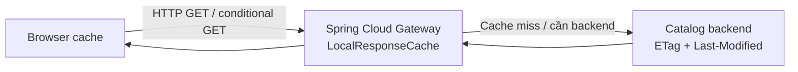
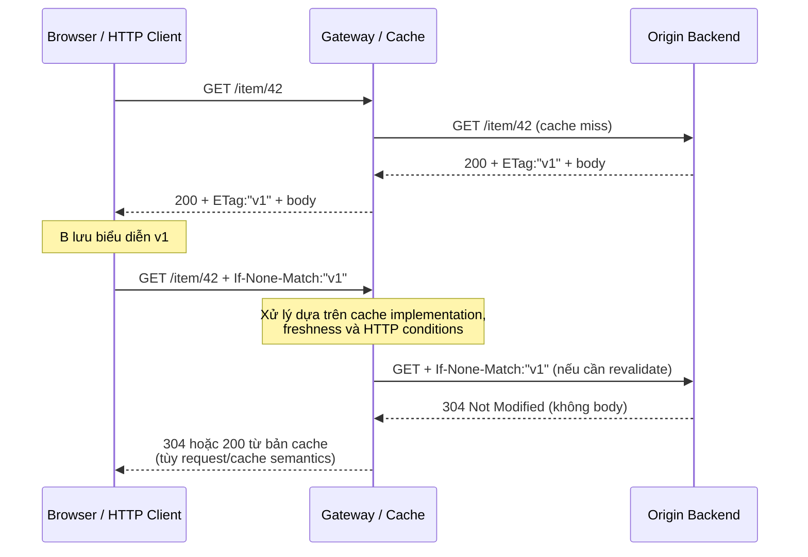

# Tương tác với `max-age` và các yêu cầu có điều kiện

**Chương:** Bộ nhớ đệm  
**Module:** `SPRING_CLOUD_GATEWAY` — Spring Cloud Gateway

Một API Gateway cho microservices có thể giảm tải backend bằng cách lưu response của những HTTP `GET` phù hợp. Nhưng câu hỏi “đã cache chưa?” chưa đủ để đánh giá hành vi đúng. Khi client nhận `Cache-Control: max-age=60`, trình duyệt có thể sử dụng bản sao trong một khoảng thời gian; khi hết hạn, client có thể gửi `If-None-Match` hoặc `If-Modified-Since` để kiểm tra tài nguyên có thay đổi hay không. Trong Spring Cloud Gateway, `LocalResponseCache` lại có **TTL riêng** và có thể **viết lại `max-age`** trong response. Vì vậy cache ở browser, cache tại Gateway và dữ liệu gốc ở backend có thể có **ba vòng đời khác nhau**.

Bài học này giải thích chính xác sự tương tác giữa **cache freshness**, `max-age`, `Age`, ETag, Last-Modified, `304 Not Modified` và **conditional requests**, rồi thực hành với **Spring Cloud Gateway Server WebFlux** và một backend Spring Boot. Đặc biệt, ta phân biệt **quy tắc chuẩn HTTP** với **hành vi cụ thể của `LocalResponseCache`**, không mặc định filter Gateway là một HTTP cache tuân thủ đầy đủ mọi tình huống RFC 9111. Phần cuối liên hệ caching với route predicate, filter chain, header transformation, service discovery, OAuth2/Authorization, TLS, rate limiting, circuit breaker, retry và quan sát request.

> **Phạm vi và bảo mật:** Ví dụ dành cho **Gateway Server WebFlux** với cấu hình route theo namespace `spring.cloud.gateway.server.webflux.*` của các dòng Spring Cloud Gateway mới. Caching response **có thể làm rò rỉ dữ liệu qua ranh giới route hoặc người dùng** nếu thiết kế cache key sai. Bài lab chỉ cache dữ liệu **catalog công khai**, dùng **cache riêng theo route**, không bật global cache. Spring công bố **CVE-2026-59426 ngày 19/11/2026** liên quan `global LocalResponseCache` của một số phiên bản; xem mục bảo mật trước khi bật cache trên môi trường thật.

## 1. Mục tiêu học tập

Sau bài này, bạn có thể:

1. Giải thích sự khác nhau giữa **TTL của Gateway cache**, **`Cache-Control: max-age` của HTTP response**, **`Age`** và **thời gian sống của bản sao trong browser/CDN**.
2. Mô tả `ETag`, `Last-Modified`, `If-None-Match`, `If-Modified-Since` và điều kiện tạo `304 Not Modified`.
3. Phân biệt `no-store`, `no-cache`, `private`, `public`, `must-revalidate`, `max-age=0` và `s-maxage`.
4. Hiểu quy tắc `LocalResponseCache`: request GET không body, các status được cache, phụ thuộc `Cache-Control` và cách viết lại `max-age` khi backend đã khai báo nó.
5. Viết cấu hình cache **theo route** có TTL và kích thước giới hạn, bật/tắt đúng property của release train.
6. Dựng backend có ETag, Last-Modified và bộ đếm origin hits để kiểm thử lần gọi đầu, cache hit, conditional GET và cache expiry.
7. Nhận diện rủi ro cache chéo quyền truy cập, sai `Vary`, stale dữ liệu, cache stampede, nhiều Gateway replicas và lỗi vận hành.
8. Thiết kế test có thể lặp lại, quan sát hit/miss/304 mà không log token hoặc dữ liệu cá nhân.

## 2. Ba tầng lưu response trong một request

Một browser gọi `GET /api/catalog/items/SKU-42` có thể gặp:



Ngoài ra còn có CDN, reverse proxy, ingress hoặc service cache ở phía backend; chúng đều có thể thêm **một tầng caching khác**. Không thể kết luận “backend không thấy request nên LocalResponseCache hit” nếu browser hoặc CDN cũng đang cache.

| Tầng | Dữ liệu lưu ở đâu? | Căn cứ quyết định |
|---|---|---|
| **Browser HTTP cache** | Trên thiết bị người dùng, theo policy browser | `Cache-Control`, `Age`, validators, request mode và browser policy |
| **CDN / shared proxy cache** | Bên ngoài Gateway hoặc ingress | HTTP cache policy, cache key, `Vary`, authorization, TTL riêng |
| **Gateway `LocalResponseCache`** | Bộ nhớ cache cục bộ trong từng tiến trình Gateway, Caffeine | Quy tắc filter, route, URI/key, TTL, status và headers |
| **Backend data cache** | Redis, DB cache, in-memory service | TTL/invalidation của ứng dụng, khác HTTP response cache |

**Local** nghĩa là **một Gateway replica có cache riêng**. Khi có hai replicas, instance A có thể đang giữ entry còn instance B chưa có, trừ khi hệ thống có lớp cache dùng chung ở phía ngoài. Thêm `lb://catalog-service` chỉ thay cách chọn backend, không biến LocalResponseCache thành Redis/distributed cache.

### 2.1. Một cache hit có nghĩa gì?

Lần đầu:

```text
Browser -> Gateway MISS -> Backend 200 + body + ETag + Cache-Control
                    Gateway lưu response nếu đủ điều kiện
         <- 200 response
```

Lần sau trong TTL:

```text
Browser -> Gateway HIT (nếu request/entry phù hợp)
         <- response từ cache, backend không xử lý request này
```

Khi entry hết hạn hoặc không dùng được, Gateway có thể cần gọi backend; backend có thể trả `200` với biểu diễn mới hoặc `304` theo một conditional request. **Không được đồng nhất** “cache miss” với “backend trả 200”, hay “HTTP 304” với “Gateway cache hit”: ba khái niệm đến từ các tầng khác nhau.

## 3. `Cache-Control: max-age` là gì?

`Cache-Control: max-age=N` ở **response** biểu đạt thời gian freshness tính bằng giây của response theo HTTP caching. Ví dụ:

```http
HTTP/1.1 200 OK
Cache-Control: public, max-age=60
ETag: "catalog-v4"
Last-Modified: Sun, 01 Nov 2026 00:00:00 GMT
Content-Type: application/json

{"sku":"SKU-42","price":350000}
```

Response có thể được cache phù hợp trong khoảng freshness được phép. Nếu chưa có yếu tố `Age`/Date hoặc sự thay đổi thời gian khác, ta có thể hiểu đơn giản là **tối đa khoảng 60 giây** kể từ thời điểm được coi là mới. Tuy nhiên, theo RFC 9111, **freshness không được tính chỉ bằng một stopwatch tự đặt tại client**: cache phải xét thời gian đã trôi qua từ nguồn, `Date`, `Age` và các thông tin tương ứng.

### 3.1. Tính freshness còn phải xét `Age`

Một response qua shared cache có thể trông như sau:

```http
HTTP/1.1 200 OK
Cache-Control: public, max-age=60
Age: 35
ETag: "catalog-v4"
```

Diễn giải đơn giản: response đã khoảng 35 giây tuổi; nếu giới hạn freshness là 60 giây thì khoảng thời gian còn “fresh” chỉ còn xấp xỉ 25 giây, chưa kể thời gian truyền/đồng hồ theo chuẩn. **Không tự coi `max-age=60` là thêm 60 giây mới sau mỗi lần một cache trả response.**

Một phép ước tính trực quan:

```text
freshnessLifetime = 60 giây
currentAge        = 35 giây
remainingFresh    = max(0, 60 - 35) = 25 giây
```

Đây là **sơ đồ tính gần đúng** để học; RFC 9111 quy định cách tính `current_age` chi tiết bằng `Date`, `Age` và các mốc thời gian request/response. Header `Age` không được dùng như một bộ đếm tuyệt đối duy nhất.

### 3.2. `max-age` không nói tài nguyên chắc chắn bất biến

Backend có thể cập nhật giá sản phẩm ngay sau khi gửi response `max-age=60`. Khi đó cache vẫn có thể phục vụ bản cũ trong freshness lifetime mà backend đã cho phép. Quyết định `max-age` là một **trade-off về độ mới, tải và latency**, không phải bằng chứng dữ liệu thật sự không đổi.

Với tồn kho, giá nhạy cảm, phân quyền hoặc trạng thái giao dịch, TTL phải dựa trên mức độ stale chấp nhận được. Nếu không thể chấp nhận stale, chọn chính sách validation/no-store hoặc chủ động invalidation phù hợp thay vì dùng thời gian dài theo cảm tính.

### 3.3. `max-age` ở response khác `max-age` ở request

Hai bên có thể gửi cùng tên directive nhưng mục đích khác:

```http
GET /api/catalog/items/SKU-42 HTTP/1.1
Cache-Control: max-age=0
```

Ở **request**, `max-age=0` thể hiện mong muốn không dùng response đã có tuổi vượt ngưỡng 0; đây là **ưu tiên của client**, không tương đương server trả `Cache-Control: no-store`. Trong triển khai cụ thể, cache có thể phải kiểm tra lại với origin hoặc làm theo chiến lược được hỗ trợ. Không giả định `max-age=0` luôn xóa entry trong cache hay chắc chắn ép backend tạo body mới.

## 4. Các Cache-Control directives cần phân biệt

| Directive | Ở request / response | Ý nghĩa cần nhớ |
|---|---|---|
| `max-age=60` | Response | Độ tươi tối đa của biểu diễn theo quy tắc HTTP freshness |
| `max-age=0` | Request hoặc response | Request muốn response rất mới; response gần như stale ngay khi `current_age > 0` |
| `no-cache` | Response | **Cho lưu**, nhưng phải xác thực lại với origin trước khi dùng để đáp ứng request khác |
| `no-cache` | Request | Client yêu cầu cache không được dùng response đã lưu để trả lời mà chưa validate lại, theo HTTP semantics |
| `no-store` | Request/response | Yêu cầu không lưu response/request theo semantics tương ứng; với Gateway filter là điều kiện loại khỏi cache |
| `private` | Response | Không cho **shared cache** lưu; private browser cache có thể lưu theo policy |
| `public` | Response | Cho phép shared cache lưu nếu các điều kiện khác thỏa; không tự bảo đảm an toàn nếu response có dữ liệu riêng |
| `must-revalidate` | Response | Khi stale, không dùng lại mà chưa validate; nếu không thể validate, theo chuẩn phải lỗi thay vì trả stale trái phép |
| `s-maxage=30` | Response | Freshness override dành cho **shared caches**, có semantics riêng với `max-age` |
| `stale-while-revalidate` | Response extension | Có thể tạm phục vụ stale trong giới hạn khi tái xác thực ở nền, **chỉ nếu cache hỗ trợ** |
| `immutable` | Response extension | Gợi ý cho client rằng biểu diễn không đổi trong thời gian fresh, thường dùng tài nguyên versioned |

**Không đồng nhất `no-cache` với `no-store`.** Response `no-cache` theo HTTP vẫn có thể được lưu, nhưng việc **sử dụng lại** phụ thuộc revalidation. Với dữ liệu nhạy cảm, `private, no-store` là chính sách thường cần đánh giá, đồng thời phải áp **authentication/authorization** ở Gateway và backend, không dựa một mình vào header.

### 4.1. Header có nhiều directives

```http
Cache-Control: public, max-age=120, must-revalidate
```

Các directives được phân tách bằng dấu phẩy và tên không phân biệt hoa/thường; filter/cache phải xử lý **từng directive**, không so sánh nguyên chuỗi theo vị trí cố định. Nếu có:

```http
Cache-Control: max-age=120, private
```

thì `private` vẫn cấm shared cache lưu response mặc dù có `max-age`. Nếu có `no-store` trong response, không được xóa directive đó để cưỡng bức cache một response chứa dữ liệu riêng tư.

### 4.2. Có nên thêm `public` vào mọi response GET?

**Không.** Request GET có thể trả thông tin đơn hàng, thông tin hồ sơ, kết quả tìm kiếm theo quyền, tenant, role hoặc cookie. `GET` chỉ nói về HTTP method, không chứng minh dữ liệu có thể chia sẻ giữa người dùng. Cần đánh giá response contract và cache key trước khi thêm `Cache-Control: public`.

## 5. Conditional request: kiểm tra “đã thay đổi chưa?”

Khi client đã có một bản sao, nó có thể yêu cầu server/cache **xác thực điều kiện** thay vì luôn gửi toàn bộ body. Hai nhóm validator thường dùng:

- **ETag / If-None-Match:** so sánh dấu hiệu phiên bản biểu diễn (entity tag).
- **Last-Modified / If-Modified-Since:** so sánh thời điểm sửa đổi cuối cùng.



Trong sơ đồ, Gateway **không bắt buộc** luôn forward conditional request đến origin. Nếu đang giữ một bản sao fresh, một HTTP cache phù hợp có thể tự xử lý điều kiện khi đủ thông tin; với filter `LocalResponseCache` phải kiểm thử implementation thực tế. Tương tự, nếu origin trả 304 cho cache, cache có thể cập nhật metadata rồi trả **200 cùng body đã lưu** cho một client không gửi conditional request.

### 5.1. ETag và `If-None-Match`

Origin trả:

```http
HTTP/1.1 200 OK
ETag: "catalog-v7"
Cache-Control: public, max-age=60
Content-Type: application/json

{"sku":"SKU-42","price":350000}
```

Client đã có body gửi:

```http
GET /api/catalog/items/SKU-42 HTTP/1.1
If-None-Match: "catalog-v7"
```

Nếu biểu diễn đã chọn vẫn có ETag tương ứng, server có thể trả:

```http
HTTP/1.1 304 Not Modified
ETag: "catalog-v7"
Cache-Control: public, max-age=60
```

`304` **không có response body** theo chuẩn. Client dùng lại representation đã lưu của mình, cập nhật metadata theo quy tắc caching. Nếu ETag không khớp (ví dụ origin đã thay đổi), server có thể trả `200` với body mới và ETag mới.

**ETag phải ổn định khi representation tương đương theo semantics của validator.** Nếu body thay đổi giá, tên sản phẩm hoặc thuộc tính mà ETag vẫn giữ nguyên, client có nguy cơ dùng bản cũ không đúng. Ngược lại, tạo ETag ngẫu nhiên ở mỗi request sẽ khiến revalidation hiếm khi tiết kiệm được body.

### 5.2. Strong ETag và weak ETag

```http
ETag: "v7"
ETag: W/"v7"
```

- Strong ETag không có prefix `W/`, thể hiện quan hệ tương đương biểu diễn chặt chẽ hơn và hữu ích với byte ranges.
- Weak ETag có prefix `W/`, cho phép một số thay đổi ở biểu diễn mà vẫn được coi là tương đương ngữ nghĩa theo validator.
- `If-None-Match` trong GET dùng **weak comparison** theo RFC 9110, nên weak/strong tags có thể so sánh được khi opaque tag giống nhau; điều này khác các điều kiện đòi strong comparison như `If-Match`.
- Không chọn weak ETag cho một endpoint file download/range request mà bạn cần ràng buộc byte chính xác và `If-Range`.

Thông thường, ứng dụng có thể dùng **version dữ liệu** hoặc hash của biểu diễn làm ETag, nhưng cần cân nhắc encoding, định dạng JSON, locale và quyền truy cập. Hash token/user identity đưa nguyên vào ETag hoặc cache key có thể lộ metadata.

### 5.3. Last-Modified và `If-Modified-Since`

Nếu origin không có ETag, nó có thể gửi:

```http
HTTP/1.1 200 OK
Last-Modified: Sun, 01 Nov 2026 00:00:00 GMT
Cache-Control: public, max-age=60
```

Client gửi:

```http
GET /api/catalog/items/SKU-42 HTTP/1.1
If-Modified-Since: Sun, 01 Nov 2026 00:00:00 GMT
```

Nếu tài nguyên không thay đổi sau thời điểm đó và các preconditions phù hợp, server có thể trả `304`. Khi tài nguyên đã thay đổi, server trả `200` với representation mới.

**Giới hạn của Last-Modified:** HTTP-date thường có độ phân giải giây; nếu dữ liệu bị sửa nhiều lần trong cùng giây hoặc đồng hồ/metadata không đáng tin, validator theo thời gian có thể kém chính xác hơn version/hash ETag. Vì vậy API cập nhật nhanh thường cần một ETag/row version ổn định.

### 5.4. Nếu request có cả hai header?

Với GET/HEAD, khi có `If-None-Match`, điều kiện này **có ưu tiên hơn `If-Modified-Since`** theo RFC 9110; không tự viết logic “nếu một trong hai nói not modified thì luôn 304” khi ETag không khớp. Hãy sử dụng HTTP conditional support của Spring Framework hoặc kiểm tra điều kiện đúng thứ tự.

```http
GET /items/SKU-42 HTTP/1.1
If-None-Match: "old-version"
If-Modified-Since: Sun, 01 Nov 2026 00:00:00 GMT
```

Nếu ETag hiện tại khác `"old-version"`, backend nên xử lý theo `If-None-Match` ưu tiên, kể cả mốc thời gian trong `If-Modified-Since` tình cờ khiến logic tùy biến muốn trả 304.

### 5.5. `304` và `412` là hai kết quả khác nhau

| Request | Validator | Phản hồi có thể xảy ra | Ý nghĩa |
|---|---|---|---|
| GET | `If-None-Match` khớp | `304 Not Modified` | Dùng lại bản sao client đã có |
| GET | `If-Modified-Since` phù hợp | `304 Not Modified` | Không cần gửi body mới |
| GET | Validator không khớp | `200 OK` + body | Tài nguyên có bản mới hoặc không thể xác nhận not-modified |
| PUT/PATCH/DELETE | `If-Match` không khớp | `412 Precondition Failed` | Chặn cập nhật lên phiên bản không như mong đợi |
| PUT/POST khác theo `If-None-Match` | Tùy semantics và điều kiện | Có thể `412` | Không được dùng công thức GET→304 cho mọi method |

`If-Match`/`If-Unmodified-Since` thường được dùng để tránh **lost update** trong ứng dụng ghi dữ liệu. Đây là cơ chế đồng bộ/optimistic concurrency khác mục tiêu HTTP response caching cho GET. `LocalResponseCache` không tự làm một API thanh toán/đơn hàng có optimistic lock.

### 5.6. HEAD, 206 và Range cần thận trọng

HTTP HEAD về nguyên tắc hỏi metadata của representation mà không yêu cầu body. `If-Range`/`Range` liên quan **phạm vi byte** và `206 Partial Content`; ETag strong, `Content-Range`, `Vary` và các bản partial representation cần được xử lý đúng.

Tài liệu `LocalResponseCache` của Gateway liệt kê **GET không body** là request đủ điều kiện cache và status **200/206/301** là những response được cache. Điều đó **không đồng nghĩa** bạn có thể tự suy ra mọi tình huống Range/If-Range hay HEAD đều được filter kết hợp theo RFC một cách hoàn hảo. Với media/video/range download, hãy viết integration tests riêng hoặc sử dụng cache/CDN chuyên biệt có support HTTP range rõ ràng.

## 6. Tương tác của conditional GET với freshness

Trường hợp A — response đang **fresh** trong HTTP cache:

```text
Browser có bản v1 còn fresh
  -> Có thể trả response từ browser cache
  -> Không phát HTTP request đến Gateway
```

Trường hợp B — response đã **stale**, có validator:

```text
Browser có bản v1 stale + ETag "v1"
  -> GET If-None-Match:"v1"
  -> Gateway / origin kiểm tra theo semantics thực tế
  -> 304 nếu chưa thay đổi, hoặc 200 + body mới nếu đã thay đổi
```

Trường hợp C — đã stale, **không có validator**:

```text
Browser có body cũ, nhưng không có ETag/Last-Modified
  -> Có thể phải GET bình thường
  -> Response thường chứa body nếu HTTP 200
```

Điểm quan trọng: **`max-age` quyết định khi nào bản sao có thể dùng mà chưa revalidate**, trong khi **ETag/Last-Modified quyết định có thể xác minh bản sao đó còn đúng hay không**. Hai cơ chế bổ trợ chứ không thay thế nhau.

### 6.1. `304` không tự động làm body cũ biến mất

Client có representation cũ và nhận `304` sẽ dùng lại body đã lưu, đồng thời cập nhật các header/metadata theo cơ chế HTTP cache. Vì thế:

- Một request nhận `304` có thể tiết kiệm băng thông response body.
- Backend/Proxy vẫn phải xử lý request validation, có thể tốn I/O/CPU.
- Browser hiện body đúng khi nó có bản sao trước đó; một `curl` gửi `If-None-Match` thủ công nhưng **không lưu body cũ** sẽ chỉ nhìn thấy `304` và không có JSON.
- Nếu một intermediary trả `304` cho request **không có điều kiện**, client HTTP thông thường có thể không có bản sao để dùng; đây là hành vi cần kiểm thử và có thể không phù hợp HTTP semantics mong đợi.

### 6.2. `Age`, `Date` và ETag không phải cùng mục đích

| Header | Câu hỏi trả lời |
|---|---|
| `Cache-Control: max-age=60` | Có thể coi response fresh tối đa bao lâu? |
| `Age: 15` | Response hiện đã có tuổi bao nhiêu theo cache trả về? |
| `Date` | Thời điểm message được tạo theo HTTP semantics |
| `ETag: "v1"` | Phiên bản/validator của representation là gì? |
| `Last-Modified` | Biểu diễn/tài nguyên được thay đổi lần cuối khi nào? |
| `If-None-Match` | Client đang xác thực một hoặc nhiều ETag nào? |
| `If-Modified-Since` | Client muốn kiểm tra thay đổi sau thời điểm nào? |
| `Vary` | Những request header nào ảnh hưởng chọn representation/cache entry? |

Không tự tạo một `X-Version` trong JSON rồi kết luận browser/CDN sẽ dùng nó như ETag: HTTP clients cần **validator headers chính thức** hoặc cơ chế riêng được hai phía thỏa thuận.

## 7. `LocalResponseCache` của Spring Cloud Gateway Server WebFlux

Trong **Spring Cloud Gateway Server WebFlux**, `LocalResponseCache` là một `GatewayFilter` hỗ trợ lưu response body và headers trong cache cục bộ (Caffeine). Theo tài liệu chính thức, filter có những điều kiện quan trọng:

| Thành phần | Điều kiện documented |
|---|---|
| HTTP method | **GET không có request body** |
| HTTP status được xem xét lưu | **200 OK**, **206 Partial Content**, **301 Moved Permanently** |
| Request `Cache-Control: no-store` | Không cache response |
| Response `Cache-Control: no-store` | Không cache response |
| Response `Cache-Control: private` | Không cache response |
| Response có `Cache-Control: max-age` | Filter có thể **viết lại max-age** dựa trên TTL của cache |
| Response không có `max-age` | Không mặc định tự thêm một `max-age` chỉ vì TTL đã cấu hình |
| Request `Cache-Control: no-cache` khi entry đã có | Tài liệu Gateway mô tả hành vi **304 không body** trong một số dòng; cần kiểm tra phiên bản/strategy, **không nhầm với quy tắc RFC chung** |

**Lưu ý quan trọng:** bảng trên mô tả **filter của Gateway**, không phải một bảng đầy đủ mọi HTTP caching rule của RFC 9111. `LocalResponseCache` không nên được coi là bộ giải quyết mọi biến thể `Vary`, `Authorization`, `Range`, `If-None-Match`, stale revalidation và CDN invalidation mà chưa có integration tests.

### 7.1. `max-age` được Gateway viết lại như thế nào?

Tài liệu Gateway giải thích:

1. Nếu **response gốc đã có** `Cache-Control: max-age=...`, filter sẽ viết lại giá trị đó bằng **số giây của `timeToLive` được cấu hình**.
2. Với các lượt request tiếp theo được phục vụ từ entry cache, Gateway tính lại `max-age` dựa trên **số giây còn lại trước khi entry hết hạn**.
3. Nếu response gốc **không chứa `max-age`**, filter không tự bảo đảm xuất hiện `max-age` mới.

Giả sử:

```text
Backend:
  Cache-Control: public, max-age=120
  ETag: "v1"

Gateway LocalResponseCache:
  timeToLive = 30s

Gateway response lần đầu:
  Cache-Control: public, max-age=30   (minh họa)

Gateway response sau 10s, entry còn fresh:
  Cache-Control: public, max-age≈20  (minh họa)

Gateway response sau TTL:
  entry cần được làm mới / gọi lại backend theo hành vi filter
```

Các giá trị `30` và `20` là **minh họa theo hành vi được tài liệu mô tả**, không phải lời hứa cURL sẽ luôn thấy đúng số nguyên ấy: thời gian thực, thời điểm entry bắt đầu và cách làm tròn có thể thay đổi. Kiểm tra header thật trên phiên bản Gateway bạn đang chạy.

### 7.2. Gateway TTL khác `max-age` của origin

| Trường hợp | Hệ quả cần kiểm tra |
|---|---|
| Backend `max-age=120`, Gateway TTL 30s | Gateway có thể hạ `max-age` outbound xuống 30s |
| Backend `max-age=5`, Gateway TTL 30s | Gateway có thể nâng `max-age` thành 30s — **có nguy cơ trái ý định freshness của backend**, cần chính sách rõ |
| Backend `max-age=120` nhưng Gateway không được phép cache vì `private` | Không được vì vậy mà cưỡng ép cache để có TTL 30s |
| Backend chỉ có `ETag`, **không** có `max-age` | TTL cache nội bộ không tự biến thành explicit browser freshness lifetime |
| Backend `no-store` | Không cache, bất kể TTL/filter đã bật |

**Đừng coi TTL Gateway là “thời gian tối đa backend cho phép cache” một cách tự động.** Vì filter có thể viết lại max-age theo TTL, nhóm vận hành phải thống nhất policy giữa backend và Gateway: nên chọn TTL không vượt giới hạn freshness được dữ liệu/nguồn gốc cho phép, trừ khi đã có một thỏa thuận caching riêng được kiểm chứng.

### 7.3. Request `no-cache` và điểm khác giữa tài liệu Gateway với chuẩn HTTP

Theo RFC 9111, `Cache-Control: no-cache` trong **request** mang ý nghĩa yêu cầu cache không dùng một response đã lưu để thỏa request **nếu chưa validation thành công với origin**.

Trong khi đó, các trang `LocalResponseCache` của Spring Cloud Gateway có mô tả: khi đã có cached response và request gửi `Cache-Control: no-cache`, filter có thể trả **`304 Not Modified` không body**. Các phiên bản mới còn công bố property:

```properties
spring.cloud.gateway.server.webflux.filter.local-response-cache.request.no-cache-strategy=skip-update-cache-entry
```

**Không được suy ngược** rằng `no-cache` là synonym của `If-None-Match`. Một `304` chuẩn dành cho conditional retrieval phải dựa trên preconditions/validators phù hợp; `Cache-Control: no-cache` **tự nó không phải validator**. Nếu một filter trả `304` cho request không có `If-None-Match`/`If-Modified-Since`, hãy xem đó là **hành vi implementation cần thử, đánh giá tương thích HTTP client và phiên bản**, không dạy nó như một quy tắc RFC.

Ở bài lab, ta sẽ thử **hai request riêng**:

```bash
# Điều khiển freshness policy, chưa có validator:
curl -i -H "Cache-Control: no-cache" "http://localhost:8080/api/catalog/items/SKU-42"

# Điều kiện dựa trên ETag cụ thể:
curl -i -H 'If-None-Match: "catalog-v1-SKU-42"' \
  "http://localhost:8080/api/catalog/items/SKU-42"
```

Hai response có thể khác tùy cache hit/miss, strategy và version. **Không** dùng lệnh thứ nhất để chứng minh backend đã được revalidate hoặc lệnh thứ hai để mặc định Gateway luôn forward ETag.

### 7.4. Về các property theo release train

Tên filter `LocalResponseCache` có thể xuất hiện trong nhiều trang docs. Với **Gateway Server WebFlux 5.x** theo bảng Configuration Properties:

```properties
spring.cloud.gateway.server.webflux.filter.local-response-cache.enabled=true
spring.cloud.gateway.server.webflux.filter.local-response-cache.time-to-live=5m
spring.cloud.gateway.server.webflux.global-filter.local-response-cache.enabled=false
```

Một số trang văn bản mô tả filter vẫn dùng tên **ngắn/cũ**:

```properties
spring.cloud.gateway.filter.local-response-cache.enabled=true
spring.cloud.gateway.global-filter.local-response-cache.enabled=false
```

Các bản **4.2.x và cũ hơn** dùng nhiều tên `spring.cloud.gateway.*`; các dòng hiện đại có namespace `spring.cloud.gateway.server.webflux.*`. **Không trộn hai prefix trong cùng ví dụ rồi giả định cả hai luôn tương đương.** Khi chạy project, xác minh bảng configprops của đúng release train hoặc metadata cấu hình thực tế.

### 7.5. Per-route và global cache

Hai cách bật cache có ý nghĩa:

| Kiểu | Scope | Khuyến nghị |
|---|---|---|
| `LocalResponseCache` trên một route | Chỉ route đã cấu hình, có TTL và size riêng | **Ưu tiên** khi API đã được review có thể cache |
| Global local response cache | Nhiều route, dùng một cơ chế cache toàn cục | Cực kỳ thận trọng với cache key, route predicates và security; không bật mặc định toàn hệ thống |

Đặc biệt, có **CVE-2026-59426** liên quan việc global cache dùng chung không có route ID trong cache key ở một số phiên bản. Bài lab sẽ **tắt global cache** và chỉ bật route-level filter. Tình trạng phiên bản và mitigation chi tiết ở mục 14.

### 7.6. Phụ thuộc Caffeine và Spring Cache

Tài liệu Gateway yêu cầu thêm:

```xml
<dependency>
    <groupId>com.github.ben-manes.caffeine</groupId>
    <artifactId>caffeine</artifactId>
</dependency>
<dependency>
    <groupId>org.springframework.boot</groupId>
    <artifactId>spring-boot-starter-cache</artifactId>
</dependency>
```

Caffeine quản lý cache cục bộ, kích thước/eviction phù hợp với cấu hình. `spring-boot-starter-cache` tích hợp Spring Cache và các thành phần mà filter cần. Nếu dự án có custom `CacheManager`, tài liệu khuyến cáo đánh dấu `@Primary` hoặc dùng `@Qualifier` phù hợp, tránh không xác định được bean.

**Đừng nhầm với `CacheRequestBody`**: filter đó cache **request body** để những thành phần trong pipeline đọc lại body, không phải cache HTTP response cho lần GET tiếp theo.

## 8. Thực hành: tạo Origin Backend có ETag và Last-Modified

Ta dựng **hai ứng dụng độc lập**:

| Ứng dụng | Port | Stack | Vai trò |
|---|---:|---|---|
| Catalog Backend | `8081` | Spring Boot MVC | Trả response với `Cache-Control`, ETag, Last-Modified và bộ đếm lần origin được gọi |
| API Gateway | `8080` | Spring Cloud Gateway Server WebFlux | `LocalResponseCache` theo route, TTL 30 giây |

Backend còn có một endpoint `POST` **chỉ dùng trong lab** để thay version của catalog. Đây là cách kiểm chứng cache có thể tiếp tục phục vụ bản cũ **trước khi TTL hết hạn**, mặc dù origin đã thay đổi.

### 8.1. Tạo dự án Catalog Backend

Từ Spring Initializr, tạo dự án Maven Java với dependency **Spring Web** (cho Spring Boot 3.x dùng Java 17+), package `com.example.catalog`. Với Spring Boot 4.x hoặc dòng mới hơn, chọn đúng starter mà Initializr cung cấp, không tự ép version.

Tạo `src/main/resources/application.yml`:

```yaml
server:
  port: 8081
spring:
  application:
    name: catalog-origin-lab
```

Tạo `CatalogApplication.java`:

```java
package com.example.catalog;

import org.springframework.boot.SpringApplication;
import org.springframework.boot.autoconfigure.SpringBootApplication;

@SpringBootApplication
public class CatalogApplication {
    public static void main(String[] args) {
        SpringApplication.run(CatalogApplication.class, args);
    }
}
```

Tạo `CatalogController.java`:

```java
package com.example.catalog;

import java.time.Duration;
import java.time.Instant;
import java.util.LinkedHashMap;
import java.util.Map;
import java.util.concurrent.atomic.AtomicInteger;
import java.util.concurrent.atomic.AtomicReference;
import org.springframework.http.CacheControl;
import org.springframework.http.HttpStatus;
import org.springframework.http.ResponseEntity;
import org.springframework.web.bind.annotation.GetMapping;
import org.springframework.web.bind.annotation.PathVariable;
import org.springframework.web.bind.annotation.PostMapping;
import org.springframework.web.bind.annotation.RestController;
import org.springframework.web.context.request.ServletWebRequest;

@RestController
public class CatalogController {

    private final AtomicInteger catalogVersion = new AtomicInteger(1);
    private final AtomicInteger originRequests = new AtomicInteger();
    private final AtomicReference<Instant> modifiedAt =
        new AtomicReference<>(Instant.parse("2026-11-01T00:00:00Z"));

    @GetMapping("/items/{sku}")
    public ResponseEntity<Map<String, Object>> getItem(
            @PathVariable String sku,
            ServletWebRequest webRequest) {

        int originNumber = originRequests.incrementAndGet();
        int version = catalogVersion.get();
        long lastModified = modifiedAt.get().toEpochMilli();
        String eTag = "\"catalog-v" + version + "-" + sku + "\"";
        CacheControl policy = CacheControl
            .maxAge(Duration.ofSeconds(90))
            .cachePublic();

        // Spring hỗ trợ đánh giá If-None-Match / If-Modified-Since.
        if (webRequest.checkNotModified(eTag, lastModified)) {
            return ResponseEntity.status(HttpStatus.NOT_MODIFIED)
                .eTag(eTag)
                .lastModified(lastModified)
                .cacheControl(policy)
                .header("X-Origin-Requests", String.valueOf(originNumber))
                .build();
        }

        Map<String, Object> body = new LinkedHashMap<>();
        body.put("sku", sku);
        body.put("version", version);
        body.put("price", 350000);

        return ResponseEntity.ok()
            .eTag(eTag)
            .lastModified(lastModified)
            .cacheControl(policy)
            .header("X-Origin-Requests", String.valueOf(originNumber))
            .body(body);
    }

    @GetMapping("/private/{sku}")
    public ResponseEntity<Map<String, Object>> noStore(
            @PathVariable String sku) {
        int originNumber = originRequests.incrementAndGet();
        return ResponseEntity.ok()
            .cacheControl(CacheControl.noStore())
            .header("X-Origin-Requests", String.valueOf(originNumber))
            .body(Map.of(
                "sku", sku,
                "demo", "no-store",
                "originInvocation", originNumber));
    }

    @PostMapping("/_lab/catalog/change")
    public ResponseEntity<Map<String, Integer>> changeVersion() {
        int newVersion = catalogVersion.incrementAndGet();
        modifiedAt.set(Instant.now());
        return ResponseEntity.ok()
            .cacheControl(CacheControl.noStore())
            .body(Map.of("catalogVersion", newVersion));
    }
}
```

**Giải thích kỹ thuật:**

- `catalogVersion` quyết định ETag và trường `version` của body. Khi version không đổi, body của cùng SKU cũng giữ nguyên giá trị, nên ETag ổn định.
- `modifiedAt` phản ánh lần thay đổi version trong lab. Khi gọi endpoint POST, thời điểm mới được lưu cho `Last-Modified`.
- `X-Origin-Requests` là một **header quan sát**, giúp phân biệt request thật tới backend và cache hit. Header này không được dùng làm validator hoặc authorization.
- `ServletWebRequest.checkNotModified(etag,lastModified)` do Spring Framework hỗ trợ kiểm tra conditional GET và có thể đặt trạng thái `304` khi phù hợp.
- Response GET có `Cache-Control: public, max-age=90`; Gateway lab sẽ dùng TTL **30 giây** để thấy sự thay đổi `max-age` ở phía client.
- Endpoint `/private/{sku}` chỉ trả dữ liệu giả, có `no-store` để kiểm tra Gateway không cache, không phải một endpoint dữ liệu cá nhân thật.
- Endpoint `POST /_lab/catalog/change` **không được expose trên Internet**. Nó chỉ dùng để tạo thay đổi của origin trong môi trường lab, không có auth trong ví dụ tối thiểu.

Nếu controller đang chạy với Spring Security do dự án bạn chủ động thêm, cần cấu hình quyền vào các endpoint thử phù hợp; **không tắt bảo mật production** để bài lab chạy.

### 8.2. Khởi động backend và kiểm tra GET trực tiếp

Trong thư mục Catalog Backend:

```bash
./mvnw spring-boot:run
```

Windows PowerShell:

```powershell
.\mvnw.cmd spring-boot:run
```

Ở terminal khác:

```bash
curl -i "http://localhost:8081/items/SKU-42"
```

Kỳ vọng:

```http
HTTP/1.1 200 OK
Cache-Control: public, max-age=90
ETag: "catalog-v1-SKU-42"
Last-Modified: Sun, 01 Nov 2026 00:00:00 GMT
X-Origin-Requests: 1
Content-Type: application/json
```

Body có dạng:

```json
{"sku":"SKU-42","version":1,"price":350000}
```

`X-Origin-Requests: 1` chỉ chính xác khi đây là request đầu tiên kể từ lúc backend khởi động; nếu trước đó đã thử endpoint khác, số có thể lớn hơn. Ý nghĩa của header là **giá trị tăng khi backend thực sự nhận thêm request**, không phải một con số tuyệt đối.

### 8.3. Gửi conditional GET đến backend trực tiếp

```bash
curl -i "http://localhost:8081/items/SKU-42" \
  -H 'If-None-Match: "catalog-v1-SKU-42"'
```

Với version còn là 1, backend có thể trả:

```http
HTTP/1.1 304 Not Modified
ETag: "catalog-v1-SKU-42"
Cache-Control: public, max-age=90
```

**Không có JSON body trong 304**. `X-Origin-Requests` có thể vẫn tăng vì controller/backend đã xử lý conditional request; điều này minh họa rằng `304` tiết kiệm body nhưng **không đồng nghĩa request hoàn toàn không tới origin**.

Thử thêm:

```bash
curl -i "http://localhost:8081/items/SKU-42" \
  -H "If-Modified-Since: Sun, 01 Nov 2026 00:00:00 GMT"

curl -i "http://localhost:8081/items/SKU-42" \
  -H 'If-None-Match: "different-version"'
```

Trong lab với version 1 và thời gian không đổi, lệnh `If-Modified-Since` có thể nhận 304; lệnh ETag sai dự kiến nhận 200 cùng body. Đây là cách kiểm tra **backend conditional semantics trước khi thêm Gateway**.

### 8.4. Tăng version ở origin

```bash
curl -i -X POST "http://localhost:8081/_lab/catalog/change"

curl -i "http://localhost:8081/items/SKU-42"
```

Kỳ vọng `catalogVersion` chuyển thành 2, ETag thành `"catalog-v2-SKU-42"` và body có `"version":2`. Những request mang ETag `v1` bây giờ phải được xem xét như phiên bản cũ.

**Lưu ý:** vì bài học dùng đối tượng `AtomicInteger` trong memory, khi khởi động lại backend mọi version/request count sẽ reset. Điều này không phải phương thức versioning production; dữ liệu thực nên có version/updatedAt nhất quán từ DB hoặc nguồn metadata đáng tin.

## 9. Thực hành: bật `LocalResponseCache` theo route ở Gateway

Tạo **ứng dụng Spring Cloud Gateway Server WebFlux** riêng với Spring Boot/Spring Cloud BOM tương thích. Với release train có starter hiện đại, Maven dependencies gồm:

```xml
<dependencies>
    <dependency>
        <groupId>org.springframework.cloud</groupId>
        <artifactId>spring-cloud-starter-gateway-server-webflux</artifactId>
    </dependency>
    <dependency>
        <groupId>org.springframework.boot</groupId>
        <artifactId>spring-boot-starter-cache</artifactId>
    </dependency>
    <dependency>
        <groupId>com.github.ben-manes.caffeine</groupId>
        <artifactId>caffeine</artifactId>
    </dependency>
</dependencies>
```

Không đưa `spring-boot-starter-web`/Spring MVC vào project Gateway WebFlux chỉ để thêm controller demo; backend MVC ở `8081` là project khác. Nếu đã có Redis cache cho ứng dụng, **không** giả định Gateway LocalResponseCache sẽ tự dùng Redis thay Caffeine.

### 9.1. `application.yml` của Gateway

```yaml
server:
  port: 8080

spring:
  application:
    name: catalog-response-cache-gateway
  cloud:
    gateway:
      server:
        webflux:
          filter:
            local-response-cache:
              enabled: true
          global-filter:
            local-response-cache:
              enabled: false
          routes:
            - id: public-catalog-cache
              uri: http://localhost:8081
              predicates:
                - Path=/api/catalog/items/**
                - Method=GET
              filters:
                - StripPrefix=2
                - LocalResponseCache=30s,5MB

            - id: no-store-demo
              uri: http://localhost:8081
              predicates:
                - Path=/api/catalog/private/**
                - Method=GET
              filters:
                - StripPrefix=2
                - LocalResponseCache=30s,5MB
```

**Giải thích:**

1. `filter.local-response-cache.enabled: true` bật khả năng tạo `LocalResponseCache` **route-level filter** (property theo bảng Gateway Server WebFlux mới).
2. `global-filter.local-response-cache.enabled: false` vô hiệu global cache; đây là **lựa chọn chủ động** để tránh chia sẻ entry giữa các route và giảm bề mặt rủi ro.
3. Route `public-catalog-cache` chỉ cho GET `/api/catalog/items/**`, bỏ hai segment `api` và `catalog`, để backend nhận `/items/SKU-42`.
4. `LocalResponseCache=30s,5MB` đặt TTL 30 giây và dung lượng cache theo route 5 MB; nếu không có response phù hợp, không có entry được lưu.
5. Route `no-store-demo` cũng có filter nhưng backend `/private/SKU-42` trả `Cache-Control: no-store`, nên không được cache dù status 200.
6. `Method=GET` giới hạn route API được thiết kế; bản thân `LocalResponseCache` cũng chỉ cache các **GET không body** theo tài liệu.

**Đối chiếu phiên bản:** namespace `spring.cloud.gateway.server.webflux.*` được bảng Configuration Properties của Gateway 5.x liệt kê. Nếu project là Gateway WebFlux cũ, có thể cần `spring.cloud.gateway.routes`, `spring.cloud.gateway.filter.local-response-cache.enabled` và `spring.cloud.gateway.global-filter.local-response-cache.enabled`. Không tự thay mà chưa kiểm tra release train.

### 9.2. Java DSL tương đương, dùng khi không muốn YAML

Một route Java trong Gateway WebFlux:

```java
package com.example.gateway;

import java.time.Duration;
import org.springframework.cloud.gateway.route.RouteLocator;
import org.springframework.cloud.gateway.route.builder.RouteLocatorBuilder;
import org.springframework.context.annotation.Bean;
import org.springframework.context.annotation.Configuration;

@Configuration
public class CatalogCacheRoutes {

    @Bean
    RouteLocator catalogCacheRoute(RouteLocatorBuilder builder) {
        return builder.routes()
            .route("public-catalog-cache", r -> r
                .path("/api/catalog/items/**")
                .filters(f -> f
                    .stripPrefix(2)
                    .localResponseCache(Duration.ofSeconds(30), "5MB"))
                .uri("http://localhost:8081"))
            .build();
    }
}
```

Trong Java DSL này không có predicate `Method=GET`, nhưng bản thân filter chỉ lưu GET không body; nếu cần hạn chế toàn route theo HTTP method, hãy thêm method predicate theo API RouteLocatorBuilder của bản Gateway. **Không bật đồng thời** route YAML và Java với cùng ID/path trong lab trừ khi chủ động quản lý ưu tiên, vì nhiều route trùng sẽ khiến kiểm thử cache khó diễn giải.

### 9.3. Khởi động Gateway

Chạy backend trước, sau đó trong project Gateway:

```bash
./mvnw spring-boot:run
```

Từ terminal riêng, kiểm tra Gateway có thể đến backend:

```bash
curl -i "http://localhost:8080/api/catalog/items/SKU-42"
```

Nếu `502`/`503` hoặc connection refused, kiểm tra backend `8081`, URI, mạng và route trước khi xem caching. Nếu `404`, kiểm tra `Path`, `Method` và `StripPrefix=2`. Lỗi route/downstream không đồng nghĩa cache không hoạt động.

### 9.4. Không bật global cache vì một lý do quan trọng

Trong một hệ thống nhiều route, global cache có thể lấy response từ route A để trả cho request về mặt URL tương tự nhưng route B được chọn theo header, host hoặc quyền khác. **CVE-2026-59426** công bố chính trường hợp rò rỉ cache **cross-route** ở một số bản Gateway. Vì vậy cấu hình lab tắt global cache và dùng **cache riêng trên từng route đã kiểm duyệt**.

Nguyên tắc bảo mật còn rộng hơn CVE: **per-route cache không tự bảo đảm an toàn cho dữ liệu riêng của người dùng nếu một route phục vụ nhiều principal/tenant mà cache key và policy không phân biệt đúng**. Không dùng route-level cache cho response cá nhân chỉ vì một CVE global cache đã được vá.

## 10. Kiểm thử cache hit và `max-age` qua Gateway

Trước mỗi chuỗi test, muốn quan sát dễ nhất hãy **khởi động lại backend và Gateway trong lab** để đặt lại bộ đếm/cache. Việc restart không phải cơ chế invalidate cache production; chỉ dùng để tạo trạng thái test ổn định.

### 10.1. Lần đầu: cache miss

```bash
curl -i "http://localhost:8080/api/catalog/items/SKU-42"
```

Backend dự kiến trả `Cache-Control: public, max-age=90`; route Gateway TTL `30s` nên một phản hồi từ Gateway có thể có:

```http
HTTP/1.1 200 OK
Cache-Control: public, max-age=30
ETag: "catalog-v1-SKU-42"
X-Origin-Requests: 1
```

Body:

```json
{"sku":"SKU-42","version":1,"price":350000}
```

Nếu bạn quan sát `max-age` ở 29 thay vì 30, đó có thể chỉ là cách làm tròn/thời điểm cache entry đã được tạo. Cần kiểm tra server logs/response và version đúng trước khi kết luận.

### 10.2. Lần hai: cache hit khi TTL chưa hết

Gửi **ngay** cùng URL, method, headers và query:

```bash
curl -i "http://localhost:8080/api/catalog/items/SKU-42"
```

Trong trường hợp cache hit:

- Body vẫn có `"version":1`.
- `X-Origin-Requests` giữ giá trị cũ do response headers đang được phục vụ từ cache.
- `Cache-Control: max-age` **giảm** theo số giây còn lại trước khi entry hết hạn.
- Backend **không** xử lý thêm request GET tương ứng.

Đây là cách quan sát tương đối bằng header. Để chắc chắn, so sánh origin logs/metrics: nếu backend không nhận thêm request, đó là bằng chứng mạnh hơn việc đoán từ độ trễ thấp.

### 10.3. So sánh trực tiếp với origin

```bash
# Gateway (có thể cache hit).
curl -i "http://localhost:8080/api/catalog/items/SKU-42"

# Gọi trực tiếp origin (bỏ qua LocalResponseCache).
curl -i "http://localhost:8081/items/SKU-42"
```

Lệnh trực tiếp làm `X-Origin-Requests` tăng; lệnh qua Gateway có thể vẫn thấy count cũ. **Không coi direct backend là một đường truy cập production an toàn** nếu backend cần được bảo vệ khỏi bypass; ở đây chỉ có HTTP lab trên localhost.

### 10.4. Thay dữ liệu gốc khi entry Gateway còn fresh

Trong lúc cache TTL còn lại:

```bash
# Thay dữ liệu trên backend, KHÔNG qua route cached.
curl -i -X POST "http://localhost:8081/_lab/catalog/change"

# Origin đã có version mới:
curl -i "http://localhost:8081/items/SKU-42"

# Gateway có thể vẫn trả version cũ trong TTL:
curl -i "http://localhost:8080/api/catalog/items/SKU-42"
```

Ví dụ:

| Chặng | `version` có thể thấy | Vì sao |
|---|---:|---|
| Origin sau POST | 2 | Dữ liệu gốc đã đổi |
| Gateway trong TTL | 1 | Entry cũ còn fresh theo cấu hình route |
| Gateway sau TTL | 2 | Khi entry hết hạn, request có thể đi tới origin để lấy response mới |

Đây là đánh đổi cốt lõi của caching: **giảm tải nhưng chấp nhận một khoảng stale**. Nếu hợp đồng API không cho phép thấy giá/tồn kho cũ trong 30 giây, hãy thay TTL/policy hoặc dùng validation/invalidation phù hợp.

### 10.5. Hết TTL

Sau khi đã qua khoảng TTL 30 giây tính từ lúc entry được cache (đừng chờ một thời điểm cụ thể nếu bạn vừa restart):

```bash
curl -i "http://localhost:8080/api/catalog/items/SKU-42"
```

Khi entry expired và không có tầng cache khác cản trở, Gateway cần làm mới bằng cách liên hệ backend; `X-Origin-Requests` có thể tăng và ETag mới phản ánh version 2. Nếu còn thấy version 1, kiểm tra thời điểm request, cache ở browser/CDN, các Gateway replicas, route thực được chọn và strategy revalidation.

**Tùy phiên bản, expired entry có thể bị xóa, cache miss có thể dẫn đến GET thường, hoặc cơ chế cache có thể thực hiện bước xác thực.** Tài liệu LocalResponseCache không bảo đảm một chuỗi HTTP duy nhất cho mọi loại validator; hãy dựa vào kết quả thực và kiểm thử.

### 10.6. So sánh với `no-store`

```bash
curl -i "http://localhost:8080/api/catalog/private/SKU-42"
curl -i "http://localhost:8080/api/catalog/private/SKU-42"
```

Backend `/private/SKU-42` trả `Cache-Control: no-store`; với filter ở route `no-store-demo`, cả hai request vẫn phải đi backend và `originInvocation` trong JSON tăng. **Không** dùng response `private` thật với user data để test công khai: trong lab tên path chỉ phục vụ so sánh header policy.

## 11. Kiểm thử yêu cầu có điều kiện qua Gateway

Sau khi đã hiểu những phép thử **trực tiếp tới backend** ở phần 8, ta chuyển cùng headers sang URL **Gateway**. Điều cần quan sát không chỉ là HTTP status mà còn là **backend có nhận request không**, `ETag` nào được dùng và `max-age` được trình bày ra sao.

### 11.1. `If-None-Match` trong lúc entry còn fresh

Giả sử đã cache response ETag `"catalog-v1-SKU-42"`:

```bash
curl -i "http://localhost:8080/api/catalog/items/SKU-42" \
  -H 'If-None-Match: "catalog-v1-SKU-42"'
```

Với HTTP conditional semantics, nếu cache/nguồn nhận request lựa chọn representation có ETag phù hợp và xử lý được precondition, phản hồi `304` là hợp lệ cho GET **có `If-None-Match`**. Nhưng **không giả định** LocalResponseCache luôn thực hiện ETag comparison giống một CDN/RFC-compliant shared cache: một cache hit theo implementation có thể phục vụ representation khác kỳ vọng; nếu forwarded đến origin, Spring MVC backend có thể trả 304.

Ghi lại:

| Thuộc tính | Quan sát cần có |
|---|---|
| HTTP status | 200 hay 304; không tự ép một kết quả |
| Response ETag | Có còn `"catalog-v1-SKU-42"` không |
| `Cache-Control: max-age` | TTL còn lại hay giá trị từ origin/filter |
| `X-Origin-Requests` | Có thay đổi so với response trước không |
| Origin/backend logs | Có một lượt GET mới đến backend không |

Thử sau khi TTL hết; kết quả có thể khác vì Gateway cần tìm representation mới.

### 11.2. Validator cũ sau khi origin đã đổi

Để kiểm tra tình huống stale:

1. Khởi tạo response `v1` qua Gateway.
2. Gọi `POST http://localhost:8081/_lab/catalog/change` để backend chuyển sang `v2`.
3. Chờ cache Gateway hết TTL, hoặc khởi động lại Gateway **chỉ trong lab**.
4. Gửi:

```bash
curl -i "http://localhost:8080/api/catalog/items/SKU-42" \
  -H 'If-None-Match: "catalog-v1-SKU-42"'
```

Theo conditional GET trên origin, vì ETag hiện tại là `v2`, origin không nên khẳng định bản `v1` vẫn là latest; một GET thông thường hoặc request có validator cũ có thể nhận `200` và body `v2`. Nếu Gateway phục vụ bản cached `v1` trước TTL, việc client vẫn thấy `v1` là **hành vi freshness được phép bởi TTL lab**, chưa đủ khẳng định origin từ chối validator.

Nếu trong một bài test bạn nhận 304 không có body nhưng validator không phù hợp, phải phân biệt **cache implementation path** trước khi kết luận API đồng bộ đúng: test trực tiếp backend ở `8081` là đối chứng.

### 11.3. `If-Modified-Since` và ưu tiên ETag

```bash
curl -i "http://localhost:8080/api/catalog/items/SKU-42" \
  -H "If-Modified-Since: Sun, 01 Nov 2026 00:00:00 GMT"

curl -i "http://localhost:8080/api/catalog/items/SKU-42" \
  -H 'If-None-Match: "old-version"' \
  -H "If-Modified-Since: Sun, 01 Nov 2026 00:00:00 GMT"
```

Yêu cầu đầu mô phỏng validation theo thời gian. Yêu cầu thứ hai có **hai preconditions** và `If-None-Match` phải được ưu tiên khi được origin đánh giá. Đừng chỉ nhìn status ở Gateway khi response còn fresh: Gateway có thể không liên hệ origin, do vậy kết quả không nhất thiết chứng minh backend đã chạy đúng rule precedence.

### 11.4. Request `Cache-Control: no-cache`

```bash
curl -i "http://localhost:8080/api/catalog/items/SKU-42" \
  -H "Cache-Control: no-cache"
```

So sánh với:

```bash
curl -i "http://localhost:8080/api/catalog/items/SKU-42" \
  -H "Cache-Control: no-cache" \
  -H 'If-None-Match: "catalog-v1-SKU-42"'
```

Tài liệu `LocalResponseCache` có mô tả nhánh trả 304 khi cache đã có và client yêu cầu `no-cache`. Vì vậy:

- **Không** dùng một kết quả `304` từ request chỉ có `no-cache` để dạy rằng header này là conditional validator chuẩn.
- Nếu request có `If-None-Match`, kiểm tra validator đúng phiên bản và tình trạng entry trước khi kết luận response hợp lệ.
- Tìm property `filter.local-response-cache.request.no-cache-strategy` trong Configuration Properties của release train; không tự đặt giá trị enum không được docs hỗ trợ.
- Nếu endpoint có yêu cầu revalidation bắt buộc với origin ở mọi lượt, cần đánh giá kỹ `LocalResponseCache` implementation và có thể chọn thiết kế không cache tại Gateway hoặc bộ cache khác hỗ trợ giao thức đầy đủ.

### 11.5. `no-store` ở request

```bash
curl -i "http://localhost:8080/api/catalog/items/SKU-42" \
  -H "Cache-Control: no-store"
```

Theo tài liệu filter, request có `no-store` không được tạo cache response mới. Nhưng **không suy luận** nó sẽ xóa tất cả entry đã cache trước đó hoặc vô hiệu hóa hoàn toàn mọi CDN/browser cache khác. Cần test request path và quan sát origin logs tùy yêu cầu bảo mật.

### 11.6. `curl` khác browser cache

`curl -i` thông thường không lưu HTTP cache giữa các lệnh như browser. Nó giúp quan sát **Gateway/Origin** tương đối trực tiếp. Browser có thể giữ response `max-age` và **không gửi request thứ hai tới Gateway**, làm các lần test trông như cache hit trong khi Gateway không được gọi.

Khi cần tách:

1. Dùng cURL gửi request với headers có kiểm soát.
2. Trong browser DevTools, bật hiển thị Network, kiểm tra mục “from memory cache”/“from disk cache” (nhãn tùy browser).
3. Kiểm tra có HTTP request thật tới Gateway không.
4. So sánh counters ở origin và gateway metrics; nếu có CDN/ingress, phải quan sát thêm tầng đó.
5. Khi kiểm thử conditional GET, **không thay token/cookie hoặc thêm query ngẫu nhiên chỉ để bust cache** nếu mục đích đang là nghiên cứu chính cache key.

## 12. `Vary` và cache key: tài nguyên nào được coi là cùng một bản sao?

Một response có thể thay đổi theo:

- URL path và query, ví dụ `/items/SKU-42?currency=VND`;
- `Accept-Language` khi backend trả bản địa hóa;
- `Accept-Encoding` khi biểu diễn khác theo compression;
- `Authorization` hoặc cookie nếu API có dữ liệu theo người dùng;
- `Host`, tenant, API version, header route predicate hoặc các headers ứng dụng khác.

`Vary` nói với cache rằng **những request headers nào ảnh hưởng chọn representation**. Ví dụ một API dịch nội dung:

```http
HTTP/1.1 200 OK
Vary: Accept-Language
Cache-Control: public, max-age=60
ETag: "item-42-vi-v1"
```

Một request `Accept-Language: vi` không được phục vụ nhầm body tiếng Anh từ entry chỉ dành cho `Accept-Language: en` nếu representation thực sự khác. Nếu backend trả ETag giống nhau cho hai body khác nhau và không công bố `Vary` cần thiết, lỗi có thể xảy ra **dù `max-age` và validator nhìn riêng vẫn đúng cú pháp**.

### 12.1. Vary không thay thế authorization

Nếu API trả dữ liệu riêng cho từng user, **thêm `Vary: Authorization` không tự làm mọi lớp cache an toàn**. Phải hiểu chính xác cache key ở Gateway phiên bản đang chạy, network trust, đường đi bypass, authorization ở backend và tính chất response. Với thông tin nhạy cảm, ưu tiên `Cache-Control: private, no-store` cùng auth/tenant isolation và **không bật Gateway response cache** nếu chưa có threat-model/review.

### 12.2. Vary, Content-Encoding và ETag

Nếu response được nén khi `Accept-Encoding: gzip`, byte representation có thể khác so với response không nén. Strong ETag của các representation có thể phải khác hoặc hệ thống cần dùng weak validator theo semantics thích hợp; `Vary: Accept-Encoding` giúp cache phân biệt chúng.

Không tự thêm `ModifyResponseBody`, rewrite JSON hoặc gzip compression **sau khi tạo ETag** mà không nghĩ tới việc validator có còn đúng với bytes mới không. Nếu filter thay body nhưng để nguyên `Content-Length`, ETag hoặc Content-Encoding cũ, clients có thể nhận nội dung/conditional status không nhất quán.

### 12.3. Route predicates và cache key

Hai routes có thể dùng cùng URL `/api/data` nhưng chọn upstream khác dựa trên `Header`, `Cookie`, `Host`, `RemoteAddr` hay `Query`. Nếu cache key không phân biệt route ID hoặc những yếu tố chọn route, **một entry từ route A có thể bị dùng cho route B**.

Đây chính là mô hình rủi ro của advisory **CVE-2026-59426** cho global LocalResponseCache ở các bản bị ảnh hưởng. Vì thế không nên chỉ hỏi “cache key có URL không?”; cần hỏi nó có **tách đúng tuyến, principal/tenant và biểu diễn** hay không. Nếu không thể chứng minh an toàn, đừng cache route đó.

### 12.4. Query parameter, Host và path rewrite

Ví dụ:

```text
Public request:  /api/catalog/items/SKU-42?currency=VND
Gateway route:   /api/catalog/items/**
StripPrefix=2:   /items/SKU-42?currency=VND
Backend:         /items/SKU-42?currency=VND
```

Nếu backend thay giá theo `currency`, cache phải phân biệt biến thể hoặc **không cache**. Tương tự, việc `RewritePath`/`StripPrefix` đổi URL downstream không có nghĩa cache key của Gateway sẽ tự lấy đúng representation key nghiệp vụ; cần kiểm tra filter order và implementation.

### 12.5. CORS và response cache

Một frontend ở origin A nhận `Access-Control-Allow-Origin: https://a.example.test`. Nếu response được cache và tái sử dụng cho origin B nhưng thiếu `Vary: Origin` hoặc cache key không bảo vệ biến thể, browser có thể từ chối hoặc policy vô tình bị sai. Hãy xác định nơi chịu trách nhiệm CORS (Gateway/ingress/backend) và kiểm tra `Vary: Origin` khi policy phản hồi động theo origin.

Preflight `OPTIONS` thường không đi qua route GET cache; LocalResponseCache tài liệu chỉ cache **GET không body**, nên không dùng nó để “tăng tốc CORS preflight” bằng cách bật cache toàn cục thiếu kiểm soát.

## 13. Những lỗi thiết kế thường gặp với `max-age` và validator

### 13.1. Nâng max-age quá thời gian dữ liệu được phép cũ

Backend công bố `Cache-Control: public, max-age=5` vì giá/tồn kho đổi nhanh, nhưng Gateway được cấu hình TTL 10 phút. Khi filter viết lại `max-age` theo TTL, client có thể được hướng dẫn dùng bản sao lâu hơn backend dự kiến. Đó không phải “tối ưu miễn phí”: nó thay đổi thỏa thuận freshness của API.

**Khuyến nghị:** đặt TTL Gateway theo mức stale nghiệp vụ cho phép; nếu backend điều khiển freshness chặt chẽ, đừng ghi đè nó bằng cấu hình cache chung lớn hơn. Với trường hợp phải dùng shared cache riêng, hợp đồng giữa backend và Gateway cần quy định ngưỡng rõ ràng.

### 13.2. ETag không đổi dù body đã khác

Ví dụ backend tăng giá từ 350.000 lên 400.000 nhưng vẫn trả:

```http
ETag: "catalog-v1"
```

Một client có bản `v1` gửi `If-None-Match: "catalog-v1"` có thể nhận `304` dù giá đã thay đổi. Sai lầm nằm ở **validator không đại diện đúng cho representation**, không phải do 304 bị lỗi.

**Khuyến nghị:** derive ETag từ một version/hash đáng tin, đồng bộ với thay đổi representation và các biến thể theo language/currency/encoding.

### 13.3. Không có validator nhưng muốn tiết kiệm body khi hết TTL

Nếu backend chỉ trả:

```http
Cache-Control: public, max-age=30
```

thì một cache khi stale có thể phải lấy body mới vì thiếu ETag/Last-Modified có ý nghĩa. `LocalResponseCache` không thể tự suy ra body chưa đổi chỉ bằng việc bản trước và bản mới có cùng URL. Thêm `ETag`/`Last-Modified` ở backend là một phần quan trọng của HTTP cache design.

### 13.4. Nhầm `no-cache` với “chỉ lấy response mới”

Request `Cache-Control: no-cache` không yêu cầu origin **bắt buộc** tạo dữ liệu phiên bản mới. Nếu xác thực thành công rằng representation không đổi, kết quả hợp lệ của conditional retrieval có thể là `304`. Mục tiêu là **không tái sử dụng mà chưa xác thực**, không phải đổi dữ liệu bằng mọi giá.

### 13.5. Đặt `Cache-Control: private` rồi kỳ vọng Gateway cache

Theo tài liệu LocalResponseCache, response có `private` sẽ **không được lưu**. `private` không cấm mọi browser cache theo RFC, nhưng Gateway là một shared intermediary; không nên ép bypass policy để giảm tải backend.

### 13.6. Coi `max-age=0` như `no-store`

`max-age=0` khiến response hầu như không còn thời gian fresh; `no-store` chỉ thị **không lưu**. Với dữ liệu credential, thông tin cá nhân, hóa đơn hoặc kết quả gắn session, chọn policy phù hợp security contract, đừng dùng `max-age=0` thay cho `no-store` khi yêu cầu là không lưu.

### 13.7. Gắn ETag vào nội dung đã bị sửa trên đường đi

Gateway có thể sử dụng `ModifyResponseBody`, `RewriteResponseHeader` hoặc response compression. Nếu body bị thay đổi nhưng ETag từ backend vẫn giữ nguyên, client có thể dùng conditional validator sai. Cần xác định lớp nào tạo representation cuối cùng, update/invalidate ETag phù hợp hoặc không expose validator không còn đúng.

### 13.8. Chỉ nhìn latency để đo cache hit

Một response 200 nhanh có thể tới từ backend khỏe, connection pool hoặc browser cache; một cache hit cũng có thể chậm do tải CPU/GC. Nên đo **origin calls, Gateway cache metrics nếu có, response headers và route ID** thay vì dựa duy nhất vào thời gian cURL.

## 14. Cảnh báo bảo mật: global LocalResponseCache và CVE-2026-59426

Ngày **19/11/2026**, Spring công bố advisory **“Spring Cloud Gateway Global LocalResponseCache Leaks Responses Across Routes”**, định danh **CVE-2026-59426**, mức **HIGH**.

Theo advisory:

- Global `LocalResponseCache` ở các phiên bản bị ảnh hưởng sử dụng **một cache chung cho nhiều route** không khai route-level filter.
- Cache key gồm request URI, `Authorization`, cookies và một số request headers theo `Vary`, **nhưng không gồm route đã xử lý request**.
- Khi nhiều routes có thể khớp cùng URI nhưng được tách bởi `RemoteAddr`, `Host`, `Header`, `Cookie`, `Query` hoặc custom predicate, một cached response dành cho route hạn chế có thể bị phục vụ cho caller chỉ khớp route khác.
- Một người chưa xác thực có thể đọc response không dành cho mình trong điều kiện cụ thể của lỗi.
- Các route tự cấu hình `LocalResponseCache` riêng dùng cache theo route và **không nằm trong tình huống cross-route global cache của advisory**.

### 14.1. Dải phiên bản và bản vá theo advisory

| Phiên bản bị ảnh hưởng | Bản sửa được Spring công bố | Ghi chú |
|---|---|---|
| `5.0.0–5.0.4` | `5.0.5` | OSS |
| `5.0.0–5.0.4` | `5.0.4.1` | Enterprise Support Only |
| `4.3.0–4.3.6` | `4.3.7` | Enterprise Support Only |
| `4.0.0–4.2.10` | `4.2.11` | Enterprise Support Only |

Các thông tin ở đây dựa trên advisory được công bố **19/11/2026**, tại thời điểm viết bài tháng **11/2026**. Khi vận hành về sau, cần đọc advisory và release notes mới nhất thay vì coi bảng này là danh sách cập nhật vĩnh viễn.

**Nguồn chính thức:** [Spring Security Advisory — CVE-2026-59426](https://spring.io/security/cve-2026-59426/).

### 14.2. Cách giảm thiểu được Spring hướng dẫn

1. **Nâng cấp** lên bản đã sửa tương ứng nếu đang dùng phiên bản bị ảnh hưởng.
2. Nếu chưa nâng cấp ngay, **tắt global LocalResponseCache** và cấu hình `LocalResponseCache` riêng ở **những route thực sự cần cache**:

```yaml
# Với namespace Gateway Server WebFlux hiện đại.
spring:
  cloud:
    gateway:
      server:
        webflux:
          global-filter:
            local-response-cache:
              enabled: false
          filter:
            local-response-cache:
              enabled: true
```

3. Trên Gateway `4.2.x`, advisory nêu property tắt global cache dạng cũ:

```properties
spring.cloud.gateway.global-filter.local-response-cache.enabled=false
```

4. Kiểm tra chính sách security, route overlaps và response headers để không bật cache trái hợp đồng dữ liệu.

**Không suy ra rằng bản vá CVE giải quyết mọi rủi ro caching.** Nếu route `/profile` cho nhiều người dùng cùng URI mà response khác nhau theo principal, một policy sai vẫn có thể gây lộ dữ liệu dù route-level cache không mắc đúng lỗi cross-route nói trên. Đừng cache dữ liệu riêng tư khi chưa có chứng minh rõ cache key, `Vary`, authorization và invalidation.

### 14.3. Test ranh giới route và quyền truy cập

Trong một test integration **cô lập**, có thể tạo hai routes cùng path:

```text
Route A:
  Path=/api/data, Header=X-Lab-Context, public
  -> backend công khai

Route B:
  Path=/api/data, Header=X-Lab-Context, restricted
  -> backend hạn chế, yêu cầu quyền phù hợp
```

Mục tiêu không phải khai thác môi trường thật mà là **chứng minh cache không phục vụ nhầm representation khi predicates khác nhau**. Không tạo endpoint restricted thiếu authentication để thử tấn công, không dùng token/dữ liệu khách hàng, không bật global cache có lỗ hổng chỉ để “kiểm chứng trên production”.

Kiểm thử cần:

1. Gửi request qua route restricted bằng credential **test hợp lệ** và dữ liệu giả, tạo response.
2. Gửi request đến cùng URI qua route public bằng context/header test khác.
3. Xác nhận response chỉ chứa dữ liệu public, không chứa marker hạn chế.
4. Quan sát route ID, origin calls và trạng thái cache riêng theo route.
5. Lặp lại qua nhiều Gateway replicas, không coi test một process là bằng chứng cho cả deployment.

### 14.4. Kiểm tra cache key không được dựa vào các giả định thiếu bằng chứng

Một số headers ảnh hưởng quyền:

```text
Authorization: Bearer ...
Cookie: SESSION=...
X-Tenant-Id: ...
X-Internal-Role: ...
X-API-Version: ...
Accept-Language: ...
```

Cache key và response contract phải phân biệt **những yếu tố ảnh hưởng representation**. Nhưng `X-Internal-Role` hoặc `X-Tenant-Id` do client tự khai **không phải bằng chứng authorization**. Backend/Gateway cần xác thực principal/token, tenant isolation và mạng tin cậy trước khi suy ra dữ liệu nào được chia sẻ.

Với OAuth2/OIDC Gateway, **TokenRelay** có thể đưa access token xuống backend khi route được chọn; response mang dữ liệu theo user/scope không nên cache ở Gateway theo chính sách public. Không đủ để nói “cache key gồm Authorization là an toàn”: token có thể được thêm ở filter khác, cache key có thể tính trước/sau transformation hoặc scope/quyền có thể thay đổi. Cần integration tests và security review.

### 14.5. Dữ liệu nào nên và không nên cache tại Gateway?

| Ví dụ endpoint | Quyết định sơ bộ | Lý do |
|---|---|---|
| Catalog công khai với dữ liệu chậm đổi | Có thể cache per-route TTL ngắn | Nội dung giống nhau cho mọi caller được phép |
| Static assets có URL fingerprint/versioned | Có thể cache dài hơn | URL đổi khi nội dung đổi |
| Giá/tồn kho thời gian thực | Chỉ cache nếu stale window được chấp thuận | Có rủi ro thay đổi nhanh |
| `GET /me` hoặc `GET /orders` của user | **Không cache tại shared Gateway theo mặc định** | Response gắn identity/quyền |
| Admin dashboard, nội bộ hạn chế | **Không cache nếu chưa có security review cụ thể** | Dễ bị rò rỉ qua route/cookie/role |
| OAuth2 callback, token/session endpoints | Không dùng response cache thông thường | Chứa code/token/session state nhạy cảm |
| API trả `Cache-Control: no-store` | Không cache | Origin đã từ chối việc lưu |

Đây là bảng **ra quyết định ban đầu**, không phải tự động chứng minh một endpoint thuộc nhóm “an toàn”. Xem thêm yêu cầu tuân thủ pháp luật, dữ liệu cá nhân và thay đổi quyền theo thời gian.

## 15. Kết hợp response cache với các tính năng khác của Gateway

Response caching là một phần trong pipeline. Khi request **cache hit**, nó có thể **không cần đi đến backend**, nên một số thành phần ở chặng downstream không chạy. Vì vậy cần review thứ tự filter và xem security, rate limiting, circuit breaker, retry, routing có được áp ở đúng tầng hay không.

### 15.1. Route predicate và path transformations

Một route như:

```yaml
predicates:
  - Path=/api/catalog/items/**
  - Method=GET
filters:
  - StripPrefix=2
  - LocalResponseCache=30s,5MB
```

khác với một route khác có thêm `Header`/`Cookie`/`Host` predicate dù URL nhìn giống nhau. **Route selection** quyết định filter chain nào chạy; filter order quyết định URL/headers dùng ở từng giai đoạn. Khi có các route overlaps, kiểm tra cache isolation bằng integration test thực sự.

### 15.2. Rate limiting và cache hits

`RequestRateLimiter` có thể áp theo user/key trước hoặc sau một cache filter tùy cấu hình/order. Nếu cache hit khiến một số filter phía sau không chạy, người dùng có thể đi qua cache mà không bị tính quota như kỳ vọng, hoặc ngược lại bị tính quota cho một response không đụng backend. Phải xác định **quota nhằm bảo vệ Gateway/API hay nhằm bảo vệ backend** và đặt limiter ở tầng thích hợp.

Không lấy raw `X-Forwarded-For`, header client tự khai hoặc URL path chứa user ID làm quota identity khi proxy chain chưa được tin cậy. Cache isolation và rate limiting đều cần identity/route policy đáng tin.

### 15.3. CircuitBreaker và cache

Khi backend đang lỗi:

- Cache entry **còn fresh** có thể được trả mà không gọi backend.
- Cache entry **expired** có thể yêu cầu request mới; nếu backend lỗi, `CircuitBreaker`/`fallbackUri` có thể tham gia theo thứ tự thực thi.
- `LocalResponseCache` không tự trở thành cơ chế **stale-if-error** hoàn chỉnh chỉ vì backend hỏng.
- Fallback của circuit breaker không nên vô tình bị cache lâu như response dữ liệu công khai bình thường; nếu là thông điệp suy giảm, dùng HTTP status và Cache-Control thích hợp.

Không để một cache hit che giấu hoàn toàn tình trạng outage trong monitoring. Cần metrics riêng cho cache hit rate, backend error rate và breaker states khi có thể.

### 15.4. Retry và conditional requests

Retry một `GET` khi backend lỗi có thể là lựa chọn hợp lý nếu có giới hạn và idempotent semantics, nhưng:

- Một client request có thể tạo nhiều downstream requests;
- Cache miss + nhiều request đồng thời có thể tạo **cache stampede/thundering herd**;
- `If-None-Match` không làm retry an toàn cho mọi method; `POST` ghi dữ liệu cần idempotency riêng;
- Revalidation nhiều lần trong lúc backend chậm có thể tăng tải thay vì giảm tải.

Vì vậy, giới hạn concurrent cache misses và timeout/retry budget theo SLO; không bật retry vô hạn để “tăng cache hit”.

### 15.5. OAuth2/TokenRelay và authorization

Với một route `/api/profile/me` dùng WebSession/OIDC Login + `TokenRelay`:

```text
Browser cookie -> Gateway xác thực -> TokenRelay -> Backend user-specific response
```

Response kiểu này **không nên dùng `LocalResponseCache` theo route public** nếu không có hợp đồng caching rõ ràng và kiểm tra chính sách identity/tenant. Thứ tự SecurityWebFilterChain, GatewayFilters và cache key có thể khiến headers/tokens được nhìn thấy ở các thời điểm khác nhau; không giả định cache tự phân biệt mọi principal chỉ vì token được relay ở một bước.

### 15.6. TLS và service discovery

`uri: https://catalog.internal` mã hóa chặng Gateway → backend nếu TLS được cấu hình tin cậy. `lb://catalog-service` chọn instance theo discovery/LoadBalancer. **Không cơ chế nào tự sửa một cache key sai hoặc invalidate entry cũ.**

Một route được chuyển từ backend A sang backend B sau deployment vẫn có thể phục vụ response cached của phiên bản cũ cho tới TTL, nếu policy cho phép. Trong production, cần chiến lược versioned URLs, cache invalidation hoặc TTL ngắn phù hợp với rollout.

### 15.7. CORS, Accept-Encoding và biến đổi response

Nếu Gateway thay đổi `Access-Control-Allow-Origin`, `Vary` hoặc nén/chỉnh JSON response:

- Kiểm tra `Vary` còn đúng với các request headers được dùng;
- Kiểm tra ETag phản ánh representation cuối cùng được gửi cho client;
- Không giữ `Content-Length` cũ sau khi body bị thay đổi;
- Không đưa token/cookie vào cache metadata/log;
- Kiểm tra mã `304` trả từ cache/backend có đủ metadata hợp lệ.

**HTTP compression** cũng có thể làm cùng một tài nguyên có các byte representation khác nhau, khiến `If-Range` hoặc strong ETag cần xử lý riêng.

### 15.8. Giới hạn memory và request body

`LocalResponseCache` cache **response body** của GET đủ điều kiện; `CacheRequestBody` phục vụ **request body** trong filter chain. Chúng là hai nhu cầu khác nhau, và việc bật cả hai không miễn phí. Với response lớn, mỗi entry giữ memory; với nhiều client/cache keys, cardinality tăng. Cần cấu hình `5MB`/size phù hợp, giới hạn response payload ở service, theo dõi heap/direct memory, cache eviction và GC.

## 16. Quan sát cache hit, stale và revalidation trong production

Một thiết kế observability tốt cần trả lời năm câu:

1. Request có đến Gateway chưa, hay được browser/CDN phục vụ?
2. Route nào được chọn và user/tenant có quyền với route không?
3. `LocalResponseCache` có hit, miss, eviction hay bypass vì `no-store/private`?
4. Backend có được gọi để lấy body mới hoặc validate ETag không?
5. Client nhận status 200/304 nào, `max-age` còn lại bao nhiêu, response có đúng version hay không?

### 16.1. Các tín hiệu nên theo dõi

| Tín hiệu | Dùng để phân biệt | Điều cần lưu ý |
|---|---|---|
| Route ID | Cache/response thuộc tuyến nào | Không thay bằng raw URL có ID user |
| `X-Origin-Requests` trong lab | Backend có được gọi không | Không đưa counter debug vào API public |
| Response `Cache-Control`/`Age` | Freshness mà client nhận | Không dựa một header để suy đủ HTTP cache state |
| `ETag`/`Last-Modified` | Validator hiện tại | Tránh log toàn bộ nếu validator chứa thông tin nhạy cảm |
| HTTP status 200/304/4xx/5xx | Body được gửi hay validation/error | 304 không tự đồng nghĩa cache hit |
| Backend request count | Mức giảm tải thật | Kể cả 304 vẫn tốn request |
| Cache estimated size/eviction | Áp lực memory/cardinality | Không vượt memory budget Gateway |
| Gateway p50/p95/p99 latency | Lợi ích và tác dụng phụ caching | Phân tầng theo route/miss/hit nếu có |
| CircuitBreaker/Retry metrics | Lỗi backend và số lần thử | Cache hit có thể che lỗi backend |
| Security audit và deny logs | Không có cache chéo người dùng | Không lưu raw token/cookie vào log |

### 16.2. Phân biệt 200 từ cache với 304 từ origin

Một request `GET` không điều kiện có thể nhận `200` với body cũ từ Gateway vì entry còn fresh. Một request có `If-None-Match` có thể nhận `304` từ origin sau khi cache cần validation. Nhìn **chỉ status** không đủ biết request có tới backend không.

Nếu muốn đo hit rate, dùng metrics/event được implementation hoặc hệ thống instrument hỗ trợ; **không dựa vào giả định rằng `X-Cache: HIT` luôn tồn tại** vì LocalResponseCache không cam kết tự thêm một header cố định như vậy.

### 16.3. Metrics và giới hạn truy cập

Spring Boot Actuator/Micrometer có thể cung cấp thông tin Gateway routes, HTTP status, response timing; Caffeine/Spring Cache metrics phụ thuộc việc bật binder/instrumentation và CacheManager cụ thể. Không hứa một tên metric hit/miss sẽ xuất hiện ở mọi version.

Không mở toàn bộ `/actuator/**` ra Internet. Metrics có thể tiết lộ route IDs, URI backend hoặc hạ tầng. Hãy dùng authentication, network policies, giới hạn nhãn metrics và retention phù hợp.

### 16.4. Đừng log mọi conditional headers nguyên bản

`Authorization` và `Cookie` chứa thông tin xác thực; `If-None-Match` và một số query/header cũng có thể chứa định danh user hoặc nội dung nhạy cảm nếu backend đặt ETag kém an toàn. Nên log method, route ID, status class, validator **có/không**, cache outcome và correlation ID không nhạy cảm, thay vì dump toàn bộ request/response headers.

### 16.5. Multiple Gateway replicas

Giả sử hai Gateway instances cùng phục vụ route:

```text
Gateway A: cache entry SKU-42 v1, còn 10s
Gateway B: chưa có entry SKU-42

Request qua A -> có thể trả v1
Request qua B -> gọi backend, có thể nhận v2
```

Đây là hậu quả **local** caching, không nhất thiết là lỗi load balancing. Nếu ứng dụng yêu cầu tính nhất quán giữa replicas, cân nhắc caching ở lớp khác có invalidation/version control thích hợp, hoặc TTL đủ ngắn và hợp đồng stale rõ ràng.

## 17. Bảng lỗi thường gặp

| Hiện tượng | Nguyên nhân có thể | Cách kiểm tra |
|---|---|---|
| Response luôn đi backend, không có cache hit | Filter chưa bật/thiếu Caffeine/cache starter/sai route/property | Kiểm tra dependency, route ID, filter config, origin request counter |
| `LocalResponseCache` không nhận trong YAML | Prefix sai release train hoặc filter disabled | Đối chiếu `server.webflux.filter.local-response-cache.enabled` |
| `max-age` không đổi theo TTL | Backend response không có `max-age` hoặc request bypass cache | Xem headers origin và Gateway, điều kiện filter |
| `max-age` lớn hơn mong đợi | Gateway TTL lớn hơn policy origin | Kiểm tra TTL và response header bị viết lại |
| Request POST không được cache | Filter chỉ cache GET không body | Đúng thiết kế, không sửa bằng cache POST tùy tiện |
| Status 404/401/403 không được cache | Tài liệu filter chỉ liệt kê 200/206/301 | Phân biệt response status và behavior expected |
| Backend trả `no-store` nhưng cache vẫn được nhìn thấy ở tầng khác | Browser/CDN/proxy khác hoặc cấu hình sai | Quan sát từng cache layer và header thực tế |
| `private` response không cache tại Gateway | Shared cache không được lưu private response | Hành vi an toàn theo docs |
| `no-cache` request trả 304 bất ngờ | Nhánh implementation/strategy riêng của LocalResponseCache | Không nhầm với If-None-Match; kiểm tra version, backend hits |
| `If-None-Match` khớp nhưng vẫn 200 | Gateway trả cached response, ETag không được xử lý như kỳ vọng, hoặc representation khác | Kiểm tra conditional trực tiếp backend và Gateway sau TTL |
| `If-None-Match` cũ vẫn trả 304 | Validator backend sai hoặc cache implementation xử lý khác | Kiểm tra ETag hiện tại, backend version và conditional precedence |
| Thấy dữ liệu cũ sau khi thay origin | TTL Gateway/browser/CDN chưa hết | Đối chiếu mỗi tầng, TTL, cache key, invalidation |
| Chỉ một số replica trả dữ liệu mới | Cache cục bộ từng Gateway | So sánh replica/counters và deployment routing |
| Response sai ngôn ngữ/currency | Thiếu `Vary`/query variant trong cache key | Kiểm tra `Accept-Language`, query và representation |
| Response sai tenant hoặc role | Cache key/route auth policy không tách đúng | Ngưng cache route rủi ro, review security và advisory |
| CORS response lỗi khi cache hit | ACAO/`Vary: Origin` không phù hợp hoặc double headers | Kiểm tra Origin, policy CORS của Gateway/backend/ingress |
| ETag giống nhau cho body khác nhau | Version/hash validator sai | Sửa logic ETag ở origin và các body transforms |
| `304` không có body trong cURL | Đúng HTTP semantics của conditional retrieval | Client cần bản cache có sẵn để dùng lại |
| Range/206 trả payload không đúng | Partial representation/caching chưa được kiểm chứng | Test `Range`, `Content-Range`, `If-Range` riêng |
| CPU/heap tăng sau bật cache | Entry quá lớn, nhiều keys, GC/eviction, stampede | Giới hạn size, TTL, concurrency, đo metrics |
| 503 từ backend nhưng client vẫn nhận 200 | Fresh cache hit trước khi thử backend | Quan sát backend errors/health riêng, không coi cache hit là backend khỏe |
| Gateway không tìm được backend `lb://...` | Service discovery không có instance | Kiểm tra service ID, LoadBalancer, TLS, network |

### 17.1. Quy trình debug theo tầng

1. **Gọi trực tiếp backend `8081`**: kiểm tra ETag, Last-Modified, `Cache-Control` và `If-None-Match` có hoạt động không.
2. **Kiểm tra Gateway `8080`**: route `Path`/`Method`, `StripPrefix` và starter/cache property đúng phiên bản.
3. **Tắt global cache**, chỉ dùng route-level LocalResponseCache trên URL public lab.
4. **Gửi GET hai lần** bằng cURL, đối chiếu `X-Origin-Requests` và `max-age`.
5. **Đổi version origin**, so sánh response direct và qua Gateway khi TTL còn/hết.
6. **Thử conditional headers** tách riêng `If-None-Match`, `If-Modified-Since`, request `no-cache` và `no-store`.
7. **Kiểm tra cache key** với query/header `Vary`, origin/tenant/role/route predicates, nhưng chỉ dùng dữ liệu giả.
8. **Kiểm tra nhiều proxies/replicas** nếu production kết quả khác lab.
9. **Đánh giá security** trước khi đưa bất kỳ route có identity/cookie/bearer token vào cache.

Đừng xử lý một lỗi `304` bằng cách tăng TTL hoặc xóa toàn bộ ETag: phải xác định lỗi do validator origin, freshness rule, filter implementation hay browser cache.

## 18. Bài tập tự thực hành

Chỉ thực hiện trên các ứng dụng **lab** ở `8080`/`8081` với dữ liệu giả; không bật cache vào route dữ liệu cá nhân/đơn hàng production để thử.

### Bài 1 — Xác định response freshness

Giả sử client nhận:

```http
Cache-Control: public, max-age=120
Age: 45
ETag: "v3"
```

Hãy ước lượng remaining freshness theo mô hình đơn giản, rồi giải thích tại sao trong thực tế RFC 9111 còn cần xét `Date`, thời gian truyền và `current_age`.

### Bài 2 — TTL của Gateway khác `max-age` origin

Cấu hình backend `max-age=90` và Gateway `LocalResponseCache=30s,5MB` như lab. Gọi cùng URL hai lần trong vòng 30 giây, ghi:

- `Cache-Control` đầu ra ở Gateway;
- ETag;
- `X-Origin-Requests`;
- Response body version.

Tại sao Gateway có thể trả `max-age` nhỏ dần dù backend vẫn khai `max-age=90`?

### Bài 3 — Conditional GET trực tiếp origin

Gửi `If-None-Match: "catalog-v1-SKU-42"` vào backend khi version 1, ghi status và body length. Sau đó gọi endpoint thay version thành 2 và lặp lại điều kiện cũ. Giải thích 304 và 200.

### Bài 4 — Conditional GET qua Gateway

Gửi cùng hai request vào Gateway **khi cache còn fresh** và **sau TTL**. So sánh với backend direct. Nêu ba nguyên nhân có thể khiến kết quả khác nhau (cache hit/TTL, filter strategy, version/backend validator).

### Bài 5 — `If-Modified-Since`

Dùng `Last-Modified` từ response backend để gửi `If-Modified-Since`. Vì sao timestamp validator có thể thiếu chính xác nếu dữ liệu thay đổi nhiều lần trong một giây? Khi request có cả ETag và timestamp, điều kiện nào được ưu tiên?

### Bài 6 — `no-store` so với `no-cache`

Gửi hai lượt GET `/api/catalog/private/SKU-42` qua Gateway và chứng minh backend luôn được gọi vì `no-store`. Sau đó gửi `Cache-Control: no-cache` vào route public có cache; nếu nhận 304, tại sao **không thể** nói bản thân `no-cache` là ETag validator?

### Bài 7 — CORS và `Vary`

Giả sử backend trả `Access-Control-Allow-Origin` theo request `Origin`. Thiết kế chính sách `Vary: Origin` và phân biệt browser cache với Gateway cache. Giải thích tại sao `Access-Control-Allow-Origin` của origin A không được phục vụ nhầm cho origin B.

### Bài 8 — Dữ liệu theo người dùng

Cho route `GET /api/orders` sử dụng OIDC session/TokenRelay và có response khác nhau theo user. Quyết định có nên bật `LocalResponseCache` không? Nếu không, giải thích rủi ro cache key, token, authorization và invalidation. Nếu đưa ra giải pháp cache khác, nêu rõ cách chứng minh isolation và quyền truy cập.

### Bài 9 — Cross-route security

Xây dựng **test giả lập** hai routes cùng URI với predicates khác nhau, xác nhận mỗi route chỉ trả response đúng nhóm caller. Đọc advisory **CVE-2026-59426** và nêu vì sao route-level cache, tắt global cache và cập nhật bản vá là các biện pháp quan trọng.

### Bài 10 — Thử nhiều Gateway replicas

Giả sử Gateway A đã cache `v1`, Gateway B chưa cache; origin cập nhật `v2`. Dự đoán request qua A/B có thể nhận kết quả nào trong TTL. Nêu một phương án nếu yêu cầu business không chấp nhận lệch version giữa replicas.

### Bảng tự đánh giá

| Tiêu chí | Điều kiện đạt |
|---|---|
| Phân biệt hai TTL | Hiểu `timeToLive` LocalResponseCache khác `max-age` HTTP |
| Đọc được `Age` | Không tính mới lại 60 giây sau mỗi lần cache trả response |
| Hiểu validator | Giải thích ETag, Last-Modified, If-None-Match, If-Modified-Since |
| Phân biệt 200/304 | 304 không có body; client cần bản đã lưu |
| Hiểu directive | Không nhầm `no-cache`, `no-store`, `private` và `max-age=0` |
| Cấu hình Gateway | Dùng cache per-route, TTL/size hữu hạn, global cache disabled |
| Kiểm thử backend | `X-Origin-Requests` chứng minh backend có/không được gọi |
| Kiểm thử update | Nhìn thấy stale trong TTL và version mới sau expiry |
| Cache key an toàn | Biết ý nghĩa `Vary`, route ID, principal và tenant |
| Biết advisory | Nêu đúng nguy cơ CVE-2026-59426 và mitigation |
| Vận hành | Quan sát hit/miss/304/latency, không log secrets |

## 19. Câu hỏi ôn tập nhanh

**1. `Cache-Control: public, max-age=60` có bảo đảm body không đổi trong 60 giây không?**  
Không. Nó cho phép coi response fresh trong một khoảng thời gian theo policy; origin có thể thay đổi dữ liệu trước khi cache hết freshness lifetime.

**2. Gateway LocalResponseCache TTL 30 giây còn backend `max-age=90`, giá trị client có thể thấy là bao nhiêu?**  
Với response origin có `max-age` và filter đúng cấu hình, Gateway có thể viết lại thành khoảng 30 giây ở lần đầu và giảm theo thời gian còn lại của entry cache.

**3. Nếu backend không có `max-age` nhưng Gateway có TTL, filter có tự thêm `max-age` không?**  
Theo tài liệu LocalResponseCache, phép viết lại chỉ áp dụng khi origin đã có `max-age`. Không tự cho rằng TTL cache cục bộ là HTTP freshness metadata của browser.

**4. `no-cache` có nghĩa là không được lưu response không?**  
Không. Theo HTTP, cache có thể lưu nhưng phải revalidate trước khi sử dụng lại. `no-store` là chỉ thị về việc không lưu.

**5. Khi nào GET có `If-None-Match` nhận `304`?**  
Khi precondition được xử lý theo HTTP semantics và validator phù hợp với selected representation không đổi; `304` không có body.

**6. `If-None-Match` và `If-Modified-Since` cùng xuất hiện, điều kiện nào được ưu tiên?**  
`If-None-Match` có ưu tiên trong việc xử lý GET/HEAD theo RFC 9110.

**7. Nếu client chỉ gửi `Cache-Control: no-cache` và nhận `304` từ Gateway, có phải no-cache chính là conditional validator không?**  
Không. Đây có thể là hành vi đặc thù LocalResponseCache/strategy trên một phiên bản; `no-cache` tự nó không mang validator như ETag hoặc Last-Modified.

**8. HTTP 304 có phải bằng chứng backend đã được gọi không?**  
Không. Intermediary có thể tự xử lý điều kiện, hoặc origin có thể trả 304. Phải quan sát logs/metrics theo từng tầng.

**9. Vì sao response có `private` không được Gateway LocalResponseCache lưu?**  
Gateway đóng vai trò intermediary/shared cache; tài liệu filter từ chối response mang `private`. Một browser private cache có thể có policy khác.

**10. `Vary: Accept-Language` giải quyết điều gì?**  
Cho cache biết response phụ thuộc request `Accept-Language`, để không trả nhầm bản tiếng Việt cho request cần tiếng Anh hoặc ngược lại.

**11. `LocalResponseCache` có cache POST JSON mặc định không?**  
Không. Tài liệu giới hạn request đủ điều kiện là GET không body.

**12. Lý do bật `LocalResponseCache` toàn cục có thể nguy hiểm là gì?**  
Cache key không phân biệt đúng routes/authorization có thể phục vụ response qua ranh giới quyền. CVE-2026-59426 là một ví dụ về rò rỉ cross-route với global cache ở các phiên bản cụ thể.

**13. Chỉ nâng cấp bản sửa CVE đã đủ để cache `GET /me` công khai chưa?**  
Chưa. Dữ liệu user-specific cần chính sách privacy/authorization/cache key riêng; không tự coi route-level cache hoặc patch là giấy phép cache.

**14. Khi Gateway có hai replicas, TTL 30 giây có bảo đảm hai replicas trả cùng version không?**  
Không. LocalResponseCache lưu entry trong từng tiến trình; mỗi replica có thể miss/hit và làm mới vào thời điểm khác.

**15. Nếu request GET qua Gateway nhanh hơn bình thường thì đã chứng minh cache hit chưa?**  
Chưa. Đối chiếu origin request count, headers và metrics, đồng thời loại trừ browser/CDN cache.

## 20. Checklist thiết kế và triển khai

- [ ] Xác định route có **thực sự được phép cache** (data public, stable representation, mức stale chấp nhận được).
- [ ] Chọn release train Gateway và đúng property namespace theo bảng Configuration Properties.
- [ ] Chỉ bật `LocalResponseCache` trên những route đã review; **tắt global cache** nếu không có thiết kế/kiểm chứng đủ mạnh.
- [ ] Kiểm tra và cập nhật các phiên bản bị ảnh hưởng bởi **CVE-2026-59426** theo advisory.
- [ ] Cài đúng dependencies `spring-boot-starter-cache`, Caffeine và Gateway Server WebFlux.
- [ ] Giới hạn cache TTL, size và memory budget; có kế hoạch với cache stampede và nhiều replicas.
- [ ] Thống nhất `max-age` backend với TTL Gateway; không vô tình kéo dài freshness hơn dữ liệu cho phép.
- [ ] Cài ETag/Last-Modified phù hợp với representation cuối cùng; cập nhật validator khi dữ liệu/format thay đổi.
- [ ] Test `If-None-Match`, `If-Modified-Since`, 304/200, request `no-cache`, response `no-store/private` riêng biệt.
- [ ] Có `Vary` phù hợp với ngôn ngữ/encoding/origin và những biến thể HTTP được phép.
- [ ] Không cache session/cookie/bearer-token/user-specific responses nếu chưa chứng minh isolation và auth.
- [ ] Có integration tests tách route theo Host/Header/Cookie/Query/RemoteAddr và request identity.
- [ ] Biết rõ filter order với `StripPrefix`/`RewritePath`/`ModifyResponseBody`/`TokenRelay`/`RequestRateLimiter`.
- [ ] Quan sát origin requests, cache hit/miss/eviction, HTTP status, freshness và backend error rate.
- [ ] Không ghi raw `Authorization`, `Cookie`, token, query nhạy cảm hoặc body cá nhân vào logs/metrics.
- [ ] Đã thử browser, cURL, nhiều Gateway replicas và ingress/CDN nếu có, không chỉ một request local.
- [ ] Có chính sách invalidation/deploy/rollout rõ nếu dữ liệu đổi trước TTL.

## 21. Tổng kết

Trong HTTP caching, **`Cache-Control: max-age`** xác định freshness được công bố, còn **`ETag`/`Last-Modified` cùng `If-None-Match`/`If-Modified-Since`** cung cấp cơ chế xác thực một bản sao đã có. `304 Not Modified` không gửi body, giúp client/cache tái sử dụng biểu diễn nếu validator cho thấy không đổi; nó **không** tự chứng minh rằng request đã tới backend hoặc rằng một cached response mới đã được tạo.

Với **Spring Cloud Gateway Server WebFlux**, `LocalResponseCache` có **TTL riêng** và có thể **viết lại `max-age`** khi origin response đã mang directive đó, rồi giảm `max-age` theo thời gian entry còn fresh. Filter chỉ cache các request/responses đủ điều kiện và có các hành vi riêng liên quan `no-cache` cần kiểm chứng theo phiên bản; không đồng nhất nó với một HTTP cache đầy đủ mọi ngữ nghĩa RFC 9111.

Để dùng response caching an toàn trong cổng vào microservices, hãy **cache theo route**, giới hạn size/TTL, giữ cache key và `Vary` nhất quán với representation, hiểu rủi ro stale, bảo vệ token/session/tenant và không để cache vượt qua authorization. Đặc biệt với cảnh báo **CVE-2026-59426** công bố tháng 11/2026, cần đối chiếu versions và tránh global LocalResponseCache dùng chung ở các bản bị ảnh hưởng. Cuối cùng, kết hợp caching đúng tầng với route predicates, filter chain, service discovery, rate limiting, circuit breaker, retry, TLS và observability để tăng hiệu năng mà không đánh đổi quyền riêng tư hay tính chính xác dữ liệu.

## Tài liệu tham khảo chính thức

1. [Spring Cloud Gateway Server WebFlux — LocalResponseCache GatewayFilter Factory](https://docs.spring.io/spring-cloud-gateway/reference/spring-cloud-gateway-server-webflux/gatewayfilter-factories/local-cache-response-filter.html) — điều kiện cache, TTL/size, max-age rewrite.
2. [Spring Cloud Gateway Server WebFlux — Global Filters](https://docs.spring.io/spring-cloud-gateway/reference/spring-cloud-gateway-server-webflux/global-filters.html) — global/route cache và filter ordering.
3. [Spring Cloud Gateway — Configuration Properties](https://docs.spring.io/spring-cloud-gateway/reference/configprops.html) — xác minh prefix `spring.cloud.gateway.server.webflux.*` và `no-cache-strategy`.
4. [Spring Security Advisory — CVE-2026-59426](https://spring.io/security/cve-2026-59426/) — rò rỉ cross-route của global LocalResponseCache, các phiên bản bị ảnh hưởng và mitigations.
5. [RFC 9111 — HTTP Caching](https://www.rfc-editor.org/rfc/rfc9111.html) — `max-age`, `Age`, `no-cache`, `no-store`, `Vary` và cache validation.
6. [RFC 9110 — HTTP Semantics](https://www.rfc-editor.org/rfc/rfc9110.html) — ETag, Last-Modified, preconditions, 304/412, GET/HEAD.
7. [Spring Framework WebFlux — HTTP Caching](https://docs.spring.io/spring-framework/reference/web/webflux/caching.html) — `CacheControl`, `ResponseEntity.eTag`, conditional request support.
8. [Spring Framework MVC — HTTP Caching](https://docs.spring.io/spring-framework/reference/web/webmvc/mvc-caching.html) — Servlet/MVC conditional request handling.
9. [Spring Cloud Gateway Server WebFlux — Route Predicate Factories](https://docs.spring.io/spring-cloud-gateway/reference/spring-cloud-gateway-server-webflux/request-predicates-factories.html) — `Path`/`Method`.
10. [Spring Cloud Gateway Server WebFlux — GatewayFilter Factories](https://docs.spring.io/spring-cloud-gateway/reference/spring-cloud-gateway-server-webflux/gatewayfilter-factories.html) — filter chain, path/header/body transformations.

> **Ghi chú phiên bản và phạm vi:** Các ví dụ sử dụng Spring Cloud Gateway Server WebFlux theo namespace cấu hình hiện đại; phiên bản cũ và Gateway Server Web MVC có thể khác starter, prefix và semantics triển khai. Hành vi đặc biệt của `LocalResponseCache` với `Cache-Control: no-cache` cần được kiểm tra trên đúng release train thay vì coi là chuẩn HTTP chung. Bài viết này hoàn thành yêu cầu STEP 4 về tài liệu học tập; chưa thay thế QA học thuật STEP 6, kiểm thử integration trên hệ thống thực hoặc security review production.
