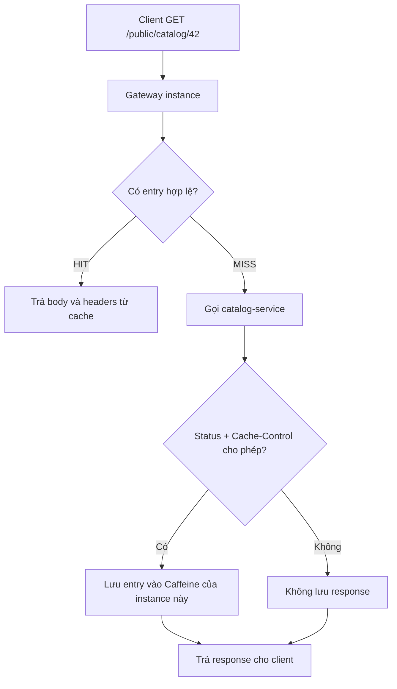
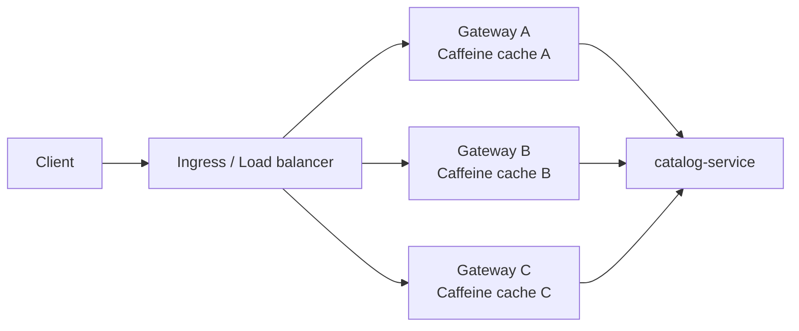

# Giới hạn cache cục bộ khi gateway có nhiều bản sao

Trong kiến trúc microservices, **Spring Cloud Gateway** là cổng vào thực hiện route predicate, filter chain, chuyển đổi path/header, xác thực, rate limiting, circuit breaker, retry và quan sát request. Khi một API đọc dữ liệu được gọi nhiều lần, **response caching** có thể giảm tải backend và cải thiện độ trễ. Nhưng giải pháp tiện nhất — lưu response **ngay trong bộ nhớ của Gateway** — có một giới hạn quan trọng: **mỗi bản sao Gateway giữ cache riêng**.

Giả sử có ba Gateway replica `gateway-a`, `gateway-b`, `gateway-c` cùng phục vụ `GET /public/catalog/42`. Replica A đã cache sản phẩm phiên bản cũ, B vừa lấy phiên bản mới, C chưa từng thấy request. Load balancer có thể phân phối ba request liên tiếp tới ba replica khác nhau và khiến client quan sát kết quả khác nhau, dù chúng đều dùng **cùng một file cấu hình**.

Bài học thuộc chương **Bộ nhớ đệm**, tập trung vào cách hoạt động và giới hạn của **`LocalResponseCache`** trên **Spring Cloud Gateway Server WebFlux**, tác động của việc scale nhiều instance, cách giữ an toàn dữ liệu, tính toán bộ nhớ, kiểm thử và lựa chọn khi nào nên chuyển sang CDN, shared cache hoặc cache ở backend.

> **Phạm vi phiên bản:** Các ví dụ dùng Spring Cloud Gateway **Server WebFlux 5.0.x**, Spring Cloud 2025.1.x và Spring Boot 4.x tương thích. YAML route dùng `spring.cloud.gateway.server.webflux.routes`, không phải tiền tố cũ `spring.cloud.gateway.routes`. **Server Web MVC** dùng API/filter stack khác; đừng áp dụng cấu hình WebFlux này cho MVC mà không đối chiếu tài liệu của nhánh đang chạy.

## 1. Mục tiêu học tập

Sau bài này, bạn có thể:

1. Phân biệt **cache cục bộ mỗi replica**, **cache dùng chung**, cache CDN và cache trình duyệt.
2. Giải thích `LocalResponseCache` dựa trên Caffeine, những request/response phù hợp để cache và các điều kiện `Cache-Control`.
3. Chỉ ra vì sao các replica có **hit/miss**, phiên bản dữ liệu, TTL và tập khóa cache khác nhau.
4. Tính **dung lượng cache tổng khi scale** và đánh giá tác động warm-up, evictions, rolling restart, HPA.
5. Cấu hình cache theo route, giới hạn `timeToLive`/`size` và kiểm soát việc bật cache toàn cục trong Gateway 5.0.
6. Dựng lab hai Gateway process và một backend chung để chứng minh kết quả cache độc lập.
7. Tránh cache dữ liệu cá nhân, response phân quyền/tenant, thông tin có `Set-Cookie` và dữ liệu giao dịch nhạy cảm.
8. Lựa chọn giữa local cache, Redis/cache dùng chung, CDN và cache tại backend theo SLO/freshness/chi phí.

## 2. Cache response thực sự lưu những gì?

Với một request `GET /public/catalog/42`:

- **Cache MISS:** Gateway không có bản ghi hợp lệ, gọi upstream, nhận response và có thể lưu body/header theo chính sách.
- **Cache HIT:** Gateway phục vụ response đã lưu **không cần gọi lại backend**.
- **Expiration:** Bản ghi hết TTL; request sau có thể gọi backend để lấy nội dung mới.
- **Eviction:** Cache quá giới hạn dung lượng, implementation có thể loại bớt entry trước khi TTL kết thúc.
- **Invalidation:** Chủ động xóa bản ghi vì dữ liệu thay đổi — đây là bài toán khó hơn khi các instance giữ bộ nhớ độc lập.



### 2.1. `LocalResponseCache` và Caffeine

Trong Gateway Server WebFlux, `LocalResponseCache` là khả năng lưu **response body và một số headers** trong cache cục bộ dựa trên **Caffeine**. Để sử dụng, tài liệu chính thức yêu cầu dependency `caffeine` cùng `spring-boot-starter-cache`; muốn giới hạn từng route, dùng `LocalResponseCache` GatewayFilter.

Điều này **không đồng nghĩa** Gateway tự trở thành hệ thống distributed cache. Caffeine sử dụng bộ nhớ **của JVM đang chạy**. Không có cơ chế tự đồng bộ các entry giữa Gateway replica A và B, không có bản sao lưu entry giữa các pod và cũng không có giao thức invalidation liên replica được bảo đảm chỉ bằng `LocalResponseCache`.

### 2.2. Điều kiện cache response theo tài liệu Gateway

Tài liệu `LocalResponseCache` của Gateway Server WebFlux mô tả những điều kiện chính:

| Điều kiện | Ý nghĩa |
|---|---|
| Request là **GET không có body** | Không phải cache POST/PUT/PATCH, không kỳ vọng body lớn được cache |
| Response có status **200**, **206** hoặc **301** | Các status này là ứng viên theo khả năng hiện tại; không tự cache mọi 2xx/3xx/4xx |
| Request **không có** `Cache-Control: no-store` | Client có thể chỉ thị không lưu theo chính sách filter |
| Response **không có** `Cache-Control: no-store` hoặc `private` | Những response không dành cho shared cache phải tránh lưu |
| TTL và dung lượng còn đáp ứng | Entry có thể hết hạn hoặc bị evict trước thời điểm phục vụ |

Đây là **điều kiện đủ để xem xét lưu**, không phải tuyên bố mọi response thỏa điều kiện chắc chắn sẽ hit. Request còn chịu route matching, filter order, cache key, dung lượng, version behavior và tình trạng bộ nhớ.

**Chú ý `206 Partial Content`:** Đây là phản hồi theo range, cần kiểm tra kỹ `Range`, `Content-Range`, `ETag` và cách cache key được triển khai trước khi bật cache cho download file. Một partial response không được dùng thay response toàn phần một cách sai ngữ nghĩa. Với media/file lớn, cân nhắc CDN hoặc streaming thay vì cache body trên Gateway.

**Chú ý `301 Moved Permanently`:** Redirect có thể được lưu. Nếu redirect phụ thuộc host, ngôn ngữ, session hoặc tenant, không nên mặc định dùng cùng cache cho mọi client.

### 2.3. `Cache-Control` quyết định khả năng lưu

```http
GET /public/catalog/42 HTTP/1.1
Host: api.example.test
```

Response công khai phù hợp để cân nhắc cache:

```http
HTTP/1.1 200 OK
Content-Type: application/json
Cache-Control: public, max-age=60
ETag: "catalog-v42"

{"id":"42","name":"Keyboard","price":120}
```

Response chứa dữ liệu tài khoản **không được** lưu vào shared response cache:

```http
HTTP/1.1 200 OK
Content-Type: application/json
Cache-Control: private, no-store

{"userId":"u-123","balance":10000}
```

Các directive HTTP như `private` và `no-store` không phải chỉ là gợi ý trình bày: chúng thể hiện **chính sách** cho các cache. Tuy nhiên không được dựa duy nhất vào header do một backend đang cấu hình sai để bảo vệ PII. Đường phòng vệ quan trọng nhất là **không bật LocalResponseCache trên route có dữ liệu cá nhân/authorization** trừ khi đã thẩm định kỹ cache key và phân vùng quyền.

### 2.4. `max-age` và TTL của Gateway không phải một khái niệm duy nhất

Một response có `Cache-Control: max-age=120` còn Gateway được cấu hình `LocalResponseCache=30s,10MB`. Theo tài liệu, khi response ban đầu có `max-age`, filter có thể **ghi lại `max-age` theo TTL của cache**, rồi tính lại số giây còn lại khi trả response cache hit.

Vì vậy đừng giả định client luôn nhìn thấy chính xác `max-age=120` như backend gửi. Khi debug cần kiểm tra header **qua Gateway**, thời gian hit và TTL cấu hình thực tế.

Ngoài ra, TTL của cache Gateway chỉ nói **entry tại Gateway tồn tại bao lâu**. Trình duyệt, CDN và proxy trung gian còn có cache riêng theo header/validator. Việc bản ghi Gateway hết hạn **không buộc** mọi trình duyệt/CDN phải lấy lại response ngay, trừ khi có chính sách tương ứng.

## 3. Điều gì thay đổi khi Gateway chạy nhiều replica?

Mô hình một instance:

```text
Client → Gateway A [cache A] → catalog-service
```

Khi scale thành ba instance:



Dù các instance cùng tải một cấu hình route, **bộ nhớ của chúng không dùng chung**. Khi request đi tới instance B:

- Nó **không hỏi** cache của A.
- Nó **không được hưởng** những entry A đã warm-up.
- Nó có thể gọi backend một lần nữa cho cùng resource.
- Nó có thể giữ một phiên bản khác hoặc TTL hết hạn vào thời điểm khác.
- Khi pod B restart, những entry chỉ có ở B mất đi.

### 3.1. Bảng timeline: cùng một URL, khác kết quả

Giả sử `GET /public/catalog/42` có TTL 60 giây trên mỗi instance. Mỗi lần gọi backend trả version hiện hành:

| Thời điểm | Replica được LB chọn | Backend version | Cache replica trước request | Kết quả client |
|---|---|---|---|---|
| `t=00` | A | v1 | A MISS | v1; A lưu v1 |
| `t=01` | A | v1 | A HIT | v1; không gọi backend |
| `t=02` | B | v1 | B MISS | v1; B lưu v1 |
| `t=05` | — | **Cập nhật lên v2** | A và B vẫn có v1 | Không request |
| `t=06` | C | v2 | C MISS | v2; C lưu v2 |
| `t=07` | A | v2 | A HIT (v1) | **v1** |
| `t=08` | C | v2 | C HIT (v2) | **v2** |
| `t=09` | B | v2 | B HIT (v1) | **v1** |

**Kết luận:** Một client có thể thấy `v1 → v2 → v1` do load balancer chọn các instance khác nhau. Việc backend đã cập nhật dữ liệu không tự xóa entry khỏi từng JVM. Điều này có thể chấp nhận với danh mục công khai được phép trễ, nhưng rất nguy hiểm với giá, tồn kho, quyền truy cập hoặc dữ liệu tài chính cần tính nhất quán cao.

### 3.2. Cache cục bộ làm tăng số lần MISS khi scale

Nếu có `N` Gateway replica và một URL “hot” mà mỗi replica chưa lưu, cùng một tài nguyên có thể gây tối thiểu **N lần MISS đầu** khi tất cả replica lần lượt nhận request, thay vì một lần trên shared cache lý tưởng. Trong burst đồng thời, ngay trên một replica cũng cần kiểm tra cơ chế đồng bộ loader để tránh nhiều request cùng làm việc tải lại.

Công thức trực giác cho cold start:

\[
\text{Miss sơ bộ} \approx N \times K
\]

với `K` là số cache key được yêu cầu ít nhất một lần tại mỗi instance. Đây **không phải** upper bound: TTL, eviction, cập nhật nội dung và các request đồng thời có thể tạo thêm miss.

Khi Horizontal Pod Autoscaler tăng từ 2 lên 8 replica, sáu replica mới **khởi đầu cache lạnh**. Một sự kiện scale-out lớn ngay lúc backend đã quá tải có thể khiến nhiều request vượt cache hơn kỳ vọng.

### 3.3. Sticky session có giải quyết không?

Load balancer có thể dùng cookie/IP hash để cố giữ cùng client vào một replica. Cách này tăng khả năng **cache locality** cho một số workload, nhưng không biến local cache thành shared cache:

- Mỗi client khác vẫn có thể đi một replica khác.
- Khi pod restart hoặc LB rebalance, session được chuyển và cache mới có thể lạnh.
- Routing theo IP bị ảnh hưởng bởi NAT/mạng doanh nghiệp; lệch tải và hotspot khó dự đoán.
- Dữ liệu thay đổi vẫn không tự invalidation giữa các instance.
- Cookie affinity có chính sách bảo mật/riêng tư và vận hành riêng.

**Không chọn sticky session làm giải pháp chính cho dữ liệu cần nhất quán.** Nó chỉ có thể là tối ưu phân phối cache hit trong các trường hợp đã chấp nhận eventual consistency.

## 4. Bộ nhớ bị nhân theo số bản sao

Giả sử cấu hình giới hạn mỗi replica có cache tối đa `128 MB`. Khi chạy `6` instance:

\[
M_{\text{cache tổng lý thuyết}} \le 6 \times 128\,\text{MB} = 768\,\text{MB}
\]

Đây là tổng **ngân sách cấu hình** nếu mỗi instance có cùng mức giới hạn và cùng cơ chế đo kích thước cache. Nó không có nghĩa toàn hệ thống có **một cache 768 MB dùng chung**, cũng không đồng nghĩa quá trình Java chỉ tiêu đúng 128 MB/instance.

| Số replica | Ngân sách local mỗi instance | Tổng ngân sách cache định mức |
|---:|---:|---:|
| 1 | 128 MB | 128 MB |
| 2 | 128 MB | 256 MB |
| 4 | 128 MB | 512 MB |
| 6 | 128 MB | 768 MB |
| 10 | 128 MB | 1.280 MB |

**Đừng nhầm ngân sách với memory usage thực:** còn overhead key/entry, object/header, buffer, Netty direct memory, mã Java/heap, GC và các filter khác. Với `LocalResponseCache`, cấu hình size giới hạn dữ liệu theo chính sách eviction của cache, **không** phải giới hạn RAM toàn JVM hoặc pod.

### 4.1. Per-route size và tổng cache

Nếu một instance có ba route cache được bật, mỗi route có mức `20MB`, tổng ngân sách cache của instance có thể khác một `20MB` duy nhất, tùy cấu hình global/per-route và cách chia cache manager. Phải xác minh **size áp dụng tại đâu** trong phiên bản cụ thể. Không lấy giá trị một route rồi kết luận giới hạn tổng bộ nhớ cho toàn bộ Gateway.

### 4.2. Dung lượng cache không đồng nghĩa chi phí nhỏ

Response có body 300 KiB, được lưu với headers và metadata. Nếu nhiều URL khác nhau có content tương tự:

- Cache chiếm bộ nhớ cho mỗi key/entry được lưu.
- Lưu response lớn có thể tạo áp lực heap/GC và độ trễ.
- Khi đụng size limit, entry bị evict, làm tăng miss liên tục.
- Với nhiều replica, cùng body có thể được lưu **lặp lại** `N` lần.
- Nếu request có query parameters tạo key cardinality cao, lợi ích caching có thể rất thấp so với memory/CPU.

Không bật local response cache cho **file download lớn, video, SSE hay streaming response** chỉ vì muốn giảm băng thông backend. Những workload này thường hợp lý hơn với CDN/object storage/streaming và quota thích hợp.

## 5. Bật cache đúng phạm vi trên Gateway Server WebFlux 5.0

### 5.1. Dependency cần thiết

Với Maven, project Gateway có thể dùng các dependency chính sau:

```xml
<dependencies>
    <dependency>
        <groupId>org.springframework.cloud</groupId>
        <artifactId>spring-cloud-starter-gateway-server-webflux</artifactId>
    </dependency>

    <dependency>
        <groupId>org.springframework.boot</groupId>
        <artifactId>spring-boot-starter-cache</artifactId>
    </dependency>

    <dependency>
        <groupId>com.github.ben-manes.caffeine</groupId>
        <artifactId>caffeine</artifactId>
    </dependency>
</dependencies>
```

Đây chỉ là các **dependency liên quan**; `pom.xml` hoàn chỉnh còn cần Spring Boot parent/plugin và Spring Cloud BOM phù hợp với bản Boot. Không tự gán version Caffeine/Gateway tùy ý nếu dependency management đã cung cấp version được kiểm chứng.

Nếu project có `CacheManager` tùy biến, tài liệu Spring Cloud Gateway nhắc cần chú ý `@Primary` hoặc `@Qualifier` để tránh Spring chọn nhầm bean. Một `CacheManager` dùng cho business data không tự động là distributed cache của Gateway.

### 5.2. Hai công tắc dễ bị nhầm trên Gateway 5.0

Trong **Configuration Properties 5.0**, có hai property khác nhau:

| Property WebFlux 5.0 | Mặc định được liệt kê | Vai trò |
|---|---|---|
| `spring.cloud.gateway.server.webflux.global-filter.local-response-cache.enabled` | `true` | Cho phép local response cache **toàn cục** |
| `spring.cloud.gateway.server.webflux.filter.local-response-cache.enabled` | `false` | Cho phép factory `LocalResponseCache` để áp dụng **theo route** |

Vì thế, khi muốn thí điểm **chỉ một route public**, hãy **tắt global cache tường minh** và **bật filter theo route tường minh**. Đừng chỉ thêm `- LocalResponseCache=...` rồi giả định route khác chắc chắn không bị cache; kiểm tra effective configuration và tài liệu đúng release đang dùng.

**Ý tưởng triển khai:** cache scope phải là **allowlist các route public an toàn**, không bật cho mọi route rồi hy vọng backend nào cũng đặt `Cache-Control: private` chuẩn.

### 5.3. Một cấu hình YAML route-only rõ ràng

`src/main/resources/application.yml`:

```yaml
server:
  port: ${SERVER_PORT:8080}

spring:
  application:
    name: catalog-cache-gateway

  cloud:
    gateway:
      server:
        webflux:
          global-filter:
            local-response-cache:
              enabled: false  # Không cache toàn bộ routes

          filter:
            local-response-cache:
              enabled: true   # Cho phép factory theo route

          routes:
            - id: public-catalog
              uri: http://localhost:9000
              predicates:
                - Path=/public/**
                - Method=GET
              filters:
                - StripPrefix=1
                - LocalResponseCache=15s,10MB
```

Phân tích:

| Thành phần | Ý nghĩa |
|---|---|
| `server.port` | Đọc từ biến môi trường `SERVER_PORT`, mặc định `8080` |
| `global-filter.local-response-cache.enabled: false` | Không bật cache trên mọi route |
| `filter.local-response-cache.enabled: true` | Cho phép dùng `LocalResponseCache` trong `filters` |
| `Path=/public/**` + `Method=GET` | Chỉ chọn các GET trên namespace public của lab |
| `uri: http://localhost:9000` | Một backend chung, dùng cho mọi replica Gateway |
| `StripPrefix=1` | `/public/catalog/42` thành `/catalog/42` ở backend |
| `LocalResponseCache=15s,10MB` | TTL của entry là `15s`, giới hạn cache route là `10MB` |

Thứ tự tham số shortcut của `LocalResponseCache` là **TTL trước, size sau**. Đây là bộ lọc **cache response**, không phải `CacheRequestBody` để cache request body trong filter chain.

> **Cảnh báo phạm vi:** Đây là cấu hình thực hành cho **nội dung công khai**, không thêm một route `/private/**` dùng chung filter để cache dữ liệu người dùng. Nếu ứng dụng có `spring.cloud.gateway.server.webflux.default-filters` hoặc cấu hình cache toàn cục từ profile/config server, phải kiểm tra chúng không vô tình bật cache trên các route nhạy cảm.

### 5.4. Cấu hình mặc định và điều chỉnh

Theo bảng cấu hình Gateway 5.0, thời gian mặc định `time-to-live` của local response cache được liệt kê là **5 phút**. Có các property cấu hình như:

```yaml
spring:
  cloud:
    gateway:
      server:
        webflux:
          filter:
            local-response-cache:
              enabled: true
              time-to-live: 30s
              size: 20MB
```

Đây là cấu hình **các giá trị mặc định chung của filter**, không thay thế việc chọn route cache an toàn. Khi route dùng shortcut `LocalResponseCache=15s,10MB`, route đã chỉ định giá trị riêng cho TTL và size.

Nên luôn khai báo **TTL và size có chủ đích** cho route production. Nếu không chỉ định kích thước, cần kiểm tra default/effective cache builder; không tự suy ra bộ nhớ bị giới hạn cứng chỉ vì có TTL.

### 5.5. `Cache-Control: no-cache` có phải lệnh “bỏ qua local cache” không?

**Không được giả định.** Tài liệu `LocalResponseCache` mô tả một hành vi riêng: nếu entry đã cache và client gửi request có `Cache-Control: no-cache`, filter có thể trả **`304 Not Modified` không có body**. Vì vậy:

```bash
curl -i -H "Cache-Control: no-cache" \
  http://localhost:8080/public/catalog/42
```

không phải phép thử đảm bảo “luôn gọi lại backend và tải bản mới”. Nếu muốn xác minh invalidation hoặc cache bypass, hãy thiết kế **chính sách riêng** và kiểm tra đúng runtime; không dùng `no-cache` như nút xóa tất cả cache trên mọi replica.

`Cache-Control: no-store` là directive khác: tài liệu yêu cầu request `no-store` không được dùng để lưu response vào local cache. Việc tương tác với entry đã tồn tại, đặc biệt trong môi trường nhiều filter/validator, cần kiểm thử; đừng suy diễn hành vi của mọi HTTP proxy từ tên directive đơn lẻ.

### 5.6. Tính năng này không tự tích hợp Redis

`LocalResponseCache=15s,10MB` **không chứa** một Redis URL, không phát Redis pub/sub invalidation và cũng không chia sẻ Caffeine map qua HTTP. Đổi `uri: lb://catalog-service` chỉ thay cách chọn backend, không chuyển local cache thành shared cache.

Nếu muốn **cache tập trung**, phải bổ sung kiến trúc phù hợp: CDN/edge cache, proxy/cache ngoài Gateway, cache tại backend dùng Redis hoặc giải pháp response cache phân tán được xây và kiểm thử riêng. Không mô tả “chỉ thêm `spring.data.redis.host` thì LocalResponseCache chia sẻ trạng thái” — đó là kết luận sai.

## 6. Lab: hai Gateway replica, cùng backend nhưng cache độc lập

Lab cố tình tạo **hai process Gateway** trên cùng máy và **một backend** chung ở port `9000`. Mục tiêu là kiểm tra sự khác nhau của response đến từ hai cache riêng ngay trước mặt.

### 6.1. Backend thay đổi dữ liệu mà không restart

Tạo file `CatalogCacheLab.java` trong thư mục thực hành:

```java
import com.sun.net.httpserver.HttpServer;
import java.net.InetSocketAddress;
import java.nio.charset.StandardCharsets;
import java.util.concurrent.atomic.AtomicInteger;
import java.util.concurrent.atomic.AtomicLong;

public class CatalogCacheLab {
    public static void main(String[] args) throws Exception {
        HttpServer server = HttpServer.create(
                new InetSocketAddress("127.0.0.1", 9000), 0);

        AtomicLong backendCalls = new AtomicLong();
        AtomicInteger revision = new AtomicInteger(1);

        server.createContext("/", exchange -> {
            String path = exchange.getRequestURI().getRawPath();
            String method = exchange.getRequestMethod();

            // Chỉ dùng trong lab cục bộ; production không có endpoint này.
            if ("/__lab/bump".equals(path) && "POST".equals(method)) {
                int next = revision.incrementAndGet();
                byte[] body = ("revision=" + next + "\n")
                        .getBytes(StandardCharsets.UTF_8);
                exchange.getResponseHeaders().set(
                        "Cache-Control", "no-store");
                exchange.sendResponseHeaders(200, body.length);
                try (var out = exchange.getResponseBody()) {
                    out.write(body);
                }
                return;
            }

            if (!"GET".equals(method)) {
                exchange.sendResponseHeaders(405, -1);
                exchange.close();
                return;
            }

            long call = backendCalls.incrementAndGet();
            int currentRevision = revision.get();

            String json = "{\"path\":\"" + path
                    + "\",\"revision\":" + currentRevision
                    + ",\"backendCalls\":" + call + "}";

            byte[] body = json.getBytes(StandardCharsets.UTF_8);
            exchange.getResponseHeaders().set(
                    "Content-Type", "application/json");
            exchange.getResponseHeaders().set(
                    "Cache-Control", "public, max-age=120");
            exchange.getResponseHeaders().set(
                    "X-Backend-Calls", Long.toString(call));
            exchange.getResponseHeaders().set(
                    "X-Backend-Revision", Integer.toString(currentRevision));
            exchange.sendResponseHeaders(200, body.length);

            try (var out = exchange.getResponseBody()) {
                out.write(body);
            }

            System.out.println("backendCall=" + call
                    + " revision=" + currentRevision
                    + " path=" + path);
        });

        server.start();
        System.out.println("Catalog lab on http://localhost:9000");
    }
}
```

Chạy backend bằng JDK 17+:

```bash
java --add-modules jdk.httpserver CatalogCacheLab.java
```

Backend này chỉ phục vụ lab: `/__lab/bump` thay revision bằng POST mà **không có xác thực**. Vì vậy nó bind vào `127.0.0.1` để dùng trên máy phát triển và **tuyệt đối không được triển khai công khai**. Trong demo, Gateway chỉ có route GET `/public/**` và không proxy endpoint `/__lab/bump`.

### 6.2. Gateway application và hai process

Class khởi động tối thiểu:

```java
import org.springframework.boot.SpringApplication;
import org.springframework.boot.autoconfigure.SpringBootApplication;

@SpringBootApplication
public class CatalogGatewayApplication {
    public static void main(String[] args) {
        SpringApplication.run(CatalogGatewayApplication.class, args);
    }
}
```

Dùng cùng `application.yml` ở mục 5.3. Trong thư mục dự án Gateway, khởi động hai process riêng:

**Linux/macOS (hai terminal):**

```bash
# Terminal A
SERVER_PORT=8081 ./mvnw spring-boot:run

# Terminal B
SERVER_PORT=8082 ./mvnw spring-boot:run
```

**Windows PowerShell 5.1 (hai terminal riêng):**

```powershell
# Terminal A
$env:SERVER_PORT = '8081'
.\mvnw.cmd spring-boot:run

# Terminal B (trong cửa sổ PowerShell khác)
$env:SERVER_PORT = '8082'
.\mvnw.cmd spring-boot:run
```

Hai process chạy cùng code/config nhưng có **JVM và Caffeine cache độc lập**. Ở đây ta gọi thẳng port 8081/8082 để chủ động chọn replica. Khi deploy thật, ingress/load balancer quyết định request tới replica nào và có thể thêm service discovery, TLS và các filter khác.

### 6.3. Làm nóng cache A

Gọi hai lần liên tiếp (trong `15s`):

```bash
curl -i http://localhost:8081/public/catalog/42
curl -i http://localhost:8081/public/catalog/42
```

Nếu cấu hình cache hoạt động, lần đầu gọi backend và nhận response body có `backendCalls=1`. Lần thứ hai qua **cùng A** thường nhận lại `backendCalls=1`, vì Gateway A trả từ cache. Header `Cache-Control: max-age` có thể bị tính lại theo TTL còn lại thay vì giữ nguyên 120 giây backend gửi.

Trong terminal backend, số lần gọi `/catalog/42` cũng thường chỉ tăng một lần khi hai request tới A sát nhau. Đây là **bằng chứng mạnh hơn** việc chỉ nhìn latency thấp: response từ network vẫn có thể nhanh dù không cache.

### 6.4. Lần đầu gọi cache B

```bash
curl -i http://localhost:8082/public/catalog/42
curl -i http://localhost:8082/public/catalog/42
```

Vì Gateway B là process khác, nó chưa có entry mà A đã tạo. Lần đầu tới B thường làm `backendCalls` tăng lên `2`; lần thứ hai qua B giữ `backendCalls=2` do cache B hit. Tại thời điểm này A đang giữ response `backendCalls=1`, B giữ response `backendCalls=2`.

Đừng hiểu các con số 1 và 2 là quy tắc cho mọi lần chạy: test trước đó, TTL, timing và các request khác có thể làm số thực tế khác. Điều cần quan sát là **A hit không làm B hit**.

### 6.5. Đổi backend revision và thấy dữ liệu không nhất quán

Trong vòng TTL của A, gọi **trực tiếp backend**:

```bash
curl -i -X POST http://localhost:9000/__lab/bump
```

Backend tăng revision từ `1` lên `2`. Gọi lại A khi entry vẫn còn sống:

```bash
curl -i http://localhost:8081/public/catalog/42
```

A có thể vẫn trả `revision=1`. Nếu B đã giữ revision 1 thì B cũng có thể vẫn giữ revision 1. Đợi từng entry hết TTL hoặc khởi động một Gateway instance mới `8083`, rồi gọi route trên instance mới:

```bash
SERVER_PORT=8083 ./mvnw spring-boot:run
curl -i http://localhost:8083/public/catalog/42
```

Process mới `C` chưa có entry nên có thể nhận `revision=2` từ backend. Nếu request xen kẽ A và C trong lúc A chưa hết TTL, client có thể thấy `revision=1` và `revision=2` luân phiên.

**Lưu ý về timing:** TTL trong demo chỉ có 15 giây; khởi động process C có thể kéo dài đủ lâu để A hết TTL. Nếu muốn chắc chắn quan sát cả hai phiên bản, hãy tăng TTL lab lên `60s`, khởi động sẵn C **trước** khi đổi revision nhưng chưa gửi request qua C, hoặc chủ động gửi request đúng thời điểm. Không coi việc không nhìn thấy stale data trong một lần chạy là bằng chứng cache đã đồng bộ.

### 6.6. Chờ TTL rồi kiểm tra lại

Sau khi mỗi entry hết TTL, lần GET tiếp theo trên replica tương ứng có thể gọi backend, nhận revision mới và lưu lại. Nhưng thời điểm “tất cả replica đã mới” khác nhau do **chúng tạo entry tại các thời điểm khác nhau**.

Giới hạn TTL giúp ràng buộc tuổi của **mỗi entry** theo chính sách cache, nhưng **không** đồng bộ mốc cập nhật dữ liệu giữa các replica. Nếu nghiệp vụ đòi các replica đồng thời chuyển sang phiên bản mới, TTL đơn độc không phải giao thức consistency.

## 7. Các giới hạn trong môi trường nhiều replica

### 7.1. Không có invalidation liên replica tự động

Giả sử catalog-service cập nhật sản phẩm và phát một sự kiện `ProductUpdated(42)`. Nếu cache A, B, C là các Caffeine instance nằm trong ba JVM khác nhau, sự kiện nghiệp vụ **không tự động** tìm đến và xóa entry tương ứng trong cả ba JVM chỉ vì chúng chạy Spring Cloud Gateway.

Để có invalidation chủ động cần thêm cơ chế được thiết kế:

- Phát event cho mọi instance qua message broker/pub-sub và mỗi instance biết key nào cần xóa.
- Gọi một endpoint quản trị đã được xác thực trên **từng replica** để purge entry (nếu bạn tự triển khai và hỗ trợ); không giả định `LocalResponseCache` có sẵn API purge distributed.
- Đổi namespace/cache version trong URL hoặc key khi phát hành dữ liệu tĩnh mới.
- Đặt TTL đủ ngắn nếu nghiệp vụ chấp nhận stale data và không cần invalidation tức thì.
- Chuyển sang cache có shared state/invalidation protocol khi có yêu cầu nhất quán chặt hơn.

**Cảnh báo:** “Gửi một request đến service Gateway” qua load balancer **không bảo đảm** lệnh purge đến tất cả instance. LB thường chọn **một** replica, tương tự như với request GET. Muốn xóa đồng loạt, phải giải quyết service discovery/instance registry, retry delivery, pod mới/đang restart và race conditions.

### 7.2. TTL không bảo đảm dữ liệu đúng ở thời điểm đọc

TTL nhỏ hơn chỉ giới hạn khoảng thời gian một bản ghi **có thể** được phục vụ từ cache sau khi lưu. TTL không kiểm tra dữ liệu backend có vừa bị đổi.

Một sản phẩm đã cập nhật lúc `12:00:10` có thể vẫn được A trả từ cache tạo lúc `12:00:00` đến gần `12:01:00` khi TTL 60s. Nhưng nếu B lưu phiên bản mới lúc `12:00:12`, A và B tạm thời khác nhau.

Nếu nghiệp vụ đòi:

- Giá hiển thị phải đúng ngay khi khách thanh toán.
- Số lượng tồn kho không được vượt số thật.
- Quyền truy cập phải bị thu hồi ngay lập tức.
- Trạng thái giao dịch không được báo nhầm thành công.

thì **không được đặt tính đúng đắn lên LocalResponseCache ngắn hạn**. Đọc source of truth hoặc một cơ chế dữ liệu nhất quán phù hợp tại bước quyết định quan trọng; có thể dùng cache cho danh sách/snapshot tham khảo, nhưng xác minh lại khi thực hiện thao tác có side effect.

### 7.3. Scale-out tạo cold cache

Khi số replica tăng từ 2 lên 10, tám JVM mới không tự “nhập khẩu” entry từ hai JVM cũ. Nếu traffic được phân đều, nhiều URL mà trước đó có hit cao trên A/B sẽ tạo **MISS mới** ở các pod mới.

Các tác động:

1. Backend QPS tăng ngay sau scale-out.
2. p95/p99 latency có thể tạm tăng khi cache ấm lại.
3. Connection pool outbound phải phục vụ nhiều request hơn.
4. Nếu backend đang quá tải, nhiều miss có thể làm việc khôi phục khó hơn.
5. Những request dùng chung key hot có thể đến nhiều replica cùng lúc — một dạng **cache stampede ở cấp toàn cụm**.

Một chiến lược scale-out cần xem xét rate limiting, circuit breaker, connection pool, backend concurrency và có thể preload **một tập nhỏ key public rất hot** nếu hợp đồng cho phép. Preload tất cả key hoặc warm-up bằng request lớn có thể tạo thêm bão tải.

### 7.4. Rolling deployment, HPA và request routing

**Rolling update:** instance mới trống cache, instance cũ còn entry; trong giai đoạn trộn version ứng dụng và version cache, client có thể nhận dữ liệu không giống nhau ngay cả khi backend không đổi.

**Autoscaling down:** entry trong pod bị xóa mất cùng pod, không được chuyển về các instance còn lại.

**Rolling restart:** sau khi tất cả pod restart, toàn cụm bắt đầu lạnh; đừng dựa vào cache cục bộ để duy trì trạng thái quan trọng.

**Health check:** `/actuator/health` xanh chỉ nói một số thành phần đang khỏe theo health indicators; nó **không chứng minh** cache đã warm, dữ liệu còn mới hoặc hit rate đạt mục tiêu. Cần metric riêng cho cache effectiveness.

### 7.5. Hotspot, eviction và key cardinality

Ví dụ một route cache được tối đa `10MB`, nhưng có 200.000 URL/query variant:

```text
/public/catalog/42?lang=vi
/public/catalog/42?lang=en
/public/catalog/42?lang=fr
/public/catalog/42?sort=name
/public/catalog/42?sort=price
...
```

Nếu các biến thể thực sự tạo nhiều cache key, entry mới có thể liên tục đẩy entry cũ ra khỏi cache. Hệ quả: **cache thrashing**, miss cao, CPU tăng để xử lý cache, trong khi RAM vẫn bị tiêu thụ.

Không tự kết luận chính xác cache key gồm tất cả hay không gồm query/header/`Vary` nếu chưa kiểm tra **implementation của đúng phiên bản**. Điều cần kiểm chứng trong test là: những response có nội dung khác nhau **không được trả nhầm cho một request khác**, và số lượng biến thể thực tế không làm cache quá tải.

Với các bộ lọc `RewritePath`, `StripPrefix` và sửa query/header, thứ tự filter còn có thể ảnh hưởng URL mà cache nhìn thấy. Hãy kiểm thử biến thể sau khi ứng dụng được cấu hình đầy đủ, thay vì chỉ đọc một đoạn YAML nhỏ để đoán cache key.

### 7.6. Request đồng thời và “cache stampede”

Hai request đồng thời tới A cùng URL khi entry hết TTL có thể cùng quan sát trạng thái chưa có dữ liệu mới. Tùy khả năng đồng bộ/single-flight của implementation, có thể phát sinh nhiều lời gọi upstream.

Khi chạy 8 replica, dù từng replica có bảo vệ single-flight trong JVM, **không có single-flight toàn cụm** chỉ bằng Caffeine cục bộ. Các biện pháp bổ sung có thể gồm:

- Shared cache hoặc single-flight theo key ở một lớp chung.
- Randomized TTL/jitter khi được implementation/hệ thống cho phép.
- Background refresh có giới hạn và circuit breaker.
- Rate limiting/bulkhead trước backend, trả lỗi minh bạch khi nguồn quá tải.
- Ưu tiên cache tại backend cho dữ liệu được dùng bởi nhiều Gateway replica.

Không viết một `GlobalFilter` tự `synchronized` trên JVM A rồi tuyên bố đã chống stampede ở toàn cụm — mutex của A không khóa B/C.

## 8. Bảo mật: rủi ro trộn dữ liệu giữa user và tenant

Cache response nằm ở gateway có thể trở thành lỗi **lộ dữ liệu liên người dùng** nếu nó lưu response nhạy cảm và dựng cache key không bao gồm đúng identity, authorization context hoặc request variant.

### 8.1. Ví dụ dữ liệu cần tránh cache

```http
GET /api/me HTTP/1.1
Authorization: Bearer <token-alice>
```

Upstream trả:

```http
HTTP/1.1 200 OK
Content-Type: application/json

{"user":"alice","email":"alice@example.test"}
```

Nếu route này được cache theo URL mà không phân biệt principal, request từ Bob có thể nhận dữ liệu Alice. **Không dựa vào việc Spring Security đã xác thực cả hai user** để khẳng định cache key tách họ. Xác thực đứng trước/ở quanh filter chain không tự làm response cache phân vùng theo principal.

Phòng vệ có nhiều lớp:

1. **Không bật LocalResponseCache cho route `/api/me`, `/api/orders/**`, `/api/payments/**` hoặc các response nhạy cảm** nếu chưa có thiết kế cache phân vùng được thẩm định.
2. Backend trả `Cache-Control: private, no-store` cho response chứa dữ liệu cá nhân/token/credential và các kết quả không nên lưu.
3. Chặn đường truy cập trực tiếp backend, bảo đảm authorization theo tài nguyên ở backend.
4. Không coi `Authorization`, `Cookie`, `X-User-Id` do client tự gửi là cache partition đáng tin nếu chưa xác minh.
5. Nếu thật sự cần cache dữ liệu người dùng, cân nhắc **cache tại service** theo identity đã xác thực, có quota/TTL/invalidation rõ, thay vì cache HTTP response toàn cục ở Gateway.
6. Kiểm thử với ít nhất hai user, hai tenant, hai JWT khác quyền và nhiều replica trước khi bật production.

### 8.2. `Cache-Control: private` và `no-store`

Một response chứa `private` hoặc `no-store` theo tài liệu `LocalResponseCache` sẽ không được cache theo tính năng này. Ví dụ an toàn:

```http
HTTP/1.1 200 OK
Cache-Control: private, no-store
Content-Type: application/json

{"accountId":"a-42","balance":100}
```

Nhưng **không nên chỉ dựa vào một header**. Một commit code backend vô tình bỏ `private` có thể khiến hành vi thay đổi. Route allowlist và kiểm thử phân quyền vẫn cần tồn tại.

### 8.3. `Set-Cookie`, `Vary`, CORS và các biến thể response

Những yếu tố dễ gây sai cache key:

| Yếu tố | Rủi ro nếu bỏ qua |
|---|---|
| `Authorization` | Trả dữ liệu/role của user A cho user B |
| `Cookie` / `Set-Cookie` | Phát lại session/cookie của người khác hoặc cache response có session state |
| `Vary: Accept-Language` | Trả nhầm ngôn ngữ cho client khác |
| `Vary: Accept-Encoding` | Trả body nén không phù hợp với request |
| `Vary: Origin` và CORS headers | Trả `Access-Control-Allow-Origin` sai hoặc tạo cache poisoning |
| Query `tenant=...`, `lang=...`, `currency=...` | Trộn dữ liệu nghiệp vụ/currency/locale |
| `Range` / `Content-Range` cho `206` | Dùng nhầm một phần file làm response toàn phần |
| Response `301` theo host/path | Redirect nhầm tenant/host hoặc lưu redirect cũ |

`Vary` là tín hiệu HTTP để cache phân biệt biến thể, **nhưng không được giả định** mọi cache implementation/framework version tự xử lý tất cả biến thể đúng như CDN. Với route có `Vary` phức tạp, cần integration tests kiểm tra key và headers, hoặc không dùng local cache đó.

### 8.4. Không cache response xác thực hoặc lỗi có dữ liệu nhạy cảm

Không đưa vào local response cache:

- Token endpoint/login/logout, response có `Set-Cookie` hoặc refresh token.
- Thông tin `/me`, account profile, order history, số dư, payment status.
- API có phân quyền theo tenant, role hoặc resource ownership.
- Đường trả JWT/JWK/private identity material nhạy cảm không dành cho public cache.
- Response phản ánh trạng thái quyền vừa bị thu hồi.
- API dùng dữ liệu thời gian thực để phê duyệt giao dịch, xác nhận tồn kho hoặc rủi ro gian lận.

Cấu hình `RequestRateLimiter`, Spring Security và TLS bảo vệ **quyền truy cập và lưu lượng**, nhưng không sửa được một response cache đang phân phối sai body giữa người dùng. Phải xử lý ranh giới dữ liệu riêng.

## 9. Chọn cache cục bộ hay cache dùng chung?

Không có một chiến lược luôn tốt nhất. Bảng sau so sánh theo phạm vi và tính nhất quán:

| Giải pháp | Cache sống ở đâu? | Khi scale Gateway | Điểm mạnh | Rủi ro/đánh đổi |
|---|---|---|---|---|
| **LocalResponseCache (Caffeine)** | RAM từng Gateway JVM | **Mỗi replica riêng** | Hit cực nhanh, không phát sinh network hop đến cache | Dữ liệu lệch thời điểm, RAM nhân theo replica, không invalidation chung |
| CDN / edge cache | Nhiều edge POP | Độc lập với số Gateway replica | Giảm traffic từ Internet vào Gateway, hợp với tài nguyên public | TTL/purge theo POP, biến thể URL/header, chi phí, dữ liệu public |
| Shared reverse proxy HTTP cache | Lớp proxy/cache chung | Nhiều Gateway có thể dùng chung cache tier | HTTP caching centralized, có thể hỗ trợ purge | Thêm tier, HA, TTL/consistency và vận hành |
| Redis hoặc distributed data cache **ở backend** | Shared key-value giữa services | Gateway nào gọi backend cũng hưởng cache của backend | Dễ phân vùng theo identity/nghiệp vụ và invalidation | Backend vẫn nhận request Gateway, thêm network/cache service |
| Cache trong từng backend replica | RAM mỗi backend instance | Không phụ thuộc riêng Gateway, nhưng backend vẫn phân tán | Cache gần logic nghiệp vụ | Vẫn cần distributed invalidation nếu nhiều backend |
| Không cache | Đọc source of truth | Không có inconsistency do gateway cache | Đúng đắn, đơn giản hóa security | Tăng latency/tải backend, cần capacity planning |

**Không đồng nhất Redis backend cache với LocalResponseCache:** thêm dependency Redis vào Gateway không tự thay Caffeine thành distributed HTTP response cache. Muốn thực sự chia sẻ response, cần một cơ chế riêng biết cache key, HTTP headers/validation, TTL, serialization, invalidation và phân quyền.

### 9.1. Khi nào local response cache phù hợp?

Tốt khi API:

- Chỉ phục vụ **public GET** không có body.
- Dữ liệu ít thay đổi hoặc chấp nhận stale vài giây/phút.
- Response nhỏ, lượng URL/variant kiểm soát được.
- Có cache headers đúng và route được allowlist.
- Không yêu cầu xóa entry tức thì trên mọi replica.
- Có đủ bộ nhớ theo **số replica tối đa**, không chỉ số replica hiện tại.
- Có metric chứng minh cache thực sự giảm tải backend.

Ví dụ: danh sách quốc gia, metadata công khai, tài liệu API tĩnh, catalog preview không chứa giá chốt giao dịch.

### 9.2. Khi nào nên dùng shared cache/CDN?

Nếu mục tiêu chính là **giảm tổng số lần gọi backend bất kể Gateway replica nào nhận request**, một cache ở lớp chung hoặc backend thường phù hợp hơn.

Ví dụ catalog public rất hot, 20 Gateway replica mỗi replica cần warm cùng 5.000 key. Local cache có thể tạo tới hàng chục nghìn lần nạp đầu và các bản sao trùng RAM. CDN hoặc shared cache sẽ giảm mức lặp tại các điểm có chung cache state — đổi lại phải thiết kế consistency, purge, availability và cache stampede của lớp cache chung.

Nếu cần đồng bộ cập nhật giá/tồn kho tức thì, **một shared cache vẫn không bảo đảm linearizability** trừ khi hệ thống xây cơ chế consistency thích hợp. Cache dùng chung làm giảm số bản sao trạng thái, không thay thế source of truth hoặc chính sách giao dịch.

## 10. Thiết kế TTL, size và ngân sách tải khi scale

Một quy trình chọn tham số không nên bắt đầu từ “đặt cache thật lớn” mà từ **freshness requirement**, tải backend và giới hạn bộ nhớ.

### 10.1. Chọn TTL từ thời gian stale chấp nhận được

Giả sử catalog cho phép thông tin hiển thị cũ không quá khoảng 30 giây sau lần lấy từ backend. Chọn `timeToLive=30s` là một điểm bắt đầu cần kiểm thử. Nó không tạo cam kết nhất quán tức thì và không quản lý cache downstream của browser/CDN.

| Nhóm dữ liệu | Tính chất | Chính sách cache nên cân nhắc |
|---|---|---|
| Mã quốc gia, metadata public ít thay đổi | Tính cũ có thể chấp nhận | TTL vài phút hoặc CDN lâu hơn, đi với invalidation khi release |
| Trang danh mục công khai | Dữ liệu có thể thay đổi theo phút | TTL ngắn, quan sát stale window và upstream traffic |
| Giá tham khảo trên trang listing | Có thể trễ trong phạm vi sản phẩm cho phép | TTL rất thận trọng; **xác minh lại giá tại checkout** |
| Tồn kho/chỗ ngồi thời gian thực | Cần chính xác khi quyết định mua | Không dựa vào local response cache để giữ chỗ/chốt đơn |
| Profile, đơn hàng, trạng thái thanh toán | Theo user/tenant và nhạy cảm | Không local-cache theo URL tại Gateway |
| JWT/authorization decision | Phải hỗ trợ thu hồi/quyền | Không cache response authorization bằng filter HTTP public |

Những khoảng thời gian là **định hướng thiết kế**, không phải mặc định chính thức. Đội nghiệp vụ phải xác định mức stale chấp nhận được; team vận hành kiểm tra độ trễ, memory và upstream load.

### 10.2. Chọn size theo số replica tối đa

Giả sử mỗi pod Gateway có giới hạn memory 512 MiB, ứng dụng cần đủ headroom cho heap, connection pool, buffers, native/direct memory và các filter khác. **Không** cấp hết 512 MiB làm response cache.

Nếu mỗi pod dự kiến dành tối đa 40 MiB cho local response cache và HPA có thể lên 12 pod:

\[
\text{Ngân sách cache toàn cụm} \approx 40\,\text{MiB} \times 12 = 480\,\text{MiB}
\]

Con số trên là phép nhân ngân sách, **không phải dự báo RSS chính xác**, và không mô tả một shared cache 480 MiB. Phải theo dõi RSS, JVM heap/non-heap, direct memory, GC và workload thực, bởi kích thước response được cache không luôn bằng tổng bộ nhớ do entry chiếm.

Một bảng capacity planning nên có ít nhất:

| Đại lượng | Cần đo |
|---|---|
| Số Gateway replica thấp nhất / cao nhất | `N_min` / `N_max` theo HPA |
| Response body p50/p95/p99 | Phân phối kích thước thực |
| Số key/route trong khoảng TTL | Cardinality và phân bố hot keys |
| TTL và size của mỗi route | Ngân sách memory và staleness |
| Hit/miss khi đã warm | Lợi ích thực so với không cache |
| Miss surge khi restart/scale | Tải đột biến lên backend |
| Eviction count / memory pressure | Cache có đang thrash không |
| Backend capacity & SLO | Có chịu được cold-start traffic không |

### 10.3. Công thức thô để ước lượng hit/miss

Với một route:

\[
\text{Hit ratio} = \frac{\text{cache hits}}{\text{cache hits} + \text{cache misses}}
\]

và

\[
\text{Backend requests từ route} \approx
\text{cache misses} + \text{bypass/non-cacheable requests}
\]

Đây là mô hình đơn giản; implementation có thể đo miss theo cách khác khi có concurrent loads, status không cache được, lỗi backend hoặc requests bị chặn trước filter.

Ví dụ 10.000 GET public trong một phút:

- Cache hit 7.000, miss 2.000, còn 1.000 request không cache được theo chính sách → backend có thể nhận khoảng 3.000 request.
- Nếu scale-out tạo thêm 2.000 miss trong cùng phút → backend nhận khoảng 5.000 request, dù lượng client request không đổi.

**Không chỉ đo final HTTP 200:** cache miss cũng có thể trả 200, và cache hit không chứng minh dữ liệu tươi. Tách riêng hit ratio, backend QPS, stale incidents và response latency.

### 10.4. Khi cache lưu bản lỗi hoặc redirect

Theo điều kiện `LocalResponseCache` của Gateway được nêu trong tài liệu, status ứng viên là **200, 206, 301**. `404` không nằm trong danh sách mặc định này; đừng suy rằng việc tăng TTL khiến Gateway tự cache negative lookup 404.

`301` có thể tồn tại lâu theo header/TTL và browser/CDN cũng có chính sách riêng. Khi sửa URL redirect, cache cũ của nhiều replica và client có thể còn tồn tại. Cần chiến lược redirect/versioning và kiểm thử nhiều hop.

`206` cần đặc biệt thận trọng với `Range`, validators và file lớn. Nếu không có lý do dùng local response cache cho partial content, hãy tách route file/download và giao cho CDN/object storage.

## 11. Vòng đời cache cùng với các lớp khác của Gateway

### 11.1. Route predicate và filter chain

`LocalResponseCache` hoạt động trong ngữ cảnh Gateway đã chọn route. Điều đó có nghĩa:

- Route không match `Path`/`Method` sẽ không chạy cache filter của route đó.
- Cache hit có thể ngăn việc gọi upstream trong pipeline bình thường.
- Các filter khác vẫn có thứ tự thực thi; việc sửa path/query/header có thể ảnh hưởng lựa chọn route và cách cache được áp dụng.
- Nếu global response cache đang được bật, cache có thể có phạm vi **ngoài** route riêng mà bạn đang nhìn vào.

**`routes[*].order` ưu tiên chọn route**, không phải thứ tự thực thi `GatewayFilter`. Đừng sửa `order` để “đồng bộ cache” giữa các replica.

### 11.2. Spring Security không làm cache tự an toàn

Với JWT/OAuth2 Resource Server hoặc mTLS, Spring Security có thể từ chối request thiếu quyền trước khi route Gateway chạy. Nhưng với **hai user đều được xác thực**, không nên giả định LocalResponseCache phân biệt hai user nếu route và cache key không được thiết kế cho điều đó.

Với những nội dung phải phân quyền, bỏ HTTP response cache ở Gateway hoặc dùng cache phía business service có key gồm identity đã xác minh và policy ownership. Không cho client tự tạo `X-Internal-Tenant-Id` và dùng nó làm cache partition.

### 11.3. Caching không thay circuit breaker, retry hoặc rate limiting

- **CircuitBreaker:** chặn lời gọi đến upstream lỗi; cache hit có thể giảm số lần phải gọi nhưng không bảo đảm dữ liệu còn hợp lệ.
- **Retry:** một cache miss có thể kéo theo nhiều upstream attempt nếu cấu hình retry, đặc biệt nguy hiểm khi scale-out.
- **RequestRateLimiter:** giới hạn request theo key/route; cache hit không có nghĩa miễn mọi chính sách quota (tùy vị trí/filter order).
- **TLS/mTLS:** bảo vệ kênh và danh tính của hop; không làm entry cache cục bộ được mã hóa/truyền sang replica khác.
- **Observability:** cần đo cả cache outcome và upstream outcome. Nếu cache hoạt động, backend thấy ít request hơn, nhưng Gateway vẫn phục vụ cùng lượng traffic.

Đừng dùng cache để che lỗi 401/403, thay thế user authorization hoặc làm fallback trả dữ liệu cũ cho giao dịch quan trọng.

## 12. Quan sát nhiều replica: điều gì cần đo?

### 12.1. Actuator để kiểm tra route và filter

Nếu dự án đã có `spring-boot-starter-actuator`, trên Gateway 5.0.x có thể cấu hình endpoint chỉ đọc:

```yaml
management:
  endpoint:
    gateway:
      access: read-only
  endpoints:
    web:
      exposure:
        include: health,info,gateway,metrics
```

Sau khi khởi động, gọi riêng từng instance:

```bash
curl -i http://localhost:8081/actuator/gateway/routes
curl -i http://localhost:8082/actuator/gateway/routes
curl -i http://localhost:8081/actuator/gateway/routes/public-catalog
```

Endpoint route cho biết `LocalResponseCache` được khai báo ở route nào. Nó **không tự chứng minh** entry nào đang có trong Caffeine, TTL còn lại từng key hoặc rằng hai replica có nội dung giống nhau.

**Không công khai Actuator ra Internet**: route IDs, URI upstream và filter config có thể tiết lộ thông tin kiến trúc. Dùng security/network policy và quyền truy cập có kiểm soát.

### 12.2. Metrics nên có

| Metric/tín hiệu | Phân nhóm hữu ích | Cần phát hiện |
|---|---|---|
| Cache hit/miss ratio | Replica, route | Replica mới có cold cache hay không |
| Cache eviction rate | Replica, route | Size quá nhỏ hoặc key cardinality quá lớn |
| Cache size/weight | Replica, route | Mức sử dụng bộ nhớ của cache |
| Backend QPS | Backend, route | Cache có giảm tải thật không |
| Response p50/p95/p99 | Route, replica | Hit có giảm latency và tránh tail spikes không |
| JVM heap/RSS/direct memory/GC | Pod, phiên bản ứng dụng | Cache có gây áp lực bộ nhớ không |
| Response version/staleness | Resource/test dataset | Replica trả dữ liệu cũ khác nhau |
| HPA replicas, rollout restarts | Deployment | Hit ratio giảm tương quan với scale/restart |
| HTTP 5xx, timeout, circuit OPEN | Route/upstream | Cold miss có làm backend quá tải không |
| CORS/tenant/security anomalies | Route, security domain | Có rò rỉ response variant không |

**Không khẳng định** các metric trên đều tự có sẵn với cùng tên trong một starter. Caffeine, Micrometer, Spring Boot Actuator và bộ cache nội bộ của Gateway cần được bật/instrument đúng để quan sát được. Nếu không có hit/miss metric trực tiếp, lab `X-Backend-Calls` giúp suy luận hit/miss an toàn trong môi trường test, nhưng không nên dùng header đếm truy cập nội bộ này để giám sát production.

### 12.3. Logging có cấu trúc

Một event log mẫu:

```json
{
  "requestId": "5ba02424-4dc3-4c5d-80cb-555e25a65f4d",
  "routeId": "public-catalog",
  "replica": "gateway-b",
  "cacheOutcome": "MISS",
  "upstreamCalled": true,
  "status": 200,
  "durationMs": 31
}
```

Đây là **schema đề xuất**, không phải log tự sinh của filter. Cần thêm instrumentation tại lớp phù hợp nếu muốn log `cacheOutcome` chính xác. Không ghi raw `Authorization`, cookie, token, dữ liệu người dùng hoặc toàn response body để debug cache; giới hạn metric tags để không tạo cardinality theo `requestId`/user ID.

### 12.4. Phân biệt cache hiệu quả với “đang phục vụ dữ liệu cũ”

Một Gateway có hit ratio 99% chưa chắc là tốt nếu những entry đều stale so với yêu cầu nghiệp vụ. SLO nên kết hợp:

- **Availability:** Có trả response theo hợp đồng hay không?
- **Latency:** p95/p99 qua Gateway có tốt hơn không?
- **Freshness:** Tỷ lệ response trong stale window được chấp nhận?
- **Correctness:** Có lộ dữ liệu liên tenant, sai giá/permission hoặc redirect sai không?
- **Cost:** Backend QPS, CPU, memory và egress thay đổi thế nào khi số replica tăng?

Đặt mục tiêu hit ratio cao **không bao giờ** được ưu tiên hơn an toàn dữ liệu hoặc đúng đắn nghiệp vụ.

## 13. Ma trận kiểm thử khi bật cache trên nhiều Gateway replica

Đối với cache, chỉ chạy `curl` hai lần trên **một instance** là chưa đủ. Một bộ kiểm thử cần kiểm chứng trạng thái trong từng JVM, tính đúng đắn HTTP và ranh giới bảo mật.

| Ca thử | Thao tác | Kết quả cần quan sát |
|---|---|---|
| A1 | GET cùng URL hai lần sát nhau tới A | Backend thường được gọi một lần, A HIT lần sau |
| A2 | Cùng URL, lần đầu tới B | B có thể MISS dù A vừa HIT |
| A3 | Gửi liên tiếp tới A và B | Body/`X-Backend-Calls` có thể khác nhau vì cache riêng |
| A4 | Đổi revision backend khi A đang giữ entry | A có thể trả revision cũ trong TTL |
| A5 | Pod/instance C mới, chưa warm | C có thể lấy revision mới, khác A |
| A6 | Đợi TTL từng replica hết hạn | Mỗi replica có thể refresh ở thời điểm khác |
| A7 | Restart riêng replica A | Entry của A mất, B có thể vẫn giữ entry |
| A8 | Scale từ 2 lên 8 replica | Có thêm cold misses; backend QPS có thể tăng |
| A9 | GET với `Cache-Control: no-store` | Kiểm chứng không lưu entry mới theo điều kiện filter |
| A10 | Cache hit + request `Cache-Control: no-cache` | Kiểm tra hành vi `304` được tài liệu mô tả; không coi là purge |
| A11 | Response `Cache-Control: private, no-store` | Không được lưu trong local response cache |
| A12 | Upstream trả HTTP 404 | Không mặc định cache theo status rule 200/206/301 |
| A13 | Route không match `Path` hoặc `Method` | `LocalResponseCache` của route không được chạy |
| A14 | Hai user/tenant gọi response có nội dung riêng | Không được dùng local cache public để lộ dữ liệu liên user |
| A15 | `Vary: Accept-Language`/`Origin` | Biến thể nội dung/header không bị trộn; cần kiểm tra implementation |
| A16 | Bật route `LocalResponseCache` nhưng global filter vẫn bật | Kiểm tra có route ngoài allowlist bị cache ngoài ý muốn không |
| A17 | Response `206` cho request `Range` | Không ghép nhầm partial content thành full content |
| A18 | Đặt size nhỏ, tạo nhiều key | Theo dõi eviction, miss và memory growth |

**Khi assert bằng test tự động**, hãy kiểm tra **status, body, response headers và số lần backend thật sự được gọi**, không chỉ kiểm tra tốc độ request. Với các trường hợp TTL và đồng thời, dùng độ trễ có tolerance và assert theo khoảng; không phụ thuộc chính xác số mili-giây trên CI.

### 13.1. Trường hợp tránh cache global bằng hai route

Một cấu hình sản phẩm có thể chia rõ public và private:

```yaml
spring:
  cloud:
    gateway:
      server:
        webflux:
          global-filter:
            local-response-cache:
              enabled: false
          filter:
            local-response-cache:
              enabled: true
          routes:
            - id: catalog-public
              uri: http://catalog-service:9000
              predicates:
                - Path=/public/catalog/**
                - Method=GET
              filters:
                - LocalResponseCache=20s,10MB
                - StripPrefix=1

            - id: orders-private
              uri: http://order-service:9001
              predicates:
                - Path=/api/orders/**
              filters:
                - StripPrefix=1
                # CỐ Ý không có LocalResponseCache
```

Đây là cấu hình **minh họa phân phạm vi**, các host DNS chỉ có ý nghĩa trong topology triển khai có các service tương ứng. Nó không chạy nguyên vẹn khi chưa có backend ở các tên đó, và route private vẫn cần Spring Security + authorization ở backend. Về HTTP cache, route `orders-private` không có filter cache và global cache được tắt.

Với `catalog-public`, cần cân nhắc `Set-Cookie`, `Vary`, `Cache-Control` và data sensitivity. Chỉ có chữ “public” trong route ID **không làm dữ liệu tự trở nên công khai**.

### 13.2. Kiểm thử trong Kubernetes

Khi deploy Gateway qua Kubernetes Deployment với nhiều pod:

1. Gắn nhãn `pod`/`instance` vào **log/metric nội bộ** để phân biệt replica, không nhất thiết công bố tên pod ra header client.
2. Đo backend QPS trước và sau scale-out/rolling update.
3. Kiểm tra local cache thực tế ở pod mới (cold) và pod cũ (warm).
4. Thử cập nhật resource ở backend rồi gửi request qua nhiều pod.
5. Thử drain/restart một pod; các pod còn lại phải hoạt động bình thường dù cache state không đồng bộ.
6. Đảm bảo limit pod còn đủ memory khi cache đầy; theo dõi OOMKill/GC.
7. Quan sát tỷ lệ `429`, circuit breaker OPEN và timeout khi cold misses tăng, vì các filter này có thể phản ứng với tải đột ngột.
8. Kiểm tra kết quả khi HPA scale về ít replica và scale lên lại.

**Không sửa route để trỏ từng request tới một pod bằng cách đổi production service discovery ngẫu nhiên.** Dùng môi trường test hoặc endpoint/port-forward có kiểm soát, không để debug bypass ranh giới auth/TLS.

## 14. Những lỗi cấu hình và vận hành thường gặp

| Hiện tượng | Nguyên nhân có thể | Hướng xử lý |
|---|---|---|
| A cache HIT, B luôn MISS cho cùng URL | Mỗi instance giữ Caffeine riêng | Đây là đặc tính local cache; cần shared cache nếu muốn dùng chung |
| Client thấy giá trị cũ/mới xen kẽ | Mỗi replica có TTL và thời điểm refresh khác | Chấp nhận stale window hoặc đổi kiến trúc cache |
| Backend tăng tải sau HPA scale-out | Pod mới có cache lạnh | Capacity planning, warm-up giới hạn, shared cache, bảo vệ backend |
| Cache biến mất sau restart | Entry chỉ sống trong RAM của pod | Không lưu state quan trọng trong local cache |
| RAM JVM tăng theo số route cache | Nhiều cache/entry trong một instance, overhead | Giới hạn size theo route, đo tổng bộ nhớ, cân nhắc gộp/chuyển layer |
| OOMKilled dù `LocalResponseCache=10MB` | 10MB chỉ là giới hạn cache route, còn heap/Netty/filters | Đo RSS/heap/direct memory; giảm body/route cache và tăng headroom |
| Response không được cache | Thiếu Caffeine/cache starter, flag route chưa bật, status không thuộc 200/206/301, `no-store`/`private` | Kiểm tra dependency, effective properties, cache headers và route match |
| Một route không khai báo filter vẫn cache | Global cache hoặc default filters đang bật | Tắt global cache tường minh, audit config profiles |
| Tưởng `no-cache` buộc lấy dữ liệu mới nhưng nhận 304 | Hành vi request `no-cache` đặc thù được tài liệu nêu khi entry đã cache | Không dùng làm purge; thiết kế invalidation riêng |
| `max-age` qua Gateway khác backend | Filter tính lại theo TTL của local cache | So sánh upstream headers, TTL config và thời điểm cache |
| `GET` có query khác cho response sai | Key/variant handling hoặc rewrite không đúng | Test query, `Vary` và cache key ở đúng version |
| Dữ liệu user A xuất hiện cho user B | Cache nhầm route/private data hoặc phân vùng key sai | Tắt cache ở route nhạy cảm, kiểm tra auth, `private/no-store` |
| Header `Set-Cookie` từ response cũ xuất hiện | Có thể đã cache response chứa session header | Không cache session response; kiểm tra policy/cache key |
| Redirect `301` trỏ tới host cũ | Redirect được cache ở Gateway/browser/CDN | Dùng versioning/purge và kiểm tra mọi cache layer |
| Nội dung `206` bị sai range | Header/range variant không được kiểm soát | Tách route file, dùng CDN hoặc tắt local cache cho partial content |
| Eviction cao, hit ratio thấp | Size quá nhỏ, key nhiều biến thể, payload lớn | Hạn chế biến thể, điều chỉnh TTL/size theo dữ liệu hoặc bỏ cache |
| Redis đã cấu hình mà replica vẫn cache độc lập | `LocalResponseCache` là Caffeine cục bộ | Shared cache cần kiến trúc và code riêng |
| Actuator không hiện số entry | Endpoint routes không phải API inspect Caffeine keys | Bổ sung metrics/diagnostic có kiểm soát |
| Request cache hit nhưng backend vẫn được gọi ở route khác | Request match route khác hoặc có filter/tenant variation | Kiểm tra route order/method/predicate và filter chain |
| Response `401`/`403` lại trả từ cache | Cấu hình không phù hợp hoặc lớp cache khác đang can thiệp | Không cache auth responses; xem ingress/CDN/browser và chính sách |
| Nâng TTL làm stale data ngày càng rõ | TTL chỉ trì hoãn refresh, không đồng bộ invalidation | Chọn TTL từ freshness SLO, cache ở nguồn phù hợp |
| Nhiều Gateway trả cùng response nhưng không giảm backend QPS | Cache MISS liên tục, bypass, eviction hoặc workload nhiều key | Đo hit/miss theo replica/route, kiểm tra source headers |

### 14.1. Quy trình chẩn đoán bảy bước

1. **Xác nhận route:** request match `Path`/`Method` nào; filter `LocalResponseCache` có được nạp không?
2. **Xác nhận scope:** có `global-filter.local-response-cache.enabled`, `default-filters` hoặc profile ghi đè không?
3. **Kiểm tra dependency:** Caffeine và Spring Boot cache starter đúng phiên bản?
4. **Kiểm tra HTTP semantics:** status 200/206/301, request `no-store`, response `private/no-store`, `max-age` và `Vary`.
5. **Đo backend calls theo replica:** test A/A rồi B/B, phân biệt hit/miss thay vì chỉ dựa vào latency.
6. **Kiểm tra bộ nhớ/TTL:** size per-route, eviction, thời điểm refresh, pod restart và số replica cao nhất.
7. **Đánh giá security/consistency:** auth/cookie/tenant, stale price/stock, cách invalidation; đổi kiến trúc nếu local cache không đáp ứng.

## 15. Câu hỏi tự kiểm tra

**Câu 1.** Gateway A và B dùng cùng YAML, vì sao một URL hit ở A nhưng miss ở B?

**Đáp án:** `LocalResponseCache` dùng Caffeine trong **bộ nhớ từng JVM**. Hai process không chia sẻ entry hoặc thời điểm TTL.

**Câu 2.** Scale từ hai lên tám pod có tự chia đều các entry cache cũ sang pod mới không?

**Đáp án:** Không. Sáu pod mới bắt đầu cold cache. Backend có thể chịu thêm miss cho các key vốn đã được cache trên pod cũ.

**Câu 3.** Nếu cấu hình mỗi pod 128MB và có sáu pod, có một shared cache 768MB không?

**Đáp án:** Không. Đó chỉ là **tổng ngân sách định mức** của sáu cache riêng, chưa tính overhead. Một pod không đọc được entry của pod khác.

**Câu 4.** `LocalResponseCache=30s,20MB` có ý nghĩa gì?

**Đáp án:** TTL entry tối đa khoảng 30 giây và dung lượng cache được cấu hình 20MB cho phạm vi filter/route theo implementation. Nó không đặt giới hạn RAM tổng JVM/pod.

**Câu 5.** Gateway WebFlux 5.0 dùng dependency gì cho LocalResponseCache?

**Đáp án:** Theo tài liệu, cần `com.github.ben-manes.caffeine:caffeine` và `spring-boot-starter-cache` ngoài starter Gateway tương thích.

**Câu 6.** Một response trả `Cache-Control: private, no-store` có nên được lưu bởi LocalResponseCache không?

**Đáp án:** Không. Các directive này loại response khỏi điều kiện cache theo tài liệu, và route chứa dữ liệu nhạy cảm còn nên tránh bật filter.

**Câu 7.** `Cache-Control: no-cache` luôn ép Gateway lấy response mới từ backend không?

**Đáp án:** Không nên giả định. Tài liệu `LocalResponseCache` nêu trường hợp entry đã cache và request `no-cache` có thể dẫn tới `304` không body, không phải thao tác purge toàn cụm.

**Câu 8.** Một sản phẩm vừa được cập nhật ở backend có lập tức biến thành bản mới trên A/B/C không?

**Đáp án:** Không. Entry còn sống trên từng pod có thể vẫn là bản cũ, trừ khi có invalidation riêng hoặc TTL hết hạn.

**Câu 9.** Sticky session có giải quyết consistency khi backend đổi dữ liệu không?

**Đáp án:** Không. Nó có thể tăng locality, nhưng không cập nhật entry ở pod khác và vẫn dễ lệch khi rebalance/restart.

**Câu 10.** Thêm Redis dependency vào Gateway có tự khiến `LocalResponseCache` thành distributed cache không?

**Đáp án:** Không. LocalResponseCache là Caffeine cục bộ; cần một giải pháp cache dùng chung/kiến trúc mới nếu muốn share entries.

**Câu 11.** Vì sao `Vary: Accept-Language` hoặc `Vary: Origin` cần test khi bật cache?

**Đáp án:** Body/header có thể thay đổi theo request header. Nếu cache không phân biệt biến thể đúng, client có thể nhận sai ngôn ngữ hoặc CORS header, thậm chí dữ liệu không phù hợp.

**Câu 12.** Route nào cần tránh `LocalResponseCache` dù có lưu lượng lớn?

**Đáp án:** Những route trả dữ liệu theo user/tenant, có thông tin thanh toán, session, token, quyền truy cập hoặc trạng thái cần chính xác tức thời; caching sai có thể lộ dữ liệu hoặc tạo quyết định nghiệp vụ sai.

**Câu 13.** Vì sao cache hit ratio cao chưa chắc là tốt?

**Đáp án:** Các hit có thể là dữ liệu stale hoặc sai phân vùng; phải đánh giá thêm freshness, correctness, memory, latency và backend load.

**Câu 14.** Nếu mỗi pod tự khóa một key trong JVM để chống stampede, đã chống trùng request toàn cluster chưa?

**Đáp án:** Chưa. Mutex cục bộ không đồng bộ giữa các JVM; nhiều pod vẫn có thể cùng miss và gọi backend.

### Bài tập thực hành

1. Chạy hai Gateway process `8081`/`8082` và backend `9000`; đo lần đầu A/A/B/B và ghi `X-Backend-Calls`.
2. Thay TTL 15s thành 60s; tăng backend revision sau khi A đã cache, so sánh A với một process C chưa warm.
3. Restart A nhưng giữ B; quan sát A MISS lại trong khi B có thể HIT.
4. Dùng một backend test trả `Cache-Control: private, no-store`, xác nhận request lặp không tạo cache hit trong route demo.
5. Thử request `Cache-Control: no-cache` khi đã có entry và ghi status/headers thực tế; giải thích vì sao không thể coi đó là invalidate.
6. Tăng số query variant test, quan sát eviction/hit ratio nếu có instrumentation, kiểm tra kích thước memory theo pod.
7. Vẽ deployment 6 Gateway replicas + CDN + catalog-service + Redis backend cache. Chỉ ra cache layer nào có thể purge tập trung, layer nào không, và ranh giới bảo mật của data public/private.
8. Đề xuất chiến lược cho catalog public (`GET`), order history, payment status và file download; giải thích khi nào không cache, local cache hay CDN/shared cache.

## 16. Checklist trước khi bật local response cache trên production

- [ ] Xác nhận đang chạy đúng **Gateway Server WebFlux** và version Spring Cloud/Spring Boot tương thích.
- [ ] Đã thêm `caffeine` và `spring-boot-starter-cache`, xác nhận `CacheManager` không bị bean khác thay thế ngoài ý muốn.
- [ ] Tắt global cache tường minh nếu chỉ muốn cache theo route; dùng allowlist public GET.
- [ ] Không cache route cá nhân, tài khoản, thanh toán, đơn hàng, token, session hoặc authorization decisions.
- [ ] Backend có `Cache-Control` đúng; response nhạy cảm đặt `private/no-store`.
- [ ] Đã kiểm tra `Vary`, query params, `Accept-Language`, `Origin`, `Range`, `ETag` và redirect `301` nếu route có liên quan.
- [ ] TTL được chọn theo **freshness SLO**, không chỉ theo mong muốn hit ratio cao.
- [ ] Size được chọn theo memory/headroom của **mỗi pod**, tính đến số replica tối đa.
- [ ] Đã thử hai replica khác nhau, cập nhật backend khi entry còn TTL, cold-start sau restart và rolling deployment.
- [ ] Có câu trả lời cho bài toán **invalidation**: chỉ chấp nhận TTL hay cần purge/shared state?
- [ ] Không giả định sticky session hoặc một request purge qua LB sẽ cập nhật mọi replica.
- [ ] Có load test cho scale-out, cache stampede và backend timeout/circuit breaker khi cache lạnh.
- [ ] Monitoring phân biệt hit/miss/eviction trên **từng replica**, và theo dõi backend QPS + memory.
- [ ] Có kiểm thử cách filter tương tác với security, rate limiter, response rewrite và body streaming.
- [ ] Không công khai endpoint quản trị/debug có thể liệt kê entry, URI backend, token hoặc cache keys nhạy cảm.
- [ ] Có rollback/feature flag hoặc phương án tắt cache an toàn nếu phát hiện stale data hay rò dữ liệu.

## 17. Tài liệu tham khảo chính thức

1. [Spring Cloud Gateway Server WebFlux — LocalResponseCache GatewayFilter Factory](https://docs.spring.io/spring-cloud-gateway/reference/5.0/spring-cloud-gateway-server-webflux/gatewayfilter-factories/local-cache-response-filter.html) — điều kiện GET, status 200/206/301, `Cache-Control`, TTL/size và ví dụ route.
2. [Spring Cloud Gateway Server WebFlux — Global Filters](https://docs.spring.io/spring-cloud-gateway/reference/spring-cloud-gateway-server-webflux/global-filters.html) — cách bật/tắt Local Response Cache toàn cục và điều kiện cache.
3. [Spring Cloud Gateway 5.0 — Configuration Properties](https://docs.spring.io/spring-cloud-gateway/reference/5.0/configprops.html) — tiền tố `spring.cloud.gateway.server.webflux.*`, `global-filter` và `filter.local-response-cache`.
4. [Spring Cloud Gateway 5.0 — How It Works](https://docs.spring.io/spring-cloud-gateway/reference/5.0/spring-cloud-gateway-server-webflux/how-it-works.html) — route matching, `GatewayFilter` và `GlobalFilter`.
5. [Spring Cloud Gateway Server WebFlux — Actuator API](https://docs.spring.io/spring-cloud-gateway/reference/5.0/spring-cloud-gateway-server-webflux/actuator-api.html) — quan sát route/filter qua Actuator.
6. [Spring Framework — Cache Abstraction](https://docs.spring.io/spring-framework/reference/integration/cache.html) — khái niệm cache, key và sự khác biệt với business caching; không phải tài liệu cấu hình trực tiếp `LocalResponseCache`.
7. [Spring Boot — Caching](https://docs.spring.io/spring-boot/4.0/reference/io/caching.html) — cache auto-configuration và các provider như Caffeine.
8. [Caffeine Cache](https://github.com/ben-manes/caffeine) — thư viện in-process Java caching và các khái niệm eviction, expiration, thống kê.
9. [RFC 9111 — HTTP Caching](https://www.rfc-editor.org/rfc/rfc9111) — HTTP caching semantics, `Cache-Control`, freshness, validators và `Vary`.
10. [RFC 9110 — HTTP Semantics](https://www.rfc-editor.org/rfc/rfc9110) — các HTTP method, status 200/206/301/304 và conditional requests.

**Ghi nhớ:** `LocalResponseCache` mang lại tốc độ nhờ dữ liệu nằm sát Gateway, nhưng **cache của mỗi replica là một bản sao riêng, có TTL, bộ nhớ và thời điểm refresh riêng**. Scale nhiều replica không tạo shared cache: nó nhân ngân sách bộ nhớ, tăng cold misses khi rollout và có thể làm client thấy dữ liệu cũ/mới xen kẽ. Chỉ áp dụng cache cục bộ trên route public có mức stale chấp nhận được, giới hạn size/TTL tường minh, kiểm thử nhiều instance và **không đánh đổi bảo mật/đúng đắn nghiệp vụ lấy hit ratio**. Khi cần invalidation hoặc dùng chung dữ liệu giữa replica, hãy thiết kế một cache tier/consistency protocol phù hợp thay vì kỳ vọng Caffeine tự đồng bộ.
