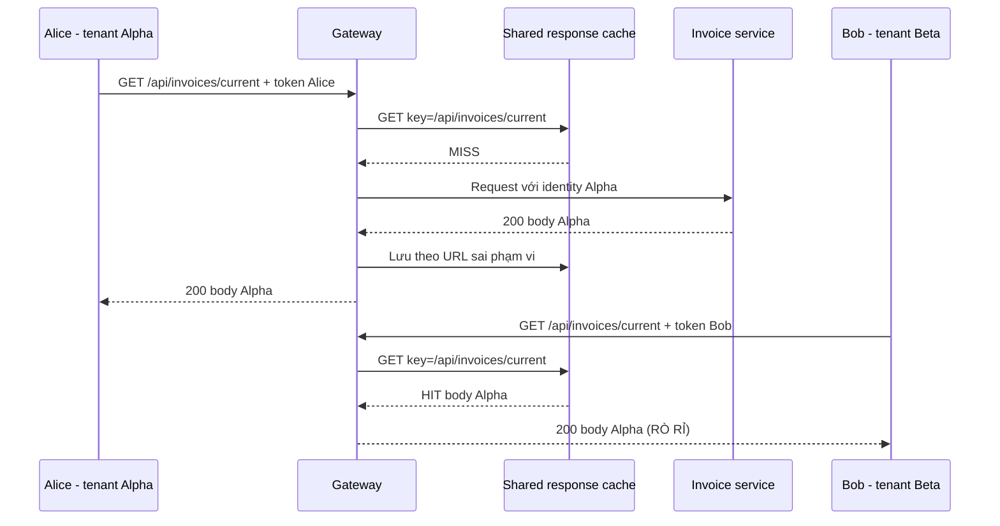
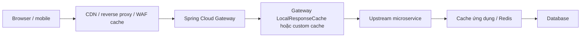
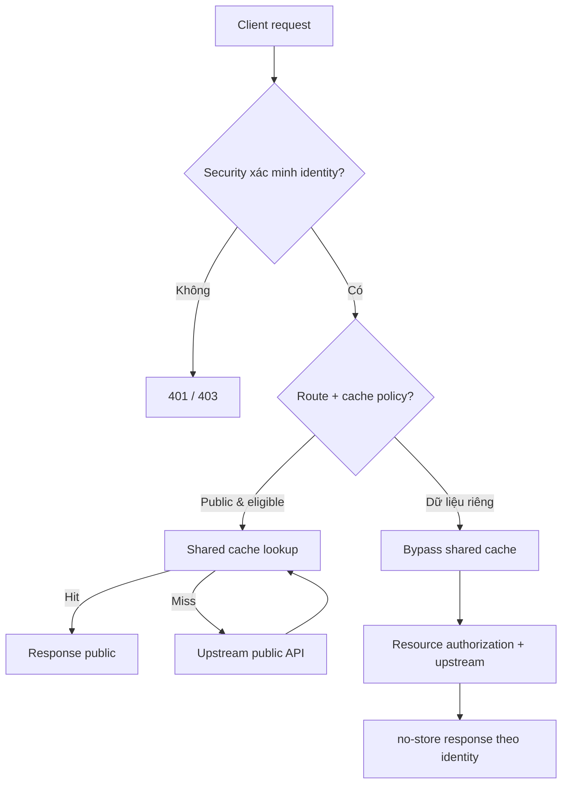
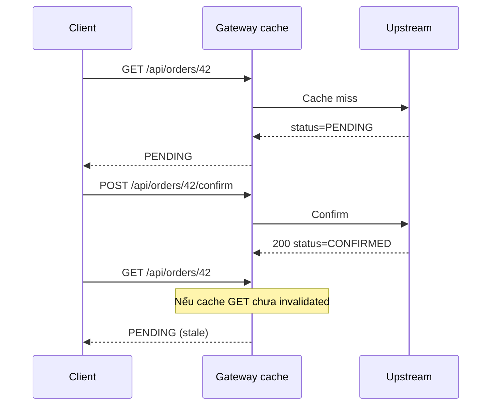
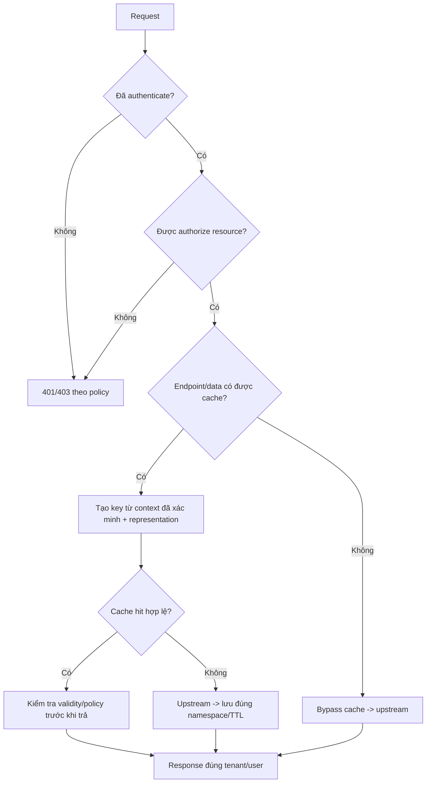

# Ngăn cache nhầm dữ liệu theo người dùng hoặc khách hàng

**Response caching** giúp Spring Cloud Gateway giảm số lần gọi microservice và rút ngắn thời gian trả lời các request lặp lại. Tuy nhiên, cache là một **ranh giới bảo mật**, không chỉ là công cụ tăng hiệu năng: nếu Gateway lưu response của người dùng A rồi trả cho người dùng B, hệ thống có thể làm lộ hồ sơ cá nhân, đơn hàng, thông tin thanh toán hoặc dữ liệu của một khách hàng doanh nghiệp khác.

Trong hệ thống multi-tenant, cùng đường dẫn `GET /api/orders` có thể trả danh sách đơn hàng khác nhau tùy **principal**, **tenant**, **vai trò**, **phạm vi quyền** và **trạng thái dữ liệu**. Một cache key chỉ gồm URL có thể hợp lệ cho danh mục sản phẩm công khai, nhưng cực kỳ nguy hiểm cho endpoint `/api/me` hoặc `/api/tenants/current/invoices`. Lỗi cache nhầm thường không biểu hiện thành HTTP `500`: client vẫn nhận `200 OK` với JSON đúng schema, nhưng **thuộc về người khác**.

Bài thuộc chương **Bộ nhớ đệm**, tập trung vào cách ngăn cache nhầm dữ liệu theo **người dùng hoặc khách hàng/tenant** khi vận hành **Spring Cloud Gateway Server WebFlux**. Nội dung kết hợp route predicates, filter chain, xác thực/phân quyền, `LocalResponseCache`, HTTP caching headers, service discovery, circuit breaker, retry, TLS và observability để thiết kế Gateway an toàn.

> **Phạm vi:** Ví dụ dùng Spring Cloud Gateway **Server WebFlux**, Spring Security reactive và HTTP caches. Một số thuộc tính/cú pháp `LocalResponseCache` khác nhau theo phiên bản. Tài liệu phân biệt cơ chế cache theo chuẩn HTTP với bộ nhớ đệm ứng dụng tùy chỉnh: **không giả định một Gateway filter bất kỳ tự tuân thủ mọi quy tắc `Cache-Control`, `Vary`, quyền truy cập hoặc tenant isolation**. Khi chưa chứng minh cache an toàn, mặc định **không cache response cá nhân hóa**.

## 1. Cache nhầm dữ liệu là sự cố gì?

Giả sử hai nhân viên thuộc hai khách hàng doanh nghiệp (tenant):

- Alice thuộc `tenant-alpha`, được phép xem hóa đơn của Alpha.
- Bob thuộc `tenant-beta`, chỉ được phép xem hóa đơn của Beta.
- Cả hai gọi `GET https://api.example.test/api/invoices/current` qua Gateway, mang JWT khác nhau.

```text
Alice: GET /api/invoices/current
       Authorization: Bearer token-alice
       -> upstream trả {"tenant":"alpha","total":125000}

Gateway cache:
       key = "GET /api/invoices/current"
       value = {"tenant":"alpha","total":125000}

Bob:   GET /api/invoices/current
       Authorization: Bearer token-bob
       -> cache HIT, trả JSON của Alice

Bob thấy dữ liệu Alpha dù Bob không có quyền.
```

Một implementation cache như vậy sai vì **biến thể của response phụ thuộc identity/tenant nhưng cache key không phản ánh sự phụ thuộc đó**. Nếu cache phục vụ response trước khi kiểm tra authorization phù hợp, rủi ro còn nghiêm trọng hơn.



**Điểm đáng chú ý:** JWT của Bob có thể được Spring Security xác minh thành công; cache vẫn trả sai nếu **phân vùng dữ liệu** và **thứ tự kiểm tra quyền** không đúng. Authentication đúng không tự đảm bảo kết quả từ cache được phân quyền đúng.

### Rò rỉ có thể xảy ra giữa những ai?

| Phạm vi sai lệch | Ví dụ | Hậu quả |
| --- | --- | --- |
| **Giữa người dùng** | User B nhận `/api/me` của user A | Lộ danh tính, email, lịch sử hoạt động |
| **Giữa tenant** | Công ty B nhận bảng giá riêng hoặc hóa đơn của công ty A | Rò rỉ dữ liệu khách hàng và hợp đồng |
| **Giữa vai trò** | Nhân viên thường nhận representation của admin | Lộ trường nhạy cảm/quyền quản trị |
| **Giữa phiên/token** | Token cũ đã bị thu hồi nhưng response cached vẫn được phát | Vượt chính sách thu hồi/quyền đã đổi |
| **Giữa ngôn ngữ/định dạng** | `Accept-Language` hoặc `Accept` khác nhưng cache dùng chung | Trả sai representation; có thể gây hỏng dữ liệu ở client |
| **Giữa origin** | Response CORS cho origin X được phục vụ cho Y | Lỗi CORS; trong thiết kế sai có thể làm lộ dữ liệu |
| **Giữa môi trường/host** | Cùng path trên hai virtual hosts trỏ tenant khác nhau | Lẫn dữ liệu do thiếu host trong key |

Cache sai trong các trường hợp trên thường là **lỗ hổng phân quyền ở tầng phân phối dữ liệu**, không đơn thuần là lỗi tối ưu hiệu năng.

## 2. Phân biệt các lớp cache có thể tồn tại

Một response từ microservice đến trình duyệt có thể được lưu ở nhiều vị trí:



| Lớp | Thường chia sẻ giữa ai? | Rủi ro bảo mật cần kiểm soát |
| --- | --- | --- |
| Browser private cache | Thường thuộc một browser profile, nhưng có vòng đời/cơ chế chia sẻ riêng | Dữ liệu nhạy cảm lưu trên thiết bị, logout, shared device |
| CDN/edge/shared reverse proxy | Nhiều người dùng, nhiều vùng và origin | Cross-user/tenant leak có thể xảy ra **trước khi đến Gateway** |
| `LocalResponseCache` ở Gateway | Nhiều request đến **một Gateway instance** | Cache key và eligibility có phù hợp response hay không |
| Custom Gateway `GlobalFilter`/`GatewayFilter` | Tùy cách code/cache store | Dễ bỏ qua SecurityContext, `Vary`, invalidation |
| Cache trong microservice | Tùy cache key theo nghiệp vụ | Dữ liệu trả sai user/tenant dù Gateway không cache |
| Database/query cache | Tùy connection/schema/tenant filter | Lỗi phân vùng dữ liệu ở tầng repository |

**Cache Gateway và cache ứng dụng khác nhau.** Nếu Gateway không lưu gì mà backend đã trả nhầm JSON từ Redis cache, tắt `LocalResponseCache` không khắc phục lỗi gốc. Ngược lại, một microservice trả đúng dữ liệu vẫn có thể bị Gateway/CDN phục vụ sai sau khi cache.

### Một route `lb://` không giải quyết phạm vi cache

`lb://invoice-service` giúp Spring Cloud LoadBalancer chọn instance backend. Nó **không bảo đảm cache key có principal/tenant**, cũng không biến response riêng thành response public. Nhiều backend instances với dữ liệu đúng vẫn không ngăn được một cache chung ở Gateway phát lại response của người khác.

## 3. Quy tắc an toàn nhất: không cache response cá nhân hóa ở cache dùng chung

Phân loại API trước khi bật caching:

| Kiểu endpoint | Ví dụ | Chính sách khởi đầu |
| --- | --- | --- |
| **Công khai, giống nhau với mọi người** | `GET /api/public/countries`, danh mục public không tùy user | Có thể xem xét shared caching với TTL và `Vary` đúng |
| **Công khai nhưng biến thể theo ngôn ngữ** | `GET /api/public/articles/42` | Chỉ cache nếu tách đúng `Accept-Language`/representation |
| **Theo user** | `GET /api/me`, `GET /api/my/orders` | **Không cache ở shared Gateway/CDN** |
| **Theo tenant** | `GET /api/tenant/invoices`, giá hợp đồng riêng | Mặc định **không shared-cache**; chỉ xem xét partition nếu thật sự cần |
| **Theo vai trò/quyền** | `GET /api/admin/reports` | Không shared-cache nếu chưa có mô hình key và authz có thể chứng minh |
| **Dữ liệu nhạy cảm** | Token, PII, tài khoản, giao dịch thanh toán | `Cache-Control: no-store` và bypass các cache dùng chung |
| **Ghi dữ liệu** | `POST /payments`, `PATCH /users/42` | Không dùng response cache GET thông thường cho thao tác ghi; thiết kế invalidation |
| **Streaming/SSE hoặc tải file riêng** | `GET /reports/export` | Tránh cache tự động; cần policy riêng cho nội dung lớn/nhạy cảm |

**Khuyến nghị theo mức độ rủi ro:** Với `/api/me`, `/api/orders`, `/api/invoices`, `/api/payments` và dữ liệu nhạy cảm theo user/tenant, hãy **tắt shared response caching** thay vì cố thêm vài header vào cache key. Một số dữ liệu nội bộ có thể cache theo tenant nếu tất cả điều kiện authorization, cache key và invalidation đều được chứng minh, nhưng đó là thiết kế nâng cao với bề mặt lỗi lớn hơn.

## 4. HTTP caching headers: hiểu chính xác trước khi cấu hình

Các tiêu đề HTTP không đồng nghĩa với cùng một hành vi:

| Header response | Ý nghĩa chính | Hệ quả với dữ liệu riêng |
| --- | --- | --- |
| `Cache-Control: no-store` | Cache tuân thủ chuẩn không được lưu response theo nghĩa lưu để dùng lại | Phù hợp cho dữ liệu nhạy cảm; còn phải kiểm tra custom caches |
| `Cache-Control: private` | Response dành cho cache riêng, không cho shared cache lưu | Không ngăn browser cache lưu |
| `Cache-Control: no-cache` | **Có thể lưu** nhưng phải revalidate trước khi dùng lại | **Không đồng nghĩa no-store** |
| `Cache-Control: public` | Cho phép shared cache lưu khi đủ điều kiện | Nguy hiểm nếu response được cá nhân hóa |
| `Cache-Control: max-age=60` | Thời gian response có thể được xem là fresh theo quy tắc HTTP | Không tự định nghĩa biến thể user/tenant |
| `Cache-Control: s-maxage=60` | Freshness cho shared cache, ưu tiên hơn `max-age` ở cache dùng chung | Chỉ dùng khi chắc chắn an toàn cho shared cache |
| `ETag` | Validator cho một representation cụ thể | Không thay thế identity/authorization |
| `Vary` | Xác định những request headers làm thay đổi representation | Cần được cache thực thi đúng; không tự tạo authz |
| `Set-Cookie` | Có thể chứa session state hoặc nội dung riêng | **Không tự bảo đảm mọi cache sẽ bypass** |

### `no-store` so với `private`

Đối với response nhạy cảm:

```http
HTTP/1.1 200 OK
Cache-Control: no-store
Content-Type: application/json

{"userId":"u-42","email":"private@example.test"}
```

`no-store` là chỉ thị mạnh hơn để ngăn cache tuân thủ chuẩn lưu nội dung cho lần sử dụng sau. Với dữ liệu ít nhạy cảm nhưng riêng cho một người, `private, max-age=...` có thể cho browser cache, nhưng phải đánh giá shared device, logout và việc dữ liệu đổi quyền.

**`private` không có nghĩa “mã hóa dữ liệu”**. Nó chỉ là chỉ thị về **loại cache có thể lưu** trong cơ chế HTTP. Không dùng `private` thay cho TLS, xác thực hoặc phân quyền.

### `no-cache` không có nghĩa “không lưu”

```http
Cache-Control: no-cache
ETag: "representation-v1"
```

Cache vẫn có thể lưu representation, nhưng phải revalidate khi cần sử dụng. Điều này có thể phù hợp cho dữ liệu public muốn luôn kiểm tra cập nhật. Với dữ liệu cá nhân/tenant cực kỳ nhạy cảm, **không dùng `no-cache` thay `no-store`** chỉ vì tên nghe giống nhau.

### `public` không phải “endpoint có thể truy cập nếu đã login”

Một API yêu cầu JWT nhưng trả dữ liệu riêng không thể được xem là public chỉ vì mọi user đều được phép gọi endpoint đó. Trong HTTP caching, `public` khuyến khích shared cache lưu; đó là khái niệm **chia sẻ representation**, không phải tên của policy authorization.

## 5. Header `Authorization` và `Cookie`: các bẫy thường gặp

Theo quy tắc HTTP caching cho shared caches tuân thủ chuẩn, response của request chứa `Authorization` có hạn chế tái sử dụng, trừ khi có các chỉ thị cho phép theo điều kiện của chuẩn (ví dụ `public` hoặc một số chỉ thị shared-cache cụ thể). Tuy nhiên:

- Một **custom cache** trong Gateway có thể không triển khai đầy đủ chuẩn HTTP.
- Một route dùng **cookie phiên** nhưng không có header `Authorization` vẫn là response riêng theo người dùng.
- Một proxy khác đứng trước Gateway có thể cấu hình bỏ qua hoặc không xử lý đúng `Cache-Control`.
- Một response do upstream phát `public` sai có thể được shared cache lưu, dù dữ liệu là riêng tư.

**Không dựa duy nhất vào việc request có Bearer token để bảo vệ dữ liệu**. Chính sách chắc chắn nhất là các route có dữ liệu riêng **không được gắn cache chia sẻ**, đồng thời trả `Cache-Control: no-store` và kiểm thử qua các tầng.

### Sai lầm: thêm raw Authorization vào cache key

Một cách vá dễ nghĩ là:

```text
cacheKey = method + path + query + raw Authorization header
```

Cách này có vấn đề:

1. Raw access token là credential; lưu trong key có thể đưa bí mật vào heap dumps, telemetry, dashboard hoặc log.
2. Token rotation tạo nhiều cache entries cho cùng người dùng; khó invalidation.
3. Một user có nhiều scope/tenant contexts vẫn cần phân quyền cho dữ liệu theo từng request.
4. Nếu token được sử dụng không đúng audience hoặc hết hạn, cache hit không được phép thay thế xác minh.
5. Cache key vẫn có thể thiếu host, locale, resource representation hoặc các điều kiện khác.

**Đừng dùng token thô làm định danh cache**. Nếu một thiết kế thật sự cần cache theo user, định danh phải xuất phát từ **SecurityContext đã xác minh**, với principal/tenant và ngữ cảnh quyền được canonicalize, isolation và TTL phù hợp. Ngay cả khi đó, phương án **không cache** thường an toàn hơn cho dữ liệu nhạy cảm.

## 6. Cache key phải mô tả đầy đủ biến thể của response

Một cache key an toàn cho dữ liệu được phép cache không chỉ là `URL path`. Tùy API, key có thể cần:

```text
key = (
  route/policy version,
  effective scheme + host,
  normalized method + path + relevant query,
  negotiated representation (Accept, language, encoding, ...),
  verified tenant scope (nếu dữ liệu tenant-scoped),
  verified principal/authorization cohort (nếu cho phép cache user-scoped),
  data/permission version hoặc invalidation namespace
)
```

Đây là **mô hình thiết kế**, không phải cấu trúc key mặc định của `LocalResponseCache`. Nếu dùng Gateway filter có sẵn, phải kiểm tra cache key và header support thực tế theo phiên bản; **không giả định nó tự nhận SecurityContext/tenant ID**.

| Thành phần key | Khi cần | Nếu thiếu |
| --- | --- | --- |
| Scheme/host/route | Virtual hosts hoặc nhiều upstream cùng path | Lẫn public domain, môi trường hoặc route |
| Path và query có ý nghĩa | `?category=x` khác `?category=y` | Trả sai tài nguyên |
| HTTP method | Response không cùng semantics giữa methods | Dùng sai representation |
| `Accept`/`Accept-Language`/encoding | Nội dung thay đổi theo content negotiation | Trả sai ngôn ngữ/định dạng |
| Verified tenant ID | Nội dung theo công ty/khách hàng | Cross-tenant leak |
| Verified principal ID | Nội dung theo người dùng | Cross-user leak |
| Scope/role/policy version | Response khác theo quyền | Trả dữ liệu của role cao hơn |
| Data version/invalidation tag | Response bị ảnh hưởng bởi mutation | Phát dữ liệu cũ quá thời hạn |
| Origin, nếu representation/CORS thực sự thay đổi | Header `Access-Control-Allow-Origin` động | Cache nhầm CORS policy |

**Key đầy đủ vẫn chưa đủ nếu authorization bị bỏ qua ở cache hit.** Gateway/backend phải xác minh user còn được quyền truy cập bản ghi trước khi phát response, hoặc thiết kế cache phải đảm bảo **mỗi request cache hit chỉ xảy ra sau kiểm tra quyền**. Một cache key đúng hôm qua có thể sai hôm nay vì user bị rút quyền, tenant chuyển ownership hoặc subscription hết hạn.

### Không tin `X-Tenant-Id` do client tự nhập

Ví dụ nguy hiểm:

```http
GET /api/invoices/current HTTP/1.1
Authorization: Bearer <token-user-beta>
X-Tenant-Id: tenant-alpha
```

Nếu cache key lấy trực tiếp `X-Tenant-Id` do client gửi, Bob có thể thử tên tenant khác để lấy dữ liệu chưa được phân quyền. Đây là **cache key poisoning** và lỗi trust boundary.

Nguồn tenant đáng tin thường là claim/permission từ identity đã được xác minh, hoặc tenant context được backend xác nhận. Nếu người dùng được phép chuyển tenant, phải kiểm tra **membership/quyền vào tenant được chọn**, không chỉ đọc chuỗi tenant ID. Không bao giờ coi giá trị query/header phía client là bằng chứng có quyền truy cập một tenant.

## 7. Cache theo user và cache theo tenant khác nhau ở đâu?

Hai người dùng trong cùng tenant có thể **không có cùng quyền**.

Giả sử:

- Anna: `tenant-alpha`, role `FINANCE_ADMIN`.
- Minh: `tenant-alpha`, role `VIEWER`.
- Một endpoint `GET /api/tenant/report` trả thêm trường `bankAccount` cho Finance Admin.

Nếu cache key chỉ gồm `tenant-alpha`, Minh có thể nhận representation được tạo cho Anna. **Tenant isolation không tự đảm bảo user/role isolation**.

| API | Cache key chỉ có tenant? | Cách xử lý an toàn |
| --- | --- | --- |
| Danh sách quốc gia public | Không cần tenant | Public key theo URL/representation |
| Cấu hình giao diện chung tenant, không có dữ liệu cá nhân | Có thể, nếu contract đảm bảo mọi member tenant nhận cùng dữ liệu | Cân nhắc tenant-aware cache có authz + invalidation |
| Báo cáo tenant với quyền role-specific | **Không đủ** | Không shared-cache hoặc partition theo quyền có kiểm chứng |
| `/api/me` | **Sai** | Không shared-cache |
| Hóa đơn tenant chứa quyền xem từng hóa đơn | **Không đủ** | Kiểm tra resource authorization, ưu tiên bypass cache |
| Feature flags tùy user/plan | **Không đủ** | Key theo identity/cohort/policy và invalidation, hoặc bypass |

**Một response là “tenant scoped” chỉ khi hợp đồng chứng minh mọi principal được phép trong tenant nhận cùng representation.** Nếu API có lọc theo user, team, field-level masking, subscription hoặc policy động, cần phân vùng sâu hơn hoặc loại khỏi cache.

## 8. `Vary` quan trọng nhưng không thay thế authorization

`Vary` mô tả những request header làm thay đổi representation được chọn:

```http
HTTP/1.1 200 OK
Cache-Control: public, max-age=60
Vary: Accept-Language
Content-Type: application/json
```

Một shared cache tuân thủ chuẩn chỉ có thể tái sử dụng response cho request mới khi các điều kiện matching, trong đó có `Vary`, được thỏa mãn.

Với response CORS phản ánh origin, có thể thấy:

```http
Vary: Origin
Access-Control-Allow-Origin: https://app.example.test
```

Nếu CDN không xét `Origin` hoặc xóa `Vary`, nó có thể trả header CORS dành cho một frontend origin khác. Đó là lỗi cache variant; có thể gây CORS rejection hoặc, trong thiết kế sai kết hợp chính sách credentials, tạo vấn đề an toàn khác.

### Vì sao `Vary: Authorization` không phải “giải pháp chuẩn” cho dữ liệu riêng?

Một số người đề xuất:

```http
Cache-Control: public, max-age=300
Vary: Authorization
```

Đây **không phải** lời khuyên mặc định cho API cá nhân hóa. Lý do:

- Nó vẫn đưa dữ liệu riêng vào **shared cache**, làm tăng bề mặt rò rỉ và lưu credential-related variants.
- Cơ chế cache tùy chỉnh có thể **không triển khai `Vary` đúng**.
- `Authorization` có thể khác giữa lần refresh token, làm phát sinh entries khó thu hồi.
- Nó không giải quyết permission revocation hoặc tình huống browser dùng cookie thay Bearer.
- Nếu response từ backend bị gắn `public` sai, một cache khác có thể tái sử dụng theo policy không mong đợi.

Với `/api/me`, tenant invoices, account data: **bypass shared cache và trả `Cache-Control: no-store`** là lựa chọn rõ ràng hơn. Nếu cache cá nhân hóa là yêu cầu bắt buộc, cần cơ chế key/authorization/invalidation chuyên dụng và review bảo mật.

## 9. `LocalResponseCache` của Spring Cloud Gateway: dùng đúng phạm vi

Spring Cloud Gateway Server WebFlux có **`LocalResponseCache` GatewayFilter Factory** ở các phiên bản hỗ trợ. Nó dùng cache **cục bộ trong tiến trình Gateway**, tối ưu những response đủ điều kiện theo triển khai và cấu hình của framework.

Ví dụ lab cho **danh mục sản phẩm thực sự công khai**:

```yaml
spring:
  cloud:
    gateway:
      routes:
        - id: public-catalog
          uri: lb://catalog-service
          predicates:
            - Path=/api/public/catalog/**
            - Method=GET
          filters:
            - StripPrefix=1
            - LocalResponseCache=30s,20MB

        - id: my-profile
          uri: lb://identity-service
          predicates:
            - Path=/api/me/**
          filters:
            - StripPrefix=1
            - SetResponseHeader=Cache-Control,no-store
```

Trong ví dụ:

1. `public-catalog` là route đọc dữ liệu **được chứng minh giống nhau với mọi người**.
2. `LocalResponseCache=30s,20MB` minh họa cú pháp shortcut trong những phiên bản hỗ trợ: TTL và giới hạn kích thước cache. Cần kiểm tra tên factory, dependency, điều kiện hoạt động và cấu hình version thực tế.
3. `my-profile` **không có `LocalResponseCache`** và buộc `Cache-Control: no-store` ở response theo mục tiêu policy.
4. `SetResponseHeader` thay giá trị header tại route filter thay vì thêm một giá trị `Cache-Control` mới gây mâu thuẫn; upstream cũng phải cấu hình đúng.
5. Spring Security vẫn kiểm tra quyền đối với `/api/me/**` và mọi route cần bảo vệ.

**Đây không phải cấu hình production hoàn chỉnh**. Tùy bản Gateway, việc sử dụng LocalResponseCache có thể yêu cầu dependency cache và thuộc tính bật tính năng riêng; các điều kiện cache eligible thường phụ thuộc method, body, response status và HTTP caching headers. Cần xác minh **chính xác phiên bản** trước khi dùng.

### Tránh bật cache toàn cục không kiểm soát

Một số phiên bản Gateway hỗ trợ cơ chế cache toàn cục hoặc thuộc tính bật local response cache cho nhiều route. Nếu cấu hình global hoặc default filter không phân biệt public/private API, một route `/api/me` có thể vô tình được đưa vào cùng chính sách.

**Không coi `LocalResponseCache` tự biết tenant/principal**. Nếu định cache response phụ thuộc user, phải biết chính xác key eligibility, `Vary` handling, thứ tự filter và CORS/Security interaction của phiên bản đang chạy. Khi không chứng minh được, không bật nó cho dữ liệu riêng.

### Local cache trên nhiều Gateway replicas

`LocalResponseCache` là bộ nhớ đệm **local**: Gateway replica A và B có thể giữ entries khác nhau, thời điểm hết hạn khác nhau. Một response stale chỉ xuất hiện ở một replica có thể gây lỗi “lúc đúng lúc sai”, đặc biệt khi traffic đi qua ingress load balancer.

Không suy luận rằng đổi dữ liệu trên `catalog-service` sẽ **ngay lập tức** xóa mọi response local đã cache trên tất cả Gateway replica. Cần TTL, invalidation/refresh policy hoặc versioned URL phù hợp; không đánh đồng cache response với service discovery cache.

## 10. Authn/authz phải là ranh giới trước khi lấy dữ liệu cache

Trong Gateway WebFlux, Spring Security thường tham gia **WebFilter chain** trước Gateway route mapping/filter chain. Điều này giúp từ chối request thiếu/không hợp lệ token trước khi một route filter chạy, nhưng **không đủ** nếu cache data không partition đúng.



Sơ đồ mô tả **chính sách mong muốn**, không cam kết mọi `CacheFilter` tự hoạt động theo hình. Với custom filter, developer phải triển khai đúng điểm kiểm tra quyền và caching.

### Authentication khác authorization

- **Authentication:** “Request này thuộc Alice không?”
- **Authorization:** “Alice có được xem invoice X trong tenant Alpha không?”
- **Cache eligibility:** “Response này có an toàn để phục vụ lại cho request khác không?”

Ba câu hỏi này khác nhau. Một cache hit có thể được tạo bởi user có quyền, nhưng user sau đó đã bị rút quyền. Nếu chỉ có authentication và cache key cũ, response vẫn có thể lộ.

**Quy tắc quan trọng:** Với dữ liệu được phân quyền theo tài nguyên, không được dùng cache hit để **đi tắt authorization**. Cần kiểm tra quyền cho mỗi lần truy cập hoặc thiết kế cache riêng có ngữ cảnh quyền/invalidation được chứng minh.

### Proxy/CDN ở trước Gateway đặc biệt nguy hiểm

Một CDN có thể trả cache hit **mà request không đến Spring Security**. Vì vậy bảo vệ ở Gateway không giải quyết được việc shared edge cache lưu một response private do cấu hình sai.

Đối với API authenticated, cấu hình CDN/ingress **bypass cache** theo route hoặc policy đáng tin, đồng thời phát `no-store` cho response nhạy cảm. Phải kiểm tra response public ngoài cùng, không chỉ qua port nội bộ của Gateway.

## 11. Không cache response có `Set-Cookie` hoặc dữ liệu riêng chỉ vì URL giống nhau

Một response có thể mang:

```http
HTTP/1.1 200 OK
Set-Cookie: SESSION=...
Content-Type: application/json

{"welcome":"Alice"}
```

Nếu cache dùng chung lưu cả response headers, việc phát lại `Set-Cookie` hoặc dữ liệu riêng là rất nguy hiểm. Một cache tuân thủ chuẩn HTTP có các điều kiện riêng để xử lý response, nhưng **chỉ xuất hiện `Set-Cookie` không phải bằng chứng mọi implementation sẽ tự bypass**.

Quy tắc phòng thủ:

1. Không đưa routes login, callback, logout, refresh/session hoặc `/api/me` vào shared response cache.
2. Gửi `Cache-Control: no-store` cho response nhạy cảm.
3. Không lưu `Set-Cookie` vào entries được chia sẻ.
4. Kiểm thử cả **response headers**, không chỉ JSON body.
5. Nếu code cache tùy chỉnh, kiểm tra header injection, redirect, `Vary` và trạng thái commit đúng cách.

Đối với các response lỗi xác thực `401`/`403`, lỗi rate limit `429`, lỗi circuit breaker/fallback `503`, phải biết chúng có đi qua cache không. **Không được vô tình cache một response lỗi có thông tin cá nhân hoặc token**, và cũng không được trả cached successful response nhằm lách yêu cầu xác thực đã hết hạn.

## 12. Status, ETag và conditional requests không tự giải quyết tenant isolation

Cache HTTP có thể dùng validators:

```http
GET /api/public/catalog/items/42 HTTP/1.1
If-None-Match: "item-42-v3"
```

Upstream có thể trả `304 Not Modified` nếu representation tương ứng chưa đổi. Cache sau đó sử dụng representation **đã lưu hợp lệ trước đó**.

Với dữ liệu riêng, đây là chỗ dễ nhầm:

- `304` thường không có body; response dữ liệu thực đến từ cache.
- Nếu cache key ban đầu trộn người dùng, `304` có thể khiến cache sử dụng **body của user khác**.
- Nếu `ETag` không gắn với đúng resource/representation hoặc cache bỏ qua `Vary`, revalidation có thể không cứu được lỗi.
- User đã bị thu hồi quyền vẫn phải được xác minh, không thể chỉ vì ETag còn hợp lệ mà trả bản ghi họ không được xem.

**ETag là validator của representation, không phải chứng cứ quyền truy cập.** Không dùng `If-None-Match` như authentication token và không dùng `304` để bỏ kiểm tra policy.

### Các HTTP status cũng có quy tắc cache khác nhau

Một số status có thể được cache theo chuẩn HTTP trong điều kiện nhất định; những status khác cần chỉ thị rõ. Đừng tự thiết kế filter với logic “chỉ 200 là an toàn” hoặc “mọi 2xx đều cache được”: **tính an toàn phụ thuộc dữ liệu, quyền, headers và từng status**.

Ví dụ `200 OK` chứa `{"email":"alice@..." }` vẫn là thông tin riêng; `301 Moved Permanently` có thể mang routing/host-specific policy; `404` có thể khác nhau theo quyền (không tiết lộ tài nguyên). Cần whitelist endpoint public và hiểu eligibility thực tế của framework.

## 13. Vòng đời quyền truy cập và invalidation

Ngay cả khi cache key chứa user/tenant, trạng thái quyền truy cập vẫn có thể thay đổi.

Ví dụ timeline:

```text
10:00 Alice có quyền đọc /api/tenant-alpha/report/42.
10:01 Gateway cache response report/42 dành cho Alice.
10:03 Admin thu hồi quyền của Alice.
10:04 Alice gửi lại request.
10:04 Cache trả report/42 theo key cũ nếu không tái kiểm tra quyền.
```

Đây là **stale authorization**, không phải lỗi key trùng giữa hai user. Một cache key phân vùng đúng vẫn có thể vi phạm chính sách **quyền đã thay đổi**.

Các chiến lược:

| Cơ chế | Lợi ích | Giới hạn |
| --- | --- | --- |
| Bypass cache cho dữ liệu cần authz tức thời | Đơn giản, rõ trách nhiệm | Tốn thêm upstream calls |
| TTL rất ngắn | Giảm thời gian stale | Không đảm bảo thu hồi tức thời |
| Invalidate theo user/tenant/resource | Chủ động loại response khi đổi quyền/dữ liệu | Phức tạp trên nhiều Gateway replicas/edge |
| Version/epoch quyền trong key | Tách entries trước/sau khi đổi quyền | Cần nguồn version đáng tin, cập nhật kịp thời |
| Re-authorize trước khi trả cache hit | Giữ yêu cầu quyền hiện tại | Có thể mất phần lợi ích hiệu năng, vẫn phải xử lý race |
| Không cache body, chỉ cache dữ liệu public | Giảm bề mặt rò rỉ | Cần tái thiết kế endpoint nếu trước đây trộn public/private fields |

**TTL không phải cơ chế phân quyền.** Chọn TTL 5 giây chỉ giới hạn khoảng stale dự kiến ở một số lớp; không thay thế authentication/authorization.

## 14. Mutation: cache phải nhất quán khi dữ liệu thay đổi

Một danh mục public được cache 30 giây có thể chấp nhận stale trong khoảng đó. Nhưng với **hạn mức tín dụng, tồn kho theo hợp đồng, giá theo customer hoặc trạng thái thanh toán**, một response cũ có thể dẫn tới quyết định sai.



Ngay cả khi không có cross-user leak, response stale có thể vi phạm hợp đồng API. Với một thiết kế thực sự cần response cache cho dữ liệu có thay đổi:

1. Xác định mutation nào ảnh hưởng cache keys nào.
2. Thiết kế invalidation trong hệ thống nhiều replicas (Gateway, CDN, microservice).
3. Kiểm soát TTL/stale-while-revalidate nếu cho phép, không sử dụng cho dữ liệu cần nhất quán tức thời.
4. Không tùy tiện retry thao tác ghi thiếu idempotency, vì retry và cache stale có thể che trạng thái thực.
5. Dùng version hoặc ETag đúng representation và policy; **không dùng ETag để bỏ authorization**.

Với dữ liệu tài khoản/khách hàng nhạy cảm, **bypass response cache** thường giảm đáng kể độ phức tạp consistency và security.

## 15. CORS, ngôn ngữ và content negotiation cũng ảnh hưởng cache correctness

### CORS

Frontend `https://app-a.example.test` và `https://app-b.example.test` có thể cùng gọi public API qua Gateway. Nếu response CORS phản ánh `Origin`, phải quản lý `Vary: Origin` và tránh CDN cache sai header. Đối với request có credentials, `Access-Control-Allow-Origin: *` không phù hợp theo quy tắc CORS.

CORS **không phải authorization**. Browser chặn đọc response là lớp bảo vệ client-side, nhưng một mobile client hoặc curl không áp dụng cùng cơ chế. Một cache leak không thể được “sửa” chỉ bằng chính sách CORS.

### Ngôn ngữ và định dạng

`Accept-Language: vi` có thể nhận nội dung tiếng Việt, còn `Accept-Language: en` nhận tiếng Anh. `Accept: application/json` khác `Accept: application/problem+json` về representation. Nếu cache chỉ theo URL, client có thể nhận sai format hoặc ngôn ngữ.

Có thể dùng `Vary` phù hợp với từng header, nhưng đừng khai báo bừa một tập `Vary` cực rộng dẫn đến cache fragmentation không cần thiết. Chỉ cache endpoint nào có representation contract rõ ràng.

### Query/Host

Một API có query `?currency=VND` khác `?currency=USD`. Tên hostname có thể phân biệt môi trường hoặc customer. Cache cần bảo toàn ý nghĩa của query và host; **không tự bỏ query parameters** vì “không ảnh hưởng SEO”. Việc canonicalize query phải theo contract và được kiểm thử chống collision.

## 16. Một chiến lược route dễ kiểm soát trong Gateway

Để giảm rủi ro, có thể chia các API thành **route public cacheable** và **route private no-cache**. Cách tổ chức ở mức khái niệm:

```text
/api/public/catalog/**    -> route public-catalog -> LocalResponseCache có TTL nhỏ
/api/me/**                -> route my-profile    -> không cache + no-store
/api/orders/**            -> route orders        -> không shared-cache
/api/tenant/reports/**    -> route tenant-report -> không shared-cache
/api/admin/**             -> route admin         -> không shared-cache
```

Đặt route predicates rõ ràng và kiểm tra overlap/route order. Một route chung `Path=/api/**` có thể “bắt” request mà bạn tưởng thuộc route private, nhất là khi thêm `default-filters` hoặc global filter.

### Không đặt LocalResponseCache vào default filters cho toàn bộ API

Ví dụ **nguy hiểm về chính sách**:

```yaml
# KHÔNG khuyến nghị nếu /api/** có cả dữ liệu private.
spring:
  cloud:
    gateway:
      default-filters:
        - LocalResponseCache=5m,100MB
```

Một `default-filter` có thể được áp dụng trên nhiều route hơn dự tính. Nếu implementation cache có thể lưu các response đủ điều kiện từ dữ liệu riêng, rủi ro trở nên rộng trên toàn Gateway.

**Thay vì vậy:** Gắn caching tường minh cho route public đã được audit, viết test xác nhận private route không cache, và tách bộ quy tắc ở lớp CDN/Ingress tương ứng.

### Điều gì xảy ra khi upstream gắn sai Cache-Control?

Nếu backend vô tình trả:

```http
HTTP/1.1 200 OK
Cache-Control: public, max-age=3600

{"accountId":"a-42","balance":123456}
```

Gateway không nên coi chỉ thị `public` là bằng chứng endpoint có thể chia sẻ an toàn. **Cache eligibility phải được giới hạn trước tiên bằng danh sách route/loại dữ liệu**, sau đó mới xét các caching headers và behavior của thư viện.

Trên route private, upstream nên trả `no-store` ngay tại nguồn; Gateway có thể enforce header như một lớp bảo vệ bổ sung, nhưng **việc sửa response header không đảm bảo một cache ở trước filter đó chưa lưu dữ liệu**. Muốn ngăn lưu thật sự, phải bypass/disable cache ở chính điểm lưu và xác minh filter order.

## 17. Custom cache filter: các điều kiện bắt buộc trước khi triển khai

Nếu nhu cầu hệ thống bắt buộc cache một response theo tenant, không chỉ viết một đoạn:

```java
// PSEUDOCODE SAI: key theo path nhưng dữ liệu theo tenant.
String key = exchange.getRequest().getURI().getPath();
return cache.getOrLoad(key, () -> callUpstream(exchange));
```

Đoạn mã trên là **mô hình anti-pattern**, không phải Java API thật của Spring Cloud Gateway. Nó thiếu principal, tenant, authorization, representation, TTL và invalidation.

Một thiết kế **được phép xem xét** phải thỏa các điều kiện tối thiểu:

- **Eligibility:** chỉ những endpoint có policy caching rõ ràng mới đi vào cache.
- **Identity:** lấy principal/tenant từ bối cảnh đã xác thực, không từ header tùy ý của client.
- **Authorization:** trước **mọi cache hit**, xác minh quyền hiện tại đối với resource/representation cần trả.
- **Key:** phản ánh tenant + user/role/scope nếu representation phụ thuộc chúng; scheme/host/path/query/`Vary`/data version.
- **Value:** không chứa `Set-Cookie`, token, private headers hoặc dữ liệu user khác ngoài phạm vi cho phép.
- **TTL và invalidation:** xử lý thay đổi permission, logout, tenant membership, mutation, config/route change.
- **Concurrency:** tránh hai requests khác user cùng ghi/đọc key do race; không có mutable shared state lẫn identity.
- **Body lifecycle:** nếu dùng `DataBuffer`, quản lý retain/release, giới hạn kích thước và cleanup khi error/cancel.
- **Observability:** metrics được gắn tenant cohort đã ẩn danh/giới hạn cardinality, không ghi secrets.
- **Tests:** chứng minh không thể cross-user/tenant leak kể cả khi cache hit, retry, failover, revoked permissions và các Gateway replicas.



**Cảnh báo:** Sơ đồ là **đặc tả thiết kế**. Không coi một instance `GlobalFilter` đơn giản là đủ để giải quyết resource authorization nếu upstream mới biết chi tiết permission. Khi authz phụ thuộc dữ liệu backend, cách an toàn nhất có thể là **không cache Gateway response**.

## 18. Kiểm thử thực tế: hai user, hai tenant, một URL

### Chuẩn bị fixture

Có hai JWT test được tạo bởi security test infrastructure hoặc AS test tin cậy:

- `token-alpha`: `sub=alice`, `tenant=alpha`, có quyền xem tài nguyên Alpha.
- `token-beta`: `sub=bob`, `tenant=beta`, không có quyền xem dữ liệu Alpha.

Một upstream mock kiểm tra token/identity test và trả body tương ứng:

```json
{"tenant":"alpha","user":"alice","orders":["A-001"]}
```

```json
{"tenant":"beta","user":"bob","orders":["B-001"]}
```

Nếu endpoint là dữ liệu riêng, policy Gateway phải **bypass shared response cache**, dù request URL giống nhau.

### Dùng curl để tái hiện

```bash
# TOKEN_ALPHA và TOKEN_BETA là token TEST được nạp an toàn.
# Không in chúng ra log hoặc chia sẻ shell history.
curl -sS -D - -o /dev/null \
  -H "Authorization: Bearer $TOKEN_ALPHA" \
  http://localhost:8080/api/orders

curl -sS -D - -o /dev/null \
  -H "Authorization: Bearer $TOKEN_BETA" \
  http://localhost:8080/api/orders
```

`-o /dev/null` chỉ in response headers; để kiểm tra JSON body trong **test environment**, dùng output file riêng hoặc assertion tool, không ghi dữ liệu khách hàng thật vào logs. Request với token giả/expired phải trả `401` theo security policy và **không nhận cached 200**.

**Không đủ chỉ kiểm tra hai request trả `200`.** Phải xác nhận Alice luôn nhận Alpha, Bob luôn nhận Beta, backend được gọi khi cần, và không có nội dung bị tái sử dụng sai qua cache.

### Trình tự thử nghiệm bắt lỗi cache nhầm

```text
1. Alice gọi URL X -> nhận body Alpha.
2. Bob gọi chính URL X -> phải nhận body Beta.
3. Alice gọi lại URL X -> vẫn Alpha.
4. User anonymous gọi X -> 401 (hoặc policy tương ứng), không nhận Alpha/Beta.
5. Alice đổi tenant được phép -> representation theo tenant mới.
6. Thu hồi quyền của Alice -> không còn nhận cached response cũ.
7. Đổi vai trò Bob -> không được nhận representation từ role cũ/cao hơn.
8. Lặp với Accept-Language, query, Origin và Gateway replica khác.
9. Tạo upstream 503 -> không phục vụ private response cũ như public fallback.
```

Một cache key sai theo URL thường lộ ngay ở bước 2, nhưng một lỗi **stale authorization** có thể chỉ lộ ở bước 6 hoặc bước 7. Vì vậy cần cả test thay đổi quyền, không chỉ test nhiều users.

## 19. Kiểm thử tích hợp bằng WebTestClient

Với Spring Security reactive và Gateway WebFlux, có thể dùng `WebTestClient` trong integration test. Ví dụ dưới đây minh họa cách **assert response không bị lẫn**; test fixture cần định nghĩa mock JWT, upstream và route cụ thể:

```java
@Test
void privateOrdersAreNotSharedAcrossPrincipals() {
    webTestClient.get()
        .uri("/api/orders")
        .headers(headers -> headers.setBearerAuth(tokenAlice))
        .exchange()
        .expectStatus().isOk()
        .expectHeader().valueEquals(HttpHeaders.CACHE_CONTROL, "no-store")
        .expectBody()
        .jsonPath("$.tenant").isEqualTo("alpha")
        .jsonPath("$.user").isEqualTo("alice");

    webTestClient.get()
        .uri("/api/orders")
        .headers(headers -> headers.setBearerAuth(tokenBob))
        .exchange()
        .expectStatus().isOk()
        .expectHeader().valueEquals(HttpHeaders.CACHE_CONTROL, "no-store")
        .expectBody()
        .jsonPath("$.tenant").isEqualTo("beta")
        .jsonPath("$.user").isEqualTo("bob");
}
```

**Lưu ý:** Đây là một phần test, không phải class độc lập chạy được. `tokenAlice` và `tokenBob` phải là token **hợp lệ trong test SecurityContext/AS fixture**, `WebTestClient` cần bind vào Gateway, mock upstream cần phản hồi theo identity và error mapping phải phù hợp. Nếu upstream trong hệ thống thật không nhận token trực tiếp, test phải thiết lập mô hình relay/exchange tương ứng.

### Test chứng minh cache hit không bypass security

```java
@Test
void anonymousCannotReceivePreviouslyCachedPrivateResponse() {
    // Gọi có token Alice trước, đảm bảo đường dữ liệu được khởi tạo.
    webTestClient.get()
        .uri("/api/me")
        .headers(h -> h.setBearerAuth(tokenAlice))
        .exchange()
        .expectStatus().isOk();

    // Request anonymous không được nhận cache hit 200 của Alice.
    webTestClient.get()
        .uri("/api/me")
        .exchange()
        .expectStatus().isUnauthorized();
}
```

Đoạn test này **không chứng minh toàn bộ bảo mật** nếu route bị test fixture bypass hoặc body không được so sánh; cần bổ sung test nhiều users, tenant context, quyền thay đổi, role-specific fields và backend call count.

### Kiểm tra cache hit thực sự ở public route

Để chứng minh caching public hoạt động:

1. Upstream mock `GET /public/catalog/items/42` trả cùng representation cho mọi principal/anonymous request, kèm caching headers đúng.
2. Gửi request lần đầu qua Gateway, assert upstream call count = 1.
3. Gửi lại cùng URL/representation trong TTL, assert upstream call count vẫn = 1 nếu LocalResponseCache version/config hỗ trợ và response đủ điều kiện.
4. Gửi request với `Accept-Language` khác, nếu representation thay đổi, assert không dùng response sai.
5. Sau khi TTL/invalidation có hiệu lực, assert dữ liệu mới được dùng theo contract.

**Test public hit và private bypass là hai yêu cầu tách biệt**: bảo vệ dữ liệu bằng cách tắt mọi cache có thể an toàn nhưng làm mất mục tiêu tối ưu public catalog; ngược lại, chỉ test public hit không chứng minh riêng tư.

## 20. Ma trận kiểm thử bảo mật bộ nhớ đệm

| Test | Input/biến cố | Điều phải chứng minh |
| --- | --- | --- |
| T1 | Hai users cùng GET `/api/me` | Không user nào thấy dữ liệu của user kia |
| T2 | Hai tenants cùng GET URL giống hệt | Không cross-tenant response reuse |
| T3 | Hai roles trong cùng tenant | Không lộ field dành cho role cao hơn |
| T4 | Anonymous gọi sau request authenticated | Không nhận cached authenticated response |
| T5 | Token hết hạn/thu hồi | Cache hit không bypass authn/authz hiện tại |
| T6 | User bị rút quyền resource | Không tiếp tục thấy tài nguyên từ cache cũ |
| T7 | Chuyển tenant hợp lệ | Key/policy đổi đúng tenant context |
| T8 | Client tự sửa `X-Tenant-Id` | Không dùng header chưa xác minh để lấy cached data |
| T9 | Query `?customer=A` vs `B` | Không gộp hai resource variants |
| T10 | Hai virtual hosts cùng path | Không trộn hostname/route scope |
| T11 | `Accept-Language` khác | Trả đúng locale nếu dùng shared cache |
| T12 | CORS `Origin` khác | `Vary`/cache policy không lặp Allow-Origin sai |
| T13 | Response có `Set-Cookie` | Không cache/forward cookie của user khác |
| T14 | Private response `Cache-Control: no-store` | Không lưu qua Gateway/edge theo policy |
| T15 | Upstream vô tình trả `public` cho private API | Gateway/edge vẫn bypass theo route |
| T16 | `ETag` và `If-None-Match` | `304` không khơi lại body của user khác |
| T17 | Mutation POST/PATCH/DELETE | Không trả stale response vi phạm contract |
| T18 | CircuitBreaker fallback/Retry | Không dùng cached private success che lỗi auth/upstream |
| T19 | Hai Gateway replicas | Cả hai không leak, kể cả cache state khác nhau |
| T20 | CDN/ingress ở trước Gateway | Public response cuối đúng `Cache-Control`/`Vary` và private bypass |
| T21 | Client cancel/stream lỗi | Không lưu body một phần hoặc giữ pooled buffer |
| T22 | Lưu lượng đồng thời cao | Không race key giữa principal/tenant contexts |

Đối với bảo mật, một test “không thấy leak” trong một request đơn lẻ chưa đủ. Hãy thử **thứ tự xen kẽ A→B→A→anonymous**, concurrency, token expiry, permission changes và quá trình rolling deployment với nhiều replicas.

## 21. Quan sát cache mà không lộ dữ liệu

Metrics hữu ích:

| Nhóm | Câu hỏi trả lời |
| --- | --- |
| Cache hit/miss theo route | Caching có hoạt động ở route được cho phép không? |
| Bypass reason | Route private bị bypass theo policy hay do điều kiện không đủ? |
| TTL/entry count/eviction | Cache có giữ dữ liệu quá lâu hoặc dùng nhiều memory không? |
| Upstream call count | Public cache hit có thật sự giảm backend traffic không? |
| HTTP status | Response thành công/lỗi có bị cache ngoài chủ đích không? |
| Authn/authz decision | Request có được xác minh quyền trước khi có response không? |
| Gateway replica ID | Replica nào giữ entry stale hoặc có cấu hình lệch? |
| CDN cache status | Response đã được phục vụ từ edge trước Gateway không? |
| Mutation/invalidation events | Cập nhật dữ liệu/quyền có loại entries liên quan không? |
| Incident correlation ID | Ghép request frontend, Gateway, backend và event cache |

**Không gắn raw access token, cookie, email, invoice ID, query nhạy cảm hoặc full cache key có PII vào metric label**. Nếu cần phát hiện nhầm tenant, dùng dữ liệu test, mã định danh nội bộ đã được giới hạn/ẩn danh và cơ chế log truy cập được bảo vệ. Một header debug `X-Cache-Hit` có thể hữu ích trong test nhưng không tự cung cấp khả năng xác minh đúng user/tenant.

### Phân biệt cache hit và response đến từ upstream

Một response `Age` hoặc header debug của CDN có thể gợi ý rằng dữ liệu đã được lưu, nhưng ý nghĩa của header phụ thuộc cache và cấu hình. Không giả định mọi Gateway local cache đều tự gắn một header có tên cố định. Kiểm chứng bằng **upstream call count**, trace/span và metric từ cache implementation đang dùng.

Nếu quan sát lỗi “chỉ một Gateway replica trả sai”, kiểm tra **cache instance local, route config, rollout version, feature flag**. Nếu tất cả replicas đều sai cùng một resource, kiểm tra CDN hoặc cache nghiệp vụ upstream trước khi điều chỉnh Gateway TTL.

## 22. Runbook khi nghi ngờ cross-user/tenant cache leak

Đây là sự cố **bảo mật dữ liệu**; xử lý ưu tiên giảm khả năng phát tán hơn tối ưu performance.

1. **Khoanh vùng** endpoint, thời điểm, các tenant/users có thể bị ảnh hưởng, lớp cache liên quan và dấu hiệu response sai.
2. **Ngăn phát tán:** tắt/bypass cache ở route nghi vấn và tại edge nếu cần; giữ security checks hoạt động. Không chỉ thay TTL từ 10 phút xuống 1 phút rồi coi là đã khắc phục.
3. **Bảo vệ chứng cứ:** lưu logs/trace có kiểm soát truy cập và đã che secrets; không sao chép dữ liệu khách hàng vào kênh công khai.
4. **Xác minh tầng gây leak:** gọi upstream trực tiếp bằng test identities, rồi Gateway trực tiếp, cuối cùng qua CDN/Ingress. So sánh body, headers và call counts.
5. **Kiểm tra cache eligibility:** endpoint private có lọt vào LocalResponseCache, default-filter, global filter hoặc CDN rule không?
6. **Kiểm tra cache key:** thiếu user/tenant/role/host/query/`Vary`, dùng header tenant chưa xác minh hay cache theo raw token?
7. **Kiểm tra authorization:** cache hit có bypass authz, user đã bị rút quyền, permission version/TTL bị stale hay không?
8. **Kiểm tra headers:** `Cache-Control`, `Vary`, `Set-Cookie`, `ETag` và response từ error/fallback.
9. **Invalidate/purge đúng phạm vi:** xóa entries bị ảnh hưởng ở từng cache layer theo quy trình có kiểm soát. Một lần restart một Gateway replica không dọn CDN hoặc cache của replica khác.
10. **Triển khai bản sửa và kiểm thử:** chạy toàn bộ ma trận multi-user/tenant, revoked access, role changes, public caching và concurrency.
11. **Đánh giá ảnh hưởng:** xác định request/user/tenant nào có thể đã nhận dữ liệu sai, phối hợp quy trình incident/security/privacy của tổ chức.
12. **Theo dõi tái phát:** cache hit ratio, response mismatch assertions trong test/canary, error rate, rollout config drift và audit trails.

### Bảng chẩn đoán nhanh

| Triệu chứng | Điều cần điều tra trước |
| --- | --- |
| User B nhận body của A với cùng URL | Cache key thiếu identity hoặc shared cache phục vụ response riêng |
| User khác tenant bị lộ dữ liệu | Tenant context không đáng tin, thiếu authorization hoặc key thiếu tenant |
| Chỉ lỗi sau login/logout | Session cookie, cached private response, token/session state stale |
| Chỉ lỗi sau đổi role | Authorization version và invalidation theo quyền |
| Chỉ lỗi qua CDN, Gateway trực tiếp đúng | Edge cache key, cache policy, `Vary`, route bypass |
| Chỉ lỗi trên một replica | `LocalResponseCache` local, config drift, stale entries |
| Sau POST vẫn thấy trạng thái cũ | Invalidation/TTL và consistency |
| Browser báo CORS sau cache hit | `Vary: Origin` và Allow-Origin bị cache sai |
| Upstream luôn trả đúng, Gateway đôi khi sai | Gateway cache/filter order hoặc cache response tại proxy |
| `401` biến thành cached `200` | Cache ở trước Security hoặc authz bị bypass |
| `304` dẫn đến hiển thị sai body | Validator/representation key không đúng hoặc cached variant sai |
| Backend `503` nhưng Gateway vẫn trả private 200 cũ | Fallback/cache policy có thể che tình trạng và quyền hiện tại |

## 23. Bài tập thực hành: thiết kế cache an toàn cho SaaS đa khách hàng

Một SaaS có ba loại API sau:

- `GET /api/public/countries`: danh sách quốc gia, giống nhau cho mọi khách hàng, cập nhật mỗi tháng.
- `GET /api/tenant/pricing`: bảng giá riêng theo doanh nghiệp; trong cùng doanh nghiệp, người có role khác nhau có thể thấy các trường khác nhau.
- `GET /api/me`: tên, email, subscription và một số cài đặt riêng của user.

Gateway chạy ba replica phía sau Ingress/CDN và proxy tới microservices qua `lb://`. Spring Security xác minh JWT, nhưng tenant có thể được chọn từ URL/header sau khi kiểm tra quyền thuộc tenant.

### Đề xuất thiết kế

**Endpoint `/api/public/countries`:** Có thể cache chia sẻ theo route có kiểm soát, TTL phù hợp, `Cache-Control` và `Vary` đúng representation. Test chứng minh mọi user nhận cùng dữ liệu; backend call count giảm khi cache hit.

**Endpoint `/api/tenant/pricing`:** **Không bật shared cache theo tenant ID đơn giản**, vì representation còn phụ thuộc role và có thể là giá hợp đồng nhạy cảm. Chọn bypass Gateway/CDN response cache và trả `no-store`, hoặc chỉ cân nhắc tenant/role-aware cache sau khi authorization và invalidation được review đầy đủ.

**Endpoint `/api/me`:** Không cache response ở Gateway/CDN. Trả `Cache-Control: no-store`, xác minh JWT/session mỗi request, không để response cached bypass logout/permission changes.

**Tầng Ingress/CDN:** Chỉ cache route public đã whitelist. Không coi header upstream `public` hoặc `max-age` là lý do tự lưu dữ liệu private; có rule bypass cho authenticated/personalized APIs và test từ public domain.

### Câu hỏi tự kiểm tra

1. Vì sao cùng URL `GET /api/me` không có nghĩa response giống nhau cho mọi người?
2. JWT được xác minh thành công có đủ để cache hit được trả mà không kiểm tra quyền resource không?
3. `Cache-Control: private` và `Cache-Control: no-store` khác nhau ra sao?
4. Vì sao `no-cache` không có nghĩa “không được lưu”?
5. Tại sao chỉ thêm `Vary: Authorization` chưa phải cách an toàn mặc định cho API cá nhân?
6. Nếu hai users cùng tenant nhưng khác role, cache key chỉ có tenant ID có đủ không?
7. Khi user bị thu hồi quyền, vì sao cache key phân vùng đúng vẫn có thể gây stale authorization?
8. Vì sao không nên lấy `X-Tenant-Id` tự do của client làm nguồn tin duy nhất cho cache key?
9. `LocalResponseCache` per-instance khác gì cache dùng chung ở CDN?
10. Điều gì xảy ra nếu CDN cache hit trước khi request đến Spring Security của Gateway?
11. Vì sao response chứa `Set-Cookie` cần được xem là nguy cơ đặc biệt?
12. `ETag`/`304` có thể thay thế authorization không?
13. Nếu request POST thay đổi dữ liệu, cần xử lý GET response cache liên quan như thế nào?
14. Điều kiện nào làm `Vary: Origin` quan trọng trong response CORS?
15. Test A→B→anonymous chứng minh lỗi gì mà test cùng một user nhiều lần không phát hiện?
16. Khi một Gateway replica trả sai còn replica khác đúng, những lớp cache nào cần kiểm tra?
17. Nếu upstream trả `Cache-Control: public` sai cho thông tin tài khoản, Gateway nên làm gì?
18. Vì sao `Cache-Control` ở response không đủ nếu custom cache đã lưu dữ liệu trước khi header được sửa?
19. Những metric nào cho thấy cache public thực sự giảm upstream calls nhưng private route vẫn bypass?
20. Khi nghi ngờ leak dữ liệu khách hàng, cần hành động giảm phát tán nào trước khi tối ưu lại TTL?

**Ghi nhớ:** **Cache key đúng không chỉ là URL; cache eligibility và authorization còn quan trọng hơn.** Với response phụ thuộc user, tenant, quyền hoặc phiên đăng nhập, giải pháp an toàn nhất ở Spring Cloud Gateway là **không dùng shared response cache** và phát `Cache-Control: no-store`. Chỉ cache dữ liệu thật sự public, hoặc thiết kế cache phân vùng theo ngữ cảnh đã xác minh với invalidation và test bảo mật đầy đủ. Hãy kiểm tra tất cả các lớp từ CDN/Ingress đến Gateway và microservice; một cache hit nhanh nhưng trả dữ liệu của người khác là lỗi nghiêm trọng hơn bất kỳ lợi ích hiệu năng nào.

