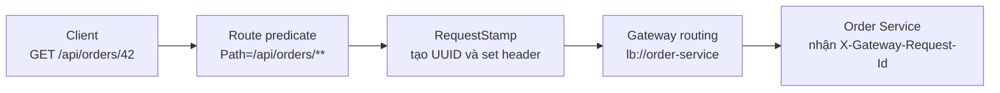

# Tạo GatewayFilterFactory bằng AbstractGatewayFilterFactory

## Mục tiêu bài học

Trong chương **Bộ lọc tùy biến**, bài học này hướng dẫn tạo một **GatewayFilterFactory riêng** bằng cách kế thừa `AbstractGatewayFilterFactory` trong **Spring Cloud Gateway Server WebFlux**. Khi những factory có sẵn như `AddRequestHeader`, `SetRequestHeader`, `RewritePath`, `RequestRateLimiter` hoặc `CircuitBreaker` chưa đáp ứng một quy tắc kỹ thuật cụ thể, bạn có thể đóng gói quy tắc ấy thành filter có tên, tham số và phạm vi áp dụng theo route.

Sau bài học, bạn có thể:

- Phân biệt `GatewayFilter`, `GatewayFilterFactory`, `GlobalFilter` và `AbstractGatewayFilterFactory`.
- Tạo Java class có hậu tố `GatewayFilterFactory`, constructor `super(Config.class)` và phương thức `apply(Config)`.
- Khai báo `Config` với JavaBean getters/setters; ánh xạ tham số từ YAML dạng **named arguments** và **shortcut** thông qua `shortcutFieldOrder()`.
- Sửa request an toàn bằng `ServerHttpRequest.mutate()` và `ServerWebExchange.mutate()`, tiếp tục chain bằng `chain.filter(exchange)`.
- Hiểu vòng đời **pre/post**, reactive publisher, thứ tự filter, response commit và cách xử lý lỗi/trả response sớm.
- Biết cách bảo vệ các header nội bộ, tránh tin header do client giả mạo và không block Reactor Netty event-loop.
- Viết unit test với `MockServerWebExchange`/`StepVerifier` và integration test với route thực.
- Quyết định khi nào cần custom filter và khi nào nên dùng factory được Spring Cloud Gateway cung cấp sẵn.

> **Phạm vi:** Ví dụ dùng Spring Cloud Gateway **Server WebFlux**, Spring Boot, Java 17+ và Project Reactor. Không lấy ví dụ servlet `HttpSecurity`, `Filter` của Servlet API hoặc Server MVC làm API tương đương. Tên starter và prefix YAML có thể thay đổi theo Spring Cloud Gateway release train; cần xác nhận phiên bản dependency đang chạy. Bài tập trung vào việc **xây dựng filter factory**, chưa phải vòng kiểm tra chuyên môn STEP 6.

## 1. GatewayFilterFactory giải quyết bài toán gì?

Giả sử một API Gateway phục vụ:

```text
GET /api/orders/42
    ↓
Spring Cloud Gateway
    ↓
Order Service
```

Nhóm vận hành muốn Gateway tạo **một request ID mới do Gateway kiểm soát** và gắn vào request gửi tới upstream để dễ tương quan logs giữa các microservices. Yêu cầu:

1. Request ID không được tin trực tiếp từ client bên ngoài.
2. Mỗi inbound request thuộc route được cấu hình nhận một UUID mới.
3. Tên header được cấu hình tại **route**, không hard-code vào mọi service.
4. Không sửa body, không chặn request, không phụ thuộc blocking I/O.
5. Có thể dùng cùng factory trên nhiều route với cấu hình khác nhau.

Một custom filter tên `RequestStamp` phù hợp để minh họa:



Tuy nhiên, **không phải mọi nhu cầu gắn header đều cần custom code**. Nếu chỉ gắn một giá trị tĩnh hoặc sao chép một biến đơn giản, hãy đánh giá các filter có sẵn:

```yaml
filters:
  - AddRequestHeader=X-Training-Example,gateway
  - SetRequestHeader=X-Api-Version,v1
```

Custom `GatewayFilterFactory` đáng cân nhắc khi có **logic điều kiện, sinh giá trị, xác thực dữ liệu, state isolation hoặc phối hợp với một thành phần khác** không thể biểu diễn rõ ràng bằng factory có sẵn. Đừng tự viết lại `Retry`, `CircuitBreaker`, security hay rate limiter chỉ để có thêm một class.

### 1.1. Factory khác filter instance

Một factory giống **bản thiết kế**. Khi đọc route, Gateway dùng factory và `Config` để tạo **một GatewayFilter** có thể thực thi:

```text
RequestStampGatewayFilterFactory (Spring bean)
                │
                ├── apply(Config route A)
                │       └── GatewayFilter A
                │
                └── apply(Config route B)
                        └── GatewayFilter B
```

Mỗi request đi qua filter tương ứng với route được match. **Factory bean thường là singleton**; không được đặt những biến thay đổi theo request (request body, tenant ID, token, UUID đang xử lý) làm field mutable trong bean factory.

## 2. Bốn khái niệm cần phân biệt

| Thành phần | Mục đích | Phạm vi |
| --- | --- | --- |
| **`GatewayFilter`** | Giao diện của một bước xử lý request/response trong gateway chain | Một filter thực thi, thường gắn với route |
| **`GatewayFilterFactory<Config>`** | Tạo `GatewayFilter` từ cấu hình | Cơ chế khai báo filter bằng tên trong route |
| **`AbstractGatewayFilterFactory<Config>`** | Base class giúp xây factory và bind cấu hình | Class bạn kế thừa để định nghĩa factory tùy biến |
| **`GlobalFilter`** | Filter áp dụng vào các request được xử lý qua gateway filtering chain, không cần khai báo theo từng route | Gateway-wide trong phạm vi routing qua Gateway |

Một route có thể sử dụng cả **GlobalFilters** và **GatewayFilters**. Trong Spring Cloud Gateway Server WebFlux, `FilteringWebHandler` kết hợp chúng thành một chain được sắp xếp theo order. Filter order quyết định thứ tự xử lý trước khi gọi backend và thứ tự những thao tác sau response.

**Spring Security WebFlux dùng `WebFilter`/`SecurityWebFilterChain` ở lớp xử lý riêng.** Đừng nhầm `GlobalFilter` của Gateway với một security web filter có thể bảo vệ mọi request đến server. Ví dụ actuator hoặc handler không match route có thể không đi qua Gateway filtering chain.

### 2.1. `GatewayFilter` có chữ ký gì?

Ở mức tối giản, filter làm việc với:

```java
Mono<Void> filter(
    ServerWebExchange exchange,
    GatewayFilterChain chain
);
```

- `ServerWebExchange` chứa request, response và attributes liên quan đến lần trao đổi HTTP.
- `GatewayFilterChain` cho phép chuyển tiếp xử lý tới các filter/routing tiếp theo.
- `Mono<Void>` biểu thị một **reactive pipeline** hoàn thành hoặc thất bại; nó không phải kết quả đồng bộ trả ngay.

Ví dụ filter không làm gì:

```java
GatewayFilter passThrough = (exchange, chain) ->
    chain.filter(exchange);
```

**Không gọi `subscribe()` hoặc `block()`** để ép filter chạy. Spring WebFlux có trách nhiệm subscribe vào publisher khi xử lý HTTP request. Tạo subscription riêng có thể làm mất backpressure, cancellation, error propagation hoặc xử lý body hai lần.

### 2.2. Khi nào dùng GlobalFilter?

Nếu bạn cần một policy chung như ghi access log theo route hoặc kiểm tra một metadata nhất quán trên mọi route, `GlobalFilter` có thể phù hợp. Nếu logic khác nhau theo từng route như:

```text
orders-api  → RequestStamp: X-Gateway-Request-Id
admin-api   → RequestStamp: X-Correlation-Id
```

thì `GatewayFilterFactory` có **`Config` riêng theo route** dễ vận hành hơn. Không tạo `GlobalFilter` rồi tự tra tên route và viết hàng loạt nhánh `if` khi có thể biểu đạt trực tiếp bằng route-specific config.

## 3. Cấu trúc chuẩn của một factory tùy biến

Một factory thường có các thành phần:

```text
@Component
public class RequestStampGatewayFilterFactory
        extends AbstractGatewayFilterFactory<Config> {

    public RequestStampGatewayFilterFactory() {
        super(Config.class);
    }

    @Override
    public GatewayFilter apply(Config config) {
        return (exchange, chain) -> ...;
    }

    @Override
    public List<String> shortcutFieldOrder() {
        return List.of("headerName");
    }

    public static class Config {
        // fields + getters + setters
    }
}
```

Các điểm quan trọng:

1. **Tên class** kết thúc bằng `GatewayFilterFactory`. Theo convention của Spring Cloud Gateway, class `RequestStampGatewayFilterFactory` xuất hiện dưới tên cấu hình **`RequestStamp`**.
2. **`@Component`** giúp Spring tạo factory bean nếu class nằm trong vùng component scanning. Có thể khai báo `@Bean` thay thế khi thích hợp.
3. **`super(Config.class)`** cung cấp kiểu cấu hình để factory infrastructure biết cách bind dữ liệu.
4. **`apply(Config config)`** tạo một filter áp dụng chính sách đã bind; đây là phần nghiệp vụ của factory.
5. **`Config`** là class chứa tham số, có các setter/getter theo convention JavaBean.
6. **`shortcutFieldOrder()`** ánh xạ tham số dạng gọn theo đúng thứ tự tên field trong `Config`.

Tên class nên rõ ràng, tránh dùng tên trùng với một filter built-in. Không dựa vào một tên được viết tắt tùy ý hoặc alias không được framework hỗ trợ; hậu tố `GatewayFilterFactory` là quy ước nên giữ.

## 4. Ví dụ hoàn chỉnh: `RequestStampGatewayFilterFactory`

Ta xây một filter tự tạo UUID và **ghi đè** giá trị header được cấu hình. Cách ghi đè giúp không tin một request ID không kiểm chứng từ client.

### 4.1. Java source

```java
package com.example.gateway.filters;

import java.util.List;
import java.util.Set;
import java.util.UUID;

import org.springframework.cloud.gateway.filter.GatewayFilter;
import org.springframework.cloud.gateway.filter.factory.AbstractGatewayFilterFactory;
import org.springframework.http.server.reactive.ServerHttpRequest;
import org.springframework.stereotype.Component;

@Component
public class RequestStampGatewayFilterFactory
        extends AbstractGatewayFilterFactory<
            RequestStampGatewayFilterFactory.Config> {

    // Chỉ cho phép những header đã được review trong config.
    private static final Set<String> ALLOWED_HEADER_NAMES = Set.of(
        "X-Gateway-Request-Id",
        "X-Correlation-Id"
    );

    public RequestStampGatewayFilterFactory() {
        super(Config.class);
    }

    @Override
    public GatewayFilter apply(Config config) {
        // Đọc/kiểm tra Config khi filter được tạo cho route.
        String headerName = config.getHeaderName();

        if (!ALLOWED_HEADER_NAMES.contains(headerName)) {
            throw new IllegalArgumentException(
                "Unsupported request ID header: " + headerName
            );
        }

        return (exchange, chain) -> {
            // UUID là dữ liệu theo request, không được giữ trong
            // mutable field của factory bean.
            String requestId = UUID.randomUUID().toString();

            ServerHttpRequest stampedRequest = exchange.getRequest()
                .mutate()
                .headers(headers -> headers.set(headerName, requestId))
                .build();

            return chain.filter(
                exchange.mutate().request(stampedRequest).build()
            );
        };
    }

    @Override
    public List<String> shortcutFieldOrder() {
        return List.of("headerName");
    }

    public static class Config {
        private String headerName = "X-Gateway-Request-Id";

        public String getHeaderName() {
            return headerName;
        }

        public void setHeaderName(String headerName) {
            this.headerName = headerName;
        }
    }
}
```

**Giả định:** dự án có starter Gateway Server WebFlux tương thích và package `com.example.gateway.filters` được Spring Boot scan. Tên package chỉ là ví dụ. `Set.of(...)` yêu cầu Java hiện đại, phù hợp với Java 17+ thường dùng cùng Spring Boot 3.

### 4.2. Phân tích từng bước

**Bước 1 — Spring phát hiện factory.** Lúc ứng dụng khởi tạo, `@Component` tạo một bean `RequestStampGatewayFilterFactory`. Nếu package nằm ngoài vùng scan và không có `@Bean`, Gateway không tìm thấy factory khi bind route.

**Bước 2 — Gateway bind route config.** Route định nghĩa `name: RequestStamp` cùng `args.headerName`. Infrastructure tạo/bind một `Config` tương ứng.

**Bước 3 — Factory tạo GatewayFilter.** `apply(config)` đọc `headerName`, kiểm tra tên được phép và tạo lambda. Lambda giữ **giá trị config không đổi** được chọn cho route, thay vì giữ state mutable theo request.

**Bước 4 — Có HTTP request match route.** Lambda tạo UUID mới khi request thực sự đi qua filter.

**Bước 5 — Request được mutate.** `ServerHttpRequest.mutate()` tạo builder cho request đã chỉnh. `headers.set(...)` **thay thế** giá trị cùng tên thay vì thêm một giá trị thứ hai.

**Bước 6 — Exchange mới được chuyển tiếp.** `exchange.mutate().request(stampedRequest).build()` tạo exchange decorator chứa request mới; `chain.filter(...)` cho các filter phía sau và routing nhìn thấy header mới.

Điểm cốt lõi: `ServerHttpRequest` và exchange trong reactive HTTP không nên bị giả định là object mutable tùy ý. Thay vì sửa trực tiếp các field request, dùng API **mutate/decorate** rồi truyền **exchange phù hợp** cho chain.

### 4.3. Vì sao phải dùng `set` thay vì `add`?

Client có thể gửi:

```http
X-Gateway-Request-Id: client-controlled-value
```

Nếu filter gọi `headers.add(...)`, downstream có thể nhận hai giá trị:

```http
X-Gateway-Request-Id: client-controlled-value
X-Gateway-Request-Id: <gateway-generated-uuid>
```

Các backend/framework có thể diễn giải nhiều header values khác nhau: lấy giá trị đầu, giá trị cuối, nối chuỗi hoặc từ chối. Nếu request ID dùng để tương quan sự kiện vận hành, Gateway nên **quyết định một giá trị duy nhất**. Vì vậy dùng `set` và xác minh rằng upstream nhận ID do Gateway tạo.

Trong ví dụ, UUID chỉ dùng cho **correlation/diagnostics**. Nó **không phải** trace ID của W3C Trace Context, không tự kích hoạt Micrometer tracing và **không phải credential**. Nếu hệ thống đã có tracing (`traceparent`), nên ưu tiên propagator của hệ thống tracing thay vì viết filter tùy biến thay thế giao thức trace.

### 4.4. Vì sao giới hạn tên header được phép?

`headerName` trong YAML là cấu hình của người triển khai, không phải input do Internet client gửi. Tuy vậy, nếu cho phép một tên header tùy ý, người cấu hình sai có thể vô tình ghi đè:

```text
Authorization
Cookie
Host
Forwarded
X-Authenticated-User
```

Những header này ảnh hưởng đến xác thực, cookie, routing hoặc trust boundary. Đối với bài học, `ALLOWED_HEADER_NAMES` là một **allowlist nhỏ** để chứng minh ý tưởng fail-fast. Khi mở rộng factory thật, cần kiểm tra cả tên header theo HTTP syntax, tính hợp lệ của giá trị, namespace và chính sách của tổ chức.

Nếu giá trị filter chứa chuỗi do client kiểm soát, phải chống header injection, newline/control characters và độ dài quá lớn. Không tự ghép header từ dữ liệu thô mà chưa kiểm tra.

## 5. Sử dụng factory trong YAML route

### 5.1. Cú pháp named arguments

```yaml
spring:
  cloud:
    gateway:
      routes:
        - id: orders-api
          uri: lb://order-service
          predicates:
            - Path=/api/orders/**
          filters:
            - name: RequestStamp
              args:
                headerName: X-Gateway-Request-Id
            - StripPrefix=1
```

Ví dụ có hai Gateway filters:

- `RequestStamp` tạo UUID và set `X-Gateway-Request-Id`.
- `StripPrefix=1` bỏ đoạn `/api` trước khi gửi URI tới backend, nên `/api/orders/42` có thể thành `/orders/42`.

Để route hoạt động đầy đủ cần Spring Cloud LoadBalancer và nguồn danh sách instances cho `order-service` nếu URI dùng `lb://`. Có thể thay thành `http://localhost:9001` khi chỉ muốn thực hành filter với một backend giả lập.

**Chú ý phiên bản:** một số dòng Gateway Server WebFlux mới dùng:

```text
spring.cloud.gateway.server.webflux.routes
```

thay cho:

```text
spring.cloud.gateway.routes
```

Chỉ thay **namespace theo phiên bản thực tế**; không tự giả định thêm thuộc tính mới vào factory. Kiểm tra route runtime được nạp, vì một YAML hợp cú pháp nhưng ở sai prefix có thể khiến filter không được áp dụng.

### 5.2. Cú pháp shortcut

Vì class đã override:

```java
@Override
public List<String> shortcutFieldOrder() {
    return List.of("headerName");
}
```

route có thể dùng:

```yaml
filters:
  - RequestStamp=X-Gateway-Request-Id
  - StripPrefix=1
```

`RequestStamp=X-Gateway-Request-Id` yêu cầu factory tìm field đầu tiên trong `shortcutFieldOrder()` và gán giá trị vào `Config.headerName`.

Với config có **nhiều tham số**, thứ tự shortcut phải phản ánh đúng `shortcutFieldOrder()`:

```java
return List.of("headerName", "policyName");
```

và dạng shortcut tương ứng:

```yaml
- CustomName=X-Gateway-Request-Id,safe-policy
```

Đây chỉ là minh họa cơ chế **thứ tự đối số**, không phải cấu hình thực sự của `RequestStamp` ở mục 4 (factory của bài chỉ có một field). Khi tham số nhiều, cần regex, dấu phẩy, ký tự đặc biệt hoặc cấu trúc phức tạp, **named arguments** thường dễ đọc và tránh nhầm hơn.

### 5.3. Một factory dùng được trên nhiều route

```yaml
spring:
  cloud:
    gateway:
      routes:
        - id: orders-api
          uri: http://localhost:9001
          predicates:
            - Path=/api/orders/**
          filters:
            - name: RequestStamp
              args:
                headerName: X-Gateway-Request-Id

        - id: admin-api
          uri: http://localhost:9002
          predicates:
            - Path=/api/admin/**
          filters:
            - name: RequestStamp
              args:
                headerName: X-Correlation-Id
```

Mỗi route áp dụng **một cấu hình riêng** khi tạo filter. Factory singleton **không được** ghi `currentHeaderName` hay `currentTenant` vào field mutable để dùng sau, vì nhiều requests từ hai route có thể chạy đồng thời trên các threads/reactive publishers khác nhau.

**Lưu ý route order:** khi hai routes có predicates chồng lấn, chính sách nào áp dụng phụ thuộc route **được chọn** theo predicate/order, không chỉ vị trí hiển thị trong YAML. Nếu muốn filter áp dụng mọi route, xem xét `default-filters` hoặc `GlobalFilter` và kiểm tra phạm vi mong muốn.

## 6. Luồng xử lý pre và post

Trong Gateway Server WebFlux, các filter được sắp xếp theo **order** rồi kết hợp thành chuỗi reactive. Một filter có thể làm công việc **trước** `chain.filter(...)` và đăng ký công việc chạy **sau** phần downstream.

Ví dụ khái niệm:

```java
GatewayFilter timingFilter = (exchange, chain) -> {
    long startNanos = System.nanoTime();

    // Pha pre: được thực thi khi filter đi vào chain.
    return chain.filter(exchange)
        .doFinally(signalType -> {
            // Pha sau: complete, error hoặc cancel.
            long elapsedMillis =
                (System.nanoTime() - startNanos) / 1_000_000;

            // Ghi metric với route ID + outcome đã chuẩn hóa.
            // Không log body, Authorization, cookie hoặc full URI.
        });
};
```

`doFinally` phù hợp để cleanup/metrics theo tín hiệu Reactor, kể cả cancellation. Với ví dụ trên, thời gian bắt đầu được tính khi lambda filter thực thi; nếu cần đo theo **mỗi subscription** một cách chặt chẽ thì có thể dùng `Mono.defer(...)` bao quanh phần đo để tránh dùng lại state ngoài ý muốn.

### 6.1. Filter order và chuỗi bao bọc

Giả sử:

```text
Filter A (order nhỏ)
  └─ Filter B (order lớn hơn)
       └─ Routing
```

Thường thấy:

```text
Pre A
  Pre B
    Routing
  Post B
Post A
```

Điều này **không có nghĩa mọi filter có callback sau chain đều được phép sửa response headers**. Khi response đã commit, status/headers có thể không còn thay đổi được. Filter có order nhỏ được gọi sớm trong pha pre và thường kết thúc muộn trong pha post.

### 6.2. Tạo filter có thứ tự tường minh

Khi cần trả về một `GatewayFilter` có order xác định:

```java
import org.springframework.cloud.gateway.filter.GatewayFilter;
import org.springframework.cloud.gateway.filter.OrderedGatewayFilter;

GatewayFilter delegate = (exchange, chain) ->
    chain.filter(exchange);

GatewayFilter ordered =
    new OrderedGatewayFilter(delegate, -10);
```

`-10` là ví dụ về order, **không phải số nên áp dụng máy móc** cho mọi custom factory. Khi dùng thứ tự riêng, phải kiểm tra sự tương tác với những Gateway filters nội bộ như route URL processing, load balancing, Netty routing/response writing, và với các factory khác.

**Đặt `@Order` trên class factory không mặc nhiên có cùng nghĩa** với đặt order trên `GatewayFilter` mà factory trả về. Nếu mục đích là sắp thứ tự filter instance, có thể dùng `OrderedGatewayFilter` hoặc cơ chế order của Route/DSL được phiên bản Gateway hỗ trợ.

### 6.3. Khi nào dùng `beforeCommit`?

Nếu muốn gắn một response header thuộc trách nhiệm Gateway **trước khi response commit**, có thể đăng ký callback sớm:

```java
GatewayFilter responseMarker = (exchange, chain) -> {
    exchange.getResponse().beforeCommit(() -> {
        exchange.getResponse().getHeaders()
            .set("X-Gateway-Handled", "true");
        return reactor.core.publisher.Mono.empty();
    });

    return chain.filter(exchange);
};
```

Mục đích của `beforeCommit` là can thiệp khi headers vẫn có thể được điều chỉnh theo HTTP response lifecycle. Cần đăng ký callback **trước** khi response bắt đầu commit, và xác minh output thực trong integration test. Không nên mặc định callback luôn được thực hiện trong mọi nhánh error/cancellation, hoặc mọi response được Gateway tự viết.

Với các thao tác đơn giản, hãy cân nhắc `AddResponseHeader`, `SetResponseHeader` hoặc các filter built-in thay vì tự tạo response decorator.

## 7. Trả response sớm trong custom GatewayFilter

Một số custom filters dùng để kiểm tra chính sách theo route. Nếu request không đáp ứng điều kiện, filter có thể **dừng chain** và trả response mà không gửi request tới backend.

Ví dụ minh họa:

```java
GatewayFilter rejectIfMissingHeader = (exchange, chain) -> {
    String value = exchange.getRequest()
        .getHeaders()
        .getFirst("X-Client-Feature");

    if (value == null || value.isBlank()) {
        exchange.getResponse().setStatusCode(
            org.springframework.http.HttpStatus.BAD_REQUEST
        );
        return exchange.getResponse().setComplete();
    }

    return chain.filter(exchange);
};
```

Điểm quan trọng:

- Nhánh từ chối **không gọi `chain.filter(exchange)`**, nên downstream filters/routing không chạy cho request đó.
- `setStatusCode` cần được gọi khi response còn có thể chỉnh status, rồi trả publisher hoàn thành response.
- Không tự `subscribe()` vào `setComplete()`.
- Phải thống nhất error status, error body, CORS headers và cách log **không chứa bí mật**.
- `X-Client-Feature` chỉ minh họa một trường thông tin kỹ thuật; một header do client gửi **không phải bằng chứng xác thực hoặc quyền truy cập**.

**Không tự biến ví dụ trên thành authentication filter.** Xác thực JWT, OAuth2, CSRF và authorization nên đặt ở Spring Security/identity layer hoặc một cơ chế có thể kiểm chứng và bảo vệ mọi đường vào; một GatewayFilter theo route có thể bị bỏ qua ở những request không match route.

## 8. Cấu hình và validation phải fail-fast

Khi đọc cấu hình từ YAML, phải coi `Config` là **dữ liệu cấu hình** cần kiểm tra, không phải một tập giá trị bảo đảm hợp lệ.

### 8.1. Kiểm tra trong `apply(Config)`

Ví dụ bài học:

```java
String headerName = config.getHeaderName();
if (!ALLOWED_HEADER_NAMES.contains(headerName)) {
    throw new IllegalArgumentException(
        "Unsupported request ID header: " + headerName
    );
}
```

Điều này giúp cấu hình tên header không được phép bị phát hiện khi filter được tạo, thay vì đến request đầu tiên mới bị lỗi.

Những trường hợp cần xem xét:

| Input cấu hình | Rủi ro | Cách xử lý |
| --- | --- | --- |
| `headerName` rỗng/null | Header HTTP không hợp lệ | Reject config hoặc dùng default có chủ đích |
| Header name chứa whitespace/CRLF | HTTP header injection hoặc lỗi encoding | Validate theo HTTP token grammar và allowlist |
| `headerName: Authorization` | Vô tình ghi đè credential | Không cho phép trong factory này |
| Giá trị có newline | Response/request splitting nếu stack không chặn | Validate/normalize theo contract, không nối raw input |
| Danh sách policy quá lớn | Config phức tạp, dễ sai | Bounded/allowlist policy |
| Tên config sai | Filter dùng default không như mong đợi | Kiểm tra binding và test route thực |

### 8.2. Bean validation cho Config

Có thể dùng Jakarta Bean Validation cho các trường cấu hình:

```java
import jakarta.validation.constraints.NotBlank;

public static class Config {
    @NotBlank
    private String headerName = "X-Gateway-Request-Id";

    public String getHeaderName() {
        return headerName;
    }

    public void setHeaderName(String headerName) {
        this.headerName = headerName;
    }
}
```

**Chú ý:** chỉ gắn `@NotBlank` vào field **không chứng minh Gateway tự động thực thi validation** cho custom factory ở mọi phiên bản và kiểu binding. Nếu dựa vào validation, phải cấu hình validator/integration theo framework hỗ trợ, vẫn giữ kiểm tra business allowlist trong `apply(Config)` và viết test config sai bị từ chối.

Đối với config chứa URL, regex, giới hạn bytes, duration hoặc tên policy, nên parse/validate **một lần khi tạo filter**, thay vì parse lại ở mỗi request. Đừng nhúng secret trực tiếp vào YAML, exception message hoặc log khởi động khi cấu hình không hợp lệ.

### 8.3. Shortcut và named args có mức rủi ro khác nhau

Ví dụ:

```yaml
filters:
  - RequestStamp=X-Correlation-Id
```

ngắn gọn nhưng không cho biết rõ tên field ở điểm đọc cấu hình. Khi class Config có nhiều trường và tùy chọn mặc định, dạng:

```yaml
filters:
  - name: RequestStamp
    args:
      headerName: X-Correlation-Id
```

thường dễ review hơn. **Không thay đổi thứ tự `shortcutFieldOrder` tùy tiện** giữa các phiên bản của factory, vì các cấu hình shortcut cũ có thể bị bind sang field khác.

## 9. Reactive programming: những điều tuyệt đối không nên làm

### 9.1. Không dùng blocking I/O trên event-loop

Một filter như:

```java
return (exchange, chain) -> {
    Thread.sleep(1000);  // Không phù hợp!
    return chain.filter(exchange);
};
```

không phải một retry/backoff tốt. Nó chặn thread xử lý và có thể làm chậm nhiều requests trên cùng Netty event-loop. Tương tự, không gọi JDBC blocking, filesystem blocking, HTTP client đồng bộ hoặc `Mono.block()` trong đường xử lý reactive.

Nếu thực sự cần gọi một dịch vụ chính sách bên ngoài, hãy dùng client non-blocking như `WebClient`, timeout rõ ràng và ghép publisher vào chain:

```java
// Minh họa: policyClient.check(exchange) trả Mono<Boolean>.
return policyClient.check(exchange)
    .flatMap(allowed -> {
        if (!allowed) {
            exchange.getResponse().setStatusCode(
                HttpStatus.FORBIDDEN
            );
            return exchange.getResponse().setComplete();
        }

        return chain.filter(exchange);
    });
```

Đây là đoạn mã **ngữ cảnh**, không phải một ứng dụng hoàn chỉnh: cần khai báo `policyClient`, `HttpStatus`, timeout/error handling, chính sách fail-open/fail-closed và authentication phù hợp. Một custom filter gọi mạng mỗi request có thể trở thành **điểm nghẽn mới** của toàn Gateway.

### 9.2. Không tạo subscription tách khỏi chain

Ví dụ sai:

```java
webClient.get()
    .uri("/policy")
    .retrieve()
    .bodyToMono(Boolean.class)
    .subscribe();

return chain.filter(exchange);
```

Đoạn trên không chờ kết quả policy; request có thể đã đi đến backend trước khi chính sách được kiểm tra. Error/cancellation của subscription riêng không thuộc HTTP request lifecycle.

Phải dùng reactive operators như `flatMap`, `then`, `onErrorResume` có chủ đích và trả về **một publisher bao trùm cả kiểm tra và downstream**.

### 9.3. Không giữ request state trong singleton field

Ví dụ sai:

```java
@Component
public class UnsafeGatewayFilterFactory
        extends AbstractGatewayFilterFactory<UnsafeGatewayFilterFactory.Config> {

    private String currentRequestId; // Sai: dùng chung giữa requests.

    // ...
}
```

Các requests có thể chạy đồng thời, đan xen hoặc chuyển threads. `currentRequestId` ở singleton bean gây race condition và rò thông tin giữa users. Dữ liệu per-request nên đặt trong **biến cục bộ**, `ServerWebExchange` attributes hoặc `Reactor Context` theo mục đích, rồi truyền đúng vòng đời.

Nếu cần state xuyên nhiều Gateway replicas, biến cục bộ cũng không đủ: cần hạ tầng phối hợp phân tán thích hợp và phải bảo đảm không tạo dependency blocking trong request path.

## 10. Request body và response body: chọn API phù hợp

Ví dụ `RequestStamp` **chỉ sửa header**, nên không tiêu thụ body. Nếu viết factory đọc và thay nội dung HTTP, phải cân nhắc vòng đời:

```text
Client HTTP body
    ↓
Flux<DataBuffer> (có thể chunked/streamed)
    ↓
Custom decoder/rewrite/decorator
    ↓
Body mới + headers/framing hợp lệ
    ↓
Upstream hoặc client
```

Trong WebFlux, `ServerHttpRequest.getBody()` thường cung cấp **`Flux<DataBuffer>`**. Đây không phải một `String` đọc lại bao nhiêu lần cũng được. Những sai lầm phổ biến:

- Gọi `subscribe()` chỉ để log body, khiến routing phía sau mất khả năng tiêu thụ stream.
- Gom toàn bộ body vào memory không có giới hạn, gây áp lực GC với file upload lớn.
- Không giải phóng/retain `DataBuffer` đúng cách khi dùng Netty pooled buffers, gây memory leak hoặc use-after-release.
- Đổi body nhưng giữ `Content-Length` hoặc `Content-Encoding` của representation cũ.
- Thay response body sau khi response đã commit.
- Retry request có body mà không bảo đảm nội dung được **replay** chính xác và operation an toàn.

Nếu mục tiêu là chuyển đổi JSON/text, nên đánh giá các factory đã có như **`ModifyRequestBody`** và **`ModifyResponseBody`**, vốn giải quyết một phần pipeline decode/encode. Nếu cần streaming transformations chuyên biệt, hãy thiết kế và kiểm thử decorator/DataBuffer flow phù hợp thay vì sao chép mã đọc bytes thiếu lifecycle.

### 10.1. Không dùng custom factory chỉ để ghi log raw body

Request/response body có thể chứa mật khẩu, token, cookie, số thẻ, hồ sơ hoặc dữ liệu người dùng. Mặc định ghi log **route ID, method, status, latency, error type đã chuẩn hóa và trace ID**; không ghi raw body.

Nếu thật sự cần audit một phần JSON, hãy ưu tiên **allowlist field và giá trị** có phạm vi, giới hạn kích thước và chính sách retention; không tạo một custom GatewayFilterFactory toàn cục để lưu mọi payload.

## 11. So sánh custom factory với các factory có sẵn

| Nhu cầu | Ưu tiên | Khi nào mới viết custom? |
| --- | --- | --- |
| Thêm header tĩnh | `AddRequestHeader` | Khi cần điều kiện/sinh giá trị đặc biệt |
| Đặt giá trị header | `SetRequestHeader` | Khi có quy tắc phức tạp hoặc dữ liệu do Gateway xác minh |
| Xóa header nhạy cảm | `RemoveRequestHeader` / policy bảo mật | Khi cần kiểm tra/biến đổi chuyên biệt theo contract |
| Rewrite URL | `RewritePath`, `StripPrefix` | Khi cần thuật toán định tuyến đặc thù |
| Trả/đổi response status | `SetStatus` hoặc error handling chuyên dụng | Khi có policy hợp lệ không thể cấu hình sẵn |
| Rate limiting phân tán | `RequestRateLimiter` + `RedisRateLimiter` | Khi cần thuật toán/khóa ngân sách khác và được thiết kế kỹ |
| Circuit breaker/fallback | `CircuitBreaker` + Spring Cloud CircuitBreaker | Khi cần integration riêng có tests |
| Retry | `Retry` | Khi có yêu cầu ngoài khả năng factory và có idempotency |
| Chuyển đổi body | `ModifyRequestBody` / `ModifyResponseBody` | Khi cần streaming/binary semantics đặc biệt |
| Correlation/trace | Micrometer tracing / W3C trace context | Khi cần request marker riêng có policy rõ |

**Không dùng custom filter để thay thế Spring Security.** Authentication/authorization, CSRF và token relay cần được đặt đúng trust boundary, không phải biến các header client tùy ý thành identity.

## 12. Kiểm thử đơn vị `RequestStampGatewayFilterFactory`

Unit test tốt cần xác minh **filter được tạo từ config**, **request được mutate** và **downstream nhận exchange mới**.

### 12.1. Unit test với `MockServerWebExchange` và `StepVerifier`

Ví dụ minh họa JUnit 5:

```java
import static org.junit.jupiter.api.Assertions.*;

import java.util.UUID;
import java.util.concurrent.atomic.AtomicReference;

import org.junit.jupiter.api.Test;
import org.springframework.cloud.gateway.filter.GatewayFilter;
import org.springframework.cloud.gateway.filter.GatewayFilterChain;
import org.springframework.mock.http.server.reactive.MockServerHttpRequest;
import org.springframework.mock.web.server.MockServerWebExchange;
import org.springframework.web.server.ServerWebExchange;
import reactor.core.publisher.Mono;
import reactor.test.StepVerifier;

class RequestStampGatewayFilterFactoryTest {

    @Test
    void overwritesUntrustedHeaderBeforeForwarding() {
        RequestStampGatewayFilterFactory factory =
            new RequestStampGatewayFilterFactory();

        RequestStampGatewayFilterFactory.Config config =
            new RequestStampGatewayFilterFactory.Config();
        config.setHeaderName("X-Gateway-Request-Id");

        GatewayFilter filter = factory.apply(config);

        MockServerWebExchange exchange =
            MockServerWebExchange.from(
                MockServerHttpRequest.get("/api/orders/42")
                    .header("X-Gateway-Request-Id", "client-value")
            );

        AtomicReference<ServerWebExchange> downstream =
            new AtomicReference<>();

        GatewayFilterChain chain = forwarded -> {
            downstream.set(forwarded);
            return Mono.empty();
        };

        StepVerifier.create(filter.filter(exchange, chain))
            .verifyComplete();

        assertNotNull(downstream.get());
        String generated = downstream.get()
            .getRequest()
            .getHeaders()
            .getFirst("X-Gateway-Request-Id");

        assertNotNull(generated);
        assertNotEquals("client-value", generated);
        assertDoesNotThrow(() -> UUID.fromString(generated));
    }

    @Test
    void rejectsDangerousHeaderConfiguration() {
        RequestStampGatewayFilterFactory factory =
            new RequestStampGatewayFilterFactory();

        RequestStampGatewayFilterFactory.Config config =
            new RequestStampGatewayFilterFactory.Config();
        config.setHeaderName("Authorization");

        assertThrows(
            IllegalArgumentException.class,
            () -> factory.apply(config)
        );
    }
}
```

Đoạn test giả định dự án có dependencies của Spring Test, JUnit 5, Reactor Test và class factory ở mục 4 trong classpath. Nó kiểm tra:

1. Header `client-value` đã được thay bằng UUID do Gateway tạo.
2. Header nằm trong **exchange forwarded** tới filter kế tiếp.
3. Dữ liệu cấu hình bị cấm được từ chối tại `apply`.

**Không** chỉ kiểm tra header trên `exchange` gốc: sau khi mutate, dữ liệu đúng có thể nằm ở exchange decorator được truyền downstream. Đây là điểm quan trọng khi test WebFlux.

### 12.2. Test mỗi request nhận ID riêng

Để chứng minh không giữ state mutable theo request, chạy filter hai lần với **hai exchanges độc lập** và so sánh UUID:

```text
Exchange A -> X-Gateway-Request-Id = UUID-A
Exchange B -> X-Gateway-Request-Id = UUID-B

UUID-A phải khác UUID-B trong test thực tế.
```

Về lý thuyết UUID v4 có xác suất trùng cực nhỏ, nhưng với test quy mô bình thường có thể coi đây là kỳ vọng thực tiễn. Quan trọng hơn: mã nguồn tạo UUID **ở mỗi lời gọi filter**, không lưu một UUID duy nhất khi factory khởi tạo.

### 12.3. Test filter short-circuit

Nếu factory có nhánh từ chối (như mục 7), cần:

- Kiểm tra status là 400/403/429 tùy contract.
- Có counter/assertion xác minh **chain không được gọi** khi từ chối.
- Khi request hợp lệ, chain được gọi **đúng một lần**.
- Không ghi response body/header sau commit.
- Kiểm tra preflight OPTIONS và CORS response khi filter trả sớm.

## 13. Integration test: YAML có thực sự nhận factory không?

Unit test chỉ cho thấy `apply()` hoạt động. **Nó không chứng minh Spring Boot đã phát hiện bean, bind YAML đúng, route match đúng và upstream nhận header thật.**

Một bài integration test nên có:

```text
Gateway (localhost:8080)
    └── Route: Path=/api/orders/**
         └── RequestStamp
              └── Backend test (localhost:9001)
                   └── Echo request headers
```

### 13.1. Backend echo minh họa

```java
import java.util.Map;
import org.springframework.web.bind.annotation.GetMapping;
import org.springframework.web.bind.annotation.RequestHeader;
import org.springframework.web.bind.annotation.RestController;
import reactor.core.publisher.Mono;

@RestController
class EchoController {

    @GetMapping("/orders/42")
    Mono<Map<String, String>> echo(
        @RequestHeader("X-Gateway-Request-Id") String requestId) {
        return Mono.just(Map.of("requestId", requestId));
    }
}
```

Trong môi trường test, backend này **phải chạy ở một server/port riêng** nếu Gateway route tới `localhost:9001`. Nếu đặt controller trong chính Gateway mà route cũng forward tới cùng URI/port không kiểm soát, có thể tạo loop hoặc route không như ý.

### 13.2. Thử bằng `curl`

Giả sử Gateway đã chạy trên `http://localhost:8080`, route có `StripPrefix=1` và upstream echo ở `9001`:

```bash
curl -i "http://localhost:8080/api/orders/42" \
  -H "X-Gateway-Request-Id: client-spoofed"
```

Response minh họa:

```json
{
  "requestId": "9f5d3bd9-8b79-412a-94db-bd19c218e874"
}
```

ID phải có dạng UUID do Gateway sinh, **không phải** `client-spoofed`. Giá trị trong ví dụ chỉ là minh họa; mỗi request tạo một UUID khác.

Nếu request trả 404, kiểm tra `Path` predicate, `StripPrefix`, URI backend và controller path. Nếu trả 503, kiểm tra service discovery/load balancing/upstream. Nếu trả 401/403, kiểm tra Spring Security **trước** khi kết luận custom factory không chạy.

### 13.3. Dùng `WebTestClient`

Trong integration test có Gateway và backend giả lập đã khởi động:

```java
webTestClient.get()
    .uri("/api/orders/42")
    .header("X-Gateway-Request-Id", "client-spoofed")
    .exchange()
    .expectStatus().isOk()
    .expectBody()
    .jsonPath("$.requestId").isNotEmpty();
```

Đây là **assertion scaffold**. Bản test hoàn chỉnh cần khởi tạo Spring Boot context, cấu hình route, test backend và `WebTestClient`, sau đó kiểm tra response JSON `requestId` là UUID hợp lệ và khác header client. Một test kiểu `@SpringBootTest(webEnvironment = RANDOM_PORT)` kết hợp backend stub có thể phù hợp để kiểm tra đường network thật.

Không cho rằng `.expectStatus().isOk()` đơn lẻ đã chứng minh filter được bind; backend có thể trả 200 dù factory chưa chạy.

### 13.4. Kiểm tra nhiều routes, nhiều replicas

Test thêm:

| Ca | Điều cần xác minh |
| --- | --- |
| Orders route `RequestStamp=X-Gateway-Request-Id` | Backend orders nhận đúng header đó |
| Admin route `RequestStamp=X-Correlation-Id` | Backend admin nhận đúng header đã cấu hình |
| Client giả mạo header | Giá trị client bị thay bằng UUID mới |
| Config `Authorization` | Factory reject khi tạo filter |
| Config rỗng hoặc sai | Không âm thầm chấp nhận một header nguy hiểm |
| Route không có `RequestStamp` | Không tự áp filter trên route đó |
| Route wildcard chồng lấn | Route được chọn và filter được áp đúng |
| Nhiều requests đồng thời | ID không bị trộn giữa requests |
| Gateway nhiều replicas | Factory hoạt động độc lập từng replica |
| Retry và CircuitBreaker | Xác định ID có giữ nhất quán theo inbound request hay đổi theo attempt |
| Response lỗi sớm | CORS/security/error handling không bị phá |
| HTTP/2 hoặc TLS ingress | Header hoạt động theo hop/giao thức và trusted proxy policy |

## 14. Tương tác với filter chain, Retry, CircuitBreaker, RateLimiter

### 14.1. `RequestStamp` trước hay sau `Retry`?

Giả sử:

```text
RequestStamp
  └── Retry
       └── Routing
```

Khi filter `RequestStamp` chạy ngoài phần downstream bị Retry resubscribe, request ID có thể được tạo **một lần cho inbound request**, rồi được dùng lại cho các outbound attempts.

Ngược lại:

```text
Retry
  └── RequestStamp
       └── Routing
```

nếu Retry thực sự chạy lại đoạn `RequestStamp`, mỗi attempt có thể nhận **UUID mới**. Khi đó một request từ client có nhiều ID ở backend.

**Điểm cần nhớ:** thứ tự thực phụ thuộc `Ordered`, cách `Retry` tạo lại publisher và vị trí filter trong effective Gateway chain. Không khẳng định chắc hành vi chỉ từ vị trí các dòng YAML; hãy kiểm tra test với backend ghi lại `X-Gateway-Request-Id` qua nhiều attempts.

Nếu hệ thống đã có trace ID chuẩn, nên dùng trace context cho **toàn bộ request**, còn một attempt ID riêng khi cần phân biệt retries. Không tái sử dụng request ID để chứng minh một POST chỉ được xử lý một lần: điều đó cần **Idempotency-Key** và backend-side deduplication được thiết kế.

### 14.2. CircuitBreaker

`CircuitBreaker` có thể ngăn downstream routing khi circuit OPEN. Nếu `RequestStamp` được đặt bên ngoài breaker, ID có thể được tạo **ngay cả khi upstream không được gọi**, nhưng không có nghĩa backend đã nhận request.

Fallback `forward:/...` có thể được thực thi theo một nhánh khác, vì vậy phải kiểm tra:

- Header ID có được giữ qua nhánh fallback không?
- Fallback có vô tình đọc header client giả mạo không?
- Response fallback có giữ status/body đúng contract và không lộ thông tin nhạy cảm?
- Metrics phân biệt request đã đi backend với request chỉ được fallback?

Không đặt logic authorization quan trọng trong một custom factory muộn nếu nhánh fallback/forward khác không được bảo vệ tương đương.

### 14.3. RequestRateLimiter

`RequestRateLimiter` có thể từ chối request trước routing. Nếu `RequestStamp` chạy sau limiter, request bị 429 có thể không được gắn ID bởi factory này. Nếu yêu cầu mỗi inbound request đều có correlation ID, nên đặt logic ở **lớp phủ phù hợp hơn** (ingress/tracing/WebFilter), thay vì chỉ dựa vào một GatewayFilterFactory trên vài routes.

### 14.4. Load balancing và service discovery

Factory tùy biến chỉ set request header; nó **không** resolve `lb://` và không chọn instance. Nếu backend không nhận header, cần kiểm tra **thực sự đang gọi instance nào**, path được rewrite ra sao và header có bị filter khác xóa/ghi đè trước routing không.

Khi Gateway gọi backend qua HTTP/2, TLS hoặc có proxy trung gian, các header hop-by-hop có thể thay đổi. Header correlation ứng dụng không nên mang dữ liệu bí mật và không được tự coi là bằng chứng identity.

## 15. Những lỗi thường gặp và cách chẩn đoán

### 15.1. `Unable to find GatewayFilterFactory with name RequestStamp`

**Nguyên nhân khả dĩ:**

- Class không kết thúc bằng `GatewayFilterFactory`.
- Class không được scan/khởi tạo thành Spring bean.
- Tên trong YAML sai hoặc framework đang dùng namespace config khác.
- Dependency Gateway Server WebFlux không khớp version/classpath.

**Cách xử lý:** kiểm tra class name, `@Component`/`@Bean`, package scan, route YAML prefix và logs startup. Đừng giải quyết bằng cách đổi tên factory thành tên một filter built-in gây conflict.

### 15.2. `headerName` bị null hoặc default không như mong đợi

**Nguyên nhân khả dĩ:** `args` sai tên, thiếu setter/getter, class Config không có cấu trúc bind được, `shortcutFieldOrder()` không đúng field hoặc property không được nạp.

**Cách xử lý:** ưu tiên named args, tạo unit test config, integration test route và giữ validation fail-fast. Đừng chỉ xem YAML ở repository rồi kết luận cấu hình đang hoạt động.

### 15.3. Backend nhận `client-spoofed` thay vì UUID

**Nguyên nhân khả dĩ:** filter không được áp, một filter sau đó ghi đè header, route khác được chọn hoặc backend đọc một header trùng tên do proxy tạo.

**Cách xử lý:** kiểm tra route ID thực, thứ tự filters, request header tại backend stub và kết nối qua ingress. Dùng `headers.set` thay cho `add` với header có ý nghĩa quản trị.

### 15.4. Custom filter làm 404/503 xuất hiện

**Nguyên nhân khả dĩ:** route predicate/URI đích, `StripPrefix`, LoadBalancer thiếu instance hoặc filter vô tình không gọi chain.

**Cách xử lý:** tách test: route đơn giản không custom filter → thêm `RequestStamp` → thêm các filters khác; quan sát số requests tại stub backend. Nếu logic dùng `return exchange.getResponse().setComplete()`, backend sẽ **không được gọi**.

### 15.5. Request body biến mất

**Nguyên nhân:** custom filter đọc `Flux<DataBuffer>` trước routing, `subscribe()` độc lập hoặc không replay body đúng.

**Cách xử lý:** loại bỏ body access không cần thiết; nếu cần biến đổi nội dung, sử dụng API body rewrite/decorator đúng vòng đời và kiểm thử cả buffering/cancellation.

### 15.6. Response headers không thay đổi

**Nguyên nhân:** filter cố set header trong pha post sau khi response đã commit, hoặc response header bị filter/proxy khác ghi đè.

**Cách xử lý:** đặt header trước commit, dùng `beforeCommit` khi thích hợp, kiểm tra `NettyWriteResponseFilter` và integration test HTTP thực.

### 15.7. Tăng latency và CPU sau khi thêm factory

**Nguyên nhân:** blocking I/O, parse regex/JSON lớn mỗi request, ghi log body, gọi policy service không timeout hoặc retry tạo nhiều attempts.

**Cách xử lý:** giữ filter non-blocking, giới hạn payload, khởi tạo cấu hình bất biến một lần, dùng metrics p95/p99, kiểm tra circuit/rate/concurrency và backpressure.

### 15.8. Một route lộ ID/tenant của route khác

**Nguyên nhân:** singleton factory giữ state mutable, dùng static map không được bảo vệ hoặc truyền dữ liệu security qua header không tin cậy.

**Cách xử lý:** tách config per route khỏi state per request, chỉ lấy tenant/identity từ authentication context đã xác minh và viết concurrency tests nhiều routes/tenants.

## 16. Checklist trước khi triển khai production

| Hạng mục | Điều cần xác nhận |
| --- | --- |
| **Factory name** | Class có hậu tố `GatewayFilterFactory`; YAML dùng tên rút gọn đúng? |
| **Bean discovery** | `@Component`/`@Bean`, package scan và dependency đúng? |
| **Config** | Config là class phù hợp binding, fields/getters/setters đúng; validate fail-fast? |
| **Shortcut** | `shortcutFieldOrder` ổn định, thứ tự khớp tham số, có test shortcut và named args? |
| **Filter behavior** | `apply` trả GatewayFilter không blocking; gọi chain đúng nhánh? |
| **Exchange mutation** | Request header/path được mutate rồi truyền exchange mới? |
| **Thread-safety** | Không giữ per-request data trong singleton state? |
| **Order** | Effective order đúng với rewrite, auth, rate, Retry, CircuitBreaker, routing? |
| **Response lifecycle** | Không sửa status/headers sau commit; body rewrite đúng codec/framing? |
| **Security** | Không tin header client làm identity; bảo vệ credential, cookie, tenant ID? |
| **CORS** | Preflight/actual request và early rejects được xử lý phù hợp? |
| **Memory** | Không giữ request body/response body vô hạn, không rò DataBuffer? |
| **Timeout** | External policy calls, nếu có, có timeout/budget và fail policy? |
| **Observability** | Route ID, latency, outcome, trace ID được đo mà không log secrets? |
| **Tests** | Unit test factory, YAML integration, multi-route, concurrent, retry/fallback, error? |
| **Version** | Cú pháp class/API/namespace config khớp Spring Cloud Gateway hiện hành? |

## 17. Bài thực hành có đáp án

### Bối cảnh

Một Gateway có hai routes:

```yaml
spring:
  cloud:
    gateway:
      routes:
        - id: orders-api
          uri: http://localhost:9001
          predicates:
            - Path=/api/orders/**
          filters:
            - RequestStamp=X-Gateway-Request-Id
            - StripPrefix=1

        - id: admin-api
          uri: http://localhost:9002
          predicates:
            - Path=/api/admin/**
          filters:
            - name: RequestStamp
              args:
                headerName: X-Correlation-Id
```

Client gửi request:

```http
GET /api/orders/42
X-Gateway-Request-Id: client-forged
```

**Câu hỏi:**

1. Tên Java class phải là gì để YAML `RequestStamp` được nhận diện theo convention?
2. Vì sao constructor cần `super(Config.class)`?
3. `shortcutFieldOrder()` trả `List.of("headerName")` dùng làm gì?
4. Vì sao dùng `headers.set` tốt hơn `headers.add` ở ví dụ này?
5. UUID được tạo trong `apply(Config)` hay trong lambda `(exchange, chain)`?
6. Vì sao phải truyền `exchange.mutate().request(stampedRequest).build()` tới chain?
7. Backend orders có thể nhận `client-forged` làm request ID cuối không, nếu filter chạy đúng và không bị filter khác ghi đè?
8. Class factory là singleton; có được tạo field `String currentRequestId` để dùng chung không?
9. Có thể dùng `RequestStamp` để xác thực user hoặc chặn mọi request trước route matching không?
10. Nếu Gateway có thêm `Retry`, ID chắc chắn được giữ nguyên qua mọi outbound attempts không?
11. Nếu muốn thêm response header trong pha post, có thể ghi tùy ý sau response commit không?
12. Khi unit test, nên đọc header từ exchange gốc hay exchange được chain nhận?

**Đáp án giải thích:**

1. **`RequestStampGatewayFilterFactory`**, được đăng ký thành Spring bean.
2. Để base factory biết kiểu `Config` cần bind theo route.
3. Ánh xạ giá trị shortcut đầu tiên, ví dụ `RequestStamp=X-Gateway-Request-Id`, tới field `headerName`.
4. `set` ghi đè header do client gửi, tránh downstream thấy hai giá trị mâu thuẫn.
5. **Trong lambda filter theo request.** `apply` nên chuẩn bị config/logic, không tạo một UUID duy nhất dùng mãi.
6. Để downstream filters/routing nhìn thấy request đã được mutate.
7. **Không nên.** Khi filter chạy đúng, header cuối là UUID do Gateway sinh; cần test để phát hiện filter khác sửa sau đó.
8. **Không.** State dùng chung gây race và rò dữ liệu giữa requests.
9. **Không.** Nó chỉ gắn header ở route được áp; security cần một policy đúng phạm vi và trust boundary.
10. **Không thể khẳng định nếu chưa biết effective order/Retry resubscription.** Phải test số attempts và header ở backend.
11. **Không.** Cần thao tác trước commit hoặc dùng API response lifecycle thích hợp.
12. **Exchange được chuyển vào `GatewayFilterChain`**, vì request mutation có thể tạo exchange decorator mới.

## Tổng kết

Tạo **`GatewayFilterFactory` bằng `AbstractGatewayFilterFactory`** là cách đóng gói logic tùy biến theo route trong **Spring Cloud Gateway Server WebFlux**. Cấu trúc quan trọng gồm **class có hậu tố `GatewayFilterFactory`, constructor `super(Config.class)`, `apply(Config)` trả GatewayFilter, `Config` với getters/setters và `shortcutFieldOrder()`** cho YAML shortcut.

Trong thực thi, hãy **mutate request/exchange rồi chuyển tiếp `chain.filter(...)`**, không giữ state per-request trong singleton factory, không block Reactor event-loop và không sửa response đã commit. Ưu tiên factory có sẵn nếu bài toán chỉ cần thêm header, rewrite, retry, circuit breaker hoặc rate limiting thông thường; chỉ viết factory mới khi logic riêng đem lại giá trị rõ ràng. Cuối cùng, kiểm chứng cả **Java unit tests** lẫn **YAML integration tests** để chắc chắn filter được đăng ký, bind cấu hình đúng, áp đúng route/order, xử lý an toàn với security, TLS, CORS, Retry, LoadBalancer và observability của hệ thống microservices.
