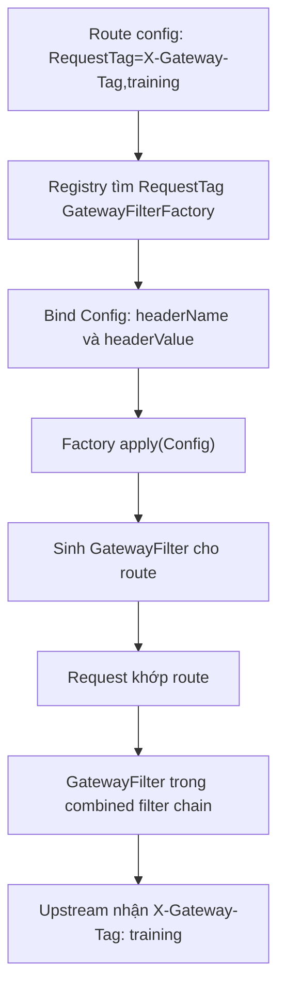
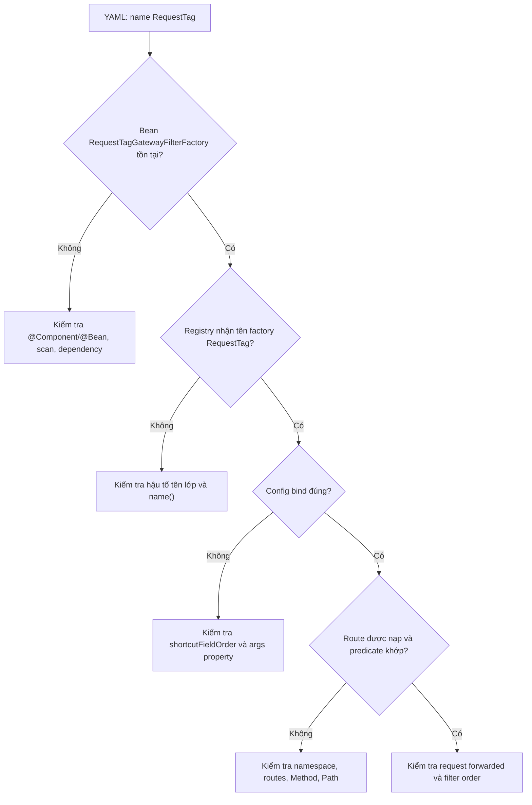

# Quy tắc đặt tên factory và shortcutFieldOrder trong Spring Cloud Gateway

Trong **Spring Cloud Gateway**, một tuyến có thể dùng sẵn các filter như `StripPrefix`, `AddRequestHeader` hay `SetResponseHeader`. Khi cần quy tắc riêng cho hệ thống microservices — chẳng hạn gắn một header truy vết nội bộ, chuẩn hóa thông tin trước khi gọi backend hoặc áp một thao tác theo từng route — ta có thể tự viết **GatewayFilter Factory**.

Việc triển khai logic bằng Java mới chỉ là một nửa công việc. Để cấu hình YAML như `- RequestTag=X-Gateway-Tag,training` hoạt động, Spring Cloud Gateway cần **tìm thấy factory bằng đúng tên**, tạo và **bind đối số cấu hình theo đúng thứ tự**. Hai khái niệm quyết định ở đây là quy tắc tên lớp kết thúc bằng `GatewayFilterFactory` và phương thức **`shortcutFieldOrder()`**.

Bài thuộc chương **Bộ lọc tùy biến** của module `SPRING_CLOUD_GATEWAY`, nơi Gateway kết hợp route predicate, filter chain, biến đổi path/header và khám phá dịch vụ. Nội dung cũng chỉ ra những điểm giao với xác thực, rate limiting, retry, circuit breaker, TLS và observability để tránh biến một custom filter tưởng như đơn giản thành lỗi định tuyến hoặc lỗ hổng bảo mật.

**Sau bài này, bạn có thể:**

1. Giải thích vì sao lớp `RequestTagGatewayFilterFactory` được tham chiếu với tên `RequestTag` trong route configuration.
2. Triển khai `AbstractGatewayFilterFactory<Config>` với `apply(Config)` và getter/setter phù hợp.
3. Khai báo cả **shortcut syntax** và **expanded named-args syntax**.
4. Hiểu `shortcutFieldOrder()` ánh xạ giá trị theo vị trí tới các thuộc tính `Config`, khác hoàn toàn với thứ tự thực thi filter.
5. Kiểm tra việc factory được đăng ký thành Spring Bean, route được nạp và request được chuyển tiếp chính xác.
6. Phân biệt custom `GatewayFilterFactory` với `GlobalFilter`, `WebFilter` và các cơ chế bảo mật sẵn có.

> **Phạm vi phiên bản:** Ví dụ dành cho **Spring Cloud Gateway Server WebFlux** (pipeline reactive). Gateway Server MVC có API/DSL riêng, không được sao chép nguyên mã `ServerWebExchange` và `GatewayFilter` WebFlux sang MVC. Namespace route có thể là `spring.cloud.gateway.routes` ở một số thế hệ cũ, hoặc `spring.cloud.gateway.server.webflux.routes` ở các thế hệ mới. Luôn xác minh starter và metadata cấu hình của phiên bản thực tế.

## 1. Một filter tên ngắn trong YAML đến từ đâu?

Đây là một route có các filter có sẵn:

```yaml
spring:
  cloud:
    gateway:
      server:
        webflux:
          routes:
            - id: catalog-api
              uri: lb://catalog-service
              predicates:
                - Path=/api/catalog/**
              filters:
                - StripPrefix=1
                - AddRequestHeader=X-Gateway-Source,edge
```

Phía Java, các filter như `StripPrefix` và `AddRequestHeader` có các **GatewayFilterFactory** tương ứng, chẳng hạn `StripPrefixGatewayFilterFactory` và `AddRequestHeaderGatewayFilterFactory`. Gateway nhận tên trong YAML, tìm một factory đã đăng ký, bind cấu hình và gọi factory để tạo filter tham gia chain.

Muốn có một filter riêng:

```yaml
filters:
  - RequestTag=X-Gateway-Tag,training
```

ta cần một Spring Bean có loại factory mang tên phù hợp, ví dụ:

```java
@Component
public class RequestTagGatewayFilterFactory
        extends AbstractGatewayFilterFactory<RequestTagGatewayFilterFactory.Config> {
    // Config, shortcutFieldOrder và apply được định nghĩa ở phần sau.
}
```

**Ý chính:** `RequestTag` là tên **factory được Gateway dùng trong cấu hình route**. Nó không phải tên phương thức Java, tên class đầy đủ, Bean ID, tên route hay header HTTP.

### 1.1. Vai trò của factory trong pipeline

Một `GatewayFilterFactory` **tạo** `GatewayFilter` từ tham số cấu hình route:



Factory thường là một bean dùng chung trong ứng dụng; **Config của mỗi route** được bind từ cấu hình route tương ứng. Không nên suy rằng `apply(Config)` được gọi một lần **cho mỗi HTTP request**. Trong luồng thông thường, Gateway tạo/filter route definition khi nạp hoặc refresh route, rồi phần lambda `filter(exchange, chain)` mới chạy cho các HTTP request khớp.

Đó là lý do không đặt dữ liệu request vào field mutable dùng chung của factory. Nếu cần giá trị theo request, lấy từ `ServerWebExchange` trong `GatewayFilter`, không ghi đè state toàn cục trong `apply`.

## 2. Quy tắc đặt tên lớp `...GatewayFilterFactory`

Quy ước phổ biến của Spring Cloud Gateway:

- Lớp Java custom kế thừa/triển khai `GatewayFilterFactory`.
- Tên lớp **nên kết thúc bằng hậu tố `GatewayFilterFactory`**.
- Tên để dùng trong `filters` thường là **tên lớp đã bỏ hậu tố này**.
- Factory phải được **đăng ký trong Spring ApplicationContext**.
- Tên trong route phải khớp với tên factory mà Gateway biết, không phải tùy tiện đặt theo ý tưởng giao diện.

Ví dụ:

| Tên lớp factory | Tên thường dùng trong YAML | Đối tượng |
| --- | --- | --- |
| `StripPrefixGatewayFilterFactory` | `StripPrefix` | Factory built-in. |
| `AddRequestHeaderGatewayFilterFactory` | `AddRequestHeader` | Factory built-in. |
| `SetResponseHeaderGatewayFilterFactory` | `SetResponseHeader` | Factory built-in. |
| `RequestTagGatewayFilterFactory` | `RequestTag` | Factory custom. |
| `TenantHintGatewayFilterFactory` | `TenantHint` | Factory custom, ví dụ. |
| `AuditLabelGatewayFilterFactory` | `AuditLabel` | Factory custom, ví dụ. |

### 2.1. Tránh tên lớp gây hiểu nhầm

Các lớp:

```java
public class RequestTagFilter { /* ... */ }

public class RequestTagFilterFactory { /* ... */ }
```

**không tự động trở thành** một `GatewayFilterFactory` được nhận diện với short name `RequestTag`. Lớp cần triển khai interface/base class thích hợp, được đăng ký làm Spring Bean và có tên factory đúng.

Để tránh nhầm lẫn và tuân theo quy ước quen thuộc, ưu tiên:

```java
public class RequestTagGatewayFilterFactory
        extends AbstractGatewayFilterFactory<RequestTagGatewayFilterFactory.Config> {
    // ...
}
```

Đừng đặt một custom factory trùng tên built-in như `RetryGatewayFilterFactory`, trừ khi bạn thực sự hiểu và kiểm soát cơ chế đăng ký/collision của phiên bản đang chạy. Trùng tên có thể khiến route bind sai hoặc hành vi thay đổi khó dự đoán.

### 2.2. Tên Bean và tên factory không nhất thiết giống nhau

`@Component` hoặc `@Bean` giúp Spring quản lý **instance của factory**. Còn tên filter mà route nhận diện đến từ **tên factory** theo quy ước/API, không chỉ từ Bean ID.

Ví dụ minh họa vấn đề:

```java
@Component("mySpringBeanName")
public class RequestTagGatewayFilterFactory
        extends AbstractGatewayFilterFactory<RequestTagGatewayFilterFactory.Config> {
    // ...
}
```

Việc gắn Bean ID `mySpringBeanName` **không có nghĩa** route tự động chấp nhận `- mySpringBeanName=...`. Trước khi muốn thay đổi tên public dùng trong YAML, hãy xem API tên factory của đúng phiên bản; phần lớn trường hợp đơn giản nhất là **đặt đúng tên lớp theo hậu tố**.

### 2.3. Có cần ghi `GatewayFilterFactory` trong YAML không?

Với factory ở ví dụ:

```yaml
# Dạng ngắn đúng theo quy ước:
filters:
  - RequestTag=X-Gateway-Tag,training
```

hoặc:

```yaml
# Dạng named args rõ nghĩa:
filters:
  - name: RequestTag
    args:
      headerName: X-Gateway-Tag
      headerValue: training
```

Không lấy tên Java đầy đủ như `RequestTagGatewayFilterFactory` làm mặc định cho trường `name`. Tên public cần dùng là tên mà Gateway đăng ký; quy tắc hậu tố giúp tên đó ngắn và ổn định.

## 3. `AbstractGatewayFilterFactory<Config>` làm nhiệm vụ gì?

Cách thông dụng để tạo filter riêng trong WebFlux là kế thừa:

```java
AbstractGatewayFilterFactory<T>
```

Trong đó `T` là kiểu cấu hình, thường đặt tên `Config`, chứa tham số cho một route.

Ba phần chính:

| Thành phần | Nhiệm vụ |
| --- | --- |
| Constructor `super(Config.class)` | Khai báo kiểu cấu hình để cơ chế bind tạo đối tượng `Config`. |
| `shortcutFieldOrder()` | Liệt kê **tên thuộc tính Config theo thứ tự** nhận giá trị của shortcut `Factory=a,b`. |
| `apply(Config config)` | Dùng cấu hình đã bind để tạo một `GatewayFilter`. |

Khung khái niệm:

```java
@Component
public class MyRuleGatewayFilterFactory
        extends AbstractGatewayFilterFactory<MyRuleGatewayFilterFactory.Config> {

    public MyRuleGatewayFilterFactory() {
        super(Config.class);
    }

    @Override
    public List<String> shortcutFieldOrder() {
        return List.of("first", "second");
    }

    @Override
    public GatewayFilter apply(Config config) {
        return (exchange, chain) -> {
            // Xử lý request theo Reactive GatewayFilter API.
            return chain.filter(exchange);
        };
    }

    public static class Config {
        private String first;
        private String second;
        // Getter/setter tương ứng cho cấu hình.
    }
}
```

Mẫu trên là khung để hiểu cấu trúc, chưa phải mã độc lập có đầy đủ import/getter/setter. Mục tiếp theo cung cấp **ví dụ đầy đủ hơn**.

### 3.1. `Config` không phải dữ liệu request

Ví dụ một route đặt:

```yaml
- RequestTag=X-Gateway-Tag,catalog
```

thì `Config` chứa `headerName=X-Gateway-Tag` và `headerValue=catalog`, là giá trị **tĩnh theo route**. Nếu cần đặt một request ID mới theo mỗi request, không nên tạo UUID trong `apply(Config)` vì giá trị đó có thể được tạo lúc bind route và bị tái sử dụng. Hãy tạo giá trị trong lambda `(exchange, chain) -> ...`, hoặc ưu tiên cơ chế trace/correlation hiện có.

### 3.2. Config phải có binding API phù hợp

Nếu tên trong `shortcutFieldOrder` là `headerName` và `headerValue`, kiểu `Config` phải phơi bày các property tương ứng, thường với getter/setter JavaBean:

```java
public static class Config {
    private String headerName;
    private String headerValue;

    public String getHeaderName() { return headerName; }
    public void setHeaderName(String headerName) {
        this.headerName = headerName;
    }

    public String getHeaderValue() { return headerValue; }
    public void setHeaderValue(String headerValue) {
        this.headerValue = headerValue;
    }
}
```

Nếu trong Java dùng `headerName` nhưng YAML lại truyền `name` mà binder không có cơ chế map rõ ràng, giá trị có thể không bind như mong muốn. Tránh dựa vào lỗi diễn giải mà route vẫn startup nhưng filter có tham số `null`.

## 4. Ví dụ đầy đủ: `RequestTagGatewayFilterFactory`

Ta xây một factory đơn giản: gắn **một request header** cố định theo cấu hình route để backend biết request đã đi qua một cổng vào cụ thể. Ví dụ này dùng header `X-Gateway-Tag` mang giá trị `training`.

Đây là **marker không có giá trị xác thực**. Không được dùng header này để backend tin một user đã đăng nhập hoặc có role admin. Một danh tính đáng tin phải xuất phát từ Spring Security/access token hoặc assertion có thể xác minh.

### 4.1. Mã Java

```java
package com.example.gateway.filters;

import java.util.List;

import org.springframework.cloud.gateway.filter.GatewayFilter;
import org.springframework.cloud.gateway.filter.factory.AbstractGatewayFilterFactory;
import org.springframework.http.server.reactive.ServerHttpRequest;
import org.springframework.stereotype.Component;
import org.springframework.util.Assert;
import org.springframework.web.server.ServerWebExchange;

@Component
public class RequestTagGatewayFilterFactory
        extends AbstractGatewayFilterFactory<RequestTagGatewayFilterFactory.Config> {

    public RequestTagGatewayFilterFactory() {
        super(Config.class);
    }

    @Override
    public List<String> shortcutFieldOrder() {
        return List.of("headerName", "headerValue");
    }

    @Override
    public GatewayFilter apply(Config config) {
        Assert.hasText(config.getHeaderName(),
            "headerName must not be empty");
        Assert.hasText(config.getHeaderValue(),
            "headerValue must not be empty");

        // Chỉ minh họa marker do người vận hành cấu hình.
        // Production cần allowlist/validation tên header phù hợp.
        Assert.isTrue(config.getHeaderName().startsWith("X-Gateway-"),
            "Only X-Gateway-* marker headers are allowed here");

        final String name = config.getHeaderName();
        final String value = config.getHeaderValue();

        return (exchange, chain) -> {
            ServerHttpRequest mutatedRequest =
                exchange.getRequest()
                    .mutate()
                    .headers(headers -> headers.set(name, value))
                    .build();

            ServerWebExchange mutatedExchange =
                exchange.mutate()
                    .request(mutatedRequest)
                    .build();

            return chain.filter(mutatedExchange);
        };
    }

    public static class Config {
        private String headerName;
        private String headerValue;

        public String getHeaderName() {
            return headerName;
        }

        public void setHeaderName(String headerName) {
            this.headerName = headerName;
        }

        public String getHeaderValue() {
            return headerValue;
        }

        public void setHeaderValue(String headerValue) {
            this.headerValue = headerValue;
        }
    }
}
```

Trong ví dụ:

1. `@Component` đăng ký factory thành Spring Bean nếu class nằm trong vùng component scan.
2. `super(Config.class)` chỉ ra kiểu cấu hình cần bind.
3. `shortcutFieldOrder()` trả về `["headerName", "headerValue"]`.
4. `apply(Config)` kiểm tra cấu hình và lưu bản sao tên/giá trị cho filter closure.
5. Trong mỗi HTTP request, `ServerHttpRequest.mutate()` tạo request mới với header được đặt.
6. `exchange.mutate().request(mutatedRequest).build()` chuyển request đã thay đổi vào chain.
7. `return chain.filter(mutatedExchange)` trả về `Mono<Void>` đúng hợp đồng reactive để các filter và routing tiếp tục.

### 4.2. Vì sao dùng `mutate()`?

Request trong Spring WebFlux không nên bị chỉnh trực tiếp như một `HttpServletRequest` mutable. Mẫu sai:

```java
// Không nên giả định headers gốc là mutable:
exchange.getRequest().getHeaders()
    .set("X-Gateway-Tag", "training");
```

Thay vào đó, dùng request builder để tạo phiên bản mới và truyền exchange mới vào `chain.filter(...)`. Nếu filter chỉ thêm response header trước khi response commit, cần dùng API của response ở thời điểm phù hợp; không cố sửa headers sau khi HTTP response đã commit.

### 4.3. Vì sao không gọi `subscribe()` hoặc `block()`?

Một `GatewayFilter` trong WebFlux phải **trả về publisher** để framework quản lý subscription, error propagation, cancellation và backpressure. Mẫu sai:

```java
// Sai: tự subscribe và trả completion tách khỏi chain.
chain.filter(exchange).subscribe();
return Mono.empty();
```

Mẫu tốt:

```java
return chain.filter(exchange);
```

Nếu cần side effect quan sát, dùng toán tử Reactor phù hợp, ví dụ `doFinally` hoặc `doOnError`, nhưng đừng thực hiện blocking I/O trên Netty event loop. Đối với Redis/database/network, nên dùng API reactive/nonblocking hoặc kiến trúc xử lý phù hợp.

### 4.4. Giới hạn của marker header

Factory này chỉ chứng minh cách binding/đặt tên. Header `X-Gateway-Tag` do cấu hình Gateway gắn vào có thể giúp trace hoặc debug trong môi trường kiểm soát, nhưng:

- Backend **không nên** coi nó là bằng chứng identity/authorization.
- Nếu khách hàng tự gửi header cùng tên, `headers.set(...)` sẽ **ghi đè** bằng giá trị route được cấu hình, nhưng cần kiểm tra các proxy/header filters khác.
- Không tạo header chứa token, thông tin cá nhân hoặc dữ liệu từ user chưa xác thực.
- Với thông tin danh tính nội bộ, cần thiết kế xóa header không tin cậy, nguồn danh tính đã xác minh và kênh bảo vệ (network/mTLS hoặc signed assertion).
- Nếu nhiều filter cùng sửa một header, thứ tự thực thi quyết định giá trị cuối cùng.

## 5. `shortcutFieldOrder()` thực sự ánh xạ điều gì?

Đây là trọng tâm của bài học. Đối với factory:

```java
@Override
public List<String> shortcutFieldOrder() {
    return List.of("headerName", "headerValue");
}
```

và shortcut:

```yaml
filters:
  - RequestTag=X-Gateway-Tag,training
```

Gateway diễn giải theo mô hình:

```text
Factory name:
    RequestTag

Positional arguments:
    arg[0] = "X-Gateway-Tag"
    arg[1] = "training"

shortcutFieldOrder():
    ["headerName", "headerValue"]

Config after binding:
    headerName  = "X-Gateway-Tag"
    headerValue = "training"
```

Đây **không phải** thứ tự filter chạy trên request. Nó chỉ là **thứ tự trường nhận các đối số vị trí** của một filter.

### 5.1. Nếu đảo thứ tự sẽ ra sao?

Giả sử lập trình viên vô tình viết:

```java
@Override
public List<String> shortcutFieldOrder() {
    return List.of("headerValue", "headerName");
}
```

trong khi YAML vẫn là:

```yaml
- RequestTag=X-Gateway-Tag,training
```

kết quả khái niệm:

| Property | Giá trị nhận được sau khi đảo |
| --- | --- |
| `headerValue` | `X-Gateway-Tag` |
| `headerName` | `training` |

Ví dụ hoàn chỉnh ở mục 4 sẽ từ chối cấu hình vì tên header không bắt đầu bằng `X-Gateway-`, nên lỗi được phát hiện sớm. Nếu không có validation, Gateway có thể chạy nhưng đặt nhầm header/value, rất khó nhận biết chỉ từ một HTTP status 200.

### 5.2. Số lượng giá trị phải khớp hợp đồng

Với hai trường bắt buộc, shortcut hợp lệ theo thiết kế:

```yaml
- RequestTag=X-Gateway-Tag,training
```

Không nên viết thiếu giá trị:

```yaml
# Thiếu headerValue, không thỏa yêu cầu factory ví dụ.
- RequestTag=X-Gateway-Tag
```

hoặc thêm giá trị mà không có binding được thiết kế:

```yaml
# Giá trị thứ ba không có trường tương ứng trong mẫu này.
- RequestTag=X-Gateway-Tag,training,extra
```

Cách Gateway xử lý chính xác trường hợp thiếu/thừa có thể khác theo parser/phiên bản; code `apply(Config)` nên **validate cấu hình bắt buộc** và integration test phải kiểm chứng startup/route loading. Không dùng việc “YAML đọc được” làm bằng chứng factory được cấu hình đúng.

### 5.3. Tên trong list phải là tên property của `Config`

Trong ví dụ:

```java
public static class Config {
    private String headerName;
    private String headerValue;
    // getters/setters...
}
```

nên trả:

```java
return List.of("headerName", "headerValue");
```

không phải tên biến bất kỳ `List.of("first", "second")` nếu Config không có các property ấy. Cơ chế bind không có cách tự suy ra “first nghĩa là headerName”.

### 5.4. Không đặt tên method là `shortcutFieldsOrder`

Phương thức cần override là **`shortcutFieldOrder()`** (không có chữ *s* sau `Field`). Gắn `@Override` giúp compiler phát hiện sai chữ ký. Khi copy ví dụ từ nguồn không đúng phiên bản, luôn kiểm tra chữ ký của base class thật.

## 6. Hai cú pháp cấu hình: shortcut và expanded args

Spring Cloud Gateway cho phép thể hiện filter route theo **cách ngắn** hoặc **cách có tên đối số** trong các phiên bản được hỗ trợ.

### 6.1. Dạng shortcut

```yaml
filters:
  - RequestTag=X-Gateway-Tag,training
```

Ưu điểm:

- Ngắn, dễ đọc khi chỉ có một hoặc hai tham số.
- Dễ tương tự với built-in `StripPrefix=1` và `AddRequestHeader=Name,Value`.

Hạn chế:

- Thứ tự quan trọng nhưng khó nhìn ý nghĩa nếu nhiều tham số.
- Dấu phẩy có thể là dấu phân tách đối số.
- Khi thêm trường hoặc thay đổi `shortcutFieldOrder`, cấu hình cũ có thể bị diễn giải khác.
- Việc truyền chuỗi phức tạp, biểu thức hoặc danh sách thường khó đọc hơn.

### 6.2. Dạng expanded named-args

```yaml
filters:
  - name: RequestTag
    args:
      headerName: X-Gateway-Tag
      headerValue: training
```

Ưu điểm:

- Thấy rõ **property nào nhận giá trị nào**.
- Không phụ thuộc thứ tự các dòng YAML.
- Dễ review khi nhiều trường, cấu hình optional hoặc giá trị có dấu phẩy.
- Dễ bảo trì khi thay đổi cách trình bày; tuy nhiên đổi **tên property Config** vẫn cần migration.

Dạng named args dùng **tên public của factory** trong trường `name` và **tên property** trong `args`. Tên Bean Spring khác không tự thay thế hai tên này.

### 6.3. Dấu phẩy trong giá trị

Nếu cần marker:

```text
team,alpha
```

không nên giả định shortcut sau giữ nguyên cả cụm là một đối số:

```yaml
# Không an toàn nếu parser shortcut tách theo dấu phẩy.
- RequestTag=X-Gateway-Tag,team,alpha
```

Ưu tiên:

```yaml
filters:
  - name: RequestTag
    args:
      headerName: X-Gateway-Tag
      headerValue: "team,alpha"
```

Việc quote YAML để có một scalar **không đồng nghĩa** các quy tắc tách đối số nội bộ của Gateway shortcut sẽ bỏ qua dấu phẩy. Với chuỗi có dấu phẩy, dấu bằng, regex, Unicode phức tạp hoặc cấu trúc lồng, named args thường rõ nghĩa hơn.

### 6.4. Khoảng trắng và kiểu dữ liệu

Đối số shortcut là **biểu diễn văn bản**, sau đó được bind sang kiểu property. Với `int`, `boolean`, `Duration`, converter và validation phải tương thích; không giả định mọi chuỗi tự chuyển được.

Ví dụ custom factory khác có hai trường `enabled:boolean` và `limit:int`:

```yaml
filters:
  - name: ExamplePolicy
    args:
      enabled: true
      limit: 20
```

Đây là **minh họa cấu trúc YAML**, không phải một factory `ExamplePolicy` built-in. Muốn sử dụng thật, cần khai báo Java factory có Config tương ứng. Dùng named args giúp kiểm tra type rõ hơn việc ghi `ExamplePolicy=true,20` ở nơi thiếu định nghĩa.

## 7. `shortcutFieldOrder()` không quyết định thứ tự filter chain

Có ba khái niệm “thứ tự” rất dễ nhầm:

| Khái niệm | Dùng để làm gì? | Ví dụ |
| --- | --- | --- |
| **`shortcutFieldOrder()`** | Bind các đối số **trong một factory** theo vị trí. | `["headerName", "headerValue"]`. |
| **Thứ tự filter trong route / `Ordered`** | Quyết định thứ tự thực thi pre/post của các GatewayFilters. | Đặt `StripPrefix` trước hoặc sau filter sửa path. |
| **`Route.order` / route predicate matching** | Ưu tiên chọn route khi nhiều route có thể khớp. | Route ưu tiên cao khớp `/api/orders/**` trước route tổng quát. |

Ví dụ:

```yaml
filters:
  - RequestTag=X-Gateway-Tag,training
  - StripPrefix=1
  - SetRequestHeader=X-Environment,staging
```

Danh sách này có **ba filter riêng**. `shortcutFieldOrder()` chỉ áp dụng cho nội bộ `RequestTag`, không khiến `headerName` chạy “trước” `StripPrefix` hoặc thay đổi các order do factory khác khai báo.

### 7.1. Pre-phase và post-phase

Trong WebFlux, các filter thường tạo thành một chain:

```text
Filter A pre
  Filter B pre
    Routing
  Filter B post
Filter A post
```

Nếu filter dùng `chain.filter(exchange).then(...)` để thực hiện logic post, thứ tự sau routing có thể đảo ngược so với pre-phase. Sự khác biệt này thuộc **filter ordering và Reactor composition**, không liên quan `shortcutFieldOrder`.

### 7.2. GlobalFilter khác GatewayFilterFactory

- **`GatewayFilterFactory`** nhận Config từ route và tạo `GatewayFilter` gắn theo route hoặc `default-filters`.
- **`GlobalFilter`** là filter mức Gateway áp dụng trong combined chain của các request đã match route, không dùng `shortcutFieldOrder`.
- **`WebFilter`** thuộc pipeline Spring WebFlux; Spring Security có thể từ chối request trước khi Gateway route filters chạy.
- **Servlet Filter** thuộc mô hình servlet/MVC, không phải cùng API reactive.

Do đó, nếu logic cần chạy trước authentication hoặc cho request **không khớp bất kỳ Gateway route nào**, một route-specific GatewayFilterFactory có thể **không phải vị trí phù hợp**. Chọn tầng thực thi theo yêu cầu, không dùng custom factory để thay cơ chế security/HTTP mapping có sẵn.

## 8. Đăng ký Spring Bean để Gateway tìm thấy factory

Đặt tên lớp đúng nhưng **quên đăng ký Bean** là một lỗi thường gặp.

### 8.1. Dùng `@Component`

```java
package com.example.gateway.filters;

import org.springframework.stereotype.Component;

@Component
public class RequestTagGatewayFilterFactory
        extends AbstractGatewayFilterFactory<RequestTagGatewayFilterFactory.Config> {
    // ...
}
```

Spring Boot phải component scan package chứa factory, thường là package con của class `@SpringBootApplication`. Nếu factory nằm ngoài phạm vi scan, nó **không tự được đăng ký**.

### 8.2. Dùng `@Bean` thay thế

Một cách khác là đăng ký factory trong class `@Configuration`:

```java
import org.springframework.context.annotation.Bean;
import org.springframework.context.annotation.Configuration;

@Configuration
public class GatewayFactoriesConfig {

    @Bean
    RequestTagGatewayFilterFactory requestTagGatewayFilterFactory() {
        return new RequestTagGatewayFilterFactory();
    }
}
```

Trong phương án này, tránh đồng thời để `@Component` **và** tạo `@Bean` cho cùng một factory nếu không có lý do — có thể dẫn tới **hai Bean** và quy tắc chọn tên khó hiểu. Nếu `apply` cần service qua DI, inject service bằng constructor thay vì tự tạo instance trong route.

### 8.3. Không tạo factory mới bên trong mỗi request

Mẫu thiếu hợp lý:

```java
return (exchange, chain) -> {
    RequestTagGatewayFilterFactory factory =
        new RequestTagGatewayFilterFactory();
    // Tự tạo factory rồi bind lại cấu hình mỗi request.
    return chain.filter(exchange);
};
```

Ngoài lãng phí, cách này bỏ qua lifecycle của ApplicationContext, DI, configuration binding và quan sát. Factory nên là Spring Bean, còn request chạy trên filter được tạo từ Config đã bind.

### 8.4. Kiểm tra tên bị trùng

Nếu hai factory cùng công bố tên `RequestTag`, registry có thể gặp xung đột hoặc factory được sử dụng không như dự định. Giữ tên riêng rõ nghĩa, có tiền tố miền nghiệp vụ khi cần, tránh tái định nghĩa built-in.

Ví dụ `TenantHeaderGatewayFilterFactory` có tên short `TenantHeader` rõ hơn một factory custom tên `RetryGatewayFilterFactory` vốn dễ đụng built-in `Retry`.

## 9. Named args khi không dùng shortcut

Một số factory có cấu hình phức tạp, hoặc không muốn hỗ trợ cách viết vị trí. Với **expanded args**, người đọc hiểu property từ tên, không cần nhớ thứ tự.

Ví dụ:

```yaml
filters:
  - name: RequestTag
    args:
      headerValue: catalog
      headerName: X-Gateway-Tag
```

Hai dòng dưới `args` được hoán đổi vị trí so với ví dụ trước nhưng vẫn phải bind vào cùng property theo **tên**. `shortcutFieldOrder()` không ép YAML named args phải đứng theo thứ tự list.

### 9.1. Có bắt buộc override `shortcutFieldOrder` không?

- Nếu chỉ dùng **expanded args** và không cần shortcut, thứ tự vị trí không phải hợp đồng công khai của bạn.
- Nếu muốn dùng `- RequestTag=a,b`, phải triển khai/khai báo thứ tự shortcut phù hợp.
- Không nên dựa vào việc reflection tự đoán thứ tự field trong Java; thứ tự declaration không phải một hợp đồng YAML ổn định.

### 9.2. Nếu đổi Config thêm một field?

Giả sử phiên bản mới thêm `enabled:boolean`:

```java
public static class Config {
    private String headerName;
    private String headerValue;
    private boolean enabled = true;
    // Getter/setter...
}
```

Bạn có thể giữ shortcut là:

```java
return List.of("headerName", "headerValue");
```

và coi `enabled` là optional chỉ khai trong named args. Điều này giúp cấu hình shortcut cũ tiếp tục có cùng semantics, nếu implementation hỗ trợ giá trị mặc định đúng.

Nếu đổi shortcut thành:

```java
return List.of("enabled", "headerName", "headerValue");
```

thì `- RequestTag=X-Gateway-Tag,training` cũ có thể bị bind sai kiểu/ý nghĩa. **Thay đổi `shortcutFieldOrder` là thay đổi hợp đồng cấu hình**, cần migration và test backward compatibility.

### 9.3. Validation ở đâu?

Validation nên nằm trong lúc tạo/cấu hình filter, trước khi xử lý traffic:

```java
@Override
public GatewayFilter apply(Config config) {
    Assert.hasText(config.getHeaderName(), "headerName is required");
    Assert.hasText(config.getHeaderValue(), "headerValue is required");
    return (exchange, chain) -> chain.filter(exchange);
}
```

Đây là fragment minh họa validation, chưa làm chức năng đặt header. Mục tiêu là fail fast khi route được nạp/refresh, không để hàng triệu request mới phát hiện `null` hoặc giá trị sai.

Tùy phiên bản và đường nạp route, thời điểm lỗi xuất hiện có thể là startup hoặc khi route definition được đánh giá/refresh. Phải kiểm tra hiệu lực cấu hình, không chỉ thấy ứng dụng đã mở cổng HTTP.

## 10. Kết hợp factory với `default-filters`

Đôi khi cần cùng một marker/tracing rule cho **mọi route**. Server WebFlux có thể hỗ trợ `default-filters`:

```yaml
spring:
  cloud:
    gateway:
      server:
        webflux:
          default-filters:
            - name: RequestTag
              args:
                headerName: X-Gateway-Tag
                headerValue: edge
          routes:
            - id: catalog-api
              uri: lb://catalog-service
              predicates:
                - Path=/api/catalog/**
              filters:
                - StripPrefix=1

            - id: orders-api
              uri: lb://order-service
              predicates:
                - Path=/api/orders/**
              filters:
                - StripPrefix=1
```

Trong các phiên bản cũ, property thường có dạng `spring.cloud.gateway.default-filters`. Tùy thế hệ, tên property khác; chọn namespace đúng.

**Lưu ý:**

- `default-filters` áp vào các **Gateway routes phù hợp**, không tự biến factory thành một Spring Security `WebFilter` áp cho mọi URL.
- Nếu route cũng thêm `RequestTag` với cùng header, kết quả phụ thuộc thứ tự filter và cách xử lý header.
- Với data nhạy cảm, không sử dụng default marker như nguồn xác thực.
- Nếu chỉ cần built-in `AddRequestHeader` hoặc `SetRequestHeader` mà không có logic mới, **không cần custom factory**; ưu tiên filter chuẩn để giảm code cần bảo trì.

### 10.1. GlobalFilter có thay default-filters được không?

Một `GlobalFilter` có thể áp logic chung trong Gateway chain nhưng không dùng cú pháp factory/Config route-specific. Chọn:

- **`GatewayFilterFactory`** nếu muốn cấu hình khác nhau theo route từ YAML.
- **`default-filters`** nếu muốn áp một factory có cấu hình chung trên mọi route.
- **`GlobalFilter`** nếu muốn logic lập trình ở Gateway scope không cần khai lại theo route, và đã hiểu ordering/lifecycle.

Không viết cả ba cơ chế cho cùng một tác dụng mà không kiểm soát trùng lặp.

## 11. Java DSL: áp factory bằng Config thay vì shortcut YAML

Trong một số dự án, route được tạo qua Java `RouteLocatorBuilder`. Bạn vẫn có thể tái sử dụng factory Bean:

```java
import org.springframework.cloud.gateway.route.RouteLocator;
import org.springframework.cloud.gateway.route.builder.RouteLocatorBuilder;
import org.springframework.context.annotation.Bean;
import org.springframework.context.annotation.Configuration;

@Configuration
public class CatalogRouteConfig {

    @Bean
    RouteLocator catalogRouteLocator(
            RouteLocatorBuilder builder,
            RequestTagGatewayFilterFactory tagFactory) {

        RequestTagGatewayFilterFactory.Config config =
            new RequestTagGatewayFilterFactory.Config();

        config.setHeaderName("X-Gateway-Tag");
        config.setHeaderValue("java-dsl");

        return builder.routes()
            .route("catalog-java", r -> r
                .path("/api/catalog/**")
                .filters(f -> f
                    .filter(tagFactory.apply(config))
                    .stripPrefix(1))
                .uri("lb://catalog-service"))
            .build();
    }
}
```

**Điểm khác:** Java DSL tạo `Config` bằng code, nên không cần diễn giải đối số vị trí bằng `shortcutFieldOrder()` tại chỗ này. Nhưng factory vẫn cùng kiểu và `apply(Config)` vẫn tạo `GatewayFilter` như khi YAML được bind.

Không đăng ký **cùng một route ID** ở cả Java DSL lẫn YAML mà không có chủ đích. Các route trùng predicate/priority có thể gây kết quả khó hiểu; hãy chọn một nguồn route definition rõ ràng hoặc kiểm soát route order.

### 11.1. Đừng `new` factory ở Java DSL nếu factory có dependency

Ví dụ factory inject một service audit qua constructor. Nếu bạn tự `new` factory trong code route, dependency có thể thiếu và lifecycle không còn do Spring quản lý. Nên inject Bean như `tagFactory` ở ví dụ trên.

## 12. Phân biệt factory binding với HTTP request binding

Nhìn chung có hai loại “binding” khác nhau:

| Binding | Khi nào? | Dữ liệu từ đâu? | Nên tin đến đâu? |
| --- | --- | --- | --- |
| **Factory Config binding** | Khi nạp/khởi tạo route. | YAML/Java DSL do người vận hành kiểm soát. | Tin có điều kiện; vẫn validate. |
| **Request data extraction** | Với từng HTTP request. | Header, path, query, body, principal. | Phải phân biệt trusted/untrusted, xác thực và sanitize. |

`shortcutFieldOrder()` chỉ xử lý **factory config binding**. Nó không có chức năng lấy `Idempotency-Key`, principal hay tenant ID từ HTTP request.

Ví dụ muốn gắn claim `tenantId` vào upstream thì phải kiểm tra **Spring Security Authentication** và trust boundary. Không giải quyết bằng cách thêm `tenantId` vào `shortcutFieldOrder` rồi hy vọng Gateway tự lấy từ request.

### 12.1. Vì sao phải kiểm tra dữ liệu Config?

Nếu route config có giá trị từ nguồn động, ví dụ config server hoặc database, một lỗi có thể thêm CR/LF, header name không hợp lệ hoặc URL nội bộ nguy hiểm. Dù nguồn cấu hình là nội bộ, vẫn phải validate classpath/binding/giá trị và phân quyền người chỉnh config.

Mẫu marker ở mục 4 giới hạn tiền tố header để minh họa; **production nên dùng allowlist cụ thể** hoặc loại rule cấu hình đủ hẹp. Không dùng factory như một cơ chế tạo tùy ý `Authorization`, `Host`, `Forwarded` hoặc header danh tính đã xác thực.

## 13. Những kiểu dữ liệu Config cần chú ý

Một factory nhiều chức năng có thể có:

```java
public static class Config {
    private String headerName;
    private String headerValue;
    private boolean enabled = true;
    private int maxLength = 64;
    // getters/setters...
}
```

Với named args:

```yaml
filters:
  - name: ExampleTag
    args:
      headerName: X-Gateway-Tag
      headerValue: catalog
      enabled: true
      maxLength: 64
```

`ExampleTag` ở đây là **factory giả định** có đủ Config và implementation, không phải filter built-in.

### 13.1. Kiểu số và boolean

Nếu một trường là `int` mà YAML chứa `maxLength: not-a-number`, binder có thể báo lỗi cấu hình. Nếu dùng `Boolean`/`Integer` nullable, phải kiểm tra null; nếu dùng primitive với default, cần phân biệt giá trị default với việc người vận hành chủ động truyền 0/false.

### 13.2. Duration

Với filter có tham số timeout, dùng kiểu `Duration` và cú pháp mà version hỗ trợ, ví dụ `500ms` hoặc `2s`. Đừng giả định một số nguyên `500` luôn có đơn vị mili giây; hợp đồng binder/route phải ghi rõ. Timeout của filter custom không tự thay thế Netty connection/response timeout của Gateway.

### 13.3. Danh sách/regex/giá trị có dấu phẩy

Với `List<String>`, regular expression hoặc chuỗi chứa dấu phẩy, cấu hình **named args** thường tránh được việc tách theo vị trí sai. Một số factory có `shortcutType()` đặc biệt để gom các giá trị thành danh sách, nhưng đây là hành vi nâng cao của từng factory và phiên bản. Không tự đổi `shortcutFieldOrder()` rồi kỳ vọng nó tự hiểu mọi kiểu list.

### 13.4. Giá trị nhạy cảm

Không truyền secret API key vào `headerValue` của marker ví dụ. Cấu hình có thể xuất hiện trong route actuator endpoint, logs hoặc debug dumps tùy môi trường. Nếu phải truyền credential tới upstream, dùng cơ chế secret management/token relay/mTLS phù hợp và giới hạn quyền xem cấu hình.

## 14. Lỗi thường gặp: factory không được tìm thấy

Một lỗi quen thuộc khi chạy route:

```text
Unable to find GatewayFilterFactory with name RequestTag
```

Thông báo thực tế phụ thuộc phiên bản/logger, nhưng ý nghĩa thường là **route yêu cầu factory tên RequestTag mà registry không tìm thấy**.

Các nguyên nhân đáng kiểm tra:

1. Class không kết thúc/không tạo tên theo quy ước `RequestTagGatewayFilterFactory`.
2. Factory không kế thừa/triển khai `GatewayFilterFactory` đúng cách.
3. Thiếu `@Component`/`@Bean` hoặc class ngoài phạm vi component scan.
4. Dùng sai tên trong YAML, ví dụ `RequestTags`, `RequestTagFilter` hoặc Bean ID thay tên factory.
5. Route config đang ở namespace không được phiên bản hiện tại đọc.
6. Ứng dụng chạy **Server MVC** nhưng code import filter API của Server WebFlux.
7. Factory Bean tạo lỗi ở constructor/dependency nên không đăng ký được.
8. Có hai factory cùng tên gây collision/hành vi không mong muốn.

### 14.1. Quy trình kiểm tra nhanh



Không chỉ nhìn một HTTP 404 rồi kết luận factory lỗi: request có thể chưa match route, backend có thể trả 404, hoặc Spring Security đã chặn trước Gateway chain.

## 15. Lỗi thường gặp: factory được tìm thấy nhưng tham số sai

Một route có thể nạp thành công nhưng tạo header sai vì:

- `shortcutFieldOrder()` đảo vị trí.
- Getter/setter không tương ứng tên property.
- YAML dùng `args.name` nhưng Java Config định nghĩa `headerName`.
- Có dấu phẩy trong shortcut khiến parser tách thành nhiều giá trị.
- Một trường optional có default khác mong đợi.
- Route nạp từ nguồn khác đang ghi đè cấu hình hoặc refresh route.
- Hai filters đặt cùng header, filter chạy sau đổi giá trị.
- Đường request qua GlobalFilter khác trước/sau custom filter.

### 15.1. Một cách chẩn đoán có hệ thống

Cho factory `RequestTag`:

```text
1. Có class RequestTagGatewayFilterFactory?
2. Spring Bean của class có trong ApplicationContext?
3. Tên route dùng "RequestTag"?
4. Config có headerName và headerValue với getters/setters?
5. shortcutFieldOrder() = ["headerName","headerValue"]?
6. YAML shortcut có đúng hai giá trị?
7. apply(Config) validate và tạo filter?
8. Request có match route không?
9. Backend/mock upstream thấy giá trị header nào?
10. Có filter khác overwrite header không?
```

**Tách riêng ba lớp kiểm tra:** factory discovery, configuration binding và runtime filter execution. Chúng là ba điểm có thể thất bại độc lập.

## 16. Cơ chế refresh route và khả năng tương thích cấu hình

Trong hệ thống có route động, Gateway có thể làm mới route definitions từ config server, registry hoặc một nguồn quản lý cấu hình đáng tin. Điều này tác động tới factory:

- Một route mới có thể tạo `Config` mới và tạo `GatewayFilter` mới.
- Filter đang xử lý request cũ có thể vẫn giữ Config đã được dùng khi request bắt đầu.
- Đổi tên factory hoặc `shortcutFieldOrder()` khiến **route config cũ** có thể không bind đúng.
- Factory nếu giữ state mutable toàn cục có thể gây race khi route reload và request đồng thời.
- Validation cấu hình phải đủ sớm để phát hiện route sai trước khi mở traffic quan trọng.

Không coi thêm một field `Config` là thay đổi “chỉ Java” khi các route YAML là hợp đồng giữa team platform và team ứng dụng.

### 16.1. Chiến lược nâng cấp Config

Với factory đã dùng trên nhiều route:

1. Ưu tiên **named args** cho cấu hình dài hoặc thường xuyên thay đổi.
2. Không tự đảo thứ tự shortcut field đang công bố.
3. Thêm field mới dưới dạng optional với default hợp lý nếu có thể.
4. Ghi migration guide khi bắt buộc đổi tên property.
5. Dùng validation để fail fast với cấu hình không hợp lệ.
6. Có kiểm thử cho route YAML hiện tại và route config mới.
7. Giám sát lỗi route refresh, số route active và những request 404/5xx sau rollout.

### 16.2. Một route có thể có nhiều phiên bản Config?

Factory của cùng tên thường có một kiểu `Config` theo class runtime. Nếu muốn hỗ trợ nhiều hợp đồng khác biệt hoàn toàn, cân nhắc tên factory mới (`RequestTagV2GatewayFilterFactory`) hoặc cơ chế version explicit có validation, thay vì đổi ngầm cách hiểu `RequestTag=a,b` khiến route cũ hoạt động sai.

## 17. Kiểm thử đơn vị factory `RequestTag`

Ta có thể kiểm thử logic của `apply(Config)` **không cần khởi động cả Gateway** bằng mock WebFlux exchange và một `GatewayFilterChain` giả.

Ví dụ minh họa với Spring Test, Reactor Test và JUnit:

```java
import java.util.concurrent.atomic.AtomicReference;

import org.junit.jupiter.api.Test;
import org.springframework.cloud.gateway.filter.GatewayFilter;
import org.springframework.cloud.gateway.filter.GatewayFilterChain;
import org.springframework.mock.http.server.reactive.MockServerHttpRequest;
import org.springframework.mock.web.server.MockServerWebExchange;
import reactor.core.publisher.Mono;
import reactor.test.StepVerifier;

import static org.junit.jupiter.api.Assertions.assertEquals;

class RequestTagGatewayFilterFactoryTest {

    @Test
    void addsConfiguredHeaderToDownstreamRequest() {
        RequestTagGatewayFilterFactory factory =
            new RequestTagGatewayFilterFactory();

        RequestTagGatewayFilterFactory.Config config =
            new RequestTagGatewayFilterFactory.Config();

        config.setHeaderName("X-Gateway-Tag");
        config.setHeaderValue("training");

        GatewayFilter filter = factory.apply(config);

        MockServerWebExchange exchange =
            MockServerWebExchange.from(
                MockServerHttpRequest.get("/api/catalog/42").build()
            );

        AtomicReference<String> observed = new AtomicReference<>();
        GatewayFilterChain chain = forwarded -> {
            observed.set(forwarded.getRequest()
                .getHeaders()
                .getFirst("X-Gateway-Tag"));
            return Mono.empty();
        };

        StepVerifier.create(filter.filter(exchange, chain))
            .verifyComplete();

        assertEquals("training", observed.get());
    }
}
```

Bài test chứng minh **runtime filter thay đổi request**. Nó **không chứng minh** tên `RequestTag` được route registry tìm thấy hoặc shortcut YAML được bind, vì test tự tạo Config bằng Java.

### 17.1. Kiểm thử `shortcutFieldOrder` trực tiếp

```java
@Test
void shortcutOrderMatchesConfigProperties() {
    RequestTagGatewayFilterFactory factory =
        new RequestTagGatewayFilterFactory();

    assertEquals(
        List.of("headerName", "headerValue"),
        factory.shortcutFieldOrder()
    );
}
```

Đây là kiểm thử nhỏ giữ hợp đồng khi refactor. Cần import `java.util.List`, `org.junit.jupiter.api.Test` và `assertEquals` tương ứng trong class test.

### 17.2. Kiểm thử tham số thiếu

```java
@Test
void missingHeaderValueIsRejected() {
    RequestTagGatewayFilterFactory factory =
        new RequestTagGatewayFilterFactory();

    RequestTagGatewayFilterFactory.Config config =
        new RequestTagGatewayFilterFactory.Config();

    config.setHeaderName("X-Gateway-Tag");

    assertThrows(IllegalArgumentException.class,
        () -> factory.apply(config));
}
```

Cần import JUnit `assertThrows`. Mẫu minh họa dùng `Assert.hasText` trong code factory; thông báo ngoại lệ chính xác không phải API contract public.

### 17.3. Cần integration test để xác minh YAML

Để chứng minh **tên factory và shortcut syntax**, phải có ít nhất một test nạp Spring context/route thật, ví dụ:

```yaml
spring:
  cloud:
    gateway:
      server:
        webflux:
          routes:
            - id: test-tag
              uri: http://localhost:9090
              predicates:
                - Path=/api/test/**
              filters:
                - RequestTag=X-Gateway-Tag,training
                - StripPrefix=1
```

Mock upstream `http://localhost:9090` nhận request và kiểm tra:

- Method/path đã được chuyển thành `/test/...`.
- Header `X-Gateway-Tag` bằng `training`.
- Request đi đúng route ID.
- Trường hợp YAML named args cho kết quả tương đương.
- Cấu hình sai được phát hiện, không silently bỏ qua filter.

**Lưu ý:** Test chỉ dùng server thử nghiệm, không gửi traffic tới production hoặc một host bên ngoài không kiểm soát.

## 18. Kiểm tra bằng curl và mock upstream

Giả sử Gateway chạy ở `localhost:8080`, mock backend tại `localhost:9090` và route `test-tag` được nạp.

```bash
curl -i "http://localhost:8080/api/test/42" \
  -H "X-Gateway-Tag: forged-by-client"
```

Với ví dụ `RequestTagGatewayFilterFactory`, filter sẽ đặt lại header thành `training` trước khi request tới upstream. **Không thể chứng minh điều này chỉ từ output `curl -i`**, vì output hiển thị **response của Gateway** chứ không phải request mà backend đã nhận. Cần:

- Mock HTTP server trả echo header trong **môi trường test**; hoặc
- Kiểm tra assertion của test backend; hoặc
- Đo tracing/log nội bộ được bảo vệ, không log credential.

Nếu sau khi bật factory nhận 404, phân biệt 404 do route không khớp, do backend không có endpoint hoặc do config factory. Nếu nhận 503, kiểm tra `lb://` và discovery; factory tên sai có thể đã được phát hiện trước khi request xử lý.

### 18.1. Kiểm thử hai route dùng cùng factory khác tham số

```yaml
routes:
  - id: catalog-tag
    uri: lb://catalog-service
    predicates:
      - Path=/api/catalog/**
    filters:
      - RequestTag=X-Gateway-Tag,catalog
      - StripPrefix=1

  - id: orders-tag
    uri: lb://order-service
    predicates:
      - Path=/api/orders/**
    filters:
      - RequestTag=X-Gateway-Tag,orders
      - StripPrefix=1
```

Đây là **fragment nằm bên dưới namespace `routes`** thích hợp, không phải một file `application.yml` hoàn chỉnh. Cùng một factory Bean có thể tạo hai filter với **hai Config khác nhau** theo route. Nếu cả hai request đều nhận header cuối là `orders`, điều tra xem factory có lưu `Config` vào mutable instance field dùng chung hay không.

### 18.2. Test reload và concurrency

Nếu route definitions được refresh động, test thay marker của một route rồi gửi request đồng thời tới cả hai route. Chúng không được vô tình chia sẻ giá trị Config mutable. Không sửa `Config` của một route từ request đang chạy.

## 19. Tác động của custom filter lên bảo mật và hệ thống khác

Factory có thể rất nhỏ nhưng ở gần ranh giới HTTP quan trọng.

### 19.1. Spring Security có thể chạy trước factory

Với JWT Resource Server, `SecurityWebFilterChain` có thể từ chối request 401/403 trước khi route-specific factory chạy. Do đó:

- Không dùng `RequestTag` để thay authN/authZ.
- Đừng mong filter luôn gắn header cho response 401 do Security tạo.
- Nếu cần principal, phải dùng thông tin đã xác thực và kiểm tra null/permissions.
- Với CORS preflight, `OPTIONS` có thể được xử lý trước route factory; không kỳ vọng custom route filter luôn chạy.

### 19.2. Rate limiting và key identity

`RequestRateLimiter` và `KeyResolver` có hợp đồng riêng. Một filter custom thêm `X-User-Id` **không biến header đó thành principal tin cậy**. Quota nên dựa vào user/tenant/API key đã xác thực hoặc IP từ proxy tin cậy, không vào dữ liệu do client tự khai.

### 19.3. Retry có thể khiến filter chạy nhiều lần

Một `Retry` GatewayFilter có thể tái thực hiện phần downstream chain trong những trường hợp phù hợp. Tùy thứ tự filter, custom filter có thể chạy lại, hoặc một side effect trong nó có thể được kích hoạt nhiều lần.

Do đó custom filter không nên:

- Tạo giao dịch thanh toán hoặc gửi email mà không có idempotency.
- Sinh một idempotency key mới cho mỗi upstream attempt.
- Ghi dữ liệu không idempotent trong `doOnSubscribe`/`doOnNext` mà không xử lý retry.
- Giữ request body `Flux<DataBuffer>` mà không hiểu ownership/ref counting/streaming.

Factory ví dụ chỉ thêm một header tĩnh nên có thể lặp thao tác mà không tạo side effect nghiệp vụ.

### 19.4. Circuit breaker và fallback

Nếu filter downstream bị circuit breaker short-circuit, custom filter ở vị trí khác trong chain có thể có hoặc không chạy, tùy order. Đừng coi một marker header là bằng chứng backend đã được gọi thành công. Cần trace/status và instrumentation ở đúng lớp.

### 19.5. TLS và nội dung header

Không tắt kiểm tra TLS upstream hoặc thêm secret vào header custom để “đi qua” authorization. Hãy dùng HTTPS/mTLS/trust store phù hợp và giới hạn những header được phép đi ra backend.

### 19.6. Observability

Custom factory có thể gắn marker hoặc correlation thông tin phục vụ log, nhưng **không tự tạo trace context hợp lệ** chỉ bằng cách đặt một chuỗi tùy ý. Ưu tiên Micrometer Observation/OpenTelemetry và W3C Trace Context. Nếu filter cần ghi route ID hoặc latency, đảm bảo:

- Không log token/cookie/body nhạy cảm.
- Không dùng raw user ID/Idempotency-Key làm metric label cardinality cao.
- Không block event loop để ghi log/network.
- Không nhầm trạng thái response do Gateway với kết quả commit của backend.

## 20. Những lỗi thường gặp và cách khắc phục

| Triệu chứng | Nguyên nhân có thể | Hướng khắc phục |
| --- | --- | --- |
| Gateway báo không tìm thấy `RequestTag`. | Tên lớp không đúng hậu tố, Bean không được scan hoặc YAML dùng tên sai. | Đặt `RequestTagGatewayFilterFactory`, đăng ký Bean, dùng `name: RequestTag`. |
| `- RequestTag=a,b` bind sai hai trường. | `shortcutFieldOrder()` đảo vị trí. | Trả đúng `List.of("headerName", "headerValue")`. |
| `args` có `name` nhưng Java Config dùng `headerName`. | Sai tên property. | Dùng tên getter/setter của Config, test binding. |
| Filter dùng được khi Java DSL nhưng YAML lỗi. | Java DSL tự tạo Config, YAML cần factory discovery và binding. | Test ApplicationContext và route YAML end-to-end. |
| Mã compile nhưng route không nạp. | Sai `spring.cloud.gateway...routes` namespace hoặc duplicate route ID. | Kiểm tra version và danh sách route active. |
| Thêm `@Component("CustomName")` nhưng YAML không nhận `CustomName`. | Nhầm Bean ID với factory name. | Dùng tên factory theo quy ước/class `name()`. |
| YAML có chuỗi chứa dấu phẩy, Config nhận sai. | Parser shortcut chia positional args. | Chuyển sang expanded named args. |
| Filter thêm header nhưng backend không thấy. | Request không match route, filter khác ghi đè hoặc mutate không được truyền vào chain. | Kiểm tra route ID, thứ tự, và `chain.filter(mutatedExchange)`. |
| Request gốc có header client nhưng custom filter không ghi đè. | Logic dùng add thay vì set, hoặc filter sau đổi giá trị. | Kiểm tra `headers.set` và thứ tự filter. |
| 401/403 không mang header custom. | Spring Security chặn trước GatewayFilter. | Xử lý ở WebFlux/Security layer nếu thực sự cần. |
| Preflight OPTIONS không chạy filter. | CORS xử lý sớm, hoặc Method predicate không khớp. | Kiểm tra CORS handler mapping và Security. |
| Config bị trộn giữa hai route. | Factory giữ Config mutable global trong field. | Tạo closure từ Config riêng của route; tránh shared mutable state. |
| Restart/refresh route gây hành vi khác. | Config version hoặc shortcut order đổi. | Có migration, tests và validation khi reload. |
| Filter làm Gateway treo khi gọi database. | Blocking I/O trong Netty event loop. | Dùng reactive async API hoặc chuyển việc sang layer phù hợp. |
| Filter làm memory tăng với JSON/multipart. | Đọc/cache body sai ownership hoặc retry nhiều lần. | Hiểu `DataBuffer`, backpressure và request size budget. |
| Header custom bị backend dùng như token tin cậy. | Không có auth/trust boundary. | Dùng JWT/mTLS/signed assertion và strip untrusted headers. |
| Actuator route dump lộ secret trong Config. | Đưa credential vào filter args. | Dùng secret management, hạn chế endpoint management. |
| Khi backend trả 503, nhóm nghi `shortcutFieldOrder`. | Lỗi có thể ở `lb://` discovery/upstream. | Phân loại route/config/filter success và upstream errors. |

## 21. Bài tập thực hành có đáp án

### Bài 1 — Đặt tên factory

Bạn tạo class:

```java
public class AuditLabelGatewayFilterFactory
        extends AbstractGatewayFilterFactory<AuditLabelGatewayFilterFactory.Config> {
    // ...
}
```

Tên thường dùng trong YAML là gì?

**Đáp án:** `AuditLabel`, vì Gateway bỏ hậu tố `GatewayFilterFactory` theo quy ước. Class phải là Bean hợp lệ và Config/apply phải triển khai đầy đủ.

### Bài 2 — Xác định thứ tự tham số

Config có `prefix` và `value`. Cấu hình là:

```yaml
- AuditLabel=trace-,123
```

`shortcutFieldOrder()` cần trả gì?

**Đáp án:** `List.of("prefix", "value")` nếu contract là giá trị đầu cho `prefix` và giá trị sau cho `value`. Cần Config getters/setters đúng tên.

### Bài 3 — Vì sao named args không sợ đổi dòng?

```yaml
- name: RequestTag
  args:
    headerValue: training
    headerName: X-Gateway-Tag
```

Hai property này bị đảo thứ tự so với `shortcutFieldOrder`. Có sai không?

**Đáp án:** Không vì expanded args bind theo **tên property**, không dựa vị trí dòng. Phải giữ tên property và giá trị hợp lệ.

### Bài 4 — Class đúng nhưng không được nhận diện

Java factory có hậu tố đúng, nhưng YAML báo không tìm thấy `RequestTag`. Class nằm ngoài component scan.

**Đáp án:** Đưa class vào package được scan hoặc đăng ký `@Bean`. Chỉ đặt tên class đúng không tự thêm Bean vào ApplicationContext.

### Bài 5 — Thay tên Bean

Bạn đổi `@Component` thành `@Component("traceMarkerBean")` và muốn YAML `- traceMarkerBean=a,b` hoạt động.

**Đáp án:** Không thể suy ra điều đó. Bean ID không mặc định là factory short name. Dùng tên mà factory công bố, trong ví dụ vẫn là `RequestTag`.

### Bài 6 — Dấu phẩy trong value

Bạn muốn header `X-Gateway-Tag: team,alpha`. Viết `- RequestTag=X-Gateway-Tag,team,alpha` có an toàn?

**Đáp án:** Không nên. Dấu phẩy trong shortcut có thể tách thành nhiều positional args. Chuyển sang `name: RequestTag` với `args.headerValue: "team,alpha"`.

### Bài 7 — Đổi `shortcutFieldOrder` khi upgrade

Phiên bản 1 dùng `["headerName","headerValue"]`, phiên bản 2 chuyển thành `["headerValue","headerName"]` nhưng giữ nguyên YAML cũ.

**Đáp án:** Đây là thay đổi phá hợp đồng config. Cần giữ order cũ hoặc migration toàn bộ route cùng tests, không đảo ngầm.

### Bài 8 — Shortcut order và filter order

Trong YAML, `RequestTag` đứng trước `StripPrefix`. Có phải `shortcutFieldOrder()` khiến RequestTag chạy trước StripPrefix?

**Đáp án:** Không. `shortcutFieldOrder()` chỉ map các tham số bên trong RequestTag. Thứ tự pre/post của các GatewayFilters dựa trên combined filter chain và `Ordered`/route filter order.

### Bài 9 — Security chặn trước custom filter

Request thiếu JWT nhận 401 và không thấy `X-Gateway-Tag` ở upstream. Factory có hỏng không?

**Đáp án:** Không nhất thiết. Spring Security WebFilter có thể chặn request trước khi GatewayFilter chạy. Cần kiểm tra auth path và filter execution riêng.

### Bài 10 — Dùng `@Bean` cùng `@Component`

Một factory được annotate `@Component`, đồng thời cấu hình `@Bean RequestTagGatewayFilterFactory` mới.

**Đáp án:** Có nguy cơ tạo hai instances/factory registrations cùng tên. Chọn một cơ chế đăng ký rõ ràng, trừ khi có cấu hình nhiều Bean được chủ động kiểm soát.

### Bài 11 — Java DSL chạy, YAML không chạy

Factory chạy khi bạn gọi `tagFactory.apply(config)` trong Java DSL nhưng YAML không bind `RequestTag=a,b`.

**Đáp án:** Java DSL bypass shortcut binding. Hãy kiểm tra tên factory trong registry, Bean scope, `shortcutFieldOrder()`, Config property binding, route namespace và test YAML integration.

### Bài 12 — Config dùng chung giữa request

Factory lưu giá trị `headerValue` của request cuối vào field instance, rồi trả lại cho các request khác.

**Đáp án:** Sai vì factory Bean có thể dùng chung, gây race và rò dữ liệu giữa routes/users. Giữ Config theo route và request state trong exchange/immutable local variables.

### Bài 13 — Header đánh dấu trở thành “admin”

Một backend tin `X-Gateway-Tag: admin` để bỏ qua phân quyền. Có nên dùng custom factory để phát header này?

**Đáp án:** Không. Một marker không phải chứng chỉ danh tính. Cần authentication/authorization ở backend hoặc một assertion được bảo vệ và xác minh qua trust boundary.

### Bài 14 — Test nào chứng minh YAML shortcut thực sự hoạt động?

Unit test tự tạo `Config`, gọi `apply(Config)` và thấy header đúng. Như vậy đã kiểm thử `RequestTag=X-Gateway-Tag,training` đầy đủ chưa?

**Đáp án:** Chưa. Unit test chỉ xác minh logic filter. Cần integration test nạp route YAML, factory discovery, shortcut binding và request tới mock upstream.

## 22. Checklist trước khi đưa custom factory vào hệ thống

- [ ] Đã chọn đúng **Spring Cloud Gateway Server WebFlux**, không dùng nhầm filter API MVC.
- [ ] Tên class kết thúc bằng `GatewayFilterFactory` và không xung đột built-in.
- [ ] Tên route config là **factory short name**, ví dụ `RequestTag`.
- [ ] Factory được đăng ký bằng `@Component` hoặc `@Bean` trong Spring context.
- [ ] Constructor gọi `super(Config.class)` với kiểu Config chính xác.
- [ ] `Config` có getters/setters/properties phù hợp tên dùng trong YAML.
- [ ] `shortcutFieldOrder()` ghi đúng **tên và thứ tự trường** cho cú pháp ngắn.
- [ ] Khi có tham số phức tạp, dùng **expanded named args** thay vì dựa vào dấu phẩy.
- [ ] Không đảo shortcut order đang công bố mà thiếu migration và tests.
- [ ] `apply(Config)` validate cấu hình bắt buộc và không tự lưu request state toàn cục.
- [ ] `GatewayFilter` truyền `ServerWebExchange` đã mutate vào `chain.filter(...)` đúng cách.
- [ ] Không gọi `block()`, `subscribe()` hay blocking I/O trong filter reactive.
- [ ] Route namespace/ID/predicate được nạp đúng phiên bản.
- [ ] Đã phân biệt shortcut field order, GatewayFilter order và Route.order.
- [ ] `default-filters`, per-route filters và GlobalFilters không tạo side effect trùng ngoài ý muốn.
- [ ] Không dùng marker/headers custom thay authentication, authorization, mTLS hoặc trusted identity.
- [ ] CORS preflight và response từ Spring Security được xử lý ở lớp phù hợp.
- [ ] Retry/circuit breaker/rate limiter tương tác với custom filter đúng thứ tự, không nhân tác dụng phụ.
- [ ] Không log JWT, cookie, body nhạy cảm hay API key trong filter.
- [ ] Đã có unit test `apply(Config)` và integration test factory discovery + YAML binding.
- [ ] Có kiểm thử thiếu/thừa args, đảo order, Config invalid, route refresh và multi-route concurrency.
- [ ] Backend test/mock upstream xác minh header/path thực tế, không chỉ đọc `curl -i`.
- [ ] Có kế hoạch versioning cho tên factory và shortcut syntax.
- [ ] Actuator/config dumps không làm lộ secret trong factory args.
- [ ] Chỉ thêm custom factory khi built-in filter không đáp ứng nhu cầu rõ ràng.

## 23. Tổng kết

Một custom filter dùng trong YAML của **Spring Cloud Gateway Server WebFlux** phải được **đăng ký thành `GatewayFilterFactory`**, thường thông qua lớp có hậu tố **`GatewayFilterFactory`** và một Spring Bean. Vì vậy class `RequestTagGatewayFilterFactory` thường được gọi trong route bằng tên rút gọn **`RequestTag`**.

**`shortcutFieldOrder()`** là cầu nối giữa dạng cấu hình vị trí **`RequestTag=X-Gateway-Tag,training`** và các property trong **`Config`**. Nó không thay đổi thứ tự thực thi filter chain. Dạng expanded **`name: RequestTag`** cùng `args.headerName`/`args.headerValue` rõ ràng hơn khi cấu hình có nhiều trường, kiểu phức tạp hoặc giá trị chứa dấu phẩy.

Khi kết hợp quy ước đặt tên, validation, binding chuẩn, request mutation theo Reactor, unit/integration tests và ranh giới bảo mật đúng đắn, `SPRING_CLOUD_GATEWAY` có thể mở rộng filter theo từng route mà vẫn giữ cấu hình dễ hiểu, có thể kiểm soát và an toàn với các microservices phía sau.
