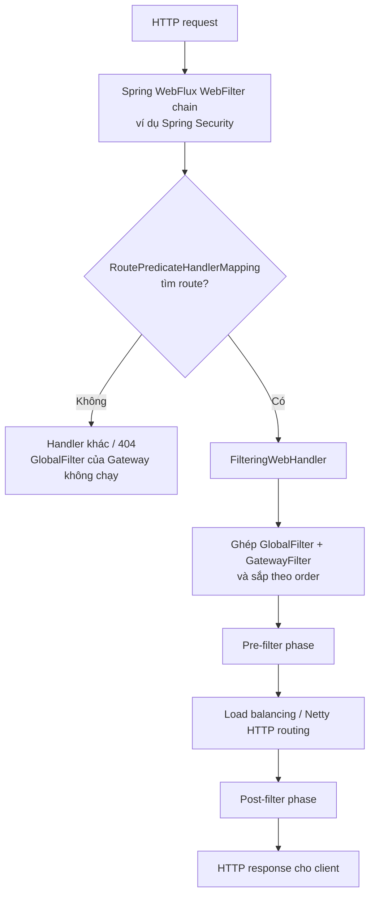
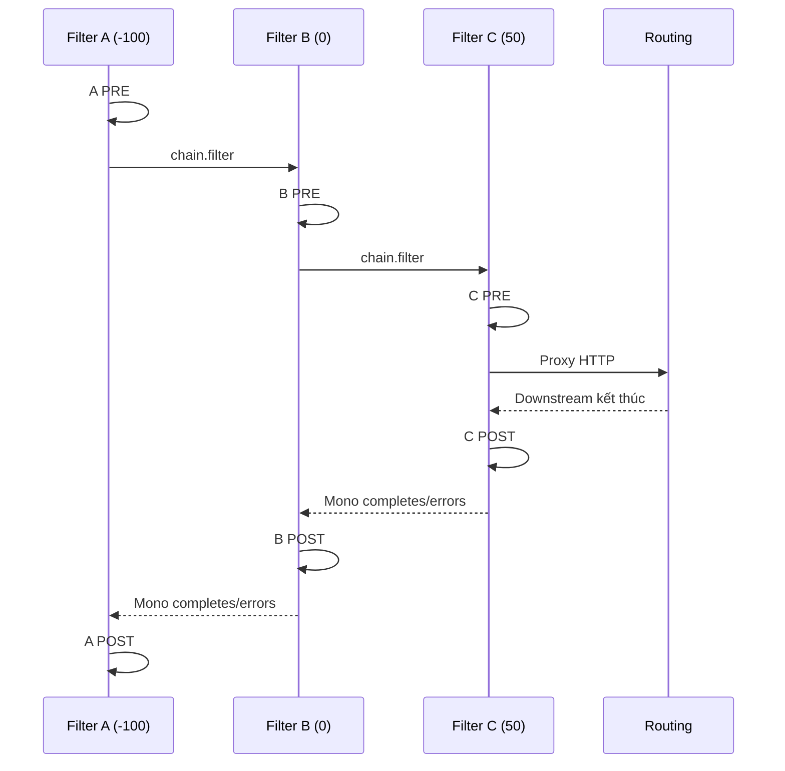
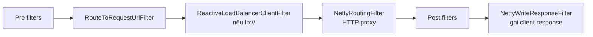
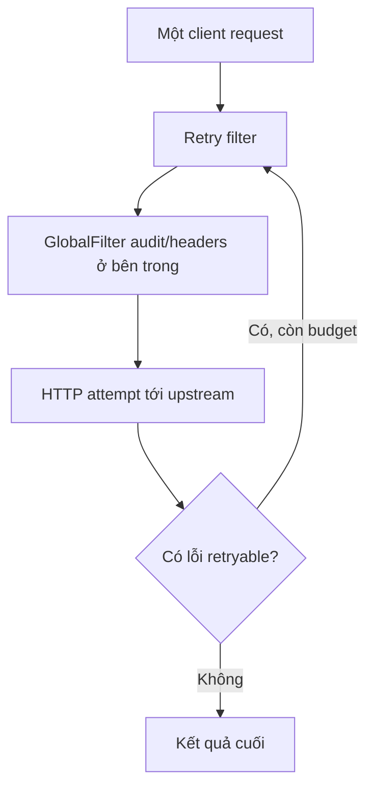

# Viết GlobalFilter và lựa chọn thứ tự có chủ đích

Trong **Spring Cloud Gateway Server WebFlux**, một request có thể đi qua nhiều bước trước khi tới service: kiểm tra route predicate, thêm correlation ID, biến đổi path/header, giải mã URI `lb://`, chọn instance, áp dụng rate limit, circuit breaker hoặc retry, sau đó gửi HTTP qua Reactor Netty và viết response về client. Khi một yêu cầu kỹ thuật cần áp dụng cho **nhiều route**, ví dụ chuẩn hóa header theo dõi, thu thập thời gian xử lý hoặc chặn request theo trạng thái bảo trì, ta có thể viết **`GlobalFilter`**.

Tuy nhiên, viết một filter hoạt động được chưa đủ. **Thứ tự filter quyết định dữ liệu mà filter nhìn thấy, số lần nó được gọi khi retry, và thời điểm response đã được commit.** Một filter ghi header quá muộn có thể không tác dụng; một filter dùng `Thread.sleep()` có thể làm nghẽn event loop; một filter đặt sau `Retry` có thể bị chạy nhiều lần và tạo audit events trùng lặp. Vì thế cần thiết kế **pre/post phase, `Ordered` và ranh giới trách nhiệm** ngay từ đầu.

Bài thuộc chương **Bộ lọc tùy biến** của module **SPRING_CLOUD_GATEWAY**. Nó áp dụng trực tiếp cho việc xây dựng API Gateway bằng route predicates, filter chain, biến đổi path/header, service discovery, xác thực, giới hạn lưu lượng, circuit breaker, retry, TLS và khả năng quan sát request.

Sau bài này, bạn có thể:

1. Phân biệt `GlobalFilter`, `GatewayFilter`, `WebFilter` và `HttpHeadersFilter`; biết khi nào nên dùng mỗi loại.
2. Hiểu **chuỗi filter kết hợp** và quy tắc ưu tiên: order nhỏ hơn chạy **sớm hơn ở pre** nhưng **muộn hơn ở post**.
3. Viết `GlobalFilter` bằng Java theo WebFlux reactive, thêm correlation ID an toàn vào request và response.
4. Đo thời gian xử lý, xử lý lỗi/cancellation, short-circuit có chủ đích và đọc metadata của route.
5. Chọn order phù hợp với `Retry`, `CircuitBreaker`, `RequestRateLimiter`, `RouteToRequestUrlFilter`, `ReactiveLoadBalancerClientFilter` và `NettyRoutingFilter`.
6. Kiểm thử hành vi pre/post, header mutation, response commit, retries, security và kiểm tra order thực tế bằng Actuator.

> **Phạm vi:** Bài sử dụng **Spring Cloud Gateway Server WebFlux** và **Reactor Netty**, không dùng `GlobalFilter` như một Servlet `Filter` hay áp dụng nguyên xi cho Gateway Server MVC. Tài liệu chính thức lưu ý API `GlobalFilter` có thể thay đổi ở các bản milestone tương lai. Ví dụ routes sử dụng namespace **Gateway Server WebFlux 5.x** `spring.cloud.gateway.server.webflux.routes`; ở **WebFlux 4.3.x** thường dùng `spring.cloud.gateway.routes`. Không hard-code order nội bộ của Gateway theo một phiên bản khác mà chưa kiểm tra runtime.

## 1. GlobalFilter nằm ở đâu trong hành trình request?

Trước khi chọn một route, Spring WebFlux xử lý request qua `WebFilter` và các handler mappings. Nếu `RoutePredicateHandlerMapping` tìm thấy route phù hợp, `FilteringWebHandler` sẽ tạo chuỗi filter của Gateway, gồm:

- Các bean triển khai **`GlobalFilter`**, áp dụng ở phạm vi các request đã **match một route** của Gateway.
- Các **`GatewayFilter`** được khai báo cho route đã chọn.
- Các GatewayFilter được bổ sung thông qua cấu hình `default-filters` hoặc các cơ chế route filters khác.

Chuỗi này được **sắp xếp theo `Ordered`**, không chia thành hai nhóm “chạy hết global rồi mới chạy route”.



**Không nhầm GlobalFilter với filter của mọi HTTP request trong Spring Boot.** Request đến actuator endpoint, một REST controller nội bộ, CORS preflight xử lý ở handler khác hoặc URL không match bất kỳ route nào **có thể không đi qua `GlobalFilter`**. Nếu cần chính sách bắt buộc ở **mọi exchange WebFlux**, hãy xem xét `WebFilter`/Spring Security hoặc lớp ingress thích hợp.

Một `GlobalFilter` được gọi “global” trong **phạm vi chuỗi Gateway của những route đã match**, không phải bảo đảm mọi URL đi qua nó.

### Ví dụ route được chọn

```yaml
spring:
  cloud:
    gateway:
      server:
        webflux:
          routes:
            - id: orders-api
              uri: lb://order-service
              predicates:
                - Path=/api/orders/**
              filters:
                - StripPrefix=1
                - AddRequestHeader=X-Edge, gateway
```

Khi client gọi `GET /api/orders/42`, các `GlobalFilter` đủ điều kiện được ghép cùng `StripPrefix` và `AddRequestHeader` của route này. Nếu một route khác `catalog-api` được chọn, **cùng các GlobalFilter** có thể chạy nhưng được ghép với các GatewayFilter riêng của catalog.

## 2. Phân biệt GlobalFilter, GatewayFilter, WebFilter và HttpHeadersFilter

Đặt đúng trách nhiệm vào đúng lớp quan trọng hơn chọn một số order “thật nhỏ”.

| Loại | Phạm vi xử lý | Nhiệm vụ phù hợp | Điểm dễ nhầm |
| --- | --- | --- | --- |
| **`GlobalFilter`** | Chuỗi Gateway khi một route match | Correlation ID, logic vận hành dùng chung, kiểm soát dựa trên route metadata | Không chạy cho mọi WebFlux handler |
| **`GatewayFilter`** | Một route hoặc các route có default filter | Rewrite path, thêm/xóa header, retry, circuit breaker theo API | Không tự có hiệu lực toàn gateway |
| **`GatewayFilterFactory`** | Tạo `GatewayFilter` có thể cấu hình từ YAML/Java DSL | Filter tái sử dụng với tham số route riêng | Khác với viết trực tiếp `GlobalFilter` |
| **`WebFilter`** | Chuỗi WebFlux trước/ngoài Gateway handler | Spring Security, CORS và các cross-cutting concerns của ứng dụng WebFlux | `Ordered` của WebFilter không đồng nhất với order Gateway |
| **`HttpHeadersFilter`** | Chỉnh headers HTTP khi Gateway chuẩn bị proxy | Forwarded/X-Forwarded và hop-by-hop header policy | Không phải một cách thay thế tổng quát cho Gateway filter chain |

### Quy tắc chọn

- Nếu tất cả routes cần một **correlation ID**: một `GlobalFilter` là ứng viên tốt.
- Nếu chỉ route `/api/payments/**` cần policy riêng: ưu tiên **GatewayFilter**/factory cấu hình cho route hoặc một GlobalFilter **có điều kiện rõ ràng** theo metadata.
- Nếu request chưa match route cũng phải đi qua authorization: dùng **Spring Security WebFlux**, không kỳ vọng `GlobalFilter` thực thi trước security.
- Nếu chỉ cần `StripPrefix`, `AddRequestHeader`, `RemoveRequestHeader` hay `SecureHeaders`, hãy **tái sử dụng factory có sẵn** thay vì viết một GlobalFilter phức tạp.
- Nếu mục đích là quản lý `Forwarded` hoặc `X-Forwarded-*`, hiểu chính sách proxy tin cậy và các `HttpHeadersFilter` tích hợp trước khi tự chèn headers.

**Anti-pattern:** Tạo một `GlobalFilter` tự parse JWT bằng Base64, gán `X-User-Id` và cho rằng đã thực hiện xác thực. JWT phải được **Spring Security Reactive Resource Server** xác minh signature, issuer, audience và thời hạn; GlobalFilter không được biến dữ liệu client tự khai báo thành danh tính đáng tin.

## 3. Chữ ký của GlobalFilter và nguyên tắc reactive

Hai API nền tảng:

```java
import org.springframework.cloud.gateway.filter.GlobalFilter;
import org.springframework.cloud.gateway.filter.GatewayFilterChain;
import org.springframework.web.server.ServerWebExchange;
import reactor.core.publisher.Mono;

public interface GlobalFilter {
    Mono<Void> filter(
        ServerWebExchange exchange,
        GatewayFilterChain chain);
}
```

`GlobalFilter.filter(...)` trả một **`Mono<Void>`** — một kế hoạch thực thi bất đồng bộ. Đừng hiểu lời gọi `chain.filter(exchange)` là “HTTP proxy chắc chắn đã xong ngay trong dòng code Java”.

Một ví dụ đơn giản nhất:

```java
import org.springframework.cloud.gateway.filter.GlobalFilter;
import org.springframework.cloud.gateway.filter.GatewayFilterChain;
import org.springframework.core.Ordered;
import org.springframework.stereotype.Component;
import org.springframework.web.server.ServerWebExchange;

import reactor.core.publisher.Mono;

@Component
public final class SimpleGlobalFilter
        implements GlobalFilter, Ordered {

    @Override
    public int getOrder() {
        return -50;
    }

    @Override
    public Mono<Void> filter(
            ServerWebExchange exchange,
            GatewayFilterChain chain) {

        // PRE: thực hiện công việc nhẹ, không blocking.
        return chain.filter(exchange);
    }
}
```

`@Component` làm lớp được đăng ký thành bean Spring. Cũng có thể khai báo `@Bean GlobalFilter`; **không dùng đồng thời cả hai** cho cùng logic, vì có thể đăng ký filter hai lần.

`Ordered` là hợp đồng Spring Core để Gateway so sánh order. Giá trị `-50` ở đây **chỉ là ví dụ**, không phải “order được Spring khuyến nghị cho mọi filter”. Phải kiểm tra sự tương tác với những GlobalFilter/GatewayFilter khác và các built-in filters có hiệu lực.

### Những điều không được làm trong filter()

```java
// ANTI-PATTERNS: không chép vào GlobalFilter production
Thread.sleep(500);
webClient.get().uri("/somewhere").retrieve()
    .bodyToMono(String.class).block();
mono.subscribe(); // Fire-and-forget, lỗi/cancellation thất lạc
```

- `Thread.sleep` và `block()` có thể nghẽn event loop.
- `subscribe()` thủ công làm công việc thoát khỏi vòng đời request, lỗi bị tách khỏi response, dễ làm side effect diễn ra sau khi client hủy.
- Ghi trạng thái request vào **field mutable của singleton bean** có thể làm dữ liệu lẫn giữa concurrent requests.
- Đọc toàn bộ request/response body trong một GlobalFilter không có decorator/buffer policy có thể tiêu thụ stream và làm backend nhận body rỗng hoặc gây leak `DataBuffer`.

## 4. Hiểu đúng pre-phase và post-phase

Một GlobalFilter thường có thể thực hiện:

- **Pre logic**: xử lý request, thêm header, quyết định cho đi hay short-circuit trước khi chuyển tới filter sau.
- **Post logic**: quan sát hoàn tất, cập nhật metrics, ghi log và thực hiện xử lý phù hợp **sau** filter chain bên trong.

Dạng điển hình:

```java
@Override
public Mono<Void> filter(
        ServerWebExchange exchange,
        GatewayFilterChain chain) {

    // PRE logic — trước khi chuyển cho phần sau.
    return chain.filter(exchange)
        .doFinally(signalType -> {
            // POST/terminal observation: complete, error hoặc cancel.
        });
}
```

Sơ đồ với ba filter minh họa: A có order `-100`, B có order `0`, C có order `50`.



Thứ tự **pre**: A → B → C. Thứ tự **post**: C → B → A.

**Quy tắc chính thức:** Filter có **mức ưu tiên cao nhất** (thường order **nhỏ nhất**) sẽ chạy **đầu tiên ở pre** và **cuối cùng ở post**. Điều đó có nghĩa một filter bọc ở bên ngoài có thể đo/hậu xử lý toàn bộ phần chuỗi bên trong.

### Bảng chọn order

| Filter minh họa | `getOrder()` | Thứ tự pre | Thứ tự post |
| --- | ---: | ---: | ---: |
| A — tạo context chung | -100 | 1 | 3 |
| B — ghi thông tin chuẩn hóa | 0 | 2 | 2 |
| C — kiểm tra trạng thái route | 50 | 3 | 1 |

**Không suy ra rằng “order lớn hơn thì filter chạy sau ở mọi giai đoạn”.** Điều này chỉ đúng cho pre, còn post đảo chiều.

### Pre/post không phải hai filter độc lập

Trong Reactor, mã chạy **trước** `return chain.filter(exchange)` và logic trong operator `doFinally`/`then` có thời điểm thực thi khác nhau. Điều kiện có thể thay đổi vì:

- Một filter ở giữa **short-circuit** và không gọi tiếp `chain.filter`.
- `Retry` resubscribe các filters phía sau nó.
- Publisher kết thúc bằng error hoặc bị cancel, không phải complete.
- Response có thể đã commit trước khi một filter chạy phần post của mình.
- Một `WebFilter` ngoài Gateway hoặc một error handler có thể xử lý response sau/bên ngoài chuỗi đang xét.

Vì vậy, dùng từ “post” để mô tả **vị trí trong reactive chain**, không bảo đảm lúc đó mọi byte đã được client nhận.

## 5. Chuỗi filter kết hợp: GlobalFilter và GatewayFilter không được tách lớp

Theo tài liệu Gateway, khi route match, `FilteringWebHandler` ghép các `GlobalFilter` và `GatewayFilter` rồi sắp xếp chung theo `Ordered`.

Giả sử có:

- Global A: order `-100`.
- Route filter X: order `-50`.
- Global B: order `0`.
- Route filter Y: order `20`.
- Global C: order `100`.

Minh họa:

```text
PRE:
  Global A (-100)
    Route X (-50)
      Global B (0)
        Route Y (20)
          Global C (100)
            HTTP routing

POST:
  Global C (100)
    Route Y (20)
      Global B (0)
        Route X (-50)
          Global A (-100)
```

Tức là **không phải**:

```text
Sai:
  chạy tất cả GlobalFilter
  -> chạy tất cả GatewayFilter
  -> gọi backend
```

### Trường hợp không gắn Ordered

Nhiều `GatewayFilter` được tạo từ YAML sẽ được bọc bằng `OrderedGatewayFilter` với order bắt nguồn từ vị trí trong danh sách filter, trừ khi factory/lớp lọc đặt order tường minh. `default-filters` và route filters có thể được đánh số độc lập, sau đó stable-sort theo quy tắc của phiên bản Gateway.

**Không nên** dựa vào hai filter cùng số order để đạt một ràng buộc bảo mật/đúng sai nghiêm ngặt. Nếu hai filter cần “sanitize trước rồi mới add trusted header”, hãy thiết kế order **khác nhau và kiểm thử** hoặc gom thành một đơn vị xử lý có contract rõ ràng.

### Route order khác filter order

Route có thể có thuộc tính `order` để ưu tiên chọn route khi nhiều predicate cùng match. Thuộc tính này **không phải** thứ tự của GlobalFilter/GatewayFilter.

```yaml
# Phân biệt hai ý nghĩa order
- id: orders-api
  order: 10         # Ưu tiên CHỌN ROUTE khi có nhiều route match
  uri: http://localhost:8081
  predicates:
    - Path=/api/orders/**
  filters:
    - StripPrefix=1 # Thứ tự GatewayFilter trong chuỗi route
```

Không thay `route.order` để giải quyết lỗi “GlobalFilter ghi header sau RewritePath”; phải điều chỉnh logic/order của filters.

## 6. Ví dụ Java hoàn chỉnh: GlobalFilter chuẩn hóa Correlation ID

Nhu cầu:

1. Client có thể gửi `X-Correlation-Id` để hỗ trợ tìm trace.
2. Gateway chỉ giữ ID có định dạng an toàn; khi không hợp lệ thì tạo UUID.
3. Gateway **ghi đè** header request bằng đúng một giá trị đã chuẩn hóa, rồi cho upstream nhận giá trị đó.
4. Gateway thêm cùng ID vào **response header trước khi response commit**.
5. Không coi correlation ID là JWT, API key hoặc bằng chứng danh tính.

```java
package example.gateway.filters;

import java.util.UUID;
import java.util.regex.Pattern;

import org.springframework.cloud.gateway.filter.GlobalFilter;
import org.springframework.cloud.gateway.filter.GatewayFilterChain;
import org.springframework.core.Ordered;
import org.springframework.http.server.reactive.ServerHttpRequest;
import org.springframework.stereotype.Component;
import org.springframework.web.server.ServerWebExchange;

import reactor.core.publisher.Mono;

@Component
public final class CorrelationIdGlobalFilter
        implements GlobalFilter, Ordered {

    private static final String HEADER = "X-Correlation-Id";

    // Không cho CR/LF, khoảng trắng hoặc chuỗi quá dài đi vào log/header.
    private static final Pattern SAFE_ID =
        Pattern.compile("[A-Za-z0-9._-]{1,64}");

    @Override
    public int getOrder() {
        // Ví dụ: chọn lại theo filter order thực tế của ứng dụng.
        return -50;
    }

    @Override
    public Mono<Void> filter(
            ServerWebExchange exchange,
            GatewayFilterChain chain) {

        String supplied = exchange.getRequest()
            .getHeaders().getFirst(HEADER);

        String id = supplied != null
                && SAFE_ID.matcher(supplied).matches()
            ? supplied
            : UUID.randomUUID().toString();

        // ServerHttpRequest immutable: phải mutate và chuyển exchange mới.
        ServerHttpRequest request = exchange.getRequest()
            .mutate()
            .headers(headers -> headers.set(HEADER, id))
            .build();

        ServerWebExchange updated = exchange.mutate()
            .request(request)
            .build();

        // Đăng ký trước khi proxy/chuyển tới filter tiếp theo.
        updated.getResponse().beforeCommit(() -> {
            updated.getResponse().getHeaders().set(HEADER, id);
            return Mono.empty();
        });

        return chain.filter(updated);
    }
}
```

### Vì sao phải dùng exchange.mutate()?

Trong WebFlux, `ServerHttpRequest` và `ServerWebExchange` sử dụng API decorator/mutation. Đoạn mã sau **không đủ**:

```java
// SAI: tạo một request mới rồi bỏ đi.
exchange.getRequest()
    .mutate()
    .header("X-Correlation-Id", "abc")
    .build();

return chain.filter(exchange); // upstream vẫn nhìn exchange cũ
```

Đúng là tạo request mới rồi truyền bằng **`chain.filter(updatedExchange)`** như ví dụ. Dùng `headers.set` thay vì `add` để tránh giữ nhiều giá trị không mong muốn cho một header công khai; với chính sách liên quan bảo mật, loại bỏ/ghi đè các headers không tin cậy **trước** khi backend đọc.

### Vì sao không chấp nhận mọi correlation ID từ client?

Client có thể gửi giá trị dài, chứa ký tự điều khiển hoặc phá cấu trúc log. Regex `[A-Za-z0-9._-]{1,64}` chỉ minh họa biện pháp **giảm rủi ro**, không làm giá trị trở thành danh tính đáng tin.

Khi cần **trace ID do edge làm chủ**, có thể **luôn tạo ID mới** thay vì giữ ID client truyền vào, hoặc dùng hệ thống distributed tracing có policy tin cậy riêng. `X-Correlation-Id` không được dùng làm khóa phân quyền, quota billing hay xác nhận user.

### Phạm vi thực tế

`CorrelationIdGlobalFilter` chạy đối với **những request có Gateway route match**. Nếu muốn correlation ID xuất hiện trong mọi response kể cả lỗi 404 từ handler khác hoặc 401 từ Spring Security trước routing, cần cơ chế `WebFilter`/Spring Security hoặc ingress instrumentation phù hợp.

## 7. Sửa response headers: trước commit hay sau chain?

Response có thể đã được gửi status/headers ngay khi các bộ lọc ở post-phase chạy. Vì vậy, hai cách sau không tương đương:

```java
// CÓ RỦI RO: response có thể đã commit khi then() chạy.
return chain.filter(exchange)
    .then(Mono.fromRunnable(() ->
        exchange.getResponse()
            .getHeaders()
            .set("X-Correlation-Id", "abc")));
```

```java
// TỐT HƠN khi cần ghi header trước thời điểm commit.
exchange.getResponse().beforeCommit(() -> {
    exchange.getResponse()
        .getHeaders()
        .set("X-Correlation-Id", "abc");
    return Mono.empty();
});
return chain.filter(exchange);
```

`beforeCommit` cho phép đăng ký callback **trước** khi response commit, để header được đặt ở thời điểm thích hợp. Callback phải **nhẹ**, không gọi I/O blocking hoặc phải fetch dữ liệu từ một service bên ngoài. Nếu filter chỉ được kích hoạt **sau khi response đã commit**, đăng ký callback không thể quay ngược thời gian.

### Đừng trộn response header và response body

- Ghi response header đúng thời điểm là thao tác khác với **đọc/biến đổi response body**.
- Khi cần sửa body, sử dụng `ModifyResponseBody` hoặc cơ chế decorator/codec được hỗ trợ, không trực tiếp đọc `DataBuffer` bằng `block()`.
- Với streaming/SSE, body có thể kéo dài, không được gom toàn bộ vào memory chỉ để chèn một header.
- Nếu `NettyWriteResponseFilter` đã bắt đầu ghi response, thay đổi status/body có thể không còn khả thi.
- Header thêm bởi backend có thể bị Gateway hoặc proxy khác viết/ghi đè; kiểm tra **response cuối từ client**, không chỉ metadata trong filter.

### Response đã commit?

```java
boolean committed = exchange.getResponse().isCommitted();
```

Dùng thông tin này để chẩn đoán, **không** làm điều kiện chính để thêm header quá muộn. Nếu bạn cần bảo đảm một response header, đăng ký callback ngay từ **pre-phase**.

## 8. GlobalFilter đo độ trễ và cả cancellation

Một nhu cầu phổ biến khác là đo thời gian từ khi GlobalFilter bắt đầu xử lý cho tới khi publisher được hoàn tất. Dùng `System.nanoTime()` thay vì đồng hồ thời gian thực `System.currentTimeMillis()` khi tính khoảng thời gian.

```java
package example.gateway.filters;

import org.slf4j.Logger;
import org.slf4j.LoggerFactory;

import org.springframework.cloud.gateway.filter.GlobalFilter;
import org.springframework.cloud.gateway.filter.GatewayFilterChain;
import org.springframework.cloud.gateway.route.Route;
import org.springframework.core.Ordered;
import org.springframework.stereotype.Component;
import org.springframework.web.server.ServerWebExchange;

import reactor.core.publisher.Mono;

import static org.springframework.cloud.gateway.support
    .ServerWebExchangeUtils.GATEWAY_ROUTE_ATTR;

@Component
public final class TimingGlobalFilter
        implements GlobalFilter, Ordered {

    private static final Logger log =
        LoggerFactory.getLogger(TimingGlobalFilter.class);

    @Override
    public int getOrder() {
        return -40;
    }

    @Override
    public Mono<Void> filter(
            ServerWebExchange exchange,
            GatewayFilterChain chain) {

        // defer bảo đảm đo theo thời điểm subscription của publisher.
        return Mono.defer(() -> {
            long started = System.nanoTime();

            return chain.filter(exchange)
                .doFinally(signal -> {
                    long elapsedMs =
                        (System.nanoTime() - started) / 1_000_000;

                    Route route = exchange.getAttribute(
                        GATEWAY_ROUTE_ATTR);

                    String routeId = route != null
                        ? route.getId() : "unknown";

                    log.debug(
                        "routeId={} signal={} elapsedMs={}",
                        routeId, signal, elapsedMs);
                });
        });
    }
}
```

**Tại sao `doFinally` thay vì chỉ `doOnSuccess`?** `doFinally` được gọi khi publisher hoàn thành bình thường, kết thúc bằng lỗi hoặc bị **cancel**. Trong một API Gateway, client có thể ngắt kết nối trong lúc upstream chậm hoặc retry; cancellation là một tín hiệu vận hành quan trọng.

**Tại sao dùng `Mono.defer`?** Nó đặt mốc bắt đầu gần subscription tương ứng, tránh ghi thời gian từ lúc Java tạo publisher nhưng publisher chưa được thực thi. Đặc biệt hữu ích khi filter chain có resubscription do retry hoặc các operator reactive khác.

### Giới hạn của phép đo

Con số `elapsedMs` đo **vòng đời publisher mà filter bọc**; không tự bảo đảm đã bao gồm tất cả thời gian ở ingress, Spring Security trước Gateway, TLS handshake của client hay việc từng byte response đã được mạng nhận. Vị trí order có thể làm filter bao bọc các phần khác nhau của chain.

Để có số liệu production chuẩn hóa:

- Ưu tiên metrics Gateway/Micrometer có sẵn như `spring.cloud.gateway.requests` khi phù hợp.
- Ghi route ID, HTTP status, outcome, latency theo tập tag có cardinality kiểm soát.
- Dùng distributed tracing/OpenTelemetry thay vì tự tạo một hệ thống trace riêng thiếu propagation.
- Không đưa path chứa user ID, URL query nhạy cảm, bearer token hay raw correlation ID thành metric label không giới hạn.

## 9. Chọn thứ tự giữa nhiều GlobalFilter do chính mình viết

Giả sử đội vận hành có ba yêu cầu:

1. Chuẩn hóa correlation ID để filter khác có thể đọc.
2. Đo thời gian của phần Gateway filter chain.
3. Kiểm tra route có được bật trong thời gian bảo trì không.

Có thể tổ chức thứ tự của **nhóm filter riêng** như sau:

| Filter tùy biến | Order ví dụ | Lý do |
| --- | ---: | --- |
| `CorrelationIdGlobalFilter` | -50 | Header được chuẩn hóa trước filter đo/log |
| `TimingGlobalFilter` | -40 | Đo phần chuỗi nằm sau nó |
| `MaintenanceGlobalFilter` | -30 | Có thể short-circuit theo route metadata |

Khi cả ba thực sự được sắp theo những order trên:

```text
PRE:
  CorrelationId(-50)
    Timing(-40)
      Maintenance(-30)
        ... các filters khác ...
POST:
  ... các filters khác ...
      Maintenance(-30)
    Timing(-40)
  CorrelationId(-50)
```

**Nhưng** đây chỉ cho biết **quan hệ tương đối giữa ba custom filters**, không đảm bảo chúng đều nằm trước `RouteToRequestUrlFilter`, `ReactiveLoadBalancerClientFilter`, `NettyRoutingFilter` hay mọi route GatewayFilter. Các built-in filters dùng order riêng và có thể thay đổi theo phiên bản.

### Đừng coi -50 là hằng số phổ quát

Một project khác có thể có:

- Một GatewayFilter route có order `-100`.
- Một GlobalFilter bảo mật tùy biến có order `-60`.
- Một GatewayFilter được wrap bằng `OrderedGatewayFilter` với order `0`.
- Một built-in filter có order âm hoặc rất lớn.

Khi thêm filter, phải liệt kê cả **các filter hiện có**, xác định dependency về dữ liệu, chọn vị trí và chạy test. Không “giải quyết” thứ tự bằng cách đặt `Ordered.HIGHEST_PRECEDENCE` cho mọi custom filter: nhiều filter cùng ưu tiên cao sẽ cạnh tranh, khó bảo trì.

## 10. GlobalFilter có điều kiện bằng route metadata

Không phải mọi route đều cần cùng logic. Nếu chỉ `orders-api` cần kiểm tra maintenance, có thể đọc `Route` đã match từ exchange:

```java
import org.springframework.cloud.gateway.route.Route;

import static org.springframework.cloud.gateway.support
    .ServerWebExchangeUtils.GATEWAY_ROUTE_ATTR;

Route route = exchange.getAttribute(GATEWAY_ROUTE_ATTR);

if (route == null) {
    return chain.filter(exchange);
}

Object flag = route.getMetadata().get("maintenance");
if (!Boolean.TRUE.equals(flag)) {
    return chain.filter(exchange);
}
```

Đây là **mảnh logic** nằm trong implementation của `GlobalFilter.filter`. Key `maintenance` là metadata **tự định nghĩa của ứng dụng**, không phải property được Gateway mặc định hiểu là trạng thái bảo trì.

Khai báo ở route:

```yaml
spring:
  cloud:
    gateway:
      server:
        webflux:
          routes:
            - id: orders-api
              uri: http://localhost:8081
              predicates:
                - Path=/api/orders/**
              metadata:
                maintenance: true
              filters:
                - StripPrefix=1

            - id: catalog-api
              uri: http://localhost:8082
              predicates:
                - Path=/api/catalog/**
```

Từ đó, cùng một GlobalFilter có thể chỉ thực hiện phần xử lý riêng cho `orders-api`. Nếu chưa bật metadata hoặc route khác được chọn, request đi tiếp như bình thường.

### Vì sao metadata tốt hơn hard-code tên route?

Lệnh:

```java
if ("orders-api".equals(route.getId())) {
    // custom policy
}
```

rất dễ viết, nhưng tên route có thể đổi khi triển khai, tách v1/v2 hoặc discovery locator tự sinh route ID. Metadata thể hiện **chủ đích của route**, giúp code ít phụ thuộc vào chuỗi tên cụ thể hơn. Dù vậy, metadata phải được quản trị bằng config tin cậy; **không lấy flag maintenance từ header do client gửi**.

## 11. Short-circuit: khi nào không gọi chain.filter?

Một `GlobalFilter` có thể chặn request trước khi HTTP proxy nếu chính sách đã cho phép làm vậy, ví dụ route đang bảo trì.

```java
package example.gateway.filters;

import org.springframework.cloud.gateway.filter.GlobalFilter;
import org.springframework.cloud.gateway.filter.GatewayFilterChain;
import org.springframework.cloud.gateway.route.Route;
import org.springframework.core.Ordered;
import org.springframework.http.HttpStatus;
import org.springframework.stereotype.Component;
import org.springframework.web.server.ServerWebExchange;

import reactor.core.publisher.Mono;

import static org.springframework.cloud.gateway.support
    .ServerWebExchangeUtils.GATEWAY_ROUTE_ATTR;

@Component
public final class MaintenanceGlobalFilter
        implements GlobalFilter, Ordered {

    @Override
    public int getOrder() {
        return -30;
    }

    @Override
    public Mono<Void> filter(
            ServerWebExchange exchange,
            GatewayFilterChain chain) {

        Route route = exchange.getAttribute(GATEWAY_ROUTE_ATTR);

        boolean maintenance = route != null
            && Boolean.TRUE.equals(
                route.getMetadata().get("maintenance"));

        if (!maintenance) {
            return chain.filter(exchange);
        }

        exchange.getResponse().setStatusCode(
            HttpStatus.SERVICE_UNAVAILABLE);

        // Chỉ dùng Retry-After khi có thời gian dự kiến thực tế.
        exchange.getResponse().getHeaders()
            .set("Retry-After", "60");

        return exchange.getResponse().setComplete();
    }
}
```

Khi bảo trì:

- Filter **không gọi `chain.filter(exchange)`**, nên các GatewayFilters/routing phía sau nó không chạy.
- Response trả `503` trực tiếp tại Gateway, backend không nhận request.
- Các filter nằm **trước** nó vẫn có thể chạy phần post/terminal callbacks.
- Không thể suy ra mọi filter phía sau được thực thi hoặc mọi metric đều đã ghi như luồng proxy bình thường.
- Nếu Retry đặt ngoài filter này và có policy retry `503`, có thể vô tình lặp lại short-circuit; cần thiết kế order/policy để tránh.

**Cảnh báo:** Giá trị `Retry-After: 60` chỉ phù hợp nếu biết dịch vụ có thể khôi phục sau khoảng tương ứng; nếu không, đừng thông báo thời điểm khôi phục không có cơ sở. Trong sản phẩm thật, cấu hình flag/thời gian bảo trì nên được quản trị, kiểm thử và có quy trình rollback.

### Trả JSON khi short-circuit?

Có thể dùng `ServerHttpResponse.writeWith` với `DataBuffer` trong WebFlux, nhưng phải quản lý buffer, charset, content length và cancellation. Đối với lỗi chuẩn, đôi khi cấu hình error handler/WebFlux controller sẽ dễ bảo trì hơn. Không viết body nhiều lần sau khi `setComplete()` đã commit response.

## 12. Đặt GlobalFilter trước hay sau route/path transformation?

Giả sử route có:

```yaml
filters:
  - StripPrefix=1
  - SetRequestHeader=X-Service-Version, v2
```

Với client request `GET /api/orders/42`:

- **Trước `StripPrefix`**, đường dẫn request thường là `/api/orders/42`.
- **Sau `StripPrefix`**, exchange được truyền tiếp có thể nhìn thấy request path đã biến đổi, ví dụ `/orders/42`.
- Route URI có thể chưa được xử lý thành `GATEWAY_REQUEST_URL_ATTR` ở những order sớm.
- Khi `RouteToRequestUrlFilter` đã chạy, attribute `GATEWAY_REQUEST_URL_ATTR` có thể chứa URI route đã kết hợp path.
- Khi `ReactiveLoadBalancerClientFilter` đã xử lý `lb://`, attribute đó có thể chứa host/port instance cụ thể.
- Khi `NettyRoutingFilter` đã thực hiện routing, response của HTTP client có thể nằm trong `CLIENT_RESPONSE_ATTR`.

### Những attribute quan trọng

| Exchange attribute | Thường do ai thiết lập/sử dụng? | Khi cần |
| --- | --- | --- |
| `GATEWAY_ROUTE_ATTR` | Route mapping/handler | Biết route ID, URI và metadata route đã match |
| `GATEWAY_REQUEST_URL_ATTR` | Route-to-request-url, load balancer, routing filters | Xác định đích outbound đã qua các giai đoạn |
| `GATEWAY_ORIGINAL_REQUEST_URL_ATTR` | Một số filter rewrite/routing | Tham chiếu các URI gốc đã lưu |
| `GATEWAY_SCHEME_PREFIX_ATTR` | Routing/load-balancing logic | Phân biệt scheme prefix như `lb` |
| `CLIENT_RESPONSE_ATTR` | Netty HTTP routing | Thông tin response từ Reactor Netty client |
| `GATEWAY_ALREADY_ROUTED_ATTR` | Routing state | Tránh gửi lại request không chủ đích |

**Không đọc attribute quá sớm** rồi kết luận nó phải tồn tại; và **không trực tiếp ghi đè internal attribute** nếu mục tiêu chỉ là thêm header hoặc rewrite path — hãy dùng các filter factory có sẵn.

### Ví dụ sai thời điểm

```java
// Có thể null nếu GlobalFilter chạy trước RouteToRequestUrlFilter.
URI uri = exchange.getAttribute(
    ServerWebExchangeUtils.GATEWAY_REQUEST_URL_ATTR);
```

Không thể bảo đảm `uri` là `http://instance:port` chỉ vì route đã có `lb://service`. Nếu cần log instance outbound thực tế, hãy thiết kế instrumentation ở đúng thời điểm sau lựa chọn instance hoặc dùng metrics/tracing của LoadBalancer và HTTP client, thay vì đặt một GlobalFilter order âm thật lớn rồi đọc URI.

## 13. Tương tác với NettyRoutingFilter và NettyWriteResponseFilter

Hai built-in GlobalFilter quan trọng của Gateway Server WebFlux:

1. **`NettyRoutingFilter`**: khi outbound URI là `http/https`, dùng Reactor Netty `HttpClient` gửi request tới backend và đặt HTTP client response vào `CLIENT_RESPONSE_ATTR`.
2. **`NettyWriteResponseFilter`**: khi có Netty client response, tham gia pha sau để ghi response về client. Theo tài liệu, nó xử lý việc viết sau khi các filter thích hợp đã hoàn tất.



Sơ đồ trình bày **thứ tự xử lý logic**, không phải danh sách numeric order chính xác của mọi built-in GlobalFilter.

### Chọn order theo dữ liệu cần đọc

| Điều muốn thực hiện | Thời điểm gợi ý | Cạm bẫy |
| --- | --- | --- |
| Thêm correlation ID trước khi gửi upstream | Pre, trước HTTP routing | Header mutation phải truyền exchange mới |
| Sửa public path | Trước việc tạo/sử dụng outbound request URL; ưu tiên filter có sẵn | Rewrite sau route-to-url có thể không như mong đợi |
| Ghi route ID | Sau khi route match, thường đầu GlobalFilter | Không áp dụng cho request không match route |
| Ghi instance backend | Sau LoadBalancer resolution ở vị trí/instrumentation thích hợp | `lb://` chưa chắc được resolve khi filter chạy |
| Thêm response header | Đăng ký `beforeCommit` sớm | Post logic có thể gặp response committed |
| Đọc HTTP client response | Sau routing và tại pha phù hợp, nếu implementation hỗ trợ | Attribute có thể null cho `forward://`/fallback/cached response |
| Thay response body | Cơ chế `ModifyResponseBody`/response decorator đúng version | Tránh đọc stream trực tiếp và leak DataBuffer |
| Thu thập latency toàn route | Filter bao ngoài phần cần đo + metrics chuẩn | Timing publisher không nhất thiết là end-to-end |

**Không copy order nội bộ** như `10000` hay `2147483647` từ một blog vào production rồi coi đó là contract vĩnh viễn. Kiểm tra `/actuator/gateway/globalfilters` của đúng binary đã triển khai, và nếu nâng cấp Gateway hãy chạy lại test thứ tự.

## 14. Tương tác với Retry, CircuitBreaker và RequestRateLimiter

Đây là nguồn lỗi vận hành khó phát hiện.

Tài liệu `Retry GatewayFilter` nhấn mạnh rằng **Retry thực thi lại các filter nằm sau nó**. Khi một GlobalFilter được sắp **sau** Retry trong chuỗi kết hợp, mã filter đó có thể bị thực thi nhiều lần do retry.



### Tác động khi đặt filter sai thứ tự

| Filter tùy biến | Nếu nằm phía sau Retry | Rủi ro |
| --- | --- | --- |
| Ghi audit “request đã được tính phí” | Có thể thực hiện theo mỗi attempt | Billing/audit bị nhân đôi |
| Thêm timestamp mỗi lần | Mỗi attempt có timestamp khác | Khó phân biệt logical request và attempt |
| Gọi service ngoài để lấy identity | Có thể gọi lại nhiều lần | Tải và latency tăng, phụ thuộc IdP |
| Ghi metric attempts | Có thể là điều **mong muốn** | Cần đặt tên metric rõ “attempt” |
| Kiểm tra quota | Có thể trừ quota nhiều lần nếu bị lặp | Thiết kế theo logical request hay attempt có chủ đích |
| Tạo correlation ID mới | Có thể tạo ID khác giữa attempts | Mất trace continuity |

**Giải pháp:** Phân biệt hai loại tác vụ:

- **Một lần cho logical request:** chọn order/position ở ngoài Retry, dùng exchange state có kiểm soát hoặc đưa tác vụ sang lớp xử lý khác phù hợp.
- **Mỗi attempt:** đặt instrumentation đúng nơi có thể nhìn thấy từng outbound attempt; không gọi đó là số request client.

### CircuitBreaker ở ngoài hay trong Retry?

- **CircuitBreaker ngoài Retry** thường đánh giá kết quả toàn bộ chuỗi retry như một logical call.
- **Retry ngoài CircuitBreaker** có thể khiến breaker ghi nhận từng attempt, mở sớm hơn.
- Fallback có thể short-circuit và biến lỗi thành response khác, ảnh hưởng Retry phía ngoài.
- Resilience4j `TimeLimiter` là một deadline khác với HTTP client timeout và có thể bao quanh toàn retry sequence hoặc từng attempt theo filter order.

**Không giả định** chỉ vì GlobalFilter có order `-50` mà nó chắc chắn nằm ngoài mọi Retry filter: route GatewayFilter có thể có order riêng; cần xem chain thực tế.

### Rate limiting và lỗi security

`RequestRateLimiter` cần key đáng tin, chẳng hạn principal đã được Spring Security xác minh. `GlobalFilter` không nên tự coi header `X-User-Id` do client gửi là key tin cậy. Nếu rate limiter ở phía sau Retry, có thể phát sinh policy trừ quota theo attempt mà người thiết kế không mong muốn.

Spring Security có thể trả `401/403` trước Gateway chain; lỗi authentication/authorization **không nên** được Retry hoặc CircuitBreaker của upstream coi là lỗi sức khỏe backend.

## 15. Xử lý lỗi đúng cách: không nuốt exception và không ghi response hai lần

Một filter giám sát nên **quan sát lỗi** mà không làm sai contract HTTP:

```java
return chain.filter(exchange)
    .doOnError(error -> {
        // Log dạng lỗi đã chuẩn hóa, không in token/cookie/body.
        log.warn("Gateway chain failed: {}",
            error.getClass().getSimpleName());
    });
```

Đừng làm thế này một cách vô điều kiện:

```java
// SAI: nuốt mọi lỗi, có thể biến request thất bại thành complete giả.
return chain.filter(exchange)
    .onErrorResume(error -> Mono.empty());
```

Việc nuốt lỗi có thể làm Spring Security, HTTP transport, retry/circuit breaker và error handler không nhận được tín hiệu đúng. Nếu phải chuyển lỗi thành response, cần một policy **rõ theo loại lỗi**, bảo đảm response chưa commit và không tiết lộ stacktrace/URI nội bộ.

### Cancellation

Nếu client ngắt kết nối, reactive publisher có thể nhận `CANCEL`. Không nên:

- Tự tạo một `subscribe()` khác để “làm cho xong việc” sau khi request đã hủy.
- Retry side-effecting call bất chấp client cancel.
- Coi cancellation là chắc chắn backend rollback transaction.
- Ghi một kết quả “success” vào audit chỉ vì downstream có một dấu hiệu không đủ rõ.

Khi metrics cần phân biệt hoàn thành và cancellation, dùng `doFinally(SignalType)` và quan sát context/request ID đã chuẩn hóa.

### Concurrent requests

`GlobalFilter` bean thường là **singleton**, được nhiều request gọi đồng thời. Không đặt `requestId`, `startTime`, `userId` vào field instance:

```java
// SAI: field mutable bị chia sẻ giữa mọi request concurrent.
private String currentRequestId;
private long startedAt;
```

Dùng biến local trong `filter(...)`, `exchange.getAttributes()` với key không xung đột hoặc Reactor Context khi cần truyền dữ liệu theo reactive chain.

## 16. WebFlux performance: event loop, body và backpressure

Một GlobalFilter được gắn ở nhiều route là điểm nóng của toàn bộ Gateway. Một lỗi performance nhỏ được nhân lên theo lưu lượng hệ thống.

### Không blocking event loop

- Không dùng `RestTemplate`, JDBC đồng bộ hoặc `WebClient.block()` trực tiếp trong `filter(...)`.
- Nếu cần gọi HTTP, dùng `WebClient` reactive, timeout có trần và có hành vi lỗi rõ ràng.
- Với thư viện blocking bắt buộc, có thể dùng `Schedulers.boundedElastic()` để chuyển tác vụ **có kiểm soát**, nhưng phải đánh giá queue/saturation và tránh biến Gateway thành nơi chạy nghiệp vụ nặng.
- Không ghi log đồng bộ quá nhiều khi QPS cao hoặc serialize body lớn chỉ để debug.
- Không giữ resource lâu hơn vòng đời request; xử lý cancellation/error một cách sạch sẽ.

Ví dụ chuyển một thao tác blocking bất khả kháng (chỉ minh họa):

```java
Mono<String> lookup = Mono.fromCallable(() ->
        legacyBlockingClient.lookupSmallValue())
    .subscribeOn(Schedulers.boundedElastic());

// Nếu thực sự cần giá trị lookup trước proxy:
return lookup.flatMap(value -> {
    ServerHttpRequest request = exchange.getRequest()
        .mutate()
        .headers(h -> h.set("X-Lookup-Value", value))
        .build();

    return chain.filter(
        exchange.mutate().request(request).build());
});
```

Mẫu này **không phải lời khuyên đưa remote lookup vào mọi GlobalFilter**. Nếu phải làm, cần timeout, circuit breaker, giới hạn concurrency và fallback hợp lệ. Đôi khi tốt hơn để backend tự lấy dữ liệu hoặc dùng cache chuẩn.

### Đọc/sửa request body

Trong WebFlux, request body là một `Flux<DataBuffer>` — dữ liệu chỉ được tiêu thụ qua reactive subscription. Đọc body trong GlobalFilter rồi không phát lại bytes cho upstream sẽ làm request không còn body. Việc cache body không giới hạn có thể gây out-of-memory, nhất là với upload/multipart.

**Ưu tiên:** `ModifyRequestBody`, `ModifyResponseBody` hoặc factory/codec được Gateway hỗ trợ. Nếu bắt buộc viết decorator, phải xử lý `DataBuffer`, backpressure, memory limit và lifecycle release đúng cách, không dùng `subscribe()` thủ công.

### Streaming/SSE/WebSocket

- SSE là response dài, `doFinally` có thể chỉ xuất hiện khi stream kết thúc/cancel.
- Response headers phải được set trước khi commit, thường ngay khi streaming bắt đầu.
- WebSocket có nhánh routing và handshake riêng; không giả định tất cả behavior giống proxy HTTP GET/POST.
- Không buffer toàn bộ stream chỉ để đo số byte hoặc gắn correlation ID.

## 17. Thực hành: chạy GlobalFilter cùng route orders và catalog

### 17.1. Chuẩn bị môi trường thử nghiệm

- Gateway Server WebFlux và Spring Boot/Spring Cloud release train tương thích.
- Hai backend HTTP thử nghiệm, một ở `localhost:8081` có `GET /orders/42`, một ở `localhost:8082` có `GET /catalog/products/7`.
- Ba bean custom filters `CorrelationIdGlobalFilter`, `TimingGlobalFilter` và `MaintenanceGlobalFilter` theo ví dụ.
- Route `orders-api` có `maintenance: false`, route `catalog-api` có thể bật bảo trì để thử short-circuit.

```yaml
spring:
  cloud:
    gateway:
      server:
        webflux:
          routes:
            - id: orders-api
              uri: http://localhost:8081
              predicates:
                - Path=/api/orders/**
              metadata:
                maintenance: false
              filters:
                - StripPrefix=1

            - id: catalog-api
              uri: http://localhost:8082
              predicates:
                - Path=/api/catalog/**
              metadata:
                maintenance: true
              filters:
                - StripPrefix=1
```

### 17.2. Gọi route hoạt động bình thường

```bash
curl -i \
  -H "X-Correlation-Id: ui-request_123" \
  http://localhost:8080/api/orders/42
```

Kỳ vọng:

1. Request được chọn vào `orders-api`.
2. `CorrelationIdGlobalFilter` giữ ID vì giá trị hợp lệ và ghi header response.
3. Backend nhận `X-Correlation-Id: ui-request_123`.
4. `StripPrefix=1` làm backend nhận path `/orders/42`.
5. `TimingGlobalFilter` ghi log route ID, tín hiệu kết thúc và thời gian đo từ chain.
6. Response có `X-Correlation-Id` nếu handler/route đã thực thi và header không bị lớp khác ghi đè.

Khi truyền ID không hợp lệ, ví dụ chứa khoảng trắng hoặc quá 64 ký tự, Gateway tạo một UUID mới. **Không cần** đưa token thật vào test.

### 17.3. Gọi route đang bảo trì

```bash
curl -i http://localhost:8080/api/catalog/products/7
```

Kỳ vọng `MaintenanceGlobalFilter` nhìn thấy `metadata.maintenance=true` và trả `503` mà không proxy tới backend catalog. Kiểm tra backend không ghi nhận request này.

### 17.4. Khi route không tồn tại

```bash
curl -i http://localhost:8080/not-a-gateway-route
```

Vì không có route match, GlobalFilter không nhất thiết chạy và `X-Correlation-Id` có thể **không xuất hiện**. Đây không phải lỗi của `CorrelationIdGlobalFilter`; đó là phạm vi thiết kế. Nếu contract API yêu cầu ID trên mọi lỗi 404/401, cần xử lý ở `WebFilter`/error handler/ingress.

### 17.5. Kiểm thử trước và sau commit

Tạo một backend trả response chậm hoặc streaming trong staging:

- Xác nhận header đã đăng ký qua `beforeCommit` được trả.
- Thử cố set header bằng `then(Mono.fromRunnable(...))` sau `chain.filter` để thấy tại sao logic đó không đáng tin.
- Quan sát khi client hủy stream: `doFinally` có thể nhận `CANCEL`.
- Bảo đảm không có `IllegalStateException` hoặc log rò rỉ payload.

## 18. Unit test với MockServerWebExchange và StepVerifier

Không cần chạy hẳn mạng TCP để kiểm tra **GlobalFilter mutation** và short-circuit. Có thể dùng Spring mock WebFlux và Reactor Test.

Ví dụ test cho `CorrelationIdGlobalFilter`:

```java
import java.util.concurrent.atomic.AtomicReference;

import org.junit.jupiter.api.Test;
import org.springframework.cloud.gateway.filter.GatewayFilterChain;
import org.springframework.mock.http.server.reactive.MockServerHttpRequest;
import org.springframework.mock.web.server.MockServerWebExchange;

import reactor.test.StepVerifier;

import static org.assertj.core.api.Assertions.assertThat;

class CorrelationIdGlobalFilterTest {

    @Test
    void normalizesHeaderAndAddsResponseHeaderBeforeCommit() {
        var exchange = MockServerWebExchange.from(
            MockServerHttpRequest.get("/api/orders/42")
                .header("X-Correlation-Id", "invalid id!")
                .build());

        AtomicReference<String> seenByNext =
            new AtomicReference<>();

        GatewayFilterChain next = mutated -> {
            seenByNext.set(mutated.getRequest()
                .getHeaders()
                .getFirst("X-Correlation-Id"));

            // setComplete() kích hoạt commit của mock response.
            return mutated.getResponse().setComplete();
        };

        StepVerifier.create(
                new CorrelationIdGlobalFilter()
                    .filter(exchange, next))
            .verifyComplete();

        String id = seenByNext.get();

        assertThat(id).isNotBlank();
        assertThat(id).matches("[A-Za-z0-9._-]{1,64}");
        assertThat(id).isNotEqualTo("invalid id!");

        assertThat(exchange.getResponse().getHeaders()
            .getFirst("X-Correlation-Id"))
            .isEqualTo(id);
    }
}
```

Cần dependency test `spring-boot-starter-test` và `reactor-test` phù hợp với phiên bản. Test giả lập một filter downstream trả `setComplete()`, **không** kiểm tra load balancing, Netty HTTP client hay filter order tổng thể.

### Test maintenance short-circuit

Với mock exchange, có thể gắn `Route` mock hoặc một route object có `metadata.maintenance=true` vào `GATEWAY_ROUTE_ATTR`, rồi dùng `GatewayFilterChain` giả đếm số lần được gọi. Tiêu chí:

- Khi maintenance true: response `503` và **chain không chạy**.
- Khi maintenance false: chain chạy **đúng một lần**.
- Khi không có route attribute: filter không ném `NullPointerException`.
- Response header/`Retry-After` chỉ có khi đúng chính sách.

### Vì sao unit test chưa đủ?

Một unit test gọi filter trực tiếp **không chạy `FilteringWebHandler`** và không thực hiện sort giữa GlobalFilters/route filters. Để xác minh order thực:

- Dùng `@SpringBootTest(webEnvironment = RANDOM_PORT)` với Gateway và backend stub.
- Gọi bằng `WebTestClient` hoặc `curl`.
- Ghi marker pre/post có thứ tự được kiểm soát trong staging.
- Xem `/actuator/gateway/globalfilters` và `/actuator/gateway/routes/{id}/combinedfilters` khi endpoint được hỗ trợ.
- Test với `Retry`, `CircuitBreaker` và nhiều requests concurrent/cancel.

## 19. Dùng Actuator kiểm tra order và filter đang chạy

Spring Cloud Gateway có Actuator endpoint để xem các GlobalFilters cùng giá trị order. Với Gateway WebFlux 5.x/Spring Boot tương thích, cách cấu hình read-only thường là:

```properties
management.endpoint.gateway.access=read-only
management.endpoints.web.exposure.include=gateway
```

Sau khi **bảo vệ mạng và authentication** cho kênh quản trị:

```bash
# Global filters và order runtime
curl -s http://localhost:8080/actuator/gateway/globalfilters

# Route definitions và route filters
curl -s http://localhost:8080/actuator/gateway/routes

# Combined filter list khi endpoint/version hỗ trợ
curl -s \
  http://localhost:8080/actuator/gateway/routes/orders-api/combinedfilters
```

Ví dụ response `/actuator/gateway/globalfilters` có thể chứa:

```json
{
  "example.gateway.filters.CorrelationIdGlobalFilter@123": -50,
  "example.gateway.filters.TimingGlobalFilter@456": -40,
  "example.gateway.filters.MaintenanceGlobalFilter@789": -30,
  "org.springframework.cloud.gateway.filter.NettyWriteResponseFilter@abc": -1,
  "org.springframework.cloud.gateway.filter.RouteToRequestUrlFilter@def": 10000
}
```

Đây là **response minh họa về cấu trúc**, không phải output bắt buộc. Các giá trị và tên class của built-in filters có thể khác ở phiên bản thực tế; endpoint có thể trả thêm filter hoặc thứ tự khác.

**Lưu ý:** `/actuator/gateway/routefilters` có thể hiển thị factories chứ không phải các instance filter trong combined chain; một số field order có thể là `null`. Muốn xác minh thứ tự cho **route cụ thể**, xem combined filters theo endpoint hỗ trợ và log/trace của request thật.

### Không mở quyền thay route chỉ để debug

Actuator Gateway có thể có API thêm/xóa/refresh route nếu được cấp quyền cao. Khi chỉ cần xem order, chọn **read-only** và giới hạn truy cập. Không expose các endpoints vận hành ra Internet hoặc cho phép anonymous truy cập vì chúng có thể làm lộ route IDs, backend URIs và cấu trúc hạ tầng.

## 20. Lỗi thường gặp và hướng xử lý

| Triệu chứng | Nguyên nhân có thể | Cách kiểm tra |
| --- | --- | --- |
| GlobalFilter không chạy | Không phải Spring bean, request không match route, app là MVC | Kiểm tra `@Component`/`@Bean`, route IDs và starter WebFlux |
| Filter bị gọi hai lần | Vừa `@Component` vừa đăng ký `@Bean`, Retry re-execute filter phía sau | Kiểm tra bean registrations và order với Retry |
| Hai custom filters chạy sai thứ tự | `getOrder()` trùng/sai, chưa xét GatewayFilter và GlobalFilter tổng | Xem Actuator global/combined filters |
| Pre đúng nhưng post có vẻ ngược | Post-phase đảo chiều do nested reactive chain | Vẽ sơ đồ pre/post theo order |
| Header upstream không đổi | Chỉ gọi `request.mutate().build()` nhưng truyền exchange cũ | Dùng `exchange.mutate().request(request).build()` |
| Response header không xuất hiện | Set trong `then()` sau khi response commit | Đăng ký `beforeCommit` ở pre |
| Gặp `UnsupportedOperationException` khi sửa header | Sửa map không cho phép modification hoặc thời điểm sai | Dùng mutation/beforeCommit đúng API |
| Đo latency âm/sai lệch | Dùng wall clock thay vì monotonic clock, sai phạm vi đo | Dùng `System.nanoTime()` và đặt filter đúng vị trí |
| Log không ghi khi client ngắt | Chỉ dùng `doOnSuccess` | Sử dụng `doFinally` để quan sát cancel/error |
| 401/403 không có correlation ID | Security chặn trước Gateway route chain | Dùng WebFilter/edge tracing cho toàn exchange |
| Request body trống sau GlobalFilter | Filter đọc body mà không phát lại downstream | Dùng ModifyRequestBody hoặc body decorator chuẩn |
| Request xử lý chậm toàn hệ thống | Filter gọi blocking I/O trên event loop | Dùng reactive clients hoặc offload có kiểm soát |
| 503 không gọi backend | Maintenance filter short-circuit hoặc LoadBalancer thiếu instance | Kiểm tra filter branch, route ID và discovery |
| Status response không sửa được | Response đã commit ở Netty/write layer | Thiết kế trước commit, không ghi lần hai |
| Metrics nhân đôi sau Retry | Filter nằm sau Retry hoặc subscription lặp | Tách logical request và per-attempt metrics |
| Lộ user identity | Tin header do client tự đặt thay vì JWT đã verify | Dùng Spring Security, xóa headers không tin |
| GlobalFilter gây lỗi chỉ ở route streaming | Body buffering không phù hợp SSE/large response | Test streaming và backpressure riêng |
| Sau nâng cấp order thay đổi | Dựa vào hằng order built-in cũ | Kiểm tra Actuator và integration test version mới |
| Route metadata flag không hoạt động | Không được bind hoặc key/type sai | Xem route metadata có hiệu lực và `Boolean.TRUE` |
| CORS preflight không qua GlobalFilter | Preflight được xử lý bởi handler ngoài route chain | Kiểm tra global CORS/WebFilter, không giả định GlobalFilter chạy |

### Quy trình debug theo thứ tự

1. Request có match route hay không? Route ID có đúng không?
2. Lớp custom filter có được Spring đăng ký thành **một bean duy nhất** không?
3. Trong combined chain, các **order thực tế** là gì?
4. Filter dùng request/exchange **mới** hay chỉ build rồi bỏ đi?
5. Response đã commit khi bạn thử set header chưa?
6. Có `Retry`/`CircuitBreaker`/fallback nào khiến chain bị resubscribe hoặc short-circuit?
7. Có lỗi security, CORS, body streaming, DataBuffer hoặc blocking I/O không?
8. Metrics/trace có đủ phân biệt logical request, upstream attempt và cancellation không?

## 21. Bài tập củng cố

### Bài tập 1 — Sắp xếp pre/post

Cho ba GlobalFilter A, B, C với order lần lượt `-100`, `0`, `50`. Không có filter nào short-circuit.

**Hỏi:** thứ tự pre và post?

**Đáp án:** Pre A → B → C; post C → B → A.

### Bài tập 2 — Tìm lỗi mutate

```java
public Mono<Void> filter(
        ServerWebExchange exchange,
        GatewayFilterChain chain) {

    exchange.getRequest().mutate()
        .header("X-Trace", "abc").build();

    return chain.filter(exchange);
}
```

**Lỗi:** Request mới không được truyền tiếp. Cần mutate request, mutate exchange và gọi `chain.filter(updated)`.

### Bài tập 3 — Hai filter có cùng order

`SanitizeIdentityFilter` và `AddTrustedIdentityFilter` đều có `getOrder() = -20`. Đội bảo mật cần bảo đảm xóa header client trước khi gắn identity tin cậy.

**Câu hỏi:** Có nên dựa vào thứ tự đăng ký bean hoặc tên class?

**Đáp án:** Không. Chọn ràng buộc order rõ ràng (với các order khác nhau) hoặc gom bước làm sạch và ghi identity trong cùng policy đã kiểm thử; đồng thời dùng Spring Security để xác thực identity.

### Bài tập 4 — Retry làm audit chạy nhiều lần

`Retry` có thể thực thi lại `AuditGlobalFilter` vì audit nằm phía sau Retry. Audit đang ghi “một request client” thành nhiều dòng tính phí.

**Cách giải quyết:** Xác định audit muốn đo logical request hay attempt; đặt ở phạm vi bên ngoài Retry, tránh side effect lặp hoặc dùng cơ chế deduplication/idempotency và test nhiều attempts.

### Bài tập 5 — Chỉ chạy cho route có maintenance flag

YAML route `orders-api` có `metadata.maintenance: true`. GlobalFilter cần trả 503 nhưng chỉ cho route này.

**Gợi ý:** Lấy `Route` từ `GATEWAY_ROUTE_ATTR`, kiểm tra `Boolean.TRUE.equals(route.getMetadata().get("maintenance"))` và dùng `response.setStatusCode` + `response.setComplete()`. Nếu false, gọi `chain.filter(exchange)`.

### Bài tập 6 — Thời gian của filter nào?

Một `TimingGlobalFilter` có order rất lớn, chạy sát Netty routing. Bạn đo được 100 ms, nhưng client báo tổng request 450 ms.

**Giải thích:** Bộ đo chỉ bao một phần pipeline; có thể chưa tính Spring Security, route matching, proxy phía trước, mạng/client hoặc các bộ lọc order thấp hơn. Đo thêm với Micrometer tracing và xem scope timing.

### Câu hỏi tự kiểm tra nhanh

**1. Một GlobalFilter có chạy cho `/actuator/health` dù URL không match route không?**

> Không được mặc định. GlobalFilter chạy trong Gateway route chain. WebFlux handler riêng như Actuator có thể không đi qua nó.

**2. Order nhỏ hơn luôn chạy sớm hơn ở cả pre và post?**

> Không. Order nhỏ chạy sớm hơn ở pre nhưng muộn hơn ở post.

**3. `beforeCommit` dùng để làm gì?**

> Đăng ký xử lý trước khi response commit; thích hợp cho việc đặt response header trong filter khi post-phase có thể quá muộn.

**4. `Mono.defer` và `doFinally` hữu ích trong filter đo latency thế nào?**

> `defer` đặt mốc theo subscription; `doFinally` quan sát complete/error/cancel. Phép đo vẫn phụ thuộc phạm vi filter đã chọn.

**5. Vì sao không gọi `block()` trong GlobalFilter của Gateway WebFlux?**

> Vì request xử lý trên event loop/reactive pipeline; blocking call có thể giữ thread và làm chậm nhiều request đồng thời.

**6. Route-level `GatewayFilter` có luôn chạy sau tất cả GlobalFilter không?**

> Không. Chúng được ghép thành một chain và sắp theo order chung.

**7. Dùng GlobalFilter để đặt `X-User-Id` từ request header có an toàn không?**

> Không, nếu tin trực tiếp header từ client. Identity phải được xác minh và các header giả mạo phải bị loại bỏ.

**8. Nếu filter không gọi `chain.filter(exchange)` thì sao?**

> Nó short-circuit; các filters/routing phía sau không chạy. Phải chủ động hoàn tất response hoặc trả một publisher lỗi được xử lý đúng.

## 22. Checklist trước khi vận hành GlobalFilter

- [ ] Bảo đảm app dùng **Spring Cloud Gateway Server WebFlux** và có một bean `GlobalFilter` duy nhất cho logic.
- [ ] Phân biệt rõ khi nào cần `GlobalFilter`, `GatewayFilterFactory`, `WebFilter` hay filter có sẵn.
- [ ] Biết `GlobalFilter` chỉ áp dụng cho request có Gateway route match; không mặc định bảo vệ Actuator/404/CORS handler.
- [ ] Chọn `getOrder()` theo dependency dữ liệu và pha pre/post, không chỉ chọn giá trị âm thật lớn.
- [ ] Xác minh các filter được **ghép và sort chung**; không giả định global luôn trước route filters.
- [ ] Hiểu thứ tự post **đảo** với pre; test nếu response header/metrics phụ thuộc post.
- [ ] Không để hai policy có dependency quan trọng cùng order mà không có bảo đảm thứ tự.
- [ ] Dùng `exchange.mutate().request(...)` khi sửa request; không chỉ build request rồi bỏ.
- [ ] Đặt response headers bằng `beforeCommit` khi cần bảo đảm trước commit.
- [ ] Không tự thay response sau khi đã commit hoặc ghi body lần hai.
- [ ] Không gọi `Thread.sleep()`, `block()`, `subscribe()` thủ công trong request path.
- [ ] Không tiêu thụ body `Flux<DataBuffer>` nếu không có cơ chế replay/release được hỗ trợ.
- [ ] Giữ trạng thái theo request bằng local/exchange/reactive context, không dùng mutable bean fields.
- [ ] Phân biệt `doFinally` complete/error/cancel và scope latency của publisher.
- [ ] Tách logical request metrics khỏi per-attempt metrics; kiểm tra tương tác với `Retry`.
- [ ] Không gắn dữ liệu bí mật, JWT, cookie, raw IDs vào log hoặc metric labels không giới hạn.
- [ ] Đọc route metadata từ `GATEWAY_ROUTE_ATTR` nếu cần policy route-specific; metadata phải đến từ config tin cậy.
- [ ] Không hard-code numeric order của Netty/LoadBalancer theo bản Gateway khác.
- [ ] Kiểm tra request URL/instance đúng giai đoạn; `lb://` không nhất thiết đã được resolve ở pre-filter.
- [ ] Với short-circuit, xác minh status/body/headers và backend không bị gọi.
- [ ] Kiểm thử WebFlux unit với `MockServerWebExchange` và integration với `WebTestClient`/backend stub.
- [ ] Kiểm thử concurrency, cancellation, timeout, retry, circuit breaker, request body lớn và streaming.
- [ ] Quan sát `/actuator/gateway/globalfilters` và combined filters ở môi trường quản trị có bảo vệ.
- [ ] Sau khi nâng cấp Spring Cloud Gateway, chạy lại test filter order và response commit.

## Kết luận

**`GlobalFilter`** cho phép áp dụng logic chung cho các request đã match route trong **Spring Cloud Gateway Server WebFlux**. Cách viết cơ bản là triển khai `GlobalFilter` với `Mono<Void> filter(ServerWebExchange, GatewayFilterChain)`, đăng ký Spring bean và dùng `Ordered` để đặt vị trí trong **chuỗi chung** của cả GlobalFilters lẫn route GatewayFilters.

Điểm quyết định là **thiết kế thứ tự có chủ đích**: order nhỏ hơn chạy sớm hơn ở **pre** nhưng muộn hơn ở **post**; filter nằm sau `Retry` có thể bị lặp, response header phải được đặt **trước commit**, request mutation phải được truyền qua exchange mới và logic không được block event loop. Khi tác vụ chỉ liên quan một route hoặc đã có GatewayFilter Factory phù hợp, đừng mặc định viết GlobalFilter mới.

Kết hợp các nguyên tắc này với Spring Security, rate limiting, circuit breaker, service discovery, TLS, timeout và metrics/tracing giúp API Gateway xử lý request minh bạch hơn, tránh side effect trùng và dễ vận hành trong kiến trúc microservices.

## Tài liệu tham khảo

- [Spring Cloud Gateway Server WebFlux — Global Filters, Combined Ordering, Netty Routing](https://docs.spring.io/spring-cloud-gateway/reference/spring-cloud-gateway-server-webflux/global-filters.html)
- [Spring Cloud Gateway Server WebFlux 4.3.x — Global Filters](https://docs.spring.io/spring-cloud-gateway/reference/4.3/spring-cloud-gateway-server-webflux/global-filters.html)
- [Spring Cloud Gateway Server WebFlux — How It Works](https://docs.spring.io/spring-cloud-gateway/reference/spring-cloud-gateway-server-webflux/how-it-works.html)
- [Spring Cloud Gateway Server WebFlux — Developer Guide / Writing Custom Global Filters](https://docs.spring.io/spring-cloud-gateway/reference/spring-cloud-gateway-server-webflux/developer-guide.html)
- [Spring Cloud Gateway Server WebFlux — Actuator API / Global Filters](https://docs.spring.io/spring-cloud-gateway/reference/spring-cloud-gateway-server-webflux/actuator-api.html)
- [Spring Cloud Gateway Server WebFlux — Retry GatewayFilter Factory](https://docs.spring.io/spring-cloud-gateway/reference/spring-cloud-gateway-server-webflux/gatewayfilter-factories/retry-factory.html)
- [Spring Cloud Gateway Server WebFlux — HttpHeadersFilters](https://docs.spring.io/spring-cloud-gateway/reference/spring-cloud-gateway-server-webflux/httpheadersfilters.html)
- [Spring Framework — WebFlux](https://docs.spring.io/spring-framework/reference/web/webflux.html)
- [Project Reactor — Mono and Reactive Operators](https://projectreactor.io/docs/core/release/reference/)
