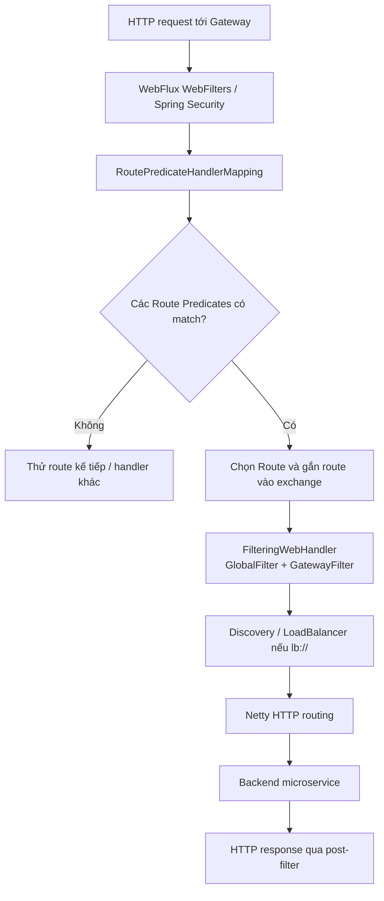
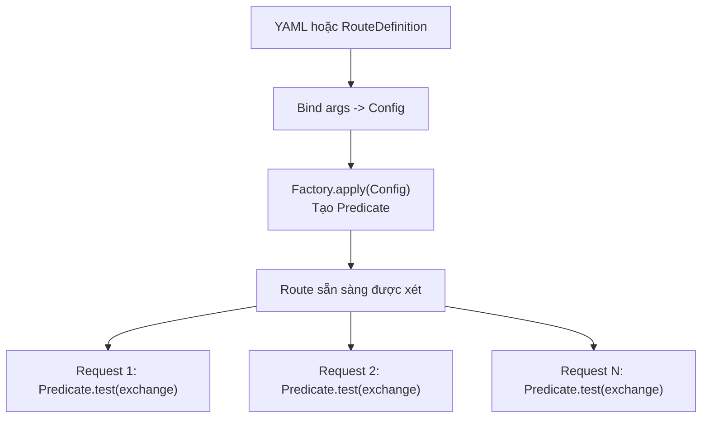
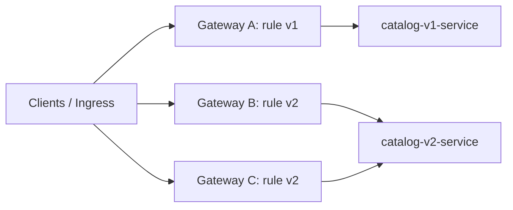
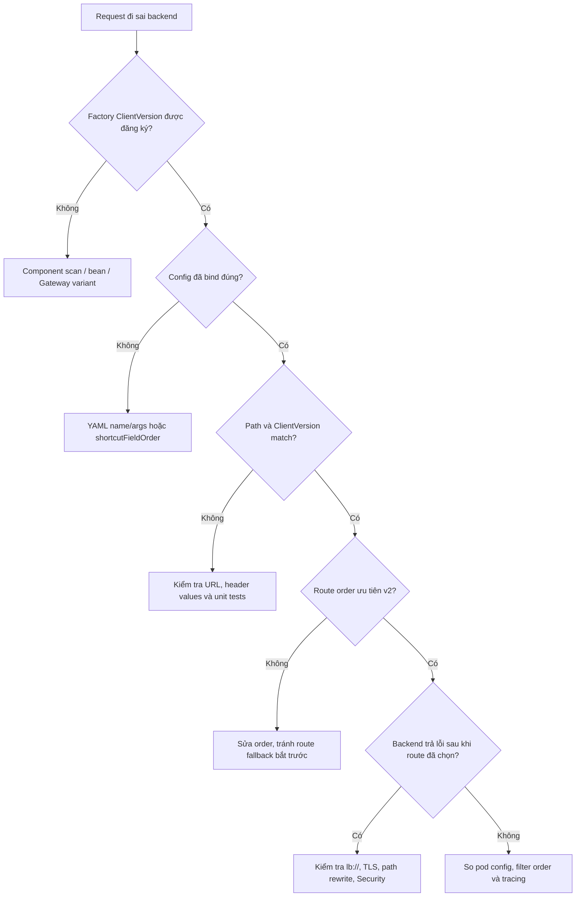

# Viết AbstractRoutePredicateFactory tùy biến

Trong **Spring Cloud Gateway**, không phải mọi yêu cầu định tuyến đều được biểu diễn thuận tiện bằng các predicate có sẵn như `Path`, `Method`, `Host`, `Header` hoặc `Query`. Chẳng hạn, một hệ thống microservices muốn chuyển request có header **`X-Api-Version: v2`** sang phiên bản catalog mới, còn những request khác đi đến phiên bản mặc định. Khi quy tắc chọn tuyến cần có tên rõ ràng, tham số cấu hình tái sử dụng được và logic kiểm tra riêng, ta có thể tự viết **`RoutePredicateFactory`** bằng cách kế thừa **`AbstractRoutePredicateFactory<Config>`**.

Bài thuộc chương **Bộ lọc tùy biến** của module **SPRING_CLOUD_GATEWAY**. Tuy nằm trong chương về mở rộng Gateway, đối tượng đang học là **predicate để quyết định route nào khớp**, không phải `GatewayFilter` để biến đổi request hoặc response. Bài học kết nối với các phần còn lại của module: route predicates, filter chain, biến đổi path/header, khám phá dịch vụ bằng `lb://`, Spring Security, giới hạn lưu lượng, retry, circuit breaker, TLS và quan sát request trong quá trình vận hành cổng microservices an toàn.

Sau bài này, bạn có thể:

1. Chọn đúng điểm mở rộng: `AbstractRoutePredicateFactory`, `AbstractGatewayFilterFactory` hay `GlobalFilter`.
2. Viết một custom predicate thuần đồng bộ nhận `ServerWebExchange` và trả `boolean`.
3. Khai báo `Config`, `shortcutFieldOrder()`, kiểm tra tham số và cấu hình tên predicate trong YAML.
4. Kết hợp predicate tùy biến với `Path`, `Method`, route order và route fallback.
5. Viết unit test, kiểm thử qua Gateway thật và phân biệt lỗi không match route với lỗi downstream.
6. Tránh dùng route predicate làm lớp authentication, tránh blocking I/O và lỗi cache/state trên nhiều Gateway replicas.

> **Giới hạn phiên bản:** Nội dung hướng đến **Spring Cloud Gateway Server WebFlux**. Các ví dụ cấu hình `spring.cloud.gateway.server.webflux.routes` dành cho những dòng Gateway có namespace WebFlux mới; bản WebFlux trước đó thường dùng `spring.cloud.gateway.routes`. **Server Web MVC** có cách khai báo predicate/route khác. Kiểm tra Spring Boot, Spring Cloud release train, Gateway và JDK tương thích trước khi dùng nguyên code.

## 1. Route predicate nằm ở đâu trong luồng request?

Một request đến Gateway đi qua các bước chính:



Predicate trả lời câu hỏi:

> **“Request hiện tại có đủ điều kiện sử dụng route này không?”**

Filter trả lời câu hỏi khác:

> **“Khi route đã được chọn, request/response cần được kiểm tra, biến đổi hoặc xử lý bổ sung như thế nào?”**

Nếu một custom predicate trả `false`, Gateway có thể tiếp tục xét route khác. Nó **không tự trả response `403`**, không sửa header, không gọi backend và không cung cấp fallback kiểu circuit breaker. Nếu không route/handler nào khớp, request có thể kết thúc với `404` hoặc cơ chế xử lý riêng của ứng dụng.

### So sánh những điểm mở rộng

| Điểm mở rộng | Được gọi khi nào? | Giá trị/hiệu ứng | Tình huống phù hợp |
| --- | --- | --- | --- |
| **`RoutePredicateFactory`** | Trong quá trình xác định route khớp. | `Predicate<ServerWebExchange>` trả `true/false`. | Chọn route theo API version, header nghiệp vụ không nhạy cảm, điều kiện đồng bộ. |
| **`GatewayFilterFactory`** | Sau khi route đã chọn, trong route filter chain. | Tạo `GatewayFilter`; có thể biến đổi request/response hoặc short-circuit. | Kiểm tra header rồi trả 400, thêm correlation ID, biến đổi path. |
| **`GlobalFilter`** | Với luồng Gateway filtering của request được xử lý bởi Gateway. | Filter áp dụng toàn cục; có pre/post semantics. | Logging, đo latency, chính sách dùng chung nhiều routes. |
| **Spring Security WebFilter** | Trong WebFlux WebFilter chain, thường trước Gateway route handling. | Authentication, authorization, CORS/CSRF theo cấu hình. | Xác minh bearer JWT, OAuth2 Login, phân quyền request. |
| **`RouteLocator` / `RouteDefinitionLocator`** | Khi cung cấp/khởi tạo danh sách routes. | Định nghĩa routes và predicates. | Lấy route từ YAML, DiscoveryClient hoặc nguồn tùy biến. |

**Không dùng `AbstractRoutePredicateFactory` để thay `AbstractGatewayFilterFactory`.** Hai lớp có tên gần nhau nhưng hợp đồng và thời điểm thực thi khác nhau.

## 2. Khi nào nên tự viết RoutePredicateFactory?

Hãy ưu tiên predicate có sẵn trước khi tự viết code. Chẳng hạn, nếu chỉ cần yêu cầu header bằng một regex đơn giản, predicate `Header` có thể đã đủ:

```yaml
predicates:
  - Path=/api/catalog/**
  - Header=X-Api-Version, v2
```

Với yêu cầu phức tạp hơn — chẳng hạn một **bộ quy tắc version được đóng gói và dùng lại** trên nhiều routes — custom factory có ích vì:

- Có một tên cấu hình ngắn gọn, nhất quán, ví dụ `ClientVersion`.
- Có lớp `Config` với tham số được bind và kiểm tra một chỗ.
- Có thể mở rộng từ so khớp chuỗi sang so khớp danh sách version hoặc rule đồng bộ khác.
- Có unit test độc lập cho hành vi `true/false`.
- Không buộc mọi đội phát triển tự lặp logic trên hàng chục route definitions.

### Không nên tự viết predicate nếu…

- Quy tắc đã được `Path`, `Method`, `Host`, `Header`, `Cookie`, `Query`, `RemoteAddr`… giải quyết đủ.
- Bạn cần **trả response lỗi trực tiếp** khi header không hợp lệ: một `GatewayFilter` hoặc Spring Security layer phù hợp hơn.
- Bạn định **gọi Redis, database, IdP hay HTTP service từ mỗi lần `test()`** để hỏi quyền truy cập. Predicate đồng bộ không phù hợp I/O blocking.
- Bạn muốn áp kiểm soát JWT/permission cho mọi API; **Spring Security** mới là nơi phù hợp.
- Bạn muốn tự động retry/fallback backend bị lỗi; predicate chỉ chọn route, không xử lý response sau khi route đã được chọn.

Một nguyên tắc tốt: **predicate đơn giản, nhanh, không có tác dụng phụ; filter hoặc security chịu trách nhiệm thực thi chính sách sau khi đã biết route**.

## 3. Bài toán thực hành: chọn catalog v2 theo một header

Giả sử ứng dụng có hai backend:

```text
catalog-v1-service: GET /products/42 → API cũ
catalog-v2-service: GET /products/42 → API mới
```

Các client gọi cùng public URL:

```http
GET /api/catalog/products/42 HTTP/1.1
Host: api.example.com
X-Api-Version: v2
```

Chính sách:

| Request | Route mong muốn |
| --- | --- |
| `X-Api-Version: v2` | `catalog-v2-route`. |
| Không có `X-Api-Version` | `catalog-default-route`. |
| `X-Api-Version: v1` | `catalog-default-route`, nếu đây là fallback được sản phẩm chấp nhận. |
| `X-Api-Version: v3` | Fallback hoặc từ chối theo hợp đồng API; **không tự mặc định** đây là lỗi hay route v1. |
| URL khác `/api/catalog/**` | Không dùng hai catalog routes, trừ khi có route khác khớp. |

Ta sẽ viết `ClientVersionRoutePredicateFactory` với hai tham số:

- `headerName`: header HTTP cần đọc, ví dụ `X-Api-Version`.
- `requiredValue`: giá trị chính xác cần khớp, ví dụ `v2`.

Factory **chỉ so khớp**, không đọc request body, không sửa JWT, không truy cập database, không chọn ngẫu nhiên backend. `X-Api-Version` là **tín hiệu tương thích API do caller chọn**, không phải bằng chứng caller được phép dùng API v2. Nếu v2 chứa tính năng bị hạn chế, cần thêm authentication/authorization thật.

## 4. Vòng đời của AbstractRoutePredicateFactory

Một factory thường trải qua hai giai đoạn:



### Giai đoạn cấu hình

1. Spring Boot phát hiện bean factory trong application context.
2. Gateway tìm factory theo tên, ví dụ `ClientVersion`.
3. Các tham số YAML/route definition được bind vào `Config`.
4. Gateway gọi `apply(Config)` để có một `Predicate<ServerWebExchange>`.
5. Predicate được đưa vào route runtime để sử dụng khi matching request.

### Giai đoạn request

Với mỗi request được xét tại route này:

1. Gateway gọi predicate đã tạo bằng `test(exchange)`.
2. Predicate đọc dữ liệu request cần thiết từ `ServerWebExchange`.
3. Predicate trả `true` hoặc `false` **đồng bộ**.
4. Nếu route có nhiều predicates, chúng được **AND** với nhau theo định nghĩa route; `Path` đúng nhưng `ClientVersion` sai thì route không match.

Điều này dẫn đến hai nguyên tắc hiệu năng:

- **Kiểm tra/chuẩn bị cấu hình trong `apply`:** ví dụ xác nhận `requiredValue` không rỗng, chuẩn hóa tham số cấu hình, compile regex có kiểm soát.
- **Giữ `test()` rất nhẹ:** chỉ đọc request header/path/query đã có, tính toán đơn giản rồi trả boolean. Không tạo HTTP client mới, không đọc body, không gọi `block()`.

**Không bảo đảm `apply()` chỉ gọi đúng một lần trong suốt vòng đời process**: khi routes được refresh hoặc definitions thay đổi, Gateway có thể xây lại runtime routes và predicates. Vì vậy `apply` cũng không nên có side effects như trừ quota hoặc gửi email.

## 5. Viết custom ClientVersionRoutePredicateFactory hoàn chỉnh

Lớp ví dụ dưới đây phù hợp với Spring Cloud Gateway **Server WebFlux**:

```java
package com.example.gateway.predicate;

import java.util.List;
import java.util.function.Predicate;

import org.springframework.cloud.gateway.handler.predicate.AbstractRoutePredicateFactory;
import org.springframework.stereotype.Component;
import org.springframework.util.StringUtils;
import org.springframework.web.server.ServerWebExchange;

@Component
public class ClientVersionRoutePredicateFactory
        extends AbstractRoutePredicateFactory<
            ClientVersionRoutePredicateFactory.Config> {

    public ClientVersionRoutePredicateFactory() {
        super(Config.class);
    }

    @Override
    public List<String> shortcutFieldOrder() {
        return List.of("headerName", "requiredValue");
    }

    @Override
    public Predicate<ServerWebExchange> apply(Config config) {
        if (config == null
                || !StringUtils.hasText(config.getHeaderName())
                || !StringUtils.hasText(config.getRequiredValue())) {
            throw new IllegalArgumentException(
                "ClientVersion requires headerName and requiredValue");
        }

        // Chốt giá trị cấu hình khi tạo predicate; không giữ Config
        // mutable để đọc/ghi lại trong từng request.
        final String headerName = config.getHeaderName().trim();
        final String requiredValue = config.getRequiredValue().trim();

        return exchange -> {
            List<String> values = exchange.getRequest()
                .getHeaders()
                .get(headerName);

            return values != null
                && values.size() == 1
                && requiredValue.equals(values.get(0));
        };
    }

    public static class Config {
        private String headerName;
        private String requiredValue;

        public String getHeaderName() {
            return headerName;
        }

        public void setHeaderName(String headerName) {
            this.headerName = headerName;
        }

        public String getRequiredValue() {
            return requiredValue;
        }

        public void setRequiredValue(String requiredValue) {
            this.requiredValue = requiredValue;
        }
    }
}
```

### Giải thích các quyết định trong code

| Thành phần | Vai trò | Lưu ý |
| --- | --- | --- |
| `@Component` | Đăng ký factory thành Spring bean để Gateway phát hiện. | Class phải nằm trong phạm vi component scan hoặc được đăng ký bean tương ứng. |
| `ClientVersionRoutePredicateFactory` | Tuân thủ quy ước đặt tên của Gateway. | Tên predicate YAML được rút gọn thành `ClientVersion`. |
| `extends AbstractRoutePredicateFactory<Config>` | Cung cấp hợp đồng factory để build route predicate. | Không phải `AbstractGatewayFilterFactory`. |
| `super(Config.class)` | Khai báo kiểu cấu hình cần bind. | Cần đúng class `Config` của factory. |
| `shortcutFieldOrder()` | Chỉ thứ tự tham số trong cú pháp rút gọn. | `headerName` đứng trước `requiredValue`. |
| `apply(Config)` | Xác nhận config và tạo predicate. | Không thực thi authentication hoặc gọi network. |
| `Predicate<ServerWebExchange>` | Đọc request và trả `boolean` khi route matching. | Cần nhanh, stateless và non-blocking. |
| `get(headerName)` | Đọc danh sách giá trị HTTP header. | Ví dụ chỉ nhận **đúng một giá trị**; header name không phân biệt hoa/thường, còn giá trị được so khớp chính xác. |
| `Config` có getters/setters | Cho binder gán YAML args vào fields. | Tránh state per-request trong Config hoặc factory. |

### So khớp chính xác có chủ đích

Ví dụ sử dụng:

```text
requiredValue = v2
```

thì `v2` sẽ khớp, nhưng `V2`, `v2-beta` hoặc `v2,v1` **không được coi là khớp** trong logic đang viết. Predicate yêu cầu đúng **một giá trị header**; request gửi hai dòng `X-Api-Version` bị từ chối bởi predicate thay vì để `getFirst()` bỏ qua giá trị thứ hai. Với header cấu hình protocol version, nên **quy định chỉ nhận một giá trị hợp lệ**, tránh tình trạng các proxy/client parse khác nhau.

Nếu hợp đồng cần case-insensitive, danh sách allowed versions hoặc semantic-version range, hãy **đổi thuật toán một cách công khai và bổ sung test**, không tự thay đổi phép so khớp trong production mà không cập nhật API contract.

### Tại sao không dùng request body để xét route?

Predicate hoạt động trong giai đoạn route matching. Đọc body thường yêu cầu tiêu thụ/caching reactive stream, làm tăng chi phí, có nguy cơ khiến downstream không đọc được body và làm phức tạp backpressure/memory. Nếu yêu cầu chọn backend theo body, cần kiến trúc/filter và chính sách request buffering phù hợp; **không tự gọi `exchange.getRequest().getBody().blockFirst()` trong predicate**.

## 6. Ánh xạ tên factory thành predicate trong YAML

Theo quy ước đặt tên của Gateway:

```text
Java class:
ClientVersionRoutePredicateFactory

Predicate name trong YAML:
ClientVersion
```

Gateway dựa vào factory bean đã được đăng ký và tên factory để nhận diện `ClientVersion` trong route definition. Đổi tên class, tên bean hoặc package/component scan có thể làm config không được nhận diện.

### Cú pháp rút gọn (shortcut)

```yaml
predicates:
  - Path=/api/catalog/**
  - ClientVersion=X-Api-Version,v2
```

Trong đó:

- `X-Api-Version` được bind vào `Config.headerName`.
- `v2` được bind vào `Config.requiredValue`.
- Hai trường xuất hiện theo đúng `shortcutFieldOrder()`.

**Không viết ngược** `ClientVersion=v2,X-Api-Version` nếu `shortcutFieldOrder()` vẫn là `headerName, requiredValue`.

### Cú pháp đầy đủ (name/args)

```yaml
predicates:
  - Path=/api/catalog/**
  - name: ClientVersion
    args:
      headerName: X-Api-Version
      requiredValue: v2
```

Cú pháp đầy đủ dễ đọc hơn khi có nhiều thuộc tính và dễ xác định property nào bị sai. Keys `headerName` và `requiredValue` phải tương ứng thuộc tính trên `Config`/binding policy. Khi custom factory có nhiều trường tùy chọn, ưu tiên dạng `name/args` thay vì shortcut dài khó review.

### Tại sao factory cần được phát hiện?

Tạo Java class trong thư mục source chưa đủ. Nó cần là Spring bean trong **Gateway application context**, ví dụ:

- Lớp có `@Component` và nằm dưới package được Spring Boot component-scan.
- Hoặc application có `@Bean`/`@Import` đăng ký factory đúng cách.

Nếu package `com.example.gateway.predicate` ở ngoài phạm vi scan của `@SpringBootApplication`, factory có thể không tồn tại trong context. Khi cấu hình route dùng `ClientVersion`, Gateway có thể báo không tìm thấy `RoutePredicateFactory` tương ứng. Cần kiểm tra startup logs và bean registration, **không đổi YAML tùy ý để né lỗi**.

## 7. Định nghĩa hai routes: ưu tiên v2 và fallback rõ ràng

Ví dụ đầy đủ cho nhánh Gateway WebFlux mới:

```yaml
spring:
  cloud:
    gateway:
      server:
        webflux:
          routes:
            - id: catalog-v2-route
              order: -10
              uri: http://localhost:8082
              predicates:
                - Path=/api/catalog/**
                - ClientVersion=X-Api-Version,v2
              filters:
                - StripPrefix=2

            - id: catalog-default-route
              order: 0
              uri: http://localhost:8081
              predicates:
                - Path=/api/catalog/**
              filters:
                - StripPrefix=2
```

Giả sử backend v1 ở `localhost:8081` và v2 ở `localhost:8082` đều phục vụ `GET /products/42`.

### Route match theo thứ tự

| Request | `catalog-v2-route` | `catalog-default-route` | Kết quả mong muốn |
| --- | --- | --- | --- |
| `/api/catalog/products/42`, header `X-Api-Version: v2` | `Path` đúng, `ClientVersion` đúng. | Cũng có `Path` đúng. | **Chọn v2** do `order: -10` được ưu tiên. |
| Cùng URL, không có header version | `ClientVersion` sai. | `Path` đúng. | Về default/v1. |
| Cùng URL, `X-Api-Version: v1` | `ClientVersion` sai. | `Path` đúng. | Về default/v1. |
| `/api/orders/123` | `Path` sai. | `Path` sai. | Xét các routes khác hoặc không match. |

**Lưu ý quan trọng:** các route có cùng `Path` có thể cùng khớp. `order` nhỏ hơn được xét trước theo route ordering; thứ tự các entries trong YAML **không nên được dùng làm hợp đồng ưu tiên duy nhất**.

Nếu dự án **không** muốn header `v3` rơi về v1, đừng dùng fallback rộng như trên. Hãy xác định hợp đồng rõ:

- Tạo các routes có predicate chính xác cho từng version được hỗ trợ.
- Không có fallback cho version không hợp lệ, hoặc thêm bộ lọc/handler chuyên trách trả lỗi phù hợp.
- Đảm bảo lỗi trả cho client là **có chủ đích**, thay vì trông chờ vào backend trả 404.

### Thay URI cố định bằng discovery

Khi đã có Spring Cloud LoadBalancer và nguồn `ServiceInstance`, có thể đổi:

```yaml
uri: lb://catalog-v2-service
```

và:

```yaml
uri: lb://catalog-v1-service
```

Predicate vẫn chỉ quyết định **route nào khớp**. Sau đó Gateway mới cần giải `lb://` thành instance backend. Nếu route v2 khớp nhưng `catalog-v2-service` không có instance, Gateway có thể trả lỗi không có upstream (ví dụ `503` theo cấu hình), **không tự quay lại route v1**. Đó là failure ở load balancing/routing, không phải `ClientVersion` bất ngờ trả false.

## 8. Những giới hạn của một predicate đồng bộ

Trong ví dụ, `apply(Config)` trả về:

```java
Predicate<ServerWebExchange>
```

Điều đó có nghĩa phép kiểm tra cuối cùng phải trả `boolean` **đồng bộ**.

### Nên làm

- Đọc `exchange.getRequest().getHeaders()`, `getPath()`, `getQueryParams()` hoặc metadata request đã có.
- So sánh chuỗi/giá trị nhỏ, không nhạy cảm.
- Chuẩn hóa và kiểm tra tham số config trong `apply`.
- Trả `false` nhanh khi thiếu header hoặc dữ liệu không hợp lệ.
- Dùng dữ liệu chỉ đọc và khai báo `final` khi capture vào lambda.

### Không nên làm

- Gọi `RestTemplate`, JDBC, Redis sync, filesystem hoặc `Thread.sleep` trong `Predicate.test()`.
- Gọi `Mono.block()` hoặc `Flux.blockFirst()` từ event-loop Reactor Netty.
- Gọi OAuth2 introspection/JWK endpoint mỗi request để quyết định quyền.
- Ghi state của user hiện tại vào field của factory singleton.
- Gọi API bên ngoài để quyết định route trên mọi request mà không có ngân sách độ trễ và cơ chế reactive phù hợp.

Nếu điều kiện routing phụ thuộc dữ liệu bên ngoài thay đổi liên tục, xem xét cách khác: **đưa dữ liệu đã xác minh vào request context trước route handling**, cập nhật route definitions từ control plane có kiểm soát, hoặc thiết kế một thành phần hỗ trợ bất đồng bộ theo API Gateway đúng phiên bản. Không “lách” bằng cách blocking trong predicate đồng bộ.

## 9. Viết unit test cho predicate, không cần dựng Gateway hoàn chỉnh

Vì `apply(Config)` trả một `Predicate<ServerWebExchange>` thuần, ta có thể kiểm tra hành vi này với `MockServerWebExchange` của Spring Test.

### Dependency kiểm thử

Trong dự án Spring Boot có test starter, thông thường có thể dùng:

```xml
<dependency>
    <groupId>org.springframework.boot</groupId>
    <artifactId>spring-boot-starter-test</artifactId>
    <scope>test</scope>
</dependency>
```

Test này cần JUnit Jupiter và các lớp Spring WebFlux test tương ứng; dùng version do Spring Boot BOM quản lý. Đừng thêm các version Spring Test/Framework không tương thích với Gateway.

### Ví dụ JUnit 5

```java
package com.example.gateway.predicate;

import static org.junit.jupiter.api.Assertions.assertFalse;
import static org.junit.jupiter.api.Assertions.assertThrows;
import static org.junit.jupiter.api.Assertions.assertTrue;

import java.util.function.Predicate;

import org.junit.jupiter.api.BeforeEach;
import org.junit.jupiter.api.Test;
import org.springframework.mock.http.server.reactive.MockServerHttpRequest;
import org.springframework.mock.web.server.MockServerWebExchange;
import org.springframework.web.server.ServerWebExchange;

class ClientVersionRoutePredicateFactoryTest {

    private ClientVersionRoutePredicateFactory factory;
    private Predicate<ServerWebExchange> predicate;

    @BeforeEach
    void setUp() {
        factory = new ClientVersionRoutePredicateFactory();

        var config = new ClientVersionRoutePredicateFactory.Config();
        config.setHeaderName("X-Api-Version");
        config.setRequiredValue("v2");
        predicate = factory.apply(config);
    }

    @Test
    void matchesExactVersion() {
        var request = MockServerHttpRequest
            .get("/api/catalog/products/42")
            .header("X-Api-Version", "v2")
            .build();

        assertTrue(predicate.test(MockServerWebExchange.from(request)));
    }

    @Test
    void rejectsMissingHeader() {
        var request = MockServerHttpRequest
            .get("/api/catalog/products/42")
            .build();

        assertFalse(predicate.test(MockServerWebExchange.from(request)));
    }

    @Test
    void rejectsDifferentOrMixedValue() {
        var v1 = MockServerHttpRequest
            .get("/api/catalog/products/42")
            .header("X-Api-Version", "v1")
            .build();

        var mixed = MockServerHttpRequest
            .get("/api/catalog/products/42")
            .header("X-Api-Version", "v2,v1")
            .build();

        assertFalse(predicate.test(MockServerWebExchange.from(v1)));
        assertFalse(predicate.test(MockServerWebExchange.from(mixed)));
    }

    @Test
    void rejectsMultipleHeaderValues() {
        var request = MockServerHttpRequest
            .get("/api/catalog/products/42")
            .header("X-Api-Version", "v2", "v1")
            .build();

        assertFalse(predicate.test(MockServerWebExchange.from(request)));
    }

    @Test
    void rejectsMissingConfiguration() {
        var invalid = new ClientVersionRoutePredicateFactory.Config();
        invalid.setHeaderName("X-Api-Version");

        assertThrows(
            IllegalArgumentException.class,
            () -> factory.apply(invalid));
    }
}
```

### Phạm vi của unit test

Những test này xác minh **logic Java trong predicate**. Chúng **chưa chứng minh**:

- Spring đã phát hiện factory bean.
- YAML shortcut hoặc `name/args` được bind đúng.
- Các route có thứ tự `order` phù hợp.
- `StripPrefix`/LoadBalancer/HTTP routing hoạt động.
- CORS, Security và response headers xử lý đúng.

Vì thế vẫn cần **integration test có Gateway application context**. Unit test nhanh giúp phát hiện lỗi như dùng nhầm `equalsIgnoreCase`, thiếu kiểm tra header, hoặc bỏ qua các giá trị header trùng lặp trước khi chạy hệ thống thật.

### Kiểm tra tên header không phân biệt hoa/thường

Theo HTTP semantics, tên field/header không phân biệt chữ hoa/thường. Có thể thêm test:

```java
@Test
void matchesCaseInsensitiveHeaderName() {
    var request = MockServerHttpRequest
        .get("/api/catalog/products/42")
        .header("x-api-version", "v2")
        .build();

    assertTrue(predicate.test(MockServerWebExchange.from(request)));
}
```

Đoạn này là **một test method bổ sung vào class bên trên**, không phải file Java độc lập. Nó nhấn mạnh sự khác biệt giữa **header name** (không phân biệt hoa/thường) và **header value** (ví dụ so khớp chính xác).

## 10. Integration test: chứng minh Gateway chọn đúng backend

### Môi trường POC

| Thành phần | Địa chỉ | Nhiệm vụ |
| --- | --- | --- |
| Spring Cloud Gateway | `http://localhost:8080` | Có bean `ClientVersionRoutePredicateFactory` và hai routes. |
| catalog v1 mock | `http://localhost:8081` | Trả dấu hiệu backend v1. |
| catalog v2 mock | `http://localhost:8082` | Trả dấu hiệu backend v2. |

Hai backend mock có cùng API `GET /products/42`, nhưng trả dữ liệu kiểm thử khác nhau:

```json
{"backend":"catalog-v1","productId":42}
```

và:

```json
{"backend":"catalog-v2","productId":42}
```

Đây là **dữ liệu do mock tự thiết kế**, không phải response mặc định của Spring Cloud Gateway.

### Case 1: có header v2

```bash
curl -i \
  -H "X-Api-Version: v2" \
  "http://localhost:8080/api/catalog/products/42"
```

Kỳ vọng **theo ví dụ routes ở mục 7**: Gateway chọn `catalog-v2-route`, filter `StripPrefix=2` biến path thành `/products/42` và mock v2 trả dấu hiệu `catalog-v2`.

### Case 2: không có header

```bash
curl -i \
  "http://localhost:8080/api/catalog/products/42"
```

Kỳ vọng: custom predicate của v2 không match và route mặc định được chọn, trả dấu hiệu `catalog-v1`.

### Case 3: header không khớp

```bash
curl -i \
  -H "X-Api-Version: v1" \
  "http://localhost:8080/api/catalog/products/42"
```

Kỳ vọng theo fallback đã chọn: `catalog-v1`.

### Case 4: nhiều giá trị hoặc version không được hỗ trợ

```bash
curl -i \
  -H "X-Api-Version: v2" \
  -H "X-Api-Version: v1" \
  "http://localhost:8080/api/catalog/products/42"

curl -i \
  -H "X-Api-Version: v3" \
  "http://localhost:8080/api/catalog/products/42"
```

Predicate `ClientVersion` của ví dụ trả `false` trong các tình huống không khớp hoặc nhiều giá trị. **Nhưng route mặc định vẫn có thể khớp** và trả v1. Nếu sản phẩm cần **từ chối version không hợp lệ**, điều đó phải được giải quyết bằng thiết kế route/validation khác, không phải hy vọng predicate `false` tự trả 400.

### Case 5: path không khớp

```bash
curl -i \
  -H "X-Api-Version: v2" \
  "http://localhost:8080/api/orders/123"
```

Vì `Path=/api/catalog/**` không khớp, không route catalog nào được chọn. Kết quả phụ thuộc có route khác cho `/api/orders/**` hay không; không nên khẳng định luôn nhận 404 trong một ứng dụng đã có các handler khác.

### Quan sát route runtime

Nếu Actuator Gateway endpoint đã được bật **và bảo vệ phù hợp**, có thể xem danh sách routes:

```http
GET /actuator/gateway/routes
```

Endpoint này giúp kiểm tra tên route, URI, predicates và filter runtime theo khả năng phiên bản. Nó **không chứng minh** request đã đi đến đúng backend; cần kết hợp mock backend logs/traces hoặc kiểm tra response thực tế.

**Không public Actuator Gateway route-management endpoints ra Internet không có authorization.** Những endpoint quản trị/chỉnh routes, nếu được bật, cần giới hạn quyền và network access.

## 11. Unit test không đủ: các trường hợp YAML binding cần kiểm tra

Một factory có thể đúng về logic nhưng route không được tạo vì tên factory hoặc args bị sai. Hãy kiểm thử độc lập cả hai cú pháp.

### Shortcut đúng

```yaml
predicates:
  - ClientVersion=X-Api-Version,v2
```

### Shortcut sai thứ tự

```yaml
predicates:
  - ClientVersion=v2,X-Api-Version
```

Trong trường hợp này binder có thể gán `v2` vào `headerName` và `X-Api-Version` vào `requiredValue`, khiến predicate không match như mong đợi. Code kiểm tra `hasText` **không thể phát hiện** mọi trường hợp cấu hình có vẻ hợp lệ nhưng bị đảo giá trị.

### Args sai tên

```yaml
predicates:
  - name: ClientVersion
    args:
      header: X-Api-Version
      value: v2
```

Các key `header` và `value` không khớp `Config.headerName`/`requiredValue` của ví dụ. Tùy binder và thời điểm route conversion, cấu hình có thể lỗi hoặc không sinh predicate như mong đợi. Đừng mặc định ứng dụng luôn thất bại ngay khi startup; route có thể được nạp/refresh tại thời điểm khác.

### Args đúng tên

```yaml
predicates:
  - name: ClientVersion
    args:
      headerName: X-Api-Version
      requiredValue: v2
```

### Không trộn namespace giữa Gateway WebFlux mới và cũ

Ví dụ nhánh cũ:

```yaml
spring:
  cloud:
    gateway:
      routes:
        - id: catalog-v2-route
          uri: http://localhost:8082
          predicates:
            - Path=/api/catalog/**
            - ClientVersion=X-Api-Version,v2
```

Không khai báo song song `spring.cloud.gateway.routes` và `spring.cloud.gateway.server.webflux.routes` chỉ để “chắc ăn”. Hãy đọc Configuration Properties của artifact cụ thể, kiểm tra các route được bind và thống nhất một mô hình cấu hình.

## 12. Kiểm tra và ràng buộc Config một cách chủ động

Ví dụ `ClientVersionRoutePredicateFactory` đã kiểm tra `headerName` và `requiredValue` không rỗng bằng `StringUtils.hasText`. Trong sản phẩm thật, có thể cần thêm:

- Chỉ cho phép một **tập header names cố định** được đội platform phê duyệt.
- Giới hạn độ dài tham số cấu hình; không cho phép cấu hình kỳ lạ do nhập liệu.
- Giới hạn danh sách versions và định dạng version được hỗ trợ.
- Kiểm tra regex hoặc glob nếu nâng cấp sang pattern matching.
- Phân biệt lỗi cấu hình khi triển khai với một request không khớp.
- Ghi lại route ID và config revision ở mức đủ để debug, không log dữ liệu bí mật.

### Fail fast khi cấu hình không hợp lệ

Một `IllegalArgumentException` từ `apply(Config)` giúp báo rõ lỗi cấu hình, nhưng **thời điểm lỗi được phát hiện** phụ thuộc khi route runtime được xây/refresh. Một số hệ thống nạp route sau startup hoặc refresh theo sự kiện.

**Không bao giờ coi lỗi cấu hình là một request “không khớp hợp lệ”** nếu nó khiến tất cả requests rơi vào fallback ngoài ý muốn. Cần kiểm tra route được tạo thành công trong pipeline triển khai, rồi mới đưa traffic vào Gateway instance đó.

### Đừng mutate Config trong mỗi request

Sai về mặt thiết kế:

```java
return exchange -> {
    config.setRequiredValue("v2"); // Mutable shared config per request!
    return true;
};
```

Đúng hướng là **kiểm tra config một lần, capture các giá trị bất biến** khi tạo predicate:

```java
final String requiredValue = config.getRequiredValue().trim();
return exchange -> requiredValue.equals(
    exchange.getRequest().getHeaders().getFirst("X-Api-Version"));
```

Đoạn ngắn trên chỉ minh họa capture immutable value; **factory hoàn chỉnh ở mục 5** còn kiểm tra số lượng header values và cho phép cấu hình `headerName`. Không thay code đầy đủ bằng đoạn này nếu cần chính sách reject duplicates.

## 13. Route ordering, fallback và trạng thái lỗi

Một custom predicate không biết backend đã phản hồi thế nào; nó chỉ được xét trước khi upstream request được gửi.

### Ba kịch bản cần phân biệt

| Kịch bản | Giai đoạn xảy ra | Có tự thử route khác không? |
| --- | --- | --- |
| `ClientVersion` trả `false` | Route matching | Gateway có thể tiếp tục xét route phù hợp khác. |
| `ClientVersion` trả `true`, nhưng `lb://catalog-v2-service` không có instance | LoadBalancer/routing sau khi chọn route | **Không tự quay về v1** chỉ vì route v2 gặp lỗi. |
| `ClientVersion` trả `true`, backend v2 trả HTTP 500 | Backend response | Predicate không được chạy lại để chọn v1; muốn fallback cần resilience policy riêng. |

### Khi muốn chuyển traffic v2 dần dần

Một số đội định tuyến theo header:

```text
X-Api-Version: v2
```

hoặc feature flag. Nếu yêu cầu là **canary rollout 5% traffic**, đừng lạm dụng một predicate lấy `Math.random()` trong mỗi lần `test()`. Tính ngẫu nhiên không ổn định giữa requests, khó debug và không ràng buộc user/session.

Các lựa chọn tốt hơn:

- Sử dụng cơ chế canary/weighted routing mà Gateway hoặc edge hỗ trợ.
- Nếu cần sticky rollout theo account, tính group bằng **hash ổn định của danh tính đã xác minh** và policy được phê duyệt.
- Tách ràng buộc security khỏi chiến lược phân phối traffic.
- Có rollback và đo error/latency riêng cho v1/v2.

Một lựa chọn v2 dựa trên header do client gửi chỉ là **request opt-in**, không phải kiểm soát quyền dùng tính năng có yêu cầu bảo mật.

## 14. Spring Security, CORS và ranh giới tin cậy

### 14.1. Predicate không thay authentication

Một client có thể gửi:

```http
X-Api-Version: v2
```

tùy ý. Vì vậy, nếu v2 chứa API dành cho admin hoặc tenant đặc biệt, `ClientVersion` **không đủ** để bảo vệ route. Cần:

1. Spring Security xác minh bearer JWT/OAuth2 session ở WebFilter chain.
2. Authorization policy kiểm tra scope/role/tenant đáng tin cậy.
3. Backend Resource Server kiểm tra issuer, audience và quyền đối với tài nguyên.
4. Chỉ sử dụng version header để **chọn API behavior**, không quyết định việc user có quyền hay không.

### 14.2. Không chờ một Mono principal bằng block

Trong WebFlux, `exchange.getPrincipal()` trả một `Mono<Principal>`. Đừng viết:

```java
Principal principal = exchange.getPrincipal().block();
```

trong route predicate. Điều này có thể chặn Reactor Netty event-loop, gây lỗi runtime hoặc giảm throughput nghiêm trọng. Nếu routing thật sự phải phụ thuộc claims của user, hãy thiết kế theo **Spring Security reactive flow** và một cơ chế cung cấp dữ liệu đã xác minh cho route matching mà không blocking, hoặc tổ chức routes/security khác. Không lấy raw JWT body/query/header rồi tự tin là principal đã được xác thực.

### 14.3. Preflight OPTIONS có thể không khớp

Nếu thêm:

```yaml
predicates:
  - Path=/api/catalog/**
  - Method=GET
  - ClientVersion=X-Api-Version,v2
```

browser preflight có method thật là `OPTIONS`, thường không mang header ứng dụng như actual GET/POST, mà mang `Access-Control-Request-*`. Preflight **không tự khớp Method=GET** và có thể không gửi `X-Api-Version`. Đừng yêu cầu preflight phải mang bearer JWT hoặc header version của actual request.

CORS phải được Spring Security/Gateway CORS processor hoặc edge xử lý tại tầng phù hợp, nhất là khi request `OPTIONS` không match route. `ClientVersion` chỉ áp vào actual route matching; nó **không phải CORS policy**.

### 14.4. Identity ở trusted proxy khác client header

`X-Forwarded-For`, `X-Forwarded-Host` hoặc custom `X-Tenant` có thể bị giả mạo nếu Gateway nhận các header đó trực tiếp từ Internet và ingress không kiểm soát chúng. Nếu một custom predicate phụ thuộc metadata từ proxy, phải xác định rõ **trust boundary**, allowlist proxies, cách strip/overwrite headers và security validation trước khi routing.

Đừng dùng dữ liệu header chưa xác minh để điều hướng token service hoặc request của user đến backend thuộc tenant khác.

## 15. Tích hợp với GatewayFilter, giới hạn lưu lượng và resilience

Khi `ClientVersion` đã chọn `catalog-v2-route`, các GatewayFilters tương ứng với route v2 mới tham gia xử lý theo thứ tự và cấu hình thực tế. Đây là ranh giới quan trọng giữa **route matching** và **traffic processing**.

| Thành phần | Giai đoạn | Tác động khi có custom predicate |
| --- | --- | --- |
| **`Path`, `Method`, `ClientVersion`** | Matching | Quyết định route v1/v2 nào được chọn. |
| **`StripPrefix`/`RewritePath`** | Filtering | Đổi public path thành path backend sau khi chọn route. |
| **`AddRequestHeader`/`SetRequestHeader`** | Filtering | Có thể sửa request header trước khi gửi downstream, không làm custom predicate match lại tự động. |
| **`TokenRelay`** | Filtering | Gắn access token phù hợp khi có authorized client/policy. |
| **`RequestRateLimiter`** | Filtering | Giới hạn request trên route đã chọn theo KeyResolver. |
| **`CircuitBreaker`** | Filtering | Bảo vệ lời gọi backend, có thể có fallback được cấu hình riêng. |
| **`Retry`** | Filtering | Thử lại upstream khi đáp ứng điều kiện; không tự đổi kết quả predicate. |
| **`LocalResponseCache`** | Filtering | Có thể trả cached response trên route cacheable phù hợp. |
| **`LoadBalancer`/`NettyRoutingFilter`** | Routing | Chọn backend instance và gửi HTTP request. |

### Route v1 và v2 có quota riêng

Nếu hai routes có ID khác nhau:

```text
catalog-v2-route
catalog-default-route
```

và mỗi route có `RedisRateLimiter`, token bucket thường được phân theo **route ID + quota key**. Điều này có thể làm một tài khoản có hai hạn mức độc lập ở v1/v2, ngay cả khi cả hai routes đại diện một API sản phẩm.

Nếu policy yêu cầu **một quota chung** cho catalog bất kể v1 hay v2, hãy thiết kế quota domain tương ứng; không mặc định hai routes cùng URI/path sẽ chia Redis bucket.

### TokenRelay theo route và audience

Route v2 có thể đi đến backend khác. Nếu Gateway dùng `TokenRelay`, backend v2 vẫn cần **xác minh token audience/scopes/issuer** đúng với API. Một custom predicate dựa trên header client gửi không có quyền tự chuyển token của user sang backend mới chưa được thẩm định về trust boundary.

### Circuit breaker fallback khác route fallback

Hai khái niệm:

1. **Route fallback:** predicate v2 false nên Gateway chọn route v1 trong giai đoạn matching.
2. **Circuit breaker fallback:** route v2 đã được chọn nhưng upstream lỗi/chậm và filter resilience kích hoạt fallback được cấu hình.

Không gọi cả hai là “fallback” rồi kỳ vọng chúng có cùng semantics. Fallback qua circuit breaker còn phải bảo đảm idempotency, authorization và response shape; với POST tạo đơn hàng, retry/fallback không kiểm soát có thể sinh tác động nghiệp vụ trùng lặp.

## 16. Hiệu năng và tính quyết định khi traffic lớn

Route predicate có thể được gọi rất thường xuyên. Một Gateway với nhiều route candidates có thể phải thử nhiều predicates cho mỗi request trước khi tìm được route phù hợp. Vì vậy, **CPU, allocation, regex và logging trong `test()`** ảnh hưởng trực tiếp latency của gateway.

### Thiết kế nhẹ và có thể dự đoán

- So khớp một header nhỏ thường rẻ hơn gọi một dịch vụ cấu hình bên ngoài.
- Nếu cần regex, **compile pattern trong `apply()`** thay vì mỗi `test()`; giới hạn pattern do config cung cấp để tránh ReDoS.
- Nếu có danh sách allowed values, chuẩn bị `Set` bất biến trong `apply()` rồi kiểm tra membership.
- Không parse một JWT đầy đủ trong custom predicate; dùng Spring Security để xác thực.
- Không sinh object hoặc cấu trúc dữ liệu lớn cho mỗi request.
- Không thực hiện blocking calls trên Reactor Netty event loop.
- Không ghi INFO log cho mọi predicate false, vì false là hành vi matching bình thường khi xét nhiều routes.

### Không sử dụng clock/random mutable như điều kiện routing mơ hồ

Một predicate kiểu:

```java
return exchange -> Math.random() < 0.05;
```

có thể hữu dụng để minh họa boolean, nhưng **không phải giải pháp canary production**: kết quả không ổn định cho cùng client, khó audit và có thể sai khi retries/requests tiếp theo. Nếu cần weighted traffic, dùng cơ chế được Gateway/edge hỗ trợ hoặc một chiến lược deterministic routing có test và policy.

Tương tự, điều kiện theo đồng hồ hệ thống của từng pod có thể khác nhau nếu đồng hồ lệch hoặc config rollout không đồng bộ. Khi cần lịch mở tính năng, nguồn chính sách cần được quản trị, kiểm soát hiệu lực và theo dõi.

### Không giữ state theo request trong factory singleton

Anti-pattern:

```java
private String lastVersionSeen;

public Predicate<ServerWebExchange> apply(Config config) {
    return exchange -> {
        lastVersionSeen = exchange.getRequest()
            .getHeaders().getFirst("X-Api-Version");
        return "v2".equals(lastVersionSeen);
    };
}
```

Đây chỉ là **đoạn sai để minh họa**: các requests có thể chạy đồng thời trên nhiều threads, state bị ghi đè và có thể rò dữ liệu/ngữ cảnh. Dùng local variable trong lambda và capture immutable config như ví dụ chính.

## 17. Rolling deployment và nhiều Gateway replicas

Giả sử có ba Gateway pods sau ingress:



Nếu rollout thay đổi logic `ClientVersion` nhưng chưa hoàn tất trên mọi pods, **cùng một request** có thể được route khác nhau tùy pod. Đây là lỗi rollout/consistency, không phải vì predicate “ngẫu nhiên” nếu code trong mỗi pod vẫn deterministic.

### Checklist rollout

| Chủ đề | Quyết định cần có |
| --- | --- |
| **Factory class** | Tất cả Gateway replicas dùng artifact có factory tương ứng trước khi route YAML mới được áp. |
| **Registration** | `@Component`/bean scan không bị lệch giữa deployments. |
| **Route definitions** | Route IDs, orders, predicates và URI đồng nhất khi cần. |
| **Compatibility** | Có thể chạy đồng thời artifact cũ và route mới không? Nếu không, dùng rollout theo thứ tự phù hợp. |
| **Fallback** | Khi v2 chưa sẵn sàng, route chọn v1 hay từ chối? Không tự fallback sau HTTP 500. |
| **Feature version** | `v2` trong header có ý nghĩa gì và được version hóa ra sao? |
| **Metrics** | Theo route ID và Gateway version để thấy sự chênh lệch. |
| **Rollback** | Có thể gỡ route v2 mà không làm client có header v2 truy cập sai dữ liệu không? |

Nếu ứng dụng dùng remote route definitions/refresh, việc sửa một YAML/config source không bảo đảm mọi replicas cập nhật đồng thời. Cần theo dõi route cache/refresh và tiến trình đồng bộ cấu hình. **`RefreshRoutesEvent`/Actuator route refresh chỉ liên quan runtime routes**, không phải bằng chứng các pods đã tải class predicate mới hoặc backend v2 đã sẵn sàng.

### Test độ ổn định giữa pods

Trong POC, có thể gọi trực tiếp hai Gateway ports:

```bash
curl -i -H "X-Api-Version: v2" \
  "http://localhost:8080/api/catalog/products/42"

curl -i -H "X-Api-Version: v2" \
  "http://localhost:8083/api/catalog/products/42"
```

Cùng request/version phải đến cùng nhóm backend mong muốn ở cả hai pods khi chúng được tuyên bố đồng bộ chính sách. Nếu không, so route ID/order, artifact revision, config hash, bean registration và service discovery.

## 18. Quan sát hành vi custom predicate mà không gây tải log

Một điều khó của route predicates là **false** thường chỉ có nghĩa “thử route khác”, không phải lỗi. Nếu cứ log mỗi false ở mức WARN/ERROR, Gateway có nhiều routes sẽ tạo lượng log lớn ngay cả khi mọi request thành công.

### Những tín hiệu thực tế nên theo dõi

| Tín hiệu | Giá trị trong chẩn đoán |
| --- | --- |
| **Selected route ID** | Request cuối cùng được gửi qua route nào? |
| **HTTP method/path template** | Public API request thuộc nhóm nào? |
| **Gateway revision/pod ID** | Có sự lệch cấu hình giữa replicas không? |
| **Backend service ID** | URI `lb://` trỏ đến service nào? |
| **Status cuối và latency** | v1/v2 có error/latency khác nhau không? |
| **Route count/refresh events** | Route definitions có được nạp/refresh đúng không? |
| **Predicate config validation errors** | Có tham số sai gây route không khả dụng không? |
| **Quota/retry/circuit breaker status** | Lỗi phát sinh sau route matching hay tại route selection? |

Sự kiện **minh họa** do ứng dụng có thể instrument, không phải log mặc định:

```text
traceId:             [trace identifier]
gatewayPod:          gateway-b
routeId:             catalog-v2-route
routePolicyRevision: 2026-11
backendService:      catalog-v2-service
httpMethod:          GET
pathTemplate:        /api/catalog/**
httpStatus:          200
elapsedMs:           [số đo]
```

Nếu muốn đo số lần custom predicate match/không match, cần thiết kế instrumentation chi phí thấp với metric tags hữu hạn. Không dùng **user ID, raw JWT, bearer token, cookie, full URL chứa ID, header tùy ý** làm metric tags; nguy cơ lộ dữ liệu và tăng cardinality rất cao.

### Debug bằng route ID thay vì đoán status

Request trả HTTP 404 có thể do **không có route khớp** hoặc **backend đã được gọi nhưng trả 404**. Hai trạng thái này cần xử lý khác nhau. Tracing với route ID/downstream span và backend mock access logs giúp phân biệt.

Tương tự, HTTP 503 có thể do `lb://` không tìm được instance; không có nghĩa factory tính sai. HTTP 401/403 thường thuộc Security/backend policy, không phải custom predicate.

## 19. Ma trận kiểm thử tổng hợp

Để nghiệm thu trước production, kiểm tra cả unit, integration và multi-replica:

| Mã | Tình huống | Bằng chứng mong muốn |
| --- | --- | --- |
| P01 | `X-Api-Version: v2` | `ClientVersion` trả true; chọn v2 route theo order. |
| P02 | Header vắng mặt | Predicate false; chọn fallback nếu được thiết kế. |
| P03 | Header có `v1` | v2 predicate false; v1/default route. |
| P04 | Header `V2` | Không khớp phép so chính xác nếu policy chưa cho phép. |
| P05 | Header `v2,v1` | Không khớp giá trị đơn mong muốn. |
| P06 | Hai dòng `X-Api-Version` | Predicate reject duplicates; kiểm tra fallback behavior. |
| P07 | Header name chữ thường | Vẫn truy xuất đúng theo HTTP case-insensitive names. |
| P08 | Thiếu `headerName` | Config validation báo lỗi rõ, route không được phát hành âm thầm. |
| P09 | Sai tên predicate trong YAML | Gateway không tìm thấy factory; kiểm tra startup/route load. |
| P10 | Sai thứ tự shortcut args | Test binding phát hiện route không match như mong muốn. |
| P11 | `Path` ngoài `/api/catalog/**` | Không chọn catalog routes dù header `v2`. |
| P12 | Route mặc định có order ưu tiên sai | Phát hiện request v2 bị route mặc định bắt trước. |
| P13 | Backend v2 không có instance | Route v2 vẫn được chọn; xử lý lỗi `lb://` theo policy. |
| P14 | Backend v2 trả 500 | Không tự thử lại v1 chỉ nhờ custom predicate. |
| P15 | Hai Gateway replicas khác cấu hình | Phát hiện divergence và rollback/cập nhật cấu hình. |
| P16 | JWT thiếu quyền dùng chức năng v2 | Spring Security/backend authorization chặn, dù predicate match. |
| P17 | CORS preflight OPTIONS | CORS được xử lý ở tầng phù hợp, không phụ thuộc header actual request. |
| P18 | RequestRateLimiter trên hai routes | Đánh giá bucket/quota theo selected route ID. |
| P19 | Path rewrite + header transforms | Backend nhận URL/headers đúng và không cần chạy lại predicate. |
| P20 | Stress test nhiều requests đồng thời | Không state leak, blocking, CPU/log storm hoặc memory growth ngoài dự kiến. |

### Bộ câu hỏi nghiệm thu

Trước khi kết luận “custom predicate hoạt động”, hãy trả lời:

1. **Factory đã được đăng ký thành bean?**
2. **Config đã được bind chính xác?**
3. **Predicate có trả đúng true/false cho những request đầu vào?**
4. **Route được chọn có đúng thứ tự ưu tiên?**
5. **Backend nhận request theo URI/path/filter mong muốn?**
6. **Security, CORS và rate limit vẫn được thực thi ở tầng đúng?**
7. **Mọi Gateway replicas cùng hành vi trong rollout?**

Một test `200 OK` đơn lẻ chưa chứng minh đủ bảy điều trên.

## 20. Chẩn đoán lỗi thường gặp

| Hiện tượng | Nguyên nhân khả dĩ | Cách kiểm tra và sửa |
| --- | --- | --- |
| Gateway không tìm thấy predicate `ClientVersion` | Factory chưa là bean, sai package scan, sai tên Java class hoặc không đúng Gateway variant. | Kiểm tra `@Component`, package chính của `@SpringBootApplication`, dependency WebFlux và factory bean. |
| Route không nạp khi dùng shortcut | `shortcutFieldOrder()` không khớp số lượng/thứ tự args. | So `ClientVersion=X-Api-Version,v2` với các field trong `Config`. |
| `Config` nhận giá trị null | YAML keys sai, thiếu getter/setter hoặc binder không nhận config. | Dùng cú pháp `name/args`, kiểm tra `headerName` và `requiredValue`. |
| Route v2 không bao giờ được chọn | Predicate trả false, route order không đúng hoặc path/method không khớp. | Unit test, request headers thực, public path và route ID/order. |
| Header `v2` vẫn đi v1 | Route mặc định được ưu tiên trước hoặc factory không hoạt động. | Đảm bảo route v2 `order: -10` và default `order: 0`. |
| Header `v2` đi đúng v2 nhưng backend trả 404 | `StripPrefix`/backend path không khớp. | So public path `/api/catalog/products/42` và backend path `/products/42`. |
| Header `v2` đi đúng route nhưng nhận 503 | Không có `ServiceInstance` cho `lb://catalog-v2-service`. | Kiểm tra DiscoveryClient, LoadBalancer, registry và instance health. |
| Header `v2` đi đúng route nhưng TLS fail | Backend HTTPS cert/CA/SNI hoặc scheme sai. | Kiểm tra outbound TLS và chính sách trust, không sửa predicate. |
| API có `401`/`403` | Security hoặc backend từ chối request. | Xác minh token/issuer/audience/scope và quyền nghiệp vụ. |
| Browser lỗi CORS, `curl` gọi được | Preflight OPTIONS không được xử lý hoặc response thiếu CORS headers. | Xem browser DevTools; cấu hình CORS trước authentication hoặc Gateway CORS hợp lệ. |
| Log WARN/ERROR tăng mạnh nhưng API bình thường | Log predicate false như lỗi khi thử nhiều routes. | Giảm logging mỗi `test()`, dùng metrics có ngữ cảnh. |
| Tải cao gây chậm bất thường | Blocking I/O, compile regex/parse JSON mỗi request, tạo object nhiều. | Profile event loop/CPU, đưa computation vào `apply`. |
| Cùng request đôi khi chọn v1, đôi khi v2 | Pods lệch artifact, config, route ordering hoặc policy rollout. | So config revision, route ID/order và selected route metrics từng pod. |
| Sau refresh route lại lỗi | `apply` được gọi với config thiếu/sai do source config thay đổi. | Kiểm tra route definition mới và validation trước refresh. |
| Một `GET` bị tính quota hai lần hay không tính | Thứ tự `RequestRateLimiter`, retry/filter chain và route khác nhau. | Quan sát selected route, limiter decisions, retry attempts. |
| Header version bị proxy đổi hoặc xóa | Ingress/CDN/header policy tác động request. | So request qua direct Gateway và qua ingress, bảo vệ trust boundary. |
| Request có hai header values đi fallback | Predicate ví dụ từ chối duplicates nhưng fallback route vẫn khớp. | Nếu muốn trả 400, thêm validation/filter hoặc thiết kế route từ chối rõ ràng. |

### Sơ đồ điều tra



## 21. Những sai lầm thiết kế nên tránh

### “Predicate false nghĩa là request bị từ chối”

Không đúng. False chỉ có nghĩa route hiện tại không khớp; route khác có thể khớp ngay sau đó. Để **từ chối request không hợp lệ**, phải xác định policy error/validation và nơi sinh response phù hợp.

### “Custom predicate có thể thay Spring Security”

Không. Header version, tenant hoặc client type do caller gửi có thể bị giả mạo. Không dùng `ClientVersion` để mở quyền admin hoặc bỏ xác minh JWT/OAuth2.

### “Để logic gọi database trong Predicate.test() cho tiện”

Không. `Predicate<ServerWebExchange>` là hợp đồng boolean đồng bộ; blocking I/O trên event loop làm giảm throughput hoặc gây lỗi. Cần thiết kế lại vị trí tính điều kiện hoặc dùng một API reactive phù hợp.

### “Chỉ cần route ID khác nhau là Gateway tự biết đây là v2”

Không. Route ID là định danh cấu hình/runtime; request chỉ được chọn bằng **predicates và ordering**, không phải vì route có tên `catalog-v2-route`.

### “Gateway sẽ quay về v1 nếu catalog-v2 trả lỗi”

Không tự động. Khi route v2 đã match, lỗi backend thuộc luồng routing/filter/resilience, không quay lại route matching để thử default route.

### “YAML viết trước thì route luôn được ưu tiên”

Không nên dựa vào đó. Khi routes chồng lấn, cấu hình `order` tường minh để thể hiện ưu tiên và có integration test.

### “Thêm `@Order` lên factory sẽ quyết định route order”

Không nên nhầm **thứ tự bean/factory registration** với **thứ tự route matching**. Muốn định nghĩa ưu tiên hai routes, dùng `order` của route trong cấu hình và xác minh runtime.

### “Nhìn thấy `404` là lỗi predicate”

Không chắc. HTTP 404 có thể do backend nhận path đã rewrite nhưng không có endpoint; cần biết request có được chọn route và đi qua upstream hay không.

### “Nếu CORS preflight fail thì thêm OPTIONS vào ClientVersion”

Không giải quyết đúng vấn đề nếu preflight không mang header version và route còn có `Method=GET`. Cần cấu hình CORS processor tại tầng phù hợp, không biến custom predicate thành thủ tục preflight authentication.

### “Mỗi Gateway pod có thể thay logic route tùy ý trong rolling deploy”

Chỉ có thể chấp nhận nếu kế hoạch rollout giải thích được kết quả mong muốn. Với routing đến các service khác nhau, config drift có thể dẫn đến hành vi không ổn định, quyền khác nhau và khó rollback.

## 22. Checklist trước production

- [ ] Đã xác định **vì sao built-in `Header`/`Path`/`Method` không đủ**, thay vì viết custom factory không cần thiết.
- [ ] Dùng đúng **Gateway Server WebFlux** và `AbstractRoutePredicateFactory<Config>` của dependency đang chạy, không trộn với MVC.
- [ ] Class có tên đúng `ClientVersionRoutePredicateFactory` để expose tên `ClientVersion`, được đăng ký Spring bean.
- [ ] `Config` có các field/getters/setters mà Gateway binder nhận; không giữ request-scoped state.
- [ ] `shortcutFieldOrder()` đúng thứ tự args; cú pháp `name/args` có unit/integration test.
- [ ] `apply(Config)` kiểm tra giá trị thiếu/sai và capture immutable values.
- [ ] `Predicate.test(exchange)` chỉ đọc dữ liệu request cần thiết, nhanh, không blocking I/O hay side effects.
- [ ] Đã xử lý missing header, giá trị khác chữ hoa, giá trị lặp và header quá dài theo API contract.
- [ ] Không sử dụng header chưa xác minh để quyết định authorization/tenant access hoặc dùng credentials quyền cao.
- [ ] Spring Security xử lý authentication/authorization; backend kiểm tra issuer/audience/scope và quyền tài nguyên.
- [ ] Có cả `Path` và custom predicate trên route; không mở route v2 rộng ngoài dự kiến.
- [ ] Các routes chồng lấn có `order` rõ ràng; fallback với version lạ được quyết định có chủ đích.
- [ ] Biết sự khác nhau giữa **predicate false**, **không có instance** và **backend 5xx**.
- [ ] CORS preflight được xử lý đúng ngay cả khi route Method/custom header không khớp OPTIONS.
- [ ] Path rewrite/header transforms được kiểm thử sau route matching.
- [ ] Với `lb://`, đã cấu hình LoadBalancer, nguồn ServiceInstance, TLS và timeout phù hợp.
- [ ] RedisRateLimiter/RequestRateLimiter có quota scope rõ khi v1/v2 dùng hai route IDs.
- [ ] Retry/CircuitBreaker không tự đổi kết quả route matching; mọi fallback bảo toàn security/semantics.
- [ ] Có unit tests cho logic boolean và integration tests qua hai backend thật/mock.
- [ ] Có observability theo route ID, Gateway pod/version, backend service, status và latency mà không log token/PII.
- [ ] Config/artifact/route ordering nhất quán giữa Gateway replicas, có quy trình rollout/rollback an toàn.
- [ ] Actuator Gateway endpoints được bảo vệ, chỉ dùng để kiểm chứng runtime config theo quyền.
- [ ] Không chạy thêm test/build hay Content QA/refactor ở bước viết bài này; vòng kiểm tra chuyên môn thực hiện theo quy trình tiếp theo.

## 23. Câu hỏi tự kiểm tra

1. `AbstractRoutePredicateFactory<Config>` khác `AbstractGatewayFilterFactory<Config>` về hợp đồng và thời điểm thực thi như thế nào?
2. Vì sao phải dùng tên class `ClientVersionRoutePredicateFactory` để có tên predicate YAML `ClientVersion`?
3. `super(Config.class)` và `shortcutFieldOrder()` có nhiệm vụ gì?
4. Vì sao `apply(Config)` nên kiểm tra/capture immutable configuration, còn `Predicate.test()` chỉ đọc request?
5. Nếu header `X-Api-Version` vắng mặt, custom predicate trả false sẽ gây hành vi gì khi có một route mặc định cùng path?
6. Vì sao `order: -10` của route v2 cần được ưu tiên trước `order: 0` của default route?
7. Tại sao custom predicate không tự trả HTTP 400 khi header v3 không hỗ trợ?
8. `getFirst()` khác kiểm tra danh sách header values ở đâu, và vì sao nên test hai header values trùng tên?
9. Vì sao unit test `factory.apply(config).test(exchange)` chưa đủ chứng minh YAML binding và component scan?
10. Khi route v2 đã chọn nhưng `lb://catalog-v2-service` không có instance, Gateway có tự thử route mặc định không?
11. Vì sao `client version header` không thể thay Spring Security authorization?
12. Tại sao `exchange.getPrincipal().block()` không phù hợp trong synchronous route predicate của WebFlux?
13. Một request v2 đi qua hai Gateway pods cho kết quả khác nhau. Những giá trị config/runtime nào cần so sánh?
14. Khi route v1 và route v2 cùng có `RedisRateLimiter`, vì sao chúng có thể tạo hai bucket quota riêng?
15. Khi browser gửi GET kèm `X-Api-Version`, tại sao có thể cần CORS preflight và vì sao OPTIONS không nhất thiết match route GET?
16. Những trường metrics/log nào giúp phân biệt route matching failure với 503 LoadBalancer và 404 do backend?
17. Vì sao nên kiểm tra lựa chọn route/callback `Apply()` sau một lần refresh route definition?
18. Nếu cần canary 5% ổn định theo customer, vì sao không nên chỉ viết `Math.random()` trong predicate?

## 24. Tài liệu tham khảo theo phiên bản

Đối chiếu **API, route configuration, component naming và filter order** với đúng Spring Boot/Spring Cloud release train mà dự án sử dụng:

- [Spring Cloud Gateway Server WebFlux — Route Predicate Factories](https://docs.spring.io/spring-cloud-gateway/reference/spring-cloud-gateway-server-webflux/route-predicate-factories.html)
- [Spring Cloud Gateway Server WebFlux — How It Works](https://docs.spring.io/spring-cloud-gateway/reference/spring-cloud-gateway-server-webflux/how-it-works.html)
- [Spring Cloud Gateway Server WebFlux — GatewayFilter Factories](https://docs.spring.io/spring-cloud-gateway/reference/spring-cloud-gateway-server-webflux/gatewayfilter-factories.html)
- [Spring Cloud Gateway Server WebFlux — Global Filters](https://docs.spring.io/spring-cloud-gateway/reference/spring-cloud-gateway-server-webflux/global-filters.html)
- [Spring Cloud Gateway — Configuration Properties](https://docs.spring.io/spring-cloud-gateway/reference/configprops.html)
- [Spring Cloud Gateway Server Web MVC — Reference](https://docs.spring.io/spring-cloud-gateway/reference/spring-cloud-gateway-server-webmvc/index.html)
- [Spring Framework WebFlux — ServerWebExchange](https://docs.spring.io/spring-framework/reference/web/webflux/reactive-spring.html)
- [Spring Security Reactive — Authorization](https://docs.spring.io/spring-security/reference/reactive/authorization/authorize-http-requests.html)
- [Spring Boot — Testing](https://docs.spring.io/spring-boot/reference/testing/index.html)

**Ghi nhớ:** **`AbstractRoutePredicateFactory` tạo điều kiện chọn route, không phải filter biến đổi request hay cơ chế xác thực.** Một factory tốt có tên rõ ràng, `Config` được bind/validate, `shortcutFieldOrder()` đúng, `apply()` chuẩn bị cấu hình và `Predicate<ServerWebExchange>` trả true/false nhanh, không blocking. Kết hợp nó với `Path` và route `order` để quyết định phiên bản backend; dùng Spring Security để bảo vệ quyền, GatewayFilters để xử lý request, LoadBalancer để chọn instance và observability để xác minh hành vi trên tất cả Gateway replicas.


