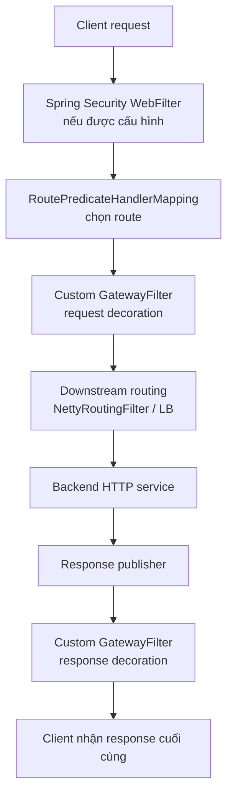
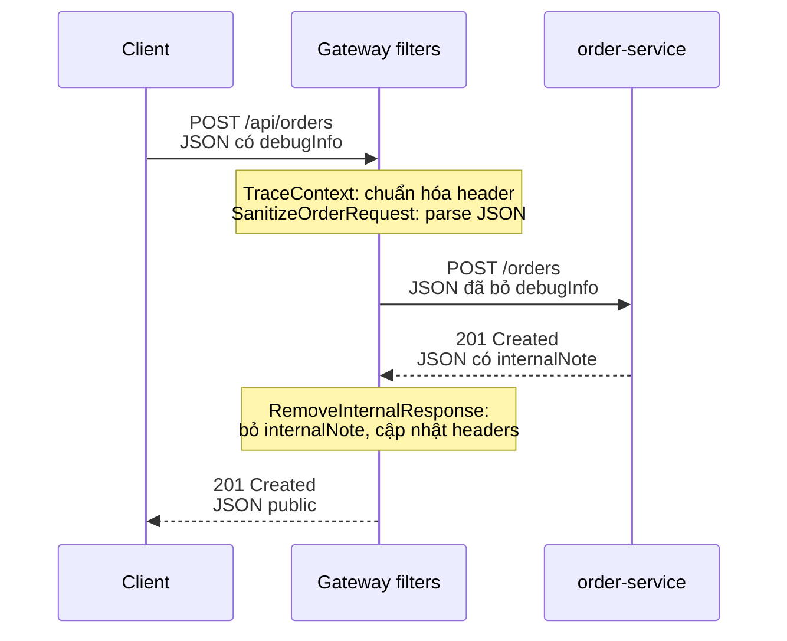

# Thay đổi request và response bằng các decorator phù hợp

Một API Gateway không chỉ quyết định request nào đi tới dịch vụ nào. Khi chuyển tiếp tới microservice, đôi lúc Gateway cần **bổ sung một header đã được xác minh**, **chuẩn hóa JSON request**, hoặc **loại bỏ một thuộc tính nội bộ khỏi JSON response**. Các yêu cầu này đều là biến đổi HTTP, nhưng chúng tác động lên những đối tượng khác nhau và **không thể được giải quyết an toàn bằng cách sửa trực tiếp request/response ban đầu**.

Trong **Spring Cloud Gateway Server WebFlux**, request và response được xử lý theo mô hình reactive. Muốn thay thế dữ liệu mà các filters phía sau nhìn thấy, lập trình viên thường dùng **`ServerWebExchange.mutate()`**, **`ServerHttpRequest.mutate()`**, **`ServerHttpRequestDecorator`** hoặc **`ServerHttpResponseDecorator`**. Đặc biệt, khi sửa body, ta phải hiểu **`Flux<DataBuffer>`**, lifecycle của buffer, cách commit response và metadata như `Content-Length`, `Content-Encoding`.

Bài thuộc chương **Bộ lọc tùy biến** của module **SPRING_CLOUD_GATEWAY**. Nội dung gắn với route predicate, filter chain, viết lại path/header, service discovery, xác thực, rate limiting, circuit breaker, retry, TLS và observability. Trọng tâm là **chọn đúng cơ chế cho đúng tầng**, tránh biến một phép sửa HTTP đơn giản thành lỗi rò rỉ bộ nhớ, phá JSON, bỏ qua phân quyền hoặc khiến client nhận response không hợp lệ.

> **Phạm vi phiên bản:** Ví dụ sử dụng Spring Cloud Gateway **Server WebFlux** và API của Spring WebFlux. Gateway 5.x sử dụng namespace `spring.cloud.gateway.server.webflux.routes`; một số dòng 4.x trước đó dùng `spring.cloud.gateway.routes`. Đừng áp dụng trực tiếp `ServerHttpRequestDecorator` hay `ServerHttpResponseDecorator` vào **Gateway Server MVC/Servlet**, vốn có loại request, filter và mô hình xử lý khác.

## 1. Bài toán thực tế: hai chiều biến đổi

Giả sử client gửi request tạo đơn hàng:

```http
POST /api/orders HTTP/1.1
Host: api.example.test
Authorization: Bearer <access-token>
Content-Type: application/json
X-Trusted-User: admin

{
  "sku": "BOOK-1",
  "quantity": 2,
  "debugInfo": "client-side verbose trace"
}
```

Với một chính sách đã được thống nhất, Gateway có thể:

1. **Request headers:** xóa `X-Trusted-User` do client tự gửi; nếu cần danh tính nội bộ, chỉ tạo lại từ `Authentication` đã được Spring Security xác thực.
2. **Request body:** bỏ thuộc tính JSON `debugInfo` trước khi chuyển tiếp xuống `order-service`.
3. **Response body:** backend có thể trả `internalNote` chỉ dành cho vận hành; Gateway loại bỏ trường đó trước khi trả client, nếu chính sách API thực sự cho phép xử lý ở Gateway.
4. **Response headers:** đảm bảo metadata cuối cùng tương thích với body mới, thay vì giữ nguyên độ dài/ETag của JSON trước khi sửa.

Backend giả định trả:

```json
{
  "orderId": "ORD-42",
  "status": "CREATED",
  "internalNote": "handled by node-3"
}
```

Client mong muốn thấy:

```json
{
  "orderId": "ORD-42",
  "status": "CREATED"
}
```

**Lưu ý bảo mật:** Loại bỏ `debugInfo` hoặc `internalNote` ở Gateway không thay thế DTO/allowlist và phân quyền tại backend. Một route khác có thể không gắn filter, trong khi dữ liệu nhạy cảm mới có thể xuất hiện với tên khác. Với thông tin cá nhân hoặc bí mật, nên ưu tiên **không sinh dữ liệu đó từ backend** cho API công khai.

## 2. Request, response và exchange trong WebFlux

Một handler của Gateway nhận **`ServerWebExchange`**, đối tượng chứa:

- **`getRequest()`:** `ServerHttpRequest`, gồm method, URI, headers, cookies và publisher body.
- **`getResponse()`:** `ServerHttpResponse`, nơi định nghĩa HTTP status, response headers và ghi body.
- **`getAttributes()`:** map thuộc tính để các WebFlux/Gateway filters phối hợp trong một exchange.
- **`getPrincipal()`:** thông tin principal khi pipeline xác thực cung cấp.

Request của WebFlux được thiết kế để không sửa tùy tiện một object đang được xử lý bởi nhiều thành phần. Đối với body, `request.getBody()` trả **`Flux<DataBuffer>`**: dữ liệu có thể được gửi thành nhiều chunks, theo lịch reactive và có thể chỉ được tiêu thụ một lần.



Sơ đồ là **luồng logic**. Trong mã nguồn, một Gateway filter có thể tạo **response decorator trước khi gọi `chain.filter(...)`**, nhưng việc ghi body thường diễn ra ở **chiều quay về (post phase)** khi routing filter hoàn tất. Thứ tự thực tế của `GlobalFilter`, `GatewayFilter` và `NettyWriteResponseFilter` phải được xác minh trên phiên bản đang chạy.

### 2.1. Decorator khác gì mutation?

| Công cụ | Khi nên dùng | Thí dụ |
| --- | --- | --- |
| **`ServerHttpRequest.mutate()`** | Đổi URI/path/query/header/method thông qua builder hỗ trợ, **không cần sửa body**. | Xóa header giả mạo, thêm correlation ID. |
| **`ServerWebExchange.mutate()`** | Cho filters phía sau nhìn thấy request/response được thay thế. | `exchange.mutate().request(newRequest).build()`. |
| **`ServerHttpRequestDecorator`** | Cần ghi đè cách request cung cấp body hoặc các thuộc tính HTTP của request. | `getBody()` trả JSON đã xử lý. |
| **`ServerHttpResponseDecorator`** | Cần chặn và biến đổi body khi downstream ghi response. | Ghi đè `writeWith(...)`. |
| **`ModifyRequestBody` / `ModifyResponseBody`** | Chuyển đổi body theo loại dữ liệu với filter **đã có sẵn** của Gateway. | Ánh xạ DTO, chuẩn hóa response JSON. |
| **`ServerWebExchange.getAttributes()`** | Truyền metadata **nội bộ** giữa các filters; không thay HTTP body. | Gắn trace context phục vụ logic tiếp theo. |

**Quy tắc chọn giải pháp:** Chỉ sửa header hoặc path thì **ưu tiên builder hoặc built-in filter**. Chỉ cần đổi body theo loại dữ liệu thì **ưu tiên `ModifyRequestBody` hoặc `ModifyResponseBody`**. Chỉ tự viết decorator khi cần kiểm soát publisher/stream và lifecycle theo một yêu cầu chưa được các factory có sẵn giải quyết.

## 3. Sửa headers và path: chưa cần decorator body

Ví dụ dưới đây minh họa một **custom GatewayFilterFactory** xóa header nhận dạng do client có thể giả mạo và ghi đè correlation header do Gateway tạo:

```java
package com.example.gateway.filters;

import java.util.UUID;

import org.springframework.cloud.gateway.filter.GatewayFilter;
import org.springframework.cloud.gateway.filter.factory.AbstractGatewayFilterFactory;
import org.springframework.http.server.reactive.ServerHttpRequest;
import org.springframework.stereotype.Component;

@Component
public class TraceContextGatewayFilterFactory
        extends AbstractGatewayFilterFactory<
            TraceContextGatewayFilterFactory.Config> {

    public static class Config { }

    public TraceContextGatewayFilterFactory() {
        super(Config.class);
    }

    @Override
    public GatewayFilter apply(Config config) {
        return (exchange, chain) -> {
            String traceId = UUID.randomUUID().toString();

            ServerHttpRequest request = exchange.getRequest()
                .mutate()
                .headers(headers -> {
                    headers.remove("X-Trusted-User");
                    headers.set("X-Gateway-Trace", traceId);
                })
                .build();

            return chain.filter(
                exchange.mutate().request(request).build()
            );
        };
    }
}
```

Đây là ví dụ **biến đổi metadata HTTP**: không đọc request body và không tạo `DataBuffer`. `headers.set(...)` **ghi đè** giá trị cũ; `headers.add(...)` có thể thêm một giá trị thứ hai và gây mơ hồ. Đối với header danh tính, phải **xóa giá trị client tự đặt** rồi phát sinh từ principal đã xác thực trong một thiết kế tin cậy. Ví dụ trên chỉ thêm **trace ID**, không tự gán một user ID.

Để đổi path mà không sửa body:

```java
ServerHttpRequest rewritten = exchange.getRequest()
    .mutate()
    .path("/orders/42")
    .build();

return chain.filter(exchange.mutate().request(rewritten).build());
```

**Không cài cứng `"/orders/42"` trong sản phẩm thực tế**. Dùng `StripPrefix`, `RewritePath` hoặc builder với path tính đúng từ request. Nếu chỉ cần viết lại URL, các filter có sẵn thường dễ kiểm thử và ít gây lỗi hơn.

### 3.1. Cấu hình filter tùy biến trong YAML

Spring Cloud Gateway nhận diện factory theo hậu tố tên class **`GatewayFilterFactory`**. Class `TraceContextGatewayFilterFactory` thường được tham chiếu dưới tên ngắn **`TraceContext`**:

```yaml
spring:
  cloud:
    gateway:
      server:
        webflux:
          routes:
            - id: orders-api
              uri: lb://order-service
              predicates:
                - Path=/api/orders/**
              filters:
                - TraceContext
                - StripPrefix=1
```

Điều kiện: bean filter thực sự được Spring quét, starter đúng Server WebFlux và có LoadBalancer/discovery nếu dùng `lb://`. Ví dụ tên ngắn chỉ phù hợp khi factory không yêu cầu tham số bắt buộc; với factory phức tạp nên dùng dạng `name/args`.

## 4. Vì sao không sửa trực tiếp request/response cũ?

Một sai lầm thường gặp là:

```java
// Không phải cách ổn định để sửa request trong WebFlux.
exchange.getRequest().getHeaders()
    .set("X-Gateway-Trace", "123");
```

Các HTTP request headers thường được trình bày dưới dạng read-only hoặc những wrapper có giới hạn; trực tiếp sửa có thể bị `UnsupportedOperationException`, không được thấy bởi lớp phía sau hoặc phá những giả định về tính bất biến.

Tương tự, **không có API** cho phép lấy `request.getBody()` rồi thay một `String` vào nó. Body là publisher dữ liệu và cần được thay bằng **một publisher mới** thông qua decorator hoặc filter body có sẵn.

Mẫu chuẩn:

```java
ServerHttpRequestDecorator decorated =
    new ServerHttpRequestDecorator(exchange.getRequest()) {
        @Override
        public Flux<DataBuffer> getBody() {
            return someNewBodyPublisher;
        }
    };

ServerWebExchange wrapped =
    exchange.mutate().request(decorated).build();

return chain.filter(wrapped);
```

Đây là **khung minh họa**, giả định biến `someNewBodyPublisher` có kiểu phù hợp và được xây đúng lifecycle. Trong ứng dụng thật, chỉ `getBody()` bị thay đổi; các thuộc tính khác được decorator chuyển tiếp cho delegate trừ khi được ghi đè.

**Đặc biệt:** Nếu body đã đổi số byte, phải xem lại `Content-Length` và `Transfer-Encoding`. Nếu content type đổi, phải cập nhật `Content-Type`; không giữ metadata từ body cũ một cách mù quáng.

## 5. DataBuffer: phần dễ sai nhất khi tự xử lý body

`DataBuffer` là abstraction của Spring cho vùng nhớ chứa dữ liệu. Với Reactor Netty, dữ liệu có thể được cấp phát qua các **pooled buffers** và yêu cầu quản lý reference count. Các thao tác xử lý body phải tuân theo ba quy tắc:

1. **Không giả định một JSON body đi trong đúng một `DataBuffer`.** TCP chunk boundaries không trùng biên JSON token, UTF-8 character hoặc đối tượng nghiệp vụ.
2. **Không tiêu thụ request body rồi bỏ trống body downstream.** Reactive request body thường không thể được tự động đọc lại từ đầu nếu đã bị một filter tiêu thụ.
3. **Không quên giải phóng pooled buffers** khi bạn trở thành chủ sở hữu của dữ liệu và đã đọc xong.

### 5.1. Sai: coi từng DataBuffer là một JSON object hoàn chỉnh

```java
// KHÔNG ĐÚNG cho JSON bất kỳ.
request.getBody().map(buffer -> {
    String text = buffer.toString(StandardCharsets.UTF_8);
    return parseAndRewriteJson(text);
});
```

Body:

```json
{"customer":{"name":"Nguyễn"},"quantity":2}
```

có thể bị chia thành nhiều chunks:

```text
Buffer 1: {"customer":{"name":"Ng
Buffer 2: uyễn"},"quant
Buffer 3: ity":2}
```

Ngay cả một ký tự UTF-8 cũng có thể bị chia giữa buffers. Parse từng chunk độc lập sẽ lỗi hoặc làm hỏng dữ liệu. Nếu cần chuyển đổi JSON **toàn object**, phải dùng codec có hỗ trợ streaming đúng ngữ nghĩa hoặc **gom body có giới hạn** rồi parse một lần.

### 5.2. DataBufferUtils.join với giới hạn kích thước

Spring cung cấp:

```java
Mono<DataBuffer> joined = DataBufferUtils.join(
    request.getBody(),
    256 * 1024 // tối đa 256 KiB cho ví dụ
);
```

API `join(Publisher, maxByteCount)` gom dữ liệu và **phát `DataBufferLimitException` khi vượt giới hạn** theo phiên bản Spring Framework. Giới hạn rất quan trọng: nếu mỗi request có body 10 MB và hàng trăm request đồng thời thì Gateway có thể tiêu tốn lượng lớn memory chỉ để parse lại nội dung.

Sau khi nhận joined buffer, đọc và giải phóng:

```java
static byte[] readAndRelease(DataBuffer dataBuffer) {
    try {
        byte[] result = new byte[dataBuffer.readableByteCount()];
        dataBuffer.read(result);
        return result;
    } finally {
        DataBufferUtils.release(dataBuffer);
    }
}
```

Theo hợp đồng `join`, nếu buffer đã gom được trả về dưới dạng composite, **release joined buffer** cũng xử lý các buffers được quản lý trong composite. **Không release từng buffer nguồn lần thứ hai** sau khi `join` đã quản lý chúng, vì có thể gây double release.

### 5.3. “Đọc, biến đổi, cấp buffer mới” khác “giữ buffer cũ”

Khi nội dung được chuyển sang `byte[]`, bạn có thể giải phóng joined buffer rồi tạo `DataBuffer` mới bằng:

```java
DataBuffer rewrittenBuffer =
    exchange.getResponse().bufferFactory().wrap(rewrittenBytes);
```

Nhưng việc buffer được phát tới downstream đúng một lần, được xử lý khi cancel/error và không được giữ quá lifecycle của request vẫn phải được kiểm thử. **Không gọi `block()` hay `subscribe()` bên trong filter** để lấy body vì làm vỡ pipeline reactive, gây nguy cơ chặn event loop và tách việc đọc body khỏi vòng đời exchange.

Trong những custom publishers phức tạp có `publishOn`, `filter` hoặc cancellation, cần xem `doOnDiscard(DataBuffer.class, DataBufferUtils::release)` và nguyên tắc ownership của từng operator để tránh leak; **không thêm release bừa** nếu buffer đã được framework xử lý.

## 6. Ví dụ request decorator: xóa một trường JSON trước downstream

Tình huống: Chỉ route **`POST /api/orders`** nhận JSON object với giới hạn kích thước nhỏ. Gateway bỏ trường `debugInfo` khỏi body rồi chuyển tiếp.

### 6.1. Factory tùy biến có xử lý body có giới hạn

Ví dụ Java 17+ dùng Jackson và Spring WebFlux:

```java
package com.example.gateway.filters;

import java.io.IOException;

import com.fasterxml.jackson.databind.JsonNode;
import com.fasterxml.jackson.databind.ObjectMapper;
import com.fasterxml.jackson.databind.node.ObjectNode;
import org.springframework.cloud.gateway.filter.GatewayFilter;
import org.springframework.cloud.gateway.filter.factory.AbstractGatewayFilterFactory;
import org.springframework.core.io.buffer.DataBuffer;
import org.springframework.core.io.buffer.DataBufferLimitException;
import org.springframework.core.io.buffer.DataBufferUtils;
import org.springframework.http.HttpHeaders;
import org.springframework.http.HttpStatus;
import org.springframework.http.MediaType;
import org.springframework.http.server.reactive.ServerHttpRequestDecorator;
import org.springframework.stereotype.Component;
import org.springframework.web.server.ResponseStatusException;
import reactor.core.publisher.Flux;
import reactor.core.publisher.Mono;

@Component
public class SanitizeOrderRequestGatewayFilterFactory
        extends AbstractGatewayFilterFactory<
            SanitizeOrderRequestGatewayFilterFactory.Config> {

    private static final int MAX_BYTES = 256 * 1024;
    private final ObjectMapper mapper;

    public static class Config { }

    public SanitizeOrderRequestGatewayFilterFactory(
            ObjectMapper mapper) {
        super(Config.class);
        this.mapper = mapper;
    }

    @Override
    public GatewayFilter apply(Config config) {
        return (exchange, chain) -> {
            var request = exchange.getRequest();
            MediaType contentType = request.getHeaders().getContentType();
            if (contentType == null ||
                    !MediaType.APPLICATION_JSON.isCompatibleWith(contentType)) {
                // Ví dụ chỉ xử lý application/json;
                // route thật phải xác định policy cho media type khác.
                return chain.filter(exchange);
            }
            if (request.getHeaders().containsKey(
                    HttpHeaders.CONTENT_ENCODING)) {
                return Mono.error(new ResponseStatusException(
                    HttpStatus.UNSUPPORTED_MEDIA_TYPE,
                    "Compressed request body not supported"));
            }

            Mono<byte[]> transformed = DataBufferUtils
                .join(request.getBody(), MAX_BYTES)
                .map(SanitizeOrderRequestGatewayFilterFactory::readAndRelease)
                .defaultIfEmpty(new byte[0])
                .flatMap(bytes -> Mono.fromCallable(
                    () -> removeDebugInfo(bytes)))
                .onErrorMap(DataBufferLimitException.class,
                    ex -> new ResponseStatusException(
                        HttpStatus.PAYLOAD_TOO_LARGE,
                        "Request JSON exceeds limit", ex));

            return transformed.flatMap(bytes -> {
                ServerHttpRequestDecorator decorated =
                    new ServerHttpRequestDecorator(request) {
                        @Override
                        public HttpHeaders getHeaders() {
                            HttpHeaders headers = new HttpHeaders();
                            headers.putAll(super.getHeaders());
                            headers.remove(HttpHeaders.TRANSFER_ENCODING);
                            headers.setContentLength(bytes.length);
                            return headers;
                        }

                        @Override
                        public Flux<DataBuffer> getBody() {
                            // Tạo DataBuffer mới khi có subscriber.
                            return Flux.defer(() -> Flux.just(
                                exchange.getResponse()
                                    .bufferFactory().wrap(bytes)));
                        }
                    };
                return chain.filter(
                    exchange.mutate().request(decorated).build()
                );
            });
        };
    }

    private byte[] removeDebugInfo(byte[] raw) throws IOException {
        if (raw.length == 0) {
            return raw;
        }
        JsonNode node = mapper.readTree(raw);
        if (!(node instanceof ObjectNode object)) {
            throw new IllegalArgumentException("Expected JSON object");
        }
        object.remove("debugInfo");
        return mapper.writeValueAsBytes(object);
    }

    private static byte[] readAndRelease(DataBuffer buffer) {
        try {
            byte[] bytes = new byte[buffer.readableByteCount()];
            buffer.read(bytes);
            return bytes;
        } finally {
            DataBufferUtils.release(buffer);
        }
    }
}
```

**Những phần quan trọng trong ví dụ:**

1. **`DataBufferUtils.join(..., MAX_BYTES)`** xử lý body nhiều chunks và từ chối nội dung vượt giới hạn.
2. **`readAndRelease`** giải phóng joined buffer sau khi sao chép dữ liệu sang `byte[]`.
3. **Jackson `ObjectNode.remove`** xóa thuộc tính **theo cấu trúc JSON**, không sửa chuỗi thô bằng regex.
4. **`getBody()`** của request decorator cung cấp publisher body **mới**, trả về cho routing filter phía sau.
5. **`getHeaders()`** tạo headers thay thế, bỏ `Transfer-Encoding` cũ và đặt lại `Content-Length` theo **số byte mới**, không tính theo số ký tự Java.
6. **`exchange.mutate().request(decorated)`** truyền request đã được wrap cho đoạn chain tiếp theo.
7. **Không có `block()` hoặc `subscribe()`**; toàn bộ bước đọc/sửa/route nằm trong một reactive chain.

Đây là **mẫu học tập có giới hạn**, chưa phải một bộ xử lý tất cả media types. Với JSON sai định dạng, `ObjectMapper` báo lỗi và error mapper của ứng dụng cần quyết định rõ trả `400` hay status khác. Response quá lớn của downstream, multipart, streaming, charset khác UTF-8, nested field, cancellation và đồng bộ với retry đòi hỏi thiết kế/test thêm. **Không chỉ copy class này vào production rồi xem là đã kiểm thử đủ.**

### 6.2. Vì sao giữ byte[] vẫn có rủi ro?

`byte[]` nằm trong lambda và sống cùng publisher/request cho đến khi pipeline hoàn tất. Nếu có hàng trăm request đồng thời, mỗi request giữ body 256 KiB cùng JSON tree/trung gian, tổng memory có thể lớn hơn nhiều lần `MAX_BYTES × số request` vì còn allocation, buffer gốc và object Jackson.

`Flux.defer(...)` giúp tạo `DataBuffer` mới cho mỗi subscription, nhưng **không biến thao tác thành streaming**: toàn bộ body đã được gom và giữ trong memory. Nếu có Retry filter, cùng bytes có thể được replay tùy order; điều đó **không bảo đảm** nghiệp vụ POST an toàn để lặp.

### 6.3. Vì sao không chỉ dùng request.mutate().header(...)?

`ServerHttpRequest.mutate()` thường phù hợp với **method, URI, path và headers**. Nó không cung cấp cách thay toàn bộ body từ `Flux<DataBuffer>` thành JSON mới qua một lệnh `header`. Muốn thay body phải dùng decorator như ví dụ hoặc factory body transformation của Gateway.

## 7. Response decorator: chặn body trước khi về client

Với response body, luồng dữ liệu đi ngược chiều: routing filter nhận phản hồi backend rồi ghi vào `ServerHttpResponse`. Một **`ServerHttpResponseDecorator`** có thể ghi đè **`writeWith(Publisher<? extends DataBuffer>)`** để nhận publisher thay vì để nội dung đi thẳng tới client.

**Mẫu ý tưởng:**

```java
ServerHttpResponseDecorator decorated =
    new ServerHttpResponseDecorator(exchange.getResponse()) {
        @Override
        public Mono<Void> writeWith(
                Publisher<? extends DataBuffer> body) {
            // Biến đổi body, rồi ghi bằng super.writeWith(...).
            return super.writeWith(body);
        }
    };

return chain.filter(
    exchange.mutate().response(decorated).build()
);
```

Đây là skeleton, **chưa làm thay đổi nội dung**. Một response decorator thực tế phải xem:

- Có **body** hay không (`204 No Content`, `304 Not Modified`, response cho `HEAD`).
- Media type là JSON bình thường, `application/problem+json`, hay binary/XML/SSE.
- Body có được **gzip/br/deflate** trước khi decorator nhìn thấy hay không.
- Body có được phát thành nhiều chunks hoặc dùng `writeAndFlushWith`.
- Metadata `Content-Length`, `Content-Encoding`, `ETag` và kiểm tra checksum/chữ ký.
- Response đã **commit** hay chưa; sau commit không thể thay status/header.

### 7.1. Ví dụ loại bỏ internalNote ở root JSON object

Ví dụ sau dùng Jackson để **xóa thuộc tính `internalNote` ở cấp gốc** từ JSON response có kiểu `application/json`, kích thước tối đa 256 KiB. Đây là ví dụ học tập, cố ý **từ chối JSON bị nén hoặc JSON streaming**, không lặng lẽ xuất dữ liệu gốc nếu không biến đổi được.

```java
package com.example.gateway.filters;

import java.io.IOException;

import com.fasterxml.jackson.databind.JsonNode;
import com.fasterxml.jackson.databind.ObjectMapper;
import com.fasterxml.jackson.databind.node.ObjectNode;
import org.reactivestreams.Publisher;
import org.springframework.cloud.gateway.filter.GatewayFilter;
import org.springframework.cloud.gateway.filter.factory.AbstractGatewayFilterFactory;
import org.springframework.core.io.buffer.DataBuffer;
import org.springframework.core.io.buffer.DataBufferLimitException;
import org.springframework.core.io.buffer.DataBufferUtils;
import org.springframework.http.HttpHeaders;
import org.springframework.http.HttpStatus;
import org.springframework.http.MediaType;
import org.springframework.http.server.reactive.ServerHttpResponseDecorator;
import org.springframework.stereotype.Component;
import org.springframework.web.server.ResponseStatusException;
import reactor.core.publisher.Flux;
import reactor.core.publisher.Mono;

@Component
public class RemoveInternalResponseGatewayFilterFactory
        extends AbstractGatewayFilterFactory<
            RemoveInternalResponseGatewayFilterFactory.Config> {

    private static final int MAX_BYTES = 256 * 1024;
    private final ObjectMapper mapper;

    public static class Config { }

    public RemoveInternalResponseGatewayFilterFactory(
            ObjectMapper mapper) {
        super(Config.class);
        this.mapper = mapper;
    }

    @Override
    public GatewayFilter apply(Config config) {
        return (exchange, chain) -> {
            ServerHttpResponseDecorator decorated =
                new ServerHttpResponseDecorator(exchange.getResponse()) {

                    @Override
                    public Mono<Void> writeWith(
                            Publisher<? extends DataBuffer> body) {
                        MediaType type = getHeaders().getContentType();
                        if (type == null ||
                                !MediaType.APPLICATION_JSON
                                    .isCompatibleWith(type)) {
                            return super.writeWith(body);
                        }

                        if (getHeaders().containsKey(
                                HttpHeaders.CONTENT_ENCODING)) {
                            return Mono.error(new ResponseStatusException(
                                HttpStatus.BAD_GATEWAY,
                                "Compressed JSON transformation unsupported"));
                        }

                        Mono<byte[]> transformed = DataBufferUtils
                            .join(Flux.from(body), MAX_BYTES)
                            .map(RemoveInternalResponseGatewayFilterFactory
                                ::readAndRelease)
                            .defaultIfEmpty(new byte[0])
                            .flatMap(bytes -> Mono.fromCallable(
                                () -> removeInternalNote(bytes)))
                            .onErrorMap(DataBufferLimitException.class,
                                ex -> new ResponseStatusException(
                                    HttpStatus.BAD_GATEWAY,
                                    "Downstream JSON exceeds limit", ex));

                        return transformed.flatMap(bytes -> {
                            // Byte length/ETag của response cũ không còn đúng.
                            getHeaders().remove(HttpHeaders.CONTENT_LENGTH);
                            getHeaders().remove(HttpHeaders.ETAG);

                            DataBuffer out = bufferFactory().wrap(bytes);
                            return super.writeWith(Mono.just(out));
                        });
                    }

                    @Override
                    public Mono<Void> writeAndFlushWith(
                            Publisher<? extends Publisher<
                                ? extends DataBuffer>> body) {
                        MediaType type = getHeaders().getContentType();
                        if (type != null &&
                                MediaType.APPLICATION_JSON
                                    .isCompatibleWith(type)) {
                            return Mono.error(new ResponseStatusException(
                                HttpStatus.BAD_GATEWAY,
                                "Streaming JSON transformation unsupported"));
                        }
                        return super.writeAndFlushWith(body);
                    }
                };

            return chain.filter(
                exchange.mutate().response(decorated).build()
            );
        };
    }

    private byte[] removeInternalNote(byte[] raw)
            throws IOException {
        if (raw.length == 0) {
            return raw;
        }
        JsonNode json = mapper.readTree(raw);
        if (!(json instanceof ObjectNode object)) {
            throw new IllegalArgumentException("Expected JSON object");
        }
        object.remove("internalNote");
        return mapper.writeValueAsBytes(object);
    }

    private static byte[] readAndRelease(DataBuffer buffer) {
        try {
            byte[] bytes = new byte[buffer.readableByteCount()];
            buffer.read(bytes);
            return bytes;
        } finally {
            DataBufferUtils.release(buffer);
        }
    }
}
```

**Đọc ví dụ theo lifecycle:**

1. Filter tạo **response decorator trước** rồi gọi `chain.filter(...)` với `exchange` đã được wrap.
2. Khi downstream chuẩn bị ghi response, `writeWith(...)` của decorator có cơ hội nhận các `DataBuffer`.
3. Nếu đúng `application/json` và không có `Content-Encoding`, ví dụ gom body có giới hạn, parse JSON và xóa một field.
4. **Joined input buffer được release**. Bytes mới được bọc thành output `DataBuffer` cho downstream writer.
5. **`Content-Length` và `ETag` cũ bị bỏ** trước khi body mới được ghi. Không giả định hash/chữ ký hoặc những cache headers khác sẽ tự sửa.
6. Với `writeAndFlushWith` của luồng JSON, ví dụ **báo lỗi** thay vì lặng lẽ chuyển bytes gốc vì chưa có cơ chế biến đổi streaming đúng.

**Ranh giới của ví dụ:** Không tự chuyển đổi `application/problem+json`, JSON array ở root, body nén hoặc các loại streaming. Nó không chứng minh mọi error response đều được viết dưới dạng JSON và không tự thêm chính sách phân quyền. Nếu response bị commit sớm hoặc một filter khác viết trực tiếp ra Netty, hành vi có thể khác; kiểm thử với Gateway và backend thật trước khi dùng ở production.

### 7.2. Vì sao response decorator cần chặn lúc write?

Một cách không đủ:

```java
return chain.filter(exchange)
    .then(Mono.fromRunnable(() -> {
        exchange.getResponse().getHeaders()
            .add("X-Processed", "true");
    }));
```

Khi `then(...)` chạy, downstream có thể đã **commit** headers và body. Thêm header lúc ấy có thể bị bỏ qua hoặc lỗi tùy adapter. Muốn thay **response body**, không thể đợi đến lúc response ghi xong rồi sửa một object `String` không tồn tại. Cần tạo decorator **trước khi downstream ghi**; muốn chỉnh header ngay trước commit có thể đăng ký `beforeCommit(...)` khi đúng lifecycle, nhưng vẫn không được coi đó là một bước thay body.

### 7.3. Không phải JSON nào cũng có thể biến đổi bằng một parse toàn body

- **`application/json` nhỏ:** có thể dùng Jackson và buffer có giới hạn.
- **`application/problem+json`:** cần hỗ trợ media type thích hợp, không mặc định một phép so `application/json` đã bao phủ.
- **Root array:** thuật toán `ObjectNode.remove(...)` ở root không giải quyết tất cả phần tử của array.
- **SSE/NDJSON/chunked JSON:** có ranh giới message hoặc nhiều đối tượng liên tiếp; gom toàn stream có thể không bao giờ hoàn tất.
- **Compressed body:** phải giải nén trước parse và nén lại đúng trình tự, hoặc từ chối/bỏ yêu cầu transformation theo một chính sách an toàn đã định.
- **Binary/file:** không được parse như UTF-8 JSON.

**Không để một filter dùng để che thông tin nhạy cảm tự động “bỏ qua và trả body gốc” khi không hiểu media type** nếu hợp đồng bảo mật yêu cầu field phải luôn được loại bỏ. Ưu tiên bỏ field từ backend DTO hoặc fail-closed với phản hồi được kiểm soát.

## 8. Kết hợp request decorator và response decorator trong cùng route

Hai factory của các ví dụ có thể gắn vào route theo thứ tự mong muốn:

```yaml
spring:
  cloud:
    gateway:
      server:
        webflux:
          routes:
            - id: create-order
              uri: lb://order-service
              predicates:
                - Path=/api/orders
                - Method=POST
              filters:
                - TraceContext
                - SanitizeOrderRequest
                - RemoveInternalResponse
                - StripPrefix=1
```

**Tùy chọn namespace 4.x:** Các bản Gateway Server WebFlux trước đây có thể sử dụng `spring.cloud.gateway.routes` thay cho `spring.cloud.gateway.server.webflux.routes`. Chọn đúng BOM/starter, xác minh tên factory đã được quét và xem route runtime.

### 8.1. Luồng biến đổi đầu cuối



Với các request hợp lệ và response JSON nhỏ đúng cấu trúc, đây là hành vi kỳ vọng. Trong sản phẩm thật cần xác nhận:

- Body request chuyển đến backend **đúng byte/JSON semantics** sau khi thay.
- Response cuối **không còn thuộc tính nội bộ** và metadata HTTP nhất quán.
- Status `201 Created` được giữ nếu backend trả 201 và không có filter khác thay.
- Không ghi full JSON chứa PII vào log.
- Route khác, lỗi 4xx/5xx, HTTP `HEAD`/`OPTIONS` và content negotiation không vô tình bypass chính sách.

### 8.2. Tại sao thứ tự filter quan trọng?

Spring Cloud Gateway ghép **`GlobalFilter`** và **`GatewayFilter`** thành filter chain, sắp xếp theo `Ordered`. Filters có thể có giai đoạn trước routing và sau routing. Khi request body đã bị đọc bởi filter trước, filter sau không thể mặc định đọc lại nếu không được cache/decorate đúng.

Ví dụ:

- `SanitizeOrderRequest` **trước** một filter ghi/đọc request body: bộ lọc sau nhìn thấy nội dung đã sửa (nếu đi đúng exchange).
- Nếu filter trước đã tiêu thụ body và không cung cấp replay, `SanitizeOrderRequest` có thể thấy body rỗng.
- Nếu một retry filter tái chạy phần chain sau nó, body publisher phải có khả năng replay đúng và không phát duplicate side effect.
- Response decorator phải có mặt trong exchange **trước** khi phần ghi response diễn ra.
- Một filter khác đổi `Content-Encoding`, `Content-Type` hoặc cache response có thể tạo thứ tự xử lý không tương thích.

**Không dựa vào thứ tự YAML như một bảo đảm tuyệt đối** nếu có `GlobalFilter` và custom `OrderedGatewayFilter`. Quan sát Gateway runtime và kiểm thử integration.

## 9. Vì sao ModifyRequestBody/ModifyResponseBody thường tốt hơn?

Spring Cloud Gateway đã có **`ModifyRequestBody`** và **`ModifyResponseBody`** trong Server WebFlux. Tài liệu chính thức chỉ rõ **hai factory này cấu hình bằng Java DSL**, không phải chỉ viết một dòng YAML giống các shortcut filters thông thường.

Ví dụ cấu hình Java DSL đổi body dạng text đơn giản:

```java
package com.example.gateway.routes;

import org.springframework.cloud.gateway.route.RouteLocator;
import org.springframework.cloud.gateway.route.builder.RouteLocatorBuilder;
import org.springframework.context.annotation.Bean;
import org.springframework.context.annotation.Configuration;
import org.springframework.http.MediaType;
import reactor.core.publisher.Mono;

@Configuration
public class TextBodyRoutes {

    @Bean
    RouteLocator bodyRoutes(RouteLocatorBuilder routes) {
        return routes.routes()
            .route("text-transform", r -> r
                .path("/api/text/**")
                .filters(f -> f
                    .modifyRequestBody(
                        String.class,
                        String.class,
                        MediaType.TEXT_PLAIN_VALUE,
                        (exchange, input) -> input == null
                            ? Mono.empty()
                            : Mono.just(input.trim()))
                    .modifyResponseBody(
                        String.class,
                        String.class,
                        (exchange, output) -> output == null
                            ? Mono.empty()
                            : Mono.just(output.toUpperCase()))
                )
                .uri("http://localhost:9090"))
            .build();
    }
}
```

Đoạn ví dụ **cố ý xử lý text/plain**, không phải JSON. Không sử dụng `String.replace(...)` hoặc `toUpperCase()` như một phương án xóa thuộc tính nhạy cảm khỏi JSON: nội dung JSON có escape, nested object, mảng và các chuỗi giá trị mà thao tác text thô dễ làm hỏng.

Với JSON, các filter này có thể dùng lớp DTO hoặc một biểu diễn dữ liệu tương thích với HTTP codecs để **decode → chuyển đổi có kiểu → encode**. Factory giúp quản lý nhiều công đoạn phù hợp hơn tự lắp mọi `DataBuffer`, nhưng vẫn cần kiểm thử memory, media types, null body, retries và metadata.

### 9.1. Trường hợp body trống

Tài liệu Spring Cloud Gateway ghi rằng khi body không tồn tại, rewrite function của `ModifyRequestBody`/`ModifyResponseBody` có thể nhận **`null`**. Phương án phù hợp thường là:

```java
(exchange, body) -> body == null
    ? Mono.empty()
    : Mono.just(transform(body))
```

Không mặc định mọi request/response luôn có JSON. `204 No Content`, `HEAD` hoặc route trả lỗi không body cần được giữ đúng semantics HTTP.

### 9.2. CacheRequestBody dùng khi nào?

Nếu yêu cầu chỉ là **đọc body để kiểm tra/tính toán** rồi vẫn chuyển nguyên body tới backend, có thể cân nhắc `CacheRequestBody`. Tài liệu Gateway cho biết filter này decode body thành loại dữ liệu được khai báo và đặt kết quả trong exchange attribute `ServerWebExchangeUtils.CACHED_REQUEST_BODY_ATTR`, vì body thông thường không thể được đọc hai lần.

Nhưng **cache** cũng tiêu tốn bộ nhớ; không xem nó là một biện pháp miễn phí để log toàn bộ request, đặc biệt khi body có mật khẩu, token, PII hoặc tệp upload.

### 9.3. So sánh lựa chọn

| Yêu cầu | Ưu tiên |
| --- | --- |
| Thêm, xóa hoặc ghi đè header | `AddRequestHeader`, `SetRequestHeader`, `RemoveRequestHeader` hoặc `request.mutate()` |
| Rewrite path | `StripPrefix`, `RewritePath`, `SetPath` |
| Đổi một vài field JSON ở request | `ModifyRequestBody` với typed DTO/codec, hoặc decorator nếu thực sự cần |
| Đổi cấu trúc JSON response | `ModifyResponseBody`; ưu tiên DTO tại nguồn khi liên quan bảo mật |
| Bỏ tên field JSON response | `RemoveJsonAttributesResponseBody` khi phù hợp với phiên bản và phạm vi root/recursive |
| Đọc body rồi vẫn gửi nguyên | `CacheRequestBody` hoặc một cơ chế có replay đã kiểm thử |
| Chặn/viết body ở mức publisher đặc biệt | `ServerHttpRequestDecorator`/`ServerHttpResponseDecorator` với ownership rõ |
| Kiểm tra JWT/role/scope | Spring Security reactive, **không tự parse Authorization header trong filter body** |
| Giới hạn lưu lượng | `RequestRateLimiter`, quota policy; không dùng body decorator để tự khóa requests |

## 10. Metadata HTTP phải nhất quán sau khi đổi body

Đây là nguồn lỗi tinh vi: JSON parse lại có thể có **số byte khác** dù giá trị nghiệp vụ gần giống.

| Metadata | Rủi ro khi body đã đổi | Điều cần làm |
| --- | --- | --- |
| **`Content-Length`** | Vẫn là độ dài byte của body cũ → client đọc thiếu/thừa, lỗi framing | Tính lại byte length hoặc bỏ header để stack xử lý framing đúng |
| **`Transfer-Encoding`** | Xung đột với Content-Length đã chỉnh hoặc HTTP/2 | Để HTTP stack chọn framing phù hợp; tránh tự ép sai |
| **`Content-Type` / charset** | Header báo JSON nhưng bytes thực là text/charset khác | Parse/serialize với codec và charset tương ứng |
| **`Content-Encoding`** | Body `gzip`/`br` không thể parse trực tiếp như JSON | Giải nén/đổi đúng cách hoặc từ chối/bỏ transformation theo policy |
| **`ETag`** | Validator của JSON cũ không còn đúng với bytes mới | Xóa/tính lại bằng body đã biến đổi |
| **`Last-Modified` / Cache-Control** | Conditional requests/cache có thể dựa vào đại diện dữ liệu khác | Rà soát cache semantics của API và gateway |
| **Content checksum/signature** | Chữ ký hoặc digest được tính trên bytes cũ | Tính lại bằng cơ chế có quyền hoặc không thay body đã ký |
| **`Set-Cookie`** | Cookie có thể làm thay đổi state khi retry/redirect | Không tự ý nhân đôi hoặc làm rò rỉ cookie |
| **Status code** | `204`/`304`/`HEAD` không có body theo ngữ nghĩa tương ứng | Không ép ghi JSON chỉ vì decorator thấy empty publisher |

**Không giải quyết lỗi framing bằng cách đổi `Content-Length` sang số ký tự Java.** Ví dụ `"Trường"` có nhiều byte UTF-8 hơn số `char` hiển thị; header phải phản ánh **số byte sau encoding cuối cùng**.

### 10.1. Response chưa commit mới có thể sửa headers/status

`ServerHttpResponse.isCommitted()` cho biết response đã bắt đầu ghi tới mức không thể đổi lại. Có thể dùng `beforeCommit(...)` cho thao tác headers trước commit:

```java
exchange.getResponse().beforeCommit(() -> {
    exchange.getResponse().getHeaders()
        .set("X-Gateway-Processed", "true");
    return Mono.empty();
});

return chain.filter(exchange);
```

Đăng ký callback **trước khi downstream ghi response**. Đoạn này chỉ thêm header, **không thay JSON body**. Callback nên là logic nhỏ, không blocking hoặc chứa side effects nguy hiểm; khi response đã commit, không có cơ chế `uncommit()` để viết lại từ đầu.

### 10.2. 204, HEAD, caching và conditional requests

Body transformation có thể vô tình vi phạm semantics của:

- **`204 No Content`**: không ghi thêm JSON “null” chỉ vì muốn đồng nhất response.
- **`HEAD`**: không phát body dù backend có thể xử lý giống GET về metadata.
- **`304 Not Modified`**: validator phải tương thích với representation client đã cache.
- **`Range` / `206 Partial Content`**: biến đổi toàn bộ body làm byte offsets của partial response không còn đúng.
- **SSE/file downloads**: không phù hợp với ví dụ gom buffer rồi parse JSON.

Với các dạng này, lựa chọn an toàn thường là **không áp dụng body decorator**, giữ một API contract không biến đổi hoặc xử lý ngay từ backend.

## 11. Retry, backpressure và hủy request

### 11.1. Reactive request body thường không đọc lại được tùy tiện

Giả sử filter A đọc toàn bộ `exchange.getRequest().getBody()` để kiểm tra, rồi gọi `chain.filter(exchange)` với request **chưa được thay thế**. Filter/routing phía sau có thể thấy body trống hoặc lỗi vì stream đã được tiêu thụ.

Một request decorator đúng phải cung cấp **publisher mới**. Nếu có retry và các đoạn phía sau được thực thi lại, publisher phải có khả năng tái subscription phù hợp. Tuy nhiên:

**Có thể replay request body ≠ được phép retry nghiệp vụ.** Ví dụ POST tạo đơn hàng đã ghi database ở attempt đầu thì retry vẫn có nguy cơ tạo trùng, dù byte payload giống hệt.

### 11.2. Tính tới backpressure và DataBuffer lifecycle

Reactor `Flux<DataBuffer>` sử dụng backpressure để điều tiết dữ liệu. Nhưng `DataBufferUtils.join(...)` là một phép gom body, làm mất ưu điểm streaming theo từng chunk cho payload đó và tăng memory trong khoảng chờ đủ body.

Khi cần hỗ trợ **streaming lớn**, hãy:

- Chọn thuật toán có thể xử lý dữ liệu theo dòng một cách đúng ngữ nghĩa (không cắt token JSON/UTF-8).
- Định nghĩa max size, max duration và concurrency budgets.
- Không giữ references tới pooled buffers sau khi publisher hoàn tất.
- Kiểm tra error/cancellation paths và giải phóng buffer đúng ownership.
- Tránh `block()` và các thao tác I/O blocking trên Netty event loop.
- Dùng codecs/filters sẵn có hoặc đưa transform xuống backend nếu có thể.

### 11.3. Retry kết hợp custom decorator

Spring Cloud Gateway Retry có thể thực hiện lại những filters phía sau nó theo filter order. Do vậy cần xác định:

| Tình huống | Rủi ro |
| --- | --- |
| Retry trước request decorator | Body có thể được parse/sửa nhiều lần, memory/CPU tăng |
| Retry sau request decorator | Cần replay body đã biến đổi; không thể mặc định mọi publisher cold/repeatable |
| Retry với POST/PUT | Side effects ở backend có thể lặp |
| Retry sau khi response đã commit | Không thể tạo một response mới hợp lệ từ đầu |
| Body logging custom filter được retry | Trùng logs, có thể lộ nội dung nhạy cảm nhiều lần |

Đừng chỉ đọc thứ tự trong YAML; phải xem `Ordered` thực tế và integration tests. Nếu cần bảo vệ dữ liệu và quota, cũng phải quyết định rate limiter tính **theo inbound request** hay theo **attempt**.

## 12. Bảo mật: decorator không thay thế security boundaries

Một gateway có thể thêm header `X-Authenticated-User` để backend biết danh tính. Nếu viết:

```java
String userId = exchange.getRequest().getHeaders()
    .getFirst("X-User-Id");
request.mutate().header("X-Authenticated-User", userId).build();
```

thì client có thể tự đặt `X-User-Id` và giả mạo người khác. Đây là sai lầm **biến dữ liệu không đáng tin thành chứng thực**. Cách đúng là lấy danh tính từ `Authentication/Principal` đã được Spring Security thiết lập, kiểm tra tenant/audience/role/scope và sử dụng một giao thức tin cậy để truyền xuống backend.

### 12.1. Những rủi ro liên quan đến body rewriting

- **Rò rỉ dữ liệu:** chỉ xóa blacklist field `internalNote` không có nghĩa các trường nhạy cảm khác đều đã bị loại.
- **Request smuggling/framing:** sửa body nhưng giữ Content-Length/Transfer-Encoding cũ có thể gây xung đột parser trên các hop.
- **Nội dung nén:** không thể parse hoặc mask JSON bằng cách giải mã UTF-8 trực tiếp từ gzip bytes.
- **Ký số:** biến đổi request/response sau khi một tầng đã tính chữ ký có thể khiến chữ ký sai hoặc gây nhầm lẫn về tính toàn vẹn.
- **JSON ambiguity:** duplicate keys, Unicode normalization, số lớn và encoding cần chính sách parse/serialization rõ.
- **High memory cost:** client ác ý gửi nhiều JSON lớn khiến Gateway gom buffers và làm cạn memory.
- **Logging:** ghi raw body trước khi che có thể làm lộ JWT, thông tin thanh toán hoặc PII vào logs.

**Không dùng decorator để tự xác thực JWT bằng cách tìm chuỗi trong body**, cũng không lấy một thuộc tính body do client gửi làm quyền truy cập. Xác thực và phân quyền phải được thực hiện ở thành phần đáng tin cậy, thường qua Spring Security và backend.

### 12.2. Khi nào phải fail closed?

Nếu yêu cầu nghiệp vụ là **“client không bao giờ được nhận internalNote”**, không thể coi việc bỏ qua transformation khi Content-Type thiếu, body quá lớn hoặc compressed là thành công. Có hai giải pháp vững hơn:

1. **Backend DTO/allowlist:** không serialize trường không được công bố ngay từ nguồn.
2. **Transformation có chính sách từ chối:** nếu payload nằm ngoài định dạng/giới hạn đã định, không gửi raw response; kiểm thử cả đường lỗi và bảo đảm response chưa commit.

Một custom decorator có thể ghi nhận sự kiện transform failure, nhưng nó không tự đảm bảo mọi loại response đều đã bị lọc; phải xem **toàn bộ route graph** và các handlers sinh lỗi/fallback trực tiếp.

### 12.3. TLS và xác thực downstream

Biến đổi body không bảo vệ dữ liệu khi truyền mạng. Cần HTTPS giữa client và Gateway, và TLS/mTLS hoặc network policy giữa Gateway và backend theo threat model. Đừng tắt certificate validation để “giảm lỗi body transformation”; lỗi TLS và lỗi JSON là những tầng khác nhau.

## 13. Kiểm thử tích hợp end-to-end

Một bộ test chỉ gọi `removeDebugInfo(...)` trên `byte[]` chưa chứng minh request decorator được lắp vào Gateway filter chain, không bị đọc hết body hoặc rò rỉ buffer. Phải kiểm tra **HTTP thực sự vào Gateway**, backend stub nhận được gì và client nhận gì.

### 13.1. Môi trường test

```text
WebTestClient / HTTP client
          |
          v
Spring Cloud Gateway (Server WebFlux)
  TraceContext
  SanitizeOrderRequest
  RemoveInternalResponse
          |
          v
Backend stub (HTTP, trả response JSON xác định)
```

Giả định:

- Gateway lắng nghe ở `localhost:8080`.
- Backend stub lắng nghe ở `localhost:9090`, nhận `POST /orders`.
- Route `/api/orders` dùng `StripPrefix=1` rồi chuyển tới `http://localhost:9090` trong test để không phụ thuộc service discovery.
- Backend kiểm tra body đã được thay và trả response JSON có `internalNote`.

### 13.2. Kiểm tra request đến backend

Request test:

```http
POST /api/orders HTTP/1.1
Content-Type: application/json
X-Trusted-User: admin

{"sku":"BOOK-1","quantity":2,"debugInfo":"should-remove"}
```

Kỳ vọng backend stub nhận JSON về mặt cấu trúc:

```json
{
  "sku": "BOOK-1",
  "quantity": 2
}
```

Ngoài ra:

- Backend **không nhận** header `X-Trusted-User` do client tự gửi.
- Có một `X-Gateway-Trace` do Gateway tạo theo thiết kế.
- `Content-Length` hoặc framing của request phù hợp byte body đã sửa.
- Không có body bị cắt ở ký tự UTF-8, không parse từng network chunk.

**Test JSON bằng cấu trúc**, ví dụ JsonPath/JSONAssert/Jackson, thay vì so raw string có whitespace, thứ tự field hoặc cách escape khác nhau sau khi serialize lại.

### 13.3. Kiểm tra response về client

Backend trả:

```http
HTTP/1.1 201 Created
Content-Type: application/json
ETag: "original-payload"

{"orderId":"ORD-42","status":"CREATED","internalNote":"private"}
```

Kỳ vọng client nhận:

```json
{
  "orderId": "ORD-42",
  "status": "CREATED"
}
```

Và:

- `internalNote` không tồn tại trong JSON response.
- `ETag` gốc không còn được phát như thể representation chưa đổi.
- Body byte length và HTTP framing hợp lệ.
- HTTP status giữ `201` nếu không có filter khác thay.
- Không mất header cần thiết như `Content-Type`.

### 13.4. WebTestClient minh họa

Trong integration test có backend stub và Gateway route/filter thật:

```java
webTestClient.post()
    .uri("/api/orders")
    .contentType(MediaType.APPLICATION_JSON)
    .header("X-Trusted-User", "admin")
    .bodyValue("""
        {"sku":"BOOK-1","quantity":2,
         "debugInfo":"should-remove"}
        """)
    .exchange()
    .expectStatus().isCreated()
    .expectHeader().contentTypeCompatibleWith(
        MediaType.APPLICATION_JSON)
    .expectBody()
    .jsonPath("$.orderId").isEqualTo("ORD-42")
    .jsonPath("$.internalNote").doesNotExist()
    .jsonPath("$.status").isEqualTo("CREATED");
```

Đây là **đoạn assert**, không phải test class hoàn chỉnh. Nó cần route thực sự nạp các factory, backend stub trả 201/JSON, và policy authentication được đáp ứng trong môi trường test. Phải kiểm tra **backend request body và headers** bằng một assertion khác; chỉ test response không chứng minh request decorator đã hoạt động.

### 13.5. Ma trận kiểm thử

| ID | Trường hợp | Kết quả cần xác minh |
| --- | --- | --- |
| D1 | JSON request bình thường | Bỏ field ở root, các field khác còn nguyên |
| D2 | JSON nhiều chunks, UTF-8 đa byte | Không lỗi parse/cắt ký tự |
| D3 | JSON request rỗng | Hành vi phù hợp hợp đồng API |
| D4 | JSON sai cú pháp | Không gọi backend với nội dung bị lỗi không kiểm soát |
| D5 | Root là array, không phải object | Bị từ chối/được xử lý theo chính sách rõ |
| D6 | Request body lớn hơn giới hạn | Báo lỗi 413 hoặc policy tương ứng; không OOM |
| D7 | Request gzip | Không parse trực tiếp bytes nén |
| D8 | `Content-Length` của input khác output | Header/framing cuối đúng với body mới |
| D9 | Backend JSON có `internalNote` | Client không thấy field đó |
| D10 | Backend JSON thiếu field cần xóa | Không làm mất field khác |
| D11 | Response có `ETag` | Không giữ validator sai sau biến đổi |
| D12 | Response `204`, `304` hoặc HEAD | Không tự thêm body trái semantics |
| D13 | SSE/streaming/file response | Không gom vô hạn hay biến đổi nhầm |
| D14 | Backend trả `application/problem+json` | Xác định policy media type, không bỏ sót |
| D15 | Backend trả JSON nén | Không gửi raw JSON nhạy cảm nếu transform bắt buộc |
| D16 | Error/cancellation khi đọc buffer | Không leak pooled DataBuffer |
| D17 | Retry trên POST | Không double side effect; body replay đúng khi được phép |
| D18 | Nhiều Gateway replicas | Cùng filter versions/config, response contract nhất quán |
| D19 | Client tự gửi `X-Trusted-User` | Header bị xóa, không được dùng làm danh tính |
| D20 | Route khác không có filter | Kiểm tra không có đường bypass chính sách quan trọng |
| D21 | Response đã commit trước khi thay | Xác định lỗi/đường xử lý, không cố uncommit |
| D22 | 100+ concurrent requests có JSON lớn | Đo memory, CPU, latency và giới hạn an toàn |

### 13.6. Kiểm thử ownership/leak của DataBuffer

Đối với Netty pooled buffers, tích hợp test nên quan sát thêm:

- Có lỗi `IllegalReferenceCountException` khi giải phóng buffer quá sớm/hai lần không?
- Có dấu hiệu buffer leak warnings hoặc memory tăng liên tục sau nhiều vòng test không?
- Nếu client ngắt kết nối giữa chừng, dữ liệu đã gom/chưa gom được giải phóng ra sao?
- Có trường hợp filter đọc body nhưng không truyền body mới tới downstream không?
- Khi data source phát lỗi giữa một JSON object, filter có lặng lẽ trả nửa body không?

Một test đơn lẻ thành công không đủ chứng minh không leak; dùng kịch bản có concurrency, cancellation, timeouts và giám sát memory dưới môi trường được phép.

## 14. Observability và vận hành custom decorators

Custom body transformation là một công việc thêm trên Gateway, do đó cần đo chi phí và mức lỗi.

| Chỉ số | Cách sử dụng | Điều không nên làm |
| --- | --- | --- |
| Route ID và filter name | Xác định route nào đã áp dụng transformation | Gán label theo user ID thô |
| Request/response bytes trước và sau | Phát hiện thay đổi kích thước bất thường | Lưu toàn bộ payload để tính byte |
| Transformation latency | Đo p95/p99 của bước parse/serialize | Dùng blocking timer hoặc ghi chậm trên event loop |
| Body decode/encode failures | Phát hiện dữ liệu sai media type/schema | Trả stacktrace và body nhạy cảm cho client |
| DataBuffer limit exceeded | Xem cần sửa API contract/max payload không | Tăng vô hạn giới hạn để “hết lỗi” |
| Memory/GC pressure | Phát hiện gom body quá nhiều | Chỉ đo CPU mà bỏ qua bộ nhớ |
| 4xx/5xx từ custom filter | Phân biệt với backend và auth errors | Gộp mọi lỗi thành “backend 502” |
| Retry attempts | Thấy amplification do filter chain bị chạy lại | Đếm mỗi attempt như một inbound request |
| Response committed errors | Điều tra response đã ghi trước khi filter thay | Cố ghi status/body lần hai |

**Không log nguyên body trước và sau biến đổi** trên dữ liệu thực. Nếu cần chứng minh lọc field, hãy dùng data test đã loại bí mật, thêm integration assertions và ghi trạng thái “field_removed=true” hoặc kích thước/correlation ID đã làm sạch.

### 14.1. Hiệu năng và timeout budgets

Sửa body có thể khiến request tốn thêm các giai đoạn:

1. Chờ nhận đủ request body.
2. Parse JSON.
3. Serialize JSON mới.
4. Gọi backend.
5. Nhận đủ response body.
6. Parse/serialize response.
7. Gửi response đã biến đổi tới client.

Với `DataBufferUtils.join`, các giai đoạn đọc body **không còn stream trực tiếp xuyên Gateway** cho route đó. Dưới tải cao, cần xác định giới hạn kích thước, timeout, concurrency và khả năng memory theo từng route; các filters `RequestRateLimiter`, circuit breaker, backend timeout và retry budget phải được thiết kế phối hợp.

### 14.2. Các lỗi thường gặp

**Lỗi A — Backend nhận body rỗng:** Một filter đã tiêu thụ request body nhưng không cung cấp publisher thay thế. Kiểm tra chain và cấu hình `CacheRequestBody`/`ModifyRequestBody`.

**Lỗi B — JSON bị hỏng ở ký tự Unicode:** Code decode từng chunk độc lập, hoặc giữ charset sai. Cần xử lý JSON qua codec/buffer đúng ngữ nghĩa.

**Lỗi C — Client báo `PrematureCloseException` hoặc body bị cắt:** Có thể có Content-Length cũ, lỗi Netty, response đã commit hoặc buffer lifecycle sai. Kiểm tra framing trước khi sửa timeout.

**Lỗi D — 200 nhưng field nhạy cảm vẫn xuất hiện:** Route không được chọn như dự kiến, filter không chạy, response media type ngoài phạm vi xử lý, content encoding/streaming hoặc backend trả schema khác. Không mặc định “custom filter đã bảo mật”.

**Lỗi E — 502/5xx tăng khi có payload lớn:** Buffer limit, memory pressure hoặc JSON parse/serialize errors. Điều tra body size và concurrency; không nâng giới hạn vô hạn.

**Lỗi F — Request header bị nhân đôi:** Dùng `headers.add(...)` trên retry path thay vì `set(...)`, hoặc filter chạy nhiều lần. Kiểm tra thứ tự và số attempts.

**Lỗi G — DataBuffer leak:** Không release joined buffer sau đọc, giữ references quá lâu, hoặc không xử lý cancellation. Dùng ownership contract của `DataBufferUtils` và integration load tests.

**Lỗi H — Kết quả khác nhau giữa Gateway replicas:** Khác starter/version, route/filter config hoặc custom class. Kiểm tra rollout, route runtime và artifact version.

## 15. Những nguyên tắc thiết kế trước production

1. **Chọn cấp độ biến đổi thấp nhất cần thiết:** header/path thì builder/built-in; body có cấu trúc thì factory có codec; chỉ dùng decorator khi cần.
2. **Xác định API contract:** method/path nào, JSON shape nào, field nào thay, status nào, media type nào.
3. **Giới hạn bytes/CPU/concurrency:** gom body phải có max size, không làm hỏng event loop.
4. **Dùng HTTP semantics đúng:** Content-Length, Transfer-Encoding, Content-Type, Content-Encoding, ETag và status không body.
5. **Quản lý DataBuffer ownership:** release đúng thời điểm, không double release, test error và cancellation.
6. **Không mất request body:** sau khi đọc, truyền publisher mới có khả năng sử dụng phù hợp downstream.
7. **Bảo vệ security boundaries:** không tin header nhận dạng từ client, không dùng blacklist body thay DTO/authorization.
8. **Xem thứ tự filters:** phối hợp rate limiting, retry, circuit breaker, caching, compression và routing.
9. **Kiểm thử end-to-end:** backend stub và WebTestClient xác nhận body/headers cuối cùng, không chỉ unit test hàm JSON.
10. **Giám sát và rollback:** metric memory/latency/errors, cơ chế tắt custom filter khi có sự cố và cấu hình đồng bộ mọi replicas.

## 16. Tự kiểm tra kiến thức

### Tình huống A — Chỉ muốn xóa header

Client gửi `X-Debug: true` và Gateway cần xóa trước khi chuyển tiếp.

**Hỏi:** Có cần `ServerHttpRequestDecorator` với `getBody()` không?

**Đáp án:** Không. Dùng `RemoveRequestHeader` hoặc `request.mutate().headers(...)`, không đọc body.

### Tình huống B — Body bị chia thành nhiều DataBuffers

Một request JSON 10 KiB đi vào Gateway thành nhiều chunks. Filter parse từng chunk như một JSON object hoàn chỉnh.

**Đáp án:** Sai. Network chunks không trùng biên JSON/UTF-8. Dùng codec hỗ trợ streaming đúng hoặc gom có giới hạn rồi parse.

### Tình huống C — Tự đọc body rồi downstream không còn dữ liệu

Filter gọi `request.getBody()` để đọc, sau đó `chain.filter(exchange)` mà không mutate request.

**Đáp án:** Có thể làm downstream không nhận được body vì stream đã bị tiêu thụ. Cần cung cấp body publisher mới hoặc dùng `ModifyRequestBody`/`CacheRequestBody`.

### Tình huống D — JSON ngắn hơn nhưng Content-Length không đổi

Gateway bỏ `internalNote` khỏi response; client gặp lỗi decode.

**Đáp án:** Kiểm tra `Content-Length`/framing và ETag cũ. Tính lại byte length hoặc để HTTP stack xử lý framing, không giữ metadata từ payload cũ.

### Tình huống E — Response streaming đang truyền thì lỗi

SSE đã gửi một phần event rồi có exception, filter muốn parse toàn body và thử lại.

**Đáp án:** Không an toàn. Response có thể đã commit, stream có thể không kết thúc. Dùng protocol-level resume/reconnect thay vì gom/retry toàn bộ response.

### Tình huống F — Client tự gửi X-Trusted-User

Gateway đọc header đó rồi chuyển thành `X-Authenticated-User` cho backend.

**Đáp án:** Đây là nguy cơ giả mạo danh tính. Lấy principal từ Spring Security sau xác thực; xóa/ghi đè header do client tự tạo và bảo vệ kết nối downstream.

### Tình huống G — Có sẵn ModifyResponseBody

Muốn đổi một JSON response qua DTO, developer định tự viết `ServerHttpResponseDecorator` và `DataBufferUtils.join`.

**Đáp án:** Nên ưu tiên `ModifyResponseBody` với codec/DTO nếu đáp ứng yêu cầu, giảm trách nhiệm quản lý buffer thủ công.

### Tình huống H — Retry với POST

Request body đã được cache và retry được, nhưng backend đã tạo đơn hàng trước khi response lỗi.

**Đáp án:** Replay body không bảo đảm an toàn nghiệp vụ. Cần idempotency key, dedup hoặc không retry thao tác ghi.

### Tình huống I — Filter cần loại trường trong JSON gzip

Backend trả `Content-Encoding: gzip`. Developer parse bytes như UTF-8 text rồi tìm `internalNote`.

**Đáp án:** Sai. Dữ liệu đã nén không phải JSON text trực tiếp. Phải xác định tầng decompression/recompression hoặc trả lỗi/đổi trách nhiệm về backend theo policy.

## 17. Ghi nhớ

1. **`ServerWebExchange.mutate()`** là cách truyền request/response thay thế cho filters phía sau; không sửa trực tiếp request ban đầu.
2. **`ServerHttpRequest.mutate()`** phù hợp cho header/path/URI/method; không dùng body decorator khi không cần biến đổi body.
3. **`ServerHttpRequestDecorator.getBody()`** có thể cung cấp publisher bytes mới cho downstream, nhưng phải giữ headers và body nhất quán.
4. **`ServerHttpResponseDecorator.writeWith(...)`** cho phép chặn response body trước khi client nhận; cần xét `writeAndFlushWith`, commit và streaming.
5. **`DataBuffer` có thể pooled, body nhiều chunks và không thể mặc định đọc lại.** Nếu gom bằng `DataBufferUtils.join`, đặt max bytes và release joined buffer đúng ownership.
6. **Không parse JSON theo từng network chunk.** Dùng codec/Jackson, có xử lý null/empty/malformed JSON, charset và content encoding.
7. **Khi body đổi, HTTP metadata phải đổi theo:** Content-Length/Transfer-Encoding, Content-Type, ETag, chữ ký/cache nếu liên quan.
8. **Ưu tiên built-in filters `ModifyRequestBody`, `ModifyResponseBody`, `CacheRequestBody`** khi chúng đáp ứng yêu cầu; tránh tự gánh rủi ro của custom publisher.
9. **Kiểm thử cả đường đi và đường về:** request tới backend đã sửa, response về client đã sửa, không leak buffer và không bypass security.

**Kết luận thực hành:** Thay request/response trong Spring Cloud Gateway WebFlux không phải “đổi một chuỗi rồi gửi tiếp”. Đó là quyết định về **đối tượng HTTP được wrap, publisher dữ liệu được chuyển tiếp, lifecycle của DataBuffer và thời điểm response được commit**. Dùng builder cho metadata, factory có sẵn cho body có cấu trúc, và decorator khi thực sự cần can thiệp mức thấp. Một custom filter đáng tin cậy phải giữ đúng semantics HTTP, kiểm soát memory, bảo vệ danh tính và được kiểm thử end-to-end trên Gateway thực tế.

### Tài liệu tham khảo

- [Spring Cloud Gateway Server WebFlux — GatewayFilter Factories](https://docs.spring.io/spring-cloud-gateway/reference/spring-cloud-gateway-server-webflux/gatewayfilter-factories.html): các bộ lọc route và khả năng thay request/response.
- [Spring Cloud Gateway — ModifyRequestBody](https://docs.spring.io/spring-cloud-gateway/reference/spring-cloud-gateway-server-webflux/gatewayfilter-factories/modifyrequestbody-factory.html): thay request body qua Java DSL.
- [Spring Cloud Gateway — ModifyResponseBody](https://docs.spring.io/spring-cloud-gateway/reference/spring-cloud-gateway-server-webflux/gatewayfilter-factories/modifyresponsebody-factory.html): thay response body qua Java DSL.
- [Spring Cloud Gateway — CacheRequestBody](https://docs.spring.io/spring-cloud-gateway/reference/spring-cloud-gateway-server-webflux/gatewayfilter-factories/cacherequestbody-factory.html): cache request body và lưu dữ liệu trong exchange attribute.
- [Spring Framework — ServerHttpRequestDecorator](https://docs.spring.io/spring-framework/docs/current/javadoc-api/org/springframework/http/server/reactive/ServerHttpRequestDecorator.html): cách ủy quyền/ghi đè getBody, getHeaders.
- [Spring Framework — ServerHttpResponseDecorator](https://docs.spring.io/spring-framework/docs/current/javadoc-api/org/springframework/http/server/reactive/ServerHttpResponseDecorator.html): chặn writeWith và writeAndFlushWith.
- [Spring Framework — DataBufferUtils](https://docs.spring.io/spring-framework/docs/current/javadoc-api/org/springframework/core/io/buffer/DataBufferUtils.html): join có giới hạn, release và quản lý bộ nhớ.
- [Spring Framework — ServerWebExchange](https://docs.spring.io/spring-framework/docs/current/javadoc-api/org/springframework/web/server/ServerWebExchange.html): mutate exchange và truyền request/response được wrap.
