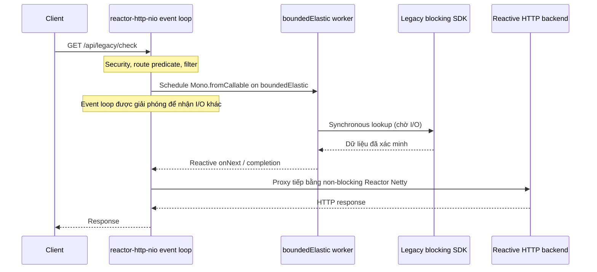

# Chạy công việc chặn luồng ngoài event loop khi thực sự cần trong Spring Cloud Gateway

## 1. Vì sao một lệnh chờ nhỏ có thể làm chậm cả API Gateway?

**Spring Cloud Gateway** là điểm vào HTTP của hệ thống microservices: sử dụng **route predicate**, **GatewayFilter/GlobalFilter chain**, biến đổi path và header, khám phá dịch vụ, xác thực, giới hạn lưu lượng, circuit breaker, retry, TLS và quan sát request. Với **Gateway Server WebFlux**, một phần quan trọng của khả năng chịu tải đến từ mô hình **Reactor Netty non-blocking event loop**.

Event loop là số lượng tương đối ít thread xử lý các sự kiện socket và các đoạn callback không chặn. Khi backend chậm, một HTTP client reactive có thể **chờ bất đồng bộ** để event loop tiếp tục phục vụ request khác. Nhưng nếu một custom filter gọi `Thread.sleep(500)`, JDBC đồng bộ, SDK chỉ hỗ trợ blocking hoặc `Mono.block()` ngay trên event loop, thread này bị giữ lại trong thời gian chờ. Nhiều request đồng thời làm backlog và p99 latency của **các route khác** cùng tăng, dù backend của chúng vẫn khỏe.

Giả sử Gateway có ba tuyến:

| Route | Công việc | Thiết kế mong muốn |
|---|---|---|
`GET /api/catalog/**` | Proxy đến Catalog qua Reactor Netty | Non-blocking hoàn toàn |
`GET /api/orders/**` | JWT, rate limit và proxy HTTP | Non-blocking, quyền theo token |
`GET /api/legacy/**` | Tạm gọi một SDK kiểm tra hạn mức **chỉ có API đồng bộ** | Bao riêng SDK trong `boundedElastic`, không chặn event loop |

Mục tiêu là **không đưa blocking I/O vào Gateway nếu có cách khác**. Khi một tích hợp legacy thật sự không thể thay thế ngay, phải **cô lập đúng đoạn blocking**, giới hạn concurrency, deadline và lỗi, rồi trả về `Mono<Void>` cho filter chain bình thường.

> **Phạm vi:** bài viết cho **Spring Cloud Gateway Server WebFlux 4.3+/5.x**, Java + Reactor Core. Ví dụ route dùng `spring.cloud.gateway.server.webflux.routes`. WebFlux 4.2 trở về trước dùng namespace route cũ `spring.cloud.gateway.routes`; Gateway Server **Web MVC** là stack Servlet riêng, không lấy `GatewayFilter` WebFlux làm mẫu thay thế trực tiếp.

## 2. Nhận diện loại công việc trước khi chọn Scheduler

Không phải tác vụ “mất thời gian” nào cũng **blocking**, và không phải một HTTP call lâu nào cũng giữ thread bận.

| Tác vụ | Có chặn thread theo thiết kế? | Cách khuyến nghị trong Gateway WebFlux |
|---|---|---|
Reactor Netty proxy backend HTTP/HTTPS | Không, khi dùng Netty reactive routing | Dùng route bình thường, không thêm scheduler |
`WebClient` với Reactor Netty connector | Non-blocking | Dùng publisher `Mono`/`Flux`, không `block()` |
`ReactiveRedisTemplate`, R2DBC client | Non-blocking nếu dùng đúng driver | Compose publisher trực tiếp |
JDBC, JPA repository đồng bộ | **Có thể chặn** khi chờ DB/connection | Ưu tiên chuyển sang service riêng; nếu bắt buộc, offload + giới hạn pool |
`RestTemplate`, `RestClient` đồng bộ, SDK HTTP blocking | **Có** | Ưu tiên `WebClient`; nếu chưa đổi được, `fromCallable` + `boundedElastic` |
`Files.readString(...)`, đọc file qua Java API đồng bộ | **Có thể chặn** I/O | Tránh trên đường request; offload khi bắt buộc |
`Thread.sleep(...)`, `Future.get()`, `CountDownLatch.await()` | **Có** | Không chạy trên event loop; tránh dùng để chờ mạng |
Nén/mã hóa/hash CPU nặng | Chủ yếu **CPU-bound**, không phải chờ I/O | Hạn chế trên request path; cân nhắc `parallel`/compute executor có trần hoặc service riêng |
Xử lý chuỗi/header nhỏ, so sánh route IDs | Nhanh, không blocking | Cứ chạy ở pipeline bình thường |
`Mono.delay(Duration)` | Non-blocking timer | Không cần tạo một thread ngủ riêng |

**Quy tắc:** nếu API có thể “đứng chờ” đĩa/mạng/lock/driver đồng bộ mà không trả quyền điều khiển cho runtime, đó là **blocking**. Ngược lại, `Mono` **không bảo đảm** bên trong non-blocking: `Mono.just(legacySdk.call())` vẫn gọi SDK blocking trước khi publisher được tạo.

## 3. Event loop, reactive subscription và điểm bắt đầu blocking



Sơ đồ chỉ diễn giải luồng logic: một số bước continuation có thể chạy trên worker hoặc thread khác tùy publishers/operators. **Không giả định** mọi lệnh `chain.filter(exchange)` chắc chắn bắt đầu lại trên `reactor-http-nio-*` ngay sau `fromCallable`. Điều cần bảo đảm là **blocking source không chiếm event loop**.

Trong WebFlux, mỗi `GatewayFilter` có contract:

```java
public interface GatewayFilter {
    Mono<Void> filter(ServerWebExchange exchange, GatewayFilterChain chain);
}
```

`chain.filter(exchange)` trả một **publisher biểu diễn phần chain còn lại**. Filter phải **return publisher**, không tự `subscribe()` rồi trả `Mono.empty()`, không dùng `block()` để “đợi” kết quả. Khi công việc chuẩn bị request kết thúc, có thể dùng `flatMap(... -> chain.filter(mutatedExchange))` hoặc `then(chain.filter(exchange))` để điều phối thứ tự.

### 3.1. Ví dụ SAI: gọi blocking trước khi trả `Mono`

```java
return (exchange, chain) -> {
    // SAI: SDK chạy ngay trên thread đang gọi filter (có thể là Netty event loop).
    String tier = legacySdk.lookupTier("user-42");
    return chain.filter(exchange);
};
```

### 3.2. Ví dụ SAI: `Mono.just(...)` không trì hoãn method call

```java
return (exchange, chain) ->
    Mono.just(legacySdk.lookupTier("user-42")) // SDK đã gọi NGAY tại đây
        .subscribeOn(Schedulers.boundedElastic())
        .then(chain.filter(exchange));
```

`subscribeOn` không thể “quay ngược thời gian” để di chuyển việc đồng bộ đã chạy **trước khi publisher được tạo**. Đây là lỗi phổ biến khi developer nghĩ rằng **cứ nhìn thấy `Mono` là đã reactive**.

### 3.3. Ví dụ SAI: offload rồi `block()` ngay lập tức

```java
// Vẫn SAI trong GatewayFilter/WebFlux event loop:
String tier = Mono.fromCallable(() -> legacySdk.lookupTier("user-42"))
    .subscribeOn(Schedulers.boundedElastic())
    .block();
```

Mặc dù callable có thể được đưa sang worker, **thread gọi `block()` vẫn phải đứng chờ**. Reactor có thể ném `IllegalStateException` khi dùng blocking operator trên thread được đánh dấu `NonBlocking`; ngay cả khi không ném, việc chặn event loop vẫn phá concurrency model.

### 3.4. ĐÚNG: khoanh đoạn blocking thành một publisher lazy

```java
Mono<String> tierMono = Mono
    .fromCallable(() -> legacySdk.lookupTier("user-42"))
    .subscribeOn(Schedulers.boundedElastic());

return tierMono.flatMap(tier -> {
    ServerHttpRequest request = exchange.getRequest().mutate()
        .header("X-Verified-Tier", tier)
        .build();
    return chain.filter(exchange.mutate().request(request).build());
});
```

Đây là **minh họa trong thân một `GatewayFilter`**; cần imports `Mono`, `Schedulers`, `ServerHttpRequest` và một `legacySdk` có thật. Ví dụ đầy đủ có authentication, kiểm tra tier và xử lý lỗi ở mục 5.

Thứ tự:

1. `fromCallable` tạo publisher **lazy**, chưa gọi SDK lúc khai báo.
2. `subscribeOn(Schedulers.boundedElastic())` điều khiển nơi **subscribe/source thực thi** khi Gateway subscribe pipeline.
3. SDK blocking chạy trên boundedElastic worker; kết quả đi vào `flatMap`.
4. Sau khi có tier hợp lệ, request được mutate, và **publisher `chain.filter(...)`** được trả về.
5. Lỗi SDK phát thành `onError` và phải được xử lý theo chính sách, **không âm thầm cho qua route bảo vệ**.

**Chú ý về headers:** overload `header(name, value)` có thể thêm giá trị. Nếu header là identity/security assertion, cần dùng `headers(h -> h.remove(...); h.set(...))` để **ghi đè giá trị do client tự gửi**, và backend phải xác minh chính danh tính/quyền, không tin header trần từ Internet.

## 4. `subscribeOn` khác `publishOn` và `then`

| Reactor API | Hiệu ứng chính | Nên dùng trong trường hợp nào? |
|---|---|---|
`Mono.fromCallable(...)` | Tạo source lazy từ một hàm đồng bộ trả giá trị hoặc phát error | Bao SDK/DAO **blocking** |
`Mono.fromRunnable(...)` | Bao một hành động đồng bộ không trả giá trị | Tác vụ blocking trả `void`, đi cùng `then(...)` |
`subscribeOn(scheduler)` | Chọn execution context cho subscription/source upstream | **Ưu tiên sát `fromCallable`/`fromRunnable`** |
`publishOn(scheduler)` | Dịch execution context của phần **downstream** trong chuỗi tại điểm đó | Khi cần offload một đoạn operator cụ thể |
`flatMap(fn)` | Compose publisher sinh ra sau khi có giá trị | Gọi tiếp `chain.filter(...)` sau lookup |
`then(otherMono)` | Chờ publisher đầu hoàn thành rồi subscribe publisher sau; bỏ qua giá trị đầu | Precondition blocking không cần kết quả |
`timeout(Duration)` | Phát timeout/cancel nếu publisher không hoàn thành kịp | Bảo vệ latency của phần blocking, **không đảm bảo dừng native I/O** |
`doOnError(...)` / `onErrorResume(...)` | Quan sát/chuyển lỗi trong pipeline | Tránh nuốt lỗi và bypass bảo vệ |

### 4.1. `publishOn` đúng chỗ và sai chỗ

Một cách cũng có thể offload một function blocking là chuyển execution context **trước** function đó:

```java
Mono.just("user-42")
    .publishOn(Schedulers.boundedElastic())
    .map(legacySdk::lookupTier);
```

Nhưng cách này dễ nhầm phạm vi nếu operator được thêm/chuyển vị trí. Với **source đồng bộ blocking**, Reactor khuyến nghị rõ hơn:

```java
Mono.fromCallable(() -> legacySdk.lookupTier("user-42"))
    .subscribeOn(Schedulers.boundedElastic());
```

Không đặt `publishOn(Schedulers.boundedElastic())` ở **sau** `map(legacySdk::lookupTier)` rồi mong đoạn blocking phía trước được chuyển thread. Và cũng không dùng `Schedulers.parallel()`/`Schedulers.single()` làm scheduler mặc định cho **blocking I/O**.

### 4.2. Trường hợp blocking `void`

Ví dụ một thư viện legacy chỉ cung cấp `void logAuditSync(AuditEvent event)`:

```java
return Mono.fromRunnable(() -> legacyAuditClient.logAuditSync(event))
    .subscribeOn(Schedulers.boundedElastic())
    .then(chain.filter(exchange));
```

**Đây là tác vụ bắt buộc hoàn thành TRƯỚC khi proxy**. Nếu muốn audit bất đồng bộ và không làm tăng latency, tốt hơn nên gửi event qua queue/non-blocking publisher có chính sách delivery riêng. Không dùng `doOnNext(...)` với blocking audit: callback có thể chạy trên event loop. Đối với audit bắt buộc vì tuân thủ, phải xử lý thất bại/fail-closed theo hợp đồng; không fire-and-forget rồi coi audit đã ghi thành công.

### 4.3. Không offload cả Gateway chain một cách mù quáng

```java
// KHÔNG NÊN dùng để “chữa” một SDK blocking ở một điểm:
return chain.filter(exchange)
    .subscribeOn(Schedulers.boundedElastic());
```

Điều này có thể di chuyển điểm subscribe **của nhiều thành phần upstream/downstream** theo cơ chế Reactor, nhưng **không cô lập rõ SDK nào là blocking**, làm khó trace, tiêu tốn worker không cần thiết và tạo tương tác bất ngờ với filters khác. Hãy bao **chỉ API blocking thật sự** trong publisher của riêng nó.

## 5. Custom `GatewayFilterFactory` hoàn chỉnh: đọc tier từ legacy SDK

Giả sử tổ chức còn một SDK đồng bộ `LegacyTierLookup` phải truy vấn hệ thống hạn mức cũ. Trước khi proxy request `/api/legacy/**`, Gateway cần tra `BASIC` hoặc `PRO` **từ danh tính đã được xác thực**, sau đó gắn header nội bộ cho backend trong một môi trường có ranh giới tin cậy rõ ràng.

**Giới hạn an toàn của ví dụ:**

- SDK đồng bộ vẫn là một khoản nợ kỹ thuật; chỉ giữ tạm khi chưa có client reactive/API service riêng.
- Spring Security phải **xác thực và phân quyền trước** custom route filter; nếu không có principal, filter không proxy.
- Không đọc user ID từ `X-User-Id`, query string hoặc dữ liệu client tự khai để quyết định quyền.
- Giới hạn thời gian tra cứu, chỉ chấp nhận danh sách tier xác định, không để header giả mạo được chuyển tới backend.
- Backend **không nên tin một plain header như chứng minh danh tính tuyệt đối**; cần mTLS/ACL và authorization riêng. Hướng dài hạn là token/assertion được ký phù hợp audience.

### 5.1. Hợp đồng của SDK legacy

```java
package com.example.gateway.filters;

public interface LegacyTierLookup {
    // Blocking: chờ JDBC/SDK/network và trả BASIC hoặc PRO.
    // Có thể throw exception hoặc return null khi không có kết quả.
    String findTierForSubject(String verifiedSubject);
}
```

Bạn phải tạo một Spring bean hiện thực interface này với client của hệ thống thật; **bài không tự tạo database hoặc SDK**. Khi triển khai, cần timeout tại **driver/socket/connection pool** ngoài Reactor timeout, và kiểm tra kết quả thuộc tập được phép.

### 5.2. Factory WebFlux có timeout và ngăn spoofed header

```java
package com.example.gateway.filters;

import java.time.Duration;
import java.util.Set;
import java.util.concurrent.TimeoutException;

import org.springframework.cloud.gateway.filter.GatewayFilter;
import org.springframework.cloud.gateway.filter.factory.AbstractGatewayFilterFactory;
import org.springframework.http.HttpStatus;
import org.springframework.http.server.reactive.ServerHttpRequest;
import org.springframework.stereotype.Component;
import org.springframework.web.server.ResponseStatusException;

import reactor.core.publisher.Mono;
import reactor.core.scheduler.Schedulers;

@Component
public final class LegacyTierGatewayFilterFactory
        extends AbstractGatewayFilterFactory<LegacyTierGatewayFilterFactory.Config> {

    private static final String INTERNAL_HEADER = "X-Trusted-Tier";
    private static final Set<String> ALLOWED_TIERS = Set.of("BASIC", "PRO");

    private final LegacyTierLookup lookup;

    public LegacyTierGatewayFilterFactory(LegacyTierLookup lookup) {
        super(Config.class);
        this.lookup = lookup;
    }

    @Override
    public GatewayFilter apply(Config config) {
        Duration timeout = Duration.ofMillis(config.getTimeoutMs());

        return (exchange, chain) -> exchange.getPrincipal()
            .switchIfEmpty(Mono.error(new ResponseStatusException(
                HttpStatus.UNAUTHORIZED, "Authentication required")))
            .flatMap(principal ->
                Mono.fromCallable(() ->
                        lookup.findTierForSubject(principal.getName()))
                    .subscribeOn(Schedulers.boundedElastic())
                    .timeout(timeout)
                    .switchIfEmpty(Mono.error(new ResponseStatusException(
                        HttpStatus.SERVICE_UNAVAILABLE, "Tier lookup unavailable")))
                    .onErrorMap(TimeoutException.class, error ->
                        new ResponseStatusException(
                            HttpStatus.SERVICE_UNAVAILABLE, "Tier lookup timeout", error))
                    .flatMap(tier -> {
                        if (!ALLOWED_TIERS.contains(tier)) {
                            return Mono.error(new ResponseStatusException(
                                HttpStatus.FORBIDDEN, "Tier not permitted"));
                        }

                        // Header do client tự gửi phải bị ghi đè, không nối thêm.
                        ServerHttpRequest trustedRequest = exchange.getRequest()
                            .mutate()
                            .headers(headers -> {
                                headers.remove(INTERNAL_HEADER);
                                headers.set(INTERNAL_HEADER, tier);
                            })
                            .build();

                        return chain.filter(exchange.mutate()
                            .request(trustedRequest)
                            .build());
                    })
            );
    }

    public static final class Config {
        private long timeoutMs = 800;

        public long getTimeoutMs() {
            return timeoutMs;
        }

        public void setTimeoutMs(long timeoutMs) {
            if (timeoutMs <= 0 || timeoutMs > 5000) {
                throw new IllegalArgumentException(
                    "timeoutMs must be between 1 and 5000");
            }
            this.timeoutMs = timeoutMs;
        }
    }
}
```

**Phân tích những điểm quan trọng:**

1. Class kết thúc bằng `GatewayFilterFactory` theo quy tắc đặt tên của Gateway, vì thế YAML tham chiếu filter bằng **`LegacyTier`**.
2. `getPrincipal()` là publisher reactive; **không cần `block()`** để đọc danh tính. `switchIfEmpty` được đặt **trước** `flatMap` trả `Mono<Void>`; đặt sau `chain.filter(...)` sẽ sai vì `Mono<Void>` hoàn thành rỗng ngay cả khi request thành công.
3. Chỉ lời gọi `lookup.findTierForSubject(...)` thực thi trên `boundedElastic` khi subscribe. Không chuyển toàn bộ Netty event loop sang thread pool này.
4. `timeout(800ms)` chỉ là một giới hạn của **reactive lookup**; nếu SDK/JDBC không hỗ trợ interrupt/cancel, công việc gốc có thể tiếp tục giữ boundedElastic thread sau khi client đã nhận timeout.
5. Kết quả `null` khiến `Mono.fromCallable` hoàn thành **empty**; `switchIfEmpty` biến nó thành lỗi thay vì lặng lẽ bỏ qua proxy.
6. `Set.of("BASIC", "PRO")` ngăn tier không hợp lệ được đẩy xuống backend; giá trị ở header chỉ được lấy từ SDK nội bộ.
7. `headers.remove + headers.set` loại giá trị giả từ client, không dùng `headers.add` khiến backend có thể thấy nhiều giá trị.
8. `onErrorMap(TimeoutException.class, ...)` chỉ áp dụng lên **lookup**, trước `flatMap(chain.filter)`, nên không tự biến mọi lỗi phát sinh từ backend routing thành lỗi “tier timeout”.
9. Lỗi chưa được mapping, ví dụ SDK ném `IllegalStateException`, vẫn phát thành error qua WebFlux handler. Gateway **không tiếp tục proxy** nếu lookup không thành công.

**Về bảo mật:** ví dụ này mô tả **attribute enrichment**, không thay thế việc xác minh JWT/audience/scope và resource ownership ở backend. `X-Trusted-Tier` là một header trong trust boundary; chỉ backend có xác thực kết nối Gateway, giới hạn direct access và hợp đồng nhất quán mới được cân nhắc sử dụng nó. Với quyền nhạy cảm, ưu tiên signed assertion hoặc access token đúng audience.

### 5.3. YAML route sử dụng factory

```yaml
# application.yml — Spring Cloud Gateway Server WebFlux 4.3+/5.x
server:
  port: 8080

spring:
  security:
    oauth2:
      resourceserver:
        jwt:
          issuer-uri: https://idp.example.test/realms/shop
          audiences:
            - legacy-api
  cloud:
    gateway:
      server:
        webflux:
          routes:
            - id: legacy-checked
              uri: http://localhost:8081
              predicates:
                - Path=/api/legacy/**
                - Method=GET
              filters:
                - name: LegacyTier
                  args:
                    timeoutMs: 800
                - StripPrefix=1
```

Khi client gọi `GET /api/legacy/data`, filter tra tier theo principal, mutate header; tiếp theo `StripPrefix=1` sẽ bỏ `/api` để backend nhận `/legacy/data`. Khi không có principal hoặc lookup thất bại, **không được gọi backend**. URI `http://localhost:8081` chỉ dành cho local demo: khi chạy container/cluster, dùng DNS/backend service thật, có HTTPS/mTLS nếu kiến trúc yêu cầu.

### 5.4. Spring Security cho bearer-only API

```java
package com.example.gateway.security;

import org.springframework.context.annotation.Bean;
import org.springframework.context.annotation.Configuration;
import org.springframework.security.config.Customizer;
import org.springframework.security.config.web.server.ServerHttpSecurity;
import org.springframework.security.web.server.SecurityWebFilterChain;

@Configuration(proxyBeanMethods = false)
public class LegacyApiSecurity {
    @Bean
    SecurityWebFilterChain legacySecurity(ServerHttpSecurity http) {
        return http
            // Chỉ dành cho API stateless bearer, không dùng cookie session.
            .csrf(ServerHttpSecurity.CsrfSpec::disable)
            .authorizeExchange(exchanges -> exchanges
                .pathMatchers("/api/legacy/**")
                    .hasAuthority("SCOPE_legacy.read")
                .anyExchange().denyAll())
            .oauth2ResourceServer(oauth2 ->
                oauth2.jwt(Customizer.withDefaults()))
            .build();
    }
}
```

Ví dụ dùng `spring-boot-starter-oauth2-resource-server` và JWT thực từ IdP, **không tự cấp token**. `issuer-uri` và `audiences` phải khớp policy thật. `csrf.disable()` không được sao chép sang Gateway dùng đăng nhập browser bằng session/cookie mà không phân tích CSRF.

Spring Security WebFlux xử lý authentication qua reactive context; không gọi `SecurityContextHolder.getContext()` trong một blocking worker rồi mặc định ThreadLocal bảo đảm có đúng user. Ở factory này, principal được lấy **trước khi offload**, và chỉ truyền `principal.getName()` vào SDK. Nếu SDK cần thêm tenant/claim, lấy chúng từ **JWT đã xác minh** và chỉ truyền dữ liệu tối thiểu.

### 5.5. Java DSL thay cho route YAML

Khi muốn tạo route bằng `RouteLocatorBuilder`, có thể tái sử dụng cùng filter factory:

```java
package com.example.gateway.routes;

import com.example.gateway.filters.LegacyTierGatewayFilterFactory;
import org.springframework.cloud.gateway.route.RouteLocator;
import org.springframework.cloud.gateway.route.builder.RouteLocatorBuilder;
import org.springframework.context.annotation.Bean;
import org.springframework.context.annotation.Configuration;

@Configuration(proxyBeanMethods = false)
public class LegacyRouteDsl {
    @Bean
    RouteLocator legacyRoute(RouteLocatorBuilder builder,
            LegacyTierGatewayFilterFactory factory) {

        LegacyTierGatewayFilterFactory.Config config =
            new LegacyTierGatewayFilterFactory.Config();
        config.setTimeoutMs(800);

        return builder.routes()
            .route("legacy-checked", r -> r
                .path("/api/legacy/**")
                .filters(f -> f
                    .filter(factory.apply(config))
                    .stripPrefix(1))
                .uri("http://localhost:8081"))
            .build();
    }
}
```

Đây là lựa chọn **thay thế** cho route YAML; không đăng ký hai route cùng ID trong một bài test. Java DSL ở đây chỉ định path, chưa thêm `Method=GET` như YAML: nếu cần contract giống hệt, thêm method predicate tương ứng hoặc giới hạn ở Spring Security. Điều đó minh họa vì sao **chính sách route có thể khác** dù cùng filter.

## 6. Scheduler toàn cục và scheduler riêng: kiểm soát tải thật sự

`Schedulers.boundedElastic()` là scheduler **chia sẻ** của Reactor, dành cho công việc chặn luồng không thể tránh. Reactor giới hạn số backing threads (mặc định thường **10 × số CPU**) và một hàng đợi task có giới hạn, nhưng **hàng đợi mặc định vẫn rất lớn**. Khi SDK legacy chậm, nhiều request cùng tới có thể xếp hàng dài, tạo latency đột biến và tăng bộ nhớ.

| Scheduler | Có dùng cho blocking I/O? | Ghi chú |
|---|---|---|
`Schedulers.boundedElastic()` | **Có, khi thật sự cần** | Shared, có thread/queue cap, phù hợp adapter legacy ngắn hạn |
`Schedulers.newBoundedElastic(cap, queue, name)` | **Có**, khi cần cô lập workload | Cấu hình giới hạn riêng và quản lý lifecycle |
`Schedulers.parallel()` | **Không** cho I/O blocking | Dành cho CPU-bound non-blocking/compute jobs |
`Schedulers.single()` | **Không** cho I/O blocking | Một thread chung dễ nghẽn toàn chuỗi |
`Schedulers.immediate()` | **Không** giúp offload | Chạy trực tiếp trên thread hiện tại |
`Schedulers.fromExecutorService(...)` | Tùy executor | Chỉ dùng khi có thiết kế pool/queue/monitoring rõ ràng |

### 6.1. Dành một scheduler riêng cho SDK

Khi `LegacyTierLookup` cần hạn chế ảnh hưởng tới những task blocking khác, có thể tạo một boundedElastic **bean riêng**:

```java
package com.example.gateway.config;

import org.springframework.context.annotation.Bean;
import org.springframework.context.annotation.Configuration;
import reactor.core.scheduler.Scheduler;
import reactor.core.scheduler.Schedulers;

@Configuration(proxyBeanMethods = false)
public class LegacySchedulerConfig {
    @Bean(destroyMethod = "dispose")
    Scheduler legacyTierScheduler() {
        // Tối đa 8 backing threads, 64 queued tasks mỗi backing thread.
        return Schedulers.newBoundedElastic(8, 64, "legacy-tier");
    }
}
```

Inject bằng `@Qualifier("legacyTierScheduler") Scheduler scheduler` vào factory và thay:

```java
.subscribeOn(Schedulers.boundedElastic())
```

thành:

```java
.subscribeOn(scheduler)
```

Đây là **biến thể kiến trúc** của factory mục 5: phải bổ sung field và tham số constructor cho scheduler được inject. Dùng `destroyMethod="dispose"` để giải phóng scheduler riêng khi Spring context đóng. **Không tạo `newBoundedElastic(...)` ở mỗi request**, vì sẽ gây rò rỉ thread/scheduler và vô hiệu giới hạn.

Thread cap của Reactor không tự giới hạn **JDBC connection pool** hoặc hệ thống legacy: cần chọn giới hạn đồng thời dựa trên năng lực DB/SDK, ví dụ HikariCP maximum pool, quota backend và circuit breaker. Hàng đợi lớn thường làm latency tăng trước khi trả lỗi; cân nhắc queue cap nhỏ, reject sớm và áp dụng rate limiting ở Gateway.

### 6.2. Không coi boundedElastic là phép màu “vô hạn song song”

Ví dụ nếu chỉ có 8 workers và mỗi call chờ 2 giây, tốc độ thực có thể bị giới hạn khoảng vài call/giây cho mỗi worker khi không có multiplexing; requests tiếp theo chờ queue. Tăng threads bừa có thể làm connection pool cạn, tăng memory/GC và khiến hệ thống legacy quá tải.

Những chỉ số quan trọng: **scheduler pending tasks, active workers, queue rejection, SDK latency, connection-pool active/pending, Gateway p95/p99, HTTP 503/504/429**, và số request đang bay trên một route. Tránh metric tag theo raw username, JWT, IP hay URL chứa PII.

### 6.3. Java 21 virtual threads và boundedElastic

Từ Reactor 3.6+, khi chạy Java 21+ và cấu hình system property `reactor.schedulers.defaultBoundedElasticOnVirtualThreads=true`, shared `boundedElastic()` có thể sử dụng triển khai dựa trên **virtual thread per task** thay cho platform-thread pool, tùy Reactor version.

**Đây không tự biến thư viện JDBC/SDK chặn luồng thành reactive**, không bỏ giới hạn kết nối phía hệ thống cũ, không miễn trừ timeout, và có thể gặp pinning/lock contention ở một số cách dùng native/synchronized code. Hãy kiểm thử theo **JDK + Reactor + Gateway version thực tế**, và không bật một property global chỉ để sửa một route trước khi đo tác động.

## 7. Timeout, cancellation và exception: tránh “hết hạn ở Gateway, vẫn chạy trong SDK”

### 7.1. Một `timeout(...)` không bảo đảm dừng tác vụ blocking

`Mono.timeout(Duration.ofMillis(800))` giới hạn **thời gian chờ của subscriber**. Khi quá hạn, Reactor có thể hủy subscription và báo `TimeoutException`. Tuy nhiên:

- SDK blocking có thể đang kẹt trong JDBC driver, socket read hoặc native library.
- Một số API chỉ dừng khi nhận `Thread.interrupt()`; số khác **phớt lờ interrupt** hoặc cần timeout riêng trong driver.
- Dù Gateway đã trả 503, worker có thể **vẫn bị giữ**; hàng đợi tiếp tục dài ra nếu requests mới dồn tới.
- Việc client hủy request cũng không nhất thiết hoàn tác transaction nghiệp vụ đã bắt đầu ở downstream.

Vì vậy, cần **hai lớp timeout**:

1. **Timeout thực của dependency**: JDBC query timeout, socket connect/read timeout, HTTP SDK deadline, DB connection acquisition, v.v.
2. **Timeout reactive/route**: giới hạn thời gian Gateway đợi kết quả để tránh treo pipeline.

Ví dụ tính toán:

| Ranh giới | Ngưỡng minh họa | Mục đích |
|---|---:|---|
SDK outbound connect | 200 ms | Không chờ quá lâu khi không kết nối được |
SDK read/query | 500 ms | Trả quyền điều khiển cho worker khi dependency chậm |
Reactive `timeout` cho lookup | 800 ms | Giới hạn toàn đoạn lookup, gồm có thể cả queue delay |
Route response timeout tới backend | 3 s | Giới hạn phần proxy HTTP riêng |
Client request deadline | 5 s | SLA tổng thể, cần trừ thời gian ở các tầng |

Những số này **chỉ minh họa**, không phải SLA chuẩn cho mọi hệ thống. Khi nhiều lớp timeout chạy, thời gian thực có thể bị ảnh hưởng bởi queue, TLS, retry và các filters khác; phải đo p95/p99 end-to-end.

### 7.2. Tránh nuốt lỗi để “fail-open” qua filter bảo mật

Một đoạn code nguy hiểm:

```java
// KHÔNG NÊN khi tier là thông tin cấp quyền:
Mono.fromCallable(() -> lookup.findTierForSubject(subject))
    .subscribeOn(Schedulers.boundedElastic())
    .onErrorReturn("PRO");
```

Nếu SDK hoặc Redis/JDBC mất kết nối, đoạn trên có thể vô tình **nâng quyền** cho user. Đối với attribute có ảnh hưởng authorization, an toàn hơn là **fail-closed**: không gọi backend hoặc trả lỗi rõ ràng sau khi xác thực.

Ở factory mục 5, `TimeoutException` thành `ResponseStatusException(503)`; các lỗi chưa định nghĩa khác vẫn phát thành error và **không gọi `chain.filter(...)`**. Việc quyết định trả 503, 403 hay mã khác phải theo contract và phân loại nguyên nhân; không tự thay mọi exception thành 200.

### 7.3. Tránh catch lỗi từ cả downstream chain

So sánh:

```java
// Dễ SAI: có thể bắt cả lỗi backend sau chain.filter.
return blockingLookup.flatMap(value -> chain.filter(exchange))
    .onErrorResume(error -> respondAsLegacyLookupFailure(exchange));
```

với cấu trúc:

```java
// Tốt hơn: chỉ chuyển lỗi của blocking lookup.
Mono<String> safeLookup = Mono.fromCallable(legacy::load)
    .subscribeOn(Schedulers.boundedElastic())
    .onErrorMap(LegacySdkException.class, error ->
        new ResponseStatusException(
            HttpStatus.SERVICE_UNAVAILABLE, "Dependency unavailable", error));

return safeLookup.flatMap(value -> chain.filter(exchange));
```

Ví dụ thứ hai là **minh họa đoạn code**; `legacy.load`, `LegacySdkException` và imports cần được cung cấp trong ứng dụng thật. Error handling nằm **trước `flatMap` chuyển tiếp** nên không tự diễn giải HTTP/client cancel của downstream thành lỗi legacy lookup.

### 7.4. Không mặc định retry blocking call

Nếu một SDK call bị timeout rồi Gateway `Retry` filter phát lại request, số lần SDK được gọi có thể nhiều hơn số request từ client; những lần đã timeout có thể vẫn đang chờ ở background. Điều này làm queue và tải legacy tăng theo cấp số lần retry.

Chỉ retry khi operation **idempotent**, policy có giới hạn attempts/backoff và dependency có cách timeout/cancel phù hợp. Với mutation như cấp quyền, thanh toán hoặc ghi audit bắt buộc, cần idempotency và thiết kế riêng; tránh retry vô điều kiện.

## 8. Phân biệt pre-filter, post-filter và response đã commit

### 8.1. Pre-filter: blocking lookup trước khi proxy

Đoạn chính của factory mục 5:

```java
return Mono.fromCallable(() -> lookup.findTierForSubject(subject))
    .subscribeOn(Schedulers.boundedElastic())
    .flatMap(tier -> {
        ServerHttpRequest request = exchange.getRequest().mutate()
            .headers(h -> h.set("X-Trusted-Tier", tier))
            .build();
        return chain.filter(exchange.mutate().request(request).build());
    });
```

**Điểm quan trọng:** request chỉ được gửi đi **sau** khi lookup trả kết quả. Đây là chỗ thích hợp nếu kết quả quyết định có được proxy hay không.

### 8.2. Post-filter: thực hiện tác vụ sau phần downstream

```java
return chain.filter(exchange)
    .then(Mono.fromRunnable(() -> legacyAuditClient.writeSync(event))
        .subscribeOn(Schedulers.boundedElastic()));
```

Đoạn trên **chỉ minh họa thứ tự reactive**: đợi `chain.filter(exchange)` hoàn thành rồi mới thực hiện SDK audit blocking trên worker. Nếu response đã commit, **không được sửa HTTP status/headers lúc này**. Nếu audit thất bại sau khi response đã được gửi, client có thể đã nhận thành công nhưng audit lại không thành công.

Do đó, đối với **audit bắt buộc**, hãy quyết định liệu audit cần chạy **trước khi proxy hoặc trước khi phản hồi**, và có chính sách retry/delivery at-least-once hay transactional outbox thích hợp. Nếu audit chỉ là telemetry phụ, nên dùng logging/exporter bất đồng bộ, không kéo một call synchronous vào đường nóng của mỗi HTTP request.

### 8.3. Response body, `DataBuffer` và memory

**Không làm việc sau trong filter:**

```java
// SAI: chặn event loop, có thể xử lý body không đúng lifecycle.
DataBuffer body = exchange.getRequest().getBody().blockFirst();
```

Request/response bodies trong WebFlux là các `Flux<DataBuffer>` có lifecycle và backpressure. Truy cập chúng cần giữ đúng cơ chế subscribe, release/retain, buffer size và response commit. Khi cần sửa body, ưu tiên `ModifyRequestBody`/`ModifyResponseBody` hoặc filter body-aware theo đúng tài liệu version; **không đọc toàn bộ stream bằng `blockFirst()` để “dễ xử lý”**.

Nếu phải gửi toàn bộ body cho một SDK blocking (ví dụ thư viện xử lý tài liệu cũ), hãy cân nhắc chuyển công việc sang **backend worker** chuyên dụng; nếu vẫn làm ở Gateway, phải có explicit request-size limit, memory cap, cancellation và cách serialize/copy/release buffer đúng. `boundedElastic` không giải quyết rò rỉ `DataBuffer` hay tăng memory do buffer toàn bộ payload.

## 9. Security context, Reactor Context và MDC khi đổi thread

Một số tích hợp cũ dùng `ThreadLocal` để tìm user hoặc trace ID. Nhưng reactive pipeline có thể đổi thread tại `subscribeOn`, `publishOn` hoặc khi I/O hoàn tất.

| Cơ chế | Có thể dựa vào ở blocking worker? | Cách đúng |
|---|---|---|
`exchange.getPrincipal()` | **Có** dưới dạng publisher, trước khi truyền dữ liệu cho worker | Lấy principal đã xác thực rồi truyền giá trị tối thiểu qua lambda |
`SecurityContextHolder.getContext()` mặc định | **Không nên giả định** ThreadLocal giống WebMVC | Dùng `ReactiveSecurityContextHolder` hoặc principal/exchange reactive |
`Reactor Context` | Là ngữ cảnh reactive, không giống ThreadLocal | `contextWrite`, `deferContextual` khi cần |
`MDC.get("traceId")` | Có thể **trống** sau khi đổi worker | Dùng Micrometer Context Propagation/config phù hợp hoặc explicit context |
Raw `X-User-Id` từ request | **Không đáng tin** | Kiểm tra JWT/principal trước khi dùng |
`Thread.currentThread().getName()` | Chỉ dùng debug scheduler | Không phải authorization hay correlation key |

Một ví dụ đưa context tối thiểu vào callable mà không dựa vào ThreadLocal:

```java
return exchange.getPrincipal()
    .flatMap(principal -> {
        String verifiedSubject = principal.getName();
        return Mono.fromCallable(() ->
                legacySdk.loadForSubject(verifiedSubject))
            .subscribeOn(Schedulers.boundedElastic())
            .flatMap(result -> chain.filter(exchange));
    });
```

Đây là **đoạn code minh họa**; `legacySdk` cần tồn tại thật, và trong production phải xử lý principal trống, lookup null/error và kiểm tra quyền như factory mục 5.

**Quan sát:** không ghi JWT raw, access token, session cookie, request body hoặc exception message nhạy cảm khi log thread names. Tracing cần tương thích Reactor/Micrometer và cấu hình context propagation đúng version, không tự lấy ThreadLocal làm bằng chứng rằng hệ thống đã giữ đúng security context sau một scheduler switch.

## 10. Đưa SDK blocking sang service riêng hay giữ trong Gateway?

Offload là **phương án chuyển tiếp**, không nhất thiết là kiến trúc tối ưu dài hạn. Hãy so sánh:

| Phương án | Ưu điểm | Chi phí/rủi ro |
|---|---|---|
Giữ SDK blocking trong Gateway + `boundedElastic` | Ít thay đổi hệ thống legacy, triển khai nhanh | Gateway mang dependency nặng, thread/queue pressure, lỗi SDK ảnh hưởng edge |
Viết WebClient/reactive SDK tương đương | Giữ non-blocking end-to-end | Cần SDK/API thật sự hỗ trợ bất đồng bộ; đầu tư chuyển đổi |
Đưa SDK vào **legacy-adapter service** riêng | Cô lập thread pool, connection pool, scaling, incident blast radius | Thêm network hop, authentication, SLA và observability |
Chuyển thao tác sang message broker/worker | Phù hợp background jobs lâu, có retry/delivery | Cần job ID, idempotency, eventual consistency |
Gateway dùng `forward:` để gọi handler blocking nội bộ | Không giải quyết bản chất chặn thread | Phải xử lý reactive/blocking ở handler; không nên là workaround mặc định |

Đối với Gateway được dùng chung cho nhiều microservices, thường nên giữ **authentication, routing, rate limiting, circuit breaker, TLS và quan sát** ở Gateway; chuyển tính toán nghiệp vụ hoặc tích hợp JDBC/SDK chặn luồng sang **service owner** khi hợp đồng cho phép.

**Dấu hiệu cần tách:** legacy calls thường mất nhiều giây, số request lớn, SDK yêu cầu Hikari/JDBC pool riêng, có nhiều thư viện native/JNI, hoặc lỗi SDK làm tăng p99 của cả Gateway dù đã dùng `boundedElastic`.

## 11. Thực hành end-to-end trong môi trường demo

### 11.1. Dependencies cần thiết

Với Spring Cloud Gateway Server WebFlux và Spring Security JWT, ví dụ Maven:

```xml
<!-- Version do Spring Boot parent và Spring Cloud BOM tương thích quản lý. -->
<dependency>
    <groupId>org.springframework.cloud</groupId>
    <artifactId>spring-cloud-starter-gateway-server-webflux</artifactId>
</dependency>
<dependency>
    <groupId>org.springframework.boot</groupId>
    <artifactId>spring-boot-starter-oauth2-resource-server</artifactId>
</dependency>
<dependency>
    <groupId>org.springframework.boot</groupId>
    <artifactId>spring-boot-starter-actuator</artifactId>
</dependency>
```

Tương đương Gradle:

```groovy
dependencies {
    implementation 'org.springframework.cloud:spring-cloud-starter-gateway-server-webflux'
    implementation 'org.springframework.boot:spring-boot-starter-oauth2-resource-server'
    implementation 'org.springframework.boot:spring-boot-starter-actuator'
}
```

Trong ví dụ sử dụng `http://localhost:8081` nên **không cần service discovery/load balancer** chỉ để thử filter. Nếu chuyển URI sang `lb://legacy-api`, cần `spring-cloud-starter-loadbalancer` và nguồn service instances. Actuator là dependency tùy chọn phục vụ quan sát, không bắt buộc để `GatewayFilterFactory` hoạt động.

**Không thêm `spring-boot-starter-web` vào Gateway Server WebFlux** chỉ để dùng một SDK đồng bộ. Nếu ứng dụng là Web MVC, hãy chọn thiết kế Servlet/MVC phù hợp thay vì trộn stack ngoài ý muốn.

### 11.2. Thay SDK thật bằng adapter demo có chủ đích chặn thread

Đặt bean sau **chỉ trong profile `demo`** ở ứng dụng Gateway:

```java
package com.example.gateway.filters;

import org.slf4j.Logger;
import org.slf4j.LoggerFactory;
import org.springframework.context.annotation.Profile;
import org.springframework.stereotype.Component;

@Component
@Profile("demo")
public final class DemoLegacyTierLookup implements LegacyTierLookup {
    private static final Logger log =
        LoggerFactory.getLogger(DemoLegacyTierLookup.class);

    @Override
    public String findTierForSubject(String verifiedSubject) {
        log.info("demo legacy lookup on thread={}",
            Thread.currentThread().getName());

        // CỐ TÌNH BLOCKING để đo scheduler, KHÔNG phải code production.
        try {
            Thread.sleep(350);
        } catch (InterruptedException exception) {
            Thread.currentThread().interrupt();
            throw new IllegalStateException("Demo lookup interrupted", exception);
        }

        return "BASIC";
    }
}
```

Bean này giả lập SDK blocking bằng `Thread.sleep(350)`. **Chỉ sử dụng trong profile thử nghiệm**, không copy sleep vào production. Để chạy demo, kích hoạt profile `demo` trong ứng dụng Gateway và bảo đảm không đăng ký đồng thời một `LegacyTierLookup` production khác không có qualifier.

Kiểm tra log ở Gateway: lời gọi SDK nên chạy trên worker thuộc `boundedElastic` (tên thread có thể khác theo Reactor/JDK/virtual threads), **không phải `reactor-http-nio-*`** thường thấy trên Netty event loop. Đây chỉ là **dấu hiệu**, không thay thế kiểm thử latency và xác định chính xác API nào đang block.

### 11.3. Backend HTTP echo tối giản

Trong **ứng dụng backend WebFlux riêng** ở cổng `8081`:

```java
package com.example.legacydemo;

import java.util.Map;
import org.springframework.http.ResponseEntity;
import org.springframework.web.bind.annotation.GetMapping;
import org.springframework.web.bind.annotation.RequestHeader;
import org.springframework.web.bind.annotation.RestController;
import reactor.core.publisher.Mono;

@RestController
public class LegacyEchoController {
    @GetMapping("/legacy/data")
    Mono<ResponseEntity<Map<String, String>>> read(
            @RequestHeader("X-Trusted-Tier") String tier) {
        // CHỈ DEMO: không dùng tier header trần làm credential ở production.
        return Mono.just(ResponseEntity.ok(Map.of(
            "route", "legacy-demo",
            "receivedTier", tier)));
    }
}
```

Backend này cố ý **echo** giá trị để kiểm tra header mutation. Ở production, endpoint nghiệp vụ phải xác thực token/mTLS và thực hiện authorization thực tế; không cho client gọi backend trực tiếp với header tự giả mạo.

### 11.4. Gửi request bằng `curl`

Để `SecurityWebFilterChain` của mục 5.4 cho request qua, cần một JWT test **thực**, ký bởi IdP cấu hình ở `issuer-uri`, có audience và `legacy.read` scope đúng. Sau khi có biến môi trường `TOKEN_VALID` từ quy trình test/secret của bạn:

```bash
# Request có danh tính đã xác thực.
curl -i \
  -H "Authorization: Bearer $TOKEN_VALID" \
  http://localhost:8080/api/legacy/data

# Cố tình giả header PRO: Gateway phải ghi đè bằng BASIC từ demo SDK.
curl -i \
  -H "Authorization: Bearer $TOKEN_VALID" \
  -H "X-Trusted-Tier: PRO" \
  http://localhost:8080/api/legacy/data

# Không có token: Security phải từ chối trước khi gọi SDK.
curl -i http://localhost:8080/api/legacy/data
```

Trong demo, hai lệnh đầu kỳ vọng backend nhận `receivedTier=BASIC`. Header giả `X-Trusted-Tier: PRO` **không được trở thành quyền backend**. Lệnh không token thường nhận `401` và SDK không được gọi. JWT thiếu scope `legacy.read` thường nhận `403`.

**Nếu không có IdP và token test hợp lệ**, `401` là kết quả đúng của Security config, không phải lỗi scheduler. Không bỏ xác thực hoặc tự phát hành token giả chỉ để thấy response 200.

### 11.5. So sánh latency khi có nhiều request đồng thời

Trong Bash, gửi một burst demo có giới hạn:

```bash
# 12 request song song, chỉ dùng môi trường test và token thử nghiệm.
for i in $(seq 1 12); do
  curl -sS -o /dev/null \
    -w "request=$i status=%{http_code} latency=%{time_total}s\n" \
    -H "Authorization: Bearer $TOKEN_VALID" \
    http://localhost:8080/api/legacy/data &
done
wait
```

Ở cấu hình đơn giản, nhiều calls `Thread.sleep(350)` trên `boundedElastic` có thể chạy đồng thời thay vì nối tiếp toàn bộ trên một Netty event loop. **Không dự đoán chính xác latency**: kết quả phụ thuộc CPU, worker cap, SDK thread pool, JVM warm-up, auth/JWK, backend và số Gateway replicas.

Để thấy tác động lên các routes khác, đo một **public health/echo route tách biệt** trước/sau burst, dùng một backend test không thực hiện blocking work. Nếu latency của route không liên quan vẫn tăng, hãy kiểm tra event loop blocking ở nơi khác, scheduler starvation, CPU saturation, connection pool và Netty worker metrics.

### 11.6. Kiểm tra lỗi timeout và không gọi backend

Trong profile demo, tạm đổi sleep từ 350 ms sang **1.5 giây** nhưng giữ `timeoutMs=800` trong route. Sau khi request test, kiểm tra:

- Gateway không gửi `X-Trusted-Tier` tới backend khi lookup chưa xong.
- Request có thể trả **503** do `ResponseStatusException` cho `TimeoutException`.
- Log có thể cho thấy SDK vẫn chạy hoặc bị interrupt tùy hành vi giả lập; **không lấy 503 làm bằng chứng tác vụ chắc chắn đã dừng**.
- Các request vào sau không được tự fail-open để vượt kiểm tra tier.

Khi `Thread.sleep` bị interrupt, demo ném `IllegalStateException`, nên response cụ thể có thể phụ thuộc race giữa timeout/cancellation và exception. Test thật cần ghi cả status và thread pool activity.

### 11.7. Unit test giới hạn cho thao tác scheduling

Một test nhỏ xác minh source được chuyển khỏi thread gọi:

```java
import static org.junit.jupiter.api.Assertions.assertNotEquals;
import org.junit.jupiter.api.Test;
import reactor.core.publisher.Mono;
import reactor.core.scheduler.Schedulers;
import reactor.test.StepVerifier;

class BlockingSchedulerTest {
    @Test
    void sourceRunsOffCallingThread() {
        String caller = Thread.currentThread().getName();
        Mono<String> source = Mono
            .fromCallable(() -> Thread.currentThread().getName())
            .subscribeOn(Schedulers.boundedElastic());

        StepVerifier.create(source)
            .assertNext(workerName -> assertNotEquals(caller, workerName))
            .verifyComplete();
    }
}
```

Test dùng `reactor-test` và JUnit 5 (thường qua `spring-boot-starter-test`), **chỉ xác minh hiệu ứng scheduling của Reactor**, không chứng minh toàn bộ Gateway không có blocking call. Trong môi trường đã cấu hình virtual threads, cách đặt tên threads có thể khác; đừng dùng prefix tên cố định làm test bảo mật.

Một số đội dùng **BlockHound** trong kiểm thử để phát hiện các blocking API phổ biến chạy trên Reactor non-blocking threads; cần phiên bản/JDK tương thích và theo dõi false positives. BlockHound **không chứng minh phát hiện mọi SDK/native I/O**, không thay thế load tests và quan sát thread dumps.

## 12. Những tín hiệu quan sát khi event loop bị nghẽn

| Tín hiệu | Khả năng giải thích | Cần kiểm tra |
|---|---|---|
Gateway p99 latency tăng trên nhiều routes cùng lúc | Event loop bị giữ, CPU/GC hoặc cạn connection | Thread dumps, Netty worker, profile CPU, các filter custom |
Thread dump có `reactor-http-nio-*` trong JDBC/SDK | **Blocking chạy sai chỗ** | Wrap source bằng `fromCallable`/`subscribeOn` hoặc tách service |
Thread dump có `boundedElastic-*` chờ DB | Đã offload nhưng dependency vẫn chậm | JDBC/SDK timeout, pool size, queue latency |
Pending tasks/rejections của scheduler tăng | Worker/queue đã bão hòa | Giới hạn concurrency, giảm task time, dedicated scheduler |
Gateway trả 503 sau ~800 ms | Reactive lookup timeout theo ví dụ | SDK có dừng không, queue delay, error handling |
Gateway trả 500 khi SDK lỗi | Exception khác `TimeoutException` chưa mapping | Phân loại lỗi, không leak details, fail-closed |
Route khác vẫn nhanh nhưng legacy route chậm | Cô lập tương đối tốt | Đo SDK p95, worker saturation và SLA |
Netty event loop CPU 100% | CPU-bound processing hoặc callback quá nặng | Profiles, tối ưu thuật toán, tách compute workload |
SSE/download đứt giữa luồng | Timeout/body buffering/response commit | Phân loại streaming route, nonblocking body handling |
Ghi audit thiếu dù HTTP 200 | Audit post-response hoặc fire-and-forget | Delivery contract, queue/outbox, beforeCommit/after semantics |
Log traceId trống trên worker | ThreadLocal MDC không propagate | Reactor Context/Micrometer context propagation |

### 12.1. Metrics và thread dump cần gắn với route

Khi có Actuator/Micrometer và exporter phù hợp, quan sát **Gateway route ID, status, response time, active requests**, cùng metrics JVM threads/CPU/direct memory, pool của SDK/JDBC, và scheduler instrumentation nếu được bật trong Reactor version đang chạy. Không khẳng định một tên metric scheduler cụ thể luôn được auto-export ở mọi version.

Khi cần thread dump/JFR, thực hiện trong môi trường quản trị có quyền và quy trình bảo mật; **không mở Actuator heapdump/threaddump công khai**. Trong log, dùng route ID/correlation ID đã được chuẩn hóa, không log payload, raw Authorization header hoặc thông tin cá nhân.

## 13. Những lỗi rất thường gặp trong custom filter

| Triệu chứng hoặc đoạn code | Vì sao nguy hiểm? | Cách xử lý |
|---|---|---|
`Mono.just(legacySdk.call())` | SDK đã block **trước** khi lập Mono | `Mono.fromCallable(legacySdk::call)` + `subscribeOn(boundedElastic)` |
`fromCallable(...).subscribeOn(...).block()` | Thread gọi `block()` vẫn chờ, event loop có thể bị giữ hoặc ném lỗi | Return publisher, compose bằng `flatMap`/`then` |
`chain.filter(exchange).subscribe()` rồi `return Mono.empty()` | Gateway mất quản lý lifecycle, error/cancellation/backpressure | **Return `chain.filter(exchange)`** |
`publishOn(...)` đặt **sau** `map(legacySdk::call)` | Blocking map phía trước vẫn chạy sai thread | Offload **trước** đoạn blocking, ưu tiên `fromCallable` |
`Schedulers.parallel()` cho JDBC/HTTP SDK đồng bộ | Giữ CPU workers khi chờ I/O | Dùng boundedElastic hoặc adapter service |
Tạo `newBoundedElastic(...)` trong mỗi request | Rò rỉ schedulers/threads, mất giới hạn | Tạo một bean có lifecycle và dispose |
`Thread.sleep(...)` trong `GlobalFilter` | Chặn thread có thể phục vụ nhiều HTTP requests | Không sleep; nếu giả lập legacy, offload và test-only |
`Mono<Void>.switchIfEmpty(...)` sau `chain.filter` | Thành công của `Mono<Void>` vẫn là complete rỗng, nhánh empty có thể chạy | Kiểm tra missing principal **trước khi flatten sang Mono<Void>** |
`lookup()` trả `null` | `fromCallable` hoàn thành empty, không chạy `flatMap` | `switchIfEmpty(Mono.error(...))` trước `flatMap` |
`onErrorResume(...)` bao cả downstream chain | Lỗi backend có thể bị tráo thành lỗi lookup, gây sai status | Xử lý lỗi **riêng trên publisher lookup** |
Timeout 800ms nhưng threads vẫn busy | SDK chặn không hỗ trợ cancellation/driver timeout | Đặt SDK/socket/query timeout và giới hạn concurrency |
Header identity nhận hai giá trị | Dùng `headers.add` thay vì replace | `headers.remove(...)` + `headers.set(...)` |
`SecurityContextHolder` rỗng sau scheduler switch | Reactive Context không tự là ThreadLocal | `exchange.getPrincipal()`/ReactiveSecurityContextHolder |
Latency tăng dù đã offload | Worker queue/SDK pool đã đầy, CPU hoặc GC bão hòa | Đo pending/active, giới hạn queue/bulkhead, tách adapter |
SSE/download bị buffer hoặc lỗi memory | Blocking xử lý body, `DataBuffer` không release đúng | Dùng body filters reactive, streaming/backpressure và size limits |
Gateway version nâng cấp, bean không nạp | Sai package/starter, WebFlux/MVC khác nhau hoặc bean ngoài component scan | Đối chiếu release train và developer guide đúng stack |

## 14. Checklist thiết kế trước khi cho một API blocking vào filter

1. **Chứng minh nhu cầu:** thư viện thực sự chỉ hỗ trợ blocking hay có `WebClient`/reactive alternative? Có thể chuyển việc sang backend adapter không?
2. **Xác định vị trí:** chỉ offload **lời gọi I/O đồng bộ**, không chuyển toàn bộ Gateway routing, response writing hay Security chain.
3. **Chọn Reactor operator đúng:** `Mono.fromCallable(...).subscribeOn(boundedElastic)` cho giá trị; `fromRunnable(...).then(...)` cho void.
4. **Giữ chain reactive:** return `Mono<Void>`; không `subscribe()`/`block()` trong filter.
5. **Xác thực và phân quyền:** dùng principal/JWT đã xác minh; không tin raw headers hoặc query để tạo assertion/quota key.
6. **Giới hạn tải:** dedicated scheduler khi cần, thread cap/queue cap, SDK connection pool, rate limit/concurrency limit.
7. **Bảo vệ deadline:** driver/query/socket timeout, Reactor timeout, tổng client SLA, thử SDK không phản hồi hoặc bỏ qua interrupt.
8. **Thiết kế lỗi:** fail-closed cho hành vi nhạy cảm, phân loại 401/403/503/500; không biến lỗi dependency thành thành công giả.
9. **Giới hạn retry:** chỉ với thao tác idempotent, có attempts/backoff/deadline, không để hàng đợi cũ tích tụ.
10. **Giữ context:** lấy identity từ Reactor security context và truyền giá trị tối thiểu, propagate tracing phù hợp.
11. **Kiểm thử đúng đường đi:** request thiếu token không gọi SDK, header giả bị ghi đè, lookup null/timeout không proxy, SDK thành công mới chạy chain.
12. **Quan sát production:** route latency/p99, scheduler saturation, SDK pool, event loop blocking, CPU/GC và lỗi timeout.
13. **Bảo vệ body:** không dùng `blockFirst()` cho DataBuffer, đặt upload limits nếu cần full aggregation.
14. **Có lộ trình bỏ nợ kỹ thuật:** đo tần suất/chi phí legacy call và kế hoạch chuyển sang non-blocking client hoặc service owner.

## 15. Câu hỏi luyện tập và đáp án

**Bài 1 — Event loop.** Vì sao `Thread.sleep(300)` trong một custom `GatewayFilter` có thể ảnh hưởng route khác dù backend của chúng không lỗi?

**Đáp án:** event loop có ít worker threads, dùng chung để xử lý I/O của nhiều requests. `Thread.sleep` giữ thread thay vì trả quyền điều khiển, làm chậm callbacks khác trên worker đó.

**Bài 2 — `Mono.just`.** Đoạn `Mono.just(blockingSdk.get()).subscribeOn(Schedulers.boundedElastic())` đã an toàn chưa?

**Đáp án:** chưa. `blockingSdk.get()` được gọi **ngay khi tạo Mono**, có thể trên event loop. Dùng `Mono.fromCallable(blockingSdk::get).subscribeOn(Schedulers.boundedElastic())`.

**Bài 3 — `block()`.** Bạn đã thêm `subscribeOn(boundedElastic)` nhưng vẫn gọi `block()` trước khi return từ filter. Vì sao không đúng?

**Đáp án:** thread gọi `block()` vẫn chờ completion; trong nonblocking scheduler có thể ném `IllegalStateException`. Cần return publisher và dùng `flatMap`/`then` để kết hợp.

**Bài 4 — `publishOn`.** `Mono.just(user).map(legacySdk::find).publishOn(boundedElastic)` có di chuyển `legacySdk.find` không?

**Đáp án:** không. `publishOn` chỉ đổi execution context cho phần **sau** nó. Chuyển trước blocking function hoặc dùng mẫu `fromCallable + subscribeOn`.

**Bài 5 — Null.** `Mono.fromCallable(() -> legacySdk.find("42"))` trả `null`. Nếu ngay sau là `flatMap(tier -> chain.filter(...))`, chuyện gì có thể xảy ra?

**Đáp án:** Reactor `Mono.fromCallable` kết thúc empty, `flatMap` không chạy, route không được proxy và response có thể không được xử lý như mong đợi. Cần `switchIfEmpty(Mono.error(...))` **trước** khi flatten sang `Mono<Void>`.

**Bài 6 — Filter chain.** Vì sao `chain.filter(exchange).subscribe(); return Mono.empty();` là sai?

**Đáp án:** tự subscribe làm tách downstream execution khỏi lifecycle request do Gateway quản lý; errors/cancellation không được liên kết đúng. Phải **return `chain.filter(exchange)`**.

**Bài 7 — Timeout.** Gateway timeout sau 800ms nhưng JDBC query vẫn chạy 5 giây. `timeout()` có sai không?

**Đáp án:** `timeout()` chỉ kết thúc/huỷ quan sát ở tầng reactive; driver blocking có thể không dừng. Cần JDBC query/socket timeout và giới hạn số worker/connections.

**Bài 8 — Authentication.** Client gửi `X-Trusted-Tier: PRO` nhưng JWT chỉ cho `legacy.read`. Có thể coi header đó là kết quả lookup trusted không?

**Đáp án:** không. Header client tự gửi có thể giả mạo. Factory phải lấy principal đã xác thực, lookup tier từ nguồn đáng tin, **ghi đè** header; backend vẫn xác minh nguồn và quyền.

**Bài 9 — Scheduler riêng.** Khi nào cân nhắc `Schedulers.newBoundedElastic(8,64,"legacy-tier")`?

**Đáp án:** khi muốn cô lập tải của một SDK cũ, giới hạn threads/queue và quan sát saturation riêng. Tạo bean một lần, dispose khi shutdown; không tạo scheduler trên từng request.

**Bài 10 — CPU.** Có nên dùng `boundedElastic` làm “nơi chạy tất cả việc khó”, kể cả hash CPU nặng không?

**Đáp án:** không. `boundedElastic` chủ yếu là giải pháp cho **blocking I/O**; compute nặng cần tối ưu thuật toán, pool tính toán giới hạn hoặc worker service khác, không chiếm nhiều threads tùy ý trong Gateway.

**Bài 11 — Post-filter.** Một blocking audit được chạy trong `chain.filter(exchange).then(...)`, nhưng response đã commit. Audit lỗi có khiến client chắc chắn nhận 500 không?

**Đáp án:** không. Response có thể đã gửi/commit, không thể an toàn sửa status lúc này. Audit bắt buộc cần thiết kế thứ tự, delivery và failure handling trước khi chọn post-filter.

**Bài 12 — Reactive context.** Đọc `SecurityContextHolder.getContext()` trong boundedElastic thread có luôn trả user JWT đã đăng nhập không?

**Đáp án:** không nên giả định. WebFlux Security dựa trên Reactor Context. Lấy principal/claims từ reactive context trước khi offload hoặc dùng API Reactor/Spring Security phù hợp.

**Bài 13 — Blocking DataBuffer.** Vì sao `exchange.getRequest().getBody().blockFirst()` không phải cách hợp lệ để lấy request body trong Gateway?

**Đáp án:** nó chặn nonblocking thread, can thiệp lifecycle của body stream và có nguy cơ buffer leak/đọc thiếu dữ liệu. Dùng `ModifyRequestBody` hoặc giải pháp reactive body-aware với memory/backpressure controls.

**Bài 14 — Giải pháp lâu dài.** SDK legacy mất 10 giây/call, 1000 concurrent users và cần Hikari pool riêng. Có nên chỉ tăng boundedElastic max threads?

**Đáp án:** không. Tăng threads có thể làm DB/SDK bão hòa, tăng queue/memory và ảnh hưởng toàn Gateway. Cần thiết kế adapter service riêng, queue/bulkhead/deadline, quota và cân nhắc thay SDK reactive.

## 16. Tài liệu tham khảo chính thức

- [Spring Cloud Gateway – Developer Guide, custom GatewayFilterFactory](https://docs.spring.io/spring-cloud-gateway/reference/spring-cloud-gateway-server-webflux/developer-guide.html): đặt tên `*GatewayFilterFactory`, kế thừa `AbstractGatewayFilterFactory` và return `chain.filter(exchange)`.
- [Spring Cloud Gateway – Global Filters and Ordering](https://docs.spring.io/spring-cloud-gateway/reference/spring-cloud-gateway-server-webflux/global-filters.html): vòng đời, thứ tự pre/post filters.
- [Reactor Core – FAQ: How Do I Wrap a Synchronous, Blocking Call?](https://projectreactor.io/docs/core/release/reference/faq.html): mẫu `Mono.fromCallable(...).subscribeOn(Schedulers.boundedElastic())`.
- [Reactor Core – Threading and Schedulers](https://projectreactor.io/docs/core/release/reference/coreFeatures/schedulers.html): `boundedElastic`, `parallel`, `publishOn`, `subscribeOn`, virtual threads và giới hạn hàng đợi.
- [Reactor Core – Schedulers API](https://docs.spring.io/projectreactor/reactor-core/docs/current/api/reactor/core/scheduler/Schedulers.html): `newBoundedElastic`, queue cap, thread cap và `dispose`.
- [Spring Framework – WebFlux Overview and Concurrency Model](https://docs.spring.io/spring-framework/reference/web/webflux/new-framework.html): event loop, blocking vs reactive, hướng chọn WebFlux/MVC.
- [Spring Cloud Gateway – ModifyRequestBody GatewayFilter](https://docs.spring.io/spring-cloud-gateway/reference/spring-cloud-gateway-server-webflux/gatewayfilter-factories/modifyrequestbody-factory.html): xử lý body reactive thay cho `blockFirst()`.
- [Spring Security – Reactive OAuth2 Resource Server JWT](https://docs.spring.io/spring-security/reference/reactive/oauth2/resource-server/jwt.html): xác thực JWT và quyền truy cập trong WebFlux.
- [Reactor Netty – Reference](https://docs.spring.io/projectreactor/reactor-netty/docs/current/reference/html/): event loop, connection lifecycle và quan sát network.

**Ghi nhớ:** **Không chặn Reactor Netty event loop.** Nếu bắt buộc gọi một API **blocking**, dùng `Mono.fromCallable(...)` hoặc `Mono.fromRunnable(...)`, đặt `subscribeOn(Schedulers.boundedElastic())` **sát nguồn**, giữ nguyên reactive `chain.filter(exchange)` và giới hạn timeout/queue/concurrency. `boundedElastic` chỉ **cô lập nơi chờ**, không biến SDK thành non-blocking, không tự dừng tác vụ khi timeout, không sửa lỗi authorization hay body buffer. Khi legacy dependency gây tải lớn, ưu tiên chuyển nó ra backend/adapter service và giữ Gateway tập trung vào định tuyến, bảo mật và quan sát.
