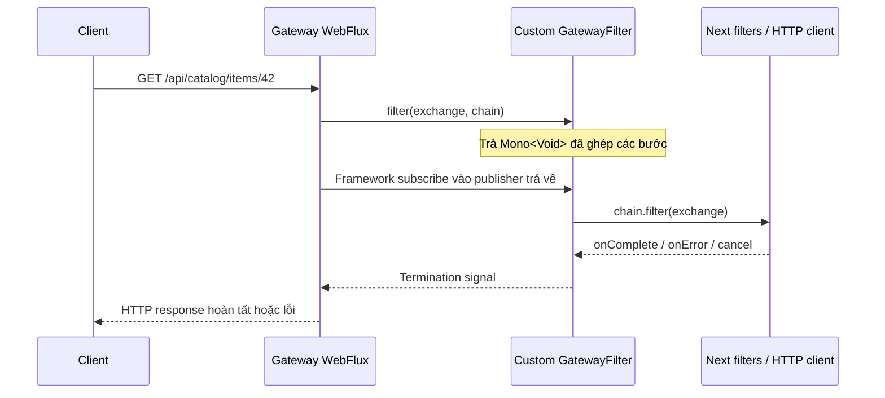
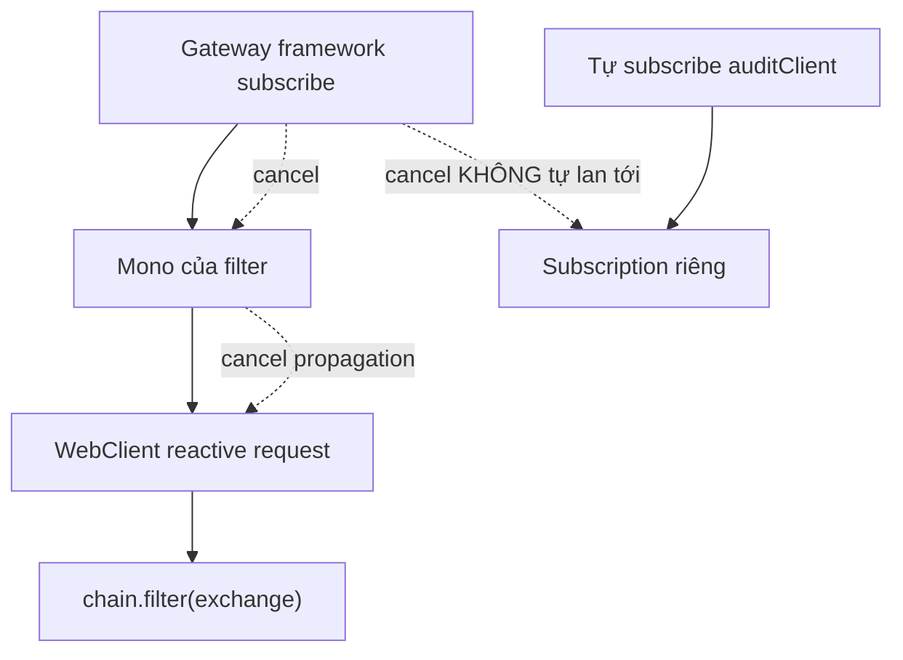

# Tránh gọi subscribe() thủ công hoặc block() trong chuỗi xử lý

## 1. Vì sao hai lời gọi này nguy hiểm trong Spring Cloud Gateway?

**Spring Cloud Gateway** là API Gateway cho microservices: route predicate chọn đích, filter chain biến đổi path/header/body, service discovery xác định backend, còn xác thực, rate limiting, circuit breaker, retry, TLS và observability kiểm soát vận hành. Khi viết **bộ lọc tùy biến** trong Gateway Server WebFlux, logic ấy nằm trên một **chuỗi reactive** do Spring WebFlux/Reactor điều phối.

Một lỗi khó phát hiện là viết:

```java
// PHẢN VÍ DỤ: KHÔNG dùng trong GatewayFilter/GlobalFilter WebFlux.
@Override
public Mono<Void> filter(ServerWebExchange exchange, GatewayFilterChain chain) {
    auditClient.sendAudit(exchange).subscribe(); // Tự tách luồng!
    return chain.filter(exchange);
}
```

Đoạn này có thể “chạy được” trong vài lượt kiểm thử nhưng **Gateway không chờ audit hoàn tất**, lỗi audit không đi qua chuỗi xử lý chính và audit có thể tiếp tục chạy sau khi client ngắt kết nối. Nếu thay `subscribe()` bằng `block()`, filter còn có thể **khóa thread non-blocking** và làm Gateway mất khả năng xử lý nhiều request.

Mục tiêu bài thuộc chương **Bộ lọc tùy biến**:

1. Hiểu hợp đồng `Mono<Void> filter(ServerWebExchange, GatewayFilterChain)` và **ai sở hữu subscription**.
2. Chỉ ra vì sao `subscribe()` và `block()` trong request-processing pipeline là anti-pattern.
3. Thay bằng `flatMap`, `then`, `Mono.defer`, `onErrorResume`, `doFinally` và các phép toán Reactor phù hợp.
4. Xây dựng một **GatewayFilterFactory tùy biến** không blocking và một **GlobalFilter** quan sát pre/post.
5. Tích hợp **WebClient** không blocking, timeout, giới hạn lỗi, context/cancellation và xử lý công việc blocking bắt buộc.
6. Viết kiểm thử nhằm phát hiện race condition, subscription bị tách, lỗi event loop và phản hồi HTTP không nhất quán.

> **Phạm vi:** Ví dụ tập trung **Spring Cloud Gateway Server WebFlux 5.0.x**, Java 17+, Spring Boot/Spring Cloud BOM tương thích và Reactor. Gateway Server Web MVC chạy trên Servlet/WebMvc.fn có API và mô hình thread khác; không sao chép nguyên WebFlux `GlobalFilter`/`GatewayFilterChain` sang MVC. Các ví dụ không thay cơ chế bảo mật thật của Spring Security.

## 2. Gateway WebFlux xử lý một request bằng publisher như thế nào?

### 2.1. Hợp đồng của filter

Trong Gateway Server WebFlux, cả `GatewayFilter` (gắn với route) và `GlobalFilter` (áp dụng rộng hơn) có phương thức:

```java
Mono<Void> filter(
    ServerWebExchange exchange,
    GatewayFilterChain chain
);
```

`ServerWebExchange` chứa request, response và attributes. `GatewayFilterChain` biểu diễn **phần filter chain còn lại**, cuối cùng dẫn tới routing/backend và viết response. `Mono<Void>` là publisher biểu diễn **toàn bộ công việc bất đồng bộ** của request, không phải một “kết quả trống vì chẳng có gì để làm”.



**Mấu chốt:** filter **trả publisher** để framework là **subscriber ở ranh giới request**. Không gọi `subscribe()` như một cách “kích hoạt cho chắc”; làm như thế tạo thêm subscription độc lập, phá contract quản lý lifecycle.

### 2.2. Pre-phase và post-phase

Khi route khớp, Gateway kết hợp các `GlobalFilter` và route-specific `GatewayFilter`, rồi sắp xếp theo `Ordered`. Filter ưu tiên cao chạy **trước** ở pha pre và **sau** ở pha post.

```text
pre F1 → pre F2 → routing → post F2 → post F1
    |         |                   |         |
    +-- Mỗi filter TRẢ publisher ghép với phần chain kế tiếp --+
```

Ví dụ chuẩn tối thiểu:

```java
@Override
public Mono<Void> filter(ServerWebExchange exchange, GatewayFilterChain chain) {
    return chain.filter(exchange);
}
```

**Trả** `chain.filter(exchange)` khác với **tự subscribe** publisher này. Framework biết khi nào request hoàn tất, khi nào lỗi xảy ra hoặc khi nào phải cancel kết nối.

## 3. Cold publisher, subscription và lifecycle

### 3.1. Tạo Mono thường chưa đồng nghĩa đã chạy I/O

Nhiều publisher Reactor là **cold**: mô tả công việc, rồi thực thi khi có subscriber.

```java
Mono<String> lookup = webClient.get()
    .uri("/flags/catalog")
    .retrieve()
    .bodyToMono(String.class);

// Chỉ xây dựng publisher; chưa tự ép một HTTP request xảy ra.
return lookup.flatMap(flag -> chain.filter(exchange));
```

Ở đây `flatMap` ghép việc đọc cờ với xử lý phần chain còn lại. **Khi framework subscribe vào kết quả trả về**, HTTP request tới `/flags/catalog` mới được điều phối, sau đó mới tiếp tục Gateway chain. Bởi vậy, **không cần** viết `lookup.subscribe()`.

Đừng suy rộng rằng **mọi** Publisher đều cold hoặc mọi factory method hoàn toàn không có side effect. Hot source, eager side effect khi xây publisher và `share/cache` có lifecycle khác; hãy kiểm tra API cụ thể. Nguyên tắc với Gateway filter vẫn là **composed publisher**, không tự tách subscription.

### 3.2. Một request có thể bị cancel

Client ngắt kết nối, Gateway timeout, upstream lỗi, retry hoặc circuit breaker có thể làm subscription của request bị **hủy**. Với một pipeline được ghép đúng, cancellation có cơ hội lan tới các bước HTTP/WebClient và cleanup. Với `subscribe()` thủ công, công việc phụ được khởi động từ subscription **khác**, nên cancellation chính **không tự hủy** nó.



Một event audit **thật sự cần chạy sau khi request bị hủy** (ví dụ bảo đảm ghi log nghiệp vụ) nên được đưa vào hệ thống queue/outbox/telemetry có retry và durability riêng. **Đừng dùng `subscribe()` fire-and-forget trong request filter làm lời hứa bảo đảm audit**.

## 4. Anti-pattern 1: gọi subscribe() thủ công

### 4.1. Gọi dịch vụ policy nhưng không chờ kết quả

```java
// SAI: kết quả kiểm tra policy không kiểm soát được lời gọi backend.
public Mono<Void> filter(ServerWebExchange exchange, GatewayFilterChain chain) {
    policyService.isAllowed(exchange)
        .subscribe(allowed -> {
            if (!allowed) {
                exchange.getResponse().setStatusCode(HttpStatus.FORBIDDEN);
            }
        });

    return chain.filter(exchange);
}
```

Các lỗi có thể xảy ra:

- **Race condition:** `chain.filter(exchange)` bắt đầu proxy request trước khi policy trả kết quả.
- **Response đã commit:** callback policy cố sửa status sau khi backend đã gửi header/body.
- **Không chặn request:** `setStatusCode(FORBIDDEN)` một mình không có nghĩa chain đã dừng.
- **Error rơi ngoài luồng:** lỗi HTTP policy không đi qua `onErrorResume` của request chính.
- **Không đồng bộ cancel:** client có thể đã hủy request nhưng policy vẫn đang chạy.

Đây là lỗi **bảo mật** nếu policy kiểm soát xác thực/tenant. Không chấp nhận cách “thấy chạy ổn khi debug” vì latency sản xuất thay đổi và race dễ tái xuất hiện.

### 4.2. Sửa bằng flatMap để quyết định trước khi proxy

```java
// ĐÚNG về mặt cấu trúc: policyService.isAllowed(exchange) trả Mono<Boolean>.
public Mono<Void> filter(ServerWebExchange exchange, GatewayFilterChain chain) {
    return policyService.isAllowed(exchange)
        .flatMap(allowed -> {
            if (allowed) {
                return chain.filter(exchange);
            }

            exchange.getResponse().setStatusCode(HttpStatus.FORBIDDEN);
            return exchange.getResponse().setComplete();
        });
}
```

**Giải thích:**

1. `isAllowed(exchange)` tạo publisher, không tự subscribe.
2. `flatMap` chờ một Boolean được phát rồi mới quyết định.
3. `allowed=true` → trả `chain.filter(exchange)` để thực hiện upstream theo đúng lifecycle.
4. `allowed=false` → đặt status và **trả `setComplete()`**, không gọi upstream.

Ví dụ này cần mở rộng trước production: nếu policy Mono **empty** thì `flatMap` không chạy và request kết thúc mà không có quyết định; nếu policy **error/timeout** phải có chính sách fail closed rõ ràng. Các bước an toàn được minh họa ở mục 9.

### 4.3. Không subscribe cả chain.filter(exchange)

```java
// SAI: framework nhận Mono.empty() và tưởng request đã hoàn tất.
public Mono<Void> filter(ServerWebExchange exchange, GatewayFilterChain chain) {
    chain.filter(exchange).subscribe();
    return Mono.empty();
}
```

Về mặt logic, `chain.filter(...)` vừa được kích hoạt bởi subscription ngoài contract, trong khi `Mono.empty()` làm chuỗi chính báo hoàn tất. Kết quả có thể là response chưa kịp ghi, exception ngoài luồng, cleanup sai thời điểm hoặc socket đóng sớm.

**Cách đúng:**

```java
return chain.filter(exchange);
```

Đừng gọi `subscribe()` để “fix một Mono không chạy” trong GatewayFilter. Thay vào đó, hãy **trả publisher chứa Mono đó** và kiểm tra xem filter đã match route, được đăng ký và được subscribe bởi Gateway hay chưa.

## 5. Anti-pattern 2: gọi block() trên event loop

### 5.1. Vì sao `block()` không phù hợp với Gateway WebFlux?

`Mono.block()` **đợi đồng bộ** kết quả, nghĩa là thread gọi bị giữ lại cho đến khi publisher hoàn tất hoặc ném lỗi. Trong Gateway Server WebFlux, request thường đi qua **Reactor Netty event-loop threads**, nơi một số thread phục vụ **nhiều kết nối**. Chặn một event loop đang xử lý request có thể làm trì hoãn hàng loạt request không liên quan.

```java
// SAI: có thể chặn Netty event loop và gây lỗi.
public Mono<Void> filter(ServerWebExchange exchange, GatewayFilterChain chain) {
    Boolean allowed = policyService.isAllowed(exchange).block();

    if (Boolean.TRUE.equals(allowed)) {
        return chain.filter(exchange);
    }

    exchange.getResponse().setStatusCode(HttpStatus.FORBIDDEN);
    return exchange.getResponse().setComplete();
}
```

Tùy scheduler/runtime, Reactor có thể ném lỗi đại loại:

```text
java.lang.IllegalStateException:
block()/blockFirst()/blockLast() are blocking,
which is not supported in thread reactor-http-...
```

Ngay cả khi không có exception (ví dụ code vô tình chạy trên thread không bị đánh dấu non-blocking), `block()` trong filter vẫn phá lợi ích async: **thread bị chiếm trong thời gian chờ I/O**, làm tăng latency và khả năng cạn thread khi tải tăng.

### 5.2. Không chỉ block()

Các lời gọi đồng bộ có rủi ro tương tự trong filter:

| Phép gọi | Vì sao nguy hiểm trên event loop | Thay thế |
|---|---|---|
| `Mono.block()`, `Flux.blockFirst()`, `Flux.blockLast()` | Đợi đồng bộ reactive source | `flatMap`/`then`/`zip`, trả publisher |
| `Thread.sleep(...)` | Giữ thread trong thời gian ngủ | `Mono.delay(...)` nếu thực sự cần hẹn giờ bất đồng bộ |
| `Future.get()`, `CompletableFuture.join()` | Đợi kết quả async theo kiểu blocking | `Mono.fromFuture(...)` hoặc API reactive |
| JDBC/JPA đồng bộ | Network I/O block thread | Dùng R2DBC khi phù hợp hoặc cô lập blocking call |
| `RestTemplate` / HTTP client blocking | Đợi phản hồi HTTP đồng bộ | `WebClient` non-blocking |
| Gọi filesystem đồng bộ lớn | Có thể block I/O | Thiết kế async hoặc chuyển sang boundedElastic có giới hạn |
| `synchronized`/lock chờ lâu | Có thể tranh chấp/đóng băng event loop | Tránh critical section chặn, thiết kế state concurrent/reactive |

**Không thay `block()` bằng `subscribe()`:** một cái **chặn thread**, một cái **tách subscription**; cả hai đều sai mục tiêu điều phối một request ở Gateway.

### 5.3. Khi nào block() có thể được chấp nhận?

Ở một **ranh giới imperative thật sự**, chẳng hạn một chương trình dòng lệnh hoặc test riêng chạy trên thread cho phép blocking, người viết có thể chủ động chờ publisher kết thúc. Tài liệu Spring WebClient cũng minh họa cách dùng đồng bộ ở phía caller imperative.

Nhưng **trong GatewayFilter, GlobalFilter, WebFlux controller hoặc callback Reactor chạy trên event loop**, nguyên tắc là **không `block()`**. “Tôi gọi `block()` trong hàm phụ chứ không trực tiếp trong filter” **không giải quyết vấn đề** nếu hàm phụ vẫn được gọi từ pipeline của Gateway.

## 6. Bảng operator thay thế: điều gì trả publisher đúng?

| Mong muốn | Mẫu Reactor phù hợp | Ghi chú |
|---|---|---|
| Chờ một giá trị async rồi xử lý tiếp | `source.flatMap(value -> chain.filter(exchange))` | Với `Mono<T>` phát 1 giá trị |
| Chạy một tác vụ `Mono<Void>` trước rồi mới đến chain | `before.then(Mono.defer(() -> chain.filter(exchange)))` | `then` chờ **completion**, bỏ giá trị `before` |
| Chạy hai công việc đọc độc lập | `Mono.zip(a, b).flatMap(tuple -> ...)` | Dùng khi thật sự có thể chạy đồng thời |
| Chỉ gắn logging/metrics khi có tín hiệu | `chain.filter(exchange).doFinally(signal -> ...)` | `doFinally` chạy khi complete/error/cancel |
| Log lỗi nhưng vẫn cho propagate | `doOnError(ex -> log.warn(...))` | Không tự nuốt lỗi |
| Fallback khi một Mono lỗi | `onErrorResume(ex -> replacementMono)` | Phải **giới hạn phạm vi** được catch |
| Xử lý publisher hoàn tất không phát giá trị | `switchIfEmpty(Mono.just(fallbackValue))` | Cần phân biệt empty với deny/error |
| Trì hoãn xây phần chain tới lúc subscribe | `Mono.defer(() -> chain.filter(exchange))` | Hữu ích khi thứ tự tạo/đăng ký publisher quan trọng |
| Đưa một tác vụ không blocking vào chuỗi | `Mono.fromRunnable(action).then(...)` | `action` vẫn chạy trên thread subscribe; không dùng cho I/O blocking |
| Bọc một hàm blocking bất khả kháng | `Mono.fromCallable(...).subscribeOn(Schedulers.boundedElastic())` | Cần timeout/giới hạn tải và kế hoạch thay thế |

### 6.1. Trình tự pre → chain với then()

```java
Mono<Void> precheck = auditService.recordAttemptAsync(exchange);

return precheck.then(
    Mono.defer(() -> chain.filter(exchange))
);
```

Thứ tự trên là **precheck hoàn tất thành công** rồi mới thực thi chain. Nếu precheck lỗi, chain **không chạy** trừ khi bạn khai báo quy tắc xử lý lỗi khác. Không dùng `Mono.when(precheck, chain.filter(exchange))` nếu business rule yêu cầu **đợi precheck trước khi proxy**: `when` có thể subscribe các nhánh đồng thời.

### 6.2. Trình tự chain → post khi thành công

```java
return chain.filter(exchange)
    .then(Mono.fromRunnable(() -> {
        // Chỉ ghi một metric/biến đếm local nhanh, không block.
        metrics.incrementCompleted();
    }));
```

`then` chỉ chạy phần sau khi chain **hoàn tất thành công**; **không chạy khi error/cancel**. Đồng thời, response có thể đã **commit** vào thời điểm ấy: không tùy tiện chỉnh `Content-Type`, status hoặc headers tại đây.

### 6.3. Quan sát cả success, error và cancellation

```java
long start = System.nanoTime();

return chain.filter(exchange)
    .doOnError(error ->
        log.warn("Gateway request failed, type={}",
            error.getClass().getSimpleName()))
    .doFinally(signalType ->
        metrics.recordDuration(System.nanoTime() - start, signalType.name()));
```

`doFinally` nhận `SignalType` như `ON_COMPLETE`, `ON_ERROR`, `CANCEL`. Đây là nơi phù hợp để cập nhật **metric nhanh, không blocking** hoặc cleanup đơn giản. **Không gọi `auditClient.sendMetric(...).subscribe()` ở đây để “gửi metric”**; tích hợp Micrometer/tracing có pipeline/buffer riêng và tránh làm chậm event loop.

**Lưu ý khi đo:** `System.nanoTime()` ở ngoài publisher được tính **lúc hàm filter được gọi**, không nhất thiết đúng lúc subscription bắt đầu. Khi cần timing chính xác theo subscription, dùng `Mono.defer(...)` hoặc công cụ metrics/tracing được framework hỗ trợ.

### 6.4. doOnNext/doOnSuccess không phải nơi chạy business workflow

`doOnNext`, `doOnSuccess` và `doOnError` chủ yếu để **quan sát side effects đơn giản**, không để thực hiện request HTTP mới rồi bỏ qua publisher. Đặc biệt, với `Mono<Void>`, `doOnNext` **không nhận giá trị** vì publisher không phát một đối tượng `Void` nào; `doOnSuccess` có thể được gọi với `null` khi Mono hoàn tất rỗng.

Nếu một bước **phải hoàn thành** trước khi HTTP response được coi là xong, hãy **ghép publisher** bằng `then`/`flatMap`, không đẩy công việc bắt buộc vào `doOnSuccess(...subscribe())`.

## 7. Ví dụ chạy được: GatewayFilterFactory tùy biến, không subscribe và không block

### 7.1. Bài lab gắn response header để truy vết

Thiết kế một factory **`TraceResponseGatewayFilterFactory`** cho route sản phẩm. Mỗi request nhận một `X-Gateway-Trace` duy nhất, nhưng backend vẫn được proxy bình thường. Đây là công việc **đồng bộ rất nhẹ** để minh họa **contract đúng** và vấn đề thời điểm HTTP response commit, không cần gọi dịch vụ bên ngoài.

Trong dự án Gateway Server WebFlux, tạo file `TraceResponseGatewayFilterFactory.java`:

```java
package com.example.gateway;

import java.util.UUID;
import org.springframework.cloud.gateway.filter.GatewayFilter;
import org.springframework.cloud.gateway.filter.factory.AbstractGatewayFilterFactory;
import org.springframework.stereotype.Component;
import reactor.core.publisher.Mono;

@Component
public class TraceResponseGatewayFilterFactory
        extends AbstractGatewayFilterFactory<
            TraceResponseGatewayFilterFactory.Config> {

    public TraceResponseGatewayFilterFactory() {
        super(Config.class);
    }

    @Override
    public GatewayFilter apply(Config config) {
        return (exchange, chain) -> {
            String traceId = UUID.randomUUID().toString();

            // Đăng ký trước khi response được ghi/commit.
            exchange.getResponse().beforeCommit(() -> {
                exchange.getResponse().getHeaders()
                    .set(config.getHeader(), traceId);
                return Mono.empty();
            });

            // Trả publisher cho framework quản lý subscription.
            return chain.filter(exchange);
        };
    }

    public static class Config {
        private String header = "X-Gateway-Trace";

        public String getHeader() {
            return header;
        }

        public void setHeader(String header) {
            this.header = header;
        }
    }
}
```

**Giải thích:**

1. Hậu tố tên class `GatewayFilterFactory` cho phép tham chiếu trong route bằng tên `TraceResponse` theo convention của Gateway.
2. Factory được đăng ký qua `@Component` trong package được Spring Boot scan.
3. Callback `beforeCommit` thay header **trước lúc response commit**; không giả định status/header còn có thể sửa sau khi body đã bắt đầu truyền.
4. Callback chỉ thực hiện thao tác nhẹ và trả `Mono.empty()`: **không subscribe** và **không block**.
5. `chain.filter(exchange)` được **return nguyên vẹn**. Gateway tiếp tục quản lý completion, error và cancellation.

### 7.2. application.yml của Gateway

Thêm dependency `spring-cloud-starter-gateway-server-webflux` theo Spring Boot/Cloud BOM tương thích. Ví dụ route:

```yaml
server:
  port: 8080

spring:
  application:
    name: custom-filter-gateway
  cloud:
    gateway:
      server:
        webflux:
          routes:
            - id: catalog-traced
              uri: http://localhost:8081
              predicates:
                - Path=/api/catalog/**
                - Method=GET
              filters:
                - StripPrefix=2
                - name: TraceResponse
                  args:
                    header: X-Gateway-Trace
```

`GET /api/catalog/items/42` được gửi tới backend thành `GET /items/42`. `TraceResponse` không tự xử lý route hay phát HTTP request mới. Mỗi lượt client request được gắn header mới do Gateway tạo.

**Lưu ý bảo mật:** không lấy giá trị `X-Gateway-Trace` client tự gửi để gắn vào log khi chưa kiểm tra length, characters và trust boundary. Ví dụ tạo UUID trên Gateway nên không phải tin dữ liệu khách hàng. Trong hệ thống có tracing, nên dùng trace ID do Micrometer/Observation/OpenTelemetry cung cấp thay vì tự xây hệ thống correlation độc lập.

### 7.3. Backend echo nhỏ để kiểm tra header

Tạo một ứng dụng **catalog-demo** khác với Gateway; dùng Spring Boot Web MVC, cổng `8081`:

```java
package com.example.catalog;

import java.util.Map;
import org.springframework.boot.SpringApplication;
import org.springframework.boot.autoconfigure.SpringBootApplication;
import org.springframework.web.bind.annotation.GetMapping;
import org.springframework.web.bind.annotation.PathVariable;
import org.springframework.web.bind.annotation.RestController;

@SpringBootApplication
@RestController
public class CatalogApplication {

    public static void main(String[] args) {
        SpringApplication.run(CatalogApplication.class, args);
    }

    @GetMapping("/items/{id}")
    public Map<String, String> item(@PathVariable String id) {
        return Map.of("id", id, "name", "Catalog demo item");
    }
}
```

File `application.yml` của **catalog-demo**:

```yaml
server:
  port: 8081
spring:
  application:
    name: catalog-demo
```

Với Spring Boot 4.x, dự án Servlet có thể dùng `spring-boot-starter-webmvc`; với Boot 3.x thường dùng `spring-boot-starter-web`. Chọn starter tương thích BOM. **Không đưa Servlet starter vào cùng ứng dụng Gateway WebFlux** của ví dụ.

### 7.4. Kiểm thử bằng curl

Khởi chạy backend trước, Gateway sau:

```bash
# Gọi thẳng backend: không có filter của Gateway.
curl --noproxy '*' -i \
  'http://localhost:8081/items/42'

# Gọi qua Gateway: có X-Gateway-Trace.
curl --noproxy '*' -i \
  'http://localhost:8080/api/catalog/items/42'

# Gọi lại để thấy trace ID khác.
curl --noproxy '*' -i \
  'http://localhost:8080/api/catalog/items/42'
```

Response **dự kiến** qua Gateway:

```http
HTTP/1.1 200 OK
Content-Type: application/json
X-Gateway-Trace: 8eaa5551-1c09-44ef-a391-6b0e264f311e

{"id":"42","name":"Catalog demo item"}
```

UUID chỉ minh họa; mỗi request sẽ có ID khác. Không có `.subscribe()` hay `.block()` trong factory. Header được đăng ký **trước khi commit** và request vẫn do framework proxy tới backend.

> Bài lab có **kết quả kỳ vọng**, không phải phản hồi đã được chạy/test trong bước soạn bài này. Trong Docker/Kubernetes, `localhost:8081` trỏ tới chính môi trường chạy Gateway; nếu backend không nằm cùng network namespace, thay bằng địa chỉ thực có thể truy cập.

## 8. Ví dụ GlobalFilter quan sát thời gian mà không chặn request

`GatewayFilterFactory` phù hợp cho route cụ thể; còn `GlobalFilter` áp dụng vào filter chain chung của những request đã match route. Đo latency là một use case đơn giản, miễn **không ghi token/PII** và **không blocking**.

```java
package com.example.gateway;

import org.slf4j.Logger;
import org.slf4j.LoggerFactory;
import org.springframework.cloud.gateway.filter.GlobalFilter;
import org.springframework.cloud.gateway.filter.GatewayFilterChain;
import org.springframework.core.Ordered;
import org.springframework.stereotype.Component;
import org.springframework.web.server.ServerWebExchange;
import reactor.core.publisher.Mono;

@Component
public class TimingGlobalFilter implements GlobalFilter, Ordered {

    private static final Logger log =
        LoggerFactory.getLogger(TimingGlobalFilter.class);

    @Override
    public int getOrder() {
        return -1;
    }

    @Override
    public Mono<Void> filter(
            ServerWebExchange exchange,
            GatewayFilterChain chain) {

        // defer đo đúng từ lúc subscription bắt đầu.
        return Mono.defer(() -> {
            long startedNanos = System.nanoTime();

            return chain.filter(exchange)
                .doFinally(signal -> {
                    long elapsedMs =
                        (System.nanoTime() - startedNanos) / 1_000_000;
                    log.debug("gateway signal={}, elapsedMs={}",
                        signal.name(), elapsedMs);
                });
        });
    }
}
```

**Ý nghĩa:**

- `@Component` tạo `GlobalFilter`, còn `Ordered` quyết định thứ tự tương đối trong filter chain.
- `Mono.defer` bảo đảm giá trị `startedNanos` được tạo **mỗi subscription**, không lấy thời gian lúc lắp ráp publisher.
- `doFinally` quan sát **complete/error/cancel**. Nó không tự đổi response hoặc tạo subscription ngoài.
- `log.debug` là ví dụ quan sát nhẹ, nhưng logging **cũng có thể tạo áp lực I/O** nếu cấu hình appender đồng bộ, throughput cao hoặc log quá nhiều. Trên production ưu tiên **Micrometer Observation/metrics**, sampling và async appender có giới hạn.
- Không ghi raw `Authorization`, cookie, body hoặc query có PII vào log.

**Đừng tự coi `GlobalFilter` chạy trước Spring Security:** Spring Security WebFlux có `WebFilter` chain riêng, có thể chặn request **trước khi Gateway HandlerMapping chọn route**. Khi debugging, phân biệt lifecycle SecurityWebFilterChain với GatewayFilterChain.

## 9. WebClient + filter tùy biến: kiểm tra policy bất đồng bộ an toàn

### 9.1. Mục tiêu và ranh giới

Giả sử Gateway phải hỏi một HTTP service `policy-demo:8082` có cho phép **đi tiếp tới backend catalog** hay không. Đây là ví dụ **điều phối bất đồng bộ**; policy-demo bên dưới chỉ cho phép đường dẫn kết thúc bằng `/42` để dễ test. Nó **không phải hệ thống phân quyền thật**: không kiểm tra JWT, tenant, actor, resource ownership hoặc chữ ký token.

Luồng cần bảo đảm:

```text
Client
  ↓
Custom Policy GatewayFilter
  ↓ WebClient GET /decision (non-blocking, timeout)
  ├─ allowed=true     → chain.filter(exchange) → backend :8081
  ├─ allowed=false    → 403, không gọi backend
  └─ lỗi/timeout/empty→ 503, không gọi backend
```

**Điểm thiết kế:** Không dùng `subscribe()`; không `block()`. Quyết định trả về một `Mono`, và toàn bộ xử lý cuối cùng được **return** cho Gateway framework.

### 9.2. GatewayFilterFactory dùng WebClient non-blocking

Tạo class `RemotePolicyGatewayFilterFactory.java` trong ứng dụng Gateway WebFlux:

```java
package com.example.gateway;

import java.time.Duration;
import org.slf4j.Logger;
import org.slf4j.LoggerFactory;
import org.springframework.cloud.gateway.filter.GatewayFilter;
import org.springframework.cloud.gateway.filter.factory.AbstractGatewayFilterFactory;
import org.springframework.http.HttpStatus;
import org.springframework.stereotype.Component;
import org.springframework.web.reactive.function.client.WebClient;
import reactor.core.publisher.Mono;

@Component
public class RemotePolicyGatewayFilterFactory
        extends AbstractGatewayFilterFactory<
            RemotePolicyGatewayFilterFactory.Config> {

    private static final Logger log =
        LoggerFactory.getLogger(RemotePolicyGatewayFilterFactory.class);

    private final WebClient policyClient;

    public RemotePolicyGatewayFilterFactory(WebClient.Builder builder) {
        super(Config.class);
        this.policyClient = builder
            .baseUrl("http://localhost:8082")
            .build();
    }

    @Override
    public GatewayFilter apply(Config config) {
        return (exchange, chain) -> {
            String path = exchange.getRequest().getPath().value();

            Mono<Outcome> decision = policyClient.get()
                .uri(uri -> uri.path("/decision")
                    .queryParam("path", path)
                    .build())
                .retrieve()
                .bodyToMono(PolicyReply.class)
                .map(reply -> reply.allowed()
                    ? Outcome.ALLOW : Outcome.DENY)
                .switchIfEmpty(Mono.just(Outcome.UNAVAILABLE))
                .timeout(Duration.ofMillis(config.getTimeoutMillis()))
                .onErrorResume(error -> {
                    // Không đưa URL/token hoặc raw exception ra client.
                    log.warn("policy check unavailable, causeType={}",
                        error.getClass().getSimpleName());
                    return Mono.just(Outcome.UNAVAILABLE);
                });

            // Chỉ sau khi có kết quả policy mới quyết định chạy chain.
            return decision.flatMap(outcome -> {
                if (outcome == Outcome.ALLOW) {
                    return chain.filter(exchange);
                }

                exchange.getResponse().setStatusCode(
                    outcome == Outcome.DENY
                        ? HttpStatus.FORBIDDEN
                        : HttpStatus.SERVICE_UNAVAILABLE);
                return exchange.getResponse().setComplete();
            });
        };
    }

    enum Outcome { ALLOW, DENY, UNAVAILABLE }

    public record PolicyReply(boolean allowed) {}

    public static class Config {
        private long timeoutMillis = 300;

        public long getTimeoutMillis() {
            return timeoutMillis;
        }

        public void setTimeoutMillis(long timeoutMillis) {
            if (timeoutMillis <= 0) {
                throw new IllegalArgumentException(
                    "timeoutMillis must be > 0");
            }
            this.timeoutMillis = timeoutMillis;
        }
    }
}
```

**Vì sao cấu trúc này đúng:**

1. `WebClient` trả `Mono<PolicyReply>`; không cần tạo thread hoặc tự subscribe.
2. `map` đưa kết quả thành `Outcome.ALLOW/DENY`.
3. `switchIfEmpty` xử lý policy service trả body rỗng: **không xem empty là ALLOW**.
4. `timeout` giới hạn thời gian chờ policy. Timeout không bảo đảm tác vụ phía policy server đã dừng hoàn toàn, nhưng subscription của HTTP client có cơ hội cancel.
5. `onErrorResume` nằm **trên publisher policy**, **trước** `flatMap(chain...)`. Vì thế lỗi của backend xảy ra **sau khi được cho phép** không bị hiểu nhầm là lỗi policy và bị đổi thành 503.
6. `DENY` → 403; `UNAVAILABLE` → 503: đây là hai trạng thái khác nhau, giúp quan sát rõ.
7. Chỉ nhánh `ALLOW` mới thực thi phần còn lại của Gateway filter chain.

**Không dùng đoạn minh họa như authorization production:** chính sách thực phải kiểm tra identity đã được Spring Security xác thực, path đã chuẩn hóa, resource owner/scope, trusted service, TLS/mTLS, retry budget và fail-closed policy. Việc truyền nguyên path vào query của policy-demo chỉ dành cho lab; request path có thể chứa PII và không nên được log hay đưa qua kênh không an toàn.

### 9.3. Đăng ký route có RemotePolicy

Thay route `catalog-traced` ở mục 7.2 bằng route này nếu muốn thử policy; hoặc dùng **route ID riêng** với pattern không chồng lấn:

```yaml
# Trích đoạn dưới spring.cloud.gateway.server.webflux.routes:
- id: catalog-with-policy
  uri: http://localhost:8081
  predicates:
    - Path=/api/policy/catalog/**
    - Method=GET
  filters:
    - StripPrefix=3
    - name: RemotePolicy
      args:
        timeoutMillis: 300
    - name: TraceResponse
      args:
        header: X-Gateway-Trace
```

`GET /api/policy/catalog/items/42` được `RemotePolicy` đánh giá; nếu ALLOW, `StripPrefix=3` đưa backend nhận `/items/42`. Khi dùng cả hai route trong lab, nên phân biệt `Path` thật rõ để tránh route có pattern rộng hơn bắt request trước.

### 9.4. Policy-demo phục vụ thử nghiệm

Tạo **ứng dụng Spring Boot Web MVC riêng** (khác Gateway và catalog backend) trên `8082`, có controller đơn giản:

```java
package com.example.policy;

import java.util.Map;
import org.springframework.boot.SpringApplication;
import org.springframework.boot.autoconfigure.SpringBootApplication;
import org.springframework.web.bind.annotation.GetMapping;
import org.springframework.web.bind.annotation.RequestParam;
import org.springframework.web.bind.annotation.RestController;

@SpringBootApplication
@RestController
public class PolicyApplication {

    public static void main(String[] args) {
        SpringApplication.run(PolicyApplication.class, args);
    }

    @GetMapping("/decision")
    public Map<String, Boolean> decision(@RequestParam String path) {
        return Map.of("allowed", path.endsWith("/42"));
    }
}
```

File `application.yml` của **policy-demo**:

```yaml
server:
  port: 8082
spring:
  application:
    name: policy-demo
```

Vì đây là service mock, tiêu chí `endsWith("/42")` chỉ dùng chứng minh thứ tự xử lý, **không phải bằng chứng được phép truy cập sản phẩm ID 42**. Tài nguyên thật cần kiểm tra user, scope, action, tenant và authorization server.

### 9.5. Dùng curl kiểm tra ALLOW, DENY và policy DOWN

Khởi động **catalog-demo :8081**, **policy-demo :8082** và **Gateway :8080** rồi gọi:

```bash
# ALLOW: policy-demo trả {"allowed":true}, backend trả 200.
curl --noproxy '*' -i \
  'http://localhost:8080/api/policy/catalog/items/42'

# DENY: policy-demo trả {"allowed":false}, Gateway trả 403.
curl --noproxy '*' -i \
  'http://localhost:8080/api/policy/catalog/items/99'
```

Sau đó dừng riêng policy-demo, nhưng giữ backend và Gateway hoạt động:

```bash
# Policy unavailable: Gateway trả 503, không được gọi backend.
curl --noproxy '*' -i \
  'http://localhost:8080/api/policy/catalog/items/42'
```

Khi policy service lỗi hoặc timeout, Gateway **fail closed** thay vì cho phép mù quáng. Nếu backend có log hoặc request counter, hãy xác nhận nó chỉ nhận request ALLOW. **Không lấy status 403/503 của curl làm bằng chứng duy nhất**: route khác hoặc backend cũng có thể trả cùng status; kiểm tra route ID, policy logs đã giảm dữ liệu và backend access logs.

## 10. Nếu thư viện bắt buộc blocking thì phải làm gì?

### 10.1. Ưu tiên không đưa blocking I/O vào Gateway

Một custom filter đôi khi gọi SDK cũ chỉ cung cấp JDBC, HTTP blocking hoặc file I/O đồng bộ. **Lựa chọn tốt nhất** là đổi sang API non-blocking (ví dụ WebClient, R2DBC, reactive Redis client), đưa phần xử lý nặng sang service riêng hoặc thiết kế lại pipeline để Gateway chỉ làm nhiệm vụ ở biên.

Nếu **chưa thể thay** ngay, có thể **cô lập** lời gọi blocking ở scheduler phù hợp, nhưng phải coi đây là **biện pháp chuyển tiếp có giới hạn**, không phải cách làm cho SDK trở thành reactive thật.

### 10.2. Sai: gọi blocking API trong map/flatMap trên event loop

```java
// SAI: hàm lookupSync có thể chiếm event loop.
return Mono.just(tenantId)
    .map(id -> legacyPolicySdk.lookupSync(id))
    .flatMap(decision -> decision.allowed()
        ? chain.filter(exchange)
        : exchange.getResponse().setComplete());
```

`flatMap` xung quanh `lookupSync` **không tự biến nó thành async**. Phép gọi blocking vẫn thực hiện trên thread đang chạy callback.

### 10.3. Tạm thời đúng hướng: fromCallable + boundedElastic

```java
Mono<LegacyDecision> decision = Mono.fromCallable(
        () -> legacyPolicySdk.lookupSync(tenantId))
    .subscribeOn(reactor.core.scheduler.Schedulers.boundedElastic())
    .timeout(java.time.Duration.ofMillis(500));

return decision.flatMap(result -> {
    if (result.allowed()) {
        return chain.filter(exchange);
    }
    exchange.getResponse().setStatusCode(HttpStatus.FORBIDDEN);
    return exchange.getResponse().setComplete();
});
```

Đoạn trên là **mẫu bên trong một filter** có các biến `legacyPolicySdk`/`tenantId` được inject/xác định an toàn; không phải class độc lập. Nó dùng:

- `Mono.fromCallable`: chỉ thực hiện lookup khi có subscription.
- `subscribeOn(Schedulers.boundedElastic())`: chuyển nguồn blocking sang pool có giới hạn, tránh chiếm Netty event loop.
- `timeout`: đặt ngân sách chờ kết quả.
- `flatMap`: chỉ proxy sau khi đã có decision.

**Giới hạn thực tế:**

1. `boundedElastic` có giới hạn thread/queue, có thể **quá tải** khi nhiều request cùng lúc.
2. `timeout` cancel publisher, nhưng **không bảo đảm chấm dứt ngay một I/O blocking** nếu SDK không hỗ trợ interrupt/cancel.
3. Cần timeout **bên trong SDK**, bulkhead/concurrency limit, metrics queue latency và circuit breaker khi phụ thuộc external service.
4. Mặc định phải xử lý `Mono.empty()`, error và timeout theo chính sách **fail closed**; đừng chỉ để một request 503 biến thành access grant.
5. Không tạo `Schedulers.newBoundedElastic(...)` hoặc thread pool mới **cho từng request**. Dùng tài nguyên có lifecycle quản lý và giới hạn theo capacity.

### 10.4. subscribeOn và publishOn khác nhau

| Operator | Ý nghĩa | Có tự sửa blocking code không? |
|---|---|---|
| `subscribeOn(scheduler)` | Ảnh hưởng nơi subscription và nguồn upstream được chạy | **Không**, chỉ thay thread cho vùng phù hợp |
| `publishOn(scheduler)` | Chuyển execution của các operator **phía sau** đến scheduler | **Không**, nếu blocking xảy ra trước publishOn |
| `boundedElastic` | Scheduler thích hợp hơn cho I/O blocking không tránh được | Chỉ là biện pháp cô lập, vẫn cần giới hạn |
| `parallel` | Phục vụ tác vụ CPU-bound non-blocking | Không phù hợp để “thả” network blocking vô hạn |

**Không đổi ngẫu nhiên scheduler chỉ để tránh lỗi `block()`.** Nếu bạn đã có một reactive `Mono`, hãy giữ chuỗi reactive và **không block**. Chỉ dùng boundedElastic khi bắt buộc gọi API đồng bộ, với capacity management.

## 11. Khi xử lý request/response body: đừng subscribe DataBuffer

### 11.1. WebFlux request body là một luồng dữ liệu

`ServerHttpRequest.getBody()` trả `Flux<DataBuffer>`. Một body HTTP không nên được đọc tùy ý nhiều lần bằng những subscriptions khác nhau:

```java
// SAI: đọc request body ngoài chain.
exchange.getRequest().getBody()
    .subscribe(buffer -> log.info("body={}", buffer));

return chain.filter(exchange);
```

Các vấn đề:

- Có thể **tiêu thụ body** trước khi routing filter/backend đọc.
- Có thể tách khỏi backpressure và lifecycle request.
- Có thể giữ/giải phóng `DataBuffer` sai, dẫn đến memory leak hoặc dữ liệu thiếu.
- Có thể vô tình **log mật khẩu, token hoặc PII**.
- Khi client hủy request, subscription riêng có thể tiếp tục đọc/gây lỗi khác.

Không dùng `getBody().blockFirst()` hay `collectList().block()` trong filter. Với Netty pooled buffers, muốn tự quản lý bytes cần hiểu **reference counting, DataBufferUtils.release**, giới hạn bộ nhớ, cancel/error cleanup và chính sách không đọc lại một body đã tiêu thụ.

### 11.2. Ưu tiên factory ModifyRequestBody/ModifyResponseBody

Nếu mục tiêu là **biến đổi nội dung**, Spring Cloud Gateway có filter chuyên dụng thay vì tự subscribe vào body. Ví dụ **Java RouteLocatorBuilder**:

```java
@Bean
RouteLocator rewriteRoutes(RouteLocatorBuilder builder) {
    return builder.routes()
        .route("body-rewrite-demo", r -> r
            .path("/api/normalize/**")
            .filters(f -> f
                .modifyRequestBody(
                    String.class,
                    String.class,
                    (exchange, body) -> body == null
                        ? Mono.empty()
                        : Mono.just(body.trim())))
            .uri("http://localhost:8081"))
        .build();
}
```

Đây là **method đặt trong một `@Configuration` class** và cần imports `RouteLocator`, `RouteLocatorBuilder`, `Mono` cùng đúng starter WebFlux. `ModifyRequestBody` xử lý publisher/body decoding theo cách Gateway hỗ trợ; bạn cung cấp **`RewriteFunction`** trả `Mono<String>` mà không gọi `subscribe()` hoặc `block()`.

**Giới hạn:** ví dụ `String.trim()` chỉ phù hợp với **payload text nhỏ** có hợp đồng rõ ràng. Không trim toàn bộ JSON/binary một cách mù quáng, không dùng filter body aggregation cho SSE/file download lớn; kiểm tra Content-Type/Content-Length/Content-Encoding, memory limits và error behavior.

### 11.3. Nếu thực sự cần DataBuffer decorator

Khi viết `ServerHttpRequestDecorator`/`ServerHttpResponseDecorator`:

1. **Trả publisher body đã được biến đổi** cho framework, không subscribe riêng.
2. Xác định rõ bên nào **sở hữu/tăng/giảm reference count** của từng `DataBuffer`.
3. Cân nhắc `DataBufferUtils.release` khi drop/replace buffer và có trách nhiệm cleanup; không release buffer rồi tiếp tục chuyển nó downstream.
4. Bảo vệ trên error, cancel, timeout và partial read, không chỉ happy path.
5. Áp dụng body size limit và backpressure, tránh `collectList()` vô hạn hoặc lưu raw body vào exchange attributes.
6. Viết integration tests với large body, abort connection, streaming và leak detection.

Các chi tiết buffer rất dễ sai; với nghiệp vụ thông thường hãy ưu tiên filter do Spring cung cấp thay vì tự quản lý byte stream.

## 12. Lỗi và hủy request: đừng giấu thất bại của downstream

### 12.1. onErrorResume phải đặt ở phạm vi đúng

Xét hai cách:

```java
// CẦN CẨN TRỌNG: sẽ bắt cả lỗi từ chain/backend.
return policyService.isAllowed(exchange)
    .flatMap(allowed -> allowed
        ? chain.filter(exchange)
        : deny(exchange))
    .onErrorResume(error -> serviceUnavailable(exchange));
```

Vấn đề là `onErrorResume` nằm **ngoài** phần `flatMap(chain...)`, nên một lỗi ghi response, TLS backend, Netty timeout hoặc exception từ filter phía sau **cũng có thể bị biến thành lỗi policy**. Tệ hơn, response có thể đã commit, lúc ấy không được tùy tiện viết một status/body mới.

**Cách đúng về phạm vi:**

```java
Mono<Boolean> policy = policyService.isAllowed(exchange)
    .timeout(Duration.ofMillis(300))
    .switchIfEmpty(Mono.error(
        new IllegalStateException("Missing policy decision")))
    .onErrorResume(error -> {
        log.warn("policy unavailable: {}",
            error.getClass().getSimpleName());
        return Mono.error(new PolicyUnavailableException());
    });

return policy.flatMap(allowed -> {
    if (allowed) {
        return chain.filter(exchange);
    }
    return deny(exchange);
});
```

Đoạn thứ hai minh họa **vị trí operator**, chưa phải class chạy độc lập (`PolicyUnavailableException`, `deny` và `policyService` cần được định nghĩa). Trong production, có thể xử lý lỗi policy thành `Outcome.UNAVAILABLE` **trước** `flatMap` như ví dụ **đầy đủ ở mục 9**, nhờ vậy không nuốt exception của backend.

### 12.2. Khi response đã commit

Nếu downstream đã bắt đầu ghi headers/body, Gateway không thể an toàn sửa status thành 403/503 hoặc chuyển sang body lỗi mới. Đó là lý do:

- **Điều kiện cho phép/từ chối** phải quyết định **trước `chain.filter(exchange)`**.
- **Response headers** cần chỉnh nên đăng ký qua `response.beforeCommit(...)` khi phù hợp.
- Một lỗi xảy ra **sau khi response được commit** có thể chỉ dẫn đến kết nối bị ngắt/stream error; không bảo đảm luôn trả JSON lỗi đẹp.
- Không coi `exchange.getResponse().setStatusCode(...)` đơn lẻ là kết thúc request; khi từ chối cần trả `exchange.getResponse().setComplete()` hoặc body writer được phối hợp đúng.

### 12.3. doFinally, cleanup và cancellation

`doFinally` là nơi phù hợp cho **counter, timer và cleanup nhẹ**. Nếu tác vụ cleanup bắt buộc bất đồng bộ (ví dụ đóng resource reactive), cân nhắc toán tử **`usingWhen`** để gắn resource acquisition/use/cleanup vào cùng pipeline; không dùng `doFinally(x -> cleanupMono.subscribe())`.

Một `CancellationException` không nhất thiết luôn đi theo `onErrorResume`: cancellation là tín hiệu riêng. Để đo request bị hủy, quan sát `SignalType.CANCEL` trong `doFinally` hoặc tracing/metrics có hỗ trợ. Không tuyên bố task đã chạy thành công chỉ vì bạn thấy log ở `doOnSubscribe`.

### 12.4. Retry và double subscription

Nếu một tác vụ nằm trong pipeline được **retry**, framework/operator có thể **subscribe lại** source. Vì vậy:

- Tránh các **side effects không idempotent** trong operator như `doOnSubscribe` nếu không có guard.
- Dùng idempotency key cho hoạt động ghi (đơn hàng/thanh toán).
- Đặt Retry/CircuitBreaker timeout budget hợp lý, tránh mỗi attempt lại gửi hàng loạt audit side effects.
- `Mono.cache()` và `share()` có thể thay hành vi reuse/subscription, nhưng **không dùng chúng như cách chữa mặc định cho double subscription**; phải hiểu lifetime và scope cache.

Ví dụ `TraceResponseGatewayFilterFactory` tạo trace ID trong `apply` callback cho từng exchange, không mở publisher ngoài scope request. Với audit cần bảo đảm exactly-once, hãy dùng persistence/outbox riêng thay vì suy từ số subscribe.

## 13. Kiểm thử filter bằng Reactor Test và WebTestClient

### 13.1. Vì sao không nên dùng sleep để “chờ async chạy xong”?

Một test kiểu:

```java
// PHẢN VÍ DỤ: test phụ thuộc timing, không chứng minh đã compose đúng.
filter.filter(exchange, chain).subscribe();
Thread.sleep(500);
assertTrue(auditWasWritten);
```

dễ qua trên laptop nhưng fail trên CI khi tải khác, và không kiểm chứng lifecycle của request. **Test đúng nên subscribe publisher có kiểm soát qua `StepVerifier` hoặc WebTestClient**, chờ tín hiệu terminal rồi assert kết quả, không tự fire-and-forget.

### 13.2. Dependency kiểm thử

Trên dự án Maven dùng Spring Boot BOM:

```xml
<dependency>
    <groupId>io.projectreactor</groupId>
    <artifactId>reactor-test</artifactId>
    <scope>test</scope>
</dependency>
```

Với integration test WebFlux, thêm starter testing phù hợp version Spring Boot (ví dụ `spring-boot-starter-webflux-test` trên Boot 4.x hoặc `spring-boot-starter-test` theo project/BOM) và dùng `WebTestClient`. Bài tập này **không chạy Gradle/Maven**; đoạn code là ví dụ để học viên đưa vào dự án và xác minh.

### 13.3. Unit test: phần chain chỉ chạy sau khi subscribe

```java
package com.example.gateway;

import java.util.concurrent.atomic.AtomicInteger;
import org.junit.jupiter.api.Test;
import org.springframework.cloud.gateway.filter.GatewayFilter;
import org.springframework.cloud.gateway.filter.GatewayFilterChain;
import org.springframework.mock.http.server.reactive.MockServerHttpRequest;
import org.springframework.mock.web.server.MockServerWebExchange;
import reactor.core.publisher.Mono;
import reactor.test.StepVerifier;

import static org.junit.jupiter.api.Assertions.assertEquals;

class ReactiveFilterTest {

    @Test
    void callsNextChainOnlyWhenSubscribed() {
        var exchange = MockServerWebExchange.from(
            MockServerHttpRequest.get("/api/catalog/items/42").build());

        AtomicInteger nextCalls = new AtomicInteger();
        GatewayFilterChain next = ex -> {
            nextCalls.incrementAndGet();
            return Mono.empty();
        };

        GatewayFilter filter = (ex, chain) ->
            Mono.just(true)
                .flatMap(allowed -> allowed
                    ? chain.filter(ex) : Mono.empty());

        Mono<Void> pipeline = filter.filter(exchange, next);
        assertEquals(0, nextCalls.get());

        // StepVerifier là subscriber trong TEST, không phải request filter.
        StepVerifier.create(pipeline).verifyComplete();
        assertEquals(1, nextCalls.get());
    }
}
```

Test trên chứng minh **mẫu `flatMap` chỉ gọi phần chain sau khi publisher được subscribe**. `StepVerifier.create(...)` kiểm soát subscription ở **test boundary**, nên không mâu thuẫn nguyên tắc “không gọi `subscribe()` thủ công trong GatewayFilter”.

### 13.4. Unit test: cancellation lan tới publisher

```java
@Test
void cancellationReachesDownstreamPublisher() {
    var exchange = MockServerWebExchange.from(
        MockServerHttpRequest.get("/api/test").build());
    java.util.concurrent.atomic.AtomicBoolean canceled =
        new java.util.concurrent.atomic.AtomicBoolean();

    GatewayFilterChain next = ex ->
        Mono.<Void>never().doOnCancel(() -> canceled.set(true));

    GatewayFilter filter = (ex, chain) -> chain.filter(ex);

    StepVerifier.create(filter.filter(exchange, next))
        .thenCancel()
        .verify();

    org.junit.jupiter.api.Assertions.assertTrue(canceled.get());
}
```

Đoạn này là **method bổ sung vào test class ở mục 13.3**, dùng các imports đã có. Nó kiểm tra cancellation trên publisher được ghép. Nếu bên trong filter dùng `subscribe()` để tạo một subscription khác, cancellation của `StepVerifier` sẽ **không tự hủy** subscription ngoài ấy.

### 13.5. Test response header được thêm trước commit

Có thể kiểm tra factory `TraceResponseGatewayFilterFactory`:

```java
@Test
void traceFilterAddsResponseHeader() {
    var exchange = MockServerWebExchange.from(
        MockServerHttpRequest.get("/api/catalog/items/42").build());

    var factory = new TraceResponseGatewayFilterFactory();
    var filter = factory.apply(
        new TraceResponseGatewayFilterFactory.Config());

    GatewayFilterChain next = ex -> ex.getResponse().setComplete();

    StepVerifier.create(filter.filter(exchange, next))
        .verifyComplete();

    org.junit.jupiter.api.Assertions.assertNotNull(
        exchange.getResponse().getHeaders().getFirst("X-Gateway-Trace"));
}
```

Phản hồi cần được **commit/completed** trong test để callback `beforeCommit` chạy. Nếu chỉ dựng publisher mà không subscribe hoặc không hoàn tất response, assertion header có thể được thực hiện quá sớm.

### 13.6. Integration test cần các case nào?

Khi dùng `WebTestClient` với Gateway chạy thực và một backend stub, test:

| Case | Expected behavior |
|---|---|
| Route không match | Factory route-specific không chạy |
| GET hợp lệ | Backend nhận một request, client nhận 200 + trace header |
| Policy ALLOW | Backend nhận request sau khi policy cho phép |
| Policy DENY | Gateway trả 403, **backend không nhận request** |
| Policy service timeout/500 | Gateway trả 503, **backend không nhận request** |
| Backend 500 sau policy ALLOW | Không bị gán sai thành policy unavailable |
| Client cancel trước khi policy hoàn tất | Publisher policy được cancel khi hỗ trợ; không có request backend ngoài ý muốn |
| 100–1000 request đồng thời (mức lab) | Không nghẽn event loop, không leak subscriptions |
| Body lớn/streaming | Không bị đọc hai lần hoặc nuốt body nếu có filter xử lý body |
| Retry/circuit breaker | Không tạo double side effects ngoài thiết kế |

**Dấu hiệu cần assert không chỉ là HTTP status:** số request backend/policy, thời gian hoàn thành, số callback thực thi, exception signal và request cancellation. Với test áp tải, ghi cả CPU/heap, Netty event-loop utilization và timeout.

## 14. Context, tracing và quan sát trong Reactor

### 14.1. Reactive Context không tương đương ThreadLocal

Trong pipeline reactive, phần xử lý có thể chuyển scheduler/thread. Nếu filter lưu user ID/trace ID vào `ThreadLocal` và hy vọng đọc lại ở một callback WebClient sau đó, giá trị có thể **mất hoặc bị nhầm** nếu không có cơ chế context propagation.

Với dữ liệu cần đi cùng subscription, Reactor cung cấp `Context`:

```java
Mono<String> work = Mono.deferContextual(ctx -> {
    String traceId = ctx.getOrDefault("traceId", "missing");
    return Mono.just(traceId);
});

return work
    .flatMap(traceId -> chain.filter(exchange))
    .contextWrite(context -> context.put("traceId", "trace-demo"));
```

Đây là **mẫu mô tả cách dùng Context bên trong một filter**, không phải một file Java độc lập. Dữ liệu truyền qua `Context` gắn với subscription và không phụ thuộc một thread cố định. **Không đặt raw access token, cookie hoặc PII tùy ý vào Context** nếu không có chính sách rõ ràng; context cũng cần vòng đời/quyền truy cập phù hợp.

Trong Spring Boot production, nên ưu tiên **Micrometer Observation/Tracing/OpenTelemetry** và cơ chế context propagation được tích hợp, tránh tự chế correlation ID song song gây lẫn.

### 14.2. Metric latency từ filter phải đủ ba loại kết thúc

| Signal | Ý nghĩa | Ví dụ |
|---|---|---|
| `ON_COMPLETE` | Pipeline hoàn tất bình thường | Proxy upstream trả và response kết thúc |
| `ON_ERROR` | Publisher kết thúc bằng lỗi | Lỗi không được xử lý bởi các operator tương ứng |
| `CANCEL` | Subscriber hủy pipeline | Client đóng kết nối, timeout/cancel |

Không chỉ đo `doOnSuccess` cho `Mono<Void>` rồi kết luận mọi request đều “thành công”. Bản thân HTTP status 4xx/5xx **có thể đến qua completion bình thường**, nên metrics phải quan sát cả **status code** và signal, không dùng `ON_COMPLETE` như đồng nghĩa HTTP 200.

### 14.3. Khi nào cần log và khi nào không?

Chỉ ghi những trường phù hợp bảo mật:

- **Route ID**, HTTP method, status, exception category, elapsed duration, trace/request ID.
- Không log toàn bộ request/response headers vì chứa `Authorization`, `Cookie`, JWT, API key.
- Không log raw body, đặc biệt các API đăng nhập, thanh toán và hồ sơ cá nhân.
- Không dùng raw URI query/path vô hạn làm metric tags (nguy cơ **high cardinality** và lộ PII).
- Khi bật Netty wiretap/TRACE để điều tra, giới hạn môi trường, thời gian và quyền truy cập.

Nếu `doFinally` thực hiện logging bằng một appender đồng bộ chậm, chính logic quan sát cũng có thể gây **event-loop stalls**. Ưu tiên instrumentation non-blocking hoặc hàng đợi telemetry có giới hạn.

## 15. Đối chiếu với Gateway Server Web MVC

Spring Cloud Gateway có các biến thể **Server WebFlux** và **Server Web MVC**. Cùng là API Gateway nhưng:

| Khía cạnh | Server WebFlux | Server Web MVC |
|---|---|---|
| Runtime | Reactor Netty/WebFlux non-blocking | Servlet/WebMvc.fn |
| Route-level filter | `GatewayFilter` / `AbstractGatewayFilterFactory` | `HandlerFilterFunction<ServerResponse, ServerResponse>` và before/after filters |
| Global filter | `GlobalFilter` WebFlux | Hạ tầng Servlet/MVC filters tương ứng |
| Chain result | Thường `Mono<Void>` | `ServerResponse`/hợp đồng Servlet API |
| HTTP client | Reactor Netty/WebClient | RestClient hoặc client được cấu hình cho MVC |
| `subscribe()`/`block()` | **Không gọi trong reactive request filter** | Không dùng WebFlux Mono chain như kiểu MVC; cân nhắc Servlet thread/pool và I/O blocking |

**Không copy class `GlobalFilter` hoặc `GatewayFilterChain` WebFlux vào ứng dụng Gateway Server Web MVC.** MVC có hệ thống filter và execution model riêng. Một Servlet handler có thể sử dụng API đồng bộ trong giới hạn Servlet thread pool, nhưng điều đó **không biến việc gọi `subscribe()` vô kiểm soát thành đúng**, cũng không cho phép giữ các tác vụ ngoài lifecycle của request mà không có thiết kế quản lý.

Nếu cần biến đổi request/response body trong MVC, hãy dùng API `BeforeFilterFunctions`/`AfterFilterFunctions` và các filter được Gateway Server Web MVC tài liệu hóa. Bài này tập trung **reactive contract của WebFlux**.

## 16. Checklist review custom filter trước production

### 16.1. Checklist code

- [ ] Mỗi `GatewayFilter`/`GlobalFilter` **trả chính xác `Mono<Void>`** của toàn bộ pipeline.
- [ ] Không có `.subscribe()`, `.block()`, `.blockFirst()`, `.blockLast()` trong request filter hay hàm phụ gọi từ nó.
- [ ] Không có `Thread.sleep`, `Future.get`, `CompletableFuture.join`, JDBC/HTTP blocking chạy trên event loop.
- [ ] Các bước cần thứ tự dùng `flatMap`/`then`; không dùng `Mono.when` cho tác vụ phải hoàn tất trước proxy.
- [ ] `Mono.empty()`, error và timeout có quy tắc rõ ràng; không vô tình cho request đi tiếp khi chưa có authorization.
- [ ] Khi từ chối, **không gọi chain**; return publisher hoàn tất response qua `setComplete()` hoặc response writer hợp lệ.
- [ ] Khi cho phép, chỉ gọi `chain.filter(exchange)` **một lần theo thiết kế**; không double-subscribe.
- [ ] `onErrorResume` chỉ bao các lỗi dự kiến; không nuốt lỗi backend khi thực ra đang xử lý lỗi policy.
- [ ] Thay response headers/status **trước commit**, không sau khi response body đã được gửi.
- [ ] Body processing không tự subscribe vào `DataBuffer`, có memory limit/cancellation/cleanup đúng.
- [ ] BoundedElastic chỉ dành cho blocking API bất khả kháng, có concurrency/timeout và lộ trình thay thế.
- [ ] Logger/metrics không tạo I/O blocking lớn và không tiết lộ secrets.

### 16.2. Checklist hệ thống

- [ ] Route predicate và filter name đúng, bean được scan và dependency/BOM tương thích.
- [ ] Xác thực/phân quyền vẫn do Spring Security hoặc policy đã kiểm chứng quyết định, không qua header client tự khai.
- [ ] WebClient tới policy/metadata service dùng TLS/mTLS, timeout và service identity phù hợp.
- [ ] Retry/circuit breaker không gây duplicate side effects hoặc kéo dài latency quá client timeout.
- [ ] Test ít nhất success/deny/error/empty/cancel và backend failure **sau** policy ALLOW.
- [ ] Test concurrency, long-lived response, request body/streaming và memory pressure khi cần.
- [ ] Xác nhận không có lỗi event loop, Netty connection pool exhaustion hoặc publisher không có subscriber.
- [ ] Actuator/log/tracing được bảo vệ, metrics phân biệt HTTP status với Reactor termination signals.

## 17. Bảng xử lý lỗi thường gặp

| Triệu chứng | Nguyên nhân thường gặp | Cách kiểm tra / sửa |
|---|---|---|
| Callback chạy nhưng client nhận response trước | Dùng `subscribe()` trong filter rồi return chain | Ghép bằng `flatMap`/`then`; để framework subscribe |
| Policy trả DENY nhưng backend vẫn nhận request | Chain đã bắt đầu trước khi quyết định policy về | Chỉ gọi `chain.filter(exchange)` trong nhánh ALLOW |
| Log xuất hiện `IllegalStateException: block()...` | Có `block()` trên Reactor Netty event loop | Truy hàm gọi blocking, chuyển sang reactive composition |
| Throughput giảm mạnh khi gọi SDK cũ | JDBC/HTTP blocking, `Future.get`, lock hoặc sleep trên event loop | Dùng reactive client; nếu bắt buộc, boundedElastic có giới hạn |
| Không có lỗi trong request nhưng audit báo lỗi muộn | Fire-and-forget subscribe có error ngoài pipeline | Trả publisher audit qua `then`, hoặc dùng queue/outbox độc lập |
| Client cancel nhưng policy/audit vẫn chạy | Subscription bị tách hoặc source không hỗ trợ cancellation | Gỡ `subscribe()`; kiểm tra `doFinally(CANCEL)`/resource cleanup |
| HTTP body mất/trống sau custom filter | Filter tự subscribe và tiêu thụ `getBody()` trước routing | Dùng ModifyRequestBody/ModifyResponseBody hoặc decorator đúng |
| Netty pooled buffer leak | Không release buffer bị drop hoặc release sai lifecycle | Review `DataBufferUtils` ownership/cancel/error paths |
| Response status đổi thành 403 quá muộn | Policy callback chạy sau chain/response commit | Chờ policy trước khi proxy; sử dụng `setComplete()` khi deny |
| Response header thêm sau chain không hiện | Response đã commit khi `then(...)`/`doFinally(...)` chạy | Đăng ký `beforeCommit(...)` từ sớm |
| Filter trả `Mono.empty()` nhưng backend không được gọi | Bỏ qua `chain.filter(exchange)` và không xử lý response | Trả chain khi muốn proxy, setComplete khi chủ động chặn |
| Lỗi backend bị chuyển thành “Policy unavailable” | `onErrorResume` bao cả `chain.filter(exchange)` | Đặt error handler trước `flatMap` nối chain |
| Test lúc pass lúc fail | `Thread.sleep`, race, nhầm async state | Dùng StepVerifier/WebTestClient và assert số lần backend gọi |
| Có nhiều request backend hơn client request | Retry hoặc double subscription/side effect | Kiểm tra filter order, attempt count, idempotency |
| MDC/ThreadLocal mất trace ID | Thread switch/context propagation thiếu | Dùng Reactor Context và tracing integration |
| Gateway HTTP 404 dù custom filter không thấy log | Predicate không match hoặc route không được nạp | Kiểm tra routes/Actuator, path/method/host |
| 500 khi gọi policy service | Policy remote lỗi, timeout hoặc `WebClient.retrieve()` xử lý 4xx/5xx | Tách policy outcome trước chain, log category, fail closed |

### 17.1. Actuator và runtime inspection

Nếu dự án có Spring Boot Actuator, Gateway WebFlux có thể cung cấp routes/filters đã lắp ráp qua endpoint Gateway khi **đã cấu hình quyền read-only và bảo vệ quyền truy cập**:

```yaml
management:
  endpoint:
    gateway:
      access: read-only
  endpoints:
    web:
      exposure:
        include: health,metrics,gateway
```

```bash
curl -sS 'http://localhost:8080/actuator/gateway/routes'
curl -sS 'http://localhost:8080/actuator/gateway/routes/catalog-traced'
curl -sS 'http://localhost:8080/actuator/gateway/globalfilters'
```

Actuator chứng minh **route/filter được đăng ký**, không tự chứng minh mọi publisher được subscribe đúng hoặc không có blocking call. Phải kết hợp **backend/policy counters, StepVerifier, metrics latency, cancellation và log errors**. Không công khai endpoint quản trị hay route URI nội bộ trên Internet.

### 17.2. Cách điều tra khi nghi event loop bị block

1. Xác định route/filter nào bị chậm, tập hợp request IDs không nhạy cảm.
2. Đo p95/p99 latency ở client → Gateway → backend; phân biệt connect timeout, policy I/O và response timeout.
3. Lấy thread dump/JFR trong môi trường phù hợp; tìm Reactor Netty event-loop threads đang chờ lock, socket blocking, `Thread.sleep` hoặc đồng bộ SDK.
4. Rà mọi phương thức phụ từ `filter(...)`: `map`, `flatMap` callback, `doOnNext`, `doFinally` và logging appenders.
5. Dùng BlockHound hoặc công cụ nhận diện blocking call trong **test/dev** nếu phù hợp dependency/runtime; không bật tùy tiện trên production.
6. Sau khi sửa, chạy regression và concurrency test đo **throughput lẫn cancellation**, không chỉ một request happy path.

## 18. Bài tập và câu hỏi tự kiểm tra

**Bài 1 — Đọc code.** Một filter gọi `auditMono.subscribe()` rồi trả `chain.filter(exchange)`. Hãy nêu ba hậu quả của cách triển khai này.

**Bài 2 — Chuyển sang flatMap.** Viết lại filter đang dùng `Boolean allowed = policyMono.block()` để chỉ gọi backend khi policy trả `true`, trả 403 nếu `false`, trả 503 nếu timeout/error.

**Bài 3 — Chuỗi trước và sau.** Một `Mono<Void>` cần ghi “request started” (nhẹ, không blocking) trước chain, rồi đo duration khi complete/error/cancel. Nên dùng operator nào?

**Bài 4 — Response commit.** Vì sao đoạn `return chain.filter(exchange).then(Mono.fromRunnable(() -> response.getHeaders().set(...)))` có thể không thêm được response header? Viết cách dùng `beforeCommit`.

**Bài 5 — subscribe chain.** Vì sao `chain.filter(exchange).subscribe(); return Mono.empty();` là lỗi đặc biệt nghiêm trọng?

**Bài 6 — Kiểm tra policy.** API policy trả body rỗng. Nếu dùng `policyMono.flatMap(...chain...)` mà không có `switchIfEmpty`, request sẽ đi về đâu? Thiết kế trạng thái `UNAVAILABLE` an toàn.

**Bài 7 — Error scope.** Nếu đặt `onErrorResume` sau `flatMap(decision -> chain.filter(exchange))`, lỗi nào có thể bị gán nhầm cho policy service?

**Bài 8 — Body.** Một custom filter subscribe vào `request.getBody()` để ghi log JSON, sau đó cho Gateway proxy. Nêu rủi ro đối với body, bộ nhớ, backpressure, security.

**Bài 9 — Blocking library.** Một SDK đồng bộ bắt buộc có `lookupSync()`. Hãy trình bày cách tạm cô lập, giới hạn concurrency, timeout và kế hoạch thay thế.

**Bài 10 — Reactor cancellation.** Test cần chứng minh client cancel sẽ cancel downstream publisher. Bạn dùng `StepVerifier` như thế nào?

**Bài 11 — MVC vs WebFlux.** Vì sao không copy class `GlobalFilter` của WebFlux vào Gateway Server Web MVC? Mô hình execution và contract khác nhau ra sao?

**Bài 12 — An toàn.** Một route TokenRelay gọi policy service với raw JWT trong query string và in response body khi lỗi. Điều gì sai về security và logging?

### Gợi ý đáp án

1. Tạo subscription tách khỏi request, lỗi/cancel không được quản lý chung, audit có thể xảy ra muộn hoặc race với response; không bảo đảm durability.
2. `policyMono.timeout(...).map(...).switchIfEmpty(...).onErrorResume(...).flatMap(outcome -> outcome == ALLOW ? chain.filter(exchange) : setStatusAndComplete(...))`; không `block()`.
3. `Mono.defer` hoặc `Mono.fromRunnable` + `then` cho pre-step, `doFinally` cho duration ở cả completion/error/cancel.
4. Headers có thể đã commit; đăng ký `exchange.getResponse().beforeCommit(() -> { headers.set(...); return Mono.empty(); })` **trước** `chain.filter(exchange)`.
5. Framework chỉ thấy publisher `Mono.empty()` và không còn quản lý subscription proxy; response có thể không kịp ghi và lỗi bị tách.
6. Empty Mono không phát value nên `flatMap` không được chạy; dùng `switchIfEmpty(Mono.just(UNAVAILABLE))` và trả 503 theo contract.
7. Lỗi backend network/TLS/timeout, body writer và filter phía sau có thể bị nuốt/đổi thành 503 policy; giới hạn handler trên policy Mono trước khi nối chain.
8. Body có thể bị tiêu thụ hai lần/đọc thiếu, leak pooled buffers, mất backpressure/cancellation, lộ PII; dùng filter body được Spring hỗ trợ.
9. `Mono.fromCallable(...).subscribeOn(Schedulers.boundedElastic())`, timeout trong SDK và ngoài pipeline, bulkhead/queue metrics; ưu tiên API reactive hoặc service tách biệt lâu dài.
10. Cho `GatewayFilterChain` trả `Mono.never().doOnCancel(...)`, dùng `StepVerifier.create(filter.filter(...)).thenCancel().verify()` rồi assert flag.
11. MVC dùng Servlet/WebMvc.fn và `HandlerFilterFunction`/`ServerResponse`, không có contract `Mono<Void>` như GatewayFilterChain WebFlux; chọn đúng starter/API.
12. Raw JWT trong query/log/response dễ bị lộ qua history, metrics, trace và bên thứ ba. Dùng secure bearer transport, redact, giới hạn scope/audience, xác thực nguồn và không phản hồi token.

## Tài liệu tham khảo chính thức

- [Spring Cloud Gateway Server WebFlux 5.0 — Developer Guide](https://docs.spring.io/spring-cloud-gateway/reference/5.0/spring-cloud-gateway-server-webflux/developer-guide.html) — cách viết custom GatewayFilterFactory/GlobalFilter, ví dụ `flatMap(chain::filter)` và pre/post.
- [Spring Cloud Gateway Server WebFlux 5.0 — Global Filters](https://docs.spring.io/spring-cloud-gateway/reference/5.0/spring-cloud-gateway-server-webflux/global-filters.html) — interface `GlobalFilter`, `Ordered` và thứ tự filter chain.
- [Spring Cloud Gateway Server WebFlux 5.0 — How It Works](https://docs.spring.io/spring-cloud-gateway/reference/5.0/spring-cloud-gateway-server-webflux/how-it-works.html) — route handler, pre/post filters và proxy lifecycle.
- [Project Reactor — Subscription Patterns](https://projectreactor.io/docs/core/release/reference/coreFeatures/simple-ways-to-create-a-flux-or-mono-and-subscribe-to-it.html) — vì sao thông thường không gọi `subscribe()` thủ công trong reactive applications.
- [Project Reactor — FAQ: Wrapping a Synchronous Blocking Call](https://projectreactor.io/docs/core/release/reference/faq.html#faq.wrap-blocking) — `fromCallable` và `boundedElastic` cho I/O blocking bất khả kháng.
- [Project Reactor — Testing](https://projectreactor.io/docs/core/release/reference/testing.html) — `StepVerifier`, kiểm tra complete/error/cancellation.
- [Spring Framework — WebClient](https://docs.spring.io/spring-framework/reference/web/webflux-webclient.html) — non-blocking HTTP client và reactive composition.
- [Spring Framework — Synchronous Use of WebClient](https://docs.spring.io/spring-framework/reference/web/webflux-webclient/client-synchronous.html) — nơi thích hợp dùng `block()` ở **imperative boundary**, không phải WebFlux filter.
- [Spring Framework — WebFlux HTTP Message Codecs](https://docs.spring.io/spring-framework/reference/web/webflux/reactive-spring.html) — reactive streams, event loop và tác vụ blocking.
- [Spring Cloud Gateway Server WebFlux 5.0 — ModifyRequestBody](https://docs.spring.io/spring-cloud-gateway/reference/5.0/spring-cloud-gateway-server-webflux/gatewayfilter-factories/modifyrequestbody-factory.html) — xử lý request body bằng Java DSL.
- [Spring Cloud Gateway Server WebFlux 5.0 — Actuator API](https://docs.spring.io/spring-cloud-gateway/reference/5.0/spring-cloud-gateway-server-webflux/actuator-api.html) — kiểm tra routes/GlobalFilters và route filters đã đăng ký.
