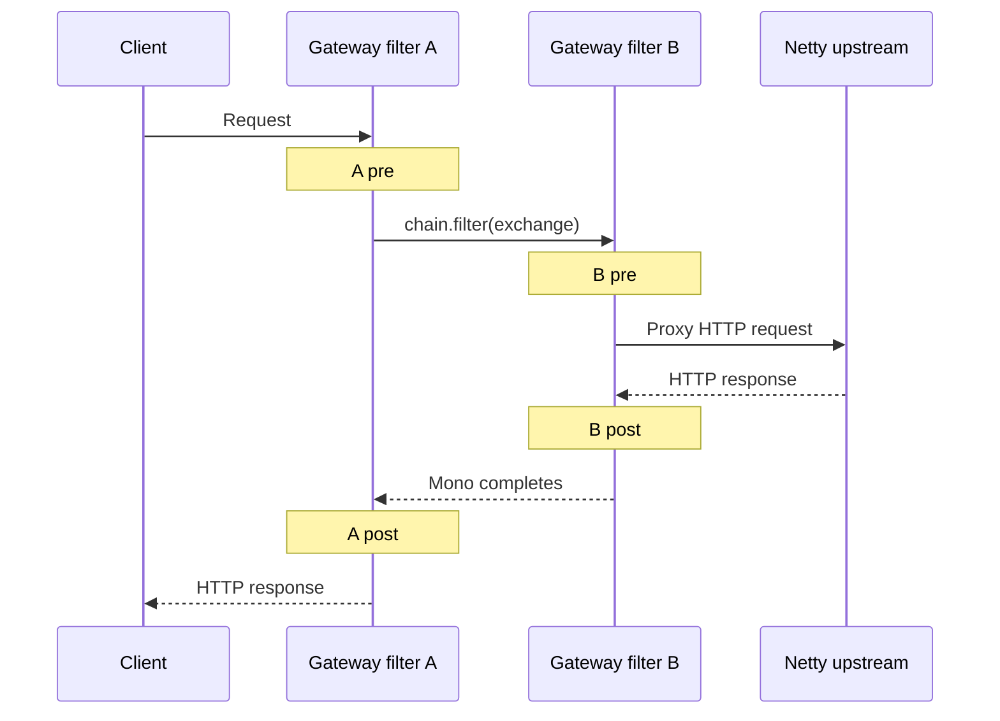

# Kiểm thử hợp đồng của bộ lọc cùng các bộ lọc có sẵn

## 1. Vì sao một custom filter cần kiểm thử "hợp đồng" với các filter khác?

Trong **SPRING_CLOUD_GATEWAY**, một HTTP request có thể đi qua nhiều lớp xử lý: route predicate chọn đường đi, **Spring Security WebFilter** xác thực, các **GatewayFilter** và **GlobalFilter** biến đổi path/header, kiểm soát lưu lượng, xử lý retry/circuit breaker, định tuyến qua `lb://` và Netty HttpClient đến microservice. Hệ thống còn cần TLS, observability và phân quyền tại downstream. Khi viết **custom filter**, việc unit test riêng logic Java chưa đủ: filter đó phải phối hợp đúng với những filter đã có.

Ví dụ route sau cần thực hiện đồng thời:

- Xóa `X-Trace-Proof` do client tự gửi (có thể giả mạo).
- Custom filter `TraceGuard` yêu cầu `X-Correlation-Id` hợp lệ và gắn một `X-Trace-Proof` đã chuẩn hóa xuống upstream.
- `SetRequestHeader` gắn thông tin ngữ cảnh Gateway; `StripPrefix` đổi đường dẫn trước khi proxy.
- `DedupeResponseHeader` loại giá trị response header trùng lặp.
- `AddResponseHeader` thêm marker phản hồi phục vụ chẩn đoán.

Một unit test chỉ chứng minh `TraceGuard` tự tạo header đúng **không thể chứng minh** `StripPrefix` đã xử lý path, giá trị giả mạo đã bị xóa, response header không trùng, không có request bị gửi tới backend khi guard từ chối, hoặc route khác không bị ảnh hưởng.

**Kiểm thử hợp đồng filter** ở đây nghĩa là kiểm chứng các quy tắc quan sát được **qua toàn bộ chuỗi filter**: đầu vào nào được chấp nhận, request thực sự đến backend dưới dạng nào, response nào được gửi cho client, lỗi nào phải dừng ở Gateway và những thuộc tính bảo mật nào phải luôn đúng.

### Mục tiêu học tập

Sau bài học, bạn có thể:

1. Viết một `AbstractGatewayFilterFactory<Config>` đúng quy ước tên và dùng một `GatewayFilter` reactive.
2. Xác định các hợp đồng về request mutation, response mutation, thứ tự filter **pre/post**, short-circuit, lỗi và cancellation.
3. Thiết kế test matrix khi custom filter chạy cùng `RemoveRequestHeader`, `SetRequestHeader`, `StripPrefix`, `DedupeResponseHeader`, `AddResponseHeader`.
4. Unit test custom filter bằng `MockServerWebExchange`, một `GatewayFilterChain` giả và `StepVerifier`.
5. Integration test Gateway HTTP thật bằng `@SpringBootTest(RANDOM_PORT)`, `WebTestClient` và backend Reactor Netty chạy cổng ngẫu nhiên.
6. Kiểm tra không gửi request xuống upstream khi thiếu/không hợp lệ một header bắt buộc và xác minh route isolation.
7. Mở rộng hợp đồng cho `Retry`, `CircuitBreaker`, `RequestRateLimiter`, `LocalResponseCache`, `TokenRelay`, TLS và quan sát request.

> **Phạm vi phiên bản:** ví dụ dùng Spring Boot 3.5.x, Spring Cloud 2025.0.x, **Spring Cloud Gateway Server WebFlux 4.3.x** và JDK 17+. Starter `spring-cloud-starter-gateway-server-webflux`, route YAML dưới `spring.cloud.gateway.server.webflux.routes`. Không áp dụng trực tiếp cho **Gateway Server MVC** (Servlet stack). Các số version `*.0` trong Maven chỉ minh họa một release train tương thích; hãy dùng patch còn được hỗ trợ cho hệ thống thực.

## 2. Hợp đồng của một GatewayFilter gồm những gì?

Một filter thường nhận `ServerWebExchange` và `GatewayFilterChain`, trả về một `Mono<Void>`:

```java
@FunctionalInterface
public interface GatewayFilter {
    Mono<Void> filter(ServerWebExchange exchange, GatewayFilterChain chain);
}
```

Đây là chữ ký **khái quát** để đọc; interface gốc còn có những chi tiết kế thừa theo API của Gateway. Điểm cốt lõi là filter **không trả response body trực tiếp như controller**, mà trả một publisher reactive đại diện cho quá trình xử lý.

| Hợp đồng | Câu hỏi cần kiểm chứng | Ví dụ kỳ vọng |
| --- | --- | --- |
| **Đầu vào** | Header/path/method nào hợp lệ? | `X-Correlation-Id: trace_42` hợp lệ; thiếu hoặc nhiều giá trị bị từ chối. |
| **Request mutation** | Cái gì thực sự tới upstream? | `X-Trace-Proof` do Gateway đặt, không nhận giá trị giả từ client. |
| **Route scope** | Filter chỉ áp dụng route nào? | `TraceGuard` chỉ chạy trên `/api/echo/**`, không chạy trên `/open/**`. |
| **Thứ tự pre/post** | Filter chạy trước/sau builtin nào? | Xóa header giả trước khi custom gắn header chuẩn; path được strip trước HTTP routing. |
| **Short-circuit** | Khi không hợp lệ, có gọi `chain.filter` không? | HTTP 400 tại Gateway, backend counter không tăng. |
| **Response mutation** | Khi response sắp commit, headers có đúng không? | Một `X-Trace-Accepted` và một `X-Contract-Stage` sau dedupe. |
| **HTTP semantics** | Status/body/header giữ được hợp đồng? | Khi hợp lệ, body từ backend; khi bị chặn, không có body backend. |
| **Reactive lifecycle** | Filter có subscribe/block hai lần không? | Không gọi `block()`, không tự `subscribe()`, không lặp chain ngoài chủ đích. |
| **Security** | Có tin dữ liệu client như danh tính không? | Correlation ID chỉ phục vụ chẩn đoán, **không phải authorization principal**. |
| **Observability** | Có thể biết request đã đến backend chưa? | So backend counter với status/header và trace route ID. |

Một **contract test** tốt phải bao gồm **negative cases** — thiếu header, header rỗng, header lặp, nội dung quá dài, route không match — chứ không chỉ happy path `200 OK`.

### 2.1. "Cùng các filter có sẵn" có nghĩa gì?

Gateway cung cấp nhiều filter factory như `StripPrefix`, `RewritePath`, `SetPath`, `AddRequestHeader`, `RemoveRequestHeader`, `SetRequestHeader`, `AddResponseHeader`, `DedupeResponseHeader`, `Retry`, `CircuitBreaker`, `RequestRateLimiter` và `LocalResponseCache`. Mỗi filter có thời điểm thao tác khác nhau và có thể đổi ý nghĩa của request/response mà custom filter nhìn thấy.

Ví dụ:

```text
Client sends:
  GET /api/echo/item-7
  X-Correlation-Id: trace_42
  X-Trace-Proof: attacker-value

After RemoveRequestHeader:
  X-Trace-Proof: <absent>

After custom TraceGuard:
  X-Trace-Proof: trace_42

After SetRequestHeader:
  X-Gateway-Context: contract-lab

After StripPrefix=1:
  GET /echo/item-7  (backend path)

Response:
  Backend: X-Contract-Stage: origin (lặp 2 lần)
  DedupeResponseHeader: chỉ giữ 1 giá trị origin
  AddResponseHeader: X-Builtin-Response: gateway
  Custom beforeCommit: X-Trace-Accepted: trace_42
```

Không thể chỉ nhìn YAML mà bảo đảm tất cả kết quả trên. Phải kiểm thử HTTP thực và đọc rõ filter order.

## 3. Thứ tự pre/post và vòng đời response

Khi một request match route, `FilteringWebHandler` kết hợp các `GlobalFilter` và các `GatewayFilter` thuộc route, **sắp xếp theo `Ordered`**. Filter có độ ưu tiên cao hơn (giá trị order nhỏ hơn) đi trước trong pha **pre**, nhưng chạy sau trong pha **post**.



Với một filter tùy biến:

```java
return (exchange, chain) -> {
    // PRE: kiểm tra/mutate request trước khi đi tiếp.
    ServerHttpRequest request = exchange.getRequest().mutate()
            .header("X-Lab", "value").build();

    return chain.filter(exchange.mutate().request(request).build())
            .then(Mono.fromRunnable(() -> {
                // POST: xử lý khi phần downstream chain hoàn tất thành công.
                // Không mặc định lúc này response headers còn sửa được.
            }));
};
```

Nếu phải gắn header **trước khi response được commit**, cách an toàn hơn là đăng ký callback `exchange.getResponse().beforeCommit(...)` **ở pha pre**. Nếu cố `response.getHeaders().set(...)` sau khi response đã commit, có thể bị bỏ qua hoặc tạo lỗi trạng thái.

### 3.1. Đừng suy thứ tự chỉ từ vị trí trong YAML

Các filter từ route thường được gán order theo vị trí khi xây dựng route, nhưng **combined chain còn gồm GlobalFilter với order riêng**, và các filter tự trả về `OrderedGatewayFilter` có thể thay đổi thứ tự. Một filter response header chạy ở pha **post** có thể thấy khác với filter chạy ở pha **pre**.

Muốn kiểm tra thứ tự thực tế:

1. Xác định các filter có `Ordered` và `getOrder()` của chúng.
2. Xem route ID, route predicates và danh sách filters tại runtime/Actuator (nếu bật với quyền hạn phù hợp).
3. Gửi request vào một backend có ghi lại path/header.
4. So request **client gửi** với request **backend nhận** và response **client nhận**.
5. Khi kết hợp `Retry`/ `CircuitBreaker`, kiểm tra số **downstream attempts**, không chỉ số request từ client.

Với các built-in filter có hậu xử lý headers, thứ tự post theo chiều ngược có thể làm `DedupeResponseHeader` chạy trước khi một filter khác thêm header. Đây là lý do ta cần test response thực thay vì suy đoán từ tên filter.

### 3.2. Khi nào filter được phép dừng chuỗi?

Một guard từ chối đầu vào có thể làm:

```java
exchange.getResponse().setStatusCode(HttpStatus.BAD_REQUEST);
return exchange.getResponse().setComplete();
```

**Không gọi `chain.filter(exchange)`** trong nhánh từ chối. Trong nhánh cho phép, gọi chain **đúng một lần** và trả publisher của nó. Không gọi `chain.filter(...)` rồi tự `subscribe()`: đó là một luồng phụ, phá lifecycle/error/cancellation và có thể gây double proxy.

**Quy tắc:** sau khi đã commit response, không cố ghi tiếp status/header/body. Với lỗi bất đồng bộ sau commit, không thể "quay lại" thay status HTTP một cách an toàn.

## 4. Custom filter của bài: `TraceGuardGatewayFilterFactory`

Bài sử dụng một filter **không làm nhiệm vụ xác thực**: chỉ kiểm tra định dạng `X-Correlation-Id`, loại giá trị trống/lặp/không đúng format, rồi tạo `X-Trace-Proof` để backend biết request đã qua bước xử lý của Gateway.

Điều kiện hợp đồng:

- Header bắt buộc tên `X-Correlation-Id` có **chính xác một giá trị**.
- Giá trị chỉ gồm chữ, số, dấu gạch ngang và gạch dưới; dài **1–32 ký tự**.
- Thiếu, rỗng, whitespace, nhiều giá trị hoặc ký tự khác → `400 Bad Request` **và không gọi downstream**.
- Giá trị hợp lệ → Gateway **set** `X-Trace-Proof` thành chính giá trị đã kiểm tra, không chấp nhận giá trị `X-Trace-Proof` do client tự gửi.
- Trước khi commit response, Gateway đặt `X-Trace-Accepted` bằng correlation ID để test.
- Filter không đọc request body, không block, không tự subscribe, không dùng shared mutable request-specific fields.

**Lưu ý bảo mật:** `X-Correlation-Id` do client chọn **không chứng minh danh tính**. Không được dùng `X-Trace-Proof` làm bằng chứng "người dùng đã đăng nhập", làm key phân quyền hoặc tenant ID. Tên "proof" ở đây chỉ là marker kỹ thuật trong lab, không phải chứng chỉ xác thực.

### 4.1. Code đầy đủ

Tạo `src/main/java/com/example/gateway/TraceGuardGatewayFilterFactory.java` trong một **project thực hành riêng của người học**:

```java
package com.example.gateway;

import java.util.List;
import java.util.regex.Pattern;

import org.springframework.cloud.gateway.filter.GatewayFilter;
import org.springframework.cloud.gateway.filter.factory.AbstractGatewayFilterFactory;
import org.springframework.http.HttpStatus;
import org.springframework.http.server.reactive.ServerHttpRequest;
import org.springframework.stereotype.Component;
import org.springframework.util.StringUtils;
import org.springframework.web.server.ServerWebExchange;

import reactor.core.publisher.Mono;

@Component
public class TraceGuardGatewayFilterFactory
        extends AbstractGatewayFilterFactory<TraceGuardGatewayFilterFactory.Config> {

    private static final Pattern TRACE_FORMAT =
            Pattern.compile("[A-Za-z0-9_-]{1,32}");

    public TraceGuardGatewayFilterFactory() {
        super(Config.class);
    }

    @Override
    public GatewayFilter apply(Config config) {
        if (!StringUtils.hasText(config.getRequiredHeaderName())
                || !StringUtils.hasText(config.getForwardHeaderName())) {
            throw new IllegalArgumentException(
                    "requiredHeaderName and forwardHeaderName are mandatory");
        }

        return (exchange, chain) -> {
            List<String> values = exchange.getRequest().getHeaders()
                    .get(config.getRequiredHeaderName());

            if (values == null || values.size() != 1
                    || !TRACE_FORMAT.matcher(values.get(0)).matches()) {
                exchange.getResponse().setStatusCode(HttpStatus.BAD_REQUEST);
                return exchange.getResponse().setComplete();
            }

            String correlationId = values.get(0);

            ServerHttpRequest request = exchange.getRequest().mutate()
                    .headers(headers -> headers.set(
                            config.getForwardHeaderName(), correlationId))
                    .build();

            ServerWebExchange forwarded = exchange.mutate()
                    .request(request)
                    .build();

            // Đăng ký ở PRE để header được thêm trước khi response commit.
            exchange.getResponse().beforeCommit(() -> {
                exchange.getResponse().getHeaders()
                        .set("X-Trace-Accepted", correlationId);
                return Mono.empty();
            });

            // Nhánh hợp lệ chỉ đi qua downstream chain đúng một lần.
            return chain.filter(forwarded);
        };
    }

    public static class Config {
        private String requiredHeaderName = "X-Correlation-Id";
        private String forwardHeaderName = "X-Trace-Proof";

        public String getRequiredHeaderName() {
            return requiredHeaderName;
        }

        public void setRequiredHeaderName(String requiredHeaderName) {
            this.requiredHeaderName = requiredHeaderName;
        }

        public String getForwardHeaderName() {
            return forwardHeaderName;
        }

        public void setForwardHeaderName(String forwardHeaderName) {
            this.forwardHeaderName = forwardHeaderName;
        }
    }
}
```

**Ghi chú về đăng ký bean:** chỉ cần `@Component` cùng việc Spring Boot quét đúng package là đủ; không phải thêm một annotation `@ComponentScan` riêng cho class này. Khi tổ chức project, giữ class dưới package gốc của `@SpringBootApplication` hoặc package con để Spring tự đăng ký factory bean.

**Tại sao tên class kết thúc bằng `GatewayFilterFactory`?** Gateway suy ra tên filter cấu hình bằng cách bỏ suffix: class `TraceGuardGatewayFilterFactory` được tham chiếu dưới tên **`TraceGuard`**. Đây là quy ước được Developer Guide chính thức khuyến nghị; không nên dùng kiểu đặt tên rút gọn không có suffix vì khả năng bị loại khỏi API tương lai.

### 4.2. Những lựa chọn có chủ đích

| Quyết định | Vì sao? |
| --- | --- |
| `AbstractGatewayFilterFactory<Config>` | Cho phép cấu hình factory theo route thay vì tự kiểm tra string rải rác trong mỗi YAML. |
| `@Component` | Đăng ký Spring bean để Gateway tìm được factory. |
| `Pattern` là `static final` | Dùng immutable regex chung; không giữ request state toàn cục. |
| `values.size() != 1` | Từ chối header lặp trước khi một proxy gộp chúng theo cách khó dự đoán. |
| `TRACE_FORMAT.matcher(...).matches()` | Giới hạn định dạng/độ dài của marker; **không** xác thực principal. |
| `headers.set(...)` | Thay giá trị cũ, không `add` trùng header do client giả mạo. |
| `exchange.mutate()` | Tạo exchange/request mới với headers đã thay, tránh sửa request bất biến trực tiếp. |
| `beforeCommit(...)` | Đảm bảo hook đổi response header chạy ở thời điểm phù hợp. |
| `return chain.filter(forwarded)` | Giữ nguyên lifecycle reactive, error/cancellation và HTTP routing. |
| `setComplete()` khi từ chối | Kết thúc request tại Gateway mà không mở kết nối downstream. |

Code lab không thêm response body cho nhánh 400; điều đó giúp test thấy rõ status/header mà không cần xử lý `DataBuffer`. Trong ứng dụng thật có thể trả JSON error chuẩn, nhưng cần thực hiện đúng content type, encoding, `DataBuffer` lifecycle và không ghi hai lần sau commit.

### 4.3. Hợp đồng lỗi và cancellation

Bên cạnh 400/200, khi downstream trả 500 hoặc bị timeout:

- `TraceGuard` không được nuốt exception rồi tự đổi thành 200.
- `beforeCommit` chỉ chạy **nếu response thực sự chuẩn bị commit**; không nên dựa vào callback để làm cleanup bắt buộc nếu request bị cancel sớm.
- Nếu muốn đo thời gian/thống kê, dùng `doFinally`/`doOnError` một cách có kiểm soát và không block; phân loại error/cancel/complete.
- Tránh giữ `ServerWebExchange` trong map static hoặc scheduler sau response: nó có thể mang headers, token, request body và gây memory leak.
- Khi tích hợp `Retry`, filter có thể được thực thi nhiều lần theo thứ tự bọc chain; **idempotency của header mutation** là cần thiết, không được đếm "một lần" một cách máy móc.

## 5. Ghép custom filter với các built-in filter

Dùng hai routes:

1. `contract-route` tại `/api/echo/**`: có `TraceGuard` và các built-in transforms.
2. `open-route` tại `/open/**`: không có `TraceGuard`, để test **route scope/isolation**.

Cấu hình `src/main/resources/application.yml`:

```yaml
server:
  port: 8080

spring:
  application:
    name: custom-filter-contract-lab

  cloud:
    gateway:
      server:
        webflux:
          routes:
            - id: contract-route
              uri: ${lab.backend.uri:http://127.0.0.1:9001}
              predicates:
                - Path=/api/echo/**
              filters:
                - RemoveRequestHeader=X-Trace-Proof
                - name: TraceGuard
                  args:
                    requiredHeaderName: X-Correlation-Id
                    forwardHeaderName: X-Trace-Proof
                - SetRequestHeader=X-Gateway-Context, contract-lab
                - StripPrefix=1
                - DedupeResponseHeader=X-Contract-Stage, RETAIN_UNIQUE
                - AddResponseHeader=X-Builtin-Response, gateway

            - id: open-route
              uri: ${lab.backend.uri:http://127.0.0.1:9001}
              predicates:
                - Path=/open/**
              filters:
                - RemoveRequestHeader=X-Trace-Proof
                - StripPrefix=1
                - AddResponseHeader=X-Open-Route, yes
```

`lab.backend.uri` là một **property placeholder**: ngoài test nếu chưa khai báo thì dùng mặc định `http://127.0.0.1:9001`. Trong integration test ở mục 8, `@DynamicPropertySource` cấp một địa chỉ backend cổng ngẫu nhiên trước khi Spring khởi tạo routes, tránh phụ thuộc port `9001` cố định.

### 5.1. Tác dụng từng filter và hợp đồng test

| Filter | Tác dụng | Contract assertion |
| --- | --- | --- |
| `RemoveRequestHeader=X-Trace-Proof` | Xóa header client có thể tự gắn. | Backend không thấy `attacker-value`. |
| `TraceGuard` | Reject khi thiếu/sai `X-Correlation-Id`; set `X-Trace-Proof`. | Thiếu → 400/không tới backend; hợp lệ → backend thấy ID chuẩn. |
| `SetRequestHeader=X-Gateway-Context, contract-lab` | **Thay** giá trị header theo cấu hình. | Nếu client gửi `X-Gateway-Context: evil`, backend chỉ thấy `contract-lab`. |
| `StripPrefix=1` | Bỏ một phần đầu đường dẫn. | `/api/echo/item-7` → `/echo/item-7` tại backend. |
| `DedupeResponseHeader=X-Contract-Stage, RETAIN_UNIQUE` | Loại giá trị trùng của một response header. | Backend trả hai lần `origin`; client chỉ nhận một lần. |
| `AddResponseHeader=X-Builtin-Response, gateway` | Thêm header ở response từ route. | Client có `X-Builtin-Response: gateway`. |
| `open-route` | Route không gắn custom guard. | Không cần `X-Correlation-Id`; không có `X-Trace-Accepted`. |

Ở route `open-route`, `RemoveRequestHeader=X-Trace-Proof` vẫn được đặt để tránh vô tình chuyển một header trông giống "đã qua Gateway" tới service. **Đừng suy rằng route không gắn `TraceGuard` sẽ tự được bảo vệ khỏi identity spoofing**; cần thống nhất trust boundary cho tất cả routes.

### 5.2. Phân biệt `SetRequestHeader` với `AddRequestHeader`

- `SetRequestHeader` thay thế các giá trị hiện có của cùng header. Phù hợp khi Gateway phải **ghi đè** một metadata nội bộ đã được kiểm soát.
- `AddRequestHeader` bổ sung giá trị, có thể tạo **nhiều giá trị** nếu client hoặc filter khác đã đặt header cùng tên.
- `RemoveRequestHeader` xóa header trước khi đến downstream nếu filter được thực hiện ở đúng vị trí.

Với một header mang ý nghĩa danh tính hoặc quyết định bảo mật, **không chỉ "add" một giá trị tin cậy bên cạnh giá trị giả do client gửi**. Phải xóa/ghi đè nguồn không tin cậy và vẫn bảo vệ kênh Gateway → downstream bằng TLS/mTLS/network policy phù hợp.

### 5.3. Phân biệt header ở pre và post

`RemoveRequestHeader`, `SetRequestHeader` và `StripPrefix` chủ yếu tác động request **trước khi proxy**. `DedupeResponseHeader`, `AddResponseHeader` và callback `beforeCommit` tác động **response** ở những giai đoạn khác nhau. Vì post order có thể đảo so với pre order, thay đổi thứ tự của một filter liên quan response có thể thay đổi kết quả cuối — cần test lại mỗi khi thêm `SetResponseHeader`, `SecureHeaders`, CORS hoặc custom response filter.

**Đừng chỉ so `exchange.getRequest()` bên trong custom filter rồi kết luận backend đã nhận request đã mutate**: các built-in filter tiếp theo có thể tiếp tục đổi nó. Backend capture mới là bằng chứng ở ranh giới proxy.

## 6. Project thực hành và dependency Maven

Dựng một Gateway Spring Boot độc lập với **JDK 17+, Maven**. Ví dụ `pom.xml` dùng Spring Boot `3.5.0` và Spring Cloud BOM `2025.0.0` để minh họa compatibility của nhánh WebFlux 4.3; trên production hãy chọn phiên bản vá còn được hỗ trợ thay vì cố giữ các bản `*.0`.

```xml
<?xml version="1.0" encoding="UTF-8"?>
<project xmlns="http://maven.apache.org/POM/4.0.0"
         xmlns:xsi="http://www.w3.org/2001/XMLSchema-instance"
         xsi:schemaLocation="http://maven.apache.org/POM/4.0.0
                             https://maven.apache.org/xsd/maven-4.0.0.xsd">
    <modelVersion>4.0.0</modelVersion>

    <parent>
        <groupId>org.springframework.boot</groupId>
        <artifactId>spring-boot-starter-parent</artifactId>
        <version>3.5.0</version>
        <relativePath/>
    </parent>

    <groupId>com.example</groupId>
    <artifactId>custom-filter-contract-lab</artifactId>
    <version>0.0.1-SNAPSHOT</version>

    <properties>
        <java.version>17</java.version>
    </properties>

    <dependencyManagement>
        <dependencies>
            <dependency>
                <groupId>org.springframework.cloud</groupId>
                <artifactId>spring-cloud-dependencies</artifactId>
                <version>2025.0.0</version>
                <type>pom</type>
                <scope>import</scope>
            </dependency>
        </dependencies>
    </dependencyManagement>

    <dependencies>
        <dependency>
            <groupId>org.springframework.cloud</groupId>
            <artifactId>spring-cloud-starter-gateway-server-webflux</artifactId>
        </dependency>
        <dependency>
            <groupId>org.springframework.boot</groupId>
            <artifactId>spring-boot-starter-test</artifactId>
            <scope>test</scope>
        </dependency>
        <dependency>
            <groupId>io.projectreactor</groupId>
            <artifactId>reactor-test</artifactId>
            <scope>test</scope>
        </dependency>
    </dependencies>

    <build>
        <plugins>
            <plugin>
                <groupId>org.springframework.boot</groupId>
                <artifactId>spring-boot-maven-plugin</artifactId>
            </plugin>
        </plugins>
    </build>
</project>
```

Tạo entry point `src/main/java/com/example/gateway/GatewayApplication.java`:

```java
package com.example.gateway;

import org.springframework.boot.SpringApplication;
import org.springframework.boot.autoconfigure.SpringBootApplication;

@SpringBootApplication
public class GatewayApplication {
    public static void main(String[] args) {
        SpringApplication.run(GatewayApplication.class, args);
    }
}
```

Đặt YAML ở mục 5 trong `src/main/resources/application.yml` và class `TraceGuardGatewayFilterFactory` ở đúng package. Không thêm `spring-boot-starter-web`: đây là **Gateway Server WebFlux**, không phải Servlet/MVC. `spring-boot-starter-test` và `reactor-test` chỉ cần cho tests.

**Phân biệt các kiểu test:**

| Loại test | Chạy gì? | Khẳng định được | Không khẳng định được |
| --- | --- | --- | --- |
| Unit test factory/filter | `MockServerWebExchange` và fake chain | Branching, mutation, short-circuit, reactive completion. | HTTP routing và built-in order thực tế. |
| WebFlux slice test | `WebTestClient` với mock web context | Handler/security logic nếu được import đúng. | Không mặc định có route mapping, Gateway Netty routing và backend thật. |
| **Integration test** | Boot Gateway ngẫu nhiên port + real HTTP backend | Route binding, built-in transforms, response, request counter. | Không tự chứng minh security policies/Redis/TLS production nếu không cấu hình chúng. |
| E2E staging | Ingress, IdP, Redis/LoadBalancer, TLS thật | Trust boundaries, latency, error paths, multi-instance. | Không thay thế unit tests xác định nguyên nhân chi tiết. |

Ở mục sau, chúng ta làm **cả unit và integration test**; không dùng một loại để thay thế loại còn lại.

## 7. Unit test hợp đồng của `TraceGuard`

Unit test dùng `MockServerWebExchange`, `MockServerHttpRequest`, `GatewayFilterChain` giả và `StepVerifier`. Mục đích là chứng minh **nhánh từ chối không gọi chain**, nhánh cho phép mutate header đúng, không cần chạy backend thật.

Tạo `src/test/java/com/example/gateway/TraceGuardUnitTest.java`:

```java
package com.example.gateway;

import java.util.concurrent.atomic.AtomicInteger;

import org.junit.jupiter.api.Test;
import org.springframework.cloud.gateway.filter.GatewayFilter;
import org.springframework.cloud.gateway.filter.GatewayFilterChain;
import org.springframework.http.HttpStatus;
import org.springframework.mock.http.server.reactive.MockServerHttpRequest;
import org.springframework.mock.web.server.MockServerWebExchange;

import reactor.core.publisher.Mono;
import reactor.test.StepVerifier;

import static org.assertj.core.api.Assertions.assertThat;

class TraceGuardUnitTest {

    private final TraceGuardGatewayFilterFactory factory =
            new TraceGuardGatewayFilterFactory();

    private final GatewayFilter filter = factory.apply(
            new TraceGuardGatewayFilterFactory.Config());

    @Test
    void missingHeaderStopsChain() {
        var request = MockServerHttpRequest
                .get("/api/echo/item-7")
                .build();
        var exchange = MockServerWebExchange.from(request);

        AtomicInteger downstreamCalls = new AtomicInteger();

        GatewayFilterChain next = ex -> {
            downstreamCalls.incrementAndGet();
            return Mono.empty();
        };

        StepVerifier.create(filter.filter(exchange, next))
                .verifyComplete();

        assertThat(exchange.getResponse().getStatusCode())
                .isEqualTo(HttpStatus.BAD_REQUEST);
        assertThat(downstreamCalls.get()).isZero();
    }

    @Test
    void duplicateHeaderValuesAreRejected() {
        var request = MockServerHttpRequest
                .get("/api/echo/item-7")
                .header("X-Correlation-Id", "trace_a", "trace_b")
                .build();
        var exchange = MockServerWebExchange.from(request);

        AtomicInteger downstreamCalls = new AtomicInteger();

        StepVerifier.create(filter.filter(exchange, ex -> {
            downstreamCalls.incrementAndGet();
            return Mono.empty();
        })).verifyComplete();

        assertThat(exchange.getResponse().getStatusCode())
                .isEqualTo(HttpStatus.BAD_REQUEST);
        assertThat(downstreamCalls.get()).isZero();
    }

    @Test
    void validHeaderOverwritesClientForgedHeaderAndCommitsMarker() {
        var request = MockServerHttpRequest
                .get("/api/echo/item-7")
                .header("X-Correlation-Id", "trace_42")
                .header("X-Trace-Proof", "attacker-value")
                .build();
        var exchange = MockServerWebExchange.from(request);

        AtomicInteger downstreamCalls = new AtomicInteger();

        GatewayFilterChain next = ex -> {
            downstreamCalls.incrementAndGet();

            assertThat(ex.getRequest().getHeaders()
                    .getFirst("X-Trace-Proof"))
                    .isEqualTo("trace_42");

            // Mô phỏng downstream đã hoàn thành response.
            return ex.getResponse().setComplete();
        };

        StepVerifier.create(filter.filter(exchange, next))
                .verifyComplete();

        assertThat(downstreamCalls.get()).isEqualTo(1);
        assertThat(exchange.getResponse().getHeaders()
                .getFirst("X-Trace-Accepted"))
                .isEqualTo("trace_42");
    }

    @Test
    void invalidCharactersDoNotContinue() {
        var request = MockServerHttpRequest
                .get("/api/echo/item-7")
                .header("X-Correlation-Id", "hello with spaces")
                .build();
        var exchange = MockServerWebExchange.from(request);

        AtomicInteger downstreamCalls = new AtomicInteger();

        StepVerifier.create(filter.filter(exchange, ex -> {
            downstreamCalls.incrementAndGet();
            return Mono.empty();
        })).verifyComplete();

        assertThat(exchange.getResponse().getStatusCode())
                .isEqualTo(HttpStatus.BAD_REQUEST);
        assertThat(downstreamCalls.get()).isZero();
    }
}
```

### 7.1. Các assertion nói lên điều gì?

- `missingHeaderStopsChain`: không có header → 400 và **0 lần** đi tiếp. Nó kiểm tra nhánh short-circuit trực tiếp, không chỉ status.
- `duplicateHeaderValuesAreRejected`: tránh xử lý mơ hồ khi HTTP client/proxy gửi nhiều giá trị cùng tên.
- `validHeaderOverwritesClientForgedHeaderAndCommitsMarker`: filter dùng `set`, không dùng `add`; `beforeCommit` tạo marker khi response hoàn tất.
- `invalidCharactersDoNotContinue`: input sai format không vào downstream.
- `StepVerifier` kiểm tra publisher **complete**. Không biến test thành `filter.filter(...).subscribe()` rồi assert ngay; asynchronous work có thể chưa xong.

**Giới hạn của unit test:** fake chain không thực thi `StripPrefix`, Netty routing, `DedupeResponseHeader` hoặc một HTTP backend thật. Nó không phát hiện được YAML viết sai tên factory, cấu hình bean không được scan hoặc filter order bị khác ở runtime.

### 7.2. Những case nên bổ sung

Đối với factory cần tính ổn định lâu dài, mở rộng unit tests:

| Input hoặc tình huống | Kỳ vọng |
| --- | --- |
| `X-Correlation-Id` không tồn tại | 400; chain 0 lần. |
| Header rỗng hoặc toàn whitespace | 400; chain 0 lần. |
| Header hơn 32 ký tự | 400; chain 0 lần. |
| Hai giá trị `X-Correlation-Id` | 400; chain 0 lần. |
| Một giá trị ký tự lạ như `trace/a` | 400; chain 0 lần. |
| Một giá trị hợp lệ `trace_42` | Chain đúng 1 lần; request header được set. |
| Client có `X-Trace-Proof: attacker-value` | Giá trị vào downstream được thay bằng `trace_42`. |
| Config thiếu tên header bắt buộc | `IllegalArgumentException` ở `apply`, không đợi tới request đầu. |
| Downstream publisher báo lỗi | Không nuốt exception; caller có thể xử lý đúng. |
| Downstream bị cancel | Không subscribe phụ, không giữ exchange trong bộ nhớ. |
| Response commit đã xảy ra | Không ghi tiếp header/status tùy tiện; nếu cần dùng hook `beforeCommit`. |

Các test này không nhất thiết phải nằm trong cùng một class lớn; có thể dùng JUnit `@ParameterizedTest` để giảm trùng lặp nhưng vẫn phải assert chính xác **status + số lần gọi chain + headers**.

## 8. Integration test: custom filter cùng built-in filters trên HTTP thật

Đây là phép thử quan trọng nhất của bài. Nó khởi động **Gateway thực** tại cổng ngẫu nhiên, đồng thời khởi động một HTTP backend **Reactor Netty** cổng ngẫu nhiên trong cùng JVM test. Không cần Docker, Redis, IdP hay service discovery cho kịch bản cơ sở.

Test sẽ quan sát request thực đi qua:

```mermaid
sequenceDiagram
    participant T as WebTestClient
    participant G as Gateway HTTP server
    participant F as TraceGuard + Built-in filters
    participant U as Embedded Netty backend

    T->>G: GET /api/echo/item-7 + valid trace + forged headers
    G->>F: Route contract-route
    F->>F: Remove, validate, SetRequestHeader, StripPrefix
    F->>U: GET /echo/item-7; X-Trace-Proof=trace_42
    U-->>F: 200; repeated X-Contract-Stage headers
    F->>F: DedupeResponseHeader; AddResponseHeader; beforeCommit
    F-->>T: 200 + sanitized trace + unique response header

    T->>G: GET /api/echo/item-7 without trace
    G->>F: TraceGuard rejects
    F-->>T: 400; backend receives no request
```

### 8.1. Vì sao chọn `@SpringBootTest(RANDOM_PORT)`?

- Nó khởi tạo toàn bộ `ApplicationContext`, route binding và factory beans.
- Gateway thực sự nhận request HTTP qua Reactor Netty.
- `WebTestClient` có thể gửi HTTP và assert status, headers, body.
- Backend test ghi lại những gì **Netty HttpClient của Gateway** thật sự gửi xuống, không chỉ một mock exchange ở giữa chain.
- Port ngẫu nhiên tránh đụng các dịch vụ đang lắng nghe `8080`/`9001` trên máy phát triển.
- Khi test fail, ta có thể tách: lỗi YAML/route, lỗi custom filter, lỗi built-in hoặc lỗi proxy outbound.

Boot 3.5 dùng import `org.springframework.boot.test.autoconfigure.web.reactive.AutoConfigureWebTestClient`. Đừng copy nhầm import từ Spring Boot 4.x nếu bài lab dùng 3.5.x.

### 8.2. Code integration test

Tạo `src/test/java/com/example/gateway/TraceGuardIntegrationTest.java`:

```java
package com.example.gateway;

import java.util.concurrent.atomic.AtomicInteger;

import org.junit.jupiter.api.AfterAll;
import org.junit.jupiter.api.Test;
import org.springframework.beans.factory.annotation.Autowired;
import org.springframework.boot.test.autoconfigure.web.reactive.AutoConfigureWebTestClient;
import org.springframework.boot.test.context.SpringBootTest;
import org.springframework.test.context.DynamicPropertyRegistry;
import org.springframework.test.context.DynamicPropertySource;
import org.springframework.test.web.reactive.server.WebTestClient;

import reactor.core.publisher.Mono;
import reactor.netty.DisposableServer;
import reactor.netty.http.server.HttpServer;

import static org.assertj.core.api.Assertions.assertThat;

@SpringBootTest(webEnvironment = SpringBootTest.WebEnvironment.RANDOM_PORT)
@AutoConfigureWebTestClient
class TraceGuardIntegrationTest {

    private static final AtomicInteger UPSTREAM_CALLS =
            new AtomicInteger();

    // Static startup chạy trước khi DynamicPropertySource cần port.
    private static final DisposableServer BACKEND = HttpServer.create()
            .host("127.0.0.1")
            .port(0)
            .handle((request, response) -> {
                int callNo = UPSTREAM_CALLS.incrementAndGet();

                String trace = request.requestHeaders()
                        .get("X-Trace-Proof");
                String context = request.requestHeaders()
                        .get("X-Gateway-Context");

                // Cố tình trả hai giá trị giống nhau để thử Dedupe.
                response.responseHeaders().add(
                        "X-Contract-Stage", "origin");
                response.responseHeaders().add(
                        "X-Contract-Stage", "origin");

                return response.status(200)
                        .header("X-Upstream-Path", request.path())
                        .header("X-Upstream-Trace",
                                trace == null ? "missing" : trace)
                        .header("X-Upstream-Context",
                                context == null ? "missing" : context)
                        .header("X-Upstream-Call-No",
                                Integer.toString(callNo))
                        .sendString(Mono.just(
                                "echo path=" + request.path()))
                        .then();
            })
            .bindNow();

    @DynamicPropertySource
    static void upstreamUri(DynamicPropertyRegistry registry) {
        registry.add("lab.backend.uri", () ->
                "http://127.0.0.1:" + BACKEND.port());
    }

    @Autowired
    WebTestClient client;

    @AfterAll
    static void shutdownBackend() {
        BACKEND.disposeNow();
    }

    @Test
    void validTraceWorksAcrossCustomAndBuiltinFilters() {
        int before = UPSTREAM_CALLS.get();

        var result = client.get()
                .uri("/api/echo/item-7")
                .header("X-Correlation-Id", "trace_42")
                .header("X-Trace-Proof", "attacker-value")
                .header("X-Gateway-Context", "attacker-context")
                .exchange()
                .expectStatus().isOk()
                .expectHeader().valueEquals(
                        "X-Upstream-Path", "/echo/item-7")
                .expectHeader().valueEquals(
                        "X-Upstream-Trace", "trace_42")
                .expectHeader().valueEquals(
                        "X-Upstream-Context", "contract-lab")
                .expectHeader().valueEquals(
                        "X-Trace-Accepted", "trace_42")
                .expectHeader().valueEquals(
                        "X-Builtin-Response", "gateway")
                .expectBody(String.class)
                .isEqualTo("echo path=/echo/item-7")
                .returnResult();

        assertThat(result.getResponseHeaders()
                .get("X-Contract-Stage"))
                .containsExactly("origin");

        assertThat(UPSTREAM_CALLS.get()).isEqualTo(before + 1);
    }

    @Test
    void missingTraceStopsBeforeBackend() {
        int before = UPSTREAM_CALLS.get();

        client.get()
                .uri("/api/echo/item-7")
                .exchange()
                .expectStatus().isBadRequest()
                .expectHeader().doesNotExist("X-Trace-Accepted");

        assertThat(UPSTREAM_CALLS.get()).isEqualTo(before);
    }

    @Test
    void duplicateTraceIsRejectedBeforeBackend() {
        int before = UPSTREAM_CALLS.get();

        client.get()
                .uri("/api/echo/item-7")
                .header("X-Correlation-Id", "trace_a", "trace_b")
                .exchange()
                .expectStatus().isBadRequest();

        assertThat(UPSTREAM_CALLS.get()).isEqualTo(before);
    }

    @Test
    void otherRouteIsNotProtectedByTraceGuard() {
        int before = UPSTREAM_CALLS.get();

        client.get()
                .uri("/open/echo/item-7")
                .header("X-Trace-Proof", "attacker-value")
                .exchange()
                .expectStatus().isOk()
                .expectHeader().valueEquals(
                        "X-Upstream-Path", "/echo/item-7")
                .expectHeader().valueEquals(
                        "X-Upstream-Trace", "missing")
                .expectHeader().valueEquals(
                        "X-Open-Route", "yes")
                .expectHeader().doesNotExist("X-Trace-Accepted");

        assertThat(UPSTREAM_CALLS.get()).isEqualTo(before + 1);
    }

    @Test
    void unmatchedPathDoesNotReachBackend() {
        int before = UPSTREAM_CALLS.get();

        client.get()
                .uri("/no-route")
                .exchange()
                .expectStatus().isNotFound();

        assertThat(UPSTREAM_CALLS.get()).isEqualTo(before);
    }
}
```

### 8.3. Test nhận biết từng hợp đồng như thế nào?

| Assertion | Chứng minh điều gì? | Nếu fail, xem ở đâu? |
| --- | --- | --- |
| `X-Upstream-Path=/echo/item-7` | `StripPrefix=1` có tác dụng **trước Netty routing**. | Path predicate, StripPrefix, route selection. |
| `X-Upstream-Trace=trace_42` | Client-forged `X-Trace-Proof` đã được thay. | RemoveRequestHeader, custom mutation, order. |
| `X-Upstream-Context=contract-lab` | `SetRequestHeader` ghi đè `attacker-context`. | Tên header, filter config, priority. |
| `X-Trace-Accepted=trace_42` | `beforeCommit` của custom filter thêm response marker. | Hook đăng ký quá muộn hoặc response đã commit. |
| `X-Builtin-Response=gateway` | `AddResponseHeader` của route có tác dụng. | Filter name/config và response phase. |
| `X-Contract-Stage` chỉ có `origin` một lần | `DedupeResponseHeader=..., RETAIN_UNIQUE` xử lý hai giá trị upstream giống nhau. | Header name, dedupe strategy, post ordering. |
| Upstream counter tăng 1 ở happy path | Đúng một HTTP request đến backend. | Double subscribe/proxy/retry không mong đợi. |
| Missing/duplicate trace → 400, counter không tăng | Short-circuit thật, không chỉ đổi status rồi tiếp tục proxy. | Nhánh `setComplete()` và `chain.filter`. |
| `/open/**` không cần trace | Custom factory không chạy ngoài route đã gắn. | Route ID, GlobalFilter ngoài ý muốn. |
| `/no-route` → 404, counter không tăng | Request không khớp routes; lỗi không phải 400 của guard. | Route predicates hoặc handler khác. |

### 8.4. Giới hạn và điều kiện để test ổn định

- Test backend **bind cổng ngẫu nhiên** bằng `.port(0).bindNow()` khi class load, để `@DynamicPropertySource` có địa chỉ hợp lệ.
- `lab.backend.uri` trong YAML được điền trước khi Gateway khởi tạo routes; chạy từ project có **cả YAML và Java code** của bài.
- `UPSTREAM_CALLS` là một counter cho test; các assertions giả định tests không chạy **song song**. Nếu dự án bật JUnit parallel execution, dùng cấu hình tuần tự/isolated state hoặc tách counter theo request ID.
- Backend test chỉ là một HTTP echo server; nó không thực hiện authentication và không mô phỏng TLS/discovery. Hãy mở rộng riêng cho những feature đó.
- Bản test chạy HTTP thật nhưng không cần phải kiểm tra URL bằng screenshot hoặc test controller bằng `MockMvc`: Gateway WebFlux dùng **WebTestClient**.
- Một số môi trường CI giới hạn mở socket loopback. Nếu CI cấm bind cổng, dùng test slice thuần mock cho unit test nhưng **không tuyên bố đã kiểm chứng Netty HTTP routing**.

Chạy các test tại project của người học:

```bash
mvn -Dtest=TraceGuardUnitTest,TraceGuardIntegrationTest test
```

Với Maven Wrapper:

```bash
./mvnw -Dtest=TraceGuardUnitTest,TraceGuardIntegrationTest test
```

**Lưu ý phạm vi tác vụ:** các lệnh trên là hướng dẫn **người học chạy trong dự án lab riêng**, không phải lệnh worker chạy trên repository `java-learning`. Vòng STEP 4 chỉ soạn/ghi Markdown; Content QA chuyên môn và build của nền tảng thuộc giai đoạn sau.

## 9. Kiểm thử thủ công bằng `curl` và EchoBackend JDK

Integration test ở mục 8 là đường khuyến nghị vì tự khởi động backend và tránh port conflict. Nếu muốn quan sát trực tiếp từng HTTP request bằng terminal, tạo một Echo server đơn giản trên **máy học tập**, không chép vào repository bài viết.

Tạo `EchoBackend.java` **ngoài source của Gateway**:

```java
import com.sun.net.httpserver.HttpServer;
import java.net.InetSocketAddress;
import java.nio.charset.StandardCharsets;
import java.util.concurrent.atomic.AtomicInteger;

public class EchoBackend {

    public static void main(String[] args) throws Exception {
        AtomicInteger counter = new AtomicInteger();

        HttpServer server = HttpServer.create(
                new InetSocketAddress("127.0.0.1", 9001), 0);

        server.createContext("/", exchange -> {
            int call = counter.incrementAndGet();
            String path = exchange.getRequestURI().getRawPath();
            String trace = exchange.getRequestHeaders()
                    .getFirst("X-Trace-Proof");
            String context = exchange.getRequestHeaders()
                    .getFirst("X-Gateway-Context");

            var responseHeaders = exchange.getResponseHeaders();
            responseHeaders.set("Content-Type",
                    "text/plain; charset=UTF-8");
            responseHeaders.set("X-Upstream-Path", path);
            responseHeaders.set("X-Upstream-Trace",
                    trace == null ? "missing" : trace);
            responseHeaders.set("X-Upstream-Context",
                    context == null ? "missing" : context);
            responseHeaders.add("X-Contract-Stage", "origin");
            responseHeaders.add("X-Contract-Stage", "origin");

            byte[] bytes = ("echo path=" + path)
                    .getBytes(StandardCharsets.UTF_8);

            System.out.println("UPSTREAM #" + call + " path="
                    + path + " trace=" + trace);

            exchange.sendResponseHeaders(200, bytes.length);
            try (var body = exchange.getResponseBody()) {
                body.write(bytes);
            }
        });

        server.start();
        System.out.println("EchoBackend listening at 127.0.0.1:9001");
    }
}
```

Ở **terminal A**:

```bash
java EchoBackend.java
```

Ở **terminal B**, từ project Gateway:

```bash
mvn spring-boot:run
```

Trong trường hợp này YAML `uri: ${lab.backend.uri:http://127.0.0.1:9001}` dùng giá trị fallback `http://127.0.0.1:9001` vì không có `lab.backend.uri` được cấp.

### 9.1. Happy path có header giả

```bash
curl -i \
  -H "X-Correlation-Id: trace_42" \
  -H "X-Trace-Proof: attacker-value" \
  -H "X-Gateway-Context: attacker-context" \
  "http://127.0.0.1:8080/api/echo/item-7"
```

Kỳ vọng response có:

```http
HTTP/1.1 200 OK
X-Upstream-Path: /echo/item-7
X-Upstream-Trace: trace_42
X-Upstream-Context: contract-lab
X-Trace-Accepted: trace_42
X-Builtin-Response: gateway
X-Contract-Stage: origin

echo path=/echo/item-7
```

Các header có thể xuất hiện theo thứ tự khác; không so sánh thứ tự headers nguyên văn. Hai giá trị `X-Contract-Stage: origin` do backend phát được filter `DedupeResponseHeader` giữ lại **một**. Terminal backend có **một** dòng `UPSTREAM` mới.

### 9.2. Missing/invalid → Gateway từ chối

```bash
curl -i "http://127.0.0.1:8080/api/echo/item-7"

curl -i \
  -H "X-Correlation-Id: bad trace with spaces" \
  "http://127.0.0.1:8080/api/echo/item-7"
```

Kỳ vọng 400, **không có** thêm dòng `UPSTREAM`. Nếu backend counter vẫn tăng, custom filter có thể đã gọi chain trong nhánh từ chối hoặc route không phải route được nghĩ tới.

### 9.3. Route không gắn guard

```bash
curl -i \
  -H "X-Trace-Proof: attacker-value" \
  "http://127.0.0.1:8080/open/echo/item-7"
```

Kỳ vọng 200, có `X-Open-Route: yes`, **không** có `X-Trace-Accepted`; backend thấy `X-Trace-Proof` không tồn tại vì `open-route` cũng dùng built-in `RemoveRequestHeader`.

### 9.4. Kiểm tra thiếu route

```bash
curl -i "http://127.0.0.1:8080/no-route"
```

Nếu không có handler hoặc security rule khác, thường nhận 404. Đây khác với 400 của `TraceGuard`: filter route không chạy khi route không được chọn.

## 10. Biến thể hợp đồng khi bổ sung các filter khác

Bài lab gốc chưa dùng mọi filter của Spring Cloud Gateway. Khi mở rộng hệ thống, phải xác định lại contract theo **trạng thái/đường đi request** chứ không chỉ nhìn tên filter.

| Built-in filter hoặc tầng xử lý | Tương tác với custom filter | Những test nên bổ sung |
| --- | --- | --- |
| `RewritePath`, `SetPath`, `PrefixPath` | Chỉnh path trước khi proxy; có thể ảnh hưởng điều kiện custom nếu nó đọc path. | Original path, forwarded path, path traversal/encoding và regex group. |
| `RemoveRequestHeader` | Bỏ giá trị không đáng tin. | Header client giả không vào backend; thứ tự trước/sau custom. |
| `AddRequestHeader`, `SetRequestHeader` | Thêm so với ghi đè; có thể tạo header nhiều giá trị. | Backend nhận đúng 1 giá trị cho header bảo mật, không có giá trị giả. |
| `AddResponseHeader`, `SetResponseHeader` | Thay đổi response trong post phase. | Header tồn tại một lần, đúng giá trị, được ghi trước commit. |
| `DedupeResponseHeader` | Xử lý duplicate header values. | `RETAIN_FIRST`, `RETAIN_LAST`, `RETAIN_UNIQUE` và thứ tự post. |
| `RequestRateLimiter` | Có thể chặn request trước khi đến backend. | 429 và upstream counter = 0; limiter key có nguồn đáng tin. |
| `CircuitBreaker` / `fallbackUri` | Có thể short-circuit khi OPEN hoặc forward đến handler fallback. | Backend counter, fallback status, exception propagation, no data leakage. |
| `Retry` | Có thể thực thi một phần downstream chain nhiều lần. | Số attempts, idempotency, body replay, không nhân đôi custom side effect. |
| `LocalResponseCache` | Cache hit có thể tránh Netty routing. | Backend counter không tăng ở hit; auth/quota không bị bypass; không cache private data. |
| `TokenRelay` | Đưa access token xuống backend khi OAuth2 Client được cấu hình. | Token đúng audience/scope, không log; backend vẫn verify token. |
| `SaveSession` | Có thể cần khi session state phải được lưu trước khi proxy. | Session/authorized client lifecycle và side effect trên request. |
| `SecureHeaders` / CORS | Thêm/chỉnh response headers bảo mật. | Không duplicate/conflict security headers, không mở origin ngoài chính sách. |
| `lb://service-id` | Chọn instance backend sau route mapping. | Header/path vẫn đúng ở mọi replica; không tin Host được client giả. |
| TLS/mTLS outbound | Bảo vệ và xác minh peer ở chặng Gateway → backend. | CA/hostname/SAN đúng, không bypass TLS khi custom filter chạy. |

Các filter có thể có **order mặc định hoặc order riêng**. Khi thêm một filter, cập nhật ít nhất một integration test kiểm tra giá trị **backend nhận** và một negative test kiểm tra điều kiện **không được** chuyển request. Với thay đổi liên quan response, thêm assertion sau khi response đã được commit hoặc dùng client HTTP thật.

### 10.1. Ví dụ với Retry: "đúng một lần" không phải lúc nào cũng là một HTTP attempt

Giả sử một request GET đi qua custom filter và `Retry`:

```text
Client request: 1

Gateway TraceGuard:
  Kiểm tra correlation ID và set header

Gateway Retry:
  Attempt 1 -> backend 503
  Attempt 2 -> backend 503
  Attempt 3 -> backend 200

Client response: 200
Backend request count: 3
```

Theo vị trí của `Retry` trong combined chain, một custom filter có thể được chạy **một lần cho logical request** hoặc được **chạy lại cho từng attempt**. Vì vậy:

- Không dùng counter global không thread-safe để tạo header rồi mong nó luôn một lần.
- Nếu filter phát sinh side effect (ghi DB, gửi message, thanh toán), phải thiết kế **idempotency key** và tránh làm trong filter nếu không cần.
- Test **số upstream attempts và số side effects**; không chỉ assert response cuối 200.
- Không retry mù quáng POST/PATCH không idempotent hoặc mọi 4xx (như 401/403/429).
- Xem raw response body, method, request body caching và cancellation; replay body không phải chuyện miễn phí.

### 10.2. Ví dụ với CircuitBreaker và fallback

Khi backend đang lỗi, `CircuitBreaker` có thể tạo response fallback mà không proxy. Nhưng một **fallback 503** có thể xảy ra **sau khi đã gọi backend thất bại lúc breaker CLOSED**, hoặc **trước khi gọi** khi breaker OPEN.

Hợp đồng cần kiểm tra: status fallback đúng; backend counter phản ánh OPEN/half-open; custom filter không biến fallback thành response thành công giả; fallback không bỏ qua xác thực/phân quyền. Một custom filter chỉ thấy một response 503 **không đủ** để kết luận breaker OPEN.

### 10.3. Ví dụ với RateLimiter và SecurityWebFilterChain

```text
Spring Security WebFilter
    | verify JWT/session + coarse authorization
    v
Gateway Route + RequestRateLimiter
    | resolve trusted key, check quota
    v
Custom filter + Gateway transformations
    v
Netty upstream routing
```

Đây là **sơ đồ mục tiêu thiết kế**, không phải bảo đảm mọi filter order của mọi dự án. Nếu identity không hợp lệ, Spring Security có thể trả 401/403 **trước Gateway route filter**. Nếu quota hết, `RequestRateLimiter` thường trả 429 khi có key. Custom guard của lab dùng 400 cho correlation ID thiếu/sai. Trong integration tests, phân biệt **nguồn gốc status**:

- 400: input validation của `TraceGuard`.
- 401/403: authentication/authorization hoặc một custom rule khác.
- 429: rate limiting.
- 5xx: upstream/proxy timeout/circuit breaker, không mặc định do custom filter.

Nếu request không tới backend, cần xác định filter nào short-circuit, không chỉ nhìn client status.

## 11. Hợp đồng liên quan response lifecycle và tính reactive

### 11.1. Đừng sửa response sau khi đã commit

Trong WebFlux, `ServerHttpResponse` có một lifecycle: đặt status/headers → commit → ghi body. Khi response đã commit, filter không thể tùy ý thêm header hoặc thay status như khi còn ở pha pre.

Mẫu nên dùng nếu custom filter phải thêm header:

```java
exchange.getResponse().beforeCommit(() -> {
    exchange.getResponse().getHeaders()
            .set("X-Contract-Marker", "processed");
    return Mono.empty();
});
return chain.filter(exchange);
```

Mẫu **cần tránh** khi không biết chắc response còn sửa được:

```java
return chain.filter(exchange)
        .then(Mono.fromRunnable(() -> {
            // Có thể quá muộn nếu một thành phần đã commit response.
            exchange.getResponse().getHeaders()
                    .set("X-Contract-Marker", "processed");
        }));
```

Một `GlobalFilter` có order rất thấp/high-precedence hoặc `NettyWriteResponseFilter` cũng ảnh hưởng thời điểm ghi response; contract tests nên dùng **client HTTP thật** để phát hiện header biến mất khi commit.

**Tách biệt mục tiêu của các callback:**

- `beforeCommit`: chỉnh dữ liệu trước lúc response commit. Không dùng nó như một finally block chắc chắn luôn chạy.
- `doOnError`: quan sát lỗi trong publisher, không được tự động biến mọi lỗi thành 200.
- `doFinally`: quan sát complete/error/cancel; tránh code blocking, không đụng response body sau commit.
- `onErrorResume`: chủ động chuyển lỗi thành fallback nếu hợp đồng cho phép; phải biết lỗi nào được xử lý và HTTP status nào đúng.

### 11.2. Cancellation cũng là một kết quả cần thiết kế

Client có thể ngắt kết nối giữa chừng, Netty connection có thể timeout, hoặc `Retry`/`CircuitBreaker` có thể cancel một publisher. Custom filter **không được**:

- Tự `subscribe()` vào một publisher phụ rồi bỏ qua cancel từ request chính.
- Dùng `Thread.sleep`, `Future.get`, `block()` hoặc JDBC đồng bộ trên Netty event loop.
- Giữ tham chiếu tới `ServerWebExchange` trong static map để "dọn sau".
- Ghi body lần thứ hai sau khi downstream đã ghi.
- Dùng một mutable field của factory bean để chứa thông tin request, vì nhiều request đồng thời chia sẻ cùng bean/filter instance.

Nếu custom filter bắt buộc làm I/O ngoài (Redis, database, HTTP client), dùng client reactive hoặc cô lập blocking work đúng scheduler với backpressure/timeout. Đo performance trong integration tests và load tests; đừng chỉ assert dữ liệu.

### 11.3. Header injection, encoding và dữ liệu nhạy cảm

Giá trị client-supplied correlation ID cần được kiểm soát độ dài/định dạng để tránh log pollution, header injection và bùng nổ cardinality. Regex lab chỉ là ràng buộc hình thức, không phải hệ thống anti-spoofing toàn diện.

Không được:

- Gắn `Authorization`, `Cookie`, access token, API key, refresh token vào response marker hoặc logs.
- Dùng correlation ID client tự khai báo làm user ID, tenant ID hay khóa phân quyền.
- Tin `X-Forwarded-For`, `Forwarded`, `X-Forwarded-Host` do client tự gửi nếu chưa có trusted proxy chain.
- Đưa raw URL/query chứa PII/token vào metric labels.
- Đưa header "đã qua Gateway" xuống backend mà không ngăn client **đi vòng qua Gateway** hoặc giả mạo kết nối nội bộ.

Nếu header nội bộ thực sự đại diện cho danh tính, cần có **Spring Security/OAuth2/JWT** hoặc cơ chế xác thực service-to-service, chỉ phát header sau verify, bảo vệ Gateway → backend bằng TLS/mTLS và network policy, đồng thời backend vẫn phải kiểm tra quyền tài nguyên.

## 12. Các lỗi tích hợp thường gặp

| Triệu chứng | Nguyên nhân có thể | Cách chẩn đoán |
| --- | --- | --- |
| Startup báo không tìm thấy `TraceGuard` | Class không có `@Component`, nằm ngoài component scan, tên không có suffix `GatewayFilterFactory`. | Xem bean registration, tên class và route binding. |
| YAML chạy nhưng test custom không được gọi | Route predicate không match hoặc route khác có ưu tiên cao hơn. | Kiểm tra route ID/Path/Method và backend capture. |
| Header client giả vẫn tới backend | `RemoveRequestHeader` chạy sai vị trí, custom dùng `add` thay `set`. | Capture raw request header ở HTTP backend. |
| `X-Gateway-Context` còn giá trị `attacker-context` | `SetRequestHeader` không được áp dụng hoặc filter order khác. | Đối chiếu YAML và phản hồi `X-Upstream-Context`. |
| Backend nhận `/api/echo/item-7` thay vì `/echo/item-7` | `StripPrefix=1` thiếu hoặc cấu hình sai; route khác. | Xem `X-Upstream-Path` và backend log. |
| `X-Trace-Accepted` không xuất hiện | Response commit trước khi đăng ký callback; nhánh guard trả 400; route khác. | Kiểm tra `beforeCommit`, route ID và response status. |
| Có hai `X-Contract-Stage: origin` | `DedupeResponseHeader` chưa chạy/không đúng header/strategy. | Assert list headers từ WebTestClient thay vì một chuỗi gộp. |
| 400 nhưng backend counter vẫn tăng | Custom filter đã gọi `chain.filter` rồi mới thay status hoặc proxy được thực hiện bởi route khác. | Unit assert chain=0, integration assert backend calls=0. |
| 200 nhưng không có body backend | Response đã bị commit hoặc body bị custom filter tiêu thụ, không replay. | Kiểm tra body lifecycle, NettyWriteResponseFilter và custom body modifiers. |
| Test lúc chạy riêng pass nhưng chạy song song fail | Shared `AtomicInteger`, port tĩnh, order dependent tests, cache/retry state dùng chung. | Port ngẫu nhiên, isolated contexts, quản lý test parallelism. |
| Cùng request có nhiều HTTP backend calls | `Retry` hoặc double subscribe; client gửi lại do timeout. | Đếm attempts/backend logs; kiểm tra filter order và retry config. |
| Lỗi 401/403 khác với 400 mong đợi | `SecurityWebFilterChain` chặn sớm trước Gateway filter. | Kiểm tra auth policy, token issuer/audience và route. |
| Header còn khi route `/open/**` | Header client không được strip ở route đó. | Áp dụng `RemoveRequestHeader` hoặc chính sách xử lý global phù hợp. |
| Kết quả sai khi `lb://` có nhiều replica | Backend implementations/policies khác nhau, service discovery trả instance không đồng nhất. | Test từng replica hoặc dùng mock servers đối xứng, quan sát selected service. |
| TLS/Netty báo 5xx | CA/SAN/hostname mismatch, upstream HTTP/HTTPS sai scheme, connect timeout. | Phân biệt TLS handshake, DNS, TCP với filter contract. |
| LocalResponseCache làm backend counter không tăng | Cache hit hợp lệ, không phải short-circuit vì guard. | Test cache disabled/unique path và auth/header policy. |
| Response headers thay đổi theo thứ tự | Post-phase reverse ordering, SetResponseHeader/secure headers/CORS xung đột. | Assert final headers và xem `Ordered` của filter. |

### 12.1. Quy trình khoanh vùng một test fail

1. **Startup/route:** Factory có được scan? `name: TraceGuard` có đúng class suffix? Route ID có match request?
2. **Pre-filter:** Input header có đúng một giá trị? Guard có trả 400/chain=0 khi cần không?
3. **Built-in request transforms:** `RemoveRequestHeader`, `SetRequestHeader`, `StripPrefix` có làm đúng tại backend không?
4. **HTTP routing:** Backend có lắng nghe ở URI thực tế? Có `lb://`, TLS, DNS, timeout hoặc retry làm thay đổi đường đi?
5. **Response:** Status/body từ backend thế nào? `DedupeResponseHeader`, `AddResponseHeader`, `beforeCommit` có tạo final headers đúng?
6. **Async:** Có error/cancellation/double subscription? Có filter ghi response sau commit không?
7. **Isolation:** Route không gắn guard có bị ảnh hưởng? Hai requests đồng thời có chia nhầm state?
8. **Security:** Headers đã được xác thực chưa? Có thông tin nhạy cảm trong logs/body/metric tags không?

Chỉ sau khi loại trừ lỗi route/filter binding mới nên điều tra các tầng cao hơn như authentication policy, rate limiter backend (Redis), circuit breaker state, cache TTL hoặc service discovery.

## 13. Ma trận hợp đồng để đưa vào CI

Trong dự án thực, bạn có thể ghi những điều kiện bất biến thành một bảng test specification để mỗi thay đổi route/filter đều chạy regression tests.

| ID | Input | Expected Gateway | Expected backend | Hợp đồng được bảo vệ |
| --- | --- | --- | --- | --- |
| C01 | GET `/api/echo/item-7`, trace hợp lệ | 200, response marker trace | 1 call, path `/echo/item-7` | Route + mutation + proxy. |
| C02 | Không có `X-Correlation-Id` | 400 | 0 calls | Missing input short-circuit. |
| C03 | Trace có whitespace | 400 | 0 calls | Format validation. |
| C04 | Trace dài hơn 32 ký tự | 400 | 0 calls | Size validation. |
| C05 | Trace header lặp hai giá trị | 400 | 0 calls | Ambiguity rejection. |
| C06 | Trace hợp lệ + `X-Trace-Proof: evil` | 200 | Chỉ thấy trace hợp lệ | Remove+Set precedence. |
| C07 | Trace hợp lệ + `X-Gateway-Context: evil` | 200 | Chỉ thấy `contract-lab` | SetRequestHeader. |
| C08 | Backend trả `X-Contract-Stage: origin` hai lần | 200, một giá trị `origin` | 1 call | DedupeResponseHeader. |
| C09 | Backend trả 200, không có custom response body | 200 + body gốc | 1 call | Body transparency. |
| C10 | GET `/open/echo/item-7`, không trace | 200, không `X-Trace-Accepted` | 1 call, no forged proof | Route isolation. |
| C11 | GET `/no-route` | Thường 404 | 0 calls | No unintended route/filter. |
| C12 | 100 requests đồng thời trace khác nhau | Không lẫn marker/headers | Không lẫn request states | Concurrency. |
| C13 | Downstream 500 | Lỗi được truyền/được xử lý theo policy | 1 call nếu không retry | Error propagation. |
| C14 | Backend chậm, client cancel | Không leak/subscribe phụ | Không có side effect bất thường | Cancellation. |
| C15 | Bật Retry 2 lần | Status theo retry policy | Đếm đúng attempts | Retry/idempotency. |
| C16 | Breaker OPEN | Fallback theo policy | 0 outbound call | Circuit short-circuit. |
| C17 | Rate limit hết quota | 429 (khi key hợp lệ) | 0 call | RateLimiter trước routing. |
| C18 | Cache hit trên public route | 200 từ cache, auth policy vẫn đúng | 0 call mới | Cache/authorization boundary. |
| C19 | Token sai/missing trên route protected | 401/403 theo policy | 0 call | Authentication trước proxy. |
| C20 | TLS upstream cert sai SAN | Handshake fail, không bỏ kiểm tra | Không có HTTP request hợp lệ | TLS peer verification. |

**Hợp đồng bất biến quan trọng hơn snapshot chính xác của mọi header**. Nhiều header như `Date`, `Server`, `Transfer-Encoding`, `Connection`, `Content-Length` có thể thay đổi theo Reactor Netty và proxy. Chỉ assert những header có ý nghĩa với nghiệp vụ/bảo mật, kèm định dạng/status/body cần thiết. Đừng viết brittle tests phụ thuộc thứ tự header hoặc một số mili-giây cố định.

### 13.1. Lưu ý khi viết test nhiều request đồng thời

Nếu phải test concurrency, hãy phát sinh `N` correlation IDs và so `X-Trace-Accepted` của **từng** response với ID của request tương ứng. Không dùng một mutable field trong `TraceGuardGatewayFilterFactory` như `currentId`; factory bean được chia sẻ giữa các requests, dễ gây trộn trace.

Tương tự, nếu dùng Reactor Context cho tracing hoặc Spring Security context, đừng chuyển sang `ThreadLocal` tự quản lý rồi cho rằng dữ liệu luôn đi theo request qua mọi scheduler. Test nên bao gồm concurrent requests và asynchronous boundaries.

### 13.2. Chia tầng trong CI

Một kế hoạch chạy hiệu quả:

- **Unit tests** chạy ở mỗi commit để phát hiện lỗi điều kiện vào/ra và việc gọi chain.
- **Integration HTTP tests** chạy ở mỗi pull request để kiểm tra route YAML + custom factory + built-in behavior.
- **Security tests** kiểm tra header spoofing, token/JWT/tenant và HTTP status ở các nhánh bị chặn.
- **Resilience tests** thêm Redis/Retry/CircuitBreaker/Cache/LoadBalancer ở môi trường test phù hợp.
- **Staging E2E** kiểm tra ingress, TLS/mTLS, multi-instance và observability trước release.

Cách chia này cân bằng tốc độ phản hồi CI và mức tin cậy. Không thay full HTTP integration test bằng một unit test có fake chain rồi coi như đã nghiệm thu filter chain.

## 14. Checklist trước khi công bố custom filter

- [ ] Factory class kết thúc bằng `GatewayFilterFactory`, được đăng ký Spring bean, tên YAML đúng.
- [ ] Route match đúng; custom filter không tự chạy cho mọi route ngoài ý muốn.
- [ ] `Config` có default/validation phù hợp; config sai gây lỗi dễ phát hiện.
- [ ] Input header/path/query/body được validate theo schema và giới hạn kích thước.
- [ ] Không tin user/tenant/IP từ headers chưa xác minh; không chuyển raw token vào logs.
- [ ] Trường hợp từ chối **không gọi** `chain.filter` và không proxy.
- [ ] Trường hợp cho phép gọi chain **đúng một lần** theo hợp đồng logic.
- [ ] Built-in `RemoveRequestHeader` và `SetRequestHeader` không để dữ liệu giả đến backend.
- [ ] `StripPrefix`/`RewritePath` cho đường dẫn đúng theo route.
- [ ] Response headers được set đúng trước commit; dedupe/order được kiểm chứng bằng HTTP test.
- [ ] Không dùng blocking I/O, `Thread.sleep`, `block()`, tự `subscribe()` trên request path.
- [ ] Error, timeout, cancellation và retry có hành vi được định nghĩa.
- [ ] Filter không giữ state request trong field của Spring singleton.
- [ ] Unit tests kiểm tra chain call count; integration tests kiểm tra backend call count.
- [ ] Tests bao gồm input thiếu/blank/duplicate/malicious, route khác và route miss.
- [ ] Khi dùng Auth/RateLimit/CircuitBreaker/Cache/TLS, test lại trust boundary và short-circuit.
- [ ] Metrics/logs không lộ access token, cookie, user ID hoặc request body nhạy cảm.
- [ ] Chọn patch Gateway/Spring Boot còn được hỗ trợ và kiểm tra behavior trên artifact thực.

## 15. Câu hỏi tự kiểm tra

**1. Vì sao test riêng `TraceGuard` bằng mock chain chưa đủ để chứng minh route hoạt động đúng?**

Vì fake chain không chạy built-in filters, route binding, Netty routing hoặc HTTP response commit thật. Phải thêm integration test để quan sát request/response ở ranh giới backend và client.

**2. Khi `TraceGuard` từ chối vì thiếu header, điều kiện kiểm chứng mạnh hơn status 400 là gì?**

`GatewayFilterChain` không được gọi và **backend request counter phải giữ nguyên**. Nếu vẫn chạm backend, đó là lỗi short-circuit dù client thấy 400.

**3. `SetRequestHeader` khác `AddRequestHeader` thế nào đối với header có thể bị giả mạo?**

Set ghi đè giá trị cũ; Add có thể giữ nhiều giá trị. Header có ý nghĩa tin cậy phải được sanitize/overwrite và không chỉ dựa trên dữ liệu client.

**4. Vì sao custom filter nên dùng `beforeCommit` khi muốn gắn response header?**

Vì thao tác ở post `.then(...)` có thể chạy khi response đã commit. `beforeCommit` cho một hook đúng thời điểm trước khi ghi response.

**5. Một `DedupeResponseHeader` có thể không xử lý giá trị thêm bởi một filter khác vì sao?**

Vì filter post-phase có thứ tự ngược pre-phase; nếu dedupe đã chạy trước lúc filter khác thêm header, giá trị thêm sau đó không được dedupe. Cần kiểm thử final response.

**6. Khi `Retry` bật, backend nhận ba requests trong khi client gửi một request có nhất thiết là bug của custom filter không?**

Không nhất thiết. Retry có thể tạo nhiều downstream attempts; phải biết filter order và policy retry. Nếu custom side effect bị nhân đôi, cần idempotency hoặc điều chỉnh thiết kế.

**7. Dùng `X-Correlation-Id` do client gửi làm user identity được không?**

Không. Correlation ID chỉ là metadata/tracing. User identity phải được xác thực bằng một cơ chế đáng tin như Spring Security JWT/session hoặc mTLS/service identity.

**8. Vì sao một request `/open/**` vẫn cần `RemoveRequestHeader=X-Trace-Proof` dù không gắn custom guard?**

Vì client có thể gửi header "nội bộ" giả trên **mọi route**. Nếu downstream tin header đó, thiếu sanitize ở route khác có thể tạo lỗ hổng.

**9. Vì sao test phải dùng cổng ngẫu nhiên và không kiểm tra thứ tự HTTP headers nguyên văn?**

Cổng ngẫu nhiên giảm đụng độ trong CI; thứ tự headers không phải phần ổn định của hợp đồng HTTP qua Netty/proxy. Nên assert giá trị/ngữ nghĩa cần thiết.

**10. Một response trả 401 khi thiếu JWT chứng minh `TraceGuard` từ chối header thiếu không?**

Không. Spring Security có thể chặn sớm trong WebFlux `SecurityWebFilterChain` trước khi request đi vào Gateway route filters. Cần xác định tầng nào trả status và test riêng guard.

## Kết luận

Kiểm thử **custom GatewayFilterFactory** không chỉ là kiểm tra một hàm Java. Trong **Spring Cloud Gateway Server WebFlux**, filter phải giữ đúng hợp đồng với **route predicates**, **filter chain có pre/post order**, các built-in request/response transforms, HTTP routing và những tầng bảo mật/vận hành khác.

Bài lab đã dùng `TraceGuardGatewayFilterFactory` để minh họa nguyên tắc: **input không hợp lệ → short-circuit không gọi backend; input hợp lệ → mutate request có kiểm soát, đi qua đúng một chain, response được sửa trước commit**. Các unit tests kiểm tra branching/lifecycle; `WebTestClient` cùng backend Reactor Netty kiểm tra request/response thật sau `RemoveRequestHeader`, `SetRequestHeader`, `StripPrefix`, `DedupeResponseHeader` và `AddResponseHeader`.

Khi mở rộng sang `Retry`, `CircuitBreaker`, `RequestRateLimiter`, `LocalResponseCache`, OAuth2/`TokenRelay`, `lb://` và TLS, hãy cập nhật contract matrix về **số attempts, thứ tự filter, short-circuit, quyền truy cập và observability**. Mục tiêu không phải "test cho xanh" mà là chứng minh Gateway **không chuyển dữ liệu giả mạo, không làm mất HTTP semantics và không bỏ qua ranh giới bảo mật**.

### Tài liệu tham khảo chính thức

- [Spring Cloud Gateway Server WebFlux 4.3 — Developer Guide: Writing Custom GatewayFilter Factories](https://docs.spring.io/spring-cloud-gateway/reference/4.3/spring-cloud-gateway-server-webflux/developer-guide.html)
- [Spring Cloud Gateway Server WebFlux 4.3 — Global Filters và Combined Ordering](https://docs.spring.io/spring-cloud-gateway/reference/4.3/spring-cloud-gateway-server-webflux/global-filters.html)
- [Spring Cloud Gateway Server WebFlux 4.3 — GatewayFilter Factories](https://docs.spring.io/spring-cloud-gateway/reference/4.3/spring-cloud-gateway-server-webflux/gatewayfilter-factories.html)
- [Spring Cloud Gateway Server WebFlux 4.3 — RemoveRequestHeader](https://docs.spring.io/spring-cloud-gateway/reference/4.3/spring-cloud-gateway-server-webflux/gatewayfilter-factories/removerequestheader-factory.html)
- [Spring Cloud Gateway Server WebFlux 4.3 — SetRequestHeader](https://docs.spring.io/spring-cloud-gateway/reference/4.3/spring-cloud-gateway-server-webflux/gatewayfilter-factories/setrequestheader-factory.html)
- [Spring Cloud Gateway Server WebFlux 4.3 — StripPrefix](https://docs.spring.io/spring-cloud-gateway/reference/4.3/spring-cloud-gateway-server-webflux/gatewayfilter-factories/stripprefix-factory.html)
- [Spring Cloud Gateway Server WebFlux 4.3 — DedupeResponseHeader](https://docs.spring.io/spring-cloud-gateway/reference/4.3/spring-cloud-gateway-server-webflux/gatewayfilter-factories/deduperesponseheader-factory.html)
- [Spring Cloud Gateway Server WebFlux 4.3 — AddResponseHeader](https://docs.spring.io/spring-cloud-gateway/reference/4.3/spring-cloud-gateway-server-webflux/gatewayfilter-factories/addresponseheader-factory.html)
- [Spring Boot 3.5 — Testing Spring Boot Applications (WebTestClient, RANDOM_PORT)](https://docs.spring.io/spring-boot/3.5/reference/testing/spring-boot-applications.html)
- [Spring Framework — Testing with WebTestClient](https://docs.spring.io/spring-framework/reference/testing/webtestclient.html)
- [Spring Cloud — Release Train compatibility](https://spring.io/projects/spring-cloud/)
