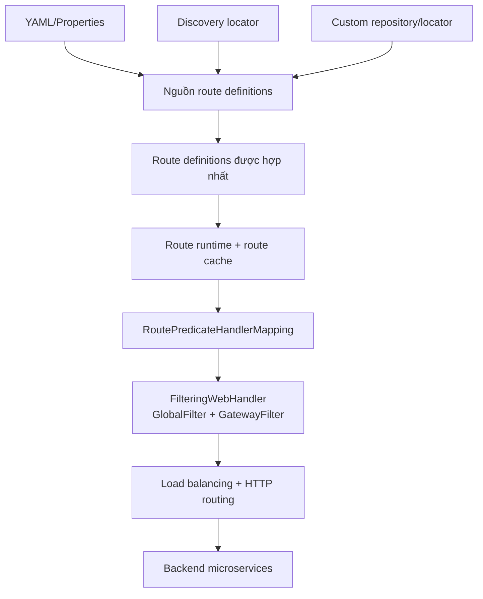
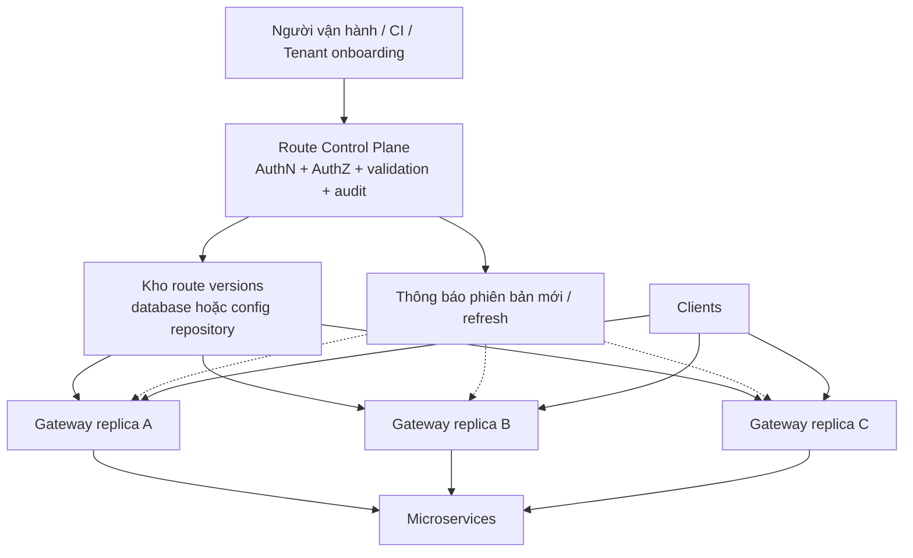
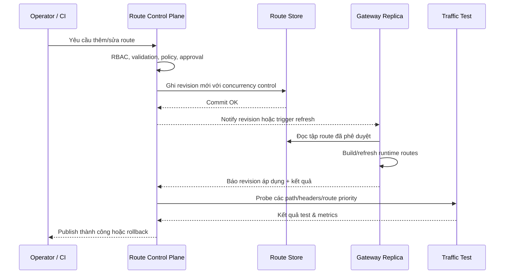

# Khi nào dùng tuyến tĩnh và khi nào cần nguồn tuyến động

## Mục tiêu bài học

Trong chương **Tuyến động**, bài này giúp bạn lựa chọn cách quản lý **route definitions** trong **Spring Cloud Gateway Server WebFlux**: khai báo tuyến tĩnh cùng mã nguồn/cấu hình triển khai, hay lấy và cập nhật tuyến từ một **nguồn dữ liệu động** khi Gateway đang chạy.

Sau bài học, bạn có thể:

- Phân biệt **route definition**, **route runtime**, **service discovery** và **cập nhật route động**.
- Chọn tuyến tĩnh cho hệ thống ổn định, cần kiểm soát thay đổi chặt chẽ; nhận diện những yêu cầu thực sự cần dynamic route source.
- So sánh cấu hình YAML/Java DSL, Spring Cloud Config/GitOps, discovery-based routes và `RouteDefinitionRepository` tùy biến.
- Hiểu vai trò của `RouteDefinitionLocator`, `RouteDefinitionWriter`, `RouteDefinitionRepository`, `RouteLocator` và cache/refresh trong Gateway.
- Biết lý do một route vừa được ghi vào kho chưa chắc **ngay lập tức** được toàn bộ Gateway replicas sử dụng.
- Thiết kế vòng đời **validate → approve → publish → refresh → verify → rollback** cho cập nhật tuyến.
- Nhận diện rủi ro từ URL tùy ý, `Path=/**`, route order, header manipulation, CORS, authentication, TLS và thay đổi filter chain.
- Thiết kế kiểm thử, giám sát và kế hoạch khôi phục để điều khiển tuyến động mà không làm Gateway thành điểm yếu của microservices.

> **Phạm vi:** bài dùng Spring Cloud Gateway **Server WebFlux** với route predicate, filter chain, `lb://` service discovery và Spring Boot. Tên property, actuator endpoints và cơ chế refresh có thể khác giữa các dòng Spring Cloud Gateway. Các ví dụ cấu hình dưới đây minh họa namespace `spring.cloud.gateway.routes` của nhiều phiên bản trước; những bản mới có thể dùng `spring.cloud.gateway.server.webflux.routes`. Luôn đối chiếu release train của hệ thống trước khi sao chép cấu hình.

## 1. Một route trong Spring Cloud Gateway gồm những gì?

Một **route** thường có những thành phần:

| Thành phần | Ý nghĩa | Ví dụ |
| --- | --- | --- |
| `id` | Định danh route | `orders-read` |
| `uri` | Đích đến của request | `lb://order-service` |
| `predicates` | Điều kiện route được chọn | `Path=/api/orders/**`, `Method=GET` |
| `filters` | Các bước biến đổi/kiểm soát request-response | `StripPrefix`, `RequestRateLimiter`, `CircuitBreaker` |
| `order` | Thứ tự ưu tiên khi nhiều tuyến có thể match | `-10` |
| `metadata` | Thông tin bổ sung cho route, có thể gồm CORS/timeout | Chính sách CORS theo route |

Ví dụ:

```yaml
spring:
  cloud:
    gateway:
      routes:
        - id: orders-read
          order: -10
          uri: lb://order-service
          predicates:
            - Path=/api/orders/**
            - Method=GET
          filters:
            - StripPrefix=1
```

Client truy cập `GET /api/orders/42`; Gateway kiểm tra predicates, áp filters rồi gửi tới một instance của `order-service` (nếu đã tích hợp Spring Cloud LoadBalancer và nguồn danh sách instances).

**Tuyến tĩnh** và **tuyến động** không nhất thiết khác nhau ở nội dung route. Chúng chủ yếu khác ở **route được định nghĩa ở đâu, khi nào được tải/cập nhật, ai có quyền thay đổi và các Gateway instances thấy bản mới bằng cách nào**.

### 1.1. Phân biệt bốn việc thường bị gọi chung là “định tuyến động”

1. **Route definition tĩnh:** Route `orders-read` tồn tại trong YAML/code; muốn thay đổi `Path`, filters hoặc đích logic phải thay đổi cấu hình/deployment theo quy trình.
2. **Service discovery động:** Route vẫn là `lb://order-service`, nhưng danh sách các instance như `10.0.1.8:8080`, `10.0.1.9:8080` thay đổi mà không cần sửa route.
3. **Nguồn route definition động:** Một database, registry hoặc control plane có thể thêm, sửa, xóa **cả định nghĩa route** mà không phải sửa YAML gốc và rebuild ứng dụng.
4. **Refresh cấu hình hoặc cache:** Gateway đọc lại/áp dụng định nghĩa mới sau một sự kiện refresh, cập nhật thuộc tính hoặc rollout. Refresh là **một bước đồng bộ trạng thái**, không tự biến mọi nơi lưu cấu hình thành nguồn route động.

Ví dụ:

```text
Route định nghĩa cố định:
  id: orders-read
  uri: lb://order-service

Service discovery cập nhật:
  instance A: 10.0.1.8:8080   (removed)
  instance B: 10.0.1.9:8080
  instance C: 10.0.1.10:8080  (added)
```

Trong tình huống này, **đích vật lý thay đổi nhưng route definition không đổi**. Không cần xây một database route động chỉ để Gateway tìm được instance mới của cùng một service.

## 2. Luồng xử lý route trong Gateway

Một cách nhìn khái quát:



Gateway có thể lấy route definitions từ **nhiều nguồn**. Chúng được chuyển thành route runtime chứa các predicate/filter đã được dựng cho việc xử lý HTTP request. Để tối ưu hiệu năng, Gateway thường dùng cơ chế cache route runtime; không nên đặt một truy vấn database chậm trên **mỗi request** chỉ để biết route nào có thể match.

Các tên API quan trọng:

| API/thành phần | Trách nhiệm |
| --- | --- |
| `RouteDefinition` | Dữ liệu khai báo route: ID, URI, predicates, filters, order, metadata |
| `RouteDefinitionLocator` | Cung cấp một `Flux<RouteDefinition>` từ nguồn khai báo |
| `RouteDefinitionWriter` | Giao diện ghi/xóa route definition |
| `RouteDefinitionRepository` | Kết hợp **locator** và **writer** cho một kho route có thể đọc/ghi |
| `RouteLocator` | Cung cấp route runtime (`Flux<Route>`) đã sẵn sàng cho matching |
| Route cache và refresh | Giúp thay đổi nguồn route được thể hiện trong tập route đang hoạt động |
| `RoutePredicateHandlerMapping` | Chọn route cho HTTP request phù hợp |
| `FilteringWebHandler` | Chạy chain filter của route đã được chọn |

**Đừng nhầm `RouteDefinitionRepository` với `RouteLocator`.** Một cái thường đại diện nguồn dữ liệu định nghĩa; cái còn lại là đối tượng route thực thi được. Cũng không nên hiểu rằng mỗi lần gọi `save()` vào repository lập tức buộc mọi replica trên cụm đồng bộ và chuyển traffic sang route mới.

## 3. Tuyến tĩnh: lựa chọn mặc định hợp lý cho nhiều dự án

Nếu hệ thống có một số service với API ổn định:

```text
/api/catalog/**  → catalog-service
/api/orders/**   → order-service
/api/users/**    → identity-service
```

thì route definitions trong `application.yml` hoặc trong Java DSL rất dễ quản lý.

### 3.1. Ví dụ YAML tĩnh

```yaml
spring:
  cloud:
    gateway:
      routes:
        - id: catalog
          order: 0
          uri: lb://catalog-service
          predicates:
            - Path=/api/catalog/**
          filters:
            - StripPrefix=1

        - id: orders
          order: 0
          uri: lb://order-service
          predicates:
            - Path=/api/orders/**
          filters:
            - StripPrefix=1
            - name: RequestRateLimiter
              args:
                key-resolver: "#{@authenticatedUserKeyResolver}"
                redis-rate-limiter.replenishRate: 20
                redis-rate-limiter.burstCapacity: 40
                redis-rate-limiter.requestedTokens: 1
```

Ví dụ chỉ minh họa route và limiter; để chạy cần dependency cho `lb://`, Redis rate limiting và bean `authenticatedUserKeyResolver` được khai báo đúng. Đây không phải cấu hình đầy đủ authentication/authorization.

### 3.2. Java DSL cũng có thể là tuyến tĩnh

```java
import org.springframework.cloud.gateway.route.RouteLocator;
import org.springframework.cloud.gateway.route.builder.RouteLocatorBuilder;
import org.springframework.context.annotation.Bean;
import org.springframework.context.annotation.Configuration;

@Configuration
class FixedRoutesConfiguration {

    @Bean
    RouteLocator fixedRoutes(RouteLocatorBuilder builder) {
        return builder.routes()
            .route("orders-read", r -> r
                .path("/api/orders/**")
                .filters(f -> f.stripPrefix(1))
                .uri("lb://order-service"))
            .build();
    }
}
```

Đây là Java cấu hình một route runtime khi ứng dụng được tạo. **Chỉ vì khai báo bằng Java thay vì YAML không khiến route tự động là dynamic**. Nếu muốn đổi `Path` hay `uri` của đoạn DSL này, thường phải sửa code/config và triển khai lại, hoặc tự bổ sung một cơ chế cập nhật chuyên biệt.

### 3.3. Khi nào tuyến tĩnh là lựa chọn nên ưu tiên?

Tuyến tĩnh phù hợp khi:

- Số nhóm API không quá lớn, path và service name tương đối ổn định.
- Route được xem như **mã nguồn hạ tầng**, cần code review, kiểm thử, phiên bản và rollback.
- Triển khai đã có **GitOps/CI/CD** với rolling deployment an toàn.
- Không có đội vận hành phải cập nhật route hàng chục lần trong ngày.
- Policy bảo mật liên quan route cần thay đổi **cùng lúc** với code API.
- Muốn hạn chế hệ thống quản trị ghi/xóa route ở runtime, giảm bề mặt tấn công.

Các ưu điểm:

| Ưu điểm | Vì sao có ích |
| --- | --- |
| **Dễ audit** | Thay đổi route đi qua commit, pull request và pipeline |
| **Dễ tái hiện** | Một bản build/config có tập route biết trước |
| **Giảm độ phức tạp vận hành** | Không cần control plane hoặc kho route riêng |
| **Đơn giản khi rollback** | Triển khai lại revision đã biết |
| **Ít rủi ro cập nhật bất ngờ** | Route không tự đổi theo nguồn external không kiểm soát |
| **Phù hợp compliance** | Có lịch sử review/approval rõ ràng |

Nhược điểm là mỗi lần sửa route có thể cần **thay config và làm rollout**. Nhưng nếu quy trình triển khai nhanh, tự động, có kiểm thử và rollback, chi phí này thường nhỏ hơn việc tự xây cả một hệ thống quản trị route động.

## 4. Nguồn tuyến động là gì?

**Nguồn tuyến động** là một nơi cung cấp route definitions có thể thay đổi trong khi Gateway đang chạy, kết hợp một cơ chế để Gateway **nhận biết và áp dụng** những thay đổi đó.

Ví dụ kiến trúc:



Ở đây:

- **Control plane** xác định route nào được phép tồn tại, ai có quyền thay đổi, kiểm duyệt và phát hành phiên bản.
- **Data plane** là các Gateway replicas nhận HTTP requests và dùng **tập route đã áp dụng** để định tuyến.
- **Kho route** chứa các định nghĩa được quản lý, có thể hỗ trợ lịch sử và rollback.
- **Refresh/reconciliation** giúp từng replica tiếp nhận cấu hình mới.

Một database chứa route nhưng Gateway chỉ đọc **một lần lúc startup** không đủ để đáp ứng yêu cầu **cập nhật online**. Ngược lại, Gateway polling nguồn route mỗi request cũng không phải thiết kế tốt: nó đưa độ trễ và lỗi database lên đường xử lý HTTP nóng.

### 4.1. Những yêu cầu có thể biện minh cho route động

1. **Onboarding nhiều khách hàng/tenant:** tạo hoặc gỡ route theo hợp đồng, hostname/path riêng với tần suất cao.
2. **API product platform:** self-service cấu hình API có quyền hạn, approval, quota và lifecycle rõ ràng.
3. **Traffic migration:** thay đích một nhóm route, bật/tắt canary/weight routing với quá trình quan sát liên tục.
4. **Điều hành sự cố:** cô lập một upstream, chuyển route tới backup service đã được phê duyệt hoặc vô hiệu hóa một entry point.
5. **Rất nhiều route:** tập route lớn thay đổi độc lập với vòng đời phát hành một ứng dụng Gateway.
6. **Central policy management:** một tổ chức vận hành nhiều cụm Gateway, muốn một nguồn cấu hình được kiểm soát và đồng bộ.

Điều kiện quan trọng: lợi ích của cập nhật online phải **đủ lớn để bù chi phí bảo mật, độ nhất quán, phân phối và vận hành**. Nếu chỉ có ba route thay đổi vài lần mỗi quý, thêm control plane/database/bus riêng thường là không cần thiết.

## 5. So sánh tuyến tĩnh và tuyến động

| Tiêu chí | Tuyến tĩnh | Nguồn tuyến động |
| --- | --- | --- |
| Nơi định nghĩa | YAML/properties, Java DSL, GitOps config | Repository, control plane, discovery locator hoặc nguồn tùy biến |
| Thay đổi route | Thường qua build/config release/rollout | Có thể publish và refresh lúc runtime |
| Quy trình review | PR/CI/CD quen thuộc | Cần RBAC, approval, audit, version và validation riêng |
| Độ nhất quán nhiều replicas | Thường qua deployment revision | Cần cơ chế phân phối/refresh và phát hiện version lệch |
| Điểm lỗi mới | Ít phụ thuộc runtime vào route store | Có thể thêm DB, event bus, quản trị API và cache |
| Khôi phục | Rollback deploy/config | Rollback route revision; có thể cần làm lại refresh toàn cụm |
| Bảo mật | Thay đổi theo quyền Git/deploy | Runtime mutation endpoint là bề mặt tấn công nhạy cảm |
| Phù hợp | API ít thay đổi, chính sách gắn với release | Route thay đổi thường xuyên, tự động hóa onboarding/traffic control |
| Tải điều khiển | Chủ yếu khi startup/rollout | Thêm tải đọc/ghi và event khi cấu hình đổi |
| Độ phức tạp kiểm thử | Static route integration tests | Thêm concurrency, reconciliation, failure và rollback tests |

**Không có kết luận “route động luôn tốt hơn”.** Một hệ thống ít route, nhưng được triển khai bằng rolling deployments nhanh, có thể đạt cả độ tin cậy lẫn tính linh hoạt mà không cần nguồn động.

### 5.1. Một quy tắc ra quyết định

Hãy hỏi lần lượt:

1. Chúng ta cần thay **route definition** hay chỉ cần backend instances tự động thay đổi?
2. Một thay đổi route có thể chờ đến pipeline triển khai kế tiếp không?
3. Ai được quyền sửa `uri`, `predicates`, `filters`, `order` và metadata bảo mật?
4. Có yêu cầu nhiều Gateway replicas phải đổi trong một khoảng thời gian rất ngắn không?
5. Nếu cấu hình mới sai, có thể rollback **tự động và an toàn** không?
6. Có khả năng vận hành một kho cấu hình/control plane **24/7** và giám sát phiên bản từng replica không?

Nếu câu (1) là **“chỉ thay instance của cùng service”**, hãy bắt đầu từ **service discovery + load balancing**. Nếu (2) là **“có thể chờ và rất ít thay đổi”**, ưu tiên **tuyến tĩnh**. Nếu nhu cầu quản lý hàng nghìn route thay đổi thường xuyên là có thật và trả lời được các câu bảo mật/vận hành còn lại, hãy cân nhắc **nguồn tuyến động**.

## 6. Nhiều con đường để thay đổi định tuyến

Không phải mọi giải pháp cập nhật route đều là custom `RouteDefinitionRepository`.

### 6.1. YAML + GitOps/deploy

Quy trình:

```text
Developer sửa application.yml
  → Pull request
  → Review và test
  → Build/config release
  → Rolling deployment
  → Verify và rollback khi cần
```

Đây là cách **tĩnh** thường dễ vận hành nhất. Một route vẫn có thể trỏ `lb://order-service` để tự chọn backend instances thay đổi.

### 6.2. Externalized configuration / Spring Cloud Config

Route definitions có thể được lưu trong một nguồn cấu hình ngoài artifact (chẳng hạn kho Git được cung cấp qua config service). Nhưng cần phân biệt:

- **Nguồn cấu hình nằm ngoài JAR** không tự đồng nghĩa Gateway **đọc lại ngay khi file đổi**.
- Cần cơ chế cập nhật `Environment`/configuration properties và làm mới route runtime phù hợp phiên bản.
- Một refresh route cache đơn thuần **không bảo đảm** Spring Boot đã nạp lại giá trị property từ nguồn remote.
- Phải giải quyết cách nhiều replicas nhận cùng revision và quan sát việc refresh thành công.

Giải pháp này phù hợp với tổ chức đã vận hành external config nhưng vẫn muốn thay đổi chủ yếu qua **Git review và release control**, thay vì cho mọi ứng dụng quyền tự thêm route.

### 6.3. Discovery-based RouteDefinitionLocator

Spring Cloud Gateway có cơ chế tạo route definitions dựa vào các services từ **DiscoveryClient** trong các phiên bản có hỗ trợ. Ví dụ namespace truyền thống:

```yaml
spring:
  cloud:
    gateway:
      discovery:
        locator:
          enabled: true
          lower-case-service-id: true
```

Chức năng này có thể tạo route cho những service được discovery biết đến, với predicate/filter mặc định hoặc tùy biến theo property. **Đừng bật mù quáng trên Gateway public**: một service nội bộ mới đăng ký có thể vô tình có một URL qua Gateway nếu chính sách tạo route quá rộng.

Thực hành an toàn:

- Giới hạn **service IDs được phép xuất hiện** qua policy/predicate có kiểm soát.
- Kiểm thử path rewrite, authorization, CORS và rate limiting của route sinh tự động.
- Không coi sự hiện diện của service trong registry là bằng chứng nó được **phép công khai**.
- Xác minh những route phát sinh thực tế; đừng dựa vào suy đoán về mặc định của discovery locator ở mọi phiên bản.

`discovery.locator` tạo **định nghĩa route từ registry**; khác với việc một route tĩnh `lb://order-service` chỉ dùng registry để tìm instances.

### 6.4. Custom RouteDefinitionLocator

Khi route được duy trì ở database/config service riêng, có thể cung cấp một bean triển khai `RouteDefinitionLocator` để đọc các định nghĩa đó:

```java
import org.springframework.cloud.gateway.route.RouteDefinition;
import org.springframework.cloud.gateway.route.RouteDefinitionLocator;
import reactor.core.publisher.Flux;

interface ApprovedRouteSource {
    Flux<RouteDefinition> loadApprovedRoutes();
}

final class DatabaseRouteLocator implements RouteDefinitionLocator {
    private final ApprovedRouteSource source;

    DatabaseRouteLocator(ApprovedRouteSource source) {
        this.source = source;
    }

    @Override
    public Flux<RouteDefinition> getRouteDefinitions() {
        return source.loadApprovedRoutes();
    }
}
```

Đây là **skeleton minh họa**: cần đăng ký bean trong Spring context, triển khai `ApprovedRouteSource`, xác thực dữ liệu, timeouts, tránh blocking I/O và thiết kế refresh/cache. `Flux<RouteDefinition>` cung cấp **dữ liệu route**, không phải lệnh tự động kích hoạt refresh trên tất cả Gateway replicas.

Nếu nguồn database dùng driver blocking, không gọi trực tiếp truy vấn blocking trên Reactor Netty event-loop. Cân nhắc reactive client, cập nhật route cache ngoài hot path hoặc chuyển xử lý phù hợp với scheduler/bounded resources có kiểm soát.

### 6.5. RouteDefinitionRepository để vừa đọc vừa ghi

`RouteDefinitionRepository` là hợp đồng dùng khi cần một nguồn route cho phép **ghi/xóa**, ngoài đọc danh sách route. Thích hợp khi có control plane hoặc API quản trị cập nhật định nghĩa với quy trình duyệt.

Khi chọn custom repository phải tự trả lời:

- Route lưu ở đâu, có bền vững qua restart không?
- Ai kiểm tra và phê duyệt URI/predicates/filters?
- Một lần `save()` có cần transaction/version check không?
- Làm sao tất cả Gateway replicas refresh và biết revision được áp dụng?
- Nếu DB unavailable, Gateway nên giữ route cache cuối hợp lệ, hay ngừng nhận traffic?
- Khi một route bị xóa, còn request đang thực thi qua route cũ xử lý thế nào?

Không dùng một `Map<String, RouteDefinition>` trong một JVM để tuyên bố đã có **dynamic routing phân tán**.

## 7. Ví dụ: RouteDefinitionRepository trong bộ nhớ để học API

Ví dụ dưới đây chỉ dạy cách triển khai interface. Nó **không** có persistence, RBAC, validation chuyên sâu, revision history, phân phối nhiều pods hay đồng bộ cache; không nên dùng nguyên bản cho production.

```java
import java.util.ArrayList;
import java.util.Map;
import java.util.concurrent.ConcurrentHashMap;

import org.springframework.cloud.gateway.route.RouteDefinition;
import org.springframework.cloud.gateway.route.RouteDefinitionRepository;
import reactor.core.publisher.Flux;
import reactor.core.publisher.Mono;

public final class LearningRouteRepository
        implements RouteDefinitionRepository {

    private final Map<String, RouteDefinition> routes =
        new ConcurrentHashMap<>();

    @Override
    public Flux<RouteDefinition> getRouteDefinitions() {
        // Snapshot hạn chế ảnh hưởng khi collection thay đổi
        // trong lúc lặp. Không phải snapshot transaction toàn cụm.
        return Flux.defer(() ->
            Flux.fromIterable(new ArrayList<>(routes.values()))
        );
    }

    @Override
    public Mono<Void> save(Mono<RouteDefinition> incoming) {
        return incoming.flatMap(route -> {
            String id = route.getId();
            if (id == null || id.isBlank()) {
                return Mono.error(
                    new IllegalArgumentException("Missing route ID")
                );
            }

            // Chỉ kiểm tra ID để minh họa contract.
            // Production phải validate URI, predicates, filters, metadata.
            routes.put(id, route);
            return Mono.<Void>empty();
        });
    }

    @Override
    public Mono<Void> delete(Mono<String> routeId) {
        return routeId.flatMap(id -> {
            RouteDefinition removed = routes.remove(id);
            return removed == null
                ? Mono.<Void>error(
                    new IllegalArgumentException("Unknown route ID")
                )
                : Mono.<Void>empty();
        });
    }
}
```

Giải thích:

- `getRouteDefinitions()` xuất một `Flux<RouteDefinition>` để Gateway có thể đọc định nghĩa.
- `save()` và `delete()` là **reactive publishers**. Không dùng `subscribe()` thủ công rồi báo ghi xong khi thao tác chưa hoàn tất.
- `ConcurrentHashMap` bảo vệ một số thao tác map trong JVM, **không** bảo đảm chỉnh sửa transaction giữa nhiều fields hoặc nhiều Gateway replicas.
- Một repository singleton trong bộ nhớ sẽ mất dữ liệu khi restart và mỗi pod có state riêng.
- Việc sửa route object được giữ trong map cũng cần tránh mutate sau khi đã publish; dùng **snapshot/copy/immutable representation** cho quản trị production.
- **Quan trọng:** ghi/xóa repository **chưa đủ** để bảo đảm route runtime cache cập nhật. Cần quy trình refresh phù hợp.

Để kết hợp source này vào Gateway, khai báo nó thành bean bằng `@Bean` hoặc một cơ chế đăng ký phù hợp, **không** tự tạo nhiều route repositories có ID trùng hoặc vô tình ghi đè route tĩnh.

### 7.1. Tạo RouteDefinition programmatically

Ví dụ xây dựng một định nghĩa cho API chỉ đọc:

```java
import java.net.URI;
import java.util.List;

import org.springframework.cloud.gateway.filter.FilterDefinition;
import org.springframework.cloud.gateway.handler.predicate.PredicateDefinition;
import org.springframework.cloud.gateway.route.RouteDefinition;

RouteDefinition route = new RouteDefinition();
route.setId("orders-read");
route.setUri(URI.create("lb://order-service"));
route.setOrder(-10);
route.setPredicates(List.of(
    new PredicateDefinition("Path=/api/orders/**"),
    new PredicateDefinition("Method=GET")
));
route.setFilters(List.of(
    new FilterDefinition("StripPrefix=1")
));
```

Đây là **code fragment**, không phải REST API quản trị production. Một implementation thực tế phải validate toàn bộ route trước khi lưu/publish và đảm bảo mỗi route ID có owner, revision cùng chính sách bảo mật.

### 7.2. Vì sao không cho client truyền RouteDefinition tùy ý?

Nếu một endpoint công khai nhận JSON:

```json
{
  "id": "unsafe-route",
  "uri": "http://127.0.0.1:8081",
  "predicates": ["Path=/**"],
  "filters": ["RemoveRequestHeader=Authorization"]
}
```

rồi lưu thẳng vào repository, kẻ tấn công có thể:

- Tạo route wildcard chiếm traffic từ các route khác.
- Chuyển request vào địa chỉ nội bộ, loopback hoặc endpoint metadata của cloud provider, dẫn tới **server-side request forgery (SSRF)** và lộ thông tin.
- Loại/ghi đè headers bảo mật hoặc tạo chính sách CORS rộng.
- Chuyển một API có auth/rate limit sang một route mới không có kiểm soát tương đương.
- Tạo route đích trỏ ngược Gateway, gây loop, khuếch đại traffic.

**Không được** biến route management endpoint thành API cho người dùng tùy ý thêm `uri`, `filter` hoặc `predicate`. Cần RBAC chặt, allowlist service ID/scheme/host/port, giới hạn paths, validation đối với filters, approval workflow và audit.

## 8. Cập nhật route runtime: refresh khác với save

Gateway thường duy trì **cache route đã xây dựng** để xử lý request nhanh. Khi source thay đổi, phải có cách yêu cầu Gateway **đọc lại và xây dựng tập route runtime**.

Một cơ chế Spring Cloud Gateway Server WebFlux thường gặp là sự kiện:

```java
import org.springframework.cloud.gateway.event.RefreshRoutesEvent;
import org.springframework.context.ApplicationEventPublisher;

// Khi revision mới đã được ghi thành công vào nguồn route.
publisher.publishEvent(new RefreshRoutesEvent(this));
```

Trong đó `publisher` là một `ApplicationEventPublisher` được Spring inject vào thành phần điều phối nội bộ. Mẫu này minh họa **phát sự kiện trong một application context** để route cache/locator của Gateway có cơ hội refresh theo cơ chế hỗ trợ ở phiên bản tương ứng.

**Không suy ra:**

- Event trong pod A **tự gửi** tới pod B/C.
- Event tự làm Spring Boot tải lại **remote YAML properties**.
- Event đồng nghĩa route mới đã được **validate, build và nhận traffic thành công**.
- Event bảo đảm mọi request đang xử lý sẽ chuyển route atomically.

### 8.1. Vòng đời cập nhật có kiểm soát



Trong thực tế, các bước notify, refresh, readback và kiểm tra có thể bất đồng bộ. **Một lệnh refresh trả HTTP thành công không tự chứng minh tất cả Gateway instances đã dùng đúng revision mới.**

### 8.2. Actuator Gateway endpoints

Khi đã bật Spring Boot Actuator và cho phép phù hợp, một số phiên bản Gateway có endpoints hỗ trợ quan sát route và **yêu cầu refresh**, thường ở nhóm đường dẫn:

```text
GET  /actuator/gateway/routes
POST /actuator/gateway/refresh
```

Một số phiên bản/config còn có khả năng **thêm hoặc xóa route** qua Gateway actuator hoặc thành phần quản trị tích hợp. **Không giả định mọi bản đều bật các thao tác ghi theo mặc định**; actuator access/exposure và tính năng thay đổi route có thể bị giới hạn hoặc thay đổi theo phiên bản.

Trong production:

- Chỉ expose **các endpoint thật sự cần**, ưu tiên private management port/network.
- Bảo vệ bằng authentication mạnh, authorization theo vai trò, TLS và ingress/network policy.
- Không bật công khai thao tác quản trị để frontend hoặc đối tác có thể sửa route.
- Không dùng actuator endpoint ghi động làm thay thế cho control plane có validation, approval, revision và rollback.
- Với nhiều replicas, xác định actuator request **được gửi tới replica nào** và trạng thái refresh của các replica còn lại.

### 8.3. Tập route cuối cùng mới là thứ cần kiểm chứng

Sau refresh, xác minh:

1. Route ID mới có xuất hiện trong tập route runtime không?
2. `Path`, `Method`, `Host` và `order` có được áp đúng không?
3. URI sau `RewritePath` hoặc `StripPrefix` có trỏ đúng đích không?
4. Headers/CORS/Security/RateLimiter có giữ policy không?
5. Có route cũ trùng ID hoặc route wildcard bắt trước route mới không?
6. Mọi Gateway replicas đã áp cùng revision chưa?
7. Có HTTP requests nào trả 404/502/503 bất thường trong lúc chuyển đổi không?

Lệnh `save`/`delete` và refresh event là **phần cơ chế**; kiểm thử hành vi và đọc lại state mới là **bằng chứng**.

## 9. Những vấn đề khi có nhiều Gateway replicas

Giả sử ba Gateway pods:

```text
Gateway A: route revision 41
Gateway B: route revision 41
Gateway C: route revision 40
```

Nếu load balancer phân phối các requests giữa cả ba, client có thể lúc nhận route mới, lúc bị route cũ xử lý. Đây là trạng thái **configuration drift**, không phải lỗi của service discovery.

### 9.1. Consistency: không phải mọi pod đổi cùng một nanosecond

Không phải lúc nào cũng đạt được **atomic cutover toàn cụm** chỉ với refresh. Cần lựa chọn:

- **Eventual consistency có giới hạn:** chấp nhận một khoảng ngắn các pods dùng khác revision, đo thời gian hội tụ.
- **Staged rollout:** publish route mới trước rồi bật traffic khi các replicas đã xác nhận tải thành công.
- **Blue/green gateway:** tạo cụm Gateway với route revision mới, test đầy đủ rồi chuyển ingress traffic.
- **Central control plane reconciliation:** các pods định kỳ so revision với source và tự sửa lệch.

Đối với thay đổi có ảnh hưởng bảo mật hoặc routing diện rộng, **blue/green hoặc staged activation** thường an toàn hơn việc ghi route rồi phát refresh một cách không có kiểm chứng.

### 9.2. Stale cache và database outage

Nếu route store không khả dụng:

| Chính sách | Lợi ích | Rủi ro |
| --- | --- | --- |
| Giữ last-known-good route cache | Giữ phục vụ traffic cũ | Có thể không áp được route revoke khẩn cấp |
| Thay cache bằng tập rỗng khi đọc lỗi | Không dùng dữ liệu có thể lỗi thời | Gateway mất toàn bộ khả năng route |
| Khởi động thất bại nếu không tải được config hợp lệ | Fail fast với security-sensitive setup | Availability phụ thuộc route store lúc startup |
| Dùng versioned snapshot/backup | Phục hồi sau lỗi nguồn | Phải bảo vệ snapshot, expiry và kiểm tra tính hợp lệ |

Không có một chiến lược chung cho mọi sản phẩm. Cần nêu rõ **fail-closed/fail-open theo loại route**, thời gian cache có thể cũ, thời gian phục hồi và cơ chế emergency revocation.

### 9.3. Concurrent writes và route revision

Giả sử hai admins cùng thay route `orders-read`:

```text
Admin A đọc revision 20 → muốn đổi uri
Admin B đọc revision 20 → muốn đổi auth-related metadata
Admin A ghi revision 21
Admin B ghi đè revision 21 bằng bản dựa trên revision 20
```

Nếu không có **optimistic locking** hay version check, thay đổi A có thể bị mất hoặc B vô tình áp cấu hình cũ. Một control plane an toàn nên:

- Yêu cầu `expectedRevision` hoặc ETag/`If-Match`.
- Reject update dựa trên revision đã cũ.
- Lưu audit log của actor, change-set, approval và kết quả publish.
- Cho rollback tới **một revision hoàn chỉnh** có tất cả policy liên quan.
- Không để một phần route set mới được publish khi transaction đang dở.

## 10. Security: route động là quyền điều khiển traffic

Một cấu hình route không đơn thuần là “chọn URL”; nó có thể thay đổi **ranh giới bảo mật** của hệ thống.

### 10.1. Các trường phải validate

| Trường | Nguy cơ | Chính sách đề xuất |
| --- | --- | --- |
| `id` | Trùng hoặc ghi đè route nhạy cảm | Namespace, owner, uniqueness, version |
| `uri` | SSRF, truy cập nội bộ, vòng lặp | Allowlist scheme/service ID/host/port; cấm đích không được duyệt |
| `Path` predicate | Wildcard `/**` chiếm traffic | Quy tắc phân quyền path, kiểm tra overlap |
| `Host` predicate | Giả định host/public domain sai | Kiểm soát domain thuộc quyền tổ chức |
| `Method` predicate | Mở thêm POST/DELETE ngoài ý muốn | Giới hạn theo hợp đồng API |
| `order` | Route mới match trước route bảo vệ cũ | Kiểm tra ưu tiên/collision tự động |
| `filters` | Bỏ auth header, rewrite sang path khác, mở CORS | Allowlist factory + args, policy enforcement |
| `metadata.cors` | Browser origin ngoài ý muốn đọc response | Exact allowed origins, credential policy |
| `metadata` khác | Timeout quá lớn, policy nới rộng | Schema và allowed values theo version |

**SSRF đặc biệt nguy hiểm** nếu quản trị route nhận `uri` tùy ý: Gateway có mạng nội bộ và credentials vận hành mà một client Internet không có. Vì thế **không được** tin URL đã parse thành công là URL an toàn. Phải kiểm soát scheme, port, DNS, redirect, service identity và những địa chỉ bị chặn theo trust boundary.

### 10.2. Route mới có được bỏ qua authentication không?

Ví dụ hệ thống ban đầu:

```text
/api/admin/** → Admin Service
```

được bảo vệ bởi Spring Security WebFlux theo path. Một route động:

```text
/internal/admin/** → cùng Admin Service
```

có thể tạo **đường vào mới** không khớp rule bảo mật cũ nếu SecurityWebFilterChain chỉ bảo vệ `/api/admin/**`.

Do đó:

1. Cần chính sách **deny by default** cho những path không được cấp phép.
2. Dynamic route creation phải đi qua security review cho từng public path.
3. Không tin route `metadata` do tenant tự khai báo làm bằng chứng đã được authentication/authorization.
4. Backend vẫn xác minh identity và quyền đối tượng; không phụ thuộc hoàn toàn vào Gateway.
5. Dùng route policy scanner/test để phát hiện một endpoint được công bố thêm nhưng không có auth phù hợp.

Một `GatewayFilter` theo route không thể thay SecurityWebFilterChain bảo vệ mọi request ngoài route chain. Với actuator và các handler đặc biệt, thiết kế security độc lập.

### 10.3. Dynamic routes và CORS

Thay đổi `metadata.cors` có thể ảnh hưởng frontend ngay cả khi upstream không đổi. Cần kiểm thử:

- Preflight OPTIONS có match route hay không (đặc biệt nếu route dùng `Method=GET`).
- `allowedOrigins` có giới hạn đúng tên miền/port/scheme.
- `allowCredentials: true` không kết hợp wildcard origin không an toàn.
- Gateway, Spring Security, ingress và backend có phát header CORS trùng nhau không.
- Response lỗi 401/403/429/503 có CORS headers thích hợp không.

Đừng để khách hàng tự thêm `allowedOrigins: '*'` trên một route dữ liệu nhạy cảm chỉ vì muốn giải quyết lỗi browser.

### 10.4. Dynamic routes không tự cập nhật TLS và định danh

Nếu route mới mang `Host=api.partner.example`, điều đó **không tự cấp TLS certificate inbound** cho domain, không tự cấu hình ingress/SNI và không chứng minh partner sở hữu domain. Tương tự, thay `uri` từ HTTP sang HTTPS phải đảm bảo **trust chain/hostname verification outbound** của Gateway.

Một route mới trỏ `lb://partner-service` còn cần discovery, instance health và network authorization phù hợp. **Route discovery không tự là security approval.**

## 11. Filter chain, route order và thay đổi không tương thích

Một route mới có thể dùng:

```yaml
predicates:
  - Path=/api/**
order: -100
```

trong khi route cũ:

```yaml
predicates:
  - Path=/api/orders/**
order: 0
```

Vì `order` nhỏ thường được ưu tiên khi chọn routes, route rộng `Path=/api/**` có thể match trước và chuyển `/api/orders/**` sang sai backend hoặc thiếu filter an toàn.

### 11.1. Không mặc định “path cụ thể nhất luôn thắng”

Khi nhiều route match:

- Phải xem `order`, predicates và cách route locator cung cấp routes.
- Không suy luận chỉ bằng thứ tự trong database hoặc tên route.
- Phải test các **vùng path giao nhau**, không chỉ test path mới.
- Nên có validator phát hiện wildcard route có thể bắt trước route nhạy cảm.

### 11.2. Thay đổi filter có thể thay semantics HTTP

Ví dụ thay:

```text
StripPrefix=1
```

thành:

```text
StripPrefix=2
```

trên đường `/api/orders/42` có thể chuyển upstream path từ `/orders/42` thành `/42`, gây 404 hoặc trỏ sai handler.

Tương tự:

- `RemoveRequestHeader=Authorization` có thể khiến backend mất token.
- `SetRequestHeader` có thể tạo identity spoofing nếu lấy giá trị không đáng tin.
- `Retry` trên POST có thể tạo giao dịch trùng nếu thiếu idempotency.
- `CircuitBreaker` fallback có thể làm response khác contract.
- `RequestRateLimiter` cần `KeyResolver` đã xác thực và Redis state phù hợp.
- `ModifyRequestBody` có thể ảnh hưởng Content-Length, Content-Encoding và bộ nhớ.

**Dynamic deployment không miễn trừ nghĩa vụ kiểm thử filters và route predicates**. Một thay đổi filter trong database cũng là một thay đổi code/hành vi của API Gateway về mặt vận hành.

## 12. Một quy trình phát hành route động an toàn

Thay vì endpoint “save và hy vọng”, nên dùng mô hình phiên bản:

```text
Draft RouteSet v57
  ↓
Schema validation + security validation
  ↓
Test predicates/filters/URI + policy checks
  ↓
Review / Approve
  ↓
Persist immutable revision v57
  ↓
Publish desired revision
  ↓
Refresh/Reconcile từng Gateway replica
  ↓
Observe actual applied revision
  ↓
Smoke test / canary
  ↓
Mark stable hoặc rollback v56
```

### 12.1. Các bước cần thiết

**Bước 1 — Soạn bản nháp.** Control plane tạo RouteSet có revision, author, change reason và tập route IDs bị ảnh hưởng.

**Bước 2 — Validation tĩnh.** Check cấu trúc, URI scheme/host/port, predicate syntax, filter allowlist/arguments, route order, xung đột path, security/CORS policy.

**Bước 3 — Test ở staging.** Dùng các HTTP requests đại diện, test path/Host/Method, rewrite, auth, rate limit, fallback và backend behavior.

**Bước 4 — Review.** Những route công khai mới hoặc thay đổi security-sensitive fields cần approval tương ứng. Không để một tenant sửa route của tenant khác.

**Bước 5 — Ghi một revision nhất quán.** Nên persist **một bản cấu hình hoàn chỉnh** hoặc transaction có khả năng rollback, thay vì cập nhật từng route không liên quan rồi client nhìn thấy trạng thái nửa chừng.

**Bước 6 — Publish.** Thông báo revision mới cho Gateway replicas; không gộp quyền ghi DB với quyền thay đổi mọi runtime routes một cách tùy tiện.

**Bước 7 — Reconciliation.** Mỗi replica cố đọc/validate/build route runtime; báo version đã áp và lỗi cụ thể.

**Bước 8 — Verify/canary.** Kiểm tra route matching, requests thực, CORS/Auth, kết nối TLS, HTTP 4xx/5xx, p95/p99 latency và fallback rate.

**Bước 9 — Rollback.** Khi lỗi, republish revision đã được xác minh an toàn và refresh/reconcile mọi replicas. Theo dõi tới khi cluster hội tụ, không chỉ gửi một lệnh rollback.

### 12.2. RouteSet cần một ID version rõ ràng

Một bản route revision có thể có metadata logic:

```json
{
  "revision": 57,
  "approvedBy": "gateway-ops",
  "routes": [
    {
      "id": "orders-read",
      "uri": "lb://order-service",
      "predicates": ["Path=/api/orders/**", "Method=GET"],
      "filters": ["StripPrefix=1"],
      "order": -10
    }
  ]
}
```

Đây là **định dạng mô tả của control plane minh họa**, **không phải JSON schema chuẩn** của mọi Spring Cloud Gateway repository hoặc Actuator API. Không đưa thông tin `approvedBy` hay `revision` vào `RouteDefinition` rồi mong framework tự đồng bộ revision; cần một cơ chế riêng cho versioning.

## 13. Canary, weighted routing và migration

Một nhu cầu thường được nêu để dùng route động là **thay đổi phân phối traffic** nhanh giữa backend cũ và mới. Spring Cloud Gateway có **Weight route predicate** trong các dòng hỗ trợ:

```yaml
spring:
  cloud:
    gateway:
      routes:
        - id: catalog-v1
          uri: lb://catalog-v1
          predicates:
            - Path=/api/catalog/**
            - Weight=catalog-rollout,90

        - id: catalog-v2
          uri: lb://catalog-v2
          predicates:
            - Path=/api/catalog/**
            - Weight=catalog-rollout,10
```

Hai route ở cùng weight group `catalog-rollout` hướng đến phân phối traffic theo tỷ lệ **tương đối**, không cam kết đúng 90/10 cho từng 10 requests hoặc có **sticky session** per user. Phải kiểm thử với phiên bản, tổng traffic đủ lớn, metrics theo route và khả năng tương thích API.

Bạn có thể quản lý trọng số bằng file tĩnh qua pipeline release hoặc thông qua nguồn động. Vì thế **canary không bắt buộc phải có dynamic repository**. Chọn dynamic khi tốc độ/khối lượng điều chỉnh và mô hình kiểm soát thực sự yêu cầu.

### 13.1. Rollout nhiều bước

```text
v1: 100%, v2: 0%
→ v1: 95%, v2: 5%
→ v1: 75%, v2: 25%
→ v1: 50%, v2: 50%
→ v1: 0%,  v2: 100%
```

Ở mỗi bước, đo error rate, p95/p99, circuit state, retry attempts, dữ liệu nghiệp vụ và authorization. Nếu v2 lỗi, revert route revision/trọng số thay vì cố giải quyết bằng Retry vô hạn.

Nếu API trả response tương thích nhưng schema dữ liệu backend khác nhau, weighted routing có thể tạo hành vi không ổn định cho client; cân nhắc versioned endpoint, sticky strategy được thiết kế riêng hoặc migration dữ liệu trước.

## 14. Quan sát route động trong production

Metrics chỉ ghi “Gateway 5xx tăng” là chưa đủ để biết lỗi do **revision route**, **backend** hay **security policy**.

| Tín hiệu | Vì sao quan trọng |
| --- | --- |
| `desiredRevision` và `appliedRevision` theo replica | Phát hiện pod chưa cập nhật |
| Thời gian từ publish tới tất cả replicas converged | Đo độ trễ đồng bộ route |
| Số route runtime, số route bị từ chối validation | Phát hiện route bị thiếu hoặc route không hợp lệ |
| HTTP requests theo route ID và status | Nhìn traffic của route mới và route cũ |
| 404 do không match route | Phát hiện mất path khi update |
| 502/503 từ upstream/routing | Phát hiện URI sai, thiếu instance hoặc backend lỗi |
| Route matching latency | Phát hiện số lượng/độ phức tạp predicates ảnh hưởng routing |
| Retry attempts, circuit states, rate denials | Phân biệt thay đổi policy/health |
| CORS preflight failures | Phát hiện metadata CORS không tương thích |
| Audit thay đổi route | Ai sửa gì, khi nào, đã phê duyệt và rollback chưa |

### 14.1. Metric labels không nên vô hạn cardinality

Các giá trị như route ID ổn định, nhóm policy, environment, revision có thể phục vụ quan sát. Nhưng không nên:

- Dùng toàn bộ dynamic URL, user-generated path hoặc query làm label.
- Dùng raw bearer token, API key, cookie hoặc tenant-provided header làm metric label.
- Phát sinh một route ID mới cho mỗi request; số series metrics tăng mất kiểm soát.

Nếu số lượng dynamic routes có thể lên hàng chục nghìn, phải thiết kế cardinality/retention trước khi bật metrics per-route chi tiết ở hệ thống giám sát.

### 14.2. Phân biệt route update với lỗi ở upstream

Ví dụ sau một lần publish:

```text
desiredRevision = 57
appliedRevision = 57
route=orders-read
status=503
```

Điều này chỉ cho biết revision mới đã được đánh dấu áp dụng và request trả 503, **chưa chứng minh route URI sai**. 503 có thể do load balancer không thấy instance, rate/bulkhead policy, CircuitBreaker fallback hoặc upstream thực sự lỗi. Cần trace và kiểm tra kết quả routing, không chỉ revert route dựa trên status đơn lẻ.

## 15. Kiểm thử: tuyến tĩnh và động

### 15.1. Test tuyến tĩnh

Với YAML trong mục 3, cần test:

1. Route IDs được nạp đúng theo namespace/version.
2. `/api/orders/42` match route orders; `/api/catalog/42` match catalog.
3. `StripPrefix=1` tạo path backend đúng.
4. `Method`, `Host`, `Path` cùng kết hợp như dự kiến.
5. Route order khi predicates chồng lấn.
6. Security, CORS, Retry, CircuitBreaker và RateLimiter vẫn có hiệu lực.
7. Rollback config/deployment phục hồi route cũ.

### 15.2. Test tuyến động

Ngoài những ca trên, bắt buộc test **vòng đời cập nhật**:

| Ca | Bước thử | Kết quả cần chứng minh |
| --- | --- | --- |
| Thêm route | Publish revision mới, refresh | Path mới hoạt động sau khi applied |
| Sửa route | Đổi URI hoặc predicate với version mới | Traffic đi đích đúng, không còn routing cũ ngoài cửa sổ cho phép |
| Xóa route | Revoke route, refresh | Route không còn match ở mọi replica sau convergence |
| Route trùng ID | Add `id` đã tồn tại | Bị reject hoặc update theo contract/version rõ, không silent override |
| Route trùng path | Add wildcard ưu tiên cao | Validator/test phát hiện shadowing |
| URI bị cấm | `127.0.0.1`, metadata IP, scheme không hợp lệ | Control plane reject trước publish |
| Filter bị cấm | Gỡ/ghi đè header auth | Reject trước publish |
| Thiếu quyền quản trị | Caller không có RBAC | Không được ghi/xóa route |
| Concurrent update | Hai admins cùng base revision | Stale write bị reject, không mất update |
| Một pod không refresh | Giả lỗi event/network | Báo drift, retry/reconcile an toàn |
| Route store unavailable | Tắt nguồn route | Fail policy rõ, không xóa route cache bừa bãi |
| Bad revision | Route mới lỗi 5xx | Rollback revision cũ, mọi pods converged |
| Pod restart | Restart một Gateway replica | Nạp đúng revision đã publish |
| Canary shift | Đổi weight 95/5 → 75/25 | Distribution/health được quan sát, rollback được |
| CORS | Preflight tới route mới | Allowed origins/methods đúng |
| Security | Route mới tới service admin | Không bypass auth/authorization |
| TLS | Route sang HTTPS upstream | Hostname/CA được kiểm chứng |

### 15.3. Một integration test sketch cho refresh

Giả sử có một **test-only route repository** và một Gateway đã khởi động, test có thể làm:

```java
// Pseudocode minh họa vòng đời, không phải test chạy độc lập.
RouteDefinition rd = createApprovedTestRoute(
    "test-orders", "Path=/api/orders/**", "http://localhost:9001"
);

repository.save(Mono.just(rd)).block(); // CHỈ trong test orchestration.
publisher.publishEvent(new RefreshRoutesEvent(this));

// Poll/read runtime routes hoặc gửi HTTP probe đến khi route match.
// Assert GET /api/orders/42 đến backend stub.

repository.delete(Mono.just("test-orders")).block(); // CHỈ trong test.
publisher.publishEvent(new RefreshRoutesEvent(this));

// Assert sau refresh path không còn match route test-orders.
```

**Không đặt `.block()` trong Gateway filter/event-loop hoặc request handler production.** Đoạn trên là **pseudocode trong test harness** cần imports, dependency, route cache behavior, backend stub và đồng bộ event cụ thể để chạy. Thực tế nên tránh sleep cứng: poll tới khi route có/không có trong runtime với **deadline hữu hạn**.

Nếu test khởi động **nhiều Gateway instances**, không thể chỉ phát `RefreshRoutesEvent` cho một instance rồi kết luận toàn cụm đã cập nhật. Cần publish/refresh qua cơ chế thực tế của cụm và kiểm tra từng replica.

### 15.4. Test HTTP hành vi chứ không chỉ đọc route definitions

Một route xuất hiện trong danh sách sau refresh **không bảo đảm**:

- URI có backend khả dụng.
- `Path` predicate đúng cho URL thực.
- Gateway filters không làm hỏng request/response.
- Spring Security đã cho phép đúng nhóm client.
- CORS trên browser thật hoạt động.
- Client không bị 429/503 bởi policy.

Hãy dùng **WebTestClient** hoặc HTTP client tới Gateway đang chạy, kết hợp backend stub đếm requests, để kiểm tra end-to-end ở mức thích hợp.

## 16. Tình huống thực hành: ba lựa chọn kiến trúc

### Trường hợp A — Nền tảng bán hàng có sáu microservices

Các path:

```text
/api/catalog/**
/api/orders/**
/api/payments/**
/api/customers/**
/api/shipping/**
/api/reviews/**
```

Mỗi tháng chỉ có vài thay đổi; mọi thay đổi đi qua CI/CD. Service instances tự thay đổi khi scale trong Kubernetes.

**Khuyến nghị:** giữ **route definitions tĩnh** trong Git/config, sử dụng `lb://` và discovery/load balancing để tìm backend instances. Không xây DB route động chỉ để giải quyết việc pods thay đổi IP.

### Trường hợp B — API marketplace cho hàng nghìn đối tác

Mỗi ngày có nhiều đối tác được onboarding, mỗi đối tác có một API host/path riêng, cần policy quota, CORS và duyệt mở API.

**Khuyến nghị:** đánh giá một **route control plane + dynamic source**, có RBAC/approval, allowlist URI/filter, versioned RouteSet, applied revision theo replica, staging tests và rollback. Nếu chỉ route động mà auth/rate/CORS không thay đổi theo đúng policy, hệ thống có thể công khai API sai.

### Trường hợp C — Cần tăng/giảm số Order Service pods liên tục

Route hiện tại:

```yaml
uri: lb://order-service
```

vẫn đúng, chỉ danh sách instances trong registry thay đổi.

**Khuyến nghị:** giải quyết bằng **service discovery/LoadBalancer**, không cần đổi route definition. Chỉ cân nhắc dynamic source khi cần thay chính `Path`, logical service name, filter policy hoặc traffic split thường xuyên.

## 17. Câu hỏi tự luyện có giải thích

1. **Một route YAML với `uri: lb://order-service` có phải route động không?**  
   Không chỉ vì dùng `lb://`. Route definition có thể cố định; danh sách backend instances được discovery cập nhật động.

2. **Khai báo route bằng `RouteLocatorBuilder` Java có tự cho phép đổi route online không?**  
   Không. Java DSL thường tạo route runtime theo code/config; cần cơ chế cập nhật và refresh riêng nếu muốn online mutation.

3. **Ghi `RouteDefinitionRepository.save()` có chắc mọi pod nhận route ngay không?**  
   Không. Phải đảm bảo persistence, cache refresh/reconciliation, phân phối phiên bản và verify trên từng replica.

4. **Có nên bật discovery locator tự động trên Gateway Internet public không?**  
   Chỉ sau khi review và giới hạn service IDs/paths/policies; registry chứa nhiều services không đồng nghĩa mọi service được phép public.

5. **Hai route cùng match `/api/orders/**`, route nào thắng?**  
   Phụ thuộc predicates, `order` và route runtime được chọn; phải test overlap, không mặc định path cụ thể hơn luôn thắng.

6. **Tại sao dynamic route management cần RBAC mạnh?**  
   Vì người có quyền đổi route có thể chuyển traffic sang upstream khác, mở API, loại filter bảo mật hoặc gây SSRF.

7. **Vì sao `RefreshRoutesEvent` không đủ để đồng bộ ba pods?**  
   Đây thường là event trong một application context; cần cơ chế cluster distribution/reconciliation và readback.

8. **Nếu config được lưu ở Git nhưng có cơ chế refresh, đó là tĩnh hay động?**  
   Cần mô tả rõ: nguồn được version bằng Git, có externalized config và khả năng refresh online nếu đã triển khai. Quan trọng là **cách thay đổi đi đến runtime**, không chỉ nhãn gọi.

9. **Canary 90/10 có cần DB route động không?**  
   Không bắt buộc. Có thể đưa cấu hình Weight predicate qua GitOps rollout, hoặc dùng dynamic source nếu cần điều chỉnh thường xuyên.

10. **Nếu route mới có `Host=api.partner.example`, TLS certificate có tự xuất hiện không?**  
    Không. Phải cấu hình DNS/ingress/SNI/certificate và chính sách trust tương ứng.

11. **Khi route store bị lỗi, xóa cache và không còn route có luôn an toàn không?**  
    Không. Đó là một fail-closed policy có thể làm gián đoạn toàn hệ thống; phải chọn theo threat model và SLO, phân biệt loại route.

12. **Làm sao biết một thay đổi đã hoàn thành?**  
    Kiểm tra revision đã áp dụng ở từng replica, runtime routes, HTTP behavior, security/CORS, metrics và khả năng rollback.

## 18. Checklist triển khai

Trước khi chọn nguồn tuyến động, hãy kiểm tra:

- [ ] Có nhu cầu **thay đổi route definition online** thật sự, không chỉ thay backend instances?
- [ ] Đã so sánh với YAML/Java DSL, GitOps, Spring Cloud Config và discovery locator?
- [ ] Đã xác định chính sách ai được tạo, sửa, xóa route và nguồn sự thật (source of truth)?
- [ ] Route IDs, version và ownership rõ ràng, có optimistic locking khi concurrent writes?
- [ ] Kiểm tra `uri` chống SSRF/loop và allowlist các service/host/port đích?
- [ ] Kiểm tra `Path`, `Host`, `Method`, `order` để tránh shadowing/hijack?
- [ ] Kiểm tra filter factories và args; không cho vô hiệu hóa auth/rate policy trái phép?
- [ ] CORS, CSRF, TLS, JWT/scope và backend authorization được kiểm tra khi thêm route?
- [ ] Có quy trình duyệt, audit, immutable revision, staging và rollback?
- [ ] Repository/cache xử lý lỗi nguồn theo fail policy đã được phê duyệt?
- [ ] Mỗi replica có `desiredRevision`/`appliedRevision` và reconciliation?
- [ ] Refresh không chạy blocking I/O trên Netty request path?
- [ ] Có tests cho add/update/delete, concurrency, multi-pod drift, lỗi store và rollback?
- [ ] Có integration tests với HTTP requests thực, backend stub và route overlap?
- [ ] Metrics/logs không làm lộ token, cookie, request body và không tăng cardinality quá mức?
- [ ] Đã xem chi phí vận hành control plane so với tốc độ release qua GitOps?

## Tổng kết

**Tuyến tĩnh** là lựa chọn đơn giản, dễ audit và thường nên ưu tiên khi tập API tương đối ổn định, thay đổi qua CI/CD và backend instances đã được **service discovery** quản lý. Một route tĩnh dùng `lb://order-service` vẫn tìm được các instances mới mà không phải viết nguồn route động.

**Nguồn tuyến động** hữu ích khi cần thay đổi **chính route definitions** thường xuyên — ví dụ onboarding đối tác, phát hành API tự phục vụ, điều chỉnh traffic split hoặc vận hành nhiều cụm Gateway — mà quy trình triển khai tĩnh không đáp ứng tốt. Tuy nhiên, nguồn động cần thêm **control plane, validation, RBAC, revisioning, refresh/reconciliation, quan sát và rollback**. Trong Spring Cloud Gateway Server WebFlux, các API như `RouteDefinitionLocator`, `RouteDefinitionRepository` và `RefreshRoutesEvent` cung cấp những khối xây dựng; chúng **không tự bảo đảm đồng bộ đa replica hoặc an toàn khi cho phép cập nhật tùy ý**.

Quy tắc lựa chọn cuối cùng: **dùng tuyến tĩnh cho route ổn định; dùng discovery cho instance động; chỉ dùng nguồn route động khi bài toán cập nhật route online có giá trị rõ và đội ngũ có thể vận hành trọn vòng đời thay đổi an toàn**. Cả hai lựa chọn đều phải giữ đúng route predicates, filter chain, xác thực, hạn mức, TLS, Retry/CircuitBreaker và observability để cổng vào microservices đáng tin cậy.
