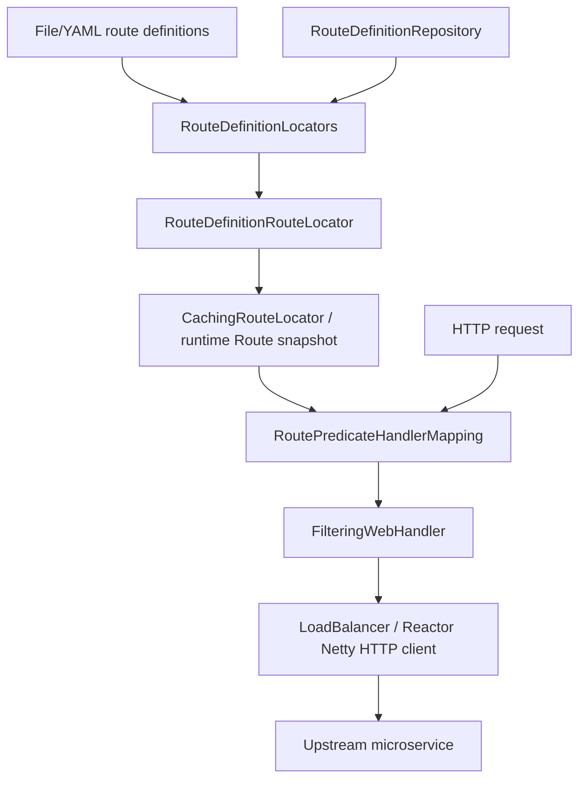
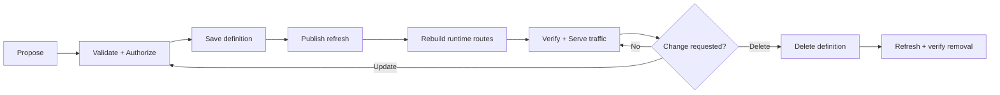
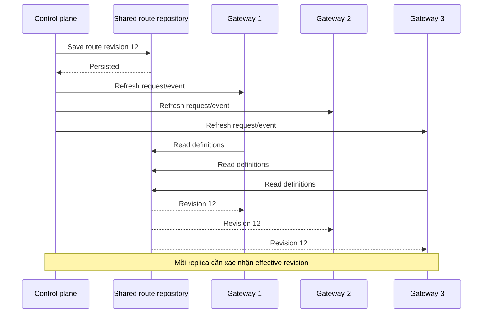

# RouteDefinitionRepository và vòng đời định nghĩa tuyến

Một API Gateway có thể được cấu hình bằng các route tĩnh trong `application.yml`. Tuy nhiên, khi hệ thống microservices cần mở dịch vụ mới, đổi đường dẫn, chuyển traffic sang phiên bản backend khác hoặc tạm ngừng một API, việc sửa file rồi khởi động lại toàn bộ Gateway không phải lúc nào cũng phù hợp. **Spring Cloud Gateway** cung cấp mô hình **định nghĩa tuyến (`RouteDefinition`)** cùng các abstraction đọc/ghi để quản lý tuyến động.

Trong chương **Tuyến động**, bài này tập trung vào **`RouteDefinitionRepository` và vòng đời của một định nghĩa tuyến**: tạo, cập nhật, lưu, nạp vào route runtime, refresh, quan sát, xóa và đồng bộ giữa các Gateway replicas. Nội dung liên hệ trực tiếp với route predicate, filter chain, sửa path/header, service discovery qua `lb://`, Spring Security, rate limiting, circuit breaker, retry, TLS và vận hành Gateway an toàn.

Điểm quan trọng nhất là: **lưu một `RouteDefinition` thành công chưa đồng nghĩa mọi Gateway instance lập tức dùng route mới**. Repository là nơi cung cấp dữ liệu cấu hình; runtime route locator/cache và cơ chế thông báo refresh là những thành phần riêng.

> **Phạm vi:** Ví dụ sử dụng **Spring Cloud Gateway Server WebFlux**. Tên class và một số API tương đối ổn định qua nhiều phiên bản, nhưng auto-configuration, route property prefix, Actuator endpoint và repository implementation có thể thay đổi. Gateway Server MVC không nên áp dụng nguyên xi luồng reactive này. Mọi thao tác cập nhật tuyến cần được giới hạn bằng phân quyền quản trị, validation và quy trình rollout.

## 1. Khi nào cần tuyến động?

Có hai cách quản lý route phổ biến:

| Cách quản lý | Ví dụ | Ưu điểm | Hạn chế |
| --- | --- | --- | --- |
| **Cấu hình tĩnh/declarative** | `spring.cloud.gateway.routes` trong YAML hoặc config server | Dễ review, version control, tái hiện môi trường | Thay đổi cần cơ chế reload/triển khai và quy trình đồng bộ cấu hình |
| **Định nghĩa tuyến động** | Ghi `RouteDefinition` thông qua repository/API quản trị | Cập nhật route khi Gateway đang chạy, phù hợp control plane | Cần persistence, validation, refresh, authz, audit, đồng bộ nhiều replicas |

Ví dụ hệ thống trước đây chỉ có:

```text
GET /api/orders/** -> lb://order-service
```

Nay cần phát hành:

```text
GET /api/orders/**       -> lb://order-service
GET /api/reports/**      -> lb://report-service
GET /api/partner/v2/**   -> lb://partner-service
```

Nếu bộ phận vận hành có một **control plane** phê duyệt thay đổi route, có thể lưu định nghĩa mới và yêu cầu các Gateway replicas nạp lại mà không khởi động lại toàn bộ ứng dụng.

**Tuyến động không đồng nghĩa tự khám phá từng pod/backend.** URI `lb://order-service` có thể giữ nguyên trong khi các service instances thay đổi. `RouteDefinitionRepository` quản lý **định nghĩa tuyến**, không phải danh sách IP của `DiscoveryClient` hay cache instance của Spring Cloud LoadBalancer.

## 2. Các lớp trong kiến trúc định tuyến của Gateway

Trước khi thay đổi cấu hình runtime, cần phân biệt các khái niệm:

| Thành phần | Dữ liệu/vai trò | Câu hỏi trả lời |
| --- | --- | --- |
| `RouteDefinition` | Mô tả route ở dạng cấu hình: ID, URI, predicates, filters, order, metadata | “Route được khai báo như thế nào?” |
| `RouteDefinitionLocator` | Cung cấp luồng `Flux<RouteDefinition>` | “Lấy định nghĩa từ nguồn nào?” |
| `RouteDefinitionWriter` | Giao diện lưu/xóa định nghĩa | “Ghi/xóa định nghĩa bằng cách nào?” |
| `RouteDefinitionRepository` | Kết hợp locator và writer cho kho định nghĩa có thể thay đổi | “Đọc và ghi route definitions từ một kho?” |
| `RouteDefinitionRouteLocator` | Chuyển route definitions thành đối tượng route runtime với predicate/filter đã bind | “Biến cấu hình thành route thực thi ra sao?” |
| `RouteLocator` | Cung cấp `Flux<Route>` cho runtime | “Những route nào có thể được matching?” |
| `CachingRouteLocator` | Cache snapshot các `Route` đã resolve ở runtime | “Gateway đang dùng snapshot route nào?” |
| `RoutePredicateHandlerMapping` | Chọn route dựa trên request và predicates | “Request này khớp route nào?” |
| `FilteringWebHandler` | Chạy chuỗi `GlobalFilter` và `GatewayFilter` của route đã chọn | “Những xử lý nào được áp lên request/response?” |



Sơ đồ cho thấy **đường đi logic của dữ liệu**. Trong ứng dụng thực tế có thể tồn tại nhiều locator được tổng hợp và các lớp cache khác nhau. Không nên suy ra “Gateway có một cache duy nhất và một repository duy nhất” cho mọi cấu hình.

### `RouteDefinition` khác `Route`

`RouteDefinition` là mô tả có thể lưu/serialize. `Route` là biểu diễn runtime đã được tạo để Gateway thực hiện matching/filtering.

Ví dụ định nghĩa:

```yaml
id: orders-read
uri: lb://order-service
predicates:
  - Path=/api/orders/**
  - Method=GET
filters:
  - StripPrefix=1
order: 10
metadata:
  owner: platform
  visibility: internal
```

Sau khi các factory xử lý, runtime cần có predicate kiểm tra request, filter thực thi `StripPrefix`, URI logic, order và metadata. **Việc sửa object cấu hình trong repository không trực tiếp thay thế mọi `Route` đã được cache trong handler mapping**; đó là lý do bước refresh có ý nghĩa.

## 3. `RouteDefinitionRepository` cung cấp những thao tác gì?

Ở các phiên bản Spring Cloud Gateway Server WebFlux sử dụng API này, `RouteDefinitionRepository` kết hợp hai contract:

```java
// Các chữ ký mô tả contract khái niệm,
// tương ứng với giao diện trong Spring Cloud Gateway.
public interface RouteDefinitionRepository
        extends RouteDefinitionLocator, RouteDefinitionWriter {
}
```

```java
public interface RouteDefinitionLocator {
    Flux<RouteDefinition> getRouteDefinitions();
}

public interface RouteDefinitionWriter {
    Mono<Void> save(Mono<RouteDefinition> route);
    Mono<Void> delete(Mono<String> routeId);
}
```

Ý nghĩa:

- `getRouteDefinitions()` phát những định nghĩa mà repository hiện cung cấp cho pipeline.
- `save(Mono<RouteDefinition>)` lưu một định nghĩa; tùy implementation, có thể có semantics **tạo hoặc ghi đè theo ID**.
- `delete(Mono<String>)` xóa định nghĩa theo route ID; lỗi khi route ID không tồn tại phụ thuộc implementation.
- `Mono<Void>` báo thao tác hoàn tất hoặc thất bại theo Reactive Streams.
- `Flux<RouteDefinition>` không phải array cố định hay API bắt buộc blocking.

**Cần nhớ:** `save` không có nghĩa “route đã nhận traffic mới trên tất cả replicas”. Nó báo công việc ghi hoàn thành theo contract repository. Refresh, kiểm tra route runtime và hội tụ giữa replicas là các bước khác.

### Reactive execution: phải có subscription

Trong Reactor, một lời gọi như:

```java
repository.save(Mono.just(definition));
```

**chưa đủ để bảo đảm thao tác được thực thi** nếu không có subscriber kích hoạt publisher. Trong controller WebFlux, nên **trả về `Mono`** để framework subscribe theo vòng đời HTTP request.

```java
// Mô tả ý tưởng: trả Mono cho WebFlux quản lý subscription.
Mono<Void> saveDefinition(RouteDefinition definition) {
    return repository.save(Mono.just(definition));
}
```

Không dùng `.subscribe()` tùy tiện trong controller/service chỉ để “ghi chạy nền”: client có thể nhận thành công quá sớm, exception bị tách khỏi HTTP response và cancellation/transaction có thể khó quản lý. Không gọi `.block()` trên Reactor Netty event loop.

## 4. Vòng đời đầy đủ của một định nghĩa tuyến

Một route được tạo động thường trải qua các mốc:

1. **Đề xuất:** control plane hoặc quản trị viên gửi một định nghĩa mới.
2. **Validation:** kiểm tra ID, URI scheme/host, predicates, filters, order, metadata và phạm vi được phép.
3. **Persistence:** lưu định nghĩa vào repository đáng tin.
4. **Refresh:** yêu cầu Gateway làm mới runtime route snapshot.
5. **Conversion/binding:** `RouteDefinitionRouteLocator` tìm các predicate/filter factory và xây route runtime.
6. **Activation:** route xuất hiện trong tập có thể match; chỉ request khớp mới dùng route.
7. **Observation:** kiểm tra route ID, metadata, route order và request thực tế.
8. **Update:** tạo revision mới, ghi đè/thay định nghĩa có kiểm soát và refresh lại.
9. **Delete/retire:** xóa định nghĩa, refresh, kiểm tra request mới không còn match và xử lý kết nối/request đang chạy.
10. **Recovery:** nếu restart hoặc replica mới được triển khai, nạp lại định nghĩa từ nguồn lưu bền vững.



**Đây là mô hình vận hành, không phải một transaction phân tán có sẵn của Gateway.** Giữa `save` và `refresh` có thể có khoảng thời gian repository đã chứa cấu hình mới nhưng runtime route cache vẫn dùng snapshot cũ.

### Bảng trạng thái thực tế

| Mốc | Trong repository | Trong runtime snapshot | Request mới |
| --- | --- | --- | --- |
| Trước khi tạo | Không có `reports` | Không có `reports` | Không match route đó |
| Sau `save`, chưa refresh | Đã có `reports` | Có thể vẫn chưa có | Chưa chắc match |
| Refresh hoàn tất thành công | Có `reports` | Đã nạp `reports` | Có thể match theo predicate/order |
| Sau update, chưa refresh | Definition mới | Có thể còn route cũ | Có thể dùng behavior cũ |
| Sau `delete`, chưa refresh | Đã xóa | Có thể vẫn cache route cũ | Có thể còn match trong thời gian ngắn |
| Sau xóa và hội tụ | Không còn | Không còn | Không còn route đó trong snapshot |

Không thể coi một **HTTP 200 của API quản trị save** là xác nhận route đã usable trên mọi Gateway replica.

## 5. Ví dụ RouteDefinition bằng Java

Một route được mô tả programmatically:

```java
RouteDefinition ordersRoute() {
    RouteDefinition definition = new RouteDefinition();

    definition.setId("orders-read-v2");
    definition.setUri(URI.create("lb://order-service"));
    definition.setOrder(10);

    definition.setPredicates(List.of(
        new PredicateDefinition("Path=/api/v2/orders/**"),
        new PredicateDefinition("Method=GET")
    ));

    definition.setFilters(List.of(
        new FilterDefinition("StripPrefix=2")
    ));

    definition.setMetadata(Map.of(
        "owner", "platform-team",
        "changeTicket", "CHG-2026-001"
    ));

    return definition;
}
```

Những kiểu thuộc Spring Cloud Gateway: `RouteDefinition`, `PredicateDefinition`, `FilterDefinition`; còn `URI`, `List` và `Map` thuộc Java. Cần dependency/module phù hợp với **Gateway Server WebFlux**.

Với `GET /api/v2/orders/42`:

- `Path=/api/v2/orders/**` match.
- `Method=GET` match.
- `StripPrefix=2` bỏ hai phân đoạn đầu `api` và `v2`, để lại `/orders/42`.
- `lb://order-service` nhờ LoadBalancer chọn upstream instance.
- `order=10` ảnh hưởng thứ tự xét route khi có nhiều route cạnh tranh.

**Route ID là danh tính kỹ thuật lâu dài của định nghĩa**, không phải URL. Giữ ID ổn định khi cập nhật cùng một route giúp tooling/metrics/audit dễ theo dõi; đổi ID thường là thêm route mới và xóa route cũ.

### Validation trước khi lưu là bắt buộc

Đoạn code trên chỉ tạo object. Một control plane an toàn phải kiểm tra:

- ID tuân thủ quy tắc định danh, không trùng với route không thuộc quyền quản trị.
- URI scheme chỉ thuộc allowlist (`lb`, `https` hoặc `http` theo môi trường).
- URI host/service ID được phép; không trỏ tới metadata endpoints hoặc mạng nội bộ nhạy cảm.
- Predicate và filter factory đã được allowlist; tham số regex/SpEL/header rewrite không chứa cấu hình nguy hiểm.
- `Path` không chiếm prefix ngoài phạm vi dịch vụ; `Host` được chứng minh thuộc domain được quản lý.
- Authn/authz, CORS, rate limiter, circuit breaker, TLS policies không bị loại bỏ vô ý.
- Order không khiến route mới bắt trộm request của route bảo vệ cao hơn.
- Metadata có owner, revision và lý do thay đổi để audit.

Không cho client công khai gửi raw `RouteDefinition` trực tiếp vào Gateway management endpoint.

## 6. Lưu route definition và yêu cầu refresh bằng code

Một service nội bộ có thể sử dụng repository và `ApplicationEventPublisher` để ghi định nghĩa rồi phát `RefreshRoutesEvent`:

```java
@Service
public class DynamicRouteAdministration {

    private final RouteDefinitionRepository repository;
    private final ApplicationEventPublisher publisher;

    public DynamicRouteAdministration(
            RouteDefinitionRepository repository,
            ApplicationEventPublisher publisher) {
        this.repository = repository;
        this.publisher = publisher;
    }

    public Mono<Void> upsert(RouteDefinition validatedDefinition) {
        // Caller phải xác thực/phân quyền và validate toàn bộ definition.
        return repository.save(Mono.just(validatedDefinition))
            .then(Mono.fromRunnable(() ->
                publisher.publishEvent(new RefreshRoutesEvent(this))));
    }

    public Mono<Void> delete(String validatedRouteId) {
        return repository.delete(Mono.just(validatedRouteId))
            .then(Mono.fromRunnable(() ->
                publisher.publishEvent(new RefreshRoutesEvent(this))));
    }
}
```

Đoạn code nêu **trình tự kỹ thuật cơ bản**, không phải API quản trị an toàn hoàn chỉnh:

1. `repository.save/delete` hoàn tất trước khi publisher phát sự kiện.
2. `RefreshRoutesEvent` yêu cầu các thành phần lắng nghe làm mới danh sách route.
3. `Mono.fromRunnable` gắn việc phát event vào reactive completion chain.
4. Method trả `Mono<Void>`, framework/caller phải subscribe.

**Không có bảo đảm distributed transaction:** Trong một hệ thống lưu route bằng Redis/DB hoặc dùng nhiều Gateway replicas, việc publish event ở replica đang nhận lệnh **không tự truyền tới tất cả các replica**. Cũng không bảo đảm listener đã rebuild thành công trước khi `Mono` hoàn thành; nên có cơ chế xác nhận rollout/activation riêng.

### Chú ý thứ tự và điều kiện lỗi

Nếu `save` thất bại, `then(...)` không chạy: refresh event không được phát ở luồng ví dụ. Nếu `save` thành công nhưng refresh thất bại hoặc route không bind được, repository vẫn có định nghĩa mới. Cần một quy trình **rollback/restore last-known-good** có kiểm chứng, không chỉ trả “update failed” rồi bỏ mặc trạng thái trung gian.

Nếu validation thực hiện sau `save` thì đã quá muộn: cấu hình nguy hiểm có thể được nạp khi một replica refresh. Validation phải là điều kiện **trước khi ghi**.

## 7. `RefreshRoutesEvent` khác làm mới service discovery

`RefreshRoutesEvent` liên quan đến việc **làm mới tập route runtime**. Nó không phải một command vạn năng để cập nhật mọi loại cache trong Gateway.

| Thay đổi | Lớp cần làm mới/kiểm tra |
| --- | --- |
| Thêm route `/api/reports/**` | Route definitions và runtime route cache |
| Sửa `Path`/`RewritePath` của route | Runtime route đã bind từ definition mới |
| Xóa route `orders` | Route repository + route cache ở các replicas |
| `order-service` thêm một pod | Discovery client/LoadBalancer instance supplier/cache |
| DNS của backend thay IP | DNS resolver + connection lifecycle |
| `LocalResponseCache` giữ body cũ | Response cache TTL/invalidation |
| JWT signing key của AS xoay vòng | Security/JWK cache theo cơ chế riêng |
| Cấu hình rate limiter thay đổi | Policy/configuration riêng, không chỉ route refresh |

**Refresh route không tương đương restart ứng dụng**: singleton beans, SecurityWebFilterChain, các HTTP connections và các caches khác có vòng đời riêng.

### Refresh ở một hay nhiều Gateway replicas?

Giả sử Gateway-1 và Gateway-2 cùng dùng repository lưu bền vững:

```text
Shared repository: route "reports" mới đã được lưu.

Gateway-1: nhận RefreshRoutesEvent -> runtime có "reports".
Gateway-2: chưa nhận refresh       -> runtime vẫn thiếu "reports".
```

Client đi qua load balancer phía trước Gateway có thể thấy lỗi lúc có lúc không. Đây là **vấn đề hội tụ cấu hình**.

Để đảm bảo rollout, control plane cần phối hợp cơ chế refresh trên **mọi replica** hoặc kiến trúc truyền sự kiện/cache invalidation đáng tin, kèm trạng thái xác nhận từng replica. Không giả định `ApplicationEventPublisher` có sẵn cơ chế broadcast qua mạng.

## 8. Repository in-memory và repository lưu bền vững

### In-memory

`InMemoryRouteDefinitionRepository` là một implementation được Gateway cung cấp trong những dòng phiên bản hỗ trợ. Nó tiện cho demo hoặc trường hợp route state cục bộ:

- Lưu definitions trong bộ nhớ **một tiến trình**.
- Không tự đồng bộ với tiến trình Gateway khác.
- Route được ghi runtime có thể mất khi process restart.
- Cần cách riêng để khởi tạo lại routes hoặc dùng cấu hình persistent.

Ví dụ mô hình:

```text
Gateway replica A:
  memory route definitions = [orders, reports]

Gateway replica B:
  memory route definitions = [orders]

Restart A:
  dữ liệu memory-only do API thêm runtime có thể biến mất
```

**Không dùng in-memory repository như hệ thống cấu hình duy nhất** nếu yêu cầu tuyến động phải tồn tại qua rolling restart hoặc scale-out.

### Redis/DB/shared repository

Một số phiên bản Spring Cloud Gateway có triển khai repository dựa trên Redis hoặc extension do ứng dụng cung cấp. Một repository tùy chỉnh cũng có thể đọc/ghi database:

```text
             +-------------------------+
             | Control plane (approved)|
             +------------+------------+
                          |
                          v
                  Shared route store
                          |
             +------------+------------+
             |                         |
             v                         v
        Gateway-1                  Gateway-2
   Repository locator         Repository locator
   Runtime route cache         Runtime route cache
```

Shared storage giải quyết **persistence và cùng nguồn cấu hình**, nhưng **không tự bảo đảm cùng snapshot runtime ngay tức thì**. Gateway-1 và Gateway-2 vẫn phải đọc lại và refresh đúng thời điểm.

### Chọn repository theo nhu cầu

| Tiêu chí | In-memory | Shared persistent |
| --- | --- | --- |
| Dễ thiết lập | Cao | Thêm hạ tầng |
| Sau restart còn route runtime vừa ghi? | Không chắc; thường mất nếu chỉ memory | Có nếu kho bền vững |
| Nhiều replicas tự có cùng dữ liệu? | Không | Cùng nguồn, nhưng cần refresh để hội tụ |
| Hỗ trợ version/audit/rollback? | Phải tự thêm | Có thể thiết kế ở control plane/storage |
| Rủi ro network/DB khi fetch | Thấp | Cần cache/fallback khi store không sẵn sàng |
| Phù hợp production tuyến động | Chủ yếu demo/nhiệm vụ cục bộ | Thường phù hợp hơn nếu được thiết kế tốt |

Không mặc định mọi Redis repository đều dùng cùng schema, key, cluster behavior hay tính năng refresh. Hãy xem tài liệu của **đúng phiên bản/implementation** đang vận hành.

## 9. Cập nhật và xóa: upsert không phải sửa tại chỗ route đang chạy

Giả sử route hiện tại:

```yaml
id: orders
uri: lb://order-service-v1
predicates:
  - Path=/api/orders/**
filters:
  - StripPrefix=1
order: 10
```

Muốn chuyển traffic sang `order-service-v2` bằng **giữ nguyên route ID**, control plane ghi định nghĩa mới:

```yaml
id: orders
uri: lb://order-service-v2
predicates:
  - Path=/api/orders/**
filters:
  - StripPrefix=1
order: 10
```

Các điều kiện thành công:

1. Repository đã ghi revision mới của ID `orders`.
2. Runtime route cache của mỗi Gateway replica đã được refresh thành công.
3. `lb://order-service-v2` thực sự có service instance khả dụng.
4. Backend v2 hỗ trợ đúng path/header/auth contract.
5. Các request mới sau hội tụ đã đi tới v2 theo kỳ vọng.

**Không thể bảo đảm mọi request in-flight đang proxy tới v1 sẽ đổi sang v2.** Request đã chọn route/instance và tạo connection có thể tiếp tục kết thúc theo luồng cũ. Đối với cutover, cần readiness, connection drain, timeout budget và kế hoạch rollback.

### Xóa route và tác dụng với traffic

Khi `delete("orders")` rồi refresh:

- Các request **mới** có thể không match `orders` nữa hoặc bị route khác khớp tùy route order.
- Các request **đã đi qua matching** trước lúc refresh có thể vẫn hoàn tất theo route cũ.
- Một route catch-all `Path=/**` có thể tiếp quản URL sau khi `orders` bị xóa, gây kết quả khác dự kiến.
- Nếu route cần bị tắt ngay vì sự cố bảo mật, cần chính sách chặn ở tầng đáng tin (Ingress/Security/policy), không chỉ trông chờ quá trình refresh eventually consistent.

**Delete route không phải delete backend service**; `order-service` vẫn có thể được gọi từ client khác hoặc route khác.

## 10. Route ID, order và xung đột nhiều nguồn cấu hình

Gateway có thể kết hợp:

- Route definitions từ YAML/properties.
- Route definitions trong repository.
- Definitions được tạo từ service discovery locator.
- Routes được tạo bằng Java DSL hoặc locator tùy chỉnh.

Một route ID giống nhau được đưa vào từ nhiều nguồn **không phải chiến lược override cấu hình rõ ràng**. Tùy cách tổng hợp locator, có thể xuất hiện xung đột hoặc kết quả khó dự đoán. Thiết kế nên xác định **một chủ sở hữu cho mỗi namespace route ID**.

Ví dụ namespace:

```text
static-public-catalog
dynamic-partner-acme
dynamic-invoice-v2
discovery-internal-inventory
```

Route `order` ảnh hưởng trình tự xét predicate khi có nhiều route cùng khớp:

| Route | Predicate | Order | Hệ quả khả dĩ |
| --- | --- | ---: | --- |
| `generic-api` | `Path=/api/**` | 100 | Catch-all API |
| `specific-orders` | `Path=/api/orders/**` | 10 | Có thể được ưu tiên hơn generic |
| `admin-api` | `Path=/api/admin/**` | 0 | Dành cho Admin, cần Security riêng |

Giá trị order nhỏ thường được ưu tiên trước trong cách sắp xếp route theo Spring ordering. Khi thêm route mới, phải test với các URL chồng lấn để tránh route bắt request dành cho API khác. **Predicate match không thay thế phân quyền**: dù route admin ưu tiên đúng, backend/Gateway vẫn phải kiểm tra quyền người dùng.

### Metadata và revision

`RouteDefinition` có thể mang `metadata` phục vụ quản trị, ví dụ owner/changeTicket/revision. Nhưng **metadata không mặc định là authorization policy hoặc concurrency-control mechanism**. Nếu muốn cập nhật có điều kiện theo revision, control plane/storage cần kiểm tra revision và bảo đảm tính nguyên tử của thao tác.

Không cho phép bất kỳ client nào chỉ cần tự gắn `metadata.owner=platform` để được phép ghi route của platform.

## 11. Cần validation và trust boundary cho API quản lý tuyến

Thay đổi route là quyền vận hành rất mạnh. Một route có thể chuyển toàn bộ request, thay đổi headers, ảnh hưởng authentication context và làm Gateway gọi địa chỉ bất kỳ.

### Những rủi ro phổ biến

| Rủi ro | Ví dụ | Cách phòng ngừa |
| --- | --- | --- |
| **SSRF** | Route mới trỏ tới metadata endpoint hoặc IP nội bộ bị cấm | Allowlist scheme/service IDs/host/network egress |
| **Privilege bypass** | Route mới cho `/api/admin/**` đi tới dịch vụ không xác thực | Review path/order, kiểm tra Security và backend authz |
| **Token leakage** | Route chuyển Bearer token sang host do attacker kiểm soát | Policy outbound destinations, header scrubbing, token audience |
| **Header spoofing** | Filter thêm `X-User-Id` từ input chưa tin cậy | Sanitization, signed identity, không tin client headers |
| **Regex DoS/route shadowing** | Predicate/filter regex quá tốn tài nguyên hoặc catch-all | Validate regex, filter allowlist, kiểm tra overlap |
| **Excessive retries/rate bypass** | Route bỏ rate limiter hoặc bật retry vô hạn | Bắt buộc security/traffic guardrails |
| **CORS misconfiguration** | Route vô tình cho wildcard origin cùng credentials | CORS policy tập trung và testing |
| **TLS downgrade** | Đổi `https://` sang `http://` khi backend có dữ liệu nhạy cảm | Scheme/TLS policy, truststore và mTLS |
| **Information disclosure** | Actuator trả routes/filters công khai | Bảo vệ management endpoints |
| **Cache contamination** | Route private bật shared response cache | Review cache eligibility và identity scope |

**Không xem `RouteDefinition` là dữ liệu thuần vô hại**. Nó tác động trực tiếp tới cách Gateway xử lý network traffic. Vì vậy route creation/update phải có xác thực mạnh, phân quyền theo namespace, audit bất biến và phê duyệt thay đổi khi phù hợp.

### Mô hình quyền hợp lý

- **Reader:** xem định nghĩa và trạng thái route, không sửa.
- **Editor của một namespace:** đề xuất route trong prefix/service ID được phép.
- **Approver/operator:** phê duyệt và activate bản đã được validate.
- **Emergency operator:** có quyền disable/rollback có kiểm soát, ghi audit.
- **Platform admin:** quản lý policy allowlist; không công khai qua internet.

Tách API quản trị khỏi public API bằng network policy, mTLS hoặc authentication/authorization tương xứng. Không chỉ dựa vào `Origin`/CORS; client không phải browser có thể gọi management API trực tiếp.

## 12. Actuator Gateway endpoints và vòng đời route

Một số phiên bản Spring Cloud Gateway cung cấp **Actuator Gateway endpoints** để quan sát/quản lý routes, ví dụ các đường dẫn thường gặp:

```text
GET    /actuator/gateway/routes
GET    /actuator/gateway/routes/{id}
GET    /actuator/gateway/routedefinitions
POST   /actuator/gateway/routes/{id}
DELETE /actuator/gateway/routes/{id}
POST   /actuator/gateway/refresh
```

**Không giả định tất cả endpoint/method trên được bật hoặc cho phép ghi ở bản đang dùng.** Spring Boot Actuator và Spring Cloud Gateway đã thay đổi cấu hình exposure/access qua các phiên bản; nhiều hành động nguy hiểm cần bật quyền truy cập management rõ ràng. Kiểm tra danh sách endpoint thực tế được hỗ trợ và bảo vệ bằng authz/network.

### Phân biệt API quản trị và trạng thái runtime

- Một API ghi route có thể sửa **repository**.
- Một API refresh có thể yêu cầu **runtime route locator/cache** đọc lại.
- API đọc `/routes` có thể phản ánh **runtime effective routes**.
- API `/routedefinitions`, nếu hỗ trợ, có thể hiển thị **definitions** từ các source.

Do đó hai endpoint quan sát có thể không giống nhau trong khoảng thời gian giữa save và refresh, hoặc do route không bind được. Đó là dữ kiện để điều tra lifecycle, không chỉ là vấn đề “API trả sai”.

### Không bật full Actuator public để thử cho nhanh

Các management endpoints có thể lộ route URI, internal service IDs, filter arguments hoặc cho phép chuyển traffic đến host tùy ý. Chỉ expose những endpoint thật sự cần, tại cổng/network phù hợp, bật xác thực/phân quyền, logging audit và hạn chế methods được phép. Khi endpoint không cần thiết sau triển khai, tắt quyền ghi.

## 13. Nhiều Gateway replicas: từ persistence đến eventual consistency

Giả sử Gateway có ba replicas:



**Shared repository là cần thiết nhưng chưa đủ.** Có thể xảy ra:

- Gateway-1 refresh thành công revision 12.
- Gateway-2 chưa nhận event nên vẫn dùng revision 11.
- Gateway-3 nhận event nhưng bind predicate/filter mới thất bại.
- Front load balancer tiếp tục phân phối requests cho cả ba.

Kết quả người dùng là route **lúc khớp, lúc 404/503** tùy replica.

### Thiết kế cơ chế hội tụ

Một control plane đáng tin cần:

1. **Revision/version:** mỗi thay đổi có revision riêng.
2. **Persist trước, activate sau:** khi cần, validation cấu hình mới trước khi publish.
3. **Refresh fan-out:** thông báo tới tất cả Gateway replicas bằng cơ chế đáng tin phù hợp.
4. **Readback:** từng replica trả về revision/effective route set đã nạp.
5. **Health/canary:** xác minh request thật qua route mới ở một số replica trước khi rollout rộng.
6. **Timeout/retry hữu hạn:** có deadline khi đợi replicas và cảnh báo nếu chỉ một phần hội tụ.
7. **Rollback:** biết revision trước đó, khôi phục store và refresh lại.
8. **Audit:** ghi ai đề xuất, ai phê duyệt, khi nào ghi, khi nào active.

Không mặc định một HTTP 202/200 từ control plane có nghĩa **100% replicas đã dùng revision mới**. API phải định nghĩa rõ trạng thái “persisted”, “refresh requested”, “active on N/M replicas”, “failed” và “rolled back”.

## 14. Concurrency và lost update khi nhiều người sửa cùng route

Giả sử hai operator cùng đọc revision `v7`:

```text
Operator A: v7 -> đổi uri sang order-v2
Operator B: v7 -> thêm RateLimiter

A save v8 (uri=order-v2).
B save v8 (từ bản v7, chỉ thêm RateLimiter).

Nếu last-write-wins: cập nhật uri của A có thể bị mất.
```

`RouteDefinitionWriter.save(...)` tự nó không định nghĩa **optimistic locking** cho cả hệ thống. Một repository tùy chỉnh có thể có semantics update khác; nếu cần tránh lost update, control plane/storage nên có:

- `revision`/version gắn riêng với route.
- API `If-Match` hoặc expectedRevision.
- So sánh và ghi nguyên tử (`compare-and-swap`) tại store.
- Conflict response như `409 Conflict` khi revision không còn đúng.
- Chỉ publish refresh khi update đã được commit.
- Audit revision trước/sau và đường rollback.

Ví dụ contract logic:

```http
PUT /internal/route-admin/routes/orders HTTP/1.1
If-Match: "route-orders-v7"
Content-Type: application/json

{"id":"orders","uri":"lb://order-service-v2", "...":"..."}
```

**API này chỉ là ví dụ thiết kế control plane**, không phải một endpoint mặc định của Spring Cloud Gateway. Payload thật phải đúng schema đã được validate; không để quản trị viên chưa có quyền tùy ý thay filter/security headers.

### Delete cần xử lý race

Nếu A đang update route trong khi B delete, thứ tự giao dịch có thể khiến route vừa xóa xuất hiện lại. Dùng versioned delete/tombstone hoặc transaction/locking phù hợp để tránh “resurrection” ngoài ý muốn, đặc biệt khi có consumer refresh theo sự kiện.

## 15. Refresh thất bại và quản lý cấu hình last-known-good

Một route mới có thể được lưu thành công nhưng không load được:

- Predicate factory name viết sai.
- Filter factory không có trong dependency.
- URI không hợp lệ hoặc scheme không được hỗ trợ.
- Regex không parse được.
- Tham số filter thiếu/không đúng kiểu.
- Route metadata hoặc order xung đột chính sách.
- Repository không truy cập được trong lúc refresh.
- Bug trong custom predicate/filter factory.

**Phân biệt lỗi load route với lỗi gọi backend**:

| Sự kiện | Lỗi xảy ra ở đâu? | Cần kiểm tra |
| --- | --- | --- |
| Lưu thất bại | Repository/DB/validation | Persistence và dữ liệu đầu vào |
| Refresh/conversion lỗi | RouteDefinitionRouteLocator hoặc factory binding | Predicate/filter args và logs refresh |
| Route không match | Handler mapping/predicate/order | Effective routes, path/method/host |
| Route match nhưng `lb://` không tìm thấy service | Discovery/LoadBalancer | Instances, service ID, cache |
| Route match nhưng upstream 503 | Backend/network/filter | Upstream health, circuit breaker |
| TLS handshake lỗi | Reactor Netty HTTP client | Certificate, hostname/SNI, truststore |
| Authn trả 401 trước mapping | Spring Security WebFilter | JWT/session/route policy |

**Không khẳng định Gateway tự rollback mọi thay đổi invalid**. Behavior xử lý refresh errors và cache cũ có thể khác theo phiên bản/cấu hình. Hệ thống vận hành nên có cách xác minh route effective, lưu revision tốt gần nhất và khôi phục nếu bản mới thất bại.

### Một quy trình an toàn hơn

```text
1. Draft route -> validate syntax + policy.
2. Kiểm thử trên Gateway staging/canary.
3. Ghi revision mới vào repository.
4. Phát refresh đến nhóm Gateway canary.
5. Xác nhận effective route và request end-to-end.
6. Mở rộng rollout tới replicas còn lại.
7. Theo dõi lỗi/latency/circuit breaker.
8. Nếu vượt ngưỡng -> restore previous revision + refresh.
```

Không dùng việc refresh ngay lập tức trên 100% replicas làm phương thức duy nhất nếu route thay đổi có nguy cơ ảnh hưởng toàn bộ API trọng yếu.

## 16. Route động và filter chain: cập nhật có thể thay đổi an ninh/hiệu năng

Một route có thể chứa các filter như:

```yaml
filters:
  - StripPrefix=1
  - name: RequestRateLimiter
    args:
      redis-rate-limiter.replenishRate: 20
      redis-rate-limiter.burstCapacity: 40
  - name: CircuitBreaker
    args:
      name: ordersBreaker
      fallbackUri: forward:/fallback/orders
  - name: Retry
    args:
      retries: 2
      methods:
        - GET
      series:
        - SERVER_ERROR
```

Khi cập nhật một route động:

- **Route predicate** mới quyết định request nào đến route.
- **Filter list** mới có thể thay đổi authentication-related headers, giới hạn lưu lượng và retry/circuit-breaker policy.
- **Route order** mới có thể khiến route khác mất traffic.
- **URI `lb://`** mới chuyển đích sang service ID khác.
- **Response cache** trên route private có thể tạo leak nếu bật thiếu kiểm soát.
- **Fallback URI** có thể trỏ đến handler trả dữ liệu không phù hợp hợp đồng.
- **TLS config của outbound client** không nhất thiết thay đổi chỉ vì một route được refresh.

Do đó control plane cần biết **những filter/predicate nào được phép sửa động**. Không nên để một tenant tự tạo route gọi backend bất kỳ hoặc vô hiệu hóa rate limiting/authz bằng cách thay YAML filter list.

### Filter arguments cần versioning

Tên và tham số của một GatewayFilter Factory có thể thay đổi khi nâng Spring Cloud Gateway. Một route definition được lưu nhiều tháng có thể không còn bind được sau khi deploy framework mới. Khi nâng version:

1. Quét definitions trong repository.
2. Validate factory names và args với bản mới.
3. Chạy migration/dry-run trên staging.
4. Có rollback nếu conversion lỗi.
5. Theo dõi các route quan trọng sau rolling upgrade nhiều Gateway replicas.

Đây là một vấn đề **schema compatibility** của dữ liệu cấu hình động; không được bỏ qua vì route đang ở Redis/DB thay vì YAML.

## 17. Tương tác với Service Discovery, TLS và CORS

### Discovery: đổi instance không cần tạo route mới

`lb://order-service` là URI logic tới một service ID. Khi service scale từ 2 lên 4 instances, definition `orders` có thể giữ nguyên. LoadBalancer và DiscoveryClient chịu trách nhiệm danh sách instances. Không nên tạo một route riêng cho từng pod, vì pod IP thay đổi sẽ làm repository chứa rất nhiều routes khó quản lý.

Nếu service ID mới `order-service-v2` chưa được discovery cung cấp, route update có thể activation thành công nhưng request gặp lỗi **no available instance**. Vì vậy phải kiểm tra readiness/service discovery trước cutover.

### TLS: đổi URI không tự cấp certificate mới

Nếu route từ `https://orders.internal.example` đổi sang `https://orders-green.internal.example`, Reactor Netty HTTP client cần trust chain/hostname verification phù hợp. Repository không tự cấu hình truststore/mTLS/SNI cho mọi đích; sai certificate sẽ gây lỗi dù route definition được lưu và refresh thành công.

Không cho phép route động tự hạ HTTPS thành HTTP khi policy yêu cầu TLS.

### CORS và Security: không để cấu hình động vượt trust boundary

CORS policy thường được áp ở WebFlux/Spring Security/Gateway handler mapping. Thêm route mới mà bỏ quên policy preflight có thể làm OPTIONS bị 401/404 hoặc gây header trùng. Nhưng **CORS không phải authentication**: nếu route lộ API admin, cấm origin trong browser không ngăn client không phải browser truy cập.

Đặc biệt, những route cho API quản trị phải có xác thực/phân quyền mạnh tại Gateway và backend; không coi `Path` predicate là access control.

## 18. Kiểm thử repository: save, get, update, delete

Đầu tiên phải kiểm chứng **contract dữ liệu**, chưa cần khởi động HTTP server thật.

### Phác thảo test với Reactor `StepVerifier`

```java
@Test
void savesAndListsRouteDefinition() {
    RouteDefinition def = new RouteDefinition();
    def.setId("test-orders");
    def.setUri(URI.create("http://localhost:8081"));
    def.setPredicates(List.of(
        new PredicateDefinition("Path=/test/orders/**")));

    StepVerifier.create(repository.save(Mono.just(def)))
        .verifyComplete();

    StepVerifier.create(
            repository.getRouteDefinitions()
                .filter(route -> route.getId().equals("test-orders"))
                .single())
        .assertNext(saved -> {
            assertEquals("test-orders", saved.getId());
            assertEquals(URI.create("http://localhost:8081"), saved.getUri());
        })
        .verifyComplete();
}
```

Đây là đoạn test minh họa; `repository` phải được khởi tạo từ implementation thật, cùng imports, JUnit 5, Reactor Test và assertion tương ứng.

### Kiểm tra delete

```java
@Test
void deletesRouteDefinition() {
    StepVerifier.create(
        repository.delete(Mono.just("test-orders")))
        .verifyComplete();

    StepVerifier.create(
        repository.getRouteDefinitions()
            .filter(route -> route.getId().equals("test-orders")))
        .verifyComplete();
}
```

Test giả định route đã tồn tại trước khi delete. Nếu repository implementation xử lý missing ID bằng lỗi, hãy test đúng hợp đồng đó thay vì coi delete always-idempotent.

**Test repository chỉ chứng minh persistence contract**, chưa chứng minh route runtime đã refresh và nhận traffic.

## 19. Kiểm thử tích hợp: xác minh route có thực sự hoạt động

Một integration test nên thiết lập Gateway, repository, endpoint quản trị nội bộ đã bảo vệ (hoặc gọi service quản trị trong fixture), upstream stub và `WebTestClient`.

Kịch bản:

```text
T0: Không có route /dynamic/orders/**
    GET /dynamic/orders/42 -> không match (theo test config)

T1: Save definition:
    id=dynamic-orders
    Path=/dynamic/orders/**
    uri=http://localhost:8081
    StripPrefix=1

T2: Refresh local route runtime.
    Xác minh effective route list có dynamic-orders.

T3: GET /dynamic/orders/42
    Upstream mock nhận GET /orders/42.
    Client nhận body/status theo contract.

T4: Update same route ID:
    uri=http://localhost:8082

T5: Refresh và verify.
    GET /dynamic/orders/42 -> upstream 8082 nhận; 8081 không nhận request mới.

T6: Delete definition, refresh.
    GET /dynamic/orders/42 -> không còn match dynamic-orders.
```

**Không assert “save Mono complete → request tiếp theo ngay lập tức phải dùng route mới”** nếu refresh bất đồng bộ chưa được quan sát. Sử dụng tín hiệu/cơ chế xác nhận effective runtime snapshot và deadline test phù hợp.

### Ví dụ WebTestClient sau khi route active

```java
@Test
void dynamicRouteForwardsToExpectedBackend() {
    // Test fixture đã save route, refresh và xác nhận activation.

    webTestClient.get()
        .uri("/dynamic/orders/42")
        .exchange()
        .expectStatus().isOk()
        .expectBody()
        .jsonPath("$.id").isEqualTo("42");

    wireMockServer.verify(
        1, getRequestedFor(urlEqualTo("/orders/42")));
}
```

Đây là mảnh test cần fixture tương ứng. Nếu route predicate khác, filter order khác hoặc Security chặn request, phải điều chỉnh test để kiểm tra đúng tầng. HTTP `200` không chứng minh backend đã đúng nếu response đến từ cache/fallback; kiểm tra cả upstream request journal.

## 20. Ma trận kiểm thử vòng đời định nghĩa tuyến

| Trường hợp | Hành động | Assertion quan trọng |
| --- | --- | --- |
| T1 | Save route hợp lệ | Repository chứa definition đúng ID/URI |
| T2 | Save rồi không refresh | Không giả định runtime đã nhận route mới |
| T3 | Refresh sau save | Effective route mới xuất hiện |
| T4 | GET khớp path/method | Đến đúng upstream/path sau filters |
| T5 | Update cùng route ID | Definition mới thay route cũ sau refresh |
| T6 | Delete route | Runtime không còn match sau hội tụ |
| T7 | Delete ID không tồn tại | Behavior đúng contract repository |
| T8 | Trùng ID giữa nhiều route sources | Bị phát hiện/chặn bởi naming policy |
| T9 | Route mới shadow `/api/admin/**` | Validation từ chối hoặc ưu tiên đúng |
| T10 | URI trỏ IP/internal metadata bị cấm | Validation chống SSRF |
| T11 | Filter/predicate factory không hợp lệ | Không activate cấu hình sai |
| T12 | Repository ghi thất bại | Không phát thông báo active thành công |
| T13 | Refresh lỗi sau save | Phát hiện mismatch và rollback có kiểm soát |
| T14 | Concurrent update cùng revision | Có conflict, không mất update |
| T15 | Delete đồng thời update | Không làm route đã xóa sống lại |
| T16 | Restart Gateway in-memory | Xác minh dữ liệu động có bị mất không |
| T17 | Restart Gateway với shared store | Nạp lại definitions như policy |
| T18 | Nhiều Gateway replicas | Tất cả hội tụ đúng revision |
| T19 | Replica chậm refresh | Control plane báo partial rollout |
| T20 | `lb://` chưa có instance | Route active nhưng proxy lỗi được phân loại đúng |
| T21 | TLS backend sai hostname | Không vô hiệu certificate validation |
| T22 | Security thiếu token | Không bypass do route dynamic |
| T23 | RateLimiter/CircuitBreaker/Retry filters | Chạy đúng scope sau update |
| T24 | Route private vô tình có response cache | Guardrails chặn và test không leak |
| T25 | Request in-flight khi delete | Không giả định bị dừng tức thì |
| T26 | Rolling upgrade Gateway | Definitions cũ vẫn bind hoặc được migration |

**Điểm xác nhận kép:** repository chứa definition đúng **và** runtime Gateway đang sử dụng route đúng. Cần xác minh ở từng replica nếu chạy nhiều process.

## 21. Observability: phân biệt persisted, active và matched

Một hệ thống route management cần theo dõi ít nhất ba lớp:

1. **Persisted:** cấu hình nào đã được ghi vào repository?
2. **Active/effective:** cấu hình nào đã được route locator/cache nạp thành `Route`?
3. **Matched/used:** request thực tế đi qua route nào, upstream nào, kết quả ra sao?

| Trường/metric/event | Câu hỏi |
| --- | --- |
| Route ID, revision, owner | Đang bàn đến định nghĩa nào? |
| Save/delete operation status | Repository đã chấp nhận thay đổi chưa? |
| Refresh event time | Đã yêu cầu reload lúc nào? |
| Refresh completion/error | Runtime build có thành công không? |
| Effective route count/list hash | Replica đang dùng snapshot nào? |
| Gateway replica ID | Có replica nào lệch revision không? |
| Route match count | Route mới có nhận traffic chưa? |
| Upstream service ID/URI | Đích logic và vật lý đúng không? |
| HTTP status/latency | Traffic sau cutover có khỏe không? |
| Rate limiter/CircuitBreaker/Retry metrics | Filter policy mới có tác dụng không? |
| Audit actor/change ticket | Ai đề xuất/phê duyệt thay đổi? |
| Rollback event | Khi nào và vì sao phục hồi revision cũ? |

Tên metric và actuator endpoints phụ thuộc version/Micrometer instrumentation. Không mặc định Gateway cung cấp sẵn field `revision` cho mọi route; đó có thể là metadata riêng do control plane quản lý. Không đưa raw token, secret filter args hoặc thông tin nhạy cảm vào logs/metric labels.

### Kiểm tra một route không nhận traffic

Nếu route đã có trong repository mà request trả 404/503:

1. **Có route runtime sau refresh không?** Nếu chưa, đây là vấn đề lifecycle.
2. **Predicate có khớp?** Kiểm tra path, method, host, headers, route order.
3. **Security có chặn trước route?** `401`/`403` khác routing.
4. **Filter có làm path sai?** `StripPrefix`/`RewritePath`.
5. **Service discovery có instance?** `lb://` đúng service ID chưa?
6. **TLS/DNS/connect có lỗi?** Route match vẫn có thể proxy thất bại.
7. **Fallback/cache có che lỗi?** HTTP status cuối không luôn nói rõ upstream.
8. **Replica nào phục vụ request?** Route update có thể mới active ở một phần cluster.

## 22. Những nhầm lẫn phổ biến

| Nhận định sai | Cách hiểu đúng |
| --- | --- |
| “`save()` thành công là route active ngay” | Cần refresh/activation và kiểm chứng runtime |
| “`RouteDefinitionRepository` là nơi chọn route mỗi request” | Repository cấp definitions; runtime locator/mapping chọn route |
| “`RouteDefinition` và `Route` là một object” | Definition là dữ liệu cấu hình, Route là biểu diễn runtime |
| “`RefreshRoutesEvent` broadcast mọi Gateway replicas” | Event local; distributed refresh cần thiết kế thêm |
| “Repository chung nghĩa mọi replica cùng snapshot” | Vẫn cần refresh và xác nhận hội tụ |
| “Route nằm trong RAM thì tồn tại sau restart” | In-memory data có thể mất khi tiến trình dừng |
| “Xóa route dừng ngay request đang chạy” | In-flight request có thể tiếp tục; cần drain/cutoff policy riêng |
| “Mỗi pod backend cần một route definition” | `lb://service-id` và discovery xử lý thay đổi instance |
| “Route ID trùng trong hai nguồn sẽ tự override đúng” | Cần namespace/ownership và tránh collision |
| “Metadata owner tự cấp quyền cho người sửa” | Metadata không phải authorization |
| “Route order không ảnh hưởng bảo mật” | Route shadowing có thể chuyển request sang backend sai |
| “Một refresh sẽ xóa DNS/cache response” | Các cache có vòng đời riêng |
| “Actuator ghi route có thể mở công khai để tiện” | Đây là quyền quản trị mạnh, có rủi ro SSRF và bypass |
| “Route được nạp là backend chắc khỏe” | LB/discovery/TLS/upstream vẫn có thể lỗi |
| “Có rollback trong DB là đã rollback runtime” | Phải refresh và kiểm tra từng replica |
| “HTTP 200 từ API save xác nhận cả cluster” | Chỉ có ý nghĩa theo contract của API quản trị |

## 23. Runbook tạo hoặc cập nhật route động trong production

**Trước thay đổi:**

1. Ghi yêu cầu và chủ sở hữu route; xác định revision đang active.
2. Kiểm tra policy URL prefix, service ID, TLS, security, CORS, rate limiting, caching và retry.
3. Kiểm tra route conflicts, order và overlap với các tuyến admin/private.
4. Validate schema và factory arguments theo phiên bản Spring Cloud Gateway đang chạy.
5. Chuẩn bị rollback definition và xác định blast radius.

**Khi triển khai:**

6. Lưu revision mới theo cơ chế kiểm soát concurrency.
7. Phát refresh có kiểm soát, ưu tiên canary nếu thay đổi quan trọng.
8. Đọc lại route runtime/effective state; không chỉ nhìn repository.
9. Gửi request test thực qua đúng path/method/host và xác minh upstream.
10. Thu thập trạng thái từng Gateway replica; kiểm tra latency, 4xx/5xx, rate limit, circuit breaker và retry.

**Sau triển khai:**

11. Quan sát đủ thời gian theo traffic và timeout budget.
12. Nếu partial rollout, ghi nhận replica/revision lệch và repair có giới hạn.
13. Nếu lỗi vượt ngưỡng, restore revision trước, refresh và verify toàn cụm.
14. Lưu audit: actor, timestamp, route ID, revision trước/sau và kết quả.
15. Với route bị retire, theo dõi request in-flight/connection drain và xóa chính thức khi đủ điều kiện.

### Quy tắc khẩn cấp

Nếu một route vô tình mở endpoint nội bộ hoặc chuyển token sang host ngoài ý muốn, ưu tiên **chặn traffic ở ranh giới đáng tin** và vô hiệu route trên toàn cụm, sau đó xem xét các kết nối đang tồn tại và bằng chứng audit. Không chỉ gọi delete trên một replica rồi giả định sự cố kết thúc.

## 24. Bài tập thực hành: kiểm soát tuyến động cho ba Gateway replicas

Một hệ thống SaaS có:

- Ba Gateway replicas `gateway-a`, `gateway-b`, `gateway-c`.
- Shared route store do control plane quản lý.
- Route `orders` hiện tại: `Path=/api/orders/**`, `uri=lb://order-service-v1`.
- Route `reports` mới: `Path=/api/reports/**`, `uri=lb://report-service`.
- Mọi request API phải đi qua Spring Security; route admin không được public.
- Một route `Path=/api/**` chung có `order=100`.

### Nhiệm vụ 1 — thêm reports

Tạo một `RouteDefinition`:

```yaml
id: dynamic-reports
uri: lb://report-service
predicates:
  - Path=/api/reports/**
  - Method=GET
filters:
  - StripPrefix=1
order: 10
metadata:
  owner: platform
  revision: "12"
```

Sau khi validation và save, phát refresh tới ba replicas và kiểm tra:

- `dynamic-reports` đã xuất hiện ở effective route snapshot mỗi replica chưa?
- `GET /api/reports/42` có đến `report-service` với path `/reports/42` không?
- `POST /api/reports/42` có bị routing theo một route khác không, và có đúng policy không?
- User thiếu quyền có bị Spring Security/backend chặn không?
- Nếu `report-service` chưa có instance, lỗi có được phân loại là discovery issue thay vì route missing không?

### Nhiệm vụ 2 — update orders

Thay URI của route ID `orders` từ `lb://order-service-v1` sang `lb://order-service-v2` **mà không xóa/recreate ID**. Gắn revision mới và dùng optimistic locking để tránh lost update. Canary một replica, xác nhận v2 sẵn sàng/TLS/auth contract, rồi refresh cả cụm.

### Nhiệm vụ 3 — xóa reports

Xóa `dynamic-reports` theo revision đã phê duyệt. Refresh và kiểm tra runtime route không còn khớp; chú ý catch-all `/api/**` có thể nhận request sau khi route specific bị xóa. Nếu mục tiêu là trả `410 Gone` hoặc `404` rõ ràng, thiết kế policy phù hợp thay vì tin rằng delete route luôn tạo status cố định.

### Câu hỏi tự kiểm tra

1. `RouteDefinitionRepository` kết hợp những hai interface nào?
2. `RouteDefinition` và `Route` khác nhau tại điểm nào?
3. `save(Mono<RouteDefinition>)` trả về kiểu gì và khi nào thao tác thực sự chạy?
4. Vì sao lưu thành công chưa chắc request tiếp theo đã dùng route mới?
5. `RefreshRoutesEvent` tác động tới cache nào, và không tự làm mới các cache nào?
6. In-memory repository khác shared persistent repository ra sao khi Gateway restart?
7. Shared repository đã đủ để ba Gateway replicas luôn cùng route revision chưa?
8. Nếu một replica bind filter mới lỗi, control plane cần báo trạng thái gì?
9. Vì sao route ID nên có namespace/owner rõ ràng khi nhiều nguồn route definitions?
10. Tại sao việc sửa `order` của route có thể ảnh hưởng route shadowing?
11. Nếu `lb://service` có pod mới, có cần ghi RouteDefinition mới cho pod không?
12. Xóa route có hủy ngay những request đang streaming hay không?
13. Metadata owner/revision có thay thế authentication và optimistic locking không?
14. Vì sao control plane không nên nhận mọi URI/host từ quản trị viên chưa đủ quyền?
15. Test repository và test HTTP end-to-end chứng minh hai điều gì khác nhau?
16. Khi một route active mà client gặp `503`, cần phân biệt lớp nào?
17. Vì sao không nên công khai Actuator Gateway write endpoints?
18. Khi nhiều người update cùng một route, cách tránh lost update là gì?
19. Nếu rollback definition trong DB, còn bước nào để khôi phục runtime?
20. Ba trạng thái **persisted**, **active** và **matched** giúp chẩn đoán route động thế nào?

**Ghi nhớ:** **`RouteDefinitionRepository` là nguồn đọc/ghi định nghĩa tuyến, không phải chính runtime router**. Tuyến động đi qua các giai đoạn **validate → save → refresh → convert → active → observe → update/delete → refresh/reconcile**. Trong cụm nhiều Gateway replicas, repository chung không tự đồng bộ cache route; cần revision, refresh fan-out, readback, rollback và audit. Bảo vệ chặt API quản trị, kiểm tra route order/filter/URI và phân biệt route cache với service discovery, DNS, TLS hoặc response cache để Spring Cloud Gateway thay đổi cấu hình mà không mở rộng rủi ro bảo mật hay gây lỗi định tuyến khó phát hiện.

