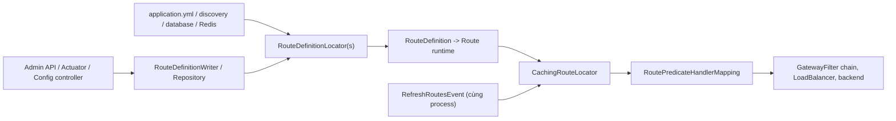
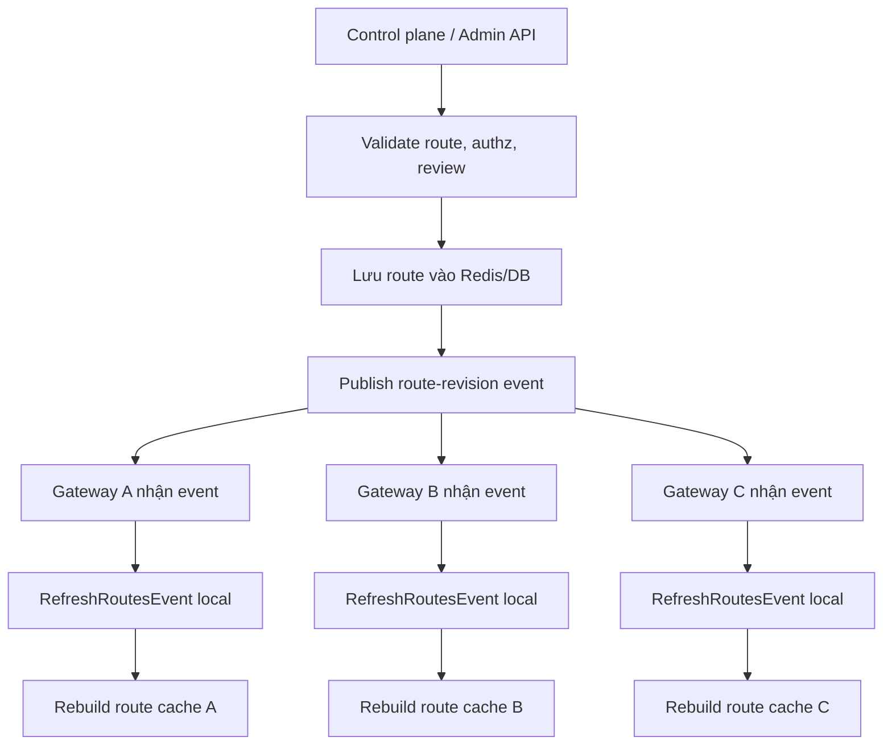
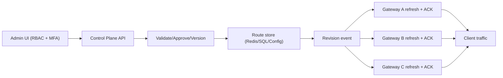
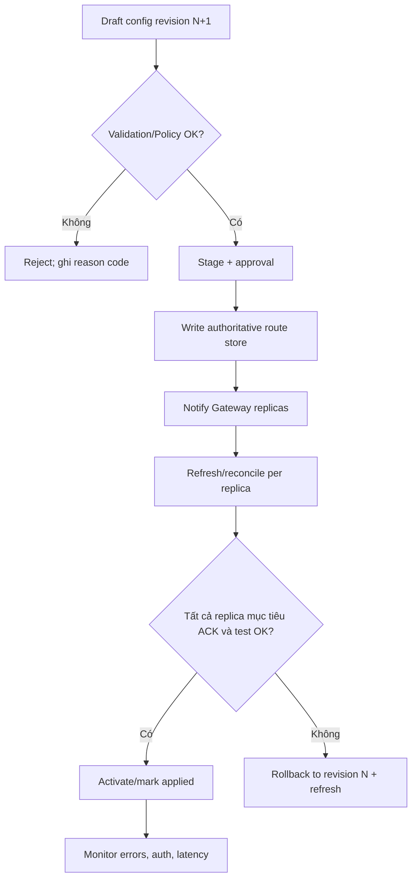

# Lưu tuyến trong bộ nhớ, Redis hoặc kho tùy biến theo phiên bản hỗ trợ

**Chương:** Tuyến động  
**Module:** `SPRING_CLOUD_GATEWAY` — Spring Cloud Gateway

Trong một API Gateway cho microservices, tuyến (route) xác định request nào được nhận, chuyển đến dịch vụ nào và trải qua những predicate/filter nào. Những tuyến đặt cố định trong `application.yml` phù hợp khi ít thay đổi, nhưng một nền tảng có nhiều dịch vụ có thể cần **tạo, cập nhật, vô hiệu hoặc xóa tuyến khi Gateway đang chạy** mà không khởi động lại toàn bộ cụm. Việc này đưa đến câu hỏi quan trọng: **định nghĩa route động được lưu ở đâu, có tồn tại sau restart không và các Gateway replicas nhìn thấy thay đổi khi nào?**

Spring Cloud Gateway **Server WebFlux** cung cấp abstraction `RouteDefinitionRepository` và các implementation theo phiên bản, trong đó có `InMemoryRouteDefinitionRepository` và `RedisRouteDefinitionRepository`. Ngoài ra, ứng dụng có thể tự xây kho route từ SQL/Redis/Config Server hoặc nguồn riêng thông qua các interface phù hợp. Tuy nhiên, lưu được một `RouteDefinition` **không tự động bảo đảm** route đã được áp dụng trong `CachingRouteLocator` của mọi process. Định nghĩa, route runtime và cache phải được phân biệt; thay đổi route còn liên quan đến xác thực, giới hạn lưu lượng, circuit breaker, retry, TLS, service discovery, quản trị và nhật ký kiểm toán.

> **Phạm vi phiên bản:** Bài thực hành chính dùng **Spring Cloud Gateway Server WebFlux** với tên starter/prefix cấu hình của những release train mới (ví dụ Gateway 5.0/5.1, tương ứng với phiên bản Spring Cloud/Boot do BOM lựa chọn). Tài liệu WebFlux hiện hành có trang *Sharing Routes between multiple Gateway instances* nhưng một số đoạn hướng dẫn vẫn hiển thị property cũ `spring.cloud.gateway.redis-route-definition-repository.enabled`; bảng Configuration Properties 5.0/5.1 sử dụng prefix `spring.cloud.gateway.server.webflux.redis-route-definition-repository.enabled`. Luôn đối chiếu đúng **phiên bản đang chạy**, không giả định các tên này hoán đổi được. Gateway **Server Web MVC** và **Proxy Exchange** có mô hình pipeline/extension khác: không sao chép nguyên các interface reactive, endpoint hoặc cấu hình WebFlux sang chúng nếu chưa kiểm tra tài liệu cùng release train.

## 1. Mục tiêu học tập

Sau bài này, bạn có thể:

1. Phân biệt `RouteDefinition`, `Route` runtime, `RouteDefinitionLocator`, `RouteDefinitionWriter`, `RouteDefinitionRepository` và `RouteLocator`.
2. Giải thích vòng đời **ghi định nghĩa → phát sự kiện refresh → tạo route runtime → định tuyến request**.
3. Đánh giá trade-off giữa **lưu tuyến trong bộ nhớ**, **Redis** và **kho tự xây** theo độ bền, tính nhất quán, HA và vận hành.
4. Sử dụng Actuator API có kiểm soát để thêm/đọc/xóa route động ở một Gateway WebFlux **chạy thử cục bộ**.
5. Bật `RedisRouteDefinitionRepository` với dependency Reactive Redis và xác định property đúng phiên bản.
6. Thiết kế cơ chế refresh tất cả Gateway replicas sau khi dữ liệu ở kho chung thay đổi, không đồng nhất “chia sẻ storage” với “cache đã đồng bộ”.
7. Phác thảo một `RouteDefinitionRepository` tùy biến dùng dữ liệu bền vững và kiểm soát race condition, lỗi lưu, idempotency, audit/rollback.
8. Chặn các rủi ro route động như SSRF, lộ Actuator write endpoint, route shadowing, bypass authorization, sai header/path, token relay và cấu hình TLS.
9. Lập checklist kiểm thử create/update/delete/restart/failover/refresh/quan sát trên đúng bản Gateway được triển khai.

## 2. RouteDefinition khác route runtime

Một cấu hình route phổ biến:

```yaml
spring:
  cloud:
    gateway:
      server:
        webflux:
          routes:
            - id: catalog-public
              uri: lb://catalog-service
              predicates:
                - Path=/api/catalog/**
                - Method=GET
              filters:
                - StripPrefix=2
                - AddRequestHeader=X-Gateway-Route, catalog-public
              order: 10
```

Ở đây, `catalog-public` là **route ID**; `lb://catalog-service` là **URI đích logic** được LoadBalancer giải ra instance; `Path`/`Method` quyết định request được chọn; filters xử lý path/header; `order` hỗ trợ xét ưu tiên giữa các route.

Các lớp trong Gateway Server WebFlux có trách nhiệm khác nhau:

| Khái niệm | Chức năng |
|---|---|
| `RouteDefinition` | Mô tả route dạng dữ liệu: `id`, `uri`, `predicates`, `filters`, `order`, metadata |
| `RouteDefinitionLocator` | Nguồn **đọc** các `RouteDefinition`; phương thức `Flux<RouteDefinition> getRouteDefinitions()` |
| `RouteDefinitionWriter` | Khả năng **ghi/xóa** định nghĩa; phương thức `save(Mono<RouteDefinition>)` và `delete(Mono<String>)` |
| `RouteDefinitionRepository` | Interface kết hợp **Locator + Writer**; thích hợp kho route động có thể sửa |
| `RouteLocator` | Cung cấp **`Route` runtime** đã xây dựng, có predicates/filter thực thi được |
| `CachingRouteLocator` | Cache các route runtime để tránh dựng lại định nghĩa trên mỗi request; nhận refresh event để cập nhật |
| `RoutePredicateHandlerMapping` | Tìm một route runtime khớp request và chọn handler/filter chain |
| `RefreshRoutesEvent` | Tín hiệu yêu cầu làm mới route runtime **trong ApplicationContext hiện tại** |



**Điểm cốt lõi:** `RouteDefinitionRepository` là nơi **lưu và truy xuất các định nghĩa**. Nó không phải cache dùng để chọn route trên từng HTTP request. Vì thế cập nhật database/Redis xong chưa chắc có tác dụng tức thì nếu `CachingRouteLocator` vẫn dùng dữ liệu cũ.

### 2.1. Một Gateway có thể có nhiều nguồn RouteDefinition

Theo tài liệu cấu hình, `PropertiesRouteDefinitionLocator` lấy route từ properties/YAML; có thể tồn tại thêm locator cho service discovery hoặc repository động. Framework thường tổng hợp các nguồn. Việc một route được tìm thấy qua `GET /actuator/gateway/routes` không có nghĩa nó được lưu trong Redis:

- **YAML/property route:** hình thành từ cấu hình ứng dụng; Actuator thường xem như **read-only**.
- **Java `RouteLocator` bean:** route tạo bằng code, không phải một entry được quản lý bởi writable repository.
- **DiscoveryClient locator:** có thể tự sinh route từ các service được khám phá, không phải entry do admin tự lưu.
- **InMemory/Redis/custom repository:** nguồn dữ liệu route động được quản lý bằng save/delete.

Nếu **trùng route ID hoặc trùng predicate/path** giữa các nguồn, đừng giả định hệ thống luôn tự merge/ưu tiên nguồn mới một cách an toàn. Cần quy ước ID, `order`, danh sách source và test route thực sự được chọn.

### 2.2. Ba trạng thái khác nhau

```text
(1) Persistent route definition:
      catalog-dynamic -> uri=http://catalog-v2:8081

(2) Runtime route cache ở Gateway A:
      catalog-dynamic -> uri=http://catalog-v1:8081

(3) Runtime route cache ở Gateway B:
      catalog-dynamic -> route chưa tồn tại
```

Điều này có thể xảy ra tạm thời khi lưu kho route đã thành công nhưng một hoặc nhiều Gateway instances chưa được refresh. **“Redis có giá trị v2” không chứng minh toàn bộ cụm đã chuyển lưu lượng sang v2.**

## 3. So sánh ba cách lưu tuyến

| Tiêu chí | In-memory | Redis built-in | Kho tùy biến |
|---|---|---|---|
| Implementation | `InMemoryRouteDefinitionRepository` | `RedisRouteDefinitionRepository` (khi được phiên bản hỗ trợ) | Tự triển khai `RouteDefinitionRepository` hoặc locator/writer phù hợp |
| Lưu qua Gateway restart | **Không** cho những route chỉ lưu RAM | Có thể tồn tại nếu Redis còn dữ liệu theo persistence/retention policy | Theo durability của DB/KV/Config Store |
| Có dữ liệu chung giữa replicas | Không | Có, nếu dùng cùng Redis namespace/connection | Có khi mọi replica đọc cùng kho |
| Runtime route cache đồng bộ tự động | Không | **Không nên giả định**; cần refresh trên mỗi replica | Cần thiết kế refresh/notification |
| Độ phức tạp | Thấp | Trung bình: Redis HA/auth/TLS/namespace | Cao: schema, codec, version, audit, retry, failover |
| Điều phối thay đổi | Một process | Storage chung + fan-out refresh | Control plane/DB transaction + fan-out refresh |
| Hợp với | Demo, môi trường đơn instance, trạng thái tạm | Nhiều Gateway dùng cùng định nghĩa | Production cần audit, kiểm duyệt, migration/rollback |
| Rủi ro chính | Mất route sau restart, lệch replicas | Stale route cache, Redis outage, thiếu ACL | Blocking I/O, schema sai, dual-write/race, code tùy biến lỗi |

**Không có lựa chọn nào miễn phí về tính nhất quán.** Kho chung giải quyết “đọc cùng nguồn” nhưng chưa giải quyết việc mỗi process *đã* đọc lại nguồn đó chưa, phiên bản dữ liệu nào được chấp nhận, và có chặn route xấu trước khi áp dụng hay không.

## 4. Chọn đúng version, gateway flavor và endpoint

Đối với **Gateway Server WebFlux** mới, cấu hình route tĩnh thường nằm ở:

```properties
spring.cloud.gateway.server.webflux.routes[0].id=catalog-public
spring.cloud.gateway.server.webflux.routes[0].uri=http://localhost:8081
```

Tài liệu cũ có thể dùng:

```properties
spring.cloud.gateway.routes[0].id=catalog-public
spring.cloud.gateway.routes[0].uri=http://localhost:8081
```

Tương tự, Redis repository có tên property mới trong Configuration Properties 5.0/5.1:

```properties
spring.cloud.gateway.server.webflux.redis-route-definition-repository.enabled=true
```

Trong một số trang **Sharing Routes** và các release train trước, bạn vẫn gặp:

```properties
spring.cloud.gateway.redis-route-definition-repository.enabled=true
```

**Quy tắc sử dụng:** ưu tiên bảng *Configuration Properties* **cùng phiên bản artifact trong ứng dụng**, kiểm tra binding/autoconfiguration khi chạy, rồi mới chọn key. Không bật cả hai property để “chắc chắn” hoặc coi tài liệu ở URL `/docs/current/reference/html` là bằng chứng về version mới nhất; các trang đó có thể phản ánh release cũ.

| Biến thể | Các lưu ý riêng |
|---|---|
| **Gateway Server WebFlux** | Các interface reactive `RouteDefinitionRepository`, `RefreshRoutesEvent`, actuator API trong bài |
| **Gateway Server Web MVC** | WebMvc.fn/Servlet pipeline; kiểm tra chính xác khả năng cập nhật route và repository trong reference của bản sử dụng |
| **Proxy Exchange** | Thành phần hỗ trợ proxy trong annotated controller; không tự có toàn bộ cơ chế Gateway route repository |

**Spring Cloud BOM:** dùng release train tương thích Spring Boot; không tự trộn `spring-cloud-gateway-server` 5.x với Spring Boot hoặc Spring Cloud Commons của dòng không tương thích. Nếu chạy Spring Boot 3.x, kiểm tra starter và actuator access theo bản tương ứng; nếu dùng Boot 4.x, chọn dependency/plugin phù hợp với bom/Initializr của hệ thống.

## 5. Bài lab — dựng backend để xác minh path/header được route

Ta dùng một backend Spring Boot MVC đơn giản, chỉ lắng nghe `8081`, có endpoint `GET /items/{sku}`. Backend giúp phân biệt “route chưa tồn tại” với “route tồn tại nhưng path rewrite hoặc backend sai”.

| Thành phần | Port | Vai trò |
|---|---:|---|
| `catalog-backend` | `8081` | Trả JSON có path và header nhận được |
| `catalog-gateway` | `8080` | Nhận request public, tạo/xóa route động |
| Gateway management server | `9090`, **chỉ bind localhost** trong lab | Actuator tạo/đọc/xóa/refresh route |
| Redis (lab mở rộng) | `6379` | Kho route chia sẻ, chỉ dùng khi thử phần Redis |

### 5.1. Tạo backend

Tại [Spring Initializr](https://start.spring.io/), tạo project Maven, Java 17+ với Spring Web trên Spring Boot 3.x tương thích; package `com.example.catalog`. Nếu dùng Boot 4.x, chọn đúng starter do Initializr của phiên bản cung cấp.

`src/main/resources/application.yml`:

```yaml
server:
  port: 8081
spring:
  application:
    name: catalog-backend
```

`CatalogApplication.java`:

```java
package com.example.catalog;

import org.springframework.boot.SpringApplication;
import org.springframework.boot.autoconfigure.SpringBootApplication;

@SpringBootApplication
public class CatalogApplication {
    public static void main(String[] args) {
        SpringApplication.run(CatalogApplication.class, args);
    }
}
```

`CatalogController.java`:

```java
package com.example.catalog;

import java.util.LinkedHashMap;
import java.util.Map;
import jakarta.servlet.http.HttpServletRequest;
import org.springframework.http.ResponseEntity;
import org.springframework.web.bind.annotation.GetMapping;
import org.springframework.web.bind.annotation.PathVariable;
import org.springframework.web.bind.annotation.RestController;

@RestController
public class CatalogController {

    @GetMapping("/items/{sku}")
    public ResponseEntity<Map<String, String>> item(
            @PathVariable String sku,
            HttpServletRequest request) {
        Map<String, String> result = new LinkedHashMap<>();
        result.put("service", "catalog-backend");
        result.put("sku", sku);
        result.put("path", request.getRequestURI());
        result.put("routeMarker", request.getHeader("X-Route-Marker"));

        return ResponseEntity.ok()
            .header("X-Backend", "catalog-8081")
            .body(result);
    }
}
```

Trường `routeMarker` cho biết filter trên Gateway có thực sự thêm request header hay không; đó **không phải chứng thực người dùng**. Đừng dùng một header client có thể tự gửi để cấp quyền truy cập dữ liệu.

### 5.2. Chạy backend và xác minh trực tiếp

Trong thư mục backend:

```bash
./mvnw spring-boot:run
```

Trên Windows PowerShell:

```powershell
.\mvnw.cmd spring-boot:run
```

Trong terminal khác:

```bash
curl -i "http://localhost:8081/items/SKU-42"
```

Kết quả mẫu:

```json
{
  "service": "catalog-backend",
  "sku": "SKU-42",
  "path": "/items/SKU-42",
  "routeMarker": null
}
```

Nếu backend trực tiếp trả 404 hoặc không kết nối được, sửa backend/port trước khi kiểm thử route động. Nếu Gateway chạy trong container khác, `localhost:8081` từ trong Gateway **không** trỏ đến container backend; phải dùng địa chỉ mạng/DNS hợp lệ.

## 6. Bài lab — Gateway WebFlux dùng kho route trong bộ nhớ

Tạo một project **Spring Cloud Gateway Server WebFlux** riêng, cổng `8080`, package `com.example.gateway`. Cài Spring Cloud BOM tương thích với Boot, rồi thêm starter Gateway và Actuator; trên các release train hiện đại có tên:

```xml
<dependencies>
    <dependency>
        <groupId>org.springframework.cloud</groupId>
        <artifactId>spring-cloud-starter-gateway-server-webflux</artifactId>
    </dependency>
    <dependency>
        <groupId>org.springframework.boot</groupId>
        <artifactId>spring-boot-starter-actuator</artifactId>
    </dependency>
</dependencies>
```

**Không cần Redis** cho bài đầu. Nếu không có writable repository nào khác thay thế bean mặc định, Gateway WebFlux có thể dùng `InMemoryRouteDefinitionRepository`. Dữ liệu route tạo từ endpoint ghi chỉ tồn tại trong RAM của **Gateway instance hiện tại**.

### 6.1. `application.yml` của Gateway

```yaml
server:
  port: 8080

spring:
  application:
    name: catalog-dynamic-gateway-lab
  cloud:
    gateway:
      server:
        webflux:
          routes:
            - id: catalog-static
              uri: http://localhost:8081
              predicates:
                - Path=/static/items/**
                - Method=GET
              filters:
                - StripPrefix=1
                - AddRequestHeader=X-Route-Marker, static-route

management:
  server:
    port: 9090
    address: 127.0.0.1
  endpoint:
    gateway:
      access: unrestricted
  endpoints:
    web:
      exposure:
        include: health,info,gateway
```

Ở đây **chỉ có route `catalog-static` trong YAML**. Ta sẽ tạo route `catalog-dynamic` bằng Actuator, không ghi nó vào `application.yml`. Điều đó cho phép quan sát rõ khác biệt giữa route cố định và route có thể ghi/xóa qua repository.

**Cảnh báo security:** Cấu hình `management.endpoint.gateway.access: unrestricted` cho phép các thao tác **ghi route**. Dòng `management.server.address: 127.0.0.1` giới hạn management endpoint vào loopback trong bài lab trên máy local, đồng thời port `9090` khác `8080`. **Không sao chép cấu hình này lên public server/Internet.** Môi trường production nên để `read-only` hoặc tắt hoàn toàn khả năng ghi; nếu thực sự cần write API, buộc phải có network isolation, authentication/authorization mạnh, kiểm toán và giới hạn URI/predicate/filter được tạo.

Với Spring Boot/Gateway cũ, `management.endpoint.gateway.enabled=true` hoặc namespace config khác có thể được dùng; tài liệu hiện hành khuyến nghị `access=read-only` và yêu cầu `unrestricted` cho các thao tác POST/DELETE/refresh. Đừng coi endpoint đã được bảo vệ chỉ vì đường dẫn chứa `/actuator/`. Nếu deployment bật Spring Security, hãy kiểm tra SecurityWebFilterChain dành cho management context.

### 6.2. Bật Gateway và xác minh route tĩnh

Khởi động backend ở `8081` trước, rồi Gateway ở `8080`. Thử:

```bash
curl -i "http://localhost:8080/static/items/SKU-42"
```

Kỳ vọng backend nhận `/items/SKU-42` và `routeMarker=static-route`. Sau đó:

```bash
curl -i "http://localhost:8080/dynamic/items/SKU-42"
```

Vì chưa tạo route tương ứng, request này thông thường trả **404 tại Gateway**, backend không được gọi. Đây là mốc đối chiếu quan trọng trước bước tạo động.

### 6.3. Kiểm tra Actuator (trên máy chạy Gateway)

```bash
curl -i "http://127.0.0.1:9090/actuator/health"
curl -i "http://127.0.0.1:9090/actuator/gateway/routes"
```

Danh sách route phải có `catalog-static`. Có thể kiểm tra `GET /actuator/gateway/routedefinitions` để quan sát các định nghĩa, nhưng **route runtime** và **route definitions** không đồng nhất về cách biểu diễn JSON. Trong một số phiên bản, thông tin `GET /actuator/gateway/routes/{id}` được trả dưới dạng mô tả predicate/filter đã dựng, **không phải JSON payload dùng trực tiếp để tạo route**.

Nếu `/actuator/gateway/routes` không truy cập được: kiểm tra management port, `management.endpoints.web.exposure.include`, `management.endpoint.gateway.access`, Spring Security, release train và chính xác hostname loopback. Nếu Gateway chạy bên trong container, `127.0.0.1` của container không thể truy cập trực tiếp từ host nếu không có cơ chế quản trị mạng phù hợp; không công khai port quản trị chỉ để sửa một vấn đề kết nối lab.

## 7. Tạo route bằng Actuator: lưu trong RAM và refresh

Theo reference **Gateway Server WebFlux Actuator API** hiện hành, route tạo qua endpoint:

```text
POST /actuator/gateway/routes/{id}
```

nhận JSON có `predicates` và `filters` ở **dạng shortcut DSL string**, ví dụ:

```json
{
  "uri": "http://localhost:8081",
  "predicates": [
    "Path=/dynamic/items/**",
    "Method=GET"
  ],
  "filters": [
    "StripPrefix=1",
    "AddRequestHeader=X-Route-Marker, dynamic-route"
  ],
  "order": 0
}
```

Đây là **body POST**, còn route ID `catalog-dynamic` được đặt trong path của endpoint quản trị. Nó không dùng `route_id` và không dùng dạng JSON đầy đủ của runtime `Route`. Nếu phiên bản cũ chỉ chấp nhận cấu trúc khác, đối chiếu **Actuator API đúng bản** trước khi gửi; không copy JSON response của `GET /routes/{id}` rồi mặc định nó là body PUT/PATCH.

### 7.1. Tạo route bằng cURL (Bash)

```bash
curl -i -X POST \
  "http://127.0.0.1:9090/actuator/gateway/routes/catalog-dynamic" \
  -H "Content-Type: application/json" \
  --data '{
    "uri": "http://localhost:8081",
    "predicates": ["Path=/dynamic/items/**", "Method=GET"],
    "filters": [
      "StripPrefix=1",
      "AddRequestHeader=X-Route-Marker, dynamic-route"
    ],
    "order": 0
  }'
```

Tài liệu Actuator hiện hành mô tả phản hồi tạo thành công là **201 Created**. Sau bước này, định nghĩa đã được ghi vào repository, nhưng **cần refresh route cache**:

```bash
curl -i -X POST "http://127.0.0.1:9090/actuator/gateway/refresh"
```

Endpoint refresh trả HTTP `200` không body theo tài liệu. Việc refresh có xử lý bất đồng bộ ở các bước nội bộ; với hệ thống thật phải **xác minh route mới xuất hiện và xử lý được request**, không chỉ căn cứ vào mã 200.

### 7.2. Tạo route bằng PowerShell

Để tránh vấn đề escape JSON trên Windows, dùng PowerShell heredoc:

```powershell
$body = @'
{
  "uri": "http://localhost:8081",
  "predicates": ["Path=/dynamic/items/**", "Method=GET"],
  "filters": [
    "StripPrefix=1",
    "AddRequestHeader=X-Route-Marker, dynamic-route"
  ],
  "order": 0
}
'@

Invoke-RestMethod -Method Post -Uri "http://127.0.0.1:9090/actuator/gateway/routes/catalog-dynamic" -ContentType "application/json" -Body $body
Invoke-RestMethod -Method Post -Uri "http://127.0.0.1:9090/actuator/gateway/refresh"
```

Trong PowerShell, `curl` có thể là alias của `Invoke-WebRequest`; nếu muốn đúng cú pháp cURL, dùng `curl.exe`. Không đặt client secret hoặc bearer token quản trị vào script lịch sử shell/terminal được chia sẻ.

### 7.3. Kiểm chứng route đã được áp dụng

```bash
curl -i "http://127.0.0.1:9090/actuator/gateway/routes"
curl -i "http://localhost:8080/dynamic/items/SKU-42"
```

Backend trả JSON minh họa:

```json
{
  "service": "catalog-backend",
  "sku": "SKU-42",
  "path": "/items/SKU-42",
  "routeMarker": "dynamic-route"
}
```

Kết quả chứng minh:

1. `Path=/dynamic/items/**` nhận được request bên ngoài;
2. `StripPrefix=1` bỏ `dynamic` để downstream nhận `/items/SKU-42`;
3. `AddRequestHeader` được route động áp dụng;
4. **Không cần restart Gateway** để route mới hoạt động trong instance đó.

Nếu nhận 404 sau khi `POST /routes` đã thành công, hãy kiểm tra `POST /refresh`, route ID, Method predicate, filter `StripPrefix`, endpoint/backend logs và route order. Đừng kết luận repository mất dữ liệu khi route đã lưu nhưng `CachingRouteLocator` chưa được dựng lại.

## 8. Cập nhật, xóa, khởi động lại: kiểm chứng tính bền vững của kho RAM

### 8.1. Không ghi đè route ID bằng POST mù quáng

Tài liệu Actuator WebFlux hiện hành có cảnh báo đáng chú ý: **không POST một route ID đã tồn tại** để cập nhật bằng đường quản trị này. Với implementation/luồng xử lý được mô tả, thao tác ấy có thể khiến định nghĩa route bị lặp nội bộ và `GET /actuator/gateway/routes` gây `500`. Để cập nhật một route **được tạo qua Actuator**, quy trình tài liệu hướng dẫn:

1. `DELETE /actuator/gateway/routes/catalog-dynamic`.
2. `POST /actuator/gateway/routes/catalog-dynamic` với body mới.
3. `POST /actuator/gateway/refresh`.

Ví dụ thay route marker:

```bash
# 1) Xóa route được Actuator tạo.
curl -i -X DELETE \
  "http://127.0.0.1:9090/actuator/gateway/routes/catalog-dynamic"

# 2) Tạo lại cùng ID với cấu hình mới.
curl -i -X POST \
  "http://127.0.0.1:9090/actuator/gateway/routes/catalog-dynamic" \
  -H "Content-Type: application/json" \
  --data '{
    "uri": "http://localhost:8081",
    "predicates": ["Path=/dynamic/items/**", "Method=GET"],
    "filters": [
      "StripPrefix=1",
      "AddRequestHeader=X-Route-Marker, updated-route"
    ],
    "order": 0
  }'

# 3) Áp dụng route mới.
curl -i -X POST \
  "http://127.0.0.1:9090/actuator/gateway/refresh"

# 4) Xác minh backend nhận marker mới.
curl -i "http://localhost:8080/dynamic/items/SKU-42"
```

**Giới hạn của cách này:** DELETE → POST → refresh **không phải một transaction atomically visible** đối với nhiều requests/replicas; có khoảng thời gian route cũ bị xóa ở kho trong khi cấu hình mới chưa được lưu, và các route caches có thể khác nhau. Với production, cần control plane có version, validation, staging/canary, compare-and-swap, rollback và giao thức refresh/ack rõ ràng.

### 8.2. Không xóa route tĩnh từ YAML bằng cùng endpoint

Thử trên lab:

```bash
curl -i -X DELETE \
  "http://127.0.0.1:9090/actuator/gateway/routes/catalog-static"
```

Theo tài liệu Gateway Actuator hiện hành, routes khai báo trong `application.yml` hoặc tạo bằng `@Bean` **không phải các route thuộc writable repository**, nên endpoint DELETE có thể trả **404 Not Found**. Điều đó không có nghĩa Gateway không có route `catalog-static`: route vẫn tồn tại vì đến từ một `RouteDefinitionLocator`/source khác.

Tương tự, một route được DiscoveryClient sinh ra không phải tự nhiên trở thành writable entry chỉ vì người quản trị nhìn thấy nó trong `GET /routes`. Quản trị phải xác định **route thuộc nguồn nào** trước khi ghi/xóa.

### 8.3. Xóa route động và refresh

```bash
curl -i -X DELETE \
  "http://127.0.0.1:9090/actuator/gateway/routes/catalog-dynamic"

curl -i -X POST \
  "http://127.0.0.1:9090/actuator/gateway/refresh"

curl -i "http://localhost:8080/dynamic/items/SKU-42"
curl -i "http://localhost:8080/static/items/SKU-42"
```

Kỳ vọng `/dynamic/items/**` không còn được xử lý bởi route vừa xóa (thường 404 nếu không có route khác), còn `/static/items/**` vẫn hoạt động. Nếu `/dynamic/items/**` vẫn trả 200, hãy kiểm tra route khác có cùng predicate, refresh chưa hoàn tất, instance nhận request khác hoặc dữ liệu repository chưa bị xóa đúng.

### 8.4. Kiểm tra khởi động lại Gateway RAM

Sau khi đã **tạo lại** route `catalog-dynamic` và xác minh hoạt động, khởi động lại **chỉ Gateway**, giữ backend chạy. Với `InMemoryRouteDefinitionRepository`:

```text
Trước restart:
  catalog-static   -> từ application.yml
  catalog-dynamic  -> từ RAM qua Actuator

Sau restart:
  catalog-static   -> còn, vì được tạo lại từ YAML
  catalog-dynamic  -> mất, vì RAM repository được tạo mới
```

Hãy kiểm tra `GET /actuator/gateway/routes` và gọi lại `/dynamic/items/SKU-42`. Đừng nhầm tính bền của application.yml với tính bền của in-memory repository: **hai nguồn route khác nhau**.

### 8.5. Khi nào chỉ lưu RAM là hợp lý?

RAM repository phù hợp cho:

- Bài lab, demo, môi trường dev đơn instance.
- Route ngắn hạn có thể được tạo lại từ nguồn xác thực khác.
- Các thử nghiệm định tuyến không cần persistence sau restart.

RAM không phù hợp làm **nguồn chân lý** cho cả cụm production nếu mỗi replica phải nhìn route động giống nhau. Nếu Gateway A có route riêng còn B không, load balancer ở phía client có thể tạo lỗi **lúc 200 lúc 404**, dù cả hai processes vẫn healthy.

## 9. Lập trình: ghi route thông qua RouteDefinitionWriter và phát refresh

Trong Gateway Server WebFlux, không bắt buộc mở writable Actuator endpoint cho một hệ thống quản trị riêng. Một control plane **đã xác thực và kiểm duyệt** có thể dùng abstraction `RouteDefinitionWriter` trực tiếp; mã phải giữ toàn bộ thao tác trong reactive pipeline và chỉ phát refresh **sau khi lưu thành công**.

```java
package com.example.gateway;

import org.springframework.cloud.gateway.event.RefreshRoutesEvent;
import org.springframework.cloud.gateway.route.RouteDefinition;
import org.springframework.cloud.gateway.route.RouteDefinitionWriter;
import org.springframework.context.ApplicationEventPublisher;
import org.springframework.stereotype.Service;
import reactor.core.publisher.Mono;

@Service
public class RouteChangeService {
    private final RouteDefinitionWriter writer;
    private final ApplicationEventPublisher publisher;

    public RouteChangeService(
            RouteDefinitionWriter writer,
            ApplicationEventPublisher publisher) {
        this.writer = writer;
        this.publisher = publisher;
    }

    // Chỉ gọi với RouteDefinition đã được xác thực/allowlist.
    public Mono<Void> saveAndRefresh(RouteDefinition validated) {
        return writer.save(Mono.just(validated))
            .then(Mono.fromRunnable(
                () -> publisher.publishEvent(new RefreshRoutesEvent(this))));
    }

    public Mono<Void> deleteAndRefresh(String id) {
        return writer.delete(Mono.just(id))
            .then(Mono.fromRunnable(
                () -> publisher.publishEvent(new RefreshRoutesEvent(this))));
    }
}
```

Code minh họa:

- `save(Mono<RouteDefinition>)` và `delete(Mono<String>)` là **reactive operations**; không `.block()` hoặc `.subscribe()` bừa bãi trong service/controller.
- `.then(...)` đảm bảo publisher chỉ được gọi **sau khi operation lưu/xóa hoàn tất thành công**.
- `RefreshRoutesEvent` chỉ được publish trong **ApplicationContext của Gateway instance hiện tại**.
- Phát event **không tự tạo transaction phân tán** và không bảo đảm mọi replicas đã cập nhật route cache.
- Method `saveAndRefresh` **không tự có cơ chế create-if-absent, optimistic lock hay upsert an toàn trên mọi implementation**. Tùy repository, route ID trùng có thể cần chính sách thay thế rõ ràng; đặc biệt không dùng method này để khẳng định Actuator POST vào cùng ID là an toàn.
- Hàm trên giả định `RouteDefinition` đã qua xác thực/validation, chưa chứa kiểm tra SSRF, quyền admin, version, audit hoặc rollback nên **chưa phải control-plane production**.

### 9.1. Vì sao không gọi `subscribe()` ngay sau `writer.save`?

Đoạn:

```java
// Không khuyến nghị: hai tác vụ không được liên kết thứ tự.
writer.save(Mono.just(route)).subscribe();
publisher.publishEvent(new RefreshRoutesEvent(this));
```

có thể phát refresh **trước khi** thao tác lưu kết thúc hoặc thất bại, khiến Gateway nạp lại dữ liệu cũ. Reactive chain qua `then(...)` giúp đảm bảo thứ tự trong một request xử lý. Trong khi đó, **phân phối sự kiện đến replicas khác** vẫn là bài toán riêng.

### 9.2. Xóa/đổi route có những hệ quả gì?

Một route được xóa khi:

- Một request đã được Gateway chọn route và đang chạy qua filter chain;
- Một request khác chưa bắt đầu khâu route selection;
- Cache runtime chưa kịp refresh;
- Backend đang xử lý request trước đó.

Đừng kỳ vọng xóa route sẽ **hủy an toàn mọi request đang xử lý** hoặc ngay lập tức thu hồi access token đã được relay. Với yêu cầu khóa truy cập khẩn cấp, phải kết hợp authorization/revocation và network policy, không dựa riêng vào thao tác xóa route.

## 10. RedisRouteDefinitionRepository: chia sẻ định nghĩa giữa các replicas

Trong **Gateway Server WebFlux** của các bản có integration phù hợp, `RedisRouteDefinitionRepository` là một implementation `RouteDefinitionRepository` giúp nhiều Gateway instances đọc/ghi **cùng một kho route** tại Redis. Nó **khác** RedisRateLimiter: dù cả hai có thể dùng Redis, một bên lưu **định nghĩa tuyến**, một bên quản lý các bộ đếm/token buckets.

### 10.1. Dependency cho Redis Reactive

Trong project Gateway của phần 6, bổ sung:

```xml
<dependency>
    <groupId>org.springframework.boot</groupId>
    <artifactId>spring-boot-starter-data-redis-reactive</artifactId>
</dependency>
```

Đây là dependency được trang *Sharing Routes* của Gateway hướng dẫn. Không chỉ dùng `spring-boot-starter-data-redis` synchronous và hy vọng repository reactive có đủ bean, cũng không thêm Redis RateLimiter rồi coi route repository tự động lưu đúng khi chưa có wiring phù hợp.

### 10.2. Cấu hình Gateway sử dụng Redis (namespace mới)

Để chuyển lab sang Redis, giữ cấu hình Gateway/Actuator ở phần 6, thêm:

```yaml
spring:
  data:
    redis:
      host: 127.0.0.1
      port: 6379
  cloud:
    gateway:
      server:
        webflux:
          redis-route-definition-repository:
            enabled: true
```

Đây là **phần cấu hình ghép thêm** vào `application.yml` đã có, không phải toàn bộ file để chép đè. Property `enabled` ở đây khớp với **Configuration Properties Gateway Server WebFlux 5.0/5.1**; các bản cũ có thể dùng `spring.cloud.gateway.redis-route-definition-repository.enabled`.

Trong bảng configprops một số dòng mới, `redis-route-definition-repository.enabled` có default `true`; tuy nhiên **điều kiện autoconfiguration còn phụ thuộc starter Redis/beans và classpath**. Việc viết `enabled: true` tường minh trong lab làm rõ ý định; không kết luận chắc Redis repo đã được tạo chỉ vì property có giá trị true. Hãy xác minh Spring context, logs và hành vi restart.

**Lưu ý môi trường:** cấu hình `127.0.0.1:6379` chỉ áp dụng khi Redis và Gateway nằm trong cùng môi trường mạng local. Nếu Gateway chạy trong Docker/Kubernetes khác namespace, phải dùng DNS/service/host phù hợp, không lấy localhost trên máy developer làm Redis endpoint.

### 10.3. Redis test dùng local riêng

Nếu chưa có Redis trong máy thử nghiệm và Docker được phép, có thể khởi động **một Redis không xác thực, chỉ bind loopback**, hoàn toàn chỉ cho lab:

```bash
docker run --rm --name redis-route-lab \
  -p 127.0.0.1:6379:6379 \
  redis:7
```

Không mở cổng Redis thử nghiệm ra public network và không dùng lệnh `FLUSHALL` hoặc xóa dữ liệu trên Redis có nhiều ứng dụng/tenant. Để thử persistence qua Redis restart, cần cấu hình Redis AOF/RDB và volume bền vững; container `--rm` ở ví dụ **không phải bài test Redis durability**.

### 10.4. Tạo route bằng Actuator khi Redis repository đang hoạt động

Khởi động Redis, backend `8081` và Gateway `8080/9090`. Không tạo route có ID `catalog-dynamic` trước đó trong Redis; nếu đã tồn tại do bài test cũ, hãy xóa **đúng route lab** và refresh, tránh dùng thao tác làm sạch toàn DB.

Gửi POST body từ mục 7, rồi:

```bash
curl -i -X POST "http://127.0.0.1:9090/actuator/gateway/refresh"
curl -i "http://localhost:8080/dynamic/items/SKU-42"
```

Nếu repo Redis được chọn đúng, định nghĩa được lưu ở Redis thay vì chỉ nằm trong `InMemoryRouteDefinitionRepository` mặc định. Tuy nhiên **cần xác minh** repository/writer thực sự đang được dùng: một application context có custom repository, nhiều beans hoặc sai namespace có thể dẫn đến kết quả khác dự tính.

### 10.5. Kiểm tra qua Gateway restart

Giữ Redis chạy và **không xóa dữ liệu**, restart Gateway. Khi Gateway khởi động, route definitions được đọc từ Redis nếu repository đã cấu hình đúng. Sau khi route runtime được dựng, `/dynamic/items/SKU-42` có thể hoạt động trở lại mà không cần tạo lại route qua Actuator.

So sánh:

| Sự kiện | RAM repository | Redis repository |
|---|---|---|
| Restart một Gateway | Route động trong RAM mất | Route có thể tải lại từ Redis nếu dữ liệu còn |
| Restart Redis nhưng không lưu đĩa | Không liên quan | Dữ liệu có thể mất, tùy Redis persistence |
| Tạo route trên Gateway A | Chỉ A ghi được entry local | A ghi vào Redis chung |
| Gateway B đang chạy | Không tự thấy route của A | **Có thể thấy sau khi refresh B** từ Redis chung |
| Redis mất kết nối | Không cần Redis | Ghi/refresh/đọc route từ kho có thể lỗi; runtime cache cũ có thể vẫn tồn tại tạm |

**Không cam kết zero downtime** chỉ nhờ Redis. Nếu Gateway không thể nạp route lúc khởi động, các route động có thể thiếu. Redis production cần authentication, ACL, network isolation, TLS, HA, backup/restore và kiểm soát khả năng phục hồi.

## 11. Hai Gateway replicas: shared Redis ≠ shared runtime route cache

Giả sử:

```text
                  +-------------------+
Admin API ------> | Redis route store |
                  +-------------------+
                      ^           ^
                      |           |
       Gateway A (8080/9090)  Gateway B (8082/9092)
         CachingRouteLocator    CachingRouteLocator
           độc lập               độc lập
```

Hai instances có thể đọc **cùng định nghĩa** nhưng giữ **runtime cache riêng**. Lưu route thành công ở Redis không tự broadcast `RefreshRoutesEvent` vào Spring ApplicationContext của Gateway B.

### 11.1. Chạy instance thứ hai cho bài lab

Trên một máy dev, có thể chạy cùng ứng dụng Gateway ở instance khác với:

```bash
SERVER_PORT=8082 MANAGEMENT_SERVER_PORT=9092 ./mvnw spring-boot:run
```

Nếu đang dùng PowerShell:

```powershell
$env:SERVER_PORT = "8082"
$env:MANAGEMENT_SERVER_PORT = "9092"
.\mvnw.cmd spring-boot:run
```

Lệnh cần chạy trong **terminal thứ hai** với cùng Redis và backend. Nếu một Maven wrapper/build dir đang được tiến trình khác sử dụng, hãy chạy hai bản jar được build đúng hoặc dùng hai môi trường container, không để thao tác build đồng thời tranh chấp output.

Management server `9092` cũng phải chỉ bind loopback hoặc mạng quản trị riêng. Đừng công khai hai cổng Actuator vì cần thử multi-instance.

### 11.2. Quan sát sai lệch trước refresh

1. Tạo `catalog-dynamic` qua actuator của **A** (`9090`).
2. Refresh **A** và xác minh `http://localhost:8080/dynamic/items/SKU-42` chạy.
3. Gọi `http://localhost:8082/dynamic/items/SKU-42` trên **B** trước khi chủ động refresh B.
4. Nếu B vẫn 404, đó là bằng chứng route cache của B chưa nạp định nghĩa mới.
5. Gọi:

```bash
curl -i -X POST "http://127.0.0.1:9092/actuator/gateway/refresh"
curl -i "http://localhost:8082/dynamic/items/SKU-42"
```

Sau refresh, B có thể đọc lại Redis và route hoạt động. **Không khẳng định B luôn 404 trước refresh**: một cơ chế đồng bộ/refresh khác, restart hoặc việc route đã tồn tại trước đó có thể làm B biết route mới. Thí nghiệm cần bắt đầu ở trạng thái rõ ràng, quan sát từng instance và route ID.

### 11.3. Vì sao cần sự kiện refresh phân tán?

Trong cụm thật, không thể yêu cầu người vận hành gọi thủ công một endpoint ở từng pod sau mỗi thay đổi. Cần một cơ chế **fan-out**:



Các lựa chọn triển khai gồm Spring Cloud Bus (khi phù hợp phiên bản/hạ tầng), Redis Pub/Sub, message broker, event stream hoặc cơ chế polling theo `route-config-revision`. **Đây là thiết kế vận hành bổ sung**, không phải điều mà RedisRouteDefinitionRepository mặc định bảo đảm.

### 11.4. Refresh event có thể bị mất

Redis Pub/Sub không có guarantee lưu lại message cho consumer đang offline. Nếu Gateway B mất kết nối đúng lúc đổi route, nó có thể không nhận thông báo. Vì thế production cần một cách **reconciliation**:

- Lưu **revision/version** của tập route cùng dữ liệu route;
- Mỗi Gateway biết revision đã áp dụng gần nhất;
- Khi startup hoặc reconnect, so revision với kho authoritative;
- Poll định kỳ hoặc nhận event thì reload;
- Ghi nhận `desiredRevision`/`appliedRevision` và retry có backoff;
- Chỉ báo “triển khai route thành công toàn cụm” khi đủ quorum/số replicas theo policy xác nhận.

Đừng coi `POST /actuator/gateway/refresh` trả 200 là ACK của **cả cluster**. Nó chỉ nói về thao tác ở instance nhận request; việc nạp dữ liệu/validation có thể diễn ra bất đồng bộ.

### 11.5. Redis an toàn trong production

Cần lưu ý:

1. Dùng Redis ACL/user, password từ secret manager; không hardcode trong file hoặc URL logs.
2. Dùng TLS và xác minh certificate/hostname khi kết nối Redis xuyên các mạng không hoàn toàn tin cậy.
3. Tách Redis của **route control plane** khỏi các bộ đếm transient nếu quota/performance khác nhau.
4. Có persistence (AOF/RDB theo RPO/RTO), backup/restore và HA phù hợp.
5. Hạn chế ai có thể ghi key route và ai có thể trigger refresh; giới hạn kích thước route definitions.
6. Đặt namespace/tenant rõ nếu dùng chung Redis; không bao giờ chạy `FLUSHDB/FLUSHALL` trên kho chung.
7. Giám sát latency/connection pool/read failures, memory eviction, và kiểm tra hành vi khi Redis không thể truy cập.

Nếu Redis được dùng đồng thời cho Spring Cloud Gateway RateLimiter, không tự giả định failure mode của rate limiter và route repository giống nhau; hai chức năng có semantics khác.

## 12. Kho tùy biến: RouteDefinitionLocator hay RouteDefinitionRepository?

Không phải tất cả hệ thống đều muốn lưu tuyến trong Redis. Có nơi route phải trải qua quy trình phê duyệt, gắn người tạo, lịch sử bản sửa, tenant, trạng thái staging/active và khả năng rollback. Khi đó, database quan hệ hoặc Config Service có thể là **nguồn chân lý**.

Chọn interface theo khả năng cần thiết:

| Nhu cầu | Extension point hợp lý |
|---|---|
| Chỉ **đọc** route từ một API/DB/config có owner ở nơi khác | `RouteDefinitionLocator` |
| Muốn **ghi/xóa** qua Gateway Writer/Actuator | `RouteDefinitionRepository` (Locator + Writer) |
| Tạo `Route` runtime bằng code tĩnh | `RouteLocator` hoặc `RouteLocatorBuilder` |
| Định tuyến dịch vụ theo service discovery | `DiscoveryClientRouteDefinitionLocator` |
| Dữ liệu route cần chịu version/canary/approval | Control-plane service + DB + `RouteDefinitionLocator`/`Repository` + fan-out refresh |

Nếu hệ thống **chỉ muốn Gateway đọc** cấu hình đã được quản trị ở một service trung tâm, triển khai `RouteDefinitionLocator` **read-only** có thể an toàn hơn cho phép Gateway tự ghi kho. Ngược lại, nếu cần các lệnh lưu/xóa bằng abstraction của Gateway, `RouteDefinitionRepository` là lựa chọn phù hợp.

### 12.1. Tránh đọc database blocking trong reactive route pipeline

Với Gateway WebFlux, `getRouteDefinitions()` trả `Flux<RouteDefinition>`. Không nên viết:

```java
// KHÔNG NÊN: blocking JDBC trên reactive thread.
public Flux<RouteDefinition> getRouteDefinitions() {
    List<RouteDefinition> definitions = jdbcTemplate.query(...);
    return Flux.fromIterable(definitions);
}
```

Lỗi thiết kế là **thực hiện JDBC blocking trước khi trả Flux**, có thể làm nghẽn thread/cấu trúc refresh. Nếu lưu route ở Postgres, cân nhắc **Spring Data R2DBC**/reactive driver, hoặc tách việc poll JDBC sang bounded scheduler có kiểm soát. Với use case cần transactional DDL/approval mạnh, có thể thiết kế control plane blocking riêng và Gateway chỉ tiêu thụ một snapshot đã duyệt.

### 12.2. Ví dụ Postgres + R2DBC cho kho RouteDefinition

Đây là **ví dụ kiến trúc tham khảo** trên Gateway Server WebFlux/Spring Framework 6.x, **không phải production repository hoàn chỉnh**. Mục tiêu là thấy ba method của interface kết nối đến kho bền vững như thế nào; cần bổ sung validation/version/audit và test codec trước khi dùng thật.

Dependencies (trong project có starter Gateway từ phần 6):

```xml
<dependency>
    <groupId>org.springframework.boot</groupId>
    <artifactId>spring-boot-starter-data-r2dbc</artifactId>
</dependency>
<dependency>
    <groupId>org.postgresql</groupId>
    <artifactId>r2dbc-postgresql</artifactId>
</dependency>
```

Schema PostgreSQL được một **công cụ migration** kiểm soát:

```sql
CREATE TABLE gateway_route_definitions (
    route_id       VARCHAR(128) PRIMARY KEY,
    definition_json TEXT NOT NULL,
    updated_at     TIMESTAMPTZ NOT NULL DEFAULT CURRENT_TIMESTAMP
);
```

Ví dụ cấu hình kết nối **trong môi trường lab**:

```yaml
spring:
  r2dbc:
    url: r2dbc:postgresql://127.0.0.1:5432/gateway_lab
    username: route_admin
    password: ${ROUTE_DB_PASSWORD}
  cloud:
    gateway:
      server:
        webflux:
          redis-route-definition-repository:
            enabled: false
```

Khi làm cách này, **không đồng thời bật RedisRouteDefinitionRepository** và không cố tạo nhiều writable repositories trùng role mà không kiểm soát composition/bean injection. Spring Boot có thể dùng `ObjectMapper` do Jackson autoconfigure; code bên dưới giả định có bean này và `DatabaseClient` R2DBC.

`SqlRouteDefinitionRepository.java`:

```java
package com.example.gateway;

import com.fasterxml.jackson.core.JsonProcessingException;
import com.fasterxml.jackson.databind.ObjectMapper;
import org.springframework.cloud.gateway.route.RouteDefinition;
import org.springframework.cloud.gateway.route.RouteDefinitionRepository;
import org.springframework.r2dbc.core.DatabaseClient;
import org.springframework.stereotype.Repository;
import reactor.core.publisher.Flux;
import reactor.core.publisher.Mono;

@Repository
public class SqlRouteDefinitionRepository
        implements RouteDefinitionRepository {

    private final DatabaseClient db;
    private final ObjectMapper json;

    public SqlRouteDefinitionRepository(
            DatabaseClient db, ObjectMapper json) {
        this.db = db;
        this.json = json;
    }

    @Override
    public Flux<RouteDefinition> getRouteDefinitions() {
        return db.sql("""
                SELECT definition_json
                FROM gateway_route_definitions
                ORDER BY route_id
                """)
            .map((row, meta) -> row.get("definition_json", String.class))
            .all()
            .map(this::parseRoute);
    }

    @Override
    public Mono<Void> save(Mono<RouteDefinition> routeMono) {
        return routeMono.flatMap(route ->
            Mono.fromCallable(() -> json.writeValueAsString(route))
                .flatMap(payload -> db.sql("""
                        INSERT INTO gateway_route_definitions
                            (route_id, definition_json)
                        VALUES (:id, :json)
                        ON CONFLICT (route_id)
                        DO UPDATE SET
                            definition_json = EXCLUDED.definition_json,
                            updated_at = CURRENT_TIMESTAMP
                        """)
                    .bind("id", route.getId())
                    .bind("json", payload)
                    .fetch()
                    .rowsUpdated()
                    .then()))
            .then();
    }

    @Override
    public Mono<Void> delete(Mono<String> routeIdMono) {
        return routeIdMono.flatMap(id ->
            db.sql("""
                    DELETE FROM gateway_route_definitions
                    WHERE route_id = :id
                    """)
                .bind("id", id)
                .fetch()
                .rowsUpdated()
                .flatMap(rows -> rows > 0
                    ? Mono.<Void>empty()
                    : Mono.error(new IllegalArgumentException(
                        "Unknown route id: " + id))))
            .then();
    }

    private RouteDefinition parseRoute(String payload) {
        try {
            return json.readValue(payload, RouteDefinition.class);
        } catch (JsonProcessingException ex) {
            throw new IllegalStateException(
                "Invalid stored RouteDefinition", ex);
        }
    }
}
```

**Đặc điểm của skeleton này:**

- `getRouteDefinitions` đọc từ SQL qua **R2DBC non-blocking**, trả `Flux<RouteDefinition>`. Nó không tự poll DB mỗi giây; dữ liệu mới chỉ được đưa vào route runtime khi Gateway refresh.
- `save` serialize JSON từ `RouteDefinition` và ghi **UPSERT** theo ID; câu lệnh có `ON CONFLICT` phụ thuộc PostgreSQL. Đây là lựa chọn của **repository tùy biến**, không phải lời khuyên POST lặp ID qua Actuator bất chấp cảnh báo riêng của endpoint.
- `delete` xóa theo ID, trả lỗi nếu không tồn tại. Trong implementation thật, nên dùng lỗi có type rõ để ánh xạ sang HTTP status từ control plane, tránh log route ID nhạy cảm.
- `ObjectMapper` cần codec phù hợp các thành phần của `RouteDefinition` theo release train; test round-trip với `predicates`, `filters`, `URI` và metadata. Không cho phép deserialize các kiểu polymorphic không được tin cậy.
- `@Repository` cung cấp bean implementation; nếu project có Redis repo hoặc các `RouteDefinitionRepository` beans khác, phải giải quyết lựa chọn **single authoritative writer** và nguồn đọc, không dựa mù quáng vào `@Primary` để che duplicate route definitions.
- Ví dụ **chưa có optimistic locking, transaction control plane, revision, schema migration versioning, conflict handling, validation hay audit**. Không được tự copy đưa vào production khi route có tính nhạy cảm.
- `ObjectMapper`/API Boot có thể khác ở Boot 4/Jackson 3; nếu dùng dòng mới, chọn codec tương đương đúng phiên bản thay vì ép dependency cũ.

### 12.3. Tại sao cần revision/optimistic locking?

Giả sử hai admin cùng sửa `catalog-dynamic`:

```text
Admin A đọc revision 10, đổi backend thành catalog-v2
Admin B đọc revision 10, đổi filters thành RemoveRequestHeader
A ghi route mới
B ghi route mới sau đó
Kết quả last-write-wins: thay đổi của A có thể bị mất
```

Production nên lưu `revision BIGINT`, `updated_by`, trạng thái `draft/approved/active` và dùng compare-and-swap trong transaction:

```sql
UPDATE gateway_route_definitions
   SET definition_json = :new_json,
       revision = revision + 1,
       updated_at = CURRENT_TIMESTAMP
 WHERE route_id = :id
   AND revision = :expected_revision;
```

Khi `rowsUpdated = 0`, yêu cầu cập nhật phải được coi là conflict (ví dụ HTTP 409 trong control plane) thay vì âm thầm ghi đè. Cần audit log và rollback snapshot, đặc biệt khi route mới thay đổi security filters hoặc đích đến.

### 12.4. Tính nhất quán khi lưu và thông báo refresh

Nếu control plane ghi DB thành công nhưng process crash **trước khi phát event**, các Gateway replicas sẽ không nhận tín hiệu. Đây là bài toán **dual-write** giữa kho dữ liệu và message broker.

Các cách vận hành bền vững hơn gồm:

- **Transactional outbox:** cùng transaction lưu route/revision và event record; worker gửi event sau commit, có retry.
- **Version polling:** mỗi Gateway định kỳ so sánh `desiredRevision` và `appliedRevision`.
- **Reconciliation khi startup/reconnect:** đồng bộ snapshot, không chỉ trông chờ event nhất thời.
- **Idempotent apply:** nhận cùng revision nhiều lần vẫn không tạo duplicate route hoặc refresh vô hạn.

Đừng quảng bá “đã lưu SQL rồi publish Kafka” như một transaction atomically distributed nếu không có chiến lược outbox/compensation.

## 13. Thiết kế control plane route an toàn

Một triển khai thực tế nên chia:



Control plane có trách nhiệm kiểm soát **ai** được tạo route nào và **đến đích nào**; Gateway data plane chỉ sử dụng tập định nghĩa đã được duyệt. Một route JSON lưu bền không bảo đảm nó an toàn.

### 13.1. Validation trước khi ghi

| Thành phần route | Quy tắc kiểm tra đề xuất |
|---|---|
| `id` | Chỉ ký tự được phép, duy nhất, có namespace/owner, không ghi đè route hệ thống |
| `uri` | Allowlist scheme, hostname/service ID, port và môi trường; không cho arbitrary URL |
| `Path`/`Host`/`Method` | Tránh route quá rộng hoặc đè lên `/actuator/**`, `/login/**`, endpoint quản trị |
| `Header`/`Cookie` predicates | Không dựa vào header client tự khai như một cơ chế authorization |
| `filters` | Allowlist các filter được phép, không cho xóa auth hoặc relay token tùy ý |
| `order` | Kiểm soát route shadowing và ưu tiên, đặc biệt các path catch-all |
| `metadata` | Validate kiểu/giới hạn, không đưa secrets/PII vào route metadata |
| Kích thước | Giới hạn số routes, số predicates/filters, độ dài regex và JSON payload |
| Revision | Optimistic locking, audit, staging/approve/rollback |

### 13.2. Rủi ro SSRF từ URI đích động

Nếu attacker điều khiển:

```json
{"uri":"http://169.254.169.254","predicates":["Path=/internal/**"]}
```

Gateway có thể bị lợi dụng làm **server-side request forgery (SSRF)** để truy cập hạ tầng nhạy cảm trong network của chính nó. Đây là lý do endpoint ghi route nguy hiểm hơn nhiều so với một endpoint “đổi config” bình thường.

Chính sách nên chặn đích tùy ý, đặc biệt loopback/private/link-local/metadata service theo network trust model; giới hạn scheme `http/https/lb/ws/wss/forward` theo mục đích được phê duyệt, giới hạn service ID/port, enforce outbound firewall/egress policy và không dựa hoàn toàn vào regex hostname. DNS rebinding và redirect cũng cần được xem xét nếu cho phép arbitrary HTTP URLs.

### 13.3. Dynamic route có thể bypass auth

Giả sử có route chính thức:

```yaml
- id: orders-secure
  uri: lb://orders-service
  predicates:
    - Path=/api/orders/**
  filters:
    - TokenRelay
    - RequestRateLimiter=...
```

Nếu một admin/attacker tạo route khác có predicate bao phủ `/api/orders/**` và order ưu tiên hơn nhưng **không có auth/authorization phù hợp**, request có thể chọn route mới và đi qua đường không được kiểm soát như mong đợi.

**Lưu ý:** `TokenRelay` chỉ là forwarding access token đã có, không tự chứng minh quyền; Spring Security ở lớp WebFilter có thể chặn trước route, trong khi một filter auth **gắn route** có thể bị bypass nếu route mới thiếu filter. Thiết kế phải có defense in depth: policy ở Gateway Security + backend Resource Server/mTLS + route allowlist và tests route overlaps.

### 13.4. Header transformation và credential leakage

Các filter như `AddRequestHeader`, `SetRequestHeader`, `RemoveRequestHeader`, `RewritePath` hoặc `TokenRelay` có thể tác động mạnh tới security. Không cho quyền điều chỉnh tùy ý:

- `Authorization` và cookie/session headers;
- `Forwarded`/`X-Forwarded-*` hoặc Host khi chưa có trusted proxy policy;
- Headers chứa user ID/role/tenant;
- HTTP response headers dùng cho CORS, CSP, HSTS hoặc redirect;
- `RewritePath`/`SetPath` làm bỏ qua route policy theo prefix.

Nếu public request được route sang backend **khác audience** của access token, không được tự relay token chỉ vì route tạo thành công.

### 13.5. Không công khai writable Actuator

Trong production, mặc định nên để:

```yaml
management:
  endpoint:
    gateway:
      access: read-only
  endpoints:
    web:
      exposure:
        include: health,info,gateway
```

Thậm chí với `read-only`, endpoint có thể tiết lộ danh sách URI, predicate, backend hoặc service names. Hãy giới hạn mạng và quyền xem. Nếu có nhu cầu thay đổi route, dùng **control plane đã xác thực** với RBAC/MFA, audit và policy; nếu vẫn dùng writable Actuator, cần quản trị riêng, không expose qua public Gateway path và test kỹ filter/security boundaries.

## 14. Các tính năng Gateway khác chịu tác động gì khi route đổi động?

Lưu một `RouteDefinition` không chỉ thay đổi URI. Toàn bộ predicate/filter chain có thể thay đổi; do đó hệ thống cần xác minh ranh giới các tính năng khác của Spring Cloud Gateway.

### 14.1. Route predicates và precedence

Hai route cùng khớp `/api/catalog/**` nhưng có `order` khác có thể đưa request đến hai backend khác nhau. Một route `Path=/**` có ưu tiên cao có thể **shadow** các route cụ thể, làm chúng không bao giờ được chọn. Một route động `Method=GET` sẽ không nhận POST; preflight `OPTIONS` của browser có thể không khớp như ở phần CORS.

Khi thay đổi route:

1. Thu thập danh sách route ID/predicates/`order` đang chạy từ mọi source.
2. Phát hiện xung đột `Host`/`Path`/`Method`/`Header`/`Cookie`.
3. Kiểm tra request nào bắt đầu khớp route mới, request nào không còn route.
4. Kiểm tra route có đi vòng chính sách auth/tenant hoặc rewrite path của service.
5. Có canary tests hoặc shadow validation trước khi nhận traffic production.

### 14.2. Service discovery và `lb://` không phải route persistence

Nếu dynamic route được lưu:

```yaml
id: orders-public
uri: lb://orders-service
predicates:
  - Path=/api/orders/**
filters:
  - StripPrefix=2
```

thì `RedisRouteDefinitionRepository` chỉ lưu **URI logic và cấu hình route**. Để gọi backend thực tế, Gateway vẫn cần **Spring Cloud LoadBalancer** và nguồn `ServiceInstance` hợp lệ (Eureka/Consul/Kubernetes/SimpleDiscoveryClient...). Lỗi `503` do không tìm thấy instance không chứng minh Redis đã mất route.

**DiscoveryClient Route Definition Locator** có thể tự sinh route từ các service mới. Đây là cơ chế **khám phá/tạo route từ registry**, khác với việc người quản trị ghi một definition vào Redis. Khi bật cả hai, cần kiểm tra route ID/URI/public path và security, không mặc định route discovery sẽ được ghi bền vào Redis.

### 14.3. Retry, circuit breaker và timeouts

Một route động thêm:

```yaml
filters:
  - name: CircuitBreaker
    args:
      name: ordersBreaker
      fallbackUri: forward:/fallback/orders
  - name: Retry
    args:
      retries: 2
```

cần có các dependency/config Resilience4j phù hợp **Gateway WebFlux**, handler fallback nội bộ hoạt động, và chính sách retry idempotency. Nếu người quản trị có thể tạo route tùy ý nhưng service chưa có `ReactiveCircuitBreakerFactory`, route có thể không dựng được; nếu filter được dựng nhưng backend lỗi, fallback URI có thể 404.

Đối với request có body, retry có thể yêu cầu cache/replay body và tăng áp lực memory; một request POST có thể đã thực thi nghiệp vụ trước khi timeout. Không cho phép route động bật retry thanh toán hoặc chuyển token đến fallback service bên ngoài khi chưa có review.

### 14.4. Rate limiting và quota

Route động có thể thiếu `RequestRateLimiter`, chọn key resolver khác hoặc thay RedisRateLimiter config; do đó một endpoint trước đây được giới hạn theo user có thể đột nhiên không được giới hạn khi đổi route. **Redis route repository** không tự cung cấp **RedisRateLimiter** và ngược lại. Hai tính năng có thể sử dụng chung hạ tầng Redis nhưng có schema/keys và semantics khác.

Quản trị phải có policy bắt buộc cho routes public, ví dụ auth + rate limit + request size; test mọi route mới không được thiếu required filters. Một `default-filter` toàn cục có thể giúp bảo vệ lớp cơ bản, nhưng vẫn cần đánh giá security/ordering và exceptions theo từng route.

### 14.5. TLS/HTTPS và outbound policy

Dynamic route có thể chuyển đích từ:

```text
http://catalog.internal:8081
                |
                v
https://catalog.internal:8443
```

Đổi scheme không tự bảo đảm Gateway có truststore đúng, hostname/SNI hợp lệ hoặc mTLS certificate của backend mới. Chứng chỉ TLS lỗi có thể gây `5xx` hoặc bị breaker coi là dependency failure. Cần xác minh:

- Scheme `http`/`https`/`lb`/`ws`/`wss`/`forward` được allowlist theo loại route;
- DNS, egress firewall, host/port và IP sau khi resolve;
- Truststore/certification validation, SNI và mTLS khi bắt buộc;
- `Host`/`X-Forwarded-*` headers không bị client thay đổi trái trust policy;
- Backend path và API contract sau `RewritePath`/`StripPrefix` đúng với deployment.

Tuyệt đối không tắt TLS certificate validation chỉ để một route động mới “hoạt động”.

### 14.6. CORS, sessions và TokenRelay

Nếu route động có `Method=GET,POST`, browser preflight `OPTIONS` có thể **không khớp route**; global CORS và Spring Security có thể cần xử lý preflight qua handler mapping riêng. Khi đổi route predicates/metadata CORS, phải kiểm tra CORS settings đã được refresh tương ứng.

Trong các phiên bản cũ từng có vấn đề tương tác giữa **RedisRouteDefinitionRepository**, `RefreshRoutesEvent` và cấu hình CORS: callback reload bất đồng bộ khiến CORS policy có thể nhìn snapshot route cũ. Spring Cloud Gateway issue [#3774](https://github.com/spring-cloud/spring-cloud-gateway/issues/3774) được xử lý trong các mốc bảo trì năm 2025. Đây là ví dụ vì sao **đối chiếu patch version và test sau refresh** quan trọng, không phải bằng chứng mọi bản mới còn lỗi ấy.

Với OAuth2/OIDC login và `TokenRelay`, một route đổi sang backend có audience khác **không tự có quyền relay token cũ**. Backend Resource Server phải xác minh token, scopes/audience và quyền; một cookie session không cho phép chuyển request đến mọi service. Tương tự, thay route không tự thu hồi phiên đăng nhập hoặc token đã cấp.

### 14.7. Response caching theo route

Khi một route động thay backend hoặc filters, response cache vẫn có thể chứa dữ liệu cũ trong TTL của từng tầng nếu không có invalidation thích hợp. `LocalResponseCache` của Gateway Server WebFlux cần được dùng có kiểm soát đối với route public; không tự cache response gắn user/cookie/token. Nếu có nhiều routes với cùng URI, phải chú ý ranh giới cache key/route và áp bản vá security phù hợp. Route refresh không nên được coi là một cơ chế xóa mọi cache CDN/browser/Redis nghiệp vụ.

## 15. Quan sát, kiểm thử và rollback khi triển khai route động

### 15.1. Một lần ghi route thành công chưa đủ

Quy trình production cần ít nhất các pha:



Các bước stage/activate và ACK là **thiết kế control plane**, không phải API mặc định mà `RedisRouteDefinitionRepository` tự cung cấp. Trong lab Actuator, bước lưu và refresh chỉ minh họa hai thao tác thấp hơn.

### 15.2. Các chỉ số và logs cần có

| Tín hiệu | Vì sao quan trọng? |
|---|---|
| `desiredRouteRevision`, `appliedRouteRevision` từng replica | Phát hiện instance chưa bắt kịp dữ liệu mới |
| Số RouteDefinition ở kho và số Route runtime ở mỗi Gateway | Phát hiện route lỗi build hoặc cache chưa refresh |
| Route ID, source, owner, version, changedAt | Kiểm toán route từ YAML, discovery, Redis hay SQL |
| Route match count / HTTP 404 | Phát hiện route missing hoặc predicate quá hẹp |
| Backend URI/service ID và status class | Phát hiện sai đích, không có instance, lỗi TLS/backend |
| HTTP latency p50/p95/p99, retry, breaker state | Đánh giá tác động khi rollout |
| Auth deny rate, rate limiter outcome, CORS failures | Phát hiện route mới bypass hoặc làm hỏng policy |
| Redis/DB read-write latency, connection failures | Phát hiện kho route không sẵn sàng |
| Refresh event count, error và duration | Biết refresh có thực sự được thực thi |
| Audit actor/approval/change diff | Ai thay route nào và vì sao |

Spring Boot Actuator có thể cung cấp thông tin Gateway routes/route-definition count tùy phiên bản và dependency, nhưng **không tự có một gauge `appliedRevision` toàn cụm**. Bạn cần bổ sung instrument/version bookkeeping nếu policy cần ACK.

### 15.3. Không đưa dữ liệu nhạy cảm vào telemetry

Không log:

- `Authorization` bearer token, cookie/session ID hoặc OAuth2 code/state;
- Raw request/response bodies chứa dữ liệu khách hàng;
- Redis/DB password hoặc connection URL có credential;
- Config secrets/keystore path nhạy cảm trong dynamic route metadata;
- Full route definition khi nó chứa literal secret.

Metric labels nên là route ID ổn định, status class và version hash có giới hạn; không dùng raw URL có user ID, request ID hoặc hostname tùy ý làm nhãn có cardinality cao.

### 15.4. Test matrix create/update/delete/restart

| Case | In-memory A | Redis A/B | Kho custom |
|---|---|---|---|
| Create route + refresh A | A nhận route | A nhận; B cần đồng bộ | Theo write+refresh |
| GET route definitions | Có entry của A | Có entry chung từ Redis | Trả snapshot từ DB |
| Restart A | Route RAM mất | A có thể nạp lại nếu Redis còn dữ liệu | A có thể nạp lại nếu DB còn dữ liệu |
| Update cùng ID | Tuân theo warning của Actuator | Cần policy API/update và refresh | Có thể dùng revision/CAS tùy triển khai |
| Delete route + refresh A | A bỏ route | Kho chung xóa; B cần refresh | DB xóa, phát event và reconcile |
| Mất network đến store | RAM vẫn dùng được | Ghi/read lại store có thể lỗi | Tùy retry/failover/read cache |
| B nhận event nhưng reload lỗi | Không áp dụng | Cần metrics/ACK/retry | Cần kiểm soát revision |
| Security kiểm tra route URI/filter | Bắt buộc | Bắt buộc | Bắt buộc |
| Route theo `lb://` không có instance | 503/404 tùy config | Không phải lỗi Redis | Không phải lỗi DB |

### 15.5. Rollback khác xóa route

Rollback an toàn nên biết **định nghĩa hợp lệ trước đó**, không chỉ xóa entry:

```text
revision 21: /api/catalog/** -> catalog-v1 (approved)
revision 22: /api/catalog/** -> catalog-v2 (canary)
revision 23: rollback -> catalog-v1 (new approved revision)
```

Tạo **revision mới khôi phục cấu hình cũ** giúp audit đầy đủ hơn là sửa đè bản ghi revision 22 mà không lưu lịch sử. Nếu route có ảnh hưởng thanh toán/session/auth, cần đánh giá những request đã vào backend v2; rollback route **không đảo ngược side effects** của backend.

## 16. Những sai lầm phổ biến và cách xử lý

| Triệu chứng | Nguyên nhân ưu tiên | Cách khắc phục |
|---|---|---|
| POST route 201 nhưng GET business 404 | Chưa refresh hoặc Path/Method sai | POST refresh, kiểm tra route runtime, backend path |
| `GET /actuator/gateway/routes` có route nhưng không forward | Runtime predicate không khớp, filter path sai | Xem route filters, backend request URI |
| Route mất sau Gateway restart | InMemory repo | Dùng Redis/DB hoặc nguồn cấu hình bền, kiểm tra startup reload |
| Gateway A nhận route, B vẫn 404 | Redis chung nhưng cache riêng, chưa refresh B | Fan-out RefreshRoutesEvent và reconcile revisions |
| Redis key có route nhưng Gateway không đọc | Sai property/bean/autoconfig, repo khác được chọn | Kiểm tra Configuration Properties đúng version và writer/locator thực tế |
| Add Redis starter nhưng vẫn dùng RAM | Redis repository chưa được bật/điều kiện không thỏa | Xem auto-config, property namespace và dependencies |
| Gateway khởi động lỗi khi Redis down | Route store không sẵn sàng lúc load | HA/retry/failover, startup policy, không hứa availability giả |
| Route đổi nhưng CORS vẫn cũ | CORS refresh timing/old version | Kiểm tra Gateway patch level, routes và CORS behavior sau refresh |
| Actuator POST cùng ID làm route lặp/500 | Ghi đè qua endpoint không đúng quy trình | Theo docs DELETE/POST/refresh, restore từ version nếu cần |
| Actuator DELETE route YAML trả 404 | YAML route không thuộc writable repo | Sửa nguồn config/rollout, không ép delete Actuator |
| Admin không vào được management API | Endpoint chưa expose, `access=read-only`, bind localhost, Security | Kiểm tra đúng endpoint/security; không public port để debug |
| Route động trỏ vào IP/host nội bộ ngoài ý định | Validation `uri` kém/SSRF | Dừng route, khóa egress, allowlist destinations |
| Route mới bypass authentication | Predicate/order/filter khác policy | Kiểm tra SecurityWebFilterChain và backend auth, rollback |
| Hai route cùng Path chọn đích không mong đợi | Trùng predicate/order hoặc locator source | So route ID/order, test precedence |
| Route mới có `lb://` nhưng 503 | Discovery/LoadBalancer không thấy instances | Kiểm tra service ID, registry, scheme và TLS |
| Header `X-Route-Marker` không xuất hiện | Filter không thuộc route được chọn hoặc bị thay | Xem `GatewayFilter` chain và controller backend |
| Refresh trả 200 nhưng replica chưa áp dụng | Async refresh/fan-out thiếu, reload lỗi | Xem logs/applied revision, chờ ACK/test request |
| Kho SQL có JSON hỏng khiến route load fail | Codec/route validation không đầy đủ | Quarantine invalid data, migration, pre-validate |
| Không thể sửa route cùng revision | Optimistic lock conflict | Đọc revision mới, merge/review lại, không overwrite mù |
| Mất Redis Pub/Sub message | Replica offline/reconnect | Poll/reconcile revision và retry có backoff |
| Latency tăng khi update routes lớn | Quá nhiều routes/regex nặng, reload thường xuyên | Batch updates, giới hạn regex, đo CPU/GC, debounce refresh |
| Metrics báo route count khác giữa replicas | Cache/version drift | Kiểm tra desired/applied revision, refresh và health per instance |

### 16.1. Debug tuần tự

1. **Kiểm tra nguồn route**: YAML, Java DSL, discovery hay repository động?
2. **Kiểm tra ID và cấu hình**: `id` duy nhất, `Path`/`Method`/`Host`, `uri`, filters/order.
3. **Kiểm tra ghi**: repository save/delete đã thực sự hoàn tất? Redis/SQL có đúng schema/namespace?
4. **Kiểm tra refresh**: event tại đúng process, route cache đã được dựng lại, có error async?
5. **Kiểm tra instance**: A/B/C có cùng desired/applied revision và route count không?
6. **Kiểm tra network**: backend URI/DNS/`lb://`/TLS có thể truy cập từ Gateway không?
7. **Kiểm tra security**: auth/tenant/rate limit và egress policy có thay đổi/bị bypass không?
8. **Kiểm tra request thật**: cURL vào Gateway, trace backend nhận path/header nào; phân biệt 404 route và 404 backend.
9. **Kiểm tra audit/rollback**: cấu hình nào được phê duyệt gần nhất và khôi phục thế nào.

Không khắc phục mọi lỗi route bằng restart toàn cụm: restart có thể xóa route RAM hoặc che giấu race condition, trong khi nguyên nhân chính là refresh/cache/route source không nhất quán.

## 17. Bài tập tự thực hành

Chỉ thực hiện trên **Gateway/backend/Redis/DB của lab** hoặc môi trường test đã được phê duyệt. Không mở Actuator write endpoint trên production để thực hành và không thử route trỏ đến metadata/IP nội bộ nhạy cảm.

### Bài 1 — Tạo route từ bộ nhớ

1. Chạy backend ở `8081` và Gateway WebFlux ở `8080`/management `9090` với **không có Redis dependency**.
2. Gọi `GET /dynamic/items/SKU-42` và ghi status.
3. Tạo route `catalog-dynamic` bằng `POST /actuator/gateway/routes/{id}`.
4. Gọi `POST /actuator/gateway/refresh`.
5. Gọi lại URL; kiểm tra backend thấy `/items/SKU-42` và `X-Route-Marker` do route thêm.

**Câu hỏi:** vì sao 201 của Actuator chưa đủ để kết luận route runtime đang được chọn?

### Bài 2 — Sửa route theo workflow Actuator

Với route do Actuator tạo, làm DELETE → POST body mới → refresh. Đổi header marker từ `dynamic-route` thành `updated-route` và xác minh. Thảo luận vì sao DELETE + POST không atomic đối với các request đang chạy, và production nên dùng revision/approval như thế nào.

### Bài 3 — Không xóa được route YAML

Thử `DELETE /actuator/gateway/routes/catalog-static`, quan sát HTTP status và xác nhận `/static/items/SKU-42` vẫn hoạt động. Giải thích sự khác nhau giữa writable repository và `PropertiesRouteDefinitionLocator`.

### Bài 4 — Tính bền qua restart

Sau khi tạo một route động trên RAM:

1. Ghi danh sách route trước restart.
2. Restart Gateway.
3. Ghi danh sách route sau restart.
4. Giữ nguyên route YAML trong suốt bài test.

Đối chiếu route nào mất, route nào còn và tại sao. Sau đó chuyển sang Redis repository và lặp lại, đảm bảo Redis còn dữ liệu.

### Bài 5 — Hai Gateway instances

Chạy Gateway A `8080/9090`, B `8082/9092` cùng dùng một Redis. Tạo route qua A, refresh A rồi thử B trước/sau khi refresh B. Ghi:

| Dữ kiện | Gateway A | Gateway B |
|---|---|---|
| Route definition có trong shared Redis? | Có thể đọc | Có thể đọc |
| Route runtime đã refresh? | Đo bằng Actuator | Đo bằng Actuator |
| GET `/dynamic/items/SKU-42` | Status? | Status? |
| `routeMarker` | Giá trị? | Giá trị? |

Tại sao Redis chung không đồng nghĩa route cache của A và B cập nhật đồng thời?

### Bài 6 — Mất kết nối Redis

Chỉ trong lab, sau khi route đã được load, làm Redis ngừng hoạt động hoặc thay network policy test, rồi thử:

1. Route đang có trong cache xử lý request như thế nào?
2. Thao tác tạo/xóa mới trả lỗi gì?
3. `POST /refresh` có hoạt động hay không?
4. Restart Gateway khi Redis chưa sẵn sàng có hệ quả gì?

Không khẳng định mọi trường hợp phải có một status duy nhất: runtime có thể còn cache cũ, bị lỗi reload hoặc thiếu route, tùy cấu hình và phiên bản.

### Bài 7 — Thiết kế SQL repository an toàn

Dựa trên skeleton `SqlRouteDefinitionRepository`, bổ sung **mô tả thiết kế**:

- Cột `revision` và optimistic locking;
- `created_by`, `approved_by`, trạng thái `draft/active`;
- Transactional outbox để phát event sau commit;
- Thao tác rollback về một revision cũ;
- Validation allowlist trước khi ghi.

Không cần triển khai toàn bộ control plane trong bài STEP 4, nhưng phải chỉ ra chính xác nơi các kiểm tra xảy ra.

### Bài 8 — Route predicate xung đột

Trong môi trường test, tạo hai routes có predicate tương tự nhưng `order` khác nhau; chỉ trỏ đến các backend công khai/dữ liệu giả. Ghi lại route thực tế được chọn; sau đó sửa `order` và refresh. Giải thích tại sao cần chính sách route ID/priority và không nên đặt catch-all `Path=/**` tùy ý.

### Bài 9 — Service discovery và route repository

Chuyển `uri` của route thử từ `http://localhost:8081` sang `lb://catalog-service` **chỉ sau khi** có Spring Cloud LoadBalancer và source `ServiceInstance`. Nếu route xuất hiện trong repository nhưng trả 503, hãy xác định đó là lỗi tìm instance hay lỗi lưu route.

### Bài 10 — Security review route động

Giả định một admin muốn thêm route:

```json
{
  "uri": "http://example-backend.invalid:8080",
  "predicates": ["Path=/api/orders/**"],
  "filters": ["StripPrefix=2"],
  "order": -100
}
```

Không cần gửi request này đến Gateway thật. Hãy mô tả các bước kiểm duyệt: ai là owner của `/api/orders/**`, route mới có đè route bảo vệ đơn hàng không, URI đích có được allowlist không, có thiếu auth/rate limit không, vì sao `order=-100` có thể rủi ro. Đề xuất cách từ chối hoặc yêu cầu phê duyệt.

### Bài 11 — Quan sát sau refresh

Thiết kế `desiredRevision` và `appliedRevision` cho mỗi Gateway replica. Khi event được publish nhưng replica C offline, bạn sẽ phát hiện và khôi phục đồng bộ bằng cách nào? Nêu vai trò polling/reconnect và ACK, không phụ thuộc chỉ vào một thông báo Pub/Sub.

### Bảng đánh giá

| Năng lực | Điều kiện đạt |
|---|---|
| Hiểu kiến trúc | Phân biệt RouteDefinition, Route runtime và CachingRouteLocator |
| Chọn repository | Nêu đúng trade-off RAM, Redis, SQL/custom |
| Biết Actuator | Tạo/xóa/refresh route lab và xác minh backend |
| Quản trị nguồn | Biết route YAML/@Bean không sửa/xóa giống route Actuator |
| Không ghi đè sai | Biết cảnh báo POST lại route ID qua Actuator |
| Hiểu persistence | Route RAM mất sau restart, Redis còn nếu data store còn |
| Hiểu cluster | Shared Redis không tự refresh route cache mọi replica |
| Biết extension point | Chọn Locator read-only hoặc Repository writable |
| Biết reactive code | Không dùng JDBC/blocking subscribe tùy tiện trong WebFlux |
| Biết consistency | Có revision, conflict, event fan-out, reconcile và rollback |
| Biết security | Chặn SSRF, route shadowing và auth bypass |
| Quan sát | Có logs/metrics/ACK cho từng replica, bảo vệ secrets |

## 18. Câu hỏi ôn tập và đáp án định hướng

**1. `RouteDefinitionRepository` khác `RouteLocator` như thế nào?**  
Repository đọc/ghi **định nghĩa route**; `RouteLocator` đưa ra **Route runtime** cho Gateway chọn request. CachingRouteLocator có thể giữ bản runtime chưa cập nhật khi repository đã đổi.

**2. Khi nào `InMemoryRouteDefinitionRepository` là đủ?**  
Đối với lab, dev hoặc route tạm có thể tạo lại; không phù hợp làm nguồn chính cho nhiều Gateway replicas cần persistence và nhất quán.

**3. RedisRouteDefinitionRepository tự đồng bộ route cache ở các replicas không?**  
Không nên giả định. Nó chia sẻ dữ liệu route definitions; các local runtime caches cần nhận refresh/reconcile riêng.

**4. Property Redis mới ở Gateway Server WebFlux 5.0/5.1 là gì?**  
`spring.cloud.gateway.server.webflux.redis-route-definition-repository.enabled`. Một số trang Sharing Routes còn dùng prefix cũ; kiểm tra bảng Configuration Properties của đúng bản.

**5. Vì sao Redis route repository cần `spring-boot-starter-data-redis-reactive`?**  
Vì integration của Gateway WebFlux sử dụng Reactive Redis để truy xuất/ghi definitions không chặn reactive pipeline.

**6. Gọi POST tạo route trả 201 có chắc request business đi qua route mới ngay không?**  
Không. Cần refresh local route cache, xác minh route runtime, predicates và backend path.

**7. `RefreshRoutesEvent` được publish trong Gateway A có tự đến Gateway B không?**  
Không. Nó là sự kiện trong ApplicationContext local; nếu muốn cụm đồng bộ phải triển khai cơ chế phân phối và reconciliation.

**8. Route khai trong `application.yml` có xóa bằng `DELETE /actuator/gateway/routes/{id}` được không?**  
Theo Actuator reference hiện hành, routes do YAML hoặc `@Bean` cung cấp được xem là read-only từ endpoint ấy; cần sửa đúng nguồn cấu hình và rollout tương ứng.

**9. Có nên POST lại cùng route ID để cập nhật qua Actuator không?**  
Tài liệu hiện hành cảnh báo điều này có thể tạo duplicate definition. Luồng được khuyến nghị cho route Actuator-managed là DELETE → POST → refresh; production cần control plane versioned để giảm cửa sổ thay đổi.

**10. Cần extension point nào nếu hệ thống chỉ cho Gateway đọc route từ một DB?**  
`RouteDefinitionLocator` read-only có thể đủ; không cần triển khai writer nếu không muốn cho Gateway sửa nguồn.

**11. Khi nào chọn custom `RouteDefinitionRepository`?**  
Khi Gateway cần đọc và ghi/xóa definitions vào kho riêng, và bạn chấp nhận trách nhiệm codec, transaction, versioning, audit, refresh và vận hành.

**12. `lb://orders-service` trong repository có bảo đảm backend reachable không?**  
Không. LoadBalancer/DiscoveryClient cần trả instance, network/TLS/path vẫn phải đúng.

**13. Tại sao route động có thể tạo SSRF?**  
Nếu người tạo route kiểm soát URI tùy ý, Gateway có thể kết nối các đích nội bộ/link-local mà client bình thường không truy cập được. Cần allowlist + egress protection + auth quản trị.

**14. Vì sao chỉ thêm `TokenRelay` vào một route mới chưa đủ bảo mật?**  
Token relay không phải authorization; cần đúng audience/scope và backend Resource Server, đồng thời không gửi token sang backend ngoài trust boundary.

**15. Tại sao không nên mở `management.endpoint.gateway.access=unrestricted` trên Internet?**  
Vì endpoint tạo/xóa route có thể thay đổi nơi request được forward, filters, thứ tự route; đây là quyền quản trị hạ tầng nhạy cảm, không phải API chỉ đọc.

**16. Redis Pub/Sub message lost có thể khắc phục thế nào?**  
Dùng desired/applied revision, polling/reconciliation khi reconnect/startup, và ACK, không phụ thuộc vào một event nhất thời.

**17. Nếu route được xóa lúc một request đang chạy, request đó có chắc bị hủy không?**  
Không. In-flight request có thể đã được chọn route và bắt đầu filter/downstream call. Hủy route definition không phải cơ chế thu hồi quyền hoặc cancel transaction.

**18. Lợi ích của optimistic locking với route definitions?**  
Tránh hai người/admin cùng sửa một revision rồi ghi đè thay đổi của nhau mà không phát hiện; conflict cần được xử lý tường minh.

**19. Khi Redis mất kết nối, Gateway chắc chắn trả tất cả requests 503 không?**  
Không chắc. Route runtime cache có thể vẫn còn trong process, còn những thao tác ghi/reload có thể thất bại; xác minh failure mode trên phiên bản và triển khai của bạn.

**20. Vì sao route count trong Redis và Gateway có thể khác nhau?**  
Do nhiều locator khác (YAML/discovery), cache runtime cũ, route validation/build errors, delayed refresh hoặc version drift; cần so **source + revision + runtime**.

## 19. Checklist vận hành tuyến động

- [ ] Đã xác định Gateway **Server WebFlux** hay **Server Web MVC** và chọn tài liệu đúng phiên bản.
- [ ] Spring Boot/Spring Cloud BOM tương thích; namespace `spring.cloud.gateway.server.webflux.*` đúng với bản chạy.
- [ ] Biết route source: YAML, Java DSL, discovery, InMemory, Redis hay custom.
- [ ] Có chính sách duy nhất/namespace cho route ID, thứ tự route và xử lý predicates chồng lấn.
- [ ] Chỉ bật writable Actuator ở **môi trường quản trị bảo vệ nghiêm ngặt**; mặc định read-only/disabled.
- [ ] Admin write APIs có RBAC/MFA, audit, IP/network restrictions và rate limits.
- [ ] URI destinations, path, host, methods, filters và order đều được allowlist/validate chống SSRF/bypass.
- [ ] Không cho route động tự ý bỏ auth, rate limiting, request size, security headers hay chuyển credential.
- [ ] Với InMemory repo: chấp nhận mất definitions sau restart hoặc có nguồn khôi phục.
- [ ] Với Redis: reactive starter, credentials, TLS, HA, persistence và namespace/retention đã được kiểm tra.
- [ ] Với custom DB: schema/codec migration, R2DBC/async access, optimistic locking và audit.
- [ ] Dữ liệu lưu thành công **trước khi** event refresh được publish.
- [ ] Có refresh/reconciliation tại **mọi Gateway instance**, không chỉ instance nhận POST.
- [ ] Có desired/applied revision, ACK hoặc monitor drift theo policy vận hành.
- [ ] Có rollback/canary/staging; không ghi đè phiên bản approved mà không giữ lịch sử.
- [ ] Có test create/update/delete, restart/failover, mất Redis/DB, duplicate IDs và invalid route JSON.
- [ ] Kiểm tra downstream `http/https/lb/ws/wss/forward`, TLS hostname, service discovery và đúng path rewrite.
- [ ] Kiểm tra OAuth2/TokenRelay, Authorization, CORS preflight, rate limiting và circuit breaker sau route update.
- [ ] Không ghi raw token/cookie, secret, request body nhạy cảm hoặc arbitrary URI vào metrics/logs.
- [ ] Dùng route count, HTTP 404/5xx, refresh errors, backend latency và revision drift cho alerting.
- [ ] Không dùng restart cluster làm giải pháp duy nhất để khôi phục route; có runbook refresh/reconcile rõ ràng.

## 20. Tổng kết

**Lưu tuyến động** trong Spring Cloud Gateway Server WebFlux gồm hai vấn đề **khác nhau**: nơi lưu `RouteDefinition` và cách áp dụng `Route` runtime mới trong từng Gateway process. `InMemoryRouteDefinitionRepository` phù hợp cho demo đơn instance nhưng **không bền qua restart**. `RedisRouteDefinitionRepository` cho phép nhiều Gateway đọc cùng kho definitions khi phiên bản hỗ trợ, nhưng **không tự đồng bộ cache trong mọi replica**. Với nhu cầu audit, phê duyệt, revision hay rollback, ứng dụng có thể tự triển khai `RouteDefinitionLocator` (read-only) hoặc `RouteDefinitionRepository` (read/write) từ SQL/nguồn khác, đồng thời phải gánh thêm trách nhiệm về transaction, reactive I/O, codec, event fan-out và reconciliation.

Để cập nhật route an toàn, cần thực hiện **kiểm duyệt và ghi → refresh đúng instance → quan sát/đối soát route runtime → xác minh request thực**. Actuator có thể tạo/xóa route trong lab, nhưng write endpoint nguy hiểm trên Internet; các cấu hình từ YAML hoặc `@Bean` không mặc định là writable entry. Khi chuyển môi trường, phải đối chiếu **Gateway flavor và release train** vì prefix Redis/route/Actuator đã thay đổi qua các dòng sản phẩm.

Một route mới cũng là một thay đổi ở **mặt phẳng bảo mật và vận hành**: URI có thể gây SSRF, predicate/order có thể shadow route bảo vệ, filters có thể sửa path/header hoặc relay token sang sai đích, còn việc thiếu rate limit/TLS/circuit breaker có thể khiến backend quá tải hoặc lộ dữ liệu. Do đó route động phải được quản trị như thay đổi cấu hình hạ tầng quan trọng, với allowlist, RBAC, audit, staging, rollback và giám sát theo từng Gateway replica.

## Tài liệu tham khảo chính thức

1. [Spring Cloud Gateway Server WebFlux — Configuration](https://docs.spring.io/spring-cloud-gateway/reference/spring-cloud-gateway-server-webflux/configuration.html) — `RouteDefinitionLocator` và routes từ properties.
2. [Spring Cloud Gateway Server WebFlux — Sharing Routes between multiple Gateway instances](https://docs.spring.io/spring-cloud-gateway/reference/spring-cloud-gateway-server-webflux/sharing-routes.html) — `InMemoryRouteDefinitionRepository` và `RedisRouteDefinitionRepository`.
3. [Spring Cloud Gateway — Configuration Properties](https://docs.spring.io/spring-cloud-gateway/reference/configprops.html) — namespace `spring.cloud.gateway.server.webflux.redis-route-definition-repository.enabled` trên các bản hiện đại.
4. [Spring Cloud Gateway Server WebFlux — Actuator API](https://docs.spring.io/spring-cloud-gateway/reference/spring-cloud-gateway-server-webflux/actuator-api.html) — create/delete/refresh, JSON shortcut DSL và access policy.
5. [Spring Cloud Gateway Server WebFlux — Route Predicate Factories](https://docs.spring.io/spring-cloud-gateway/reference/spring-cloud-gateway-server-webflux/request-predicates-factories.html) — `Path`, `Method`, `Host`, `Header`.
6. [Spring Cloud Gateway Server WebFlux — GatewayFilter Factories](https://docs.spring.io/spring-cloud-gateway/reference/spring-cloud-gateway-server-webflux/gatewayfilter-factories.html) — `StripPrefix`, `RewritePath`, `TokenRelay` và các filters.
7. [Spring Boot Actuator — Endpoints](https://docs.spring.io/spring-boot/reference/actuator/endpoints.html) — exposure và access control.
8. [Spring Data Redis — Reactive Redis Support](https://docs.spring.io/spring-data/redis/reference/redis/redis-reactive.html) — reactive Redis operations/serialization.
9. [Spring Data R2DBC — Reference](https://docs.spring.io/spring-data/relational/reference/r2dbc.html) — reactive database access.
10. [Spring Cloud Gateway GitHub Issue #3774 — Redis refresh và CORS](https://github.com/spring-cloud/spring-cloud-gateway/issues/3774) — ví dụ lỗi refresh timing từng được xử lý trong các bản bảo trì.
11. [Spring Cloud Gateway Server WebFlux — DiscoveryClient Route Definition Locator](https://docs.spring.io/spring-cloud-gateway/reference/spring-cloud-gateway-server-webflux/the-discoveryclient-route-definition-locator.html) — phân biệt tự sinh route từ service discovery và lưu route động.

> **Ghi chú cuối:** Một số trang *Sharing Routes* còn minh họa property Redis với prefix cũ, trong khi *Configuration Properties* 5.0/5.1 dùng namespace `server.webflux`. Bài học này cố ý nêu sự khác biệt đó để người học kiểm tra bản thực tế, thay vì coi mọi snippet ở các phiên bản là tương đương. Các ví dụ Actuator `unrestricted`, Redis không xác thực và PostgreSQL repository skeleton chỉ dành cho lab cô lập; không thay thế security review, integration tests hay vòng QA học thuật STEP 6.
