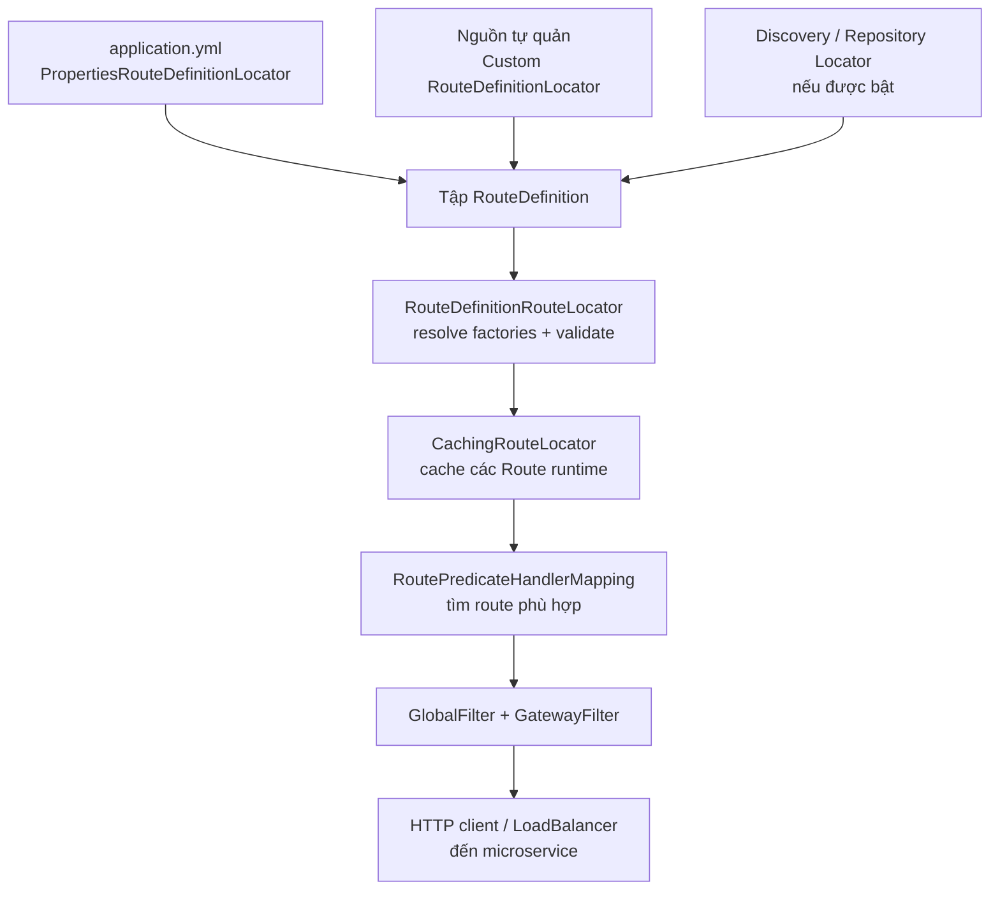
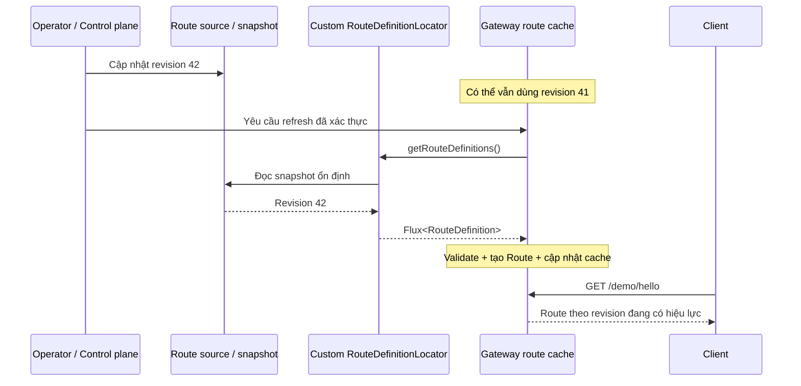
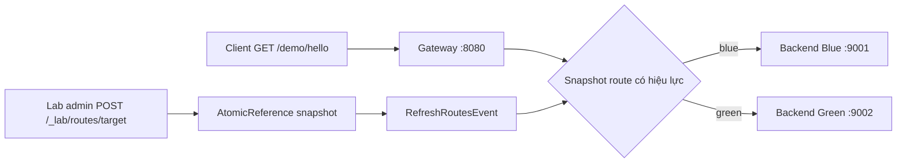
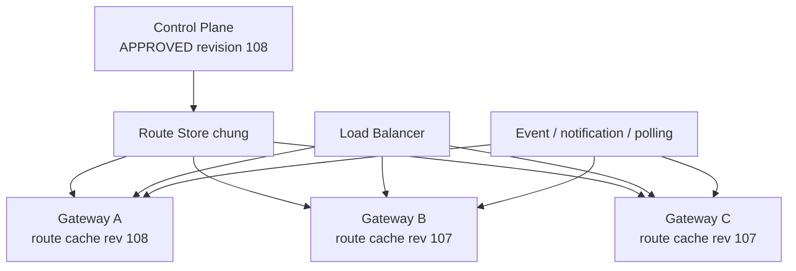
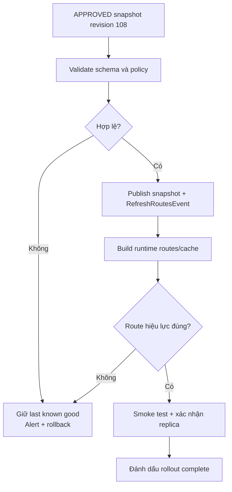

# Nạp tuyến bằng `RouteDefinitionLocator` tùy biến trong Spring Cloud Gateway

Trong kiến trúc microservices, **Spring Cloud Gateway** là điểm vào chung của client. Gateway kiểm tra *route predicate*, chạy *filter chain*, biến đổi path/header và chuyển request đến upstream; từ đó có thể kết hợp xác thực, rate limiting, circuit breaker, retry, TLS và quan sát request. Khi số service, tenant hoặc vùng triển khai thay đổi thường xuyên, việc phải sửa `application.yml` rồi khởi động lại Gateway chỉ để thêm một tuyến có thể trở thành nút thắt vận hành.

**`RouteDefinitionLocator` tùy biến** giải quyết phần **lấy danh sách định nghĩa tuyến từ nguồn do ứng dụng quản lý**: bộ nhớ, cơ sở dữ liệu, dịch vụ cấu hình, kho quản trị tuyến đã phê duyệt hoặc một nguồn dữ liệu có version. Nó không tự động đồng nghĩa với “route thay đổi tức thì trên mọi replica”. Để triển khai đúng, cần hiểu **định nghĩa tuyến**, **route thực thi**, **cache route**, **cơ chế refresh** và **ranh giới bảo mật của nguồn cấu hình**.

Bài thuộc chương **Tuyến động** của module `SPRING_CLOUD_GATEWAY`. Trọng tâm là cách **tự hiện thực `RouteDefinitionLocator`**, chuyển dữ liệu cấu hình thành `RouteDefinition`, kích hoạt nạp lại, kiểm thử kết quả và thiết kế an toàn cho môi trường nhiều Gateway instance.

> **Phạm vi:** Ví dụ dùng **Spring Cloud Gateway Server WebFlux 5.0.x**, Spring Cloud 2025.1.x và Spring Boot 4.x tương thích. Trên phiên bản này, tuyến khai báo bằng YAML dùng tiền tố `spring.cloud.gateway.server.webflux.routes`. Hướng dẫn cho Gateway 4.x có thể dùng `spring.cloud.gateway.routes`; Server Web MVC lại có API/route model khác. Các ví dụ quản trị tuyến chỉ mở ở **loopback trong lab**, không phải mẫu endpoint quản trị công khai.

## 1. Kết quả học tập

Sau bài này, bạn có thể:

1. Phân biệt `RouteDefinition`, `RouteDefinitionLocator`, `RouteLocator`, `RouteDefinitionRouteLocator` và cache tuyến đã được biên dịch.
2. Giải thích chính xác `getRouteDefinitions(): Flux<RouteDefinition>` được sử dụng khi nào, vì sao một nguồn dữ liệu thay đổi chưa chắc làm route đang chạy đổi ngay.
3. Viết một `RouteDefinitionLocator` tùy biến có **snapshot nguyên tử**, đọc lại được sau mỗi lần refresh.
4. Dựng route từ `id`, `uri`, `order`, `predicates`, `filters` và `metadata` với factory name/arguments hợp lệ.
5. Phát `RefreshRoutesEvent` trong ứng dụng và kiểm tra các route có hiệu lực qua Actuator, không lạm dụng endpoint quản trị từ Internet.
6. Thử chuyển route giữa hai backend trên runtime mà không restart Gateway; đối chiếu kết quả bằng `curl` và log.
7. Thiết kế validation, authorization, versioning, rollout/rollback và consistency khi nhiều replica cùng nạp tuyến động.

## 2. Vòng đời một route: từ định nghĩa đến request thực

Cần phân biệt ba mức:

- **`RouteDefinition`:** mô tả có thể serialize hoặc tạo từ nguồn dữ liệu; gồm `id`, `uri`, `order`, danh sách predicate/filter và metadata.
- **`Route`:** đối tượng runtime đã được xây bằng các `RoutePredicateFactory`/`GatewayFilterFactory` cụ thể, chứa predicate thực thi và các filter đã tạo.
- **Request đang đi qua Gateway:** được đối chiếu với các `Route` runtime, không truy vấn cơ sở dữ liệu cấu hình ở mỗi HTTP request theo thiết kế mặc định.

Luồng khái niệm:



Sơ đồ là mô hình các lớp trách nhiệm. Tên bean, cấu trúc composite/cache và sự kiện nội bộ có thể thay đổi theo release; điều quan trọng là **nguồn định nghĩa không phải trực tiếp là bảng route request dùng ở mọi thời điểm**.

### 2.1. `RouteDefinitionLocator` làm gì?

Tài liệu Gateway 5.0 mô tả interface:

```java
public interface RouteDefinitionLocator {
    Flux<RouteDefinition> getRouteDefinitions();
}
```

Khi một bean hiện thực interface này có trong Spring Context, Gateway có thể kết hợp nó với các locator khác để thu thập route definitions. `Flux` là publisher reactive; **không nên chủ động `subscribe()` bên trong locator chỉ để trả route**.

Các nguồn thường gặp:

| Nguồn | Mục đích | Điều cần lưu ý |
|---|---|---|
| `PropertiesRouteDefinitionLocator` | Tuyến khai báo trong cấu hình Boot | Nạp từ `application.yml`/configuration properties |
| Custom `RouteDefinitionLocator` | Tuyến từ cơ sở dữ liệu, registry hay snapshot ứng dụng | Tự chịu trách nhiệm validation và lifecycle nguồn |
| Discovery-based locator | Sinh tuyến từ service discovery khi bật | Không tự thay thế authorization/policy của route |
| `RouteDefinitionRepository` | Đọc/ghi/xóa định nghĩa tuyến qua một abstraction | Có lifecycle ghi/xóa riêng; khác custom locator chỉ đọc |
| Java DSL `RouteLocatorBuilder` | Khởi tạo `Route` bằng code Java | Đây là tuyến runtime qua `RouteLocator`, không bắt buộc đi qua `RouteDefinition` |

**Không nhầm `RouteDefinitionLocator` với `RouteLocator`**. Cái đầu cung cấp mô tả, cái sau cung cấp `Route` có thể thực thi. Nếu bạn đã có dữ liệu `id`, `uri`, `Path` và `StripPrefix` lưu trong database, `RouteDefinitionLocator` thường là điểm tích hợp tự nhiên; nếu toàn bộ route là code Java DSL bất biến, `RouteLocatorBuilder` có thể đơn giản hơn.

### 2.2. `RouteDefinitionRepository` dùng khi nào?

`RouteDefinitionRepository` mở rộng khả năng đọc định nghĩa với các thao tác lưu/xóa theo interface tương ứng. Nó hữu ích nếu muốn CRUD route bằng một persistence layer có chính sách quản trị rõ. Nhưng bài này tập trung **locator tùy biến chỉ đọc** từ snapshot, nhằm tách bạch hai vấn đề:

1. **Ai là nguồn dữ liệu chuẩn và người được phép thay đổi cấu hình tuyến?**
2. **Gateway đọc/áp dụng phiên bản định nghĩa đó như thế nào?**

Đưa CRUD vào cùng một controller công khai không làm thiết kế động tốt hơn. Một admin plane có thể ghi dữ liệu ở hệ thống riêng, còn Gateway chỉ đọc **snapshot đã kiểm tra và được phát hành**.

### 2.3. Một `RouteDefinition` chứa những trường nào?

| Trường | Ví dụ | Ý nghĩa |
|---|---|---|
| `id` | `catalog-dynamic` | Định danh tuyến, cần ổn định và không trùng trong scope áp dụng |
| `uri` | `http://127.0.0.1:9001` | Đích sau khi route được chọn; có thể là `lb://service-id` khi hỗ trợ LoadBalancer |
| `order` | `-10` | Độ ưu tiên chọn route; **số nhỏ hơn ưu tiên hơn** khi nhiều route match |
| `predicates` | `Path=/demo/**`, `Method=GET` | Những điều kiện để route được chọn |
| `filters` | `StripPrefix=1`, `AddRequestHeader=...` | Biến đổi request/response trong filter chain |
| `metadata` | `source=control-plane`, `revision=42` | Thông tin mô tả phục vụ kiểm toán/route metadata, không tự là chính sách bảo mật |

Route có `order=-10` chưa bảo đảm luôn khớp; các predicate vẫn phải đúng. `order` của **route** cũng không phải `Ordered.getOrder()` của **filter**. Không dùng metadata do nguồn bên ngoài gửi để suy ra quyền truy cập nếu chưa có chính sách xác minh riêng.

## 3. Nạp tuyến động không đồng nghĩa query database mỗi request

Một nhầm lẫn phổ biến:

> “Tôi thay một bản ghi database. Vì `getRouteDefinitions()` đọc database, request tiếp theo chắc chắn đi tuyến mới.”

Suy luận này bỏ qua cache `Route` đã chuyển đổi. Gateway thường **lấy và cache tập route runtime** để xử lý request hiệu quả. Nếu database hoặc `AtomicReference` của locator đổi, bảng cache đang được request sử dụng có thể vẫn chứa tuyến cũ.



### 3.1. Ba trạng thái thường bị trộn lẫn

| Lớp | Trạng thái | Câu hỏi xác minh |
|---|---|---|
| **Data source** | Revision mới đã được lưu chưa? | Đọc lại nguồn quản trị |
| **Route definitions** | Locator trả revision mới khi được subscribe chưa? | Test `getRouteDefinitions()` và `/actuator/gateway/routedefinitions` |
| **Effective runtime routes** | Cache của Gateway đã có `Route` mới chưa? | `/actuator/gateway/routes` và request thật qua port Gateway |

Khi một bước báo thành công không có nghĩa các bước sau đã hoàn tất. Trong những hệ thống có refresh bất đồng bộ, **nhận HTTP 200/202 từ lệnh yêu cầu refresh không phải chứng minh ngay mọi request trên mọi replica đã chuyển**. Phải kiểm tra trạng thái hiệu lực và có quy trình rollback.

### 3.2. `Flux.defer` có ích ở chỗ nào?

Nếu locator viết:

```java
return Flux.fromIterable(snapshot.get());
```

thì `snapshot.get()` được gọi **khi method chạy**, tạo publisher từ một snapshot hiện tại. Đây có thể đủ nếu Gateway gọi lại method tại mỗi refresh.

Cách viết:

```java
return Flux.defer(() -> Flux.fromIterable(snapshot.get()));
```

làm rõ rằng **mỗi lần subscribe** sẽ đọc lại snapshot của locator. Nó **không tự kích hoạt refresh**: khi cache `Route` của Gateway còn cũ, request không phải lúc nào cũng subscribe vào locator. `Flux.defer` chỉ điều khiển thời điểm publisher truy cập nguồn, không thay thế `RefreshRoutesEvent`.

### 3.3. Một lần refresh có thể thất bại

Nếu locator trả predicate không tồn tại, URI không hợp lệ hoặc một `GatewayFilterFactory` thiếu tham số, bước chuyển `RouteDefinition` thành `Route` có thể lỗi. Gateway 5.0 có property `spring.cloud.gateway.server.webflux.fail-on-route-definition-error` (mặc định được liệt kê là `true`), ảnh hưởng cách xử lý lỗi route definition.

Đừng dùng `fail-on-route-definition-error: false` như một cách che cấu hình sai mà không có alert và kiểm thử: một tuyến bị bỏ qua có thể tạo HTTP 404/định tuyến không như mong muốn. Với production, nên **xác thực snapshot trước khi publish** và giữ revision “last known good” khi dữ liệu mới không hợp lệ.

## 4. Chuẩn bị lab: một Gateway, hai backend độc lập

Lab minh họa một route tên `dynamic-greeting` với predicate `Path=/demo/**`, chuyển request `/demo/hello` thành `/hello` nhờ `StripPrefix=1`.

- Ban đầu route đi đến **backend blue** tại `127.0.0.1:9001`.
- Sau khi yêu cầu update, **cùng route ID** được hướng sang **backend green** tại `127.0.0.1:9002`.
- Gateway không cần restart, nhưng phải làm mới cache route.
- Chỉ cho operator chọn **hai đích cố định** trong lab, không cho nhập URL bất kỳ từ Internet.



### 4.1. Tạo ứng dụng Server WebFlux

Dùng Spring Initializr hoặc Maven project có Spring Boot 4.x tương thích Spring Cloud 2025.1.x. Dependency chính:

```xml
<dependencies>
    <dependency>
        <groupId>org.springframework.cloud</groupId>
        <artifactId>spring-cloud-starter-gateway-server-webflux</artifactId>
    </dependency>
    <dependency>
        <groupId>org.springframework.boot</groupId>
        <artifactId>spring-boot-starter-actuator</artifactId>
    </dependency>
</dependencies>
```

Đây **chưa phải `pom.xml` hoàn chỉnh**: dự án còn phải có Spring Boot parent/plugin và Spring Cloud BOM cùng train. Không thêm starter Spring MVC vào project Gateway Server WebFlux vì nó thay đổi application runtime và khiến ví dụ WebFlux không phản ánh dự kiến.

Class chính:

```java
import org.springframework.boot.SpringApplication;
import org.springframework.boot.autoconfigure.SpringBootApplication;

@SpringBootApplication
public class DynamicRouteGatewayApplication {
    public static void main(String[] args) {
        SpringApplication.run(DynamicRouteGatewayApplication.class, args);
    }
}
```

Đặt các class Java dưới cùng package hoặc package con để Spring Boot component scan thấy chúng.

### 4.2. `application.yml` của lab

```yaml
server:
  address: 127.0.0.1
  port: 8080

spring:
  application:
    name: dynamic-route-gateway
  cloud:
    gateway:
      server:
        webflux:
          # Không khai báo route /demo/** trùng với locator trong Java.
          routes: []

management:
  endpoint:
    gateway:
      access: read-only
  endpoints:
    web:
      exposure:
        include: health,info,gateway
```

**Vì sao `server.address: 127.0.0.1`?** Lab có một controller thay route qua HTTP để người học thử. Chúng ta chỉ cho Gateway lắng nghe local loopback, không xuất cổng quản trị ra LAN/Internet. Trong production, **không triển khai controller lab này trên public listener**; phải có control plane quản trị riêng, xác thực mạnh, phân quyền, audit và network policy.

`management.endpoint.gateway.access: read-only` cho phép xem route qua Actuator, **không mở CRUD/refresh qua Actuator**. Việc refresh trong lab sẽ do Java code phát `RefreshRoutesEvent` ở bước tiếp theo. Đừng bật `unrestricted` trên production chỉ để thao tác thuận tiện.

Cấu hình route YAML là `[]` vì route chính được tạo bởi custom locator. Spring Cloud Gateway có thể kết hợp **nhiều** locator, nhưng hai nguồn trả **trùng ID** sẽ tạo kết quả khó kiểm soát hoặc lỗi. Không khai báo thêm `dynamic-greeting` trong YAML khi dùng class Java bên dưới.

## 5. Hiện thực `RouteDefinitionLocator` tùy biến có snapshot nguyên tử

Tạo `InMemoryDynamicRouteDefinitionLocator.java`:

```java
import java.net.URI;
import java.util.List;
import java.util.Map;
import java.util.concurrent.atomic.AtomicReference;

import org.springframework.cloud.gateway.filter.FilterDefinition;
import org.springframework.cloud.gateway.handler.predicate.PredicateDefinition;
import org.springframework.cloud.gateway.route.RouteDefinition;
import org.springframework.cloud.gateway.route.RouteDefinitionLocator;
import org.springframework.stereotype.Component;

import reactor.core.publisher.Flux;

@Component
public final class InMemoryDynamicRouteDefinitionLocator
        implements RouteDefinitionLocator {

    // Mỗi lần đổi tuyến tạo một RouteDefinition MỚI.
    // Không sửa đối tượng RouteDefinition của snapshot cũ.
    private final AtomicReference<List<RouteDefinition>> snapshot =
            new AtomicReference<>(List.of(buildRoute("blue")));

    private final AtomicReference<String> desiredTarget =
            new AtomicReference<>("blue");

    @Override
    public Flux<RouteDefinition> getRouteDefinitions() {
        // Mỗi lần subscription đọc snapshot hiện tại của locator.
        // Không query network hoặc block event loop.
        return Flux.defer(() -> Flux.fromIterable(snapshot.get()));
    }

    public synchronized void switchTarget(String target) {
        if (!"blue".equals(target) && !"green".equals(target)) {
            throw new IllegalArgumentException("Unknown target");
        }

        RouteDefinition next = buildRoute(target);
        snapshot.set(List.of(next));
        desiredTarget.set(target);
    }

    public String desiredTarget() {
        // Chỉ là snapshot của nguồn, CHƯA chứng minh cache hiệu lực.
        return desiredTarget.get();
    }

    private static RouteDefinition buildRoute(String target) {
        URI uri = "blue".equals(target)
                ? URI.create("http://127.0.0.1:9001")
                : URI.create("http://127.0.0.1:9002");

        RouteDefinition definition = new RouteDefinition();
        definition.setId("dynamic-greeting");
        definition.setUri(uri);
        definition.setOrder(-10);

        definition.setPredicates(List.of(
                new PredicateDefinition("Path=/demo/**"),
                new PredicateDefinition("Method=GET")
        ));

        definition.setFilters(List.of(
                new FilterDefinition("StripPrefix=1")
        ));

        // Đừng lưu secrets/tokens ở metadata có thể được lộ qua Actuator.
        definition.setMetadata(Map.of(
                "source", "memory-lab",
                "target", target
        ));

        return definition;
    }
}
```

**Các điểm chính của class:**

1. `@Component` đăng ký một bean `RouteDefinitionLocator`; Gateway có thể thu thập route từ bean này cùng các locator khác.
2. `getRouteDefinitions()` không tự gọi `subscribe()` và không xử lý HTTP request. Nó trả reactive publisher cho **định nghĩa tuyến**.
3. `AtomicReference<List<RouteDefinition>>` cho phép thay **toàn bộ danh sách route nguồn** bằng một thao tác nguyên tử trong JVM.
4. `List.of(...)` tạo danh sách immutable; mỗi phiên bản tạo `RouteDefinition` mới để không sửa route cũ khi một subscription đang sử dụng nó.
5. `switchTarget()` dùng `synchronized` trong **lab đơn JVM** để tránh hai lời gọi quản trị cùng lúc ghi đè dữ liệu cập nhật; nó **không phải distributed lock**.
6. `URI` được chọn từ **allowlist cố định**. Không nhận arbitrary `uri` từ JSON request rồi proxy đến bất cứ host nào.
7. `PredicateDefinition("Path=/demo/**")` và `FilterDefinition("StripPrefix=1")` dùng cú pháp shortcut chính thức của Gateway; `Method=GET` tránh áp dụng route cho POST quản trị.
8. `metadata` giúp người vận hành quan sát đích snapshot, nhưng **không** tự biến thông tin này thành policy phân quyền hay điều kiện match.

### 5.1. Vì sao không tự viết `Route` runtime?

Một cách khác là tạo trực tiếp `RouteLocator` bằng Java DSL. Nhưng bài này cần **định nghĩa tuyến có thể đến từ kho dữ liệu**, nên dùng `RouteDefinition` và để Gateway giải quyết tên predicate/filter thành factories tương ứng.

Lợi ích khi biểu diễn route ở mức `RouteDefinition`:

- Dễ lưu dưới dạng JSON/YAML/schema của control plane.
- Có `id`, `uri`, `order`, `metadata` thống nhất.
- Có thể liệt kê để kiểm tra/kiểm toán.
- Có thể áp dụng validation trước khi publish.
- Không cần service cấu hình biết cách dựng Java lambda hay `GatewayFilter` cụ thể.

Đổi lại, filter tùy biến chỉ có trong Java code vẫn phải được **đăng ký factory trên Gateway**. Không thể gửi tên factory chưa cài và kỳ vọng dữ liệu JSON tự tạo được chức năng đó.

### 5.2. Snapshot nguyên tử không đồng nghĩa nhất quán toàn cụm

Trong lab, `AtomicReference` chỉ bảo đảm **một JVM** có snapshot mới mà không nhìn thấy danh sách đang bị sửa dở. Nếu có ba Gateway replica:

```text
A: revision 12, route → blue
B: revision 11, route → green
C: revision 12, route → blue
```

chúng **không** chia cùng `AtomicReference`. Cả controller trong lab cũng chỉ đổi trạng thái trên process nhận request. Một request update đi qua load balancer có thể đổi A nhưng không đổi B/C. Cần cơ chế phân phối revision và refresh riêng cho production, nêu ở phần sau.

### 5.3. Chuỗi filter và route order cần phân biệt

`definition.setOrder(-10)` quyết định **ưu tiên route** khi có nhiều route cùng match. Nó không quyết định `StripPrefix` chạy trước hay sau `NettyRoutingFilter`. Với route này:

```text
Client: GET /demo/hello
  → Predicate Path=/demo/** và Method=GET
  → Filter StripPrefix=1
  → Backend blue/green thấy GET /hello
```

Không dùng `order` để sửa một lỗi filter chain; nếu cần thứ tự filter nâng cao, phải dựa vào `Ordered` của các `GatewayFilter`/`GlobalFilter` tương ứng và kiểm tra chuỗi đã hợp nhất.

## 6. Phát `RefreshRoutesEvent` để nạp route mới

Với mô hình `RouteDefinitionLocator`, một cách phát tín hiệu refresh trong **cùng Spring ApplicationContext** là dùng `ApplicationEventPublisher`:

```java
applicationEventPublisher.publishEvent(new RefreshRoutesEvent(this));
```

`RefreshRoutesEvent` được Gateway sử dụng để yêu cầu làm mới tập route. Nó **không phải** thông điệp broadcast tự động đến mọi Gateway replica, và không bảo đảm HTTP request đã đổi route ngay tại dòng code kế tiếp.

### 6.1. Controller chỉ dùng trong lab

Tạo `DynamicRoutesLabController.java`:

```java
import java.util.Map;

import org.springframework.cloud.gateway.event.RefreshRoutesEvent;
import org.springframework.context.ApplicationEventPublisher;
import org.springframework.http.ResponseEntity;
import org.springframework.web.bind.annotation.GetMapping;
import org.springframework.web.bind.annotation.PostMapping;
import org.springframework.web.bind.annotation.RequestMapping;
import org.springframework.web.bind.annotation.RequestParam;
import org.springframework.web.bind.annotation.RestController;

@RestController
@RequestMapping("/_lab/routes")
public class DynamicRoutesLabController {

    private final InMemoryDynamicRouteDefinitionLocator locator;
    private final ApplicationEventPublisher publisher;

    public DynamicRoutesLabController(
            InMemoryDynamicRouteDefinitionLocator locator,
            ApplicationEventPublisher publisher) {
        this.locator = locator;
        this.publisher = publisher;
    }

    @GetMapping("/target")
    public ResponseEntity<Map<String, String>> desiredTarget() {
        // Đây là trạng thái NGUỒN, không phải bằng chứng route cache đã đổi.
        return ResponseEntity.ok(Map.of(
                "desiredTarget", locator.desiredTarget()
        ));
    }

    @PostMapping("/target")
    public ResponseEntity<Map<String, String>> changeTarget(
            @RequestParam("target") String target) {

        if (!"blue".equals(target) && !"green".equals(target)) {
            return ResponseEntity.badRequest().body(Map.of(
                    "error", "TARGET_NOT_ALLOWED"
            ));
        }

        locator.switchTarget(target);
        publisher.publishEvent(new RefreshRoutesEvent(this));

        // 202: đã nhận yêu cầu cập nhật, nhưng không hứa refresh
        // và mọi HTTP request đã áp dụng kết quả ngay lập tức.
        return ResponseEntity.accepted().body(Map.of(
                "desiredTarget", target,
                "state", "REFRESH_REQUESTED"
        ));
    }
}
```

**Giải thích rõ các giới hạn:**

- `@PostMapping` có tác dụng **quản trị cấu hình**, không phải endpoint nghiệp vụ. Nó bị giới hạn trong lab nhờ `server.address: 127.0.0.1`; tuyệt đối không đưa nó vào Gateway public mà không có admin authentication/authorization, CSRF policy phù hợp, network isolation và audit.
- `locator.switchTarget(...)` thay snapshot **trong một JVM**.
- `publishEvent(new RefreshRoutesEvent(this))` gửi thông báo **trong JVM đó**. Nguồn cấu hình động khác có thể dùng event phát hành từ control plane và cơ chế phân phối theo từng replica.
- `202 Accepted` nói **đã chấp nhận yêu cầu**, không cam kết route runtime cập nhật atomically với HTTP response của controller.
- `GET /_lab/routes/target` chỉ phản ánh `desiredTarget` tại nguồn; kết quả đáng tin về **route hiệu lực** là `/actuator/gateway/routes` và request `GET /demo/hello`.
- Điều kiện chọn blue/green là **allowlist hard-coded** để tránh API request thay `uri` tùy ý, dẫn đến SSRF hoặc vượt network policy.

### 6.2. Không dùng `block()` trong luồng xử lý WebFlux

`getRouteDefinitions()` trả `Flux` là contract reactive. Nếu lấy dữ liệu từ R2DBC, Redis reactive hoặc `WebClient` thì nên kết nối non-blocking:

```java
@Override
public Flux<RouteDefinition> getRouteDefinitions() {
    return repository.findAllApprovedRoutes()
            .map(this::toRouteDefinition);
}
```

**Đây là pseudo-code minh họa tích hợp**, không phải class đầy đủ: `repository` và `toRouteDefinition` phải được hiện thực theo schema dữ liệu thật.

Tránh:

```java
// ANTI-PATTERN trong luồng reactive/event-loop:
List<RouteDefinition> routes = jdbcRepository.findAll();
return Flux.fromIterable(routes);
```

Nếu bạn phải dùng JDBC/SDK đồng bộ, hãy tổ chức **quá trình tải snapshot ở một worker thread được quản lý** và xuất bản snapshot immutable, hoặc dùng scheduler phù hợp với giới hạn tải; không block Reactor Netty event-loop của Gateway khi refresh hay xử lý request. Không coi `subscribeOn(boundedElastic())` là giải pháp tự động cho transaction, timeout, consistency hoặc điều kiện cạnh tranh.

### 6.3. Refresh có thể là bất đồng bộ

Tài liệu Actuator Gateway 5.0 lưu ý refresh route cache có thể xử lý bất đồng bộ, và khi xảy ra lỗi refresh thì tập route hiện có không bị đổi theo luồng mà endpoint mô tả. Vì vậy nên định nghĩa ba mốc riêng:

1. `SOURCE_UPDATED`: dữ liệu/snapshot mong muốn đã được thay.
2. `REFRESH_REQUESTED`: event hoặc API đã được gửi.
3. `EFFECTIVE_REVISION_CONFIRMED`: từng Gateway replica đã chuyển đổi thành công và kiểm tra được tuyến hiệu lực.

Trong lab chỉ có `202 Accepted` và các bước đọc route/curl. Production có thể cần **revision ID**, health status và xác nhận rollout theo replica để tránh tuyên bố đã phát hành khi route thực tế chưa đổi.

## 7. Backend lab: chạy Blue và Green để thấy sự thay đổi

Dùng một server JDK nhỏ để phân biệt backend bằng body. Tạo file `ColorEchoBackend.java` trong thư mục thực hành ngoài project Gateway:

```java
import com.sun.net.httpserver.HttpServer;
import java.net.InetSocketAddress;
import java.nio.charset.StandardCharsets;

public class ColorEchoBackend {
    public static void main(String[] args) throws Exception {
        if (args.length != 2) {
            throw new IllegalArgumentException(
                    "Usage: ColorEchoBackend <port> <label>");
        }

        int port = Integer.parseInt(args[0]);
        String label = args[1];

        HttpServer server = HttpServer.create(
                new InetSocketAddress("127.0.0.1", port), 0);

        server.createContext("/", exchange -> {
            if (!"GET".equals(exchange.getRequestMethod())) {
                exchange.sendResponseHeaders(405, -1);
                exchange.close();
                return;
            }

            String response = "backend=" + label + "\n"
                    + "path=" + exchange.getRequestURI().getRawPath() + "\n";
            byte[] body = response.getBytes(StandardCharsets.UTF_8);

            exchange.getResponseHeaders().set(
                    "Content-Type", "text/plain; charset=utf-8");
            exchange.sendResponseHeaders(200, body.length);

            try (var output = exchange.getResponseBody()) {
                output.write(body);
            }

            System.out.println(label + " received "
                    + exchange.getRequestURI().getRawPath());
        });

        server.start();
        System.out.println(label + " on 127.0.0.1:" + port);
    }
}
```

Mở **hai terminal** trong thư mục chứa file và chạy từng backend:

```bash
# Terminal 1: Blue
java --add-modules jdk.httpserver ColorEchoBackend.java 9001 blue

# Terminal 2: Green
java --add-modules jdk.httpserver ColorEchoBackend.java 9002 green
```

JDK 17+ hỗ trợ chạy source file Java trực tiếp theo cách này. Cả hai backend bind `127.0.0.1`, chỉ để thử nghiệm local. Không phải HTTP server production.

### 7.1. Kiểm tra backend trước khi bật Gateway

```bash
curl -i http://127.0.0.1:9001/hello
curl -i http://127.0.0.1:9002/hello
```

Phản hồi mẫu:

```text
HTTP/1.1 200 OK
...
backend=blue
path=/hello
```

và:

```text
HTTP/1.1 200 OK
...
backend=green
path=/hello
```

Nếu cả hai phản hồi giống nhau, trước tiên kiểm tra label/port các process backend. Không nên chẩn đoán route động của Gateway khi upstream chưa sẵn sàng.

## 8. Thực hành: chuyển tuyến mà không restart Gateway

Khởi động ứng dụng Gateway trong terminal thứ ba:

```bash
# Linux/macOS
./mvnw spring-boot:run

# Windows PowerShell
.\mvnw.cmd spring-boot:run
```

### 8.1. Lần đầu: route trỏ Blue

```bash
curl -i http://127.0.0.1:8080/demo/hello
```

Dự kiến:

```text
HTTP/1.1 200 OK
...
backend=blue
path=/hello
```

Các dấu hiệu:

- `Path=/demo/**` và `Method=GET` khớp.
- `StripPrefix=1` xóa segment `demo`, backend thấy `/hello`.
- `URI` ban đầu là `http://127.0.0.1:9001`.
- Request được proxy qua HTTP client Gateway; controller quản trị không can thiệp request này.

Thử một request POST để hiểu predicate:

```bash
curl -i -X POST http://127.0.0.1:8080/demo/hello
```

Không có route `Method=POST` cho path này nên Gateway có thể trả `404` (hoặc bị lớp Security/config khác từ chối nếu bạn đã thêm chúng). Nó không tự chuyển POST đến Blue.

### 8.2. Chuyển route sang Green

Gọi admin lab endpoint qua loopback:

```bash
curl -i -X POST \
  "http://127.0.0.1:8080/_lab/routes/target?target=green"
```

Dự kiến HTTP `202 Accepted` với body tương tự:

```json
{
  "desiredTarget": "green",
  "state": "REFRESH_REQUESTED"
}
```

Xem dữ liệu **nguồn** của locator:

```bash
curl -i http://127.0.0.1:8080/_lab/routes/target
```

Kết quả có thể là `{"desiredTarget":"green"}`. Nhưng **đừng dừng ở đây**; kết quả này không chứng minh route cache đã áp dụng revision mới.

### 8.3. Xác minh route đang thực thi

Vì Actuator được mở read-only trên loopback trong lab, kiểm tra:

```bash
curl -i http://127.0.0.1:8080/actuator/gateway/routedefinitions
curl -i http://127.0.0.1:8080/actuator/gateway/routes
curl -i http://127.0.0.1:8080/actuator/gateway/routes/dynamic-greeting
```

Khi refresh đã hoàn tất và route được dựng thành công, `/actuator/gateway/routes` sẽ phản ánh tuyến `dynamic-greeting` với URI `http://127.0.0.1:9002`. Format JSON của Actuator là runtime-specific; không parse cứng theo một vị trí trong mảng mà chưa kiểm tra schema.

Sau đó:

```bash
curl -i http://127.0.0.1:8080/demo/hello
```

Kỳ vọng:

```text
HTTP/1.1 200 OK
...
backend=green
path=/hello
```

Nếu request ngay sau HTTP `202` còn trả Blue, **không lập tức coi đó là lỗi**: refresh có thể chưa hoàn tất. Xác minh sau khi route list đã thể hiện URI mới. Nếu kéo dài, xem logs của route conversion/cache và lỗi từ definition.

### 8.4. Đổi lại Blue, thử đích không hợp lệ

```bash
curl -i -X POST \
  "http://127.0.0.1:8080/_lab/routes/target?target=blue"

curl -i -X POST \
  "http://127.0.0.1:8080/_lab/routes/target?target=invalid"
```

Lệnh thứ nhất phát yêu cầu refresh về Blue. Lệnh thứ hai **phải** trả `400 Bad Request` và body `TARGET_NOT_ALLOWED`; state nguồn không được đổi thành `invalid`.

Nếu controller cho phép nhập `http://169.254.169.254` hoặc arbitrary `https://attacker.example`, bạn đã biến dynamic routing thành một công cụ SSRF tiềm ẩn. Ví dụ lab cố tình **không** hỗ trợ giá trị URL trực tiếp.

### 8.5. Phân biệt lỗi khi kiểm thử

| Quan sát | Có thể là | Kiểm tra |
|---|---|---|
| `GET /demo/hello` trả 404 | Route không được nạp/match, Method/Path sai | Actuator routes, predicate factory, logs |
| Trả 502/503 | Đích mới chưa chạy, lỗi HTTP client | Backend :9001/:9002, network, port |
| Nguồn hiển thị Green nhưng request vẫn Blue | Route cache chưa refresh hoặc refresh lỗi | Actuator effective routes, refresh logs |
| Có hai route `dynamic-greeting` | Duplicate ID ở nhiều locator | Bỏ route trùng trong YAML/nguồn khác |
| `POST /_lab/routes/target` không vào controller | Web runtime không khớp hoặc path bị route/security bắt | Starter WebFlux, handler mappings, security chain |
| Actuator gateway trả 404/không truy cập | Chưa bật/đã bảo vệ Actuator | `management.endpoint.gateway.access` và exposure |
| Controller trả 202 nhưng route mới không xuất hiện | Lỗi converter/filter/predicate hoặc event chưa áp dụng | Definition validity, conversion, refresh result |
| Sau restart lại về Blue | Snapshot chỉ nằm trong RAM JVM | Đây là tính chất lab, cần persistent source production |

**Không tắt authentication, TLS hoặc authorization trên production** để “sửa” HTTP 401/403 khi test cập nhật route. Trước tiên xác định lớp nào đã từ chối request.

## 9. Từ snapshot trong RAM đến nguồn cấu hình ngoài

Trong production, mục tiêu thường không phải điều khiển Blue/Green bằng một controller trong Gateway. Mục tiêu là **Gateway nạp một tập route đã được phê duyệt**, có lịch sử, có phiên bản và có cơ chế đồng bộ giữa nhiều replica.

Một cấu trúc dữ liệu phía control plane có thể như sau:

```json
{
  "revision": 108,
  "state": "APPROVED",
  "routes": [
    {
      "id": "catalog-public",
      "path": "/public/catalog/**",
      "method": "GET",
      "serviceId": "catalog-service",
      "stripPrefix": 1,
      "order": -10,
      "policy": "PUBLIC_READ"
    }
  ]
}
```

Đây là **schema quản trị tuyến minh họa do hệ thống tự định nghĩa**, không phải schema JSON trực tiếp của `RouteDefinition`. Tầng adapter có nhiệm vụ kiểm tra bản ghi, chuyển sang:

```text
id         = catalog-public
uri        = lb://catalog-service
order      = -10
predicates = Path=/public/catalog/**; Method=GET
filters    = StripPrefix=1
metadata   = source=control-plane; revision=108
```

Cách này giúp nguồn cấu hình **không trực tiếp gửi Java expression, class name, arbitrary filter factory, secret hoặc URL không được kiểm tra**. Một tập lệnh/JSON trong database không nên được phép tùy ý viết lại hành vi proxy đến host nguy hiểm.

### 9.1. Các bước chuyển đổi an toàn

| Bước | Nội dung | Lý do |
|---|---|---|
| 1 | Đọc **một revision hoàn chỉnh** | Không trộn route của hai lần phát hành |
| 2 | Kiểm tra trạng thái `APPROVED`, chữ ký/quyền phát hành | Không dùng dữ liệu nháp hoặc từ nguồn không tin |
| 3 | Validate `id`, số route, kích thước cấu hình, tính duy nhất | Tránh duplicate và bùng metadata |
| 4 | Validate `Path`/`Method` và route overlap | Tránh route bắt nhầm traffic nhạy cảm |
| 5 | Map `serviceId` sang `lb://...` theo allowlist | Không mở arbitrary HTTP proxy/SSRF |
| 6 | Áp dụng filter policy từ danh mục cho phép | Giữ auth, TLS, rate limit và không cho filter nguy hiểm tùy ý |
| 7 | Sinh **danh sách `RouteDefinition` mới** | Không sửa snapshot đang phục vụ request |
| 8 | Kiểm tra parse/factory config và smoke test | Phát hiện route không thể chuyển sang runtime |
| 9 | Publish snapshot + gửi refresh đến từng instance | Cập nhật cache route tại Gateway |
| 10 | Xác nhận revision hiệu lực và có rollback | Không dừng ở “đã lưu database” |

Đặc biệt với `lb://serviceId`, Gateway cần Spring Cloud LoadBalancer và discovery/static instance supplier phù hợp. Chỉ đặt URI `lb://catalog-service` không tự tạo backend instance hoặc policy mTLS. Khi cần upstream TLS, kiểm tra scheme instance, hostname/SAN và HTTP client SSL context thực tế.

### 9.2. Ví dụ adapter từ repository reactive (minh họa)

Sau khi bạn đã có một repository đọc **snapshot được phê duyệt**, locator có thể chuyển dữ liệu qua reactive chain:

```java
// PSEUDO-CODE: minh họa cấu trúc, không phải class có thể biên dịch
// nếu chưa tạo RouteSnapshotStore, RouteRecord và mapApprovedRoute.
public Flux<RouteDefinition> getRouteDefinitions() {
    return Flux.defer(() ->
        routeSnapshotStore.loadCurrentApprovedRevision()
            .flatMapMany(revision ->
                Flux.fromIterable(revision.routes())
                    .map(this::mapApprovedRoute))
    );
}
```

Trong thực tế, nên hạn chế thời gian truy vấn, số records, response size và độ đồng thời. Không để locator tải **tất cả revision lịch sử** rồi filter trong memory. Nếu repository có cache riêng, phải có quy tắc refresh cache repository khi control plane phát hành revision mới, nếu không Gateway có thể refresh route nhưng vẫn nhận snapshot cũ.

**Đừng viết `getRouteDefinitions()` gọi database bất chấp số lượng request rồi giả định request nào cũng query mới.** Gateway có cache routes; nguồn định nghĩa nên được đọc theo vòng refresh/khởi tạo, hoặc một pipeline preload snapshot, chứ không phải thay thế routing bằng một câu query mỗi HTTP request.

### 9.3. Snapshot nguyên tử quan trọng hơn “list được cập nhật từng dòng”

Cách cập nhật nguy hiểm:

```text
UPDATE route A -> revision 108
UPDATE route B -> revision 108
UPDATE route C -> revision 108

Gateway refresh ngay giữa ba bước và chỉ thấy A mới, B/C cũ.
```

Một chiến lược đúng hơn:

```text
DRAFT revision 108:
    insert A/B/C
    validate toàn bộ
    chuyển state thành APPROVED bằng transaction / publish pointer
CURRENT_REVISION = 108
```

Gateway đọc **một revision được phê duyệt** đã hoàn tất. Nếu cần hỗ trợ nhiều tenant, phải quy định scope của revision/transaction và route IDs; không tải snapshot đang ghi dở.

Với `AtomicReference` trong lab, bước thay danh sách là nguyên tử **trong RAM**. Với database, tính nguyên tử đến từ thiết kế transaction/snapshot publication của store, không phải từ bản thân `Flux`.

### 9.4. Thất bại khi đọc nguồn: last-known-good hoặc fail-closed?

Giả sử database quản trị tuyến tạm không truy cập được khi một instance Gateway đang có revision 107:

- **Last-known-good:** giữ tập tuyến đang hiệu lực và báo control plane lỗi; giúp duy trì availability.
- **Fail-closed có chủ đích:** từ chối một nhóm route nếu chính sách bảo mật đòi thay đổi khẩn cấp không được phép chậm áp dụng.
- **Không có tuyến:** nếu Gateway khởi động mới và chưa từng nạp snapshot, cần chính sách bootstrap rõ: không tự mở một route mặc định `/**` vào service bất kỳ.

Lựa chọn phụ thuộc threat model. Last-known-good **không luôn an toàn** nếu revision mới thu hồi quyền truy cập hoặc xóa route rủi ro. Cần phân biệt cập nhật bình thường với **security revocation/kill switch**, có quy trình tắt khẩn và bảo đảm TTL/cưỡng chế policy theo thiết kế.

Mọi failure phải tạo log/metric và cảnh báo; không âm thầm trả `Flux.empty()` để “tránh stacktrace” nếu điều đó làm toàn bộ route biến mất mà không ai biết.

## 10. Nhiều Gateway replica: nguồn dùng chung chưa đủ

Giả sử một load balancer phân phối request đến A, B, C:



Ngay cả khi ba Gateway **cùng trỏ database**, B và C có thể còn dùng cache runtime từ revision trước nếu chúng chưa refresh. Cũng có thể A refresh lỗi nhưng B thành công. Vì thế cần **hai lớp đồng bộ**:

1. **Shared source of truth**: nơi mọi instance có thể đọc cùng revision APPROVED.
2. **Per-instance activation**: từng instance phải nhận tín hiệu refresh, chuyển đổi definition thành route và báo đã áp dụng revision.

### 10.1. Các mô hình phân phối thay đổi

| Phương án | Lợi ích | Rủi ro cần xử lý |
|---|---|---|
| Poll theo revision mỗi khoảng thời gian | Đơn giản, ít phụ thuộc event delivery | Có độ trễ tới chu kỳ poll, cần jitter và chống đọc quá tải |
| Event bus/pub-sub khi APPROVED | Thay đổi có thể nhanh | Event có thể mất/đến lặp/đến sai thứ tự; vẫn phải đối chiếu revision |
| Control plane gọi endpoint quản trị từng instance | Dễ theo dõi phản hồi theo instance | Network/auth/routing phức tạp; LB không đảm bảo gọi đủ pod |
| Kết hợp event + periodic reconciliation | Nhanh khi có event, tự sửa khi bỏ lỡ | Nhiều thành phần; phải idempotent |
| Rolling restart với config immutable | Kiểm soát version theo deployment | Chậm, cần rollout và capacity planning, không thật sự runtime refresh |

**Nên có reconciliation định kỳ** dù dùng event, bởi một pod có thể offline khi event được phát. Với event nhận trùng, chỉ áp dụng revision mới hơn; với event đến sai thứ tự, không quay lại revision cũ ngoài quy trình rollback được phê duyệt.

### 10.2. Không phải RedisRateLimiter là RedisRouteDefinitionRepository

Spring Cloud Gateway WebFlux có `RedisRateLimiter` dùng Redis cho **token bucket**. Một tính năng khác là `RedisRouteDefinitionRepository` dùng Redis để **lưu các định nghĩa route** khi được cấu hình và dependency hỗ trợ. Chúng không thay thế nhau.

Trong **Configuration Properties 5.0**, tên property dành cho repository là:

```yaml
spring:
  cloud:
    gateway:
      server:
        webflux:
          redis-route-definition-repository:
            enabled: true
```

**Đoạn này chỉ minh họa namespace property, không bật trong lab** vì lab dùng locator snapshot trong JVM và không có Redis. Bản thực tế cần `spring-boot-starter-data-redis-reactive`, Redis connectivity, policy ghi/xóa và cách refresh từng instance theo tài liệu/version. Không copy property từ tài liệu cũ `spring.cloud.gateway.redis-route-definition-repository.enabled` rồi mặc định đúng cho Gateway 5.0.

Nếu tổ chức có service config riêng, việc viết **custom `RouteDefinitionLocator` đọc một nguồn đã phê duyệt** vẫn hợp lý, ngay cả khi Gateway có repository hỗ trợ Redis. Việc chọn công nghệ lưu trữ và việc refresh routes là **hai bài toán độc lập**.

### 10.3. Rollout revision theo cụm

Một quy trình phát hành định nghĩa tuyến được đề xuất:

1. Control plane phát hành `revision=108` với checksum/signed metadata.
2. Từng Gateway tải snapshot, validate, chuẩn bị definition và gửi tín hiệu refresh.
3. Gateway đo liệu `/actuator/gateway/routes` đã có URI/predicate/filter đúng cho 108.
4. Gateway phát metric `route_revision_effective{instance=...}` hoặc báo acknowledgment cho control plane.
5. Chỉ khi đủ quorum/theo policy mới tuyên bố revision “đã triển khai”. Với route nhạy cảm, có thể yêu cầu **100% instance** chứ không chỉ quorum.
6. Nếu lỗi hoặc tăng `404/5xx`, control plane phát hành rollback revision hoặc trả pointer về bản đã phê duyệt trước.
7. Instance vắng mặt khi phát hành phải reconcile trước khi nhận traffic hoặc có policy giới hạn khả dụng.

Không lưu revision ở `metadata` rồi nghĩ `CachingRouteLocator` tự hiểu/kiểm tra nó. Metadata là **thông tin**, còn việc xác nhận revision hiệu lực và rollback là logic orchestration do bạn xây dựng.

### 10.4. Routes khác nhau trong thời gian chuyển tiếp

Khi A chạy revision mới, B/C chạy revision cũ, cùng `GET /demo/hello` có thể đi đến hai backend khác nhau tùy load balancer. Điều này có thể chấp nhận cho **canary/blue-green đã thiết kế chủ động**, nhưng nguy hiểm nếu cập nhật liên quan authorization, endpoint thanh toán hoặc thay đổi hợp đồng API.

Nếu cần chuyển đổi **đồng thời** trên toàn cụm, route refresh bất đồng bộ không tự cung cấp *atomic cluster-wide cutover*. Cân nhắc deployment generation, versioned hostname/path, traffic switch ở load balancer hoặc control plane có quorum/health gate theo yêu cầu consistency.

## 11. Cấu hình động là một ranh giới bảo mật

Một record tuyến có thể thay **URI đích**, predicate, filter và thứ tự route. Tức là người được phép sửa route có thể ảnh hưởng tới việc **request của người dùng đi đến đâu** và **những kiểm soát nào được áp dụng**. Vì vậy quyền cập nhật tuyến phải được coi là **quyền vận hành mức cao**, tương đương sửa cấu hình proxy.

### 11.1. Phòng tránh SSRF và proxy tùy ý

Một form quản trị cho phép nhập arbitrary URL:

```json
{"id":"demo","uri":"http://169.254.169.254/"}
```

có thể dẫn request tới metadata service của hạ tầng hoặc mạng nội bộ không được phép nếu không có ràng buộc. Các địa chỉ `localhost`/`127.0.0.1`, private ranges, link-local, unix socket proxies, host nội bộ và DNS rebinding đều cần được đánh giá theo threat model.

Cách giảm rủi ro:

- **Không nhận arbitrary URI từ client/user input**. Dùng registry service ID theo allowlist, mapping sang `lb://service-id` sau khi kiểm tra.
- Chỉ cho phép scheme/port/upstream domain được duyệt, và thực thi egress firewall/network policy ngoài ứng dụng.
- Không bỏ qua xác minh TLS server certificate, hostname/SAN hoặc mTLS outbound để route “chạy được”.
- Có danh sách route ID/path prefix được phép sửa theo role/tenant của operator.
- Cấm một tenant ghi route `Path=/**` hoặc `Host=**` có thể chiếm traffic của tenant khác.
- Tách control plane khỏi public HTTP listener; dùng strong authentication, authorization, mTLS/service identity, approval/audit và rate limiting cho admin API.

Trong lab Blue/Green, URI được chọn từ hai giá trị **cố định**; đó là chủ đích bảo vệ tính an toàn của ví dụ, không phải giới hạn của interface `RouteDefinitionLocator`.

### 11.2. Factory names và expressions cần allowlist

Một nguồn dữ liệu không tin cậy có thể yêu cầu:

- `RequestHeaderToRequestUri` hoặc filter đổi request URL ngoài ý muốn.
- `RedirectTo` đưa client sang domain không tin cậy.
- `SetStatus` làm che lỗi upstream hoặc trả 200 giả.
- `RewritePath` với regex phức tạp/không kiểm soát.
- `AddRequestHeader` với header bảo mật giả, hoặc làm rò `Authorization` đến upstream không phù hợp.

Do đó khi map record thành `PredicateDefinition` và `FilterDefinition`, không nên chỉ gọi constructor với chuỗi raw do user gửi. Dùng schema business-level, validate **factory name và arguments** theo allowlist, giới hạn regex/size/number và test hành vi trên các route quan trọng.

Cấu hình predicate/filter có thể dùng SpEL ở những nơi tương ứng; đừng tự cấp quyền đánh giá biểu thức tùy ý từ data source không tin cậy. Gateway 5.0 có property `spring.cloud.gateway.server.webflux.restrictive-property-accessor.enabled` nhằm giới hạn truy cập property/method trong SpEL; giữ các biện pháp bảo vệ framework và không coi đó là thay thế cho validation của control plane.

### 11.3. Auth, rate limiting và route động phải thống nhất

Giả sử route `/api/payments/**` được tạo động, nhưng `SecurityWebFilterChain` chỉ bảo vệ `/api/orders/**`. Nếu `anyExchange().permitAll()` được cấu hình sai, route mới có thể vô tình bỏ qua xác thực.

**Một số quy tắc:**

- Mặc định deny cho API nhạy cảm; chỉ mở public route khi có policy phê duyệt.
- Kiểm tra authentication/authorization **độc lập với dữ liệu định tuyến** ở tầng Security.
- Áp dụng quota/rate limit và bảo vệ backend ở những nơi có thể bị lạm dụng.
- Không dùng header `X-User-Id` client tự tạo để quyết định tenant hoặc bypass auth.
- Khi route đổi upstream, kiểm tra audience của token, identity forwarding, mTLS và quyền backend.
- Nếu control plane trả policy label như `PUBLIC_READ`, phải validate và ánh xạ label sang cấu hình Security thật; metadata route tự nó không cài rule mới vào Spring Security.

### 11.4. Revision, audit và rollback

Mỗi thay đổi route production nên ghi:

| Trường audit | Mục đích |
|---|---|
| `revision` và `previousRevision` | Truy ngược và rollback |
| Người hoặc workload tạo yêu cầu | Trách nhiệm, không chỉ IP |
| Approver và change ticket | Quyền phê duyệt theo quy trình |
| Route ID, predicate/filter/URI diff đã lọc secret | Hiểu thay đổi thực tế |
| Validation result, dry-run result | Không publish definition sai |
| Timestamp/phạm vi rollout | Điều tra sự cố |
| Các Gateway instance đã áp dụng revision | Phát hiện lệch trạng thái |
| Lý do rollback/kill switch | Phục vụ postmortem |

Không log private key, access token, credential trong URI, raw Authorization hoặc thông tin nhạy cảm của request vào audit log.

## 12. Refresh route bằng Actuator: công cụ chẩn đoán, không phải API public

Gateway Server WebFlux có `/actuator/gateway` với các endpoint đọc hoặc quản trị, **nhưng quyền sử dụng phụ thuộc cấu hình Actuator**:

| Endpoint | Dùng để |
|---|---|
| `GET /actuator/gateway/routedefinitions` | Xem tập định nghĩa tuyến mà Gateway đang báo cáo |
| `GET /actuator/gateway/routes` | Xem các route runtime/verbose sau chuyển đổi |
| `GET /actuator/gateway/routes/{id}` | Kiểm tra một route đã được nạp |
| `GET /actuator/gateway/globalfilters` | Quan sát global filter order |
| `POST /actuator/gateway/refresh` | Yêu cầu làm mới route cache **khi có quyền quản trị** |
| `POST /actuator/gateway/routes/{id}` | Thêm một definition qua API quản trị nếu đã mở quyền |
| `DELETE /actuator/gateway/routes/{id}` | Xóa một definition có thể được quản lý qua API nếu đã mở quyền |

Tài liệu Gateway 5.0 đề xuất `management.endpoint.gateway.access: read-only`. Khi cấu hình như vậy, **các thao tác POST refresh/CRUD không được cấp quyền**; lab dùng Spring event để refresh. Chỉ bật `unrestricted` khi tổ chức có một control plane bảo vệ kỹ, không để endpoints quản trị trên cùng public Internet path với API client.

### 12.1. Phân biệt create/delete actuator với custom locator

Nếu ứng dụng có custom locator lấy route từ database, `POST /actuator/gateway/routes/{id}` không tự sửa record trong database **của bạn**. Nó thao tác qua mechanism/repository mà Actuator endpoint hỗ trợ trong runtime. Với một locator chỉ đọc, nguồn của bạn vẫn do custom store/control plane quản lý.

Tài liệu Actuator Gateway 5.0 còn cảnh báo không `POST` đè vào route ID đã có để cập nhật, vì có thể tạo định nghĩa trùng và lỗi đọc route. Với actuator-managed route, cần xóa route cũ theo API được hỗ trợ, tạo lại rồi refresh. Một control plane có thể thiết kế cơ chế transactional update riêng; không nên lấy chuỗi lệnh thủ công không nguyên tử làm quy trình production.

### 12.2. POST refresh không tự broadcast tới các replica

Lệnh:

```bash
curl -X POST http://127.0.0.1:8080/actuator/gateway/refresh
```

chỉ có ý nghĩa khi endpoint đã được bật **unrestricted** trên process tương ứng. Trong lab của bài này, lệnh trên không được cho phép vì cấu hình `read-only`.

Ngay cả khi có quyền, gửi `POST` vào load balancer nhiều replica **không đảm bảo** mọi instance nhận lệnh. Production phải có event distribution/reconciliation và kiểm tra revision theo instance. Tránh loop script bắn POST liên tục vào public Actuator để “cố” refresh cho đủ pod.

### 12.3. Tránh lộ thông tin qua Actuator

Các endpoint route có thể hiển thị URI backend, tên filter, metadata và route predicate. Chỉ mở cho người vận hành đã có quyền và network scope phù hợp. Không đưa access token, secret hoặc password vào route metadata/URI để rồi bị hiển thị qua Actuator.

## 13. Quan sát tuyến động trong production

Một hệ thống nạp tuyến động không nên chỉ đo HTTP 200. Khi có hàng trăm route và nhiều replica, cần biết **nguồn định nghĩa muốn áp dụng revision nào**, **route runtime thực sự dùng revision nào** và **vì sao conversion/refresh thất bại**.

### 13.1. Chỉ số và sự kiện nên thu thập

| Chỉ số hoặc sự kiện | Câu hỏi cần trả lời |
|---|---|
| `desired_route_revision` | Control plane muốn triển khai revision nào? |
| `effective_route_revision` | Instance cụ thể đã áp dụng revision nào? |
| `route_definition_count` | Có bao nhiêu definitions từ nguồn? |
| `runtime_route_count` | Sau conversion có bao nhiêu `Route` dùng được? |
| `route_refresh_requested_total` | Có bao nhiêu lần yêu cầu refresh? |
| `route_refresh_success_total` / `failure_total` | Bao nhiêu lần refresh thành công/thất bại? |
| `route_refresh_duration` | Đọc + validate + rebuild/cache route mất bao lâu? |
| `route_revision_lag` | Replica còn tụt bao nhiêu revision? |
| `route_duplicate_id_count` | Có source nào tạo route trùng ID không? |
| `404/502/503` theo route và revision | Thay đổi nào làm mất route hoặc lỗi upstream? |

Đây là **schema metric đề xuất**, không phải các metric tự động đều có sẵn trong Spring Cloud Gateway. Tổ chức cần instrument quá trình đọc nguồn, validation, phát hành snapshot và xác nhận refresh. Khi dùng Micrometer/Actuator, kiểm tra metric name/tag thực tế của release đang chạy trước khi dựng dashboard.

**Route count không phản ánh tính đúng đắn:** A và B đều có 200 route nhưng tuyến `payments` có thể trỏ sai URI ở B. Cần kiểm tra checksum/revision, route ID, URI, predicates, filters, order và policy tương ứng. Đối chiếu smoke request trên từng instance sau update.

### 13.2. Log có cấu trúc cho refresh

Một event log **minh họa**:

```json
{
  "event": "gateway.routes.refresh",
  "instance": "gateway-a",
  "desiredRevision": 108,
  "previousEffectiveRevision": 107,
  "newEffectiveRevision": 108,
  "definitions": 42,
  "result": "SUCCESS",
  "durationMs": 86
}
```

Nếu thất bại, ghi `result=FAILED` và error category an toàn. Tránh log raw secret, token, Authorization header, credential trong URI hoặc toàn bộ route record nhạy cảm. Với request đi nhầm backend, kết hợp `requestId`/`traceId`, route ID và effective revision của **instance đã xử lý request**.

### 13.3. Validation trước và sau refresh



**Validation trước refresh** nên bắt trùng ID, URI sai, factory không tồn tại, path quá rộng và nguy cơ vượt quyền. **Validation sau refresh** nên nhìn vào các route đã có hiệu lực: source đúng về schema chưa chứng minh HTTP request sẽ đi đúng upstream.

## 14. Bảng lỗi thường gặp

| Triệu chứng | Nguyên nhân có thể | Hướng xử lý |
|---|---|---|
| Custom locator không được gọi | Bean không nằm trong component scan hoặc stack không phải Server WebFlux | Kiểm tra starter, package, startup logs |
| Locator trả definition nhưng không có route | Conversion lỗi, factory sai tên, cache chưa refresh | So sánh `routedefinitions` với `routes` |
| Đổi DB rồi request vẫn đi route cũ | Chưa phát refresh hoặc locator vẫn đọc snapshot cũ | Kiểm tra revision nguồn, cache và event |
| HTTP 202 từ lab nhưng route chưa đổi ngay | Refresh không bảo đảm đồng bộ với response | Xem effective routes sau đó thử HTTP |
| Gateway A dùng Blue, B dùng Green | Cache/nguồn khác nhau theo replica | Broadcast/reconcile và xác nhận từng instance |
| Refresh xong nhưng request 404 | Predicate không match, order bị route khác che hoặc conversion lỗi | Kiểm tra path/method/order/filters |
| Đổi URI rồi thấy 502/503 | Backend không sẵn, DNS, mTLS/TLS, port sai | Kiểm tra upstream network và logs |
| Hai definition cùng ID | YAML và custom locator cùng khai báo | Enforce unique ID trước publish |
| Route `/**` bắt hết traffic | Predicate quá rộng hoặc ưu tiên order sai | Validation overlap và default deny |
| Lab controller không hoạt động | Controller không được quét hoặc bị Security/route bắt | Xem WebFlux handler mapping, port, HTTP method |
| Actuator refresh bị từ chối | `read-only` đúng như cấu hình | Dùng internal event hoặc control plane đã bảo vệ |
| POST refresh qua LB chỉ đổi một pod | LB chọn một instance | Dùng broadcast/reconciliation từng instance |
| Nguồn hiển thị revision mới nhưng route vẫn cũ | Refresh lỗi hoặc conversion thất bại | Giữ last known good, alert và điều tra |
| Restart Gateway mất route vừa đổi | Lab snapshot chỉ nằm trong RAM | Dùng durable source và nạp lại khi startup |
| Refresh làm nghẽn event-loop | Dùng JDBC/SDK blocking sai nơi | Reactive I/O hoặc background snapshot loader |
| CPU tăng khi refresh liên tục | Nhiều event trùng và rebuild toàn bộ | Debounce/coalesce theo revision |
| `lb://service-id` không tìm được backend | Discovery/LoadBalancer không có instance | Kiểm tra service ID, scheme và registry |
| Dynamic route trỏ tới mạng nội bộ không được phép | Nhận URI tùy ý, thiếu SSRF checks | Allowlist + network egress policy |
| Route mới bỏ qua xác thực/rate limit | Path chưa được Security/policy bao phủ | Default deny và integration tests |
| Event cũ ghi đè revision mới | Không kiểm tra monotonic version | CAS/version check, rollback có phê duyệt |

### 14.1. Quy trình debug sáu bước

1. **Xác định instance:** request đã vào Gateway nào, path/method, route ID và requestId.
2. **Kiểm tra nguồn:** revision APPROVED có route đúng URI/predicate/filter không?
3. **Kiểm tra locator:** khi subscribe có phát ra definition mới hay lỗi DB/parse?
4. **Kiểm tra effective routes:** Actuator `/routes` chứa ID/URI/order mong đợi chưa?
5. **Kiểm tra network:** khi route match nhưng 5xx, kiểm tra DNS, mTLS, LoadBalancer, timeout.
6. **Kiểm tra rollout:** revision có hiệu lực trên tất cả replica theo chính sách chưa?

Không xử lý bằng cách mở `permitAll()` hoặc bật `fail-on-route-definition-error: false` vô điều kiện. Điều đó có thể che lỗi cấu hình và phá lớp bảo vệ hệ thống.

## 15. Những ngộ nhận phổ biến

| Ngộ nhận | Thực tế |
|---|---|
| “`RouteDefinitionLocator` được gọi cho mỗi request.” | Gateway có bước chuyển và cache runtime routes. |
| “DB vừa đổi thì route tự đổi ngay.” | Cần refresh và xác nhận effective route. |
| “`Flux.defer` tự phát refresh.” | Nó chỉ điều khiển thời điểm đọc snapshot khi subscribe. |
| “Definition tồn tại nghĩa là request sẽ match.” | Predicate/route conversion/order vẫn quyết định. |
| “`RouteDefinitionRepository` là `RouteLocator`.” | Repository quản lý definitions, RouteLocator cung cấp runtime routes. |
| “Một event trong JVM A cập nhật luôn JVM B.” | `RefreshRoutesEvent` không tự broadcast qua cluster. |
| “Dùng Redis là đủ để mọi pod chuyển ngay.” | Vẫn phải refresh và kiểm chứng cache route từng pod. |
| “`route.order=-10` nghĩa filter chạy trước.” | Route order và filter order khác nhau. |
| “Operator đã đăng nhập có thể nhập mọi URI.” | Vẫn cần allowlist, phân quyền, SSRF defense và egress controls. |
| “Actuator refresh 200 nghĩa rollout toàn cụm hoàn tất.” | Phải xác nhận kết quả trên từng replica. |
| “Rollback DB là đủ.” | Cần kích hoạt refresh và xác minh các route hiệu lực đã quay lại. |

## 16. Checklist triển khai `RouteDefinitionLocator` tùy biến

- [ ] Xác định rõ source: YAML, custom store, Redis route repository, discovery hay Java DSL; không trùng route IDs.
- [ ] `getRouteDefinitions()` trả reactive publisher; không `block()` trên event-loop.
- [ ] Map record đã validate sang `RouteDefinition` mới; tránh mutate snapshot đang phục vụ.
- [ ] Có version APPROVED và transaction/snapshot consistency.
- [ ] Validate `id`, `uri`, `order`, Path/Method, predicate/filter factory và arguments.
- [ ] Có allowlist upstream, kiểm tra TLS và egress policy chống SSRF/DNS rebinding.
- [ ] Security policy bao phủ route mới, không bypass tenant, auth, rate limit hay circuit breaker.
- [ ] Có event/trigger refresh khi source thay đổi và kiểm tra runtime routes thực.
- [ ] Nhiều replica có broadcast/reconciliation, revision acknowledgment và drift detection.
- [ ] Có chính sách last-known-good/fail-closed và kill switch cho security revocation.
- [ ] Có rollback và kiểm tra sau rollback; không nhận event stale làm ghi đè version mới.
- [ ] Có metrics desired/effective revision, refresh failures/duration và HTTP 404/5xx.
- [ ] Control plane và Actuator quản trị dùng strong authentication, authorization, network isolation và audit.
- [ ] Có integration tests cho duplicate ID, route overlap, invalid URI/factory, restart và multi-replica rollout.
- [ ] Không lưu secrets trong route URI/metadata/Actuator response hoặc log route diff.
- [ ] Đã xác minh compatibility Gateway Server WebFlux 5.0.x / Spring Boot 4.x trước deploy.

## 17. Ma trận kiểm thử cho custom locator

Chỉ kiểm thử `GET /demo/hello` trả 200 là chưa đủ. Một bộ test cần chứng minh các lớp **source → definition → runtime route → request** cùng thống nhất.

| Ca thử | Điều kiện | Kết quả mong đợi |
|---|---|---|
| T1 | Gateway mới khởi động, chưa switch | `dynamic-greeting` trỏ Blue, `/demo/hello` trả `backend=blue` |
| T2 | `POST target=green` hợp lệ | Controller trả 202 và phát refresh |
| T3 | Đọc `GET /_lab/routes/target` sau T2 | Source có `desiredTarget=green`; chưa đủ để chứng minh runtime |
| T4 | Đọc `GET /actuator/gateway/routes/dynamic-greeting` | URI hiệu lực chuyển sang Green sau refresh |
| T5 | `GET /demo/hello` sau khi route đã hiệu lực | Trả `backend=green`, path `/hello` |
| T6 | `POST target=invalid` | HTTP 400, snapshot và tuyến hiệu lực không đổi |
| T7 | `POST /demo/hello` | Không match route do `Method=GET` |
| T8 | Khởi động lại Gateway lab sau switch Green | Quay về Blue vì nguồn là RAM; production phải nạp durable source |
| T9 | Hai replica chạy riêng, chỉ đổi A | B có thể vẫn Blue; minh họa event per JVM |
| T10 | Definition chứa `FilterDefinition` không tồn tại | Refresh/route conversion lỗi, alert và rollback theo policy |
| T11 | Hai locator trả cùng route ID | Validation chặn duplicate trước publish |
| T12 | Đổi `order` khiến route khác match trước | Test route precedence và không bypass security |
| T13 | Nguồn dữ liệu không truy cập được | Hành vi đúng chính sách last-known-good/fail-closed, có metrics |
| T14 | Update revision 108, rồi nhận event cũ 107 | Không được ghi đè 108 nếu không có rollback phê duyệt |
| T15 | Pod restart khi event được gửi | Poll/reconcile sau restart rồi xác nhận revision |
| T16 | API quản trị từ client Internet | Bị chặn bởi network/auth control plane |
| T17 | Operator nhập URI link-local/private ngoài allowlist | Validation từ chối, không proxy request |
| T18 | Thêm route nhạy cảm chưa có security policy | Không được xuất bản hoặc bị default deny |
| T19 | Refresh nhiều lần cùng revision | Idempotent và không làm route count tăng |
| T20 | Upstream lỗi DNS/mTLS/timeout sau switch | Trả lỗi có kiểm soát, logs phân biệt route config và hạ tầng |

### 17.1. Unit test cho locator, không cần chạy Gateway

Một test có thể gọi trực tiếp:

```java
// Test sketch: dùng Reactor StepVerifier hoặc collectList().block()
// CHỈ trong test thread, không block trong event-loop của Gateway.
List<RouteDefinition> definitions =
        locator.getRouteDefinitions().collectList().block();

assert definitions != null;
assert definitions.size() == 1;
assert "dynamic-greeting".equals(definitions.get(0).getId());
assert definitions.get(0).getUri().getPort() == 9001;
```

Mẫu này là **phác thảo assert**, không có đủ import/setup test để chạy độc lập. Trong test, gọi `locator.switchTarget("green")` rồi subscribe lại và assert URI port 9002. Việc gọi `block()` trong một **unit test thread** khác với gọi `block()` trong reactor event-loop production.

### 17.2. Integration test cần xác minh response và backend thật

Một test integration nên dựng Gateway với hai stub upstream Blue/Green, gọi controller lab, **chờ effective routes cập nhật trong một khoảng giới hạn**, sau đó assert body trả Green và backend Blue không bị gọi nữa ở request mới.

Với refresh bất đồng bộ, **không** dùng `Thread.sleep(50)` rồi assert một giá trị cố định: CI chậm/nhanh khiến test ngẫu nhiên. Dùng polling có deadline và điều kiện là URI/route thực tế, hoặc công cụ await có timeout hữu hạn. Đừng kiểm tra bằng vòng lặp vô hạn.

### 17.3. Kiểm thử bảo mật của control plane

Một integration test production-worthy cần ít nhất:

- Request không xác thực tới admin API → từ chối.
- Operator thuộc tenant A không được sửa route/host của tenant B.
- URI `http://169.254.169.254` hoặc service không có trong registry → từ chối.
- Không được đặt route `Path=/**` shadow mọi API nếu chưa có quyền đặc biệt.
- Không được chỉ định filter nguy hiểm chưa có trong allowlist.
- Route mới không được mở API payment/identity không có scope.
- Audit có revision, operator, approver, diff và thời điểm.
- Khi update lỗi, route đang phục vụ request không bị đổi nửa chừng.

## 18. Câu hỏi tự kiểm tra

**Câu 1.** `RouteDefinitionLocator` khác `RouteLocator` như thế nào?

**Đáp án:** `RouteDefinitionLocator` cung cấp `Flux<RouteDefinition>` — mô tả route từ nguồn cấu hình. `RouteLocator` cung cấp các `Route` runtime với predicate/filter đã được dựng cho việc xử lý request.

**Câu 2.** Nếu custom locator đọc database, thay dữ liệu database có làm request kế tiếp chắc chắn đi route mới ngay không?

**Đáp án:** Không. Gateway có bước cache runtime routes; cần refresh/activation và xác nhận effective route.

**Câu 3.** `Flux.defer` có tự phát `RefreshRoutesEvent` không?

**Đáp án:** Không. Nó chỉ trì hoãn việc truy cập snapshot tới thời điểm subscription. Cơ chế refresh là bước riêng.

**Câu 4.** Làm sao tạo `RouteDefinition` có predicate `Path=/demo/**` và filter `StripPrefix=1`?

**Đáp án:** Tạo `RouteDefinition`, gán `id`/`uri`/`order`, đặt danh sách `PredicateDefinition("Path=/demo/**")` và `FilterDefinition("StripPrefix=1")`, rồi trả từ custom locator.

**Câu 5.** Trong lab, HTTP `202 Accepted` từ `/_lab/routes/target` nghĩa là route Green đã hoạt động trên mọi replica chưa?

**Đáp án:** Chưa. Nó chỉ cho biết snapshot local đã đổi và refresh được yêu cầu. Phải kiểm tra effective routes và request thật; event trong JVM không tự broadcast tới các replica.

**Câu 6.** `RouteDefinitionRepository` có phải cách duy nhất xây route động không?

**Đáp án:** Không. Có thể dùng custom `RouteDefinitionLocator`, discovery locator, properties và Java DSL. Repository phù hợp nếu cần abstraction lưu/xóa definitions.

**Câu 7.** `order=-10` có tác dụng gì?

**Đáp án:** Ưu tiên route so với route có `order` lớn hơn khi các predicates đều match. Nó không đặt thứ tự thực thi filter.

**Câu 8.** Vì sao không nhận arbitrary URI từ người quản trị đã login?

**Đáp án:** Authentication chưa đủ; vẫn có SSRF, proxy đến metadata service/private network, DNS rebinding và nguy cơ bypass egress policy. Phải có authorization, allowlist và network controls.

**Câu 9.** Một Gateway pod refresh revision 108 thành công, pod khác vẫn 107. Có phải database bị mất dữ liệu không?

**Đáp án:** Chưa chắc. Mỗi pod có cache runtime riêng; pod kia có thể chưa nhận event, đang tải snapshot cũ hoặc refresh lỗi. Cần reconciliation và acknowledgment.

**Câu 10.** Nếu refresh lỗi do filter factory sai, có nên tự trả `Flux.empty()` để Gateway “chạy tiếp” không?

**Đáp án:** Không nên âm thầm xóa mọi route. Cần validation, fail/last-known-good policy rõ ràng, logs/metrics và rollback.

**Câu 11.** Để đổi route bằng Actuator Gateway 5.0, `access: read-only` có cho phép POST refresh không?

**Đáp án:** Không. `read-only` chỉ cho phép quan sát; quản trị yêu cầu mở quyền thích hợp và bảo vệ endpoint mạnh. Lab dùng `ApplicationEventPublisher` thay vì mở unrestricted.

**Câu 12.** Nếu Gateway hỗ trợ RedisRouteDefinitionRepository, có đồng nghĩa mỗi replica sẽ luôn có route mới tức thì?

**Đáp án:** Không. Shared storage và per-instance route refresh/cache là hai vấn đề khác nhau; vẫn phải xác nhận version hiệu lực.

**Câu 13.** Vì sao nên ghi `revision` trong metadata route nhưng không chỉ dựa vào nó để quyết định rollout?

**Đáp án:** Metadata có thể hỗ trợ audit/observability, nhưng nó không tự kích hoạt conversion/refresh, không xác nhận cache và không là acknowledgment toàn cụm.

**Câu 14.** Có thể dùng `RefreshRoutesEvent` để cập nhật tuyến qua JVM khác không?

**Đáp án:** Không trực tiếp. Nó là Spring application event trong một runtime; muốn phát tới nhiều replica cần bus/pub-sub/polling/control plane và xác nhận từng instance.

**Câu 15.** Vì sao `GET /actuator/gateway/routedefinitions` và `GET /actuator/gateway/routes` đều hữu ích?

**Đáp án:** Endpoint đầu kiểm tra definitions mà nguồn/locator cung cấp; endpoint sau thể hiện các runtime routes sau conversion/cache. So sánh chúng giúp khoanh vùng lỗi nguồn, chuyển đổi hoặc refresh.

### Bài tập mở rộng

1. Đổi lab từ một route sang **hai route**: `/demo/blue/**` và `/demo/green/**`; dùng snapshot mới chứa hai `RouteDefinition`, không thay đổi từng route in-place.
2. Tạo bản ghi revision, yêu cầu controller chỉ nhận `target` hợp lệ và từ chối update có revision cũ (optimistic concurrency).
3. Tạo một route có `Method=POST` nhưng Security chưa có policy tương ứng; viết test chứng minh **default deny** trước khi cho phép phát hành.
4. Mô phỏng một `FilterDefinition` không tồn tại, quan sát logs/Actuator và đề xuất rollback không mất route tốt.
5. Chạy **hai Gateway JVM** (ports khác nhau) và thử chỉ phát event trên A. Quan sát B chưa cập nhật; thiết kế event distributor hoặc polling.
6. Chuyển snapshot RAM sang source reactive **giả lập** trả revision APPROVED, có timeout/failure scenario. Định nghĩa hành vi last-known-good.
7. Thử một số route có predicate chồng lấn và `order` khác nhau; đo response từ backend nào để hiểu route precedence.
8. Viết bảng test SSRF cho các URI được chấp nhận/từ chối, chú ý scheme, service ID, private/loopback/link-local, DNS và egress policy.

## 19. Tài liệu tham khảo chính thức

1. [Spring Cloud Gateway Server WebFlux 5.0 — Configuration](https://docs.spring.io/spring-cloud-gateway/reference/5.0/spring-cloud-gateway-server-webflux/configuration.html). Tài liệu mô tả chính thức `RouteDefinitionLocator`, `Flux<RouteDefinition>` và `PropertiesRouteDefinitionLocator`.
2. [Spring Cloud Gateway 5.0 — Configuration Properties](https://docs.spring.io/spring-cloud-gateway/reference/5.0/configprops.html). Đối chiếu tiền tố `spring.cloud.gateway.server.webflux.*`, `routes`, `fail-on-route-definition-error` và Redis route definition repository.
3. [Spring Cloud Gateway Server WebFlux 5.0 — Actuator API](https://docs.spring.io/spring-cloud-gateway/reference/5.0/spring-cloud-gateway-server-webflux/actuator-api.html). Các endpoint `routedefinitions`, `routes`, `refresh`, quyền `read-only`/`unrestricted` và các lưu ý vận hành.
4. [Spring Cloud Gateway Server WebFlux 5.0 — Route Predicate/Filter Configuration](https://docs.spring.io/spring-cloud-gateway/reference/5.0/spring-cloud-gateway-server-webflux/configuring-route-predicate-factories-and-filter-factories.html). Cú pháp shortcut và expanded notation của `PredicateDefinition`/`FilterDefinition`.
5. [Spring Cloud Gateway Server WebFlux 5.0 — How It Works](https://docs.spring.io/spring-cloud-gateway/reference/5.0/spring-cloud-gateway-server-webflux/how-it-works.html). Vòng đời route matching, filter chain và chuyển tiếp upstream.
6. [Spring Cloud Gateway 5.0 — Route Metadata Configuration](https://docs.spring.io/spring-cloud-gateway/reference/5.0/spring-cloud-gateway-server-webflux/route-metadata-configuration.html). Metadata của route dùng trong runtime.
7. [Spring Framework — Application Events](https://docs.spring.io/spring-framework/reference/core/beans/context-introduction.html#context-functionality-events). Cơ chế `ApplicationEventPublisher` và Spring application events.
8. [Project Reactor — Flux](https://projectreactor.io/docs/core/release/reference/coreFeatures/simple-ways-to-create-a-flux-or-mono-and-subscribe-to-it.html). Publisher và nguyên tắc xây pipeline reactive.
9. [Spring Security — Reactive Authorization](https://docs.spring.io/spring-security/reference/reactive/authorization/authorize-http-requests.html). Kiểm soát truy cập độc lập với việc load route.
10. [OWASP — Server Side Request Forgery Prevention Cheat Sheet](https://cheatsheetseries.owasp.org/cheatsheets/Server_Side_Request_Forgery_Prevention_Cheat_Sheet.html). Những lớp kiểm soát cần có khi cấu hình định tuyến ảnh hưởng URI đích.

**Ghi nhớ:** `RouteDefinitionLocator` tùy biến cho phép Spring Cloud Gateway **nhận định nghĩa tuyến từ nguồn do ứng dụng kiểm soát**, nhưng bản ghi mới trong database/snapshot chưa chắc là route đang thực thi. Hãy tạo `RouteDefinition` hợp lệ từ dữ liệu đã được phê duyệt, phát refresh theo cơ chế được hỗ trợ, xác minh `Route` runtime sau conversion và **xác nhận revision trên từng Gateway replica**. Đồng thời, luôn bảo vệ control plane khỏi SSRF, route shadowing và vượt quyền; **đừng đánh đổi security để đạt “thay route mà không restart”**.
