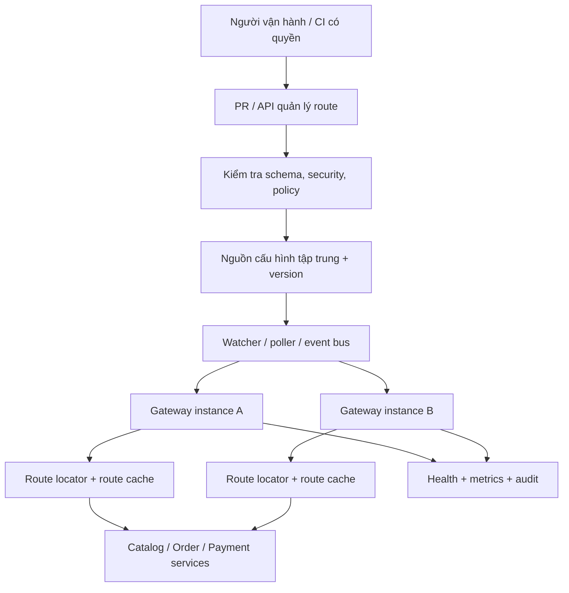
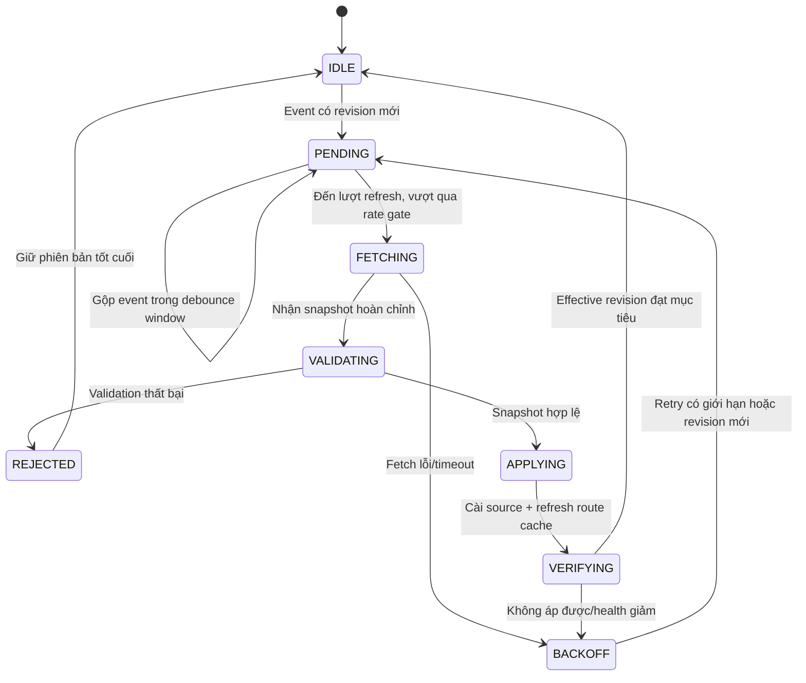
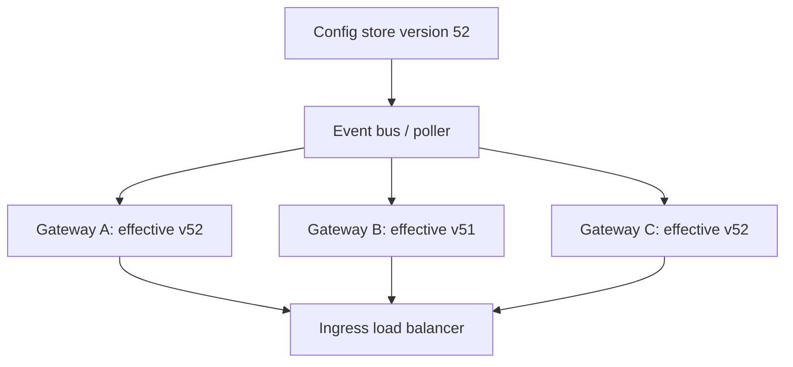

# Tích hợp nguồn cấu hình tập trung và giới hạn refresh tự động trong Spring Cloud Gateway

Trong hệ thống microservices, các API route không phải lúc nào cũng cố định. Khi triển khai một phiên bản service mới, đổi hostname, thêm route đối tác hoặc tạm vô hiệu một endpoint, nhóm vận hành có thể muốn cập nhật tuyến **mà không build lại và khởi động lại toàn bộ Spring Cloud Gateway**. Đây là động lực của **dynamic routes**: định nghĩa tuyến được đọc từ một nguồn quản lý trung tâm, được kiểm tra và áp dụng lại có kiểm soát.

Tuy nhiên, **đưa cấu hình lên một nơi tập trung không đồng nghĩa mọi Gateway replica tự động nhận và áp dụng thay đổi ngay lập tức**. Hệ thống còn phải giải quyết phát hiện thay đổi, nạp snapshot mới, refresh bộ nhớ đệm định tuyến, bảo mật nguồn cấu hình, đồng bộ nhiều instance và giới hạn tần suất refresh để tránh một vòng lặp làm tăng CPU, gây lỗi route hoặc khiến Gateway mất ổn định.

Bài học thuộc chương **Tuyến động** của module `SPRING_CLOUD_GATEWAY`, với bối cảnh Gateway sử dụng route predicate, filter chain, biến đổi đường dẫn/header và khám phá dịch vụ. Việc refresh route cần phối hợp với xác thực, rate limiting, circuit breaker, retry, TLS và quan sát request, nhưng không được thay các cơ chế ấy.

**Mục tiêu học tập:**

1. Phân biệt **nguồn cấu hình tập trung** với **bộ nhớ đệm route đang được Gateway sử dụng**.
2. Hiểu các lựa chọn **Spring Cloud Config/Git**, ConfigMap/Kubernetes và `RouteDefinitionLocator` hoặc `RouteDefinitionRepository` tùy biến.
3. Biết khi nào dùng `RefreshRoutesEvent`, actuator `/actuator/gateway/refresh` và khi nào cần cơ chế tải lại cấu hình bên ngoài.
4. Thiết kế **auto-refresh có giới hạn**: versioning, debounce, polling interval, jitter, validation, canary, rollback và bảo vệ khi source bị lỗi.
5. Phân tích tính nhất quán giữa nhiều Gateway replicas và kiểm thử cả quá trình update lẫn những request đang xử lý.

> **Phạm vi:** Tập trung vào **Spring Cloud Gateway Server WebFlux**. Các namespace và actuator access control có thay đổi giữa các thế hệ Spring Boot/Spring Cloud Gateway; ví dụ YAML/Java cần được đối chiếu với phiên bản tương thích của dự án. Các hostname, service ID, token và số liệu giới hạn bên dưới chỉ để minh họa, không phải cấu hình production mặc định. Bài không yêu cầu triển khai một control plane thật.

## 1. Vì sao tuyến động khác tuyến khai báo tĩnh?

Một route tĩnh thường nằm trong `application.yml`:

```yaml
spring:
  cloud:
    gateway:
      server:
        webflux:
          routes:
            - id: catalog-api
              uri: lb://catalog-service
              predicates:
                - Path=/api/catalog/**
              filters:
                - StripPrefix=1
```

Lợi ích là dễ review và theo dõi cùng source code. Nhưng nếu mọi thay đổi route đều đòi một lần build/deploy, nhóm vận hành có thể gặp:

- Thời gian cập nhật route dài hơn một sự cố production.
- Nhiều Gateway replicas phải rollout chỉ để thay một mapping.
- Những cấu hình cùng ý nghĩa bị sao chép không nhất quán giữa các môi trường.
- Khó triển khai canary route hoặc đóng một tuyến có rủi ro một cách nhanh và có audit.
- Khó đồng bộ luật route giữa nhiều region và tenant.

**Dynamic route** cho phép route definition đến từ một nguồn khác hoặc được làm mới trong runtime. Nhưng đổi được nhanh cũng làm tăng **blast radius**: một route `Path=/**` hoặc một `uri` không được kiểm tra có thể chuyển traffic sai, làm lộ endpoint quản trị hoặc tạo đường SSRF vào mạng nội bộ.

### 1.1. Điều gì thuộc một route definition?

Một route của Spring Cloud Gateway thường có các thành phần:

| Thành phần | Vai trò | Rủi ro khi thay động |
| --- | --- | --- |
| `id` | Định danh route, dùng trong metric/lookup/refresh. | Trùng ID hoặc đổi ID khiến khó rollback/quan sát. |
| `uri` | Đích như `lb://order-service` hay `https://upstream.example`. | Chuyển request tới đích không đáng tin. |
| `predicates` | Điều kiện `Path`, `Method`, `Host`, header… | Predicate quá rộng nuốt traffic của tuyến khác. |
| `filters` | `StripPrefix`, `RewritePath`, `Retry`, `RequestRateLimiter`… | Filter đổi path/header hoặc bỏ bảo vệ. |
| `order` | Ưu tiên route khi nhiều route khớp. | Route catch-all thắng route cụ thể. |
| `metadata` | Thông tin bổ sung cho policy/observability. | Có thể sai group, timeout hoặc cấu hình nhạy cảm. |

Một route không hợp lệ không chỉ tạo lỗi khi startup; nó có thể tác động request thật **ngay sau refresh**.

## 2. Kiến trúc khái niệm: nguồn, phiên bản, Gateway và cache

Một kiến trúc quản lý route có thể tách thành **control plane** và **data plane**:

- **Control plane**: nơi người vận hành tạo, kiểm tra, phê duyệt, version và phân phối route definitions.
- **Data plane**: các Gateway instances nhận request và dùng **route definitions đã nạp** để quyết định đi upstream nào.



Sơ đồ là **một thiết kế tham khảo**, không hàm ý Spring Cloud Gateway tự dựng sẵn mọi khối.

### 2.1. Hai trạng thái cần phân biệt

1. **Desired routes** — bản cấu hình mong muốn đang được lưu ở Git/Config Server, ConfigMap, Redis hoặc database.
2. **Effective routes** — danh sách route đang thực sự được một Gateway instance dùng để match HTTP request, sau bước bind, validate, tạo filter và refresh cache.

Có thể có tình huống **desired version = 42** nhưng một replica vẫn phục vụ **effective version = 41**, vì chưa nhận event, không tải được nguồn, đang refresh hoặc validation thất bại.

Vì vậy câu “đã merge YAML” chưa chứng minh “toàn bộ traffic đã đi theo route mới”.

### 2.2. Route cache là một phần quan trọng

Spring Cloud Gateway Server WebFlux thường có lớp tổng hợp/đệm route, chẳng hạn `CachingRouteLocator`, kết hợp nhiều nguồn `RouteDefinitionLocator`. Route definitions được chuyển thành `Route` runtime và được sử dụng cho route matching.

Khi nguồn dữ liệu đã đổi nhưng cache chưa được làm mới theo cơ chế thích hợp, Gateway có thể **tiếp tục dùng route cũ**. Ngược lại, nếu chỉ xóa cache nhưng nguồn definition vẫn cũ, Gateway sẽ **nạp lại cùng dữ liệu cũ**.

## 3. Các cách cung cấp route definitions

Không có một nguồn động duy nhất bắt buộc. Những lựa chọn phổ biến:

| Nguồn | Cách vận hành | Phù hợp khi | Điểm cần kiểm soát |
| --- | --- | --- | --- |
| `application.yml` đi cùng ứng dụng | Deploy/restart hoặc cơ chế reload riêng | Route ít thay đổi, cần tái lập rõ | Không nên kỳ vọng sửa file trên disk tự refresh. |
| **Spring Cloud Config Server + Git** | Quản lý YAML theo môi trường/nhánh, CI hoặc refresh event | Muốn audit, pull request, tập trung config | Config Client refresh và Gateway route refresh là hai bước có thể khác nhau. |
| **Kubernetes ConfigMap** | Mount file/environment hoặc API watcher theo controller | Đã dùng Kubernetes | Env var không tự đổi trong pod; file mount cập nhật chưa đồng nghĩa bean/cache tự reload. |
| **Database/Redis** | Custom `RouteDefinitionRepository` hoặc locator đọc state | Cần UI/API quản lý route động | Validation, consistency, atomic update, auth, schema migration. |
| **DiscoveryClient route locator** | Tự tạo route dựa trên service discovery metadata | Service discovery đã chuẩn hóa | Route discovery khác cấu hình thủ công; không tự kiểm soát mọi policy/header. |
| **Control plane chuyên dụng** | Phân phối snapshot/stream event có version | Nhiều cụm, phê duyệt và rollout phức tạp | Phải xây authentication, delta/snapshot, rollback, metrics. |

### 3.1. Config Server không phải RouteDefinitionRepository

**Spring Cloud Config Server** cung cấp tập thuộc tính từ nguồn bên ngoài, thường là Git. **RouteDefinitionRepository** là một giao diện mà Spring Cloud Gateway dùng để quản lý route definitions theo API lưu/đọc/xóa. Cả hai có thể cùng tham gia kiến trúc, nhưng **không phải cùng một giao diện**.

Ví dụ:

- Route YAML nằm trong repository Git → Config Client nhận properties → Gateway properties route locator nạp route.
- Route nằm trong Redis → một `RouteDefinitionRepository` tùy biến đọc Redis → Gateway route locator sử dụng definitions.
- Một control plane tự xây dùng Git làm nguồn review, rồi xuất snapshot đã duyệt sang Redis cho nhiều Gateway replicas.

Quan trọng nhất là chỉ có **một nguồn có thẩm quyền** cho mỗi nhóm route. Nếu cùng một route ID được phát từ YAML, discovery và database không có quy tắc rõ, kết quả tổng hợp có thể khó dự đoán.

## 4. Các cơ chế refresh thường bị nhầm với nhau

Đây là điểm trọng tâm khi tích hợp nguồn tập trung.

| Cơ chế | Tác động điển hình | Điều **không tự bảo đảm** |
| --- | --- | --- |
| **Cập nhật Git/Config Server** | Thay desired properties ở nguồn. | Không bắt mọi Gateway lập tức tải và dùng route mới. |
| **Spring Cloud Context refresh** | Làm mới Environment/`@RefreshScope` và một số cấu hình theo cơ chế hỗ trợ. | Không bảo đảm mọi route cache/Bean tùy biến đã nhận version mới. |
| **`RefreshRoutesEvent`** | Yêu cầu Gateway refresh route cache từ các nguồn hiện có. | Không tự gọi Git/Config Server hoặc cập nhật một database nguồn. |
| **`POST /actuator/gateway/refresh`** | Yêu cầu refresh route tại **instance được gọi**, nếu endpoint/action được bật. | Không mặc định phân phối cho mọi replica; không tự tải remote properties. |
| **Spring Cloud Bus / message broker** | Có thể phân phối thông điệp refresh khi đã cấu hình tích hợp. | Không tự biến mọi event thành cache refresh an toàn trên mọi Gateway version. |
| **Kubernetes watch/reload controller** | Có thể phát hiện thay đổi ConfigMap/Secret hoặc trigger rollout/refresh. | Không mặc định rebind route/refresh cache trong ứng dụng. |

Với **đường đi route qua Config Server**, một luồng đầy đủ có thể cần:

```text
Git commit / configuration version 42
  → Config Server cung cấp version 42
  → Gateway Config Client nhận Environment/route properties mới
  → Gateway route source phản ánh version 42
  → Route cache được làm mới
  → Gateway thật sự phục vụ effective routes version 42
```

Với **RouteDefinitionRepository tùy biến**:

```text
Admin/CI duyệt snapshot 42
  → Store lưu route definitions version 42
  → Gateway nhận tín hiệu hoặc polling thấy version mới
  → RouteDefinitionLocator đọc snapshot 42
  → Gateway refresh route cache
  → Instance xác nhận effective version 42
```

Không được gộp các mũi tên thành một thao tác “refresh” mơ hồ.

## 5. Tích hợp Spring Cloud Config Server và Git

Một mô hình phổ biến là quản lý route bên ngoài binary của Gateway nhưng vẫn giữ review/audit bằng Git.

### 5.1. Config Client: cấu hình kết nối

Ví dụ `application.yml` của Gateway Client:

```yaml
spring:
  application:
    name: edge-gateway
  config:
    import: "configserver:https://config.internal.example"
  cloud:
    config:
      label: main
      fail-fast: true
```

Ý nghĩa:

- `spring.application.name` giúp Config Server xác định cấu hình theo ứng dụng.
- `spring.config.import` là cơ chế nhập cấu hình Config Server trong các thế hệ Spring Boot/Spring Cloud Config hỗ trợ Config Data API.
- `label` có thể chọn nhánh/tag theo hợp đồng nguồn, ở ví dụ là `main`.
- `fail-fast` thể hiện chính sách startup nghiêm ngặt khi không thể tải cấu hình; lựa chọn này cần cân nhắc availability và fallback.

**Chú ý:** Cú pháp/ưu tiên profile/label và cách bật Config Client phụ thuộc version. Nếu ứng dụng chạy trong môi trường có thay đổi cấu hình được kiểm soát nghiêm, hãy pin nhãn/revision phù hợp thay vì luôn tự động theo đầu nhánh mutable mà không có kiểm soát release.

Không đặt username/password/token Config Server trực tiếp vào URL commit Git công khai. Dùng secret manager, môi trường hoặc workload identity phù hợp; bảo vệ TLS/CA và định danh nguồn cấu hình.

### 5.2. File route ở nguồn Git

Ví dụ file cấu hình cho ứng dụng và profile production do Config Server phục vụ:

```yaml
spring:
  cloud:
    gateway:
      server:
        webflux:
          routes:
            - id: catalog-api
              uri: lb://catalog-service
              predicates:
                - Path=/api/catalog/**
              filters:
                - StripPrefix=1

            - id: orders-api
              uri: lb://order-service
              predicates:
                - Path=/api/orders/**
              filters:
                - StripPrefix=1
                - name: RequestRateLimiter
                  args:
                    key-resolver: "#{@authenticatedUserKeyResolver}"
                    redis-rate-limiter.replenishRate: 5
                    redis-rate-limiter.burstCapacity: 10
```

Đây là **ví dụ nội dung route**, không phải cam kết mọi môi trường có sẵn `KeyResolver`/Redis. Nếu filter này được chọn, phải đăng ký Bean và dependency tương ứng.

Với các nhánh Gateway WebFlux cũ, route namespace phổ biến là `spring.cloud.gateway.routes`. **Config Server không tự sửa namespace sai**: một YAML hợp lệ về cú pháp nhưng không được binder đọc vẫn khiến Gateway phục vụ route cũ hoặc không nạp route mong muốn.

### 5.3. Git commit không phải tín hiệu refresh runtime

Đẩy commit vào Git chỉ làm thay đổi **nguồn cấu hình**. Gateway đang chạy có thể tiếp tục dùng route được nạp trước đó. Để áp dụng thay đổi, cần một trong các workflow đã thiết kế:

- Trigger config refresh được hỗ trợ và kiểm tra route cache refresh.
- Phân phối event qua Spring Cloud Bus, sau đó xác nhận mỗi Gateway instance đã áp route version mới.
- Rollout/restart Gateway theo revision bất biến khi muốn thay đổi được kiểm soát hơn.
- Một watcher/poller tùy biến lấy snapshot, validate rồi refresh route cache.

Không được suy rằng “Config Server trả file mới qua HTTP” nghĩa là mọi Bean tự rebind sau mỗi request.

### 5.4. Khi nào restart vẫn là lựa chọn tốt?

Với ứng dụng ít thay route, cần compliance nghiêm hoặc không có khả năng test hot reload, **rolling restart theo revision đã duyệt** có thể an toàn và dễ tái lập hơn auto-refresh. Dynamic routing là công cụ, không phải tiêu chí bắt buộc của mọi Gateway.

## 6. Kubernetes ConfigMap và biến môi trường: giới hạn quan trọng

Khi chạy Gateway trong Kubernetes, có thể cung cấp route bằng ConfigMap hoặc nguồn cấu hình trong cluster.

Ba cách thường gặp:

| Cách đưa config vào pod | Điều xảy ra khi sửa ConfigMap | Cần gì để thay runtime? |
| --- | --- | --- |
| **Environment variables** | Biến môi trường của container đang chạy không tự thay đổi. | Rollout/restart pod hoặc cơ chế áp cấu hình khác. |
| **Mounted ConfigMap volume** | File mounted có thể được kubelet cập nhật theo cơ chế/độ trễ của volume; một số cách mount không tự cập nhật. | Ứng dụng cần watcher/rebind/refresh hoặc rollout. |
| **Controller/Reload integration** | Controller có thể quan sát thay đổi và gọi cơ chế refresh/rollout. | Phải kiểm tra permission, sự kiện, compatibility và giới hạn refresh. |

Đừng dùng `kubectl apply` như bằng chứng Gateway route đã đổi. Thay đổi file trên volume chưa chắc Spring Boot đã đọc lại; `@ConfigurationProperties` và route cache có thể vẫn giữ state cũ.

### 6.1. Watcher có thể phát nhiều sự kiện cho một thay đổi

Một công cụ quan sát file có thể nhận nhiều event cho lần update gồm replace, rename, create hoặc update metadata. Nếu mỗi event gọi refresh toàn Gateway:

- CPU tăng vì tái tạo nhiều route.
- Có thể quan sát snapshot chưa hoàn chỉnh nếu đọc đúng lúc file đổi.
- Nhiều replicas đồng loạt làm mới tạo refresh storm.
- Metrics xuất hiện nhiều lỗi thoáng qua dù desired config chỉ đổi một lần.

Cần **debounce**, đọc **snapshot hoàn chỉnh** và dùng **version/content hash** để bỏ qua event trùng.

### 6.2. Không coi ConfigMap là kho bí mật

ConfigMap thường dành cho cấu hình không nhạy cảm. Token, private key, credential Config Server hoặc TLS client certificate cần hệ thống secret phù hợp và RBAC. Bất kể lưu ở đâu, route definitions cũng có thể chứa URI hoặc header nguy hiểm, nên quyền sửa route cần được giới hạn như một quyền vận hành hệ thống.

## 7. RouteDefinitionLocator và RouteDefinitionRepository

Spring Cloud Gateway Server WebFlux có các giao diện giúp lấy route definitions từ nhiều nguồn.

### 7.1. `RouteDefinitionLocator`

`RouteDefinitionLocator` cung cấp các định nghĩa route qua reactive publisher. Về mặt khái niệm:

```java
import org.springframework.cloud.gateway.route.RouteDefinition;
import org.springframework.cloud.gateway.route.RouteDefinitionLocator;
import reactor.core.publisher.Flux;

public interface ExampleShape extends RouteDefinitionLocator {
    @Override
    Flux<RouteDefinition> getRouteDefinitions();
}
```

Đoạn code trên chỉ mô tả **chữ ký cần quan tâm**, không có implementation. Nó không có hàm lưu hay xóa; mục tiêu là để Gateway **đọc** definitions.

Một custom locator có thể đọc snapshot ở bộ nhớ, Redis, database hoặc stream cấu hình. Trong Gateway reactive, tránh gọi JDBC blocking/network blocking trực tiếp từ event loop; cân nhắc reactive client, cache snapshot đã validate hoặc scheduler phù hợp khi nguồn chỉ có API đồng bộ.

### 7.2. `RouteDefinitionRepository`

`RouteDefinitionRepository` kết hợp đọc route với khả năng ghi/xóa qua giao diện writer. Những chữ ký thường gặp:

```java
Flux<RouteDefinition> getRouteDefinitions();

Mono<Void> save(Mono<RouteDefinition> route);

Mono<Void> delete(Mono<String> routeId);
```

**Chữ ký chính xác và cách tự động dùng Bean cần kiểm chứng theo version**. Nếu lưu Redis/database, việc `save()` trả thành công chỉ nên có nghĩa state đã được ghi đúng hợp đồng storage; nó **không tự chứng minh** mọi Gateway instance đã đổi route cache.

### 7.3. Locator hay Repository?

| Yêu cầu | Lựa chọn thường hợp lý |
| --- | --- |
| Chỉ đọc snapshot đã được control plane xuất bản | Custom `RouteDefinitionLocator`. |
| Cần API cập nhật/xóa route qua một nguồn state | `RouteDefinitionRepository` thích hợp. |
| Routes nằm trong `spring.cloud.gateway...routes` | Properties-based locator tích hợp. |
| Muốn route tự sinh từ registry service | Discovery locator theo khả năng/version. |
| Cần quyền phê duyệt/audit/version toàn cụm | Control plane bên ngoài, đi kèm locator/repository và refresh orchestration. |

Không lạm dụng actuator `POST /routes/{id}` như một hệ thống quản trị route production hoàn chỉnh mà không có RBAC, validation, audit và nguồn dữ liệu bền vững.

## 8. Ví dụ custom locator dùng snapshot trong bộ nhớ

Ví dụ này tập trung vào ranh giới **snapshot đã được kiểm tra** và **cache refresh**, không phải toàn bộ hệ thống quản trị route.

Một custom locator có thể giữ snapshot bất biến và cung cấp route definitions:

```java
import java.util.List;
import java.util.concurrent.atomic.AtomicReference;

import org.springframework.cloud.gateway.route.RouteDefinition;
import org.springframework.cloud.gateway.route.RouteDefinitionLocator;
import org.springframework.stereotype.Component;

import reactor.core.publisher.Flux;

@Component
public final class VersionedRouteSnapshotLocator
        implements RouteDefinitionLocator {

    private final AtomicReference<Snapshot> current =
        new AtomicReference<>(
            new Snapshot(0L, List.of())
        );

    @Override
    public Flux<RouteDefinition> getRouteDefinitions() {
        return Flux.defer(() ->
            Flux.fromIterable(current.get().routes())
        );
    }

    public synchronized boolean installValidated(Snapshot incoming) {
        if (incoming.version() <= current.get().version()) {
            return false;
        }

        // Bên gọi phải validate toàn bộ routes trước.
        // Trong hệ thống thật phải deep-copy các RouteDefinition
        // có thể mutable và gắn revision/hash của nguồn tin cậy.
        current.set(new Snapshot(
            incoming.version(),
            List.copyOf(incoming.routes())
        ));

        return true;
    }

    public record Snapshot(
        long version,
        List<RouteDefinition> routes
    ) {}
}
```

Mã trên minh họa:

- `AtomicReference` giữ một **điểm tham chiếu** tới snapshot mới, không thay từng route một.
- `Flux.defer` lấy snapshot hiện tại khi publisher được subscribe.
- `installValidated` chỉ chấp nhận version tăng và trả `true` khi đã thay snapshot.
- `List.copyOf` giữ immutable list structure; nhưng **`RouteDefinition` có thể có thuộc tính mutable**, nên hệ thống production phải tạo bản sao bất biến/defensive copies.
- `synchronized` chỉ giúp tuần tự hóa update **trong một JVM**; không phải distributed lock hay phiên bản toàn cụm.

**Giới hạn quan trọng:** Đoạn code **chưa** gọi `RefreshRoutesEvent`, chưa tải snapshot từ Git/DB, chưa validate URI/predicates/filters và chưa tạo audit. Việc cài snapshot chỉ cập nhật **nguồn đọc route**; Gateway route cache vẫn cần cơ chế refresh đúng thời điểm.

### 8.1. Cần gì để trở thành giải pháp production?

- Nguồn dữ liệu đáng tin với version monotonic hoặc revision ID.
- Cơ chế fetch snapshot đầy đủ, timeout, retry budget và validation.
- Validation cả cú pháp, chính sách bảo mật, xung đột route ID/order.
- Không cài bản snapshot mới nếu một route không hợp lệ.
- Tín hiệu refresh route cache **sau khi** snapshot đã sẵn sàng.
- Health/metrics cho desired/effective version.
- Rollback snapshot đã biết tốt; xử lý request đang chạy bằng cache cũ.
- Coordination giữa nhiều Gateway replicas.

Không đọc trực tiếp một database chậm cho mọi HTTP request chỉ để tra danh sách route; cân nhắc cache/snapshot có version và lịch refresh phù hợp.

## 9. `RefreshRoutesEvent`: một bước cục bộ sau khi nguồn thay đổi

Khi một nguồn route đã nạp snapshot mới, ứng dụng có thể phát tín hiệu để Gateway làm mới route cache. Một cơ chế được dùng trong Gateway Server WebFlux là **`RefreshRoutesEvent`**.

Ví dụ tối thiểu:

```java
import org.springframework.cloud.gateway.event.RefreshRoutesEvent;
import org.springframework.context.ApplicationEventPublisher;
import org.springframework.stereotype.Service;

@Service
public class GatewayRouteRefreshNotifier {

    private final ApplicationEventPublisher events;

    public GatewayRouteRefreshNotifier(
            ApplicationEventPublisher events) {
        this.events = events;
    }

    public void sourceSnapshotReady() {
        // Chỉ gọi SAU KHI nguồn route cục bộ đã được
        // cập nhật và kiểm tra đúng revision.
        events.publishEvent(new RefreshRoutesEvent(this));
    }
}
```

**Đây là tín hiệu refresh trong ApplicationContext của instance hiện tại.** Nó không gửi HTTP request tới Config Server, không thay Git, không cập nhật storage và **không tự broadcast** sang các Gateway khác.

### 9.1. Thứ tự thao tác đúng

```text
Sai:
  publish RefreshRoutesEvent
  → sau đó mới ghi route version mới
  → cache có thể nạp lại dữ liệu cũ

Đúng về mặt thứ tự:
  tải snapshot version mới
  → validate đầy đủ
  → cài/commit snapshot vào nguồn Gateway sẽ đọc
  → publish RefreshRoutesEvent
  → kiểm tra effective routes/version
```

Nếu publish event trước khi state đã sẵn sàng, việc refresh có thể tái tạo route cũ. Nếu cập nhật source nhiều lần nhưng publish event cho từng route một, có thể tạo refresh storm và lộ ra trạng thái trung gian. **Ưu tiên snapshot/coalescing** hơn cập nhật từng dòng không đồng bộ.

### 9.2. Refresh event không tự hủy request đang xử lý

Khi route cache đổi, những request đã đi qua route matching có thể tiếp tục xử lý theo route/filter chain cũ. Không thể dùng refresh để chắc chắn **thu hồi ngay lập tức mọi kết nối/request đã được chấp nhận**.

Nếu cần chặn khẩn cấp vì sự cố bảo mật, phải cân nhắc các tầng khác như ingress/WAF/Security filter, quyền token, network rule, connection draining và rollback, không chỉ xóa một route.

## 10. Actuator `/actuator/gateway/refresh` làm gì?

Spring Cloud Gateway có endpoint quản trị cho phép kiểm tra và, ở những phiên bản/cấu hình hỗ trợ write access, **yêu cầu refresh route cache**. Một ví dụ lệnh gọi **trong môi trường đã giới hạn quyền**:

```bash
curl -i -X POST \
  "https://gateway-admin.internal.example/actuator/gateway/refresh" \
  -H "Authorization: Bearer <admin-token>"
```

**Cần phân biệt:**

- Đây là request tới **một Gateway instance hoặc management endpoint**; không mặc định cập nhật mọi replica.
- Endpoint phải được **cài đặt, expose và cấp quyền ghi** theo Spring Boot Actuator/Gateway version. Trên những nhánh mới, access control cho actuator có thể chia read-only/unrestricted; không giả định endpoint có POST khi chỉ bật exposure.
- Endpoint này tập trung vào **refresh routes**; không thay việc Config Client phải lấy được remote properties mới.
- HTTP status thành công của lệnh không chứng minh mọi request sau đó đã dùng version mới nếu cache refresh bất đồng bộ hoặc có lỗi trong route source.

### 10.1. Vì sao không public endpoint quản trị?

Một actor điều khiển refresh route liên tục có thể khiến Gateway tiêu tốn CPU, làm xáo trộn cache và gây suy giảm dịch vụ. Những endpoint actuator cho phép xem, thêm, xóa hoặc refresh route còn có rủi ro cao hơn nếu bị public.

**Quy tắc tối thiểu:**

1. Bind management endpoint trên **mạng/cổng quản trị riêng** khi có thể.
2. Xác thực mạnh, phân quyền theo nguyên tắc least privilege; chỉ CI/control plane có thể thực hiện update/refresh.
3. Bảo vệ bằng TLS/mTLS, network policy, ingress allowlist và audit.
4. Giới hạn tần suất yêu cầu refresh; tránh mở actuator write API ra Internet.
5. Không xem `management.endpoints.web.exposure.include=*` là cấu hình an toàn production.
6. Giới hạn truy cập các endpoint hiển thị route/config vì có thể làm lộ thông tin kiến trúc và tham số nhạy cảm.

### 10.2. `/actuator/refresh` không đồng nghĩa `/actuator/gateway/refresh`

Trong hệ sinh thái Spring Cloud, một endpoint refresh khác có thể liên quan tới **Spring Cloud Context/Environment refresh**. Tên gần giống nhưng mục đích khác:

- `/actuator/refresh`: cơ chế refresh Environment/beans của Spring Cloud Context khi dependency và cấu hình hỗ trợ.
- `/actuator/gateway/refresh`: cơ chế refresh route của Gateway khi actuator tương ứng hỗ trợ.

Không nên thiết kế automation chỉ gọi một trong hai rồi mặc định tất cả hoạt động. Hãy kiểm thử **properties mới có được bind**, **route cache có được refresh**, và **effective route có đúng revision**.

## 11. Auto-refresh: vì sao cần đặt giới hạn?

Một implementation ban đầu thường rất hấp dẫn:

```text
onChange(event):
    refreshGatewayRoutes()
```

Nhưng nguồn cấu hình thực tế có thể phát nhiều event vì:

- Một commit được phân phối qua webhook, file watcher và message bus.
- Kubernetes ConfigMap được cập nhật nhiều lần trong một lần deploy.
- Config store mất kết nối rồi gửi một loạt change events.
- Nhiều control-plane replicas cùng phát tín hiệu cho một revision.
- Người vận hành nhấn “refresh” liên tục khi thấy kết quả chưa rõ.
- Một lỗi refresh dẫn tới retry ngay, lại phát thêm refresh event.

Mỗi lần refresh có thể khiến Gateway đọc nguồn, tạo route/filter/predicate, invalidation cache, metrics và nhiều I/O tùy implementation. Nếu làm không có giới hạn, **control plane có thể làm quá tải data plane**.

### 11.1. Những loại giới hạn nên có

| Kiểm soát | Ý nghĩa | Ví dụ chính sách |
| --- | --- | --- |
| **Version deduplication** | Bỏ qua event có revision đã áp dụng hoặc cũ hơn. | Revision 42 đã có, bỏ event 41 và 42. |
| **Debounce** | Gộp nhiều event liên tiếp thành một lần refresh sau khoảng yên tĩnh. | Chờ 2 giây không có event mới. |
| **Minimum interval** | Không refresh quá thường xuyên, kể cả khi event vẫn đến. | Ít nhất 10 giây giữa hai lần refresh. |
| **Rate cap** | Giới hạn tổng số lần refresh trong một khoảng. | Tối đa 6 lần/phút cho một instance. |
| **Single-flight** | Chỉ một refresh job chạy mỗi lúc trong một instance. | Event mới đánh dấu pending. |
| **Jitter** | Tránh tất cả replicas refresh cùng thời điểm. | Lệch ngẫu nhiên trong một khoảng nhỏ. |
| **Timeout** | Không để fetch/validate chờ vô hạn. | Ngân sách thời gian cho snapshot fetch. |
| **Backoff** | Khi source lỗi, tăng khoảng chờ giữa các lần thử. | Exponential backoff có trần và jitter. |
| **Canary/staged rollout** | Áp bản mới cho một phần nhỏ trước. | Một replica, rồi nhóm replica tiếp theo. |
| **Kill switch** | Tạm ngừng auto-refresh khi control plane sự cố. | Tạm chuyển sang manual approval. |

Các con số chỉ mang tính minh họa. Hạn mức thực tế phụ thuộc số route, thời gian rebuild, tài nguyên Gateway và yêu cầu thời gian cập nhật.

### 11.2. Debounce khác throttle

- **Debounce:** đợi một khoảng yên tĩnh sau event cuối cùng rồi mới xử lý; hữu ích khi một update phát nhiều event gần nhau.
- **Throttle/min interval:** hạn chế tốc độ thực thi; không cho refresh liên tục dù event không ngừng.
- **Version gate:** chỉ refresh khi revision mới thật sự khác revision đang dùng.

Một hệ thống tốt thường kết hợp cả ba. Chỉ debounce có thể **không bao giờ chạy** khi event liên tục; chỉ throttle có thể bỏ lỡ revision cuối cùng nếu không có cờ pending hoặc lịch chạy bù.

## 12. Thuật toán điều phối refresh có kiểm soát

Một state machine đơn giản:



### 12.1. Pseudocode

```text
onSourceNotification(revision):
    if revision <= appliedRevision:
        return

    desiredRevision = max(desiredRevision, revision)
    markRefreshPending()

workerLoop():
    waitUntilDebounceWindowAndRateGateOpen()

    if refreshAlreadyRunning:
        leavePendingForNextRound()
        return

    candidate = fetchCompleteSnapshot(desiredRevision, timeout)
    if fetchFails:
        scheduleBoundedBackoffWithJitter()
        return

    if not validateSchemaAndSecurity(candidate):
        recordRejectedRevision(candidate.revision)
        alertOperator()
        keepLastKnownGood()
        return

    if candidate.revision <= appliedRevision:
        return

    installCandidateAsLocalRouteSource(candidate)
    publishRefreshRoutesEvent()
    verifyEffectiveRevisionAndRouteHealth()

    if verificationPasses:
        appliedRevision = candidate.revision
    else:
        rollbackOrKeepLastKnownGoodByPolicy()
        alertOperator()

    if desiredRevision > appliedRevision:
        markRefreshPending()
```

Đây là **pseudocode kiến trúc**, không phải API có sẵn của Spring Cloud Gateway. Đặc biệt:

- Biến `desiredRevision` phải được bảo vệ khi nhiều event/worker cạnh tranh.
- `max(...)` chỉ đúng khi nguồn cung cấp **version tăng đơn điệu**; Git SHA là identifier không có thứ tự số học.
- Quá trình “verify effective version” cần một cơ chế state/metric riêng; Gateway không tự công bố một desired/effective revision chuẩn cho mọi custom source.
- Nếu refresh fail sau khi snapshot đã được cài, cần giữ bản last-known-good và có quy trình **rollback + refresh lần nữa**.
- Không thao tác I/O blocking trực tiếp trên Netty event loop.

### 12.2. Bỏ event không có nghĩa bỏ phiên bản cuối

Nếu revision 42, 43, 44 đến rất nhanh, không cần refresh lần lượt cả ba nếu không có hợp đồng bắt buộc xem từng trạng thái. Có thể **coalesce tới snapshot 44 đã validate**.

Nhưng nếu revision 44 thất bại validation, hệ thống cần quyết định giữ 42 hoặc thử 43 đã hợp lệ theo chính sách; không được tự áp một bản chưa duyệt chỉ để “kịp tiến độ”.

### 12.3. Ưu tiên snapshot đầy đủ thay nhiều cập nhật nhỏ

Nếu một bộ route liên quan gồm catalog, orders và payments cần thay đổi đồng thời, áp từng route trước rồi refresh ngay có thể làm lộ trạng thái chuyển tiếp không nhất quán.

Hãy xuất **một snapshot có version**, validate toàn bộ, rồi thay nguồn route bằng snapshot đó trước khi phát một refresh event. Điều này giảm refresh storm và giúp rollback về revision cụ thể.

## 13. Polling, webhook và event bus: nên chọn cơ chế nào?

| Cơ chế nhận thay đổi | Ưu điểm | Nhược điểm/giới hạn |
| --- | --- | --- |
| **Polling revision** | Đơn giản, tự phục hồi khi mất sự kiện; dễ giới hạn tốc độ. | Có độ trễ; gọi source dù không đổi nếu không có conditional fetch. |
| **Webhook** | Độ trễ thấp khi có update. | Webhook có thể trùng, mất hoặc giả mạo; cần auth và reconciliation. |
| **Message broker/Bus** | Phân phối event tới nhiều instances. | At-least-once/ordering/consumer lag, không bảo đảm mọi node đã áp dụng. |
| **Watch API** | Hỗ trợ theo dõi state thay đổi gần thời gian thực. | Reconnect, compaction/resume token, resource version và backpressure. |
| **Rolling deployment** | Phiên bản config được gắn với release. | Chậm hơn hot reload; có thể an toàn hơn cho thay đổi rủi ro cao. |

Một kiến trúc thực tế có thể kết hợp **event notification để phản ứng nhanh** và **polling định kỳ để sửa lỗi missed event**.

### 13.1. Conditional fetch

Nếu Config Server/control plane hỗ trợ revision identifier, `ETag` hoặc điều kiện tương đương, poller có thể chỉ tải snapshot đầy đủ khi version thay đổi. Điều này giảm I/O.

Tuy nhiên, **không tự giả định mọi endpoint Spring Cloud Config Server đều hỗ trợ chính xác giao thức `ETag` theo cách bạn muốn**. Nếu cần, hãy thiết kế API snapshot riêng có `revision` và kiểm thử header/cache behavior.

### 13.2. Webhook cần xác thực và chống replay

Một endpoint nhận sự kiện “route version 44 đã sẵn sàng” có thể bị lợi dụng để tạo refresh storm nếu public. Cần chữ ký/HMAC hoặc mTLS/identity cho webhook, giới hạn kích thước payload, rate limit, replay protection, logging và quyền phiên bản.

**Event chỉ nên là tín hiệu “có phiên bản mới”**, không phải nơi client tùy ý gửi toàn bộ route YAML để Gateway áp dụng ngay mà không validation.

## 14. Nhiều Gateway replicas: event cục bộ chưa đủ

Giả sử có ba Gateway instances:



Đây là tình huống **partial rollout**. Một client có thể nhận phản hồi khác nhau khi load balancer chuyển giữa các instances, dù request hoàn toàn giống nhau.

### 14.1. Định nghĩa mức nhất quán mong muốn

| Mức nhất quán | Ý nghĩa | Phù hợp khi |
| --- | --- | --- |
| **Eventual consistency** | Các replicas có thể lệch version trong một khoảng hữu hạn. | Thêm route không nhạy cảm, có thể chịu sai khác ngắn. |
| **Staged/canary consistency** | Một nhóm replicas nhận version mới trước rồi mới mở rộng. | Cần kiểm tra hành vi trước rollout toàn cụm. |
| **Version-gated traffic** | Traffic chỉ được chuyển tới nhóm đã đạt revision tối thiểu. | Thay route có contract quan trọng, yêu cầu kiểm soát chuyển đổi. |
| **Coordinated cutover** | Chuyển traffic theo mốc được điều phối. | Đổi route nhạy cảm, cần kiểm soát downtime và tương thích. |

Spring Cloud Gateway không tự bảo đảm **atomic cutover toàn cụm** chỉ từ `RefreshRoutesEvent` trên một instance. Muốn nhất quán chặt hơn cần control plane/ingress orchestration.

### 14.2. Mỗi replica phải báo trạng thái của chính mình

Một trạng thái quan sát nên có:

```json
{
  "instance": "edge-gateway-b",
  "desiredRevision": "cfg-52",
  "loadedRevision": "cfg-52",
  "effectiveRevision": "cfg-51",
  "lastRefreshResult": "PENDING"
}
```

Đây là **schema telemetry tùy biến**, không phải JSON chuẩn do Spring Cloud Gateway actuator trả sẵn.

Nếu chỉ biết Config Server đang ở `cfg-52`, bạn chưa biết instance nào đã thực sự phục vụ routes version mới.

### 14.3. Tại sao không refresh tất cả cùng mili giây?

Khi tất cả replicas đồng thời tải snapshot lớn, có thể:

- Tăng tải Config Server, database, Redis hoặc Kubernetes API.
- Làm peak CPU/GC vì route/filter recreation.
- Tăng lỗi cùng lúc nếu revision có lỗi.
- Khi cache/connection phục hồi, gây hiệu ứng thundering herd.

Dùng jitter/staged rollout và giới hạn concurrency, nhưng không kéo dài quá SLA cập nhật tuyến. Đặc biệt với thay đổi khẩn cấp, cần workflow riêng với mức ưu tiên, khả năng chứng minh từng node đã áp dụng và phương án chặn tại edge.

## 15. Kiểm tra route definition trước khi áp dụng

Dynamic routes có thể tạo rủi ro bảo mật lớn hơn route trong source code vì thay đổi có hiệu lực nhanh.

**Không cho client phổ thông hoặc một tài khoản CI không kiểm soát có thể gửi tùy ý:**

```yaml
- id: dangerous
  uri: http://169.254.169.254
  predicates:
    - Path=/**
```

Ví dụ này biểu thị **một đích nội bộ/metadata đáng ngại**, chỉ để minh họa kiểm tra policy; tuyệt đối không triển khai.

### 15.1. Bộ validation tối thiểu

| Nhóm kiểm tra | Ví dụ |
| --- | --- |
| **Schema** | Bắt buộc ID, URI, predicates; số lượng route/filters nằm trong giới hạn. |
| **Route ID** | Duy nhất trong snapshot và namespace, có convention và không đụng route quản trị. |
| **URI scheme** | Chỉ cho phép scheme như `lb`/`https` theo loại route; chặn scheme không mong muốn. |
| **Upstream destination** | Allowlist service IDs/domains; chặn internal metadata/loopback/private ranges khi không được phép. |
| **Predicates** | Không cho `/**` hoặc Host quá rộng trừ khi được phê duyệt đặc biệt. |
| **Order/collision** | Phát hiện route trùng `Host+Path+Method`, route catch-all lấn route cụ thể. |
| **Filter types** | Allowlist filter factories đã review; từ chối filter không có trong policy. |
| **Header mutation** | Không cho tùy ý ghi `Authorization`, `Host`, `Forwarded` hoặc header danh tính nội bộ. |
| **Redirect** | Không cho open redirect tới host bên ngoài chưa được duyệt. |
| **Retry** | Không bật retry POST/PATCH thiếu idempotency contract. |
| **Rate limit/security** | Đổi route không được âm thầm bypass Spring Security hoặc quota. |
| **Resource budget** | Giới hạn số routes, độ dài regex, metadata size, tần suất refresh. |
| **Environment** | Không cho route production trỏ vào test service hoặc tenant không được ủy quyền. |

Đầu vào dạng URI có thể có hostname giả, DNS rebinding hoặc URL encoding; một allowlist string đơn giản **không thay thế** việc áp network policy, DNS/TLS validation và egress restrictions.

### 15.2. Validation cú pháp khác validation hành vi

Một route có YAML đúng nhưng `Path=/**` và `order=-100` vẫn có thể chiếm mọi request ngoài dự kiến.

Cần **policy validation** và test route matching, không chỉ kiểm tra parse được `RouteDefinition`.

### 15.3. Bảo vệ filter chain

Route definition có thể thay các filter như `StripPrefix`, `RewritePath`, `Retry`, `RequestRateLimiter`, `CircuitBreaker` hoặc CORS metadata. Một người sửa cấu hình route có thể vô tình làm rơi rate limiting/authorization assumptions. Thiết kế security không nên chỉ dựa vào việc một route luôn chứa một filter nhất định; xác thực ở `SecurityWebFilterChain` và bảo vệ backend vẫn phải đủ mạnh.

## 16. An toàn khi cập nhật: staging, canary và rollback

Một đường đi an toàn cho route version mới có thể gồm:

1. Người vận hành tạo pull request hoặc yêu cầu đổi config có danh tính.
2. CI parse route definitions, kiểm tra schema và policy.
3. Test route matching với bộ `Host/Path/Method` điển hình.
4. Kiểm tra service ID/upstream allowlist và các thay đổi filter bảo mật.
5. Xuất snapshot có revision, checksum và chữ ký/nguồn tin cậy nếu thiết kế yêu cầu.
6. Canary một Gateway instance/nhóm có traffic kiểm soát.
7. Xác minh effective version, 404/401/403/429/5xx, latency và route ID metrics.
8. Mở rộng rollout theo từng nhóm Gateway replicas.
9. Nếu có lỗi, rollback về **last-known-good snapshot** và refresh lại một cách có kiểm soát.
10. Lưu audit ai thay đổi, khi nào, vì sao, revision trước/sau.

### 16.1. Rollback không chỉ là revert Git commit

Revert làm thay đổi **desired config**, nhưng các Gateway instances vẫn cần nhận bản rollback và refresh route cache. Nếu một instance vẫn giữ revision lỗi, traffic tới instance ấy còn có thể bị định tuyến sai.

Sau rollback, kiểm tra:

```text
Desired revision: rollback-53
Gateway A effective revision: rollback-53
Gateway B effective revision: rollback-53
Gateway C effective revision: rollback-53
Error rate: trở lại ngưỡng ổn định
```

Đừng chỉ xem “CI xanh” hoặc “Config Server trả file cũ” rồi tuyên bố rollback hoàn tất.

### 16.2. Last-known-good quan trọng hơn “áp bản mới bằng mọi giá”

Khi một snapshot có URI/filter không hợp lệ, cách an toàn thường là:

- Giữ route hiện hành đã được kiểm chứng.
- Ghi lại revision bị từ chối và lý do.
- Cảnh báo người vận hành.
- Không refresh thành một danh sách route rỗng chỉ vì Config Server tạm lỗi.
- Chỉ tiếp tục rollout sau khi được sửa hoặc phê duyệt mới.

Một số thay đổi khẩn cấp có thể cần “fail-closed” ở edge vì lý do bảo mật. Đó là một workflow riêng, không nên dùng cơ chế fail-open tự động không kiểm soát.

## 17. Khi nguồn cấu hình hoặc refresh gặp sự cố

Một số failure modes quan trọng:

| Sự cố | Triệu chứng | Hành vi nên thiết kế |
| --- | --- | --- |
| Config Server không truy cập được lúc startup | Gateway không có cấu hình mới. | Quyết định fail-fast hay last-known-good/rollout theo policy. |
| Config Server mất kết nối lúc runtime | Poller không fetch được revision. | Giữ effective routes tốt gần nhất, backoff và alert. |
| Webhook gửi trùng | Nhiều refresh trên cùng revision. | Dedupe theo revision/hash, debounce. |
| Webhook bị mất | Một replica không nhận update. | Periodic reconciliation polling để phục hồi. |
| Validation fail | Một route bị thay sai hoặc URI nguy hiểm. | Reject toàn snapshot hoặc theo chính sách rõ, không áp nửa chừng. |
| Một replica refresh thất bại | Effective revisions lệch nhau. | Alert, cô lập/canary, retry có hạn mức, không tuyên bố rollout hoàn tất. |
| Route cache không refresh | Source mới nhưng request dùng route cũ. | Kiểm tra `RefreshRoutesEvent`/actuator và effective route. |
| Route cache refresh trước source update | Cache nạp lại bản cũ. | Đổi thứ tự: commit nguồn trước rồi refresh. |
| Không có service instance | Route mới `lb://...` trả 503. | Kiểm tra discovery/readiness; rollback nếu cần. |
| Filter factory không tồn tại | Route không nạp hoặc lỗi khi tạo filter. | Validate factory allowlist và integration test trước rollout. |
| Cấu hình route mới làm tăng retry | Upstream attempts tăng, backend quá tải. | Retry budget, idempotency, circuit breaker và SLO guardrail. |
| Ngắt mạng giữa refresh | Một số requests dùng snapshot cũ, một số mới. | Hiểu tính nhất quán eventual, rollout/cutover theo yêu cầu. |
| Management endpoint bị lạm dụng | Refresh storm và hao tài nguyên. | Private management plane, authentication, rate caps và audit. |
| Thay route nhạy cảm bị lộ dữ liệu | Host/path/headers chuyển sai đích. | Incident response, kill switch, network restrictions và truy vết revision. |

### 17.1. Trường hợp source gửi snapshot rỗng

**Rỗng có thể là trạng thái hợp lệ hoặc do lỗi.** Nếu admin cố ý đóng tất cả public routes trong một môi trường thì snapshot rỗng có thể đúng; nhưng nếu Config Server trả dữ liệu rỗng do lỗi parse/mất quyền, xóa hết routes sẽ tạo outage.

Giải pháp là có **snapshot status/manifest**: revision, số routes mong đợi, checksum, môi trường, chữ ký hoặc approval; không suy ý định chỉ từ danh sách rỗng.

### 17.2. Lỗi DNS/TLS tới nguồn cấu hình

Kết nối tới Config Server hoặc Redis/DB quản lý route phải dùng mạng bảo mật, TLS và trust store phù hợp. Không tắt kiểm tra chứng chỉ để làm auto-refresh chạy được. Nếu lỗi TLS, **giữ bản tốt gần nhất** và cảnh báo, không tải route từ nguồn HTTP không tin cậy.

## 18. Quan sát: biết version nào đang chạy ở đâu

Để vận hành dynamic routes, chỉ đo HTTP 200/500 là chưa đủ.

### 18.1. Các metric nên có

- `gateway_route_refresh_attempts_total`: số lần thử, phân loại outcome.
- `gateway_route_refresh_success_total` và `gateway_route_refresh_failure_total`.
- `gateway_route_refresh_duration_seconds`: thời gian fetch, validate, install và rebuild.
- `gateway_route_snapshot_age_seconds`: độ tuổi effective snapshot.
- `gateway_route_desired_revision` / `effective_revision`: thường lưu dưới dạng info/status, **không nhất thiết là numeric metric**.
- `gateway_route_count` theo môi trường/instance.
- `gateway_route_validation_rejections_total` theo loại lỗi.
- `gateway_route_replica_skew` hoặc số replicas chưa đạt target revision.
- HTTP request count/latency/status theo **route ID**.
- Số 404, 503 hoặc redirect bất thường sau mỗi rollout.

Các tên metric là **gợi ý tự xây**, không phải cam kết Spring Cloud Gateway tự xuất toàn bộ metrics với tên này.

### 18.2. Tránh cardinality quá cao

Đừng dùng raw Git SHA, user ID, tenant ID, request path nguyên bản hoặc toàn bộ route URI làm metric label có số lượng giá trị không giới hạn. Với revision, có thể dùng info endpoint/admin dashboard hoặc log audit có cấu trúc, giữ metric labels ở nhóm ổn định như `instance`, `environment`, `outcome`.

### 18.3. Route ID và 404/503

- `404` có thể do route không khớp sau refresh hoặc backend không có tài nguyên.
- `503` có thể do `lb://service-id` không có instance, không đồng nghĩa route source lỗi.
- `401/403` có thể đến từ Spring Security trước Gateway route matching.
- `429` có thể do RequestRateLimiter; route mới hoặc key resolver sai gây thay đổi quota.
- TLS/timeout/circuit breaker có thể trả lỗi khác dù route đúng.

Phân loại **nguồn tạo response** bằng tracing/structured logs, không quy mọi 5xx sau refresh thành một lỗi duy nhất.

## 19. Quy trình kiểm thử refresh từ Config Server

Giả sử có môi trường staging:

- Config Server ở `https://config.staging.example`.
- Gateway có hai replicas, fronted bởi ingress.
- Route `catalog-api` hiện trỏ `lb://catalog-v1`, revision `cfg-10`.
- Version mới `cfg-11` muốn chuyển sang `lb://catalog-v2`.

**Không dùng hệ thống production để mô phỏng các lỗi này.**

### 19.1. Precondition

Trước khi đổi:

1. Xác minh cả hai replicas báo effective revision `cfg-10` trong telemetry tùy biến.
2. Route hiện tại và backend v1 hoạt động.
3. Config Client tải được remote properties theo phiên bản hỗ trợ.
4. CORS/auth/rate limiter được test trên nhóm route.
5. Có rollback target và quyền gọi control-plane refresh phù hợp.

### 19.2. Update source

Trong Git/control plane:

```yaml
- id: catalog-api
  uri: lb://catalog-v2
  predicates:
    - Path=/api/catalog/**
  filters:
    - StripPrefix=1
```

Đây là **fragment route definition**, không phải file `application.yml` hoàn chỉnh.

CI kiểm tra `catalog-v2` nằm trong service allowlist, route predicates không chặn nhầm API khác, filter không làm mất policy quan trọng và destination có service instances/health phù hợp.

### 19.3. Nhận version mới và refresh

Tùy workflow:

```text
1. Config source publish cfg-11.
2. Client A và B nhận cfg-11 qua trigger/polling.
3. A và B rebind/đưa cfg-11 vào route source.
4. A và B phát RefreshRoutesEvent cục bộ hoặc
   dùng Gateway actuator refresh theo policy.
5. Đợi mỗi instance xác nhận effective cfg-11.
6. Kiểm tra traffic canary và route-specific metrics.
```

**Không chỉ gọi `/actuator/gateway/refresh` rồi mặc định bước 2/3 đã xảy ra.**

### 19.4. Kiểm thử request thực tế

```bash
curl -i "https://gateway.staging.example/api/catalog/products/42" \
  -H "X-Test-Correlation: refresh-cfg-11"
```

Đọc response và upstream telemetry. Header `X-Test-Correlation` chỉ là marker kiểm thử; không phải bằng chứng route version. Cần mock upstream hoặc logs để xác nhận request đã tới `catalog-v2`.

Khi một request nhận 503, kiểm tra `catalog-v2` đã đăng ký instance chưa, chứ không kết luận refresh sai ngay lập tức.

### 19.5. Kiểm tra rollback

Đổi desired snapshot về phiên bản đã biết tốt, đưa cả hai replicas về effective revision rollback, xác nhận traffic lại tới upstream mong muốn. Ghi lại thời gian rollback thực tế và mọi khoảng thời gian Gateway replicas bị lệch route.

## 20. Kiểm thử auto-refresh và giới hạn tần suất

Một kế hoạch test tốt cần cả functional correctness và fault tolerance.

| Kịch bản | Kết quả cần quan sát |
| --- | --- |
| Một revision mới hợp lệ | Fetch + validate + refresh, effective revision cập nhật. |
| Năm webhook trùng revision | Chỉ một lần apply có ý nghĩa; không tạo năm đợt rebuild không cần thiết. |
| Nhiều revisions đến gần nhau | Coalescing tới snapshot cuối hợp lệ theo policy. |
| Revision cũ đến sau revision mới | Không rollback ngầm vì event tới trễ. |
| Snapshot có route ID trùng | Reject hoặc xử lý theo policy nhất quán, không lặng lẽ chọn một. |
| Snapshot có URI không được allowlist | Reject, giữ last-known-good, tạo audit/alert. |
| Snapshot rỗng bất thường | Không vô tình xóa hết routes khi source lỗi. |
| Config Server outage | Backoff có giới hạn, giữ route tốt đang phục vụ. |
| Watcher event storm | Debounce/rate cap giữ CPU/refresh count trong ngưỡng. |
| Hai replicas, một replica mất event | Periodic polling giúp đồng bộ lại sau khi kết nối phục hồi. |
| Một replica apply fail | Rollout báo partial, không công bố hoàn tất. |
| Rolling refresh dưới traffic | Request in-flight có hành vi theo contract, không crash vì mutable Config. |
| Backend mới không có instances | Phân biệt route refresh thành công với 503 do discovery. |
| Cấu hình đổi retry/circuit breaker | Không gây retry storm hoặc mở rộng tác dụng phụ. |
| Security rules/filter thiếu | Request trái phép vẫn bị chặn ở Spring Security/backend. |
| Actuator refresh bị gọi từ public client | Bị từ chối theo authentication/network policy. |
| Rollback revision | Mọi replicas quay lại desired/effective snapshot đã biết tốt. |
| TLS/credential Config Server hết hạn | Không tải nguồn không đáng tin; alert và giữ bản tốt. |

### 20.1. Kiểm tra version trên từng instance

Nếu ingress load balance, một lệnh `curl` duy nhất không đủ chứng minh cả cụm đã refresh. Có thể dùng management API nội bộ **trực tiếp tới từng instance** hoặc telemetry aggregator để thấy version và số routes của từng node. Không nên public endpoint quản trị chỉ để test dễ hơn.

### 20.2. Fault injection ở đúng điểm

Mô phỏng lỗi tại:

1. Trước khi source publish revision.
2. Khi client đang fetch snapshot.
3. Sau fetch nhưng trước validation.
4. Sau validate nhưng trước install local snapshot.
5. Sau install nhưng trước `RefreshRoutesEvent`.
6. Trong lúc route cache rebuild.
7. Sau refresh một replica nhưng trước khi các replica khác refresh.
8. Khi rollback được yêu cầu nhưng một node mất kết nối.

Với mỗi điểm, xác nhận **last-known-good**, **retry budget**, **audit** và **điều kiện hoàn tất rollout**.

## 21. Những nhầm lẫn thường gặp và cách sửa

| Nhận định hoặc triệu chứng | Vì sao chưa đúng? | Hướng xử lý |
| --- | --- | --- |
| “Commit Git là Gateway tự đổi route.” | Config Client không tự reload mọi thứ. | Thiết kế trigger/rebind/route refresh rõ. |
| “Gọi `/actuator/gateway/refresh` là lấy config mới từ Git.” | Route-cache refresh và Config Server fetch là hai bước khác nhau. | Cập nhật source rồi refresh cache, xác minh version. |
| “Gửi `RefreshRoutesEvent` ở instance A thì B cũng đổi.” | Event mặc định cục bộ ApplicationContext. | Dùng bus/polling/coordination nhiều replicas. |
| “ConfigMap đổi, pod env var cũng đổi.” | Env của container chạy không tự cập nhật. | Rollout hoặc cơ chế dynamic config riêng. |
| “Sửa file mount là @ConfigurationProperties đổi ngay.” | Binder không tự được gọi lại chỉ vì file thay. | Dùng refresh/rebind được hỗ trợ hoặc rollout. |
| “RouteDefinitionRepository.save() là rollout hoàn tất.” | State source có thể đã đổi nhưng cache/nodes chưa. | Refresh và xác nhận effective version từng node. |
| “Một webhook = một refresh.” | Webhook có thể trùng hoặc bị storm. | Dedupe revision, debounce, rate cap. |
| “Debounce là đủ.” | Event liên tục có thể trì hoãn mãi; có thể bỏ revision mới. | Kết hợp throttle, pending flag và reconciliation. |
| “Mọi node cùng bật bản mới tại cùng thời điểm.” | Không có atomic cutover mặc định. | Canary/version-gated traffic nếu cần. |
| “Không fetch được remote config thì xóa routes.” | Có thể gây outage lớn từ một lỗi nguồn tạm thời. | Last-known-good và failure policy. |
| “Route YAML parse được là an toàn.” | URI/filter/predicate có thể mở SSRF/bypass. | Policy validation và egress network controls. |
| “Đổi route để sửa lỗi 401 là đúng.” | Security có thể chặn trước Gateway. | Kiểm tra JWT/authority và nguồn lỗi. |
| “503 sau refresh là do cache.” | Có thể `lb://` không có service instance. | Điều tra discovery/readiness/backend. |
| “Mở public actuator để CI dễ gọi.” | Tạo attack surface rất lớn. | Private management plane và least privilege. |
| “Refresh endpoint trả 200 là tất cả đã dùng v42.” | Chưa xác minh async cache/multi-replica. | Đo effective version, probe upstream và rollout health. |
| “Dùng discovery locator thì không cần kiểm tra security.” | Route được sinh tự động vẫn cần auth/rate limit/trust boundary. | Giữ security policy độc lập với route discovery. |

## 22. Bài tập thực hành có đáp án

### Bài 1 — Commit Git và route chưa đổi

Bạn cập nhật `uri: lb://catalog-v2` trong Git Config Server, nhưng request vẫn đến `catalog-v1`. Nhóm vận hành nghĩ Spring Cloud Gateway bị hỏng. Cần kiểm tra theo thứ tự nào?

**Đáp án:** Xác nhận Config Server đã cung cấp revision mới; Config Client của từng Gateway đã nhận/rebind properties; route source thực sự chứa v2; route cache đã refresh; cuối cùng kiểm tra effective route và load balancer. Git commit đơn lẻ không đủ.

### Bài 2 — Hai endpoint refresh

Đội phát triển gọi `POST /actuator/gateway/refresh` nhưng chưa trigger Config Client tải remote properties mới. Có thể nhận route mới không?

**Đáp án:** Không thể mặc định. Endpoint Gateway refresh route từ nguồn hiện có; nếu nguồn vẫn cũ thì cache có thể chỉ nạp lại bản cũ. Cần phân biệt config refresh và route refresh.

### Bài 3 — Webhook trùng

Control plane gửi cùng revision `cfg-42` mười lần vì retry. Gateway có nên refresh mười lần?

**Đáp án:** Không cần. Dedupe theo revision/hash, gộp event và áp hạn mức refresh, đồng thời bảo đảm những revision mới thật sự không bị bỏ lỡ.

### Bài 4 — Debounce khi event liên tục

Một watcher nhận event mới cứ mỗi 500ms, debounce 2s. Một phút trôi qua không refresh. Vì sao?

**Đáp án:** Debounce thường chờ khoảng yên tĩnh sau **event cuối**, nên event liên tục có thể trì hoãn vô hạn. Cần maximum wait/throttle hoặc lịch reconcile độc lập.

### Bài 5 — Ba replicas lệch version

A/B đã dùng revision 17, C còn 16. Có thể tuyên bố rollout hoàn tất khi Config Server đang có 17 không?

**Đáp án:** Không. Cần kiểm tra effective revision **trên từng replica** và định nghĩa điều kiện hoàn tất; nếu policy yêu cầu nhất quán, có thể tách C khỏi traffic hoặc chờ reconcile.

### Bài 6 — RefreshRoutesEvent

Một service gọi `events.publishEvent(new RefreshRoutesEvent(this))`. Điều đó có tự đẩy config sang database và gửi event tới các Gateway replicas khác không?

**Đáp án:** Không. Đây là event cục bộ để Gateway refresh nguồn route hiện có; source update và phân phối tới replicas phải được thực hiện riêng.

### Bài 7 — Route snapshot rỗng

Config Server gặp lỗi và trả một snapshot rỗng. Auto-refresh ngay làm 100% API trả 404. Cần thiết kế lại gì?

**Đáp án:** Phân biệt snapshot rỗng được phê duyệt với lỗi fetch/parse. Validate manifest/revision/expected route count, giữ last-known-good khi nguồn lỗi và có fail-safe policy.

### Bài 8 — SSRF qua route động

Một người có quyền sửa route đặt `uri: http://169.254.169.254` và `Path=/**`. Dù file YAML hợp lệ, có nên áp không?

**Đáp án:** Không theo policy thông thường. Cần allowlist URI scheme/host, chặn metadata/private destinations không được duyệt, kiểm tra predicate/order và áp network egress protections.

### Bài 9 — Refresh route giữa lúc có request

Một request đã match route cũ và đang gửi đến backend khi route được đổi. Có được giả định request lập tức chuyển sang route mới không?

**Đáp án:** Không. Request đã nhận route/filter chain có thể tiếp tục theo snapshot trước đó. Muốn chặn khẩn cấp cần các tầng bổ sung và quy trình traffic draining/rollback.

### Bài 10 — Vì sao cần version?

Một webhook revision 9 đến sau revision 10 do broker giao sai thứ tự. Nếu Gateway áp mọi event liên tiếp, điều gì xảy ra?

**Đáp án:** Có thể bị rollback ngầm về bản cũ. Dùng version monotonic hoặc revision-check với nguồn có thẩm quyền để bỏ event cũ.

### Bài 11 — ConfigMap cập nhật nhưng env không đổi

Kubernetes pod lấy route từ environment variables trong lúc khởi động. ConfigMap thay đổi, pod đang chạy không thấy gì mới. Đây có phải lỗi Spring Gateway?

**Đáp án:** Không. Environment variables của process không tự thay đổi. Cần rollout/restart hoặc thiết kế nạp cấu hình động theo cách khác.

### Bài 12 — Canary phát hiện lỗi

Một route mới được áp trên một Gateway canary; 503 tăng vì `lb://payment-v2` chưa có instance. Có nên tiếp tục rollout để các node còn lại đồng bộ không?

**Đáp án:** Không. Giữ bản ổn định, kiểm tra service discovery/readiness, đánh giá tác động và chỉ rollout tiếp khi canary đạt ngưỡng; đồng bộ một cấu hình lỗi chỉ mở rộng sự cố.

### Bài 13 — Refresh storm từ người vận hành

Người vận hành liên tục gọi actuator refresh để “ép” route nhận config. CPU Gateway tăng. Thiết kế nào nên có?

**Đáp án:** Hạn chế quyền gọi actuator, rate-limit thao tác admin, dedupe theo revision, single-flight refresh, metric và thông báo trạng thái rõ ràng thay vì cho bấm refresh vô hạn.

### Bài 14 — Snapshot từ DB và route cache

Custom `RouteDefinitionRepository` đã lưu route version 20 vào database, nhưng `CachingRouteLocator` vẫn dùng route cũ. Vì sao?

**Đáp án:** Source đã đổi nhưng cache chưa được làm mới. Sau khi xác nhận source commit/version, phát tín hiệu refresh phù hợp và verify effective routes trên từng Gateway instance.

## 23. Checklist trước production

- [ ] Đã xác định đúng **Gateway Server WebFlux** và namespace cấu hình của phiên bản đang chạy.
- [ ] Có **nguồn có thẩm quyền** cho mỗi route/group, không để YAML/database/discovery tạo ID trùng ngoài kiểm soát.
- [ ] Phân biệt desired routes và effective routes; có revision/hash có thể audit.
- [ ] Không nhầm Spring Cloud Config refresh với Gateway route-cache refresh.
- [ ] Config Server/Git/Kubernetes/RouteDefinitionRepository có nguồn authentication và TLS phù hợp.
- [ ] Khi dùng ConfigMap, hiểu sự khác nhau giữa environment variables, mounted file và controller reload.
- [ ] Mọi update route được validate schema, URI, predicates, filters, ID/order và chính sách bảo mật.
- [ ] Chỉ áp snapshot hoàn chỉnh đã được phê duyệt; không áp bản nửa chừng.
- [ ] Auto-refresh có revision deduplication, debounce, minimum interval, rate cap và single-flight.
- [ ] Có timeout, exponential backoff/jitter và reconciliation định kỳ khi event bị mất.
- [ ] Mỗi Gateway replica có thể báo loaded/effective revision và kết quả refresh.
- [ ] Đã định nghĩa mức consistency: eventual, staged/canary hay cutover đồng bộ.
- [ ] Có last-known-good snapshot, rollback target và đường thực thi rollback được thử nghiệm.
- [ ] Management actuator được giới hạn mạng, quyền ghi, rate limit và audit; không public write endpoints.
- [ ] Không dùng route URI/filter tùy ý để bypass Spring Security, rate limiting, TLS hoặc egress network policy.
- [ ] Khi route mới trỏ `lb://service`, service ID/instance/health đã sẵn sàng.
- [ ] CORS, retry POST, circuit breaker và header mutation không bị thay đổi ngoài chủ đích.
- [ ] Có metrics cho refresh attempts, duration, rejected revisions, replica skew và route 4xx/5xx.
- [ ] Không lộ Config Server credential, token hoặc secret filter trong log/actuator.
- [ ] Đã test event trùng, mất event, revision cũ, source outage, validation fail, restart và concurrent traffic.
- [ ] Đã kiểm tra route refresh/rollback thực tế trên **từng replica**, không chỉ một response actuator 2xx.
- [ ] Có quy trình incident response khi route động vô tình điều hướng traffic sai hoặc lộ dữ liệu.

## 24. Tổng kết

**Tích hợp nguồn cấu hình tập trung** cho phép Spring Cloud Gateway nhận route definitions từ Git/Config Server, Kubernetes hoặc một `RouteDefinitionLocator`/`RouteDefinitionRepository` tùy biến. Nhưng quản lý route động có **hai bước độc lập cần kiểm chứng**: cập nhật **nguồn cấu hình mong muốn** và làm mới **route cache đang phục vụ request**. `RefreshRoutesEvent` và `/actuator/gateway/refresh` liên quan tới bước sau; không tự lấy cấu hình mới từ Git hoặc đồng bộ tất cả replicas.

Auto-refresh chỉ an toàn khi có **versioning, validation, debounce, rate cap, backoff, snapshot nhất quán, canary và rollback**. Trong một cụm nhiều Gateway instances, event cục bộ và một HTTP response 2xx từ actuator không chứng minh toàn bộ traffic đã dùng route mới; phải đo **effective revision của từng replica** và kiểm tra hành vi route thực tế.

Khi triển khai ranh giới control plane/data plane rõ ràng, bảo vệ endpoint quản trị, quản lý last-known-good và quan sát đầy đủ, `SPRING_CLOUD_GATEWAY` có thể cập nhật tuyến linh hoạt mà không biến nguồn cấu hình tập trung hoặc thao tác refresh thành điểm lỗi mới của hệ thống microservices.
