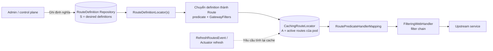
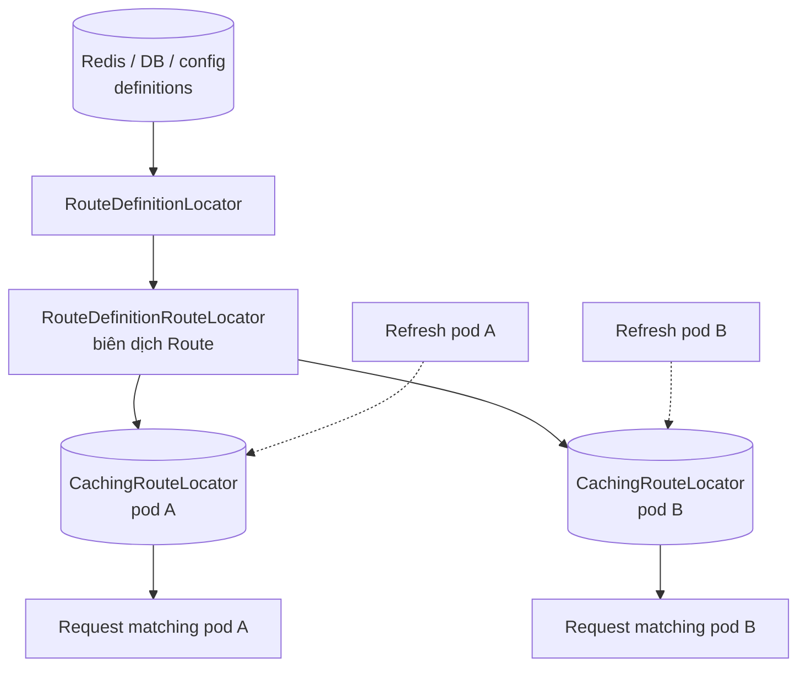
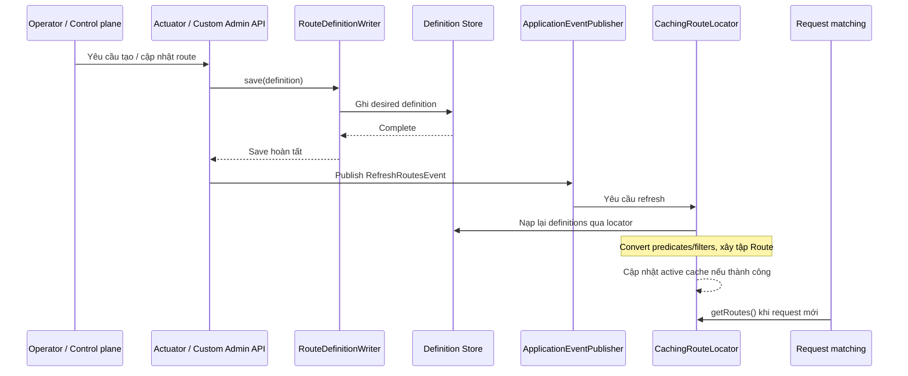
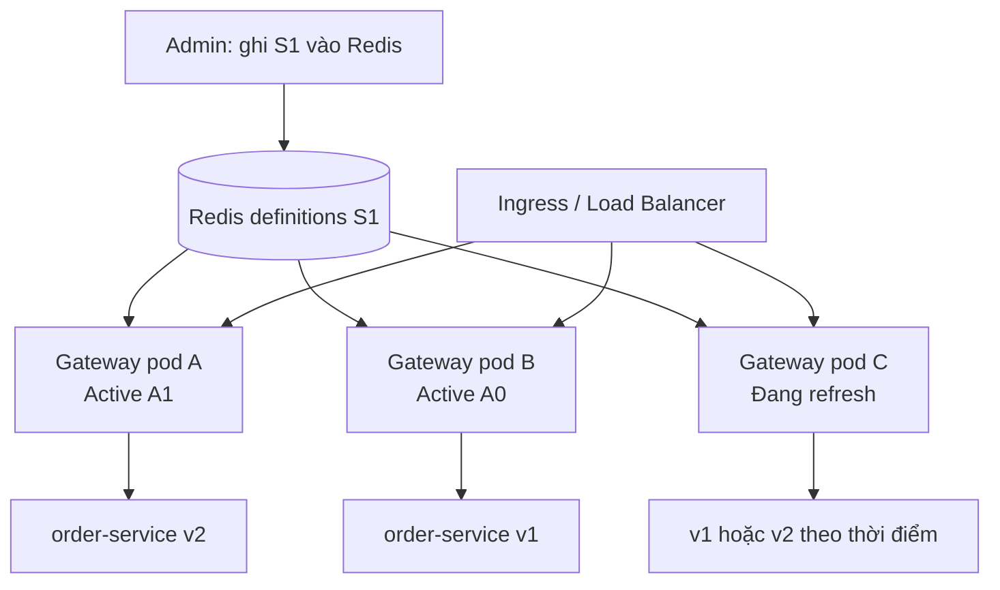
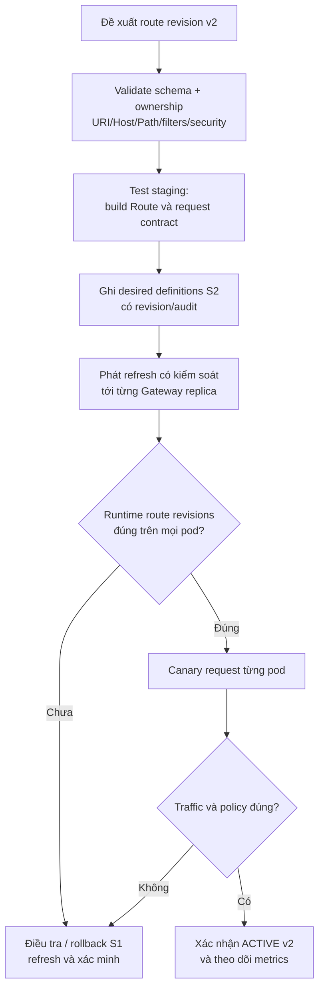

# Phân biệt thay đổi kho định nghĩa với tuyến đang có hiệu lực

Một hệ thống microservices có thể cần **thêm route mà không khởi động lại API Gateway**, ví dụ mở `/api/catalog/**` cho `catalog-service` mới, chuyển một phần traffic từ phiên bản v1 sang v2 hoặc rút một endpoint lỗi khỏi cổng vào. Spring Cloud Gateway hỗ trợ nhiều nguồn cung cấp **route definition** và các cơ chế làm mới route trong thời gian chạy. Tuy nhiên, một lỗi vận hành phổ biến là nhầm lẫn giữa:

- **Kho định nghĩa đã thay đổi:** một `RouteDefinition` mới được lưu, xóa hoặc cập nhật trong nguồn cấu hình.
- **Tuyến đang có hiệu lực:** Gateway đã nạp, chuyển định nghĩa thành `Route` có predicate/filter thực thi được và dùng nó để match những HTTP request tiếp theo.

Hai trạng thái **không đồng nhất về thời điểm**. `POST` tạo một route definition thành công chưa bảo đảm request mới sẽ khớp route đó ngay; ngược lại, xóa definition nhưng chưa làm mới cache có thể khiến Gateway vẫn xử lý theo route cũ. Trong một cụm nhiều Gateway replicas, mỗi instance còn có trạng thái cache riêng, dù kho định nghĩa được chia sẻ.

Bài thuộc chương **Tuyến động** trong module **SPRING_CLOUD_GATEWAY**. Kiến thức liên kết với route predicate, filter chain, biến đổi path/header, khám phá dịch vụ, xác thực, rate limiting, circuit breaker, retry, TLS và observability để vận hành các thay đổi định tuyến an toàn.

**Mục tiêu học tập:**

1. Phân biệt `RouteDefinition`, `RouteDefinitionLocator`, `RouteDefinitionRepository`, `RouteDefinitionWriter`, `RouteLocator` và `CachingRouteLocator`.
2. Giải thích vì sao **thay đổi nguồn định nghĩa** chưa chắc đã được nhìn thấy bởi **request mới**.
3. Sử dụng Actuator để tạo, xem, xóa, refresh và **xác minh route đã có hiệu lực**.
4. Hiểu refresh event và tác động của cache, asynchronous update, route conversion error và thứ tự route.
5. Thiết kế cập nhật/rollback có kiểm soát trên nhiều Gateway replicas, phân biệt Redis shared repository với cache local.
6. Bảo vệ API quản trị route khỏi SSRF, cấu hình route trái phép, thay đổi filter bảo mật và gián đoạn traffic.

> **Phạm vi:** Bài tập trung vào **Spring Cloud Gateway Server WebFlux**. Ví dụ chính sử dụng tài liệu **Gateway 5.x** và endpoint quản trị `/actuator/gateway`. Với Gateway Server WebFlux 4.3.x, một số configuration prefix khác. Đây không phải Gateway Server MVC; code reactive dùng `Mono`/`Flux` và thành phần định tuyến WebFlux. Tài liệu Actuator 5.x ghi nhận refresh có thể xử lý **bất đồng bộ**, nên phản hồi quản trị phải được xác minh thêm bằng route/runtime và request thực tế, không được hiểu như cam kết đồng bộ toàn cụm.

## 1. Sơ đồ tư duy: nguồn định nghĩa khác tập route phục vụ lưu lượng

Hãy tưởng tượng có một màn hình quản trị ghi thay đổi `catalog-api` từ `http://catalog-v1:8080` sang `http://catalog-v2:8080`.



Trong hình:

- `S` = trạng thái **nguồn** hay **desired configuration**.
- `A` = tập route **Gateway đã nạp và dùng để match request**.
- Giữa hai trạng thái có các bước **đọc nguồn, biên dịch predicates/filters, sắp thứ tự và làm mới cache**.
- Nếu bước làm mới chưa chạy, thất bại hoặc chưa hoàn tất trên một pod, có thể **S khác A**.
- Một request đã match route trước khi thay đổi có thể vẫn hoàn tất theo chuỗi xử lý/URI đã chọn trước đó.

**Cách diễn đạt quan trọng:** “Tôi đã lưu route” khác với “route đã được áp dụng”, lại càng khác với “mọi request trên mọi Gateway replica đều đi vào backend mới”.

### Ba câu hỏi kiểm tra riêng

| Câu hỏi | Lớp cần kiểm tra | Chưa đủ bằng chứng nếu chỉ... |
| --- | --- | --- |
| Route definition mới có tồn tại trong nguồn không? | Repository/configuration/`routedefinitions` | Thấy response `201` từ API ghi |
| Gateway pod hiện có thấy route runtime mới không? | `RouteLocator` cache / `/actuator/gateway/routes` | Chỉ xem Redis hoặc YAML |
| Request thật có đi đúng đích/policy mới không? | HTTP request với Host/Path/Method phù hợp, logs/traces upstream | Chỉ thấy route ID có trong danh sách |

## 2. RouteDefinition là dữ liệu; Route là đối tượng thực thi

**`RouteDefinition`** mô tả một route theo dữ liệu cấu hình: ID, URI, predicates, filters, order và metadata. Ví dụ:

```yaml
# Mảnh RouteDefinition khai báo trong routes
- id: catalog-api
  uri: lb://catalog-service
  order: 0
  predicates:
    - Path=/api/catalog/**
  filters:
    - StripPrefix=1
    - AddRequestHeader=X-Edge, gateway
  metadata:
    group: catalog
    revision: v2
```

**`Route`** là đối tượng runtime mà Gateway dùng trong quá trình match route, chứa predicate đã được tạo từ factory, danh sách GatewayFilters và thông tin URI/order/metadata được chuyển đổi. Nó không chỉ là JSON hoặc YAML ban đầu.

| Thuộc tính | `RouteDefinition` | `Route` runtime |
| --- | --- | --- |
| Mục đích | Định nghĩa mong muốn | Phục vụ match request và thực thi filter |
| Predicate | Mô tả kiểu `Path=/api/catalog/**` | Predicate được biên dịch/xây dựng |
| Filter | `FilterDefinition` với tên/args | `GatewayFilter` có config và order |
| Đọc/ghi | Có thể được lưu qua repository/writer | Thường được cung cấp qua `RouteLocator` |
| Cache | Có thể tới từ source/caching definition | Thường được cache ở `CachingRouteLocator` |
| Thay đổi tức thì? | Được cập nhật trong source | Phải qua quá trình refresh/nạp lại khi cần |
| Lỗi có thể xảy ra | Dữ liệu không hợp lệ/ghi thất bại | Không tìm thấy factory, URI sai, predicate/filter build lỗi |

### Vì sao quá trình chuyển đổi quan trọng?

Một definition có thể lưu được ở một kho dữ liệu nhưng không chuyển thành route hợp lệ, ví dụ:

- Predicate ghi sai tên `PathX` thay vì `Path`.
- Filter `RewritePath` thiếu biểu thức chính quy phù hợp.
- URI backend không hợp lệ hoặc dùng scheme không hỗ trợ.
- Một factory yêu cầu dependency không có trong application.
- Hai route trùng ID hoặc có điều kiện match chồng lấn ngoài dự kiến.

**Ghi thành công không đồng nghĩa biên dịch thành công.** Vì vậy quy trình cập nhật cần bước kiểm tra definition **và** bước xác minh route runtime.

## 3. Các lớp API: đọc definition, ghi definition và đọc route runtime

Spring Cloud Gateway Server WebFlux có những khái niệm riêng:

| Interface / class | Phương thức/đặc điểm | Trách nhiệm |
| --- | --- | --- |
| `RouteDefinitionLocator` | `Flux<RouteDefinition> getRouteDefinitions()` | Cung cấp definition từ một nguồn |
| `PropertiesRouteDefinitionLocator` | Đọc properties do Spring Boot bind | Routes khai báo trong `application.yml` |
| `DiscoveryClientRouteDefinitionLocator` | Sinh definition từ service discovery khi bật locator | Route tự động từ service instances/names |
| `RouteDefinitionWriter` | `save(Mono<RouteDefinition>)`, `delete(Mono<String>)` | Ghi/xóa definition ở nguồn ghi được |
| `RouteDefinitionRepository` | Kết hợp vai trò đọc/ghi definition | Nguồn runtime có thể chỉnh sửa |
| `InMemoryRouteDefinitionRepository` | Lưu trong bộ nhớ một Gateway process | Test/local route mutation, **không chia sẻ** qua replicas |
| `RedisRouteDefinitionRepository` | Lưu tập definition dùng chung qua Redis | Chia sẻ source giữa nhiều Gateway instances |
| `RouteDefinitionRouteLocator` | Chuyển definitions thành `Route` | Tạo predicate/filter thực thi |
| `RouteLocator` | `Flux<Route> getRoutes()` | Cung cấp routes runtime |
| `CachingRouteLocator` | Cache `Route`, làm mới khi có refresh event | Tập route mà Gateway thường đọc khi match |
| `RoutePredicateHandlerMapping` | Chọn route phù hợp cho exchange | Khớp Host/Path/Method/... trên request |

Một số lớp/nguồn khác có thể hiện diện theo starter và version. Không nên tự chọn một interface bất kỳ chỉ vì tên đều chứa từ `Route`.

### RouteDefinitionLocator và RouteLocator không thay nhau

```java
public interface RouteDefinitionLocator {
    Flux<RouteDefinition> getRouteDefinitions();
}

// Minh họa chữ ký khái niệm của RouteLocator:
public interface RouteLocator {
    Flux<Route> getRoutes();
}
```

`RouteDefinitionLocator` trả **dữ liệu định nghĩa**, `RouteLocator` trả **route đã có thể chạy**. Nếu bạn viết custom `RouteDefinitionLocator` đọc từ database, việc database trả dữ liệu mới **chưa bảo đảm CachingRouteLocator đã nạp bộ Route mới**.

### Không phải route nào cũng xuất phát từ Repository

Nguồn route có thể gồm:

- `application.yml`/configuration properties.
- `@Bean RouteLocator` Java DSL tạo `Route` trực tiếp.
- Definition do DiscoveryClient locator sinh.
- In-memory hoặc Redis route-definition repository.
- `RouteDefinitionLocator` tùy biến đọc database, config service hay Git-backed API.

Do đó, API ghi/xóa definition của Actuator **không mặc nhiên sửa được** route viết trong `application.yml` hoặc `@Bean RouteLocator`. Theo tài liệu Actuator 5.x, endpoint chỉnh/xóa áp dụng cho những route được quản lý thông qua đường Actuator; xóa route khai báo trong configuration có thể nhận `404 Not Found`.

## 4. Hai tầng cache và câu hỏi refresh thực sự làm gì?

Khái niệm **cache** trong Gateway có thể xuất hiện ở vài lớp. Đối với nội dung bài này, ưu tiên phân biệt:

1. **Kho route definitions**: dữ liệu do `RouteDefinitionRepository` hoặc nguồn khác cung cấp; Redis là một ví dụ shared source.
2. **CachingRouteLocator**: tập **Route runtime** đã được nạp trên **một Gateway instance**.
3. **Cache của nguồn phụ**: ví dụ cache danh sách `ServiceInstance` của LoadBalancer hoặc cache từ một configuration/discovery provider.



**Câu mấu chốt:** Việc dùng chung Redis **không tự đồng bộ nội dung CachingRouteLocator của mọi JVM ngay lập tức**. Route refresh là một bước cần tính đến ở **mỗi instance**.

### Cache route khác cache instance của LoadBalancer

Ví dụ route runtime vẫn là:

```text
id = catalog-api
uri = lb://catalog-service
predicate = Path=/api/catalog/**
```

Một instance mới của `catalog-service` được đăng ký vào Eureka/Consul/Kubernetes **không nhất thiết đòi sửa route definition** này. LoadBalancer có thể chọn instance mới thông qua danh sách service instances/caches của riêng nó.

Ngược lại, nếu bạn đổi chính route từ `Path=/api/catalog/**` thành `Path=/api/v2/catalog/**` thì đó là **thay đổi route definition**; phải đưa phiên bản route runtime mới vào chuỗi match request.

**Không nhầm** `/actuator/gateway/refresh` với “làm mới mọi cache của LoadBalancer”, “clear Redis dữ liệu nghiệp vụ” hoặc “đăng ký lại service”. Nó chủ yếu liên quan tới cache routes của Gateway.

## 5. Bảng trạng thái: đã ghi, đã refresh, đã áp dụng?

Cho `S0` là source cũ, `S1` là source mới; `A0` là tập active routes cũ, `A1` là active routes mới.

| Thời điểm | Source definitions | Active route cache pod A | Điều request có thể thấy |
| --- | --- | --- | --- |
| Trước sửa | S0 | A0 | Route cũ |
| Vừa `save` definition mới | **S1** | **A0** | Vẫn route cũ hoặc chưa có route mới |
| Gửi refresh event | S1 | A0, **đang refresh** | Có thể vẫn thấy cache cũ |
| Refresh thành công | S1 | **A1** | Request mới có thể match route mới |
| Refresh lỗi khi build route | S1 | Có thể giữ **A0** theo cơ chế của version | Runtime chưa áp dụng definition lỗi |
| Xóa definition chưa refresh | Đã bỏ khỏi source | Vẫn có route cũ | Request mới vẫn có thể match route cũ |
| Pod B chưa refresh | S1 dùng chung | B vẫn A0 | Client phân phối qua A/B có thể thấy kết quả khác |

**Ghi nhớ:** Một HTTP response `200` từ lệnh refresh **không nên được hiểu là cam kết đồng bộ mọi pod đã chuyển sang A1**. Tài liệu Actuator mô tả cơ chế refresh có thể **bất đồng bộ** và lỗi trong quá trình refresh có thể để nguyên tập route hiện có.

### Chỉ có definition trong kho không phải bằng chứng route đang match

Giả sử repository đã lưu:

```json
{
  "id": "reports-api",
  "uri": "http://reports-v2:8080",
  "predicates": ["Path=/api/reports/**"],
  "filters": ["StripPrefix=1"]
}
```

Client gọi `GET /api/reports/weekly` và nhận `404` ngay từ Gateway. Có nhiều khả năng:

- Refresh chưa diễn ra trên instance xử lý request.
- Definition build lỗi hoặc ID trùng.
- Request không khớp predicate Host/Path/Method khác.
- Một route có `order` cao hơn đã được chọn.
- Request được gửi tới pod chưa cập nhật.
- Spring Security/WebFilter từ chối trước khi route match.
- Route đã match nhưng **upstream** trả `404` do path rewrite — hoàn toàn khác Gateway không tìm route.

Vì vậy cần xem **route runtime**, route ID đã match và backend logs, không chỉ nhìn status.

## 6. RefreshRoutesEvent và quá trình làm mới route

Gateway dùng một event nội bộ như **`RefreshRoutesEvent`** để kích hoạt cơ chế refresh route cache. `CachingRouteLocator` là thành phần liên quan trực tiếp; các listeners khác có thể đồng bộ những metadata phụ thuộc route (ví dụ CORS) tùy version.



**Tùy cách gọi:** Nếu chỉ gọi `RouteDefinitionWriter.save(...)`, chương trình không được tự mặc định rằng refresh đã được phát và route runtime đã đổi. Với custom management code, hãy chủ động phát event hoặc gọi cơ chế refresh được hỗ trợ **sau khi lưu thành công**.

### Refresh có thể xử lý bất đồng bộ

Actuator Gateway documentation mô tả `POST /actuator/gateway/refresh` trả `200` với body rỗng. Refresh event và quá trình tái xây cache có thể hoàn thành sau phản hồi HTTP đó. Nếu build route lỗi, tài liệu nêu refresh bất đồng bộ **không thay đổi routes hiện có**.

Vì vậy, thiết kế quy trình quản trị nên có:

1. Ghi source thành công.
2. Yêu cầu refresh.
3. **Quan sát** cache/route runtime mới.
4. Kiểm thử request theo contract.
5. Chỉ khi thành công mới báo **active trên pod/cụm được kiểm tra**.

Không tự sử dụng `Thread.sleep(1000)` rồi cho rằng chắc chắn cache đã đổi. Với CI/staging, dùng **polling có deadline** và kiểm tra trạng thái mong muốn; nếu hết thời gian thì báo chưa được áp dụng.

## 7. Actuator: xem RouteDefinition và Route runtime

Spring Cloud Gateway Actuator có những endpoint đặc biệt hữu ích:

| Endpoint | Vai trò chính | Lưu ý |
| --- | --- | --- |
| `GET /actuator/gateway/routedefinitions` | Xem definitions do Gateway biết | Là góc nhìn definition, không tương đương request matching |
| `GET /actuator/gateway/routes` | Xem tập routes được Gateway công bố | Hữu ích để kiểm tra route runtime/cache |
| `GET /actuator/gateway/routes/{id}` | Xem một route có hiệu lực theo ID | Định dạng trả về không phải JSON body để `POST` trực tiếp |
| `GET /actuator/gateway/routes/{id}/combinedfilters` | Xem chuỗi filters kết hợp, nếu version hỗ trợ | Dùng khi nghi filter ordering sai |
| `POST /actuator/gateway/routes/{id}` | Tạo definition qua API quản trị | Route phải được refresh để áp dụng |
| `DELETE /actuator/gateway/routes/{id}` | Xóa definition do endpoint quản lý | Không tự xóa route cấu hình trong YAML |
| `POST /actuator/gateway/refresh` | Làm mới cache route | Không đồng nghĩa đã refresh toàn cluster |

**Lưu ý quan trọng về bảo mật:** Endpoint Gateway Actuator **bị vô hiệu hóa theo mặc định** ở tài liệu hiện hành. Chỉ mở quyền đọc và expose qua quản trị khi cần. Các POST/DELETE/refresh là **control-plane operations nhạy cảm** và không được public cho Internet.

### Cấu hình chỉ đọc (khuyến nghị thường trực)

```properties
management.endpoint.gateway.access=read-only
management.endpoints.web.exposure.include=gateway
```

Với `read-only`, bạn **không thể** tạo/xóa/refresh route qua Actuator. Đó là chủ đích tốt cho hệ thống chỉ cần quan sát. Nếu muốn thay đổi route bằng Actuator, cần quyền `unrestricted` theo cơ chế truy cập phiên bản Spring Boot/Gateway:

```properties
# CHỈ cho môi trường quản trị tách biệt có xác thực và phân quyền mạnh.
management.endpoint.gateway.access=unrestricted
management.endpoints.web.exposure.include=gateway
```

Không bật quyền `unrestricted` trên public gateway port mà không có authentication, authorization, network isolation, audit log và kiểm soát thay đổi. Việc expose endpoint không tự tạo cơ chế bảo mật đầy đủ.

### Xem definition và route trong test

```bash
# Kênh quản trị nội bộ, đã bật read-only.
curl -fsS http://localhost:8080/actuator/gateway/routedefinitions
curl -fsS http://localhost:8080/actuator/gateway/routes
curl -fsS http://localhost:8080/actuator/gateway/routes/catalog-api
```

Response của `/routes` có thể chứa mô tả predicate/filter đã build, URI, order và route ID. Response của `/routedefinitions` biểu diễn định nghĩa; chúng **không phải hai bản sao JSON cùng ý nghĩa**.

## 8. Thực hành: tạo route mới qua Actuator

**Mục tiêu:** thêm route `demo-dynamic` từ `/api/demo/**` đến backend thử nghiệm `http://127.0.0.1:8082` **không restart Gateway**.

Điều kiện:

- Gateway WebFlux test ở `localhost:8080`.
- Backend HTTP test ở `127.0.0.1:8082`, có endpoint `GET /demo/ping`.
- Actuator Gateway trong test được cấp quyền `unrestricted` và chỉ nghe trên mạng quản trị được phép.
- Không có route khác match `/api/demo/**` với ưu tiên cao hơn.

### Bước 1 — Đọc trạng thái trước khi tạo

```bash
curl -i http://localhost:8080/actuator/gateway/routes/demo-dynamic
curl -i http://localhost:8080/api/demo/ping
```

Nếu chưa có route, lookup route có thể trả `404`; request public có thể nhận `404` từ Gateway nếu không có handler khác. Ghi lại response và route ID để so sánh sau.

### Bước 2 — Ghi RouteDefinition

Theo tài liệu Actuator 5.x, `POST /actuator/gateway/routes/{id}` nhận body có predicates/filters theo **shortcut DSL strings** như `"Path=/api/demo/**"`, `"StripPrefix=1"`.

```bash
curl -i -X POST \
  http://localhost:8080/actuator/gateway/routes/demo-dynamic \
  -H "Content-Type: application/json" \
  -d '{
    "uri": "http://127.0.0.1:8082",
    "predicates": ["Path=/api/demo/**"],
    "filters": ["StripPrefix=1"],
    "order": 0,
    "metadata": {"group": "lab", "revision": "v1"}
  }'
```

Tài liệu cho biết thành công thường trả **`201 Created`**. Điều được xác nhận là yêu cầu **tạo definition** được xử lý, chưa phải bằng chứng route đã hoạt động.

> **Không lấy nguyên JSON từ `GET /actuator/gateway/routes/{id}` làm body POST.** GET trả mô tả `Route` runtime; POST nhận **`RouteDefinition`** theo định dạng DSL được tài liệu quy định. Các key `route_id`/`predicate` trong GET không thay thế mặc định các trường `predicates`/`filters` của POST.

### Bước 3 — Xem trạng thái trước refresh

```bash
curl -fsS http://localhost:8080/actuator/gateway/routedefinitions
curl -fsS http://localhost:8080/actuator/gateway/routes
```

Bạn có thể thấy definition mới ở view definition trong khi view route runtime **vẫn là bản cũ**; sự khác biệt này chính là nội dung bài học. Nếu version triển khai tự phát refresh ở một workflow khác, hai view có thể cập nhật gần nhau. **Đừng suy diễn từ đúng một ảnh chụp.**

### Bước 4 — Yêu cầu làm mới cache

```bash
curl -i -X POST \
  http://localhost:8080/actuator/gateway/refresh
```

Response `200` chỉ cho biết endpoint đã chấp nhận/khởi phát quy trình theo contract được mô tả; **không phải chứng nhận** tất cả pods đã dùng route mới.

### Bước 5 — Xác minh route đang có hiệu lực

```bash
# Kiểm tra route runtime đã xuất hiện.
curl -fsS \
  http://localhost:8080/actuator/gateway/routes/demo-dynamic

# Kiểm tra HTTP thực sự qua Gateway.
curl -i http://localhost:8080/api/demo/ping
```

Backend test cần ghi nhận path `/demo/ping` sau `StripPrefix=1`. Nếu request trả 200 nhưng backend marker không đúng, có thể request đã match route khác hoặc backend khác; hãy dùng route ID trong tracing và xem access log ở backend.

### Bước 6 — Xóa definition rồi refresh

```bash
curl -i -X DELETE \
  http://localhost:8080/actuator/gateway/routes/demo-dynamic

curl -i -X POST \
  http://localhost:8080/actuator/gateway/refresh

curl -i http://localhost:8080/actuator/gateway/routes/demo-dynamic
curl -i http://localhost:8080/api/demo/ping
```

Sau khi xóa definition thành công, cần refresh và kiểm tra lại; **không nên** khẳng định route biến mất tức thời ngay ở thời điểm DELETE. Một request đã chọn route trước khi xóa có thể vẫn hoàn tất với pipeline cũ.

## 9. Cập nhật route đã có: không POST đè lên ID cũ

Đây là chi tiết quan trọng trong **Actuator API 5.x**: tài liệu cảnh báo **không nên `POST` vào một ID route đã tồn tại**. Nó có thể làm trùng definition trong một số code path và dẫn tới lỗi `500` khi đọc `GET /actuator/gateway/routes`.

Với route **do Actuator quản lý**, quy trình trong tài liệu là:

1. `DELETE /actuator/gateway/routes/{id}`.
2. `POST /actuator/gateway/routes/{id}` với definition mới.
3. `POST /actuator/gateway/refresh`.
4. Xác minh route runtime và request thật.

### Ví dụ đổi target từ backend v1 sang v2

```bash
# Trước đó demo-dynamic đã tồn tại từ Actuator.
curl -i -X DELETE \
  http://localhost:8080/actuator/gateway/routes/demo-dynamic

curl -i -X POST \
  http://localhost:8080/actuator/gateway/routes/demo-dynamic \
  -H "Content-Type: application/json" \
  -d '{
    "uri": "http://127.0.0.1:8083",
    "predicates": ["Path=/api/demo/**"],
    "filters": ["StripPrefix=1"],
    "order": 0
  }'

curl -i -X POST \
  http://localhost:8080/actuator/gateway/refresh
```

**Cảnh báo về update không nguyên tử:** DELETE + POST + refresh là **ba thao tác**, không phải transaction end-to-end. Nếu POST thất bại sau DELETE, definition có thể không tồn tại trong source; nếu refresh diễn ra xen giữa các bước, request có thể thấy route bị thiếu. Vì vậy production cần **control plane có validation, serialization, versioning, rollback** hoặc một repository writer tự quản lý update/transaction theo thiết kế; không dùng ba lệnh này tùy tiện trên hệ thống có lưu lượng cao.

Nếu route được khai báo trong `application.yml` hoặc `@Bean`, endpoint xóa của Actuator **không mặc nhiên sở hữu được** route đó. Muốn thay đổi cấu hình gốc cần sửa nguồn cấu hình và dùng cơ chế refresh/redeploy phù hợp thay vì cố DELETE một definition read-only.

## 10. Lập trình thay đổi definitions bằng RouteDefinitionWriter

Đối với hệ thống có admin UI riêng hoặc một route-control service, có thể dùng **`RouteDefinitionWriter`** để lưu/xóa `RouteDefinition`. Đây là Java code dành cho **Gateway WebFlux**:

```java
package example.gateway.dynamic;

import org.springframework.cloud.gateway.event.RefreshRoutesEvent;
import org.springframework.cloud.gateway.route.RouteDefinition;
import org.springframework.cloud.gateway.route.RouteDefinitionWriter;
import org.springframework.context.ApplicationEventPublisher;
import org.springframework.stereotype.Service;

import reactor.core.publisher.Mono;

@Service
public final class ManagedRouteChanges {

    private final RouteDefinitionWriter writer;
    private final ApplicationEventPublisher events;

    public ManagedRouteChanges(
            RouteDefinitionWriter writer,
            ApplicationEventPublisher events) {
        this.writer = writer;
        this.events = events;
    }

    public Mono<Void> save(RouteDefinition definition) {
        // Validate ID, URI, predicates, filters, metadata and permissions
        // at the admin API / control-plane layer BEFORE calling save.
        return writer.save(Mono.just(definition))
            .doOnSuccess(ignored ->
                events.publishEvent(new RefreshRoutesEvent(this)));
    }

    public Mono<Void> delete(String routeId) {
        // Confirm the route is owned by this writable repository.
        return writer.delete(Mono.just(routeId))
            .doOnSuccess(ignored ->
                events.publishEvent(new RefreshRoutesEvent(this)));
    }
}
```

**Điều đoạn mã làm được:**

- Gọi writer trong một **reactive pipeline**, không dùng `.block()` trên WebFlux event loop.
- Chỉ phát `RefreshRoutesEvent` **sau khi operation save/delete hoàn thành thành công**.
- Không tự sửa các route Java DSL, file YAML hoặc repository khác nếu writer không quản lý những nguồn đó.

**Điều đoạn mã không bảo đảm:**

- Nó không chứng minh route runtime mới đã build xong.
- Nó không đồng bộ refresh sang các Gateway pods khác.
- Nó không giải quyết lost updates khi hai admin requests cùng thay một route.
- Nó không tự kiểm tra route URI có trỏ tới metadata service, mạng nội bộ nhạy cảm hoặc một endpoint trái phép không.
- Nó không cung cấp transaction giữa database write, event publication và route cache switch.

Trong production, hãy bổ sung **validation, ownership, quyền sửa route, revision/ETag, audit, giới hạn tần suất thay đổi và quy trình rollback**. Nếu API quản trị cần phản hồi “ACTIVE”, phải có bước xác minh riêng; `Mono<Void>` ở đây chỉ thể hiện **write + publish event**.

### Tạo RouteDefinition trong Java

```java
import java.net.URI;
import java.util.List;
import java.util.Map;

import org.springframework.cloud.gateway.filter.FilterDefinition;
import org.springframework.cloud.gateway.handler.predicate.PredicateDefinition;
import org.springframework.cloud.gateway.route.RouteDefinition;

// Dùng trong một service quản trị có validation/authorization riêng.
RouteDefinition route = new RouteDefinition();
route.setId("catalog-dynamic");
route.setUri(URI.create("http://127.0.0.1:8082"));
route.setPredicates(List.of(
    new PredicateDefinition("Path=/api/catalog/**")));
route.setFilters(List.of(
    new FilterDefinition("StripPrefix=1")));
route.setOrder(0);
route.setMetadata(Map.of("group", "catalog", "revision", "v2"));

// managedRouteChanges.save(route) trả Mono<Void> và phải được
// subscribe bởi một WebFlux handler/flow có quản lý.
```

**Không gọi `subscribe()` thủ công** trong controller rồi trả `200` khi chưa biết writer đã thành công. Hãy để endpoint reactive trả publisher được framework xử lý và quyết định response status dựa trên kết quả thực.

## 11. Nguồn lưu trữ: InMemory, Redis, YAML và database tùy biến

| Nguồn | Có thể thay đổi lúc chạy? | Chia sẻ nhiều pods? | Qua restart? | Ghi chú |
| --- | --- | --- | --- | --- |
| `application.yml` / configuration properties | Thay qua nguồn cấu hình + quy trình reload tương ứng | Nếu cùng cấu hình phát hành | Có khi file/config vẫn tồn tại | Không ghi qua Actuator như repository writable |
| `InMemoryRouteDefinitionRepository` | Có, qua writer/Actuator nếu sử dụng repository này | **Không**, state theo JVM | **Mất** các thay đổi runtime khi restart | Thuận tiện local/test |
| `RedisRouteDefinitionRepository` | Có, qua writer/Actuator khi được bật | **Có source chung** | Có thể còn sau pod restart nếu Redis/persistence phù hợp | Cache Route của mỗi pod vẫn riêng |
| Custom `RouteDefinitionLocator` từ DB | Có nếu DB/control plane cập nhật dữ liệu | Có thể, tùy DB và client | Tùy độ bền DB | Cần refresh/event và validation |
| `DiscoveryClientRouteDefinitionLocator` | Thay theo service registry và policy locator | Registry có thể dùng chung | Tùy registry | Route definition sinh từ discovery; cache route và instance có vòng đời riêng |
| `@Bean RouteLocator` | Thường thay bằng code/config/deploy | Mỗi pod có code riêng | Có theo bản phát hành | Không phải definition mà Actuator writer sở hữu |

**Điều quan trọng:** Redis repository dùng chung **source**, không tự biến Gateway thành một cluster có route cache phân tán theo kiểu shared-memory. Mỗi pod vẫn có vòng đời refresh riêng.

### RedisRouteDefinitionRepository

Tài liệu Spring Cloud Gateway có phần **Sharing Routes between multiple Gateway instances**: dùng `RedisRouteDefinitionRepository` để chia sẻ definitions thay cho `InMemoryRouteDefinitionRepository`.

Ở tài liệu **Configuration Properties 5.x**, property bật repository được liệt kê dưới:

```yaml
spring:
  cloud:
    gateway:
      server:
        webflux:
          redis-route-definition-repository:
            enabled: true
  data:
    redis:
      host: localhost
      port: 6379
```

Cần dependency reactive Redis phù hợp:

```xml
<dependency>
  <groupId>org.springframework.boot</groupId>
  <artifactId>spring-boot-starter-data-redis-reactive</artifactId>
</dependency>
```

> **Lưu ý version/tài liệu:** Trang *Sharing Routes* 5.x vẫn hiển thị prefix cũ `spring.cloud.gateway.redis-route-definition-repository.enabled`, còn bảng **Configuration Properties 5.x** liệt kê `spring.cloud.gateway.server.webflux.redis-route-definition-repository.enabled`. Hãy kiểm tra đúng version/starter đang chạy, effective binding và integration test; không bật hai prefix tùy tiện rồi cho rằng cả hai đều có hiệu lực. Với WebFlux 4.3.x, prefix thường là dạng cũ.

**Redis là thành phần vận hành quan trọng:** cần cấu hình network isolation, auth/TLS nếu phù hợp, backup/persistence/availability và đo lỗi đọc ghi. Redis route repository **khác** Redis rate limiter, dù cùng kết nối Redis; đừng xóa toàn bộ Redis keys chỉ để reset một route.

## 12. Nhiều Gateway replicas: shared definitions nhưng active routes có thể lệch

Giả sử ba Gateway pods A, B, C cùng đọc Redis route definitions. Một admin thao tác cập nhật route `orders-api`.



Trong một khoảng chuyển đổi, client được phân phối qua nhiều pods có thể thấy **hành vi khác nhau**. Vì vậy, không báo “rollout xong” chỉ vì một pod đã nhận route mới.

### Vì sao refresh một pod không cập nhật mọi pod?

- `RefreshRoutesEvent` là event **trong application context/JVM** theo mô hình cơ bản.
- `CachingRouteLocator` của mỗi pod giữ cache riêng.
- Redis lưu definition; nó không mặc định gửi một signal buộc mọi JVM đồng thời thay cache route.
- Một pod có thể đang lỗi mạng Redis hoặc có dependency/filter factory không tương thích.
- Rolling deployment có thể khiến pods chạy **hai phiên bản Gateway** với khả năng parse route khác nhau.

### Quy trình an toàn cho cluster

1. Ghi source definition đã qua validation, có revision `v2`.
2. Gửi refresh có kiểm soát đến **từng Gateway instance** hoặc phát tín hiệu phân phối tin cậy qua kiến trúc control plane.
3. Poll route runtime trên **từng instance**, xác minh route ID/URI/metadata/revision.
4. Gửi canary request tới **từng instance** nếu có thể; đừng chỉ gọi qua ingress ngẫu nhiên.
5. Xác nhận latency, 4xx/5xx, backend destination và security filters.
6. Khi mọi instance đạt tiêu chí, mới kết luận rollout active trong phạm vi cụm đó.
7. Nếu có pod lỗi, cô lập khỏi ingress hoặc rollback source và refresh, thay vì để traffic chạy trong trạng thái split-brain lâu.

Không nên dùng `curl /actuator/gateway/refresh` tới địa chỉ ingress chung rồi tưởng rằng lệnh đã tới tất cả pods. Load balancer thường chỉ chuyển **một HTTP request đến một pod**.

## 13. Refresh Gateway khác Refresh Spring Cloud Config và Discovery

Ba luồng dễ bị nhầm:

| Thao tác/sự kiện | Nguồn thay đổi | Phần cần cập nhật |
| --- | --- | --- |
| `POST /actuator/gateway/refresh` | Source route definitions đã thay đổi | Route cache của Gateway instance nhận lệnh |
| `RefreshRoutesEvent` do code phát | Custom control-plane đã ghi source | Tính lại route runtime theo listeners Gateway |
| `POST /actuator/refresh` (Spring Cloud Context, nếu bật) | Configuration properties thay đổi ở Config Server/source | Rebind/reinitialize beans được hỗ trợ; **không coi là alias** của Gateway refresh |
| Discovery event/locator | Service xuất hiện/mất đi trong registry | Definitions sinh tự động và/hoặc instance list tùy cơ chế |
| Cache refresh của LoadBalancer | Registry/health thay đổi | Danh sách service instances, không nhất thiết đổi Path/Host predicate |
| Redeploy/restart | Cấu hình/ứng dụng mới | Nạp lại cả application lifecycle, nhưng có thể mất InMemory definitions |

### Case 1: đổi route trong application.yml

Khi chỉnh một file YAML của ứng dụng đã chạy, Spring Boot **không tự đọc lại mọi file và cập nhật tất cả route beans tức thì**. Phải có cơ chế config refresh/rebind được hỗ trợ hoặc redeploy/restart theo quy trình. Gọi `/actuator/gateway/refresh` chỉ hữu ích nếu **nguồn RouteDefinitionLocator nhìn thấy dữ liệu mới**.

### Case 2: service registry có instance mới

Route `lb://catalog-service` vẫn có thể giữ nguyên. Danh sách instance của LoadBalancer cập nhật qua discovery/caching riêng; không cần tạo một route `catalog-instance-3` mới nếu policy routing vẫn trỏ tới service ID.

### Case 3: service được tự động tạo route qua discovery locator

Nếu sử dụng `DiscoveryClientRouteDefinitionLocator` để tự sinh route từ service IDs, thay đổi registry có thể khiến **tập definitions do locator trả về thay đổi**. Nhưng để route runtime được đồng bộ, Gateway cần các event/refresh tương ứng theo version và cache. Đừng cho rằng registry cập nhật đồng nghĩa mọi gateway pod nhận route mới ngay cùng một thời điểm.

## 14. Thay đổi predicate, filter, URI và order: ảnh hưởng không giống nhau

### Đổi Path/Host/Method predicate

Giả sử thay:

```text
Path=/api/v1/orders/**
    thành
Path=/api/v2/orders/**
```

Sau khi active route cache đổi:

- Những request mới tới `/api/v2/orders/**` có thể bắt đầu match.
- `/api/v1/orders/**` có thể không match route đó nữa, trừ khi còn route khác.
- Request đi qua khi cache cũ còn active có thể tiếp tục theo route cũ.
- Nếu client còn dùng v1, cần lộ trình backward compatibility thay vì cắt ngay.

### Đổi filters

Đổi `StripPrefix=1` sang `StripPrefix=2` có thể làm backend nhận path khác. Nếu không kiểm thử request thực, route vẫn hiện trong Actuator nhưng upstream có thể trả `404`. Tương tự, đổi `RequestRateLimiter`, `CircuitBreaker` hoặc header authorization filter có thể thay đổi bảo mật và độ sẵn sàng.

### Đổi URI upstream

Đổi `http://catalog-v1:8080` thành `http://catalog-v2:8080` chỉ làm thay **mục tiêu route runtime**; không bảo đảm DNS, TLS, LoadBalancer, service health và backend path đều đúng. Nếu scheme là `lb://catalog-service`, URI vẫn logical; instance thực được chọn ở thời điểm xử lý request.

### Đổi route order

Khi nhiều routes match cùng Path/Host, route `order` quyết định thứ tự ưu tiên chọn route. Thay đổi một definition có thể khiến route khác “bị che”, dù cả hai vẫn tồn tại. **Route order không phải GatewayFilter order**.

| Thay đổi | Điều phải kiểm thử |
| --- | --- |
| Predicate | Positive/negative match, Host, Method, Path |
| URI | Destination thật, TLS, DNS, service instance |
| Filters | Path/header/body, auth, rate limit, circuit breaker |
| Route `order` | Overlap và route ID được chọn |
| Metadata | Timeouts, CORS, custom logic đọc metadata |
| Xóa route | 404/route kế tiếp match, request in-flight |

## 15. Refresh bất đồng bộ, lỗi biên dịch và race condition

Một refresh có thể thất bại trong lúc nạp definitions hoặc xây các `Route`. Tài liệu Actuator ghi rõ: nếu asynchronous refresh sinh lỗi, nó **không thay đổi tập routes đang có** theo cơ chế được mô tả.

Vì vậy:

- Source có thể chứa **definition lỗi**.
- Active routes có thể tiếp tục là **tập cũ**.
- Admin thấy `POST /refresh` trả `200` nhưng runtime không đổi.
- Lần refresh tiếp theo có thể tiếp tục thất bại nếu lỗi source chưa được sửa.

### Không bắn nhiều refresh đồng thời vô tội vạ

Khi hai admin cập nhật route v1 → v2 → v3 cùng lúc và nhiều refresh chạy gần nhau, cần xem tính tuần tự và cache update của Gateway version cụ thể. Đã có issue trong dự án Gateway liên quan tới **asynchronous refresh/race**, nhất là với source reactive. Đừng mặc định refresh đồng thời sẽ luôn cho kết quả cuối đúng nếu không có test bảo đảm.

Giải pháp ở tầng vận hành:

1. **Serialize** thay đổi route trên một route ID hoặc một revision group.
2. Chỉ publish refresh **sau khi source write commit**.
3. Gắn revision/ETag/optimistic lock để tránh lost update.
4. Hạn chế refresh liên tục; batch updates khi có nhiều route.
5. Theo dõi thành công/từ chối refresh và so sánh source revision với runtime.
6. Có khả năng rollback bằng **last known good configuration** đã được kiểm chứng.
7. Tránh phụ thuộc vào `sleep()` cố định để “chữa race”.

Không tự phát lại refresh liên tục khi một definition chưa hợp lệ; điều đó chỉ nhân log/error và có thể làm tăng tải source Redis/DB.

## 16. Refresh chọn lọc theo metadata

Tài liệu Actuator cho phép giới hạn refresh theo **metadata** bằng query parameter `metadata`, ví dụ:

```bash
curl -i -X POST \
  "http://localhost:8080/actuator/gateway/refresh?metadata=group:catalog"
```

Giả sử:

```yaml
- id: catalog-v1
  uri: http://localhost:8081
  predicates:
    - Path=/api/catalog/v1/**
  metadata:
    group: catalog

- id: orders-v1
  uri: http://localhost:8082
  predicates:
    - Path=/api/orders/v1/**
  metadata:
    group: orders
```

Ý tưởng của refresh chọn lọc là chỉ làm mới những routes có metadata khớp `group:catalog`, tránh thay toàn bộ khi một nhóm thay đổi.

**Cảnh báo quan trọng:**

- Đây là cơ chế theo **metadata**, không phải `route-id` filter tùy ý.
- Cần xem behavior đúng version: metadata nằm ở route cũ hay definition mới, cách chọn/tái xây route thay đổi trong tình huống rename hoặc xóa.
- Khi xóa hoàn toàn route hoặc đổi metadata group, một refresh chọn lọc có thể không phải cách an toàn để bảo đảm route biến mất/di chuyển đúng.
- Nếu không chắc, ưu tiên **refresh toàn bộ routes** trong quy trình có kiểm soát và so sánh tập runtime, nhất là sau delete/rename.
- Refresh chọn lọc vẫn **local theo instance**, không phân phối tự động tới mọi pod.

Đừng dùng metadata refresh làm ranh giới phân quyền; chỉ admin control plane đã xác thực mới được gọi endpoint này.

## 17. Xây quy trình rollout và rollback thực tế

Một thay đổi route production nên được coi là **một đợt triển khai cấu hình**, không phải một lệnh CRUD đơn độc.

### Quy trình khuyến nghị



Cần lưu **last known good** trước thay đổi. Khi rollback, phải phục hồi **source definition**, phát refresh đến các pods, rồi test route runtime và request thật; không chỉ ghi “rollback complete” sau khi Redis được sửa.

### Cách tránh mất route khi update

Với API Actuator yêu cầu DELETE rồi POST, có một cửa sổ source thiếu route. Nếu tính sẵn sàng cực cao, cân nhắc:

- **Blue/green route IDs** có Path/Host/order không chồng lấn ngoài ý muốn.
- **Weighted routes** hoặc feature flags có contract rõ để chuyển traffic dần.
- Một custom repository có **atomic versioned publish** và snapshot có thể được đọc nhất quán.
- Chỉ đổi nguồn active sau validation, rồi refresh theo từng pod.
- Đặt canary route trong namespace path/test host riêng trước khi chuyển production traffic.

Các phương án này **không được Gateway tự thực hiện thay bạn** chỉ vì đã dùng RedisRouteDefinitionRepository.

## 18. Bảo mật API cập nhật route và SSRF

**Route control plane là bề mặt tấn công rất nhạy cảm.** Một người có quyền tạo route có thể:

- Định tuyến `/api/admin/**` tới một backend không đáng tin.
- Dùng URI trỏ tới metadata endpoint trong cloud, Redis, database hoặc mạng nội bộ, tạo rủi ro **SSRF/open proxy**.
- Thêm filter xóa header authorization hoặc sửa identity trước backend.
- Tắt/bỏ bớt rate limiter, circuit breaker hoặc security filter theo route.
- Đặt route với predicate quá rộng để chiếm traffic của API khác.
- Đổi Host header hoặc rewrite path theo cách vượt ranh giới tenant.
- Làm Gateway gọi một endpoint HTTP không có TLS hoặc có certificate không tin cậy.

### Các lớp bảo vệ cần có

| Kiểm soát | Mục đích |
| --- | --- |
| **Mạng quản trị tách biệt** | Không expose POST/DELETE/refresh trên public gateway listener |
| **Authentication mạnh + authorization** | Chỉ nhóm operator được phê duyệt mới thay routes |
| **Audit log có revision/actor** | Truy vết ai thay URI, predicate/filter và khi nào |
| **Validation/allowlist URI** | Chỉ cho scheme, host, port, service ID được phép |
| **Chống SSRF / egress policy** | Chặn metadata services, private addresses trái phép, DNS rebinding |
| **Giới hạn filter factories và args** | Không cho admin tùy ý bỏ security hoặc chèn header nhạy cảm |
| **Policy route ownership** | Chỉ được sửa route thuộc team/tenant tương ứng |
| **Review và approval** | Đặc biệt với routes chứa auth, payment, admin hoặc PII |
| **Canary/rollback** | Khôi phục khi cấu hình mới gây 404/502/5xx |
| **TLS/mTLS** | Bảo vệ control plane và kết nối tới upstream theo policy |

Không chỉ kiểm tra chuỗi `http://127.0.0.1`: hostname có thể resolve tới IP nội bộ, chuyển hướng, hoặc trỏ tới endpoint ngoài allowlist sau thay đổi DNS. Cần **network-level egress restrictions** bổ sung cho validation tại API.

### Tại sao route definition không được coi là dữ liệu hoàn toàn vô hại?

Trong Gateway, filter/predicate arguments quyết định cách xử lý HTTP request. Một số expression/configuration có thể truy cập tài nguyên theo khả năng framework. Dù Gateway có các biện pháp hạn chế expression property accessor theo version, điều này **không thay thế** quyền kiểm soát control plane và allowlist route configuration.

**Không dùng một endpoint CRUD routes public** làm chức năng “tenant tự tạo reverse proxy” nếu chưa có sandbox và policy bảo mật riêng.

## 19. Observability: đo desired và active riêng biệt

Để xử lý các sự cố “đã lưu nhưng chưa chạy”, cần metrics/log cho cả **control plane** và **data plane**.

| Tín hiệu | Nên lấy từ | Mục đích |
| --- | --- | --- |
| Source revision / updatedAt | Repository hoặc control-plane DB | Định nghĩa nào là desired? |
| RouteDefinition count | Definition locator / metric liên quan | Số definitions hiện được biết |
| Active Route count | RouteLocator / Gateway Actuator | Số Route được nạp thành công |
| Active revision theo pod | Metadata của active routes, tooling quản trị | Phát hiện pod chưa refresh |
| Refresh requested/result/latency | Event/Actuator instrumentation | Phát hiện refresh bị lỗi hoặc chậm |
| Route conversion errors | Gateway logs/metrics | Tên factory sai, predicate/filter lỗi |
| Route ID, path template, backend service | Gateway request metrics/traces | Request thực sự đi qua route nào |
| HTTP 404/502/503/5xx | Gateway và backend logs | Phân biệt no route, routing fail, upstream response |
| Chênh lệch giữa pods | Kiểm tra từng instance | Phát hiện rollout chưa hội tụ |
| Redis errors/latency | Redis client và infrastructure | Source repository đang lỗi |

**Không** dùng raw path chứa user ID, token hoặc query params làm metrics labels. Trên production, dùng route ID, environment, namespace/group và revision có cardinality kiểm soát. Không ghi toàn bộ secrets/TLS keys hoặc header `Authorization` khi debug route.

### RouteDefinition metrics

Tài liệu Gateway Configuration mô tả metric `spring.cloud.gateway.routes.count` biểu thị số **RouteDefinitions** khi Actuator/metrics được bật phù hợp. Đây là chỉ báo hữu ích nhưng **không phải chứng minh từng RouteDefinition đã được áp dụng và match request**. Hãy quan sát riêng active route list và HTTP behavior.

## 20. Troubleshooting: tại sao thay route rồi mà traffic chưa đổi?

| Hiện tượng | Nguyên nhân có thể | Bước kiểm tra |
| --- | --- | --- |
| POST create trả 201, GET /api mới vẫn 404 | Chưa refresh cache, refresh chưa xong, route chưa match | POST refresh, poll `/routes/{id}` và gửi request test |
| Definition mới ở `/routedefinitions` nhưng không có trong `/routes` | Convert route lỗi, cache cũ hoặc route source không được locator đọc | Xem logs và error khi refresh |
| Refresh trả 200 nhưng route runtime vẫn cũ | Refresh bất đồng bộ, nạp source cũ/lỗi | Kiểm tra event/result và compare revision sau deadline |
| Đổi YAML nhưng refresh không tác dụng | Spring Boot chưa rebind config, locator vẫn trả giá trị cũ | Xem effective properties, config refresh/redeploy |
| DELETE thành công nhưng request vẫn đi vào backend cũ | Cache route chưa refresh hoặc request đã match từ trước | Refresh đúng pod, test request mới |
| Một số request vào v1, số khác vào v2 | Gateway replicas có caches lệch | Gọi/đọc từng pod, rollout refresh đến tất cả |
| GET /routes báo 500 sau thao tác POST | Có thể trùng ID do POST vào existing route theo cảnh báo docs | Dừng update, kiểm tra repository, sửa qua quy trình quản trị |
| Xóa route YAML trả 404 | Actuator không sở hữu definition đó | Sửa nguồn YAML/config, không DELETE route read-only |
| Route xuất hiện nhưng backend trả 404 | `StripPrefix`/`RewritePath` sai hoặc backend không có endpoint | Xem backend access logs/path |
| Route xuất hiện nhưng client 503 | `lb://` không có instance, service discovery lỗi | Kiểm tra registry/LoadBalancer, không đổ cho refresh |
| Route v2 có filter bị thiếu | Định nghĩa/args không hợp lệ hoặc mismatch giữa Gateway versions | So sánh combinedfilters/runtime |
| Refresh đôi khi lùi về cấu hình cũ | Concurrent refresh/source lag/race | Serialize updates, versioning, test library version |
| Redis có định nghĩa mới nhưng pod vẫn cũ | Redis chia sẻ source, cache pod riêng | Refresh từng pod và verify |
| Refresh group không xóa được route | Metadata group đã đổi/route không khớp điều kiện | Xem matching metadata, cân nhắc full refresh |
| Security không chặn route mới như dự kiến | Route/Path matcher không đúng, filter bảo mật ngoài Gateway | Kiểm tra Spring Security WebFilter chain và route filters |
| TLS handshake failure sau đổi backend | New destination có truststore/SNI/certificate sai | Sửa TLS config, không retry mù quáng |
| InMemory route mất sau restart | Chỉ tồn tại trong JVM | Dùng durable/shared source khi cần |
| Route vừa đổi nhưng request đang chạy vẫn về v1 | Request đã chọn route trước khi refresh | Chấp nhận in-flight lifecycle, dùng graceful migration |

### Quy trình chẩn đoán gọn

1. **Xác nhận ID và ownership**: route được tạo bằng YAML, Java DSL, DiscoveryClient hay Actuator/repository?
2. **Xem source**: definition trong repository/`routedefinitions` đã đúng ID, URI, predicate/filter và revision chưa?
3. **Xem cache runtime**: `/actuator/gateway/routes/{id}` trên **đúng pod** đã đổi chưa?
4. **Xem refresh result/log**: có conversion error, cache lag, Redis/DNS/network lỗi không?
5. **Xem route match**: Host, Path, Method, query headers, route order có phù hợp?
6. **Xem request thật**: backend nào nhận, path sau rewrite, status từ Gateway hay upstream?
7. **Xem cluster**: pod nào còn revision cũ, client có bị ingress phân phối không đều?
8. **Rollback khi cần**: phục hồi last known good source, refresh và verify từng pod.

## 21. Bài tập: tự phân tích độ lệch giữa source và active

### Bài tập 1 — Chỉ ghi definition

Ban đầu `/api/inventory/**` chưa có route. Admin gửi `POST /actuator/gateway/routes/inventory-api` và nhận `201 Created`, nhưng chưa gọi refresh.

**Hỏi:** client chắc chắn truy cập được API mới chưa?

**Đáp án:** **Chưa.** Definition đã được ghi nhưng active route cache có thể chưa nạp; cần refresh và kiểm tra route runtime/request thật.

### Bài tập 2 — Refresh có lỗi

Repository chứa một definition với filter tên `NonExistingGatewayFilter`. Operator gọi `POST /actuator/gateway/refresh` và nhận `200`.

**Hỏi:** có thể báo rollout thành công không?

**Đáp án:** Không. Tài liệu mô tả refresh có thể bất đồng bộ và lỗi build route có thể giữ routes hiện có. Cần xem logs/result và active route list.

### Bài tập 3 — Một Redis, ba pods

Tất cả pods A/B/C dùng Redis repository; operator chỉ gọi refresh qua ingress một lần.

**Hỏi:** cả ba pod có chắc chắn được cập nhật không?

**Đáp án:** Không. Request qua ingress thường vào một pod; event/cache local của các pods còn lại chưa chắc nhận refresh. Phải có cơ chế fan-out và xác minh từng pod.

### Bài tập 4 — Xóa route nhưng vẫn có request qua

Admin đã DELETE route `payments-api` thành công, chưa refresh; backend ghi nhận một request mới.

**Hỏi:** đây có thể là hành vi hợp lý không?

**Đáp án:** Có. Cache runtime có thể vẫn chứa route; ngoài ra request đã được match trước khi xóa có thể đang tiếp tục xử lý. Cần refresh, xác minh request **bắt đầu sau khi cache mới active**.

### Bài tập 5 — URI thay đổi nhưng URL public không đổi

Definition chuyển URI `http://catalog-v1:8080` thành `http://catalog-v2:8080`, giữ predicate `Path=/api/catalog/**`.

**Hỏi:** thay URI và refresh đã đủ bảo đảm client nhận đúng response không?

**Đáp án:** Chưa. Cần xác minh DNS, TLS, health, backend path, auth, filters và một request thực sự tới v2.

### Bài tập 6 — Dùng Actuator POST để ghi đè existing ID

Operator gửi POST cùng `id=orders-api` với body mới mà không DELETE trước.

**Hỏi:** rủi ro nào được tài liệu Gateway 5.x nhắc tới?

**Đáp án:** Trùng definition và có thể làm `GET /actuator/gateway/routes` trả `500`. Với route Actuator-managed, docs hướng dẫn DELETE → POST → refresh; production nên có control plane versioned/atomic khi cần sẵn sàng cao.

### Câu hỏi tự kiểm tra

**1. `RouteDefinitionRepository` có đồng nghĩa `CachingRouteLocator` không?**

> Không. Repository giữ nguồn definitions, còn CachingRouteLocator giữ routes runtime phục vụ request theo Gateway instance.

**2. `GET /actuator/gateway/routes` và `GET /actuator/gateway/routedefinitions` có trả cùng một loại đối tượng không?**

> Không. Một bên chủ yếu hiển thị route runtime, một bên định nghĩa nguồn.

**3. Chỉ có `@Bean RouteLocator` thì có sửa route này bằng Actuator DELETE như một route runtime repository không?**

> Không mặc định. Actuator writer không sở hữu route cấu hình qua bean; cần thay code/config hoặc cơ chế runtime riêng.

**4. `/actuator/gateway/refresh` có cập nhật cache ServiceInstance của LoadBalancer không?**

> Không nên coi là chức năng đó. Route refresh và service discovery/LoadBalancer cache là các lớp khác nhau.

**5. Shared Redis repository có nghĩa mọi Gateway pods dùng chung active route cache không?**

> Không. Source có thể chia sẻ, cache routes vẫn local theo process và cần refresh/verify.

**6. Spring Security có tự cho phép một route mới do admin tạo ra không?**

> Không. Route predicates/filters và WebFlux Security chain là các lớp riêng; route mới phải tuân theo policy xác thực/phân quyền đã thiết kế.

**7. Có nên mở endpoint Actuator unrestricted trên Internet cho tiện đổi route không?**

> Không. Nó có thể cho phép điều chỉnh URI/filters/predicates và gây SSRF, bypass security, outage; phải bảo vệ control plane.

## 22. Checklist triển khai tuyến động an toàn

- [ ] Hiểu rõ **desired definitions** khác **active Route cache** và request in-flight.
- [ ] Biết route của mình đến từ YAML, Java DSL, discovery, repository hay custom locator.
- [ ] Phân biệt `RouteDefinitionLocator`, `RouteDefinitionWriter`/Repository và `RouteLocator`/`CachingRouteLocator`.
- [ ] Không coi `201` create hoặc `200` refresh là bằng chứng route đã active trên toàn cluster.
- [ ] Ghi source thành công trước khi phát `RefreshRoutesEvent` hoặc gọi refresh.
- [ ] Sau refresh, poll route runtime trên từng pod và kiểm thử request thực tế với Host/Path/Method đúng.
- [ ] Khi build/refresh lỗi, giữ last known good và có cảnh báo/rollback.
- [ ] Không POST existing actuator-managed ID một cách mù quáng; xem hướng dẫn DELETE → POST → refresh.
- [ ] Với YAML/`@Bean` routes, chỉnh nguồn gốc thích hợp; không cố DELETE một route read-only qua Actuator.
- [ ] Xem xét atomic/versioned publish nếu production không chấp nhận khoảng thiếu route khi update.
- [ ] Dùng revision/ETag/optimistic locking để tránh hai admin ghi đè nhau.
- [ ] Hạn chế refresh liên tục/đồng thời; có cơ chế serialize/batch updates.
- [ ] Nhớ Redis repository chia sẻ **definitions**, không tự đồng bộ **active route cache** giữa pods.
- [ ] Nếu có nhiều Gateway replicas, phải fan-out refresh và đo hội tụ, không chỉ gọi qua ingress chung.
- [ ] Phân biệt route refresh với config refresh, LoadBalancer instance cache và service registry.
- [ ] Kiểm tra Path/Host/Method predicates, URI, filter args, route order và metadata sau đổi.
- [ ] Không thay đổi security/rate limiting/CORS/circuit breaker qua route nếu chưa review impact.
- [ ] Giới hạn quyền `management.endpoint.gateway.access`; ưu tiên `read-only` cho quan sát.
- [ ] Tách mạng control plane, bắt buộc auth/RBAC, audit và approval cho tạo/xóa/refresh.
- [ ] Validate URI/Host/port/scheme/filter args, chống SSRF và bảo vệ egress network.
- [ ] Giám sát route definitions count, active routes/revision, refresh failures, HTTP 404/5xx và backend destinations.
- [ ] Kiểm thử staging: create, update, delete, refresh error, concurrent admin writes, Redis outage, restart và rolling deploy.
- [ ] Có quy trình rollback về last known good và kiểm tra từng pod trước khi xác nhận hoàn tất.
- [ ] Không sử dụng dữ liệu raw từ client để tự tạo dynamic route hoặc quyết định đích proxy chưa được phê duyệt.

## Kết luận

Trong **Spring Cloud Gateway Server WebFlux**, **thay đổi kho định nghĩa** và **thay đổi tuyến đang có hiệu lực** là hai bước khác nhau. `RouteDefinitionRepository`/`RouteDefinitionWriter` lưu hoặc xóa source definitions; `RouteDefinitionLocator` cung cấp những definitions đó; các thành phần route locator chuyển chúng thành `Route`, và `CachingRouteLocator` giữ tập routes để match request. Muốn thay đổi runtime phải **refresh** theo cơ chế được hỗ trợ và **xác minh** cache/traffic.

Một route được tạo qua Actuator thường cần `POST /actuator/gateway/refresh` để áp dụng mà không restart. Nhưng **`200` của refresh không chứng minh cả cluster đã hội tụ**, nhất là khi cập nhật bất đồng bộ hoặc có lỗi chuyển đổi route. Dùng RedisRouteDefinitionRepository giúp nhiều pods chia sẻ source, không thay thế local refresh hay kiểm tra pod-by-pod. Trong production, hãy quản lý mỗi thay đổi như một deployment cấu hình có versioning, validation, canary, observability, security và rollback.

Hiểu đúng ranh giới này giúp thay đổi route predicate/filter, URI, path/header transformations, service discovery, xác thực, rate limiting, circuit breaker, retry và TLS mà không tạo ra những tình huống “trong Redis đã mới nhưng request vẫn chạy cấu hình cũ”.

## Tài liệu tham khảo

- [Spring Cloud Gateway Server WebFlux — Configuration / RouteDefinitionLocator](https://docs.spring.io/spring-cloud-gateway/reference/spring-cloud-gateway-server-webflux/configuration.html)
- [Spring Cloud Gateway Server WebFlux 5.x — Actuator API: refresh, routes, creating/deleting](https://docs.spring.io/spring-cloud-gateway/reference/spring-cloud-gateway-server-webflux/actuator-api.html)
- [Spring Cloud Gateway Server WebFlux 4.3.x — Actuator API](https://docs.spring.io/spring-cloud-gateway/reference/4.3/spring-cloud-gateway-server-webflux/actuator-api.html)
- [Spring Cloud Gateway Server WebFlux — Sharing Routes between Gateway instances](https://docs.spring.io/spring-cloud-gateway/reference/spring-cloud-gateway-server-webflux/sharing-routes.html)
- [Spring Cloud Gateway 5.x — Configuration Properties](https://docs.spring.io/spring-cloud-gateway/reference/configprops.html)
- [Spring Cloud Gateway Server WebFlux — How It Works](https://docs.spring.io/spring-cloud-gateway/reference/spring-cloud-gateway-server-webflux/how-it-works.html)
- [Spring Cloud Gateway Server WebFlux — Route Metadata Configuration](https://docs.spring.io/spring-cloud-gateway/reference/spring-cloud-gateway-server-webflux/route-metadata-configuration.html)
- [Spring Boot — Controlling and Securing Actuator Endpoints](https://docs.spring.io/spring-boot/reference/actuator/endpoints.html)
- [Spring Cloud Gateway Issue #3956 — Race concern in CachingRouteLocator refresh, version-specific](https://github.com/spring-cloud/spring-cloud-gateway/issues/3956)
- [Spring Cloud Gateway Issue #3774 — Historical per-route CORS refresh timing issue](https://github.com/spring-cloud/spring-cloud-gateway/issues/3774)
