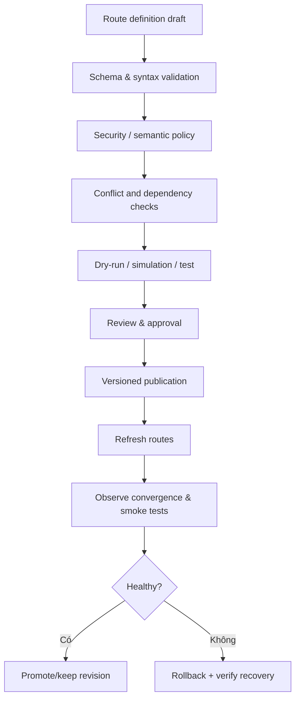
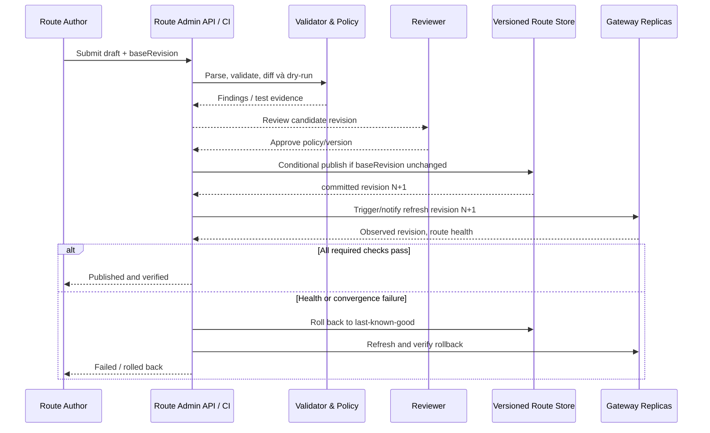
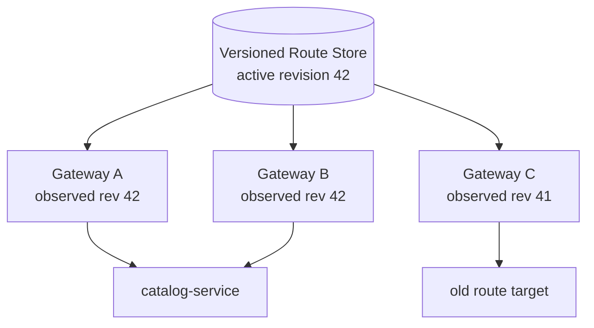
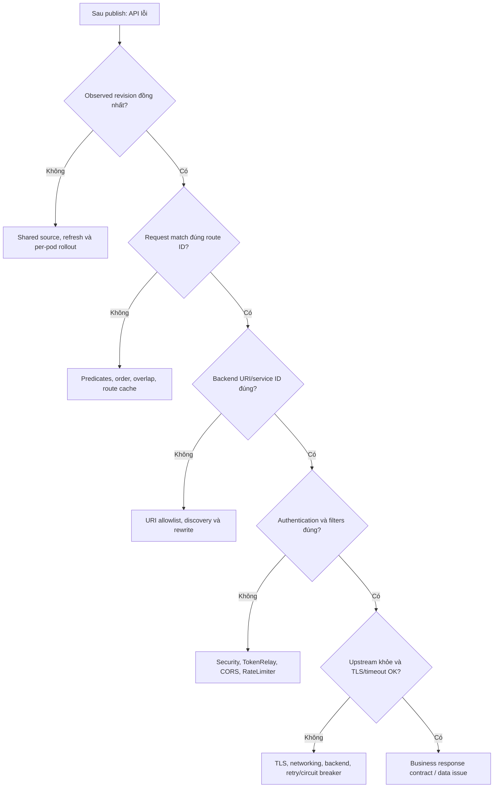

# Kiểm tra định nghĩa tuyến trước khi phát hành

Trong **Spring Cloud Gateway**, việc thay đổi tuyến (*route*) động giúp đội vận hành bổ sung backend, đổi route predicate, sửa filter chain hoặc chuyển traffic sang một phiên bản dịch vụ mà không nhất thiết phải chỉnh lại source code rồi triển khai lại toàn bộ Gateway. Nhưng route động cũng có thể trở thành **một dạng mã cấu hình có quyền cao**: một URI sai có thể chuyển traffic đến máy chủ không tin cậy; `StripPrefix` hoặc `RewritePath` sai có thể mở nhầm endpoint quản trị; một filter làm mất `Authorization` có thể thay đổi ranh giới xác thực; hoặc hai routes chồng lấn có thể khiến một API quan trọng bị định tuyến sang backend ngoài dự kiến.

Vì thế, **kiểm tra định nghĩa tuyến trước khi phát hành** không chỉ là xác nhận file YAML/JSON parse được. Đó là quá trình đánh giá **cấu trúc, chính sách, rủi ro, hành vi định tuyến dự kiến và khả năng rollout/rollback** trước khi đưa một `RouteDefinition` vào tập routes có hiệu lực.

Bài thuộc chương **Tuyến động** của module **SPRING_CLOUD_GATEWAY**. Nội dung liên kết với toàn bộ hành trình xây dựng API Gateway cho microservices: route predicate, GatewayFilter/GlobalFilter, rewrite path/header, service discovery/load balancing, OAuth2/JWT, rate limiting, circuit breaker, retry, TLS và observability. Ta sẽ thiết kế một **cổng kiểm tra phát hành** (*route publication gate*) đủ rõ để giảm lỗi cấu hình và rủi ro bảo mật, đặc biệt khi Gateway chạy nhiều bản sao.

> **Phạm vi phiên bản:** Các API Java và ví dụ route dùng **Spring Cloud Gateway Server WebFlux**. Ở một số dòng mới, property nằm dưới `spring.cloud.gateway.server.webflux.routes`; ở nhiều dòng cũ là `spring.cloud.gateway.routes`. Gateway Server Web MVC có stack servlet, route configuration và một số điểm mở rộng khác. Không sao chép nguyên API WebFlux sang MVC nếu chưa đối chiếu release train Spring Boot/Spring Cloud Gateway đang chạy.

## 1. Vì sao tuyến động cần một bước kiểm tra riêng?

Một tuyến khai báo đúng cú pháp nhưng sai ý nghĩa:

```yaml
id: account-service
uri: https://untrusted.example.invalid
predicates:
  - Path=/api/accounts/**
filters:
  - TokenRelay
```

Về hình thức, nó có route ID, URI, predicate và filter. Nhưng nếu gateway đang giữ access token của người dùng, **TokenRelay đến một endpoint không tin cậy** có thể trở thành rò rỉ credential. Route này không được phép phát hành chỉ vì `RouteDefinition` bind thành công.

Một ví dụ khác:

```yaml
id: admin-catchall
uri: lb://admin-service
predicates:
  - Path=/**
order: -100
```

Route có thể giành quyền match hầu hết request trước các route khác, phá contract API công khai. Ngay cả khi có Spring Security, nó có thể gây sai lệch hành vi, availability, thông tin lỗi hoặc rủi ro phân quyền nếu các security matchers/backend không được thiết kế tương ứng.

### Bốn nhóm lỗi cần bắt

| Nhóm | Ví dụ | Rủi ro |
| --- | --- | --- |
| **Sai cú pháp/cấu trúc** | Thiếu `id`, `uri` sai định dạng, predicate/filter factory không tồn tại, args thiếu. | Route không nạp hoặc hoạt động không như dự định. |
| **Sai ngữ nghĩa** | `Method=GET` trên route chỉ phục vụ POST; `StripPrefix=3` thay vì 2. | HTTP 404/405, request sai path, mất chức năng. |
| **Sai chính sách/bảo mật** | URI tự do, filter không cho phép, route quá rộng, bỏ xác thực, lộ token. | SSRF, credential leakage, bypass policy, truy cập nhầm tài nguyên. |
| **Sai khi rollout** | Route ID trùng, order xung đột, config replicas khác nhau, refresh lỗi. | Chuyển sai backend, downtime, inconsistent behavior. |

**Mục tiêu của kiểm tra trước phát hành:** chỉ đưa một thay đổi vào runtime khi đã có đủ bằng chứng rằng cấu hình hợp lệ, được cho phép và có phương án phục hồi.

## 2. RouteDefinition khác runtime Route ở điểm nào?

Trong Gateway WebFlux, cần phân biệt:

| Đối tượng | Chức năng | Vai trò trong kiểm tra |
| --- | --- | --- |
| **`RouteDefinition`** | Mô tả cấu hình route: ID, URI, predicates, filters, order, metadata. | **Đầu vào** để parse, kiểm tra policy, review và version hóa. |
| **`PredicateDefinition`** | Tên predicate factory và các tham số. | Kiểm tra Path/Method/Host/Header và custom predicate phù hợp. |
| **`FilterDefinition`** | Tên GatewayFilterFactory và args. | Kiểm tra tác động đến path/header/auth, retry, limiter. |
| **`RouteDefinitionLocator`** | Cung cấp tập `RouteDefinition` cho Gateway. | Nguồn cấu hình có thể là file, discovery, repository. |
| **`RouteDefinitionWriter`** | Hợp đồng ghi/xóa định nghĩa route. | Một điểm *publish* nếu được quản trị, **không phải validator**. |
| **`RouteDefinitionRepository`** | Vừa cung cấp vừa ghi/xóa route definitions. | Có thể làm backend lưu tuyến động, nhưng không tự bảo đảm transaction/approval. |
| **`RouteDefinitionRouteLocator`** | Chuyển `RouteDefinition` thành runtime `Route` với predicates/filters. | Bước build có thể phát hiện factory/args sai trong ngữ cảnh Spring app. |
| **`RouteLocator`/`CachingRouteLocator`** | Cung cấp runtime routes đã được tạo/cache cho matching. | Cần kiểm tra route cache được làm mới và các instance có cùng revision. |
| **`RefreshRoutesEvent`** | Tín hiệu yêu cầu refresh routes trong application context. | Không phải cam kết mọi Gateway replica đã nhận/áp dụng revision. |

Khi xử lý HTTP request, **`RoutePredicateHandlerMapping`** dùng những runtime routes mà `RouteLocator` cung cấp để xét predicates và chọn route phù hợp; sau đó **`FilteringWebHandler`** xử lý các GlobalFilter/GatewayFilter. Vì vậy, kiểm tra định nghĩa tuyến trước publish phải xem cả **route selection** và **filter/routing behavior** sau khi route đã được chọn.

### Luồng thay đổi cần kiểm soát



Không có một class mặc định duy nhất trong Gateway thực thi **toàn bộ** quy trình này. Gateway cung cấp primitives để khai báo, nạp, lưu và refresh routes; việc thiết kế review, policy engine, approvals và phân phối revisions là trách nhiệm của kiến trúc triển khai.

## 3. Phạm vi của “trước khi phát hành”

Một định nghĩa tuyến có thể trải qua nhiều trạng thái:

```text
DRAFT
  -> VALIDATED
  -> APPROVED
  -> PUBLISHED (source of truth)
  -> OBSERVED_ON_INSTANCES
  -> ACTIVE / ROLLED_BACK
```

Đây là **mô hình trạng thái do nhóm platform thiết kế**, không phải các trạng thái được `RouteDefinition` hay `RouteDefinitionRepository` mặc định cung cấp.

### Phân biệt các mốc

- **Validated:** đã kiểm tra tính hợp lệ và policy trên một revision cụ thể.
- **Approved:** người/hệ thống có thẩm quyền chấp nhận thay đổi đó.
- **Published:** source of truth đã được cập nhật; chưa chắc mọi gateway instance đã tải.
- **Observed/active:** các instances cần thiết đã báo nhận revision, runtime route table đúng và smoke checks đạt.
- **Rolled back:** source được trả về revision an toàn trước đó và các instances được xác minh đã hội tụ lại.

Không báo “triển khai thành công” chỉ vì API ghi route trả `200`/`204` hoặc vì một event refresh đã được phát. Phải xác minh **runtime state** và **request behavior**.

## 4. Cấu trúc RouteDefinition cần kiểm tra

Ví dụ tuyến hợp lệ về ý tưởng:

```yaml
id: catalog-read-v2
uri: lb://catalog-service
order: -10
predicates:
  - Path=/api/catalog/**
  - Method=GET
filters:
  - StripPrefix=2
metadata:
  owner: catalog-team
  changeTicket: CHG-1042
```

Đây là **đoạn route definition riêng lẻ**, không phải toàn bộ `application.yml`. Nếu đặt trong file cấu hình Gateway WebFlux mới, nó nằm dưới `spring.cloud.gateway.server.webflux.routes`. Với nguồn dynamic API/repository, các trường có thể được biểu diễn bằng đối tượng Java hoặc JSON tương ứng.

### Bộ trường tối thiểu và mở rộng

| Trường | Kiểm tra bắt buộc/đề xuất |
| --- | --- |
| `id` | Không rỗng, duy nhất trong toàn bộ route set, format ổn định, không đổi vô ý. |
| `uri` | Scheme được cho phép; đích thuộc allowlist; không chứa userinfo/credentials hoặc endpoint tùy ý. |
| `predicates` | Factory tồn tại, có điều kiện matching đủ hẹp, args đúng và không tạo đường đi bất ngờ. |
| `filters` | Factory được cho phép, thứ tự/tác dụng hợp lệ, không làm rò token hoặc bỏ kiểm soát. |
| `order` | Phù hợp ưu tiên; không giành traffic khỏi routes hiện hành ngoài kế hoạch. |
| `metadata` | Chỉ lưu giá trị được quản trị: owner, release, timeout giới hạn…; không lưu secrets. |

**Không đủ để chỉ kiểm tra JSON schema.** Một `id` là string, `uri` parse được và `filters` là mảng hợp lệ vẫn có thể cấu thành một route nguy hiểm.

## 5. Lớp 1 — Kiểm tra cấu trúc và factory binding

Các kiểm tra có thể thực hiện trước khi ghi route vào repository:

1. Parse YAML/JSON hoặc request body với giới hạn kích thước và độ sâu.
2. Từ chối giá trị thiếu, null, sai kiểu hoặc trường không nằm trong schema cho phép.
3. Chuẩn hóa route ID có quy tắc rõ ràng và kiểm tra không trùng.
4. Parse URI và kiểm tra scheme/host/port/path/encoding.
5. Kiểm tra tên `PredicateDefinition.name` và `FilterDefinition.name` có trong **allowlist** của nền tảng.
6. Kiểm tra số lượng, tên và kiểu `args`; không đưa raw key tùy ý vào factory.
7. Kiểm tra `order` trong khoảng đã phê duyệt.
8. Giới hạn số routes, filters, predicates và kích thước metadata.

### Factory có thật không?

Một route dùng:

```yaml
predicates:
  - name: ClientVersion
    args:
      headerName: X-Api-Version
      requiredValue: v2
```

chỉ hợp lệ nếu runtime Gateway **đã đăng ký** custom `ClientVersionRoutePredicateFactory` tương ứng và có đúng cấu hình mà factory chấp nhận. Validator bên ngoài có thể biết allowlist tên factory; nhưng cách chắc hơn để phát hiện lỗi framework là **xây Route runtime trong một application context thử nghiệm có cùng các factory/dependencies như production**.

Tương tự, route có:

```yaml
filters:
  - name: RequestRateLimiter
    args:
      key-resolver: "#{@customerKeyResolver}"
      redis-rate-limiter.replenishRate: 5
      redis-rate-limiter.burstCapacity: 10
```

cần thực sự có `customerKeyResolver` bean và RedisRateLimiter đúng phiên bản. Một bản JSON schema chỉ biết đây là chuỗi `"#{@customerKeyResolver}"`, nhưng không thể tự xác minh bean tồn tại, classpath đúng hay Redis hoạt động.

### “Đã bind” không bằng “hoạt động đúng”

`StripPrefix=3` có thể được bind hợp lệ, nhưng với `/api/catalog/products/42` sẽ biến path thành `/42` thay vì `/products/42`. Đó là lỗi **ngữ nghĩa** chỉ thấy khi xem URL/backend contract hoặc chạy test.

## 6. Lớp 2 — URI allowlist và chống SSRF

**Dynamic upstream URI là ranh giới bảo mật đặc biệt quan trọng.** Nếu một người dùng chỉ có quyền chỉnh route có thể chuyển Gateway request đến host tùy ý, họ có thể lợi dụng quyền mạng của Gateway để chạm vào API nội bộ, metadata endpoint của cloud hoặc host không tin cậy.

### URI rủi ro

```yaml
uri: http://127.0.0.1:8080
```

```yaml
uri: http://169.254.169.254
```

```yaml
uri: https://unexpected-partner.example.invalid
```

Ví dụ này chỉ dùng để **nhận diện cấu hình cần từ chối**, không phải đích để thực hành gọi thật.

### Kiểm tra URI theo policy

| Yếu tố | Quy tắc an toàn |
| --- | --- |
| **Scheme** | Chỉ cho các scheme có chủ đích như `lb` và `https`; chỉ `http` trong POC được giới hạn mạng. |
| **Host/service ID** | Match allowlist **cụ thể** theo sản phẩm/route owner; không phải wildcard arbitrary host. |
| **Port** | Chỉ những port đã phê duyệt; tránh admin/control-plane ports. |
| **User info** | Không nhận URI chứa username/password hoặc token. |
| **Query/fragment** | Không chấp nhận giá trị không cần thiết trong upstream base URI. |
| **Host dạng IP** | Tránh IP literal nếu không có yêu cầu được kiểm soát; ngăn loopback/link-local/metadata. |
| **DNS** | Chống thay đổi DNS sang IP nội bộ ngoài allowlist (*DNS rebinding*) ở tầng egress/network, không chỉ validate string. |
| **TLS** | Xác minh certificate, hostname/SNI, CA trust; không tắt xác minh chỉ để route chạy được. |

Đối với `lb://catalog-service`, **service ID** cũng phải được phép. Chỉ cho `lb://any-internal-service` có thể mở đường đến dịch vụ quản trị hoặc service không thuộc public API.

### Allowlist chưa đủ nếu đường mạng không được khóa

Một route validator chạy trước khi publish chỉ kiểm tra **cấu hình đã khai báo**. Để chống SSRF/credential exfiltration đáng tin cậy, cần thêm:

- Egress network policy/firewall.
- DNS và service discovery trust.
- Không cấp network reachability từ Gateway đến các endpoint quản trị không cần thiết.
- TLS trust và certificate validation.
- Kiểm tra lại mỗi lần cập nhật route URI/đích.
- Cơ chế xác thực/phân quyền backend độc lập.

Nếu có `TokenRelay` hoặc `AddRequestHeader=Authorization,...`, URI destination càng cần được thẩm định: token có thể đi theo request outbound.

## 7. Lớp 3 — Kiểm tra predicate và phạm vi API được công bố

**Route predicate định nghĩa vùng request mà route có thể nhận.** Một thay đổi ở predicate có thể ảnh hưởng rất nhiều API dù URI vẫn đúng.

### Các nhóm predicate quan trọng

| Predicate | Điều cần kiểm chứng |
| --- | --- |
| **`Path`** | Public prefix đã được cấp, không nuốt `/**` hoặc `/actuator/**` ngoài chính sách. |
| **`Method`** | Chỉ method nghiệp vụ cần thiết; POST/DELETE không vô tình mở từ route GET. |
| **`Host`** | Public hostname đúng; không coi Host tùy ý là bằng chứng danh tính tenant. |
| **`Header`/`Query`** | Dùng cho routing semantics, không dùng như Authentication; regex/pattern có giới hạn. |
| **`RemoteAddr`** | Nếu dùng forwarded IP, cần kiểm soát proxy chain và spoofing. |
| **`Weight`** | Xem group/weight và tổng phân phối traffic theo cấu hình. |
| **Custom factory** | Class/bean hiện diện, Config bind và logic không blocking; có tests. |

### Path quá rộng và route ordering

Giả sử đang có:

```yaml
- id: catalog-public
  uri: lb://catalog-service
  order: 0
  predicates:
    - Path=/api/catalog/**
```

Sau đó có người đề xuất:

```yaml
- id: api-catchall
  uri: lb://legacy-service
  order: -100
  predicates:
    - Path=/api/**
```

Route thứ hai có thể **nhận request catalog trước** do phạm vi rộng và `order` ưu tiên cao. Một schema validator sẽ không thấy sai kiểu dữ liệu; kiểm tra an toàn phải so **tập route mới với các routes đang hoạt động**, phát hiện overlap và thứ tự.

**Chú ý:** không thể đánh giá mọi biểu thức Path/Host/Header/Method/regex bằng so sánh prefix đơn giản. Nên dùng công cụ/libraries phù hợp, policy về route scopes và **request matrix** mô phỏng thực tế. Với các route chồng lấn có chủ đích, phải ghi rationale và thể hiện route `order` tường minh.

### Những trường hợp phải review thủ công

- Route mới có `Path=/**` hoặc `/api/**`.
- Route thay đổi `Host` sang hostname khác tenant hoặc domain.
- Route thay `Method=GET` thành GET/POST/DELETE.
- Route có regex phức tạp, nhiều predicate âm/đối nghịch, hoặc rewrite khó đọc.
- Route có `Weight` làm chuyển lượng traffic đáng kể.
- Route đặt `order` có độ ưu tiên cao hơn các routes đã tồn tại.

## 8. Lớp 4 — Kiểm tra GatewayFilter và side effects

**GatewayFilter** không chỉ quyết định một tuyến có được chọn: nó có thể sửa đường dẫn, header, body, retry, circuit breaker, response hoặc gửi token đến backend. Vì thế, route publication gate cần biết **những filter nào được phép** cho nhóm route và **args nào cần review**.

### Phân nhóm theo mức rủi ro

| Filter/nhóm | Rủi ro cần kiểm tra | Gợi ý chính sách |
| --- | --- | --- |
| **`StripPrefix`, `PrefixPath`, `SetPath`, `RewritePath`** | Dẫn request vào endpoint khác dự định, regex quá phức tạp, lệch path security. | Cho phép có giới hạn và kiểm thử ánh xạ public path → backend path. |
| **`AddRequestHeader`/`SetRequestHeader`/`RemoveRequestHeader`** | Thay `Authorization`, `Host`, `Forwarded`, `X-Forwarded-*` hoặc tenant identity. | Allowlist tên headers; cấm sửa header bảo mật ngoài quy trình đặc biệt. |
| **`TokenRelay`** | Chuyển user token tới backend không tin cậy hoặc sai audience. | Chỉ trên route/backend đã phê duyệt, đúng OAuth2 registration/security contract. |
| **`RequestRateLimiter`** | Bị loại khỏi route, sai `KeyResolver`, quota quá cao/thấp. | Bảo đảm policy quota bắt buộc cho public route cần bảo vệ. |
| **`CircuitBreaker`** | Fallback gửi request đến endpoint không mong đợi, response shape sai. | Review fallbackUri, timeout, error behavior. |
| **`Retry`** | Duplicate operations khi retry POST/PUT/PATCH/DELETE; request storm. | Chỉ methods/status được duyệt, max retries và idempotency. |
| **`LocalResponseCache`** | Cache dữ liệu người dùng, stale data, memory pressure. | Chỉ trên route public đã thẩm định, TTL/size hạn chế. |
| **`RedirectTo`/`RewriteResponseHeader`** | Open redirect, leak internal host/path, thay redirect URI. | Kiểm tra target domain và response header semantics. |
| **`ModifyRequestBody`/`ModifyResponseBody`** | Thay đổi schema, lộ dữ liệu, áp lực buffer memory. | Test theo contract và giới hạn body size; kiểm tra codec. |
| **Custom GatewayFilterFactory** | Logic tùy ý, có thể blocking hoặc bypass policy. | Chỉ deploy factory đã kiểm thử, allowlist và owner rõ. |

Đừng để một hệ thống quản lý route động tự động cho phép **mọi filter factory có mặt trên classpath**. Bean factory có thể được đăng ký vì lý do kỹ thuật, nhưng **quyền sử dụng trong public route** là quyết định riêng của platform/security.

### Kiểm tra thứ tự và tương tác

Một route có:

```yaml
filters:
  - StripPrefix=2
  - TokenRelay=shop-login
  - name: RequestRateLimiter
    args:
      key-resolver: "#{@customerKeyResolver}"
      redis-rate-limiter.replenishRate: 5
      redis-rate-limiter.burstCapacity: 10
```

Validator không nên chỉ thấy “ba filter đã nằm trong allowlist”. Cần hỏi:

- Route đích có được nhận user access token từ `shop-login` không?
- KeyResolver có lấy principal **đã xác thực**, không tin raw `X-Customer-ID`?
- `StripPrefix=2` có đúng backend path contract?
- Nếu `TokenRelay` không có authorized client, request thất bại ra sao?
- Thứ tự hiệu lực của filter có được kiểm chứng qua runtime `Ordered`/pre-post semantics không?
- Response `401/403/429/503` có CORS/metrics/header phù hợp không?

Thứ tự entries trong YAML **không tự mô tả đầy đủ** thứ tự xử lý của toàn bộ `GlobalFilter` và `GatewayFilter`; cần integration test hoặc kiểm tra runtime filter order của đúng phiên bản Gateway.

### Expression injection và bean references

Một số filter args hỗ trợ Spring Expression Language hoặc bean references, ví dụ:

```yaml
key-resolver: "#{@customerKeyResolver}"
```

Đây là **tên bean nội bộ do platform quản lý**, không nên biến thành ô nhập biểu thức tùy ý cho người sử dụng hệ thống quản lý route. Với dynamic route input **không hoàn toàn tin cậy**, tốt hơn:

1. Chỉ cho tên bean được allowlist, hoặc **biến field policy thành enum/ID** rồi server dựng args.
2. Không chấp nhận chuỗi SpEL tùy ý do client/operator ít quyền gửi.
3. Giới hạn filter/args theo loại route.
4. Kiểm tra source/version và chỉ đưa route vào môi trường với beans đã được xác nhận.

## 9. Lớp 5 — Chính sách bảo mật trước khi route được phép public

Một route không thể được đánh giá an toàn nếu chỉ xem `RouteDefinition` tách khỏi Spring Security và backend contract.

### Ranh giới bắt buộc

| Câu hỏi | Kiểm tra trước phát hành |
| --- | --- |
| Ai được gọi endpoint? | Spring Security path/method matcher hoặc API auth policy có bao phủ public route mới không? |
| Bearer JWT được kiểm tra ở đâu? | Issuer, audience, expiry, scope và tenant không bị bỏ qua vì đổi route. |
| Backend có authorization riêng không? | Resource server vẫn kiểm tra token và quyền theo tài nguyên. |
| Có chuyển token outbound không? | `TokenRelay` chỉ hướng tới service thuộc trust boundary phù hợp. |
| Có cookie/session không? | CORS, CSRF, `SameSite`/`Secure`, session lifecycle vẫn đúng. |
| Có endpoint quản trị không? | `/actuator/**`, `/internal/**`, debug routes và control-plane endpoints không bị mở. |
| Có request body/PII không? | Tránh log/caching token, cookie, dữ liệu riêng tư hoặc mã hóa yếu. |
| Dùng backend qua `lb://` hay HTTPS? | Host/service ID, discovery trust, TLS/mTLS và egress policy hợp lệ. |

**Không xem `Header=X-Role,admin` hoặc `X-Tenant-ID` do client tự gửi là authorization.** Route predicate dùng header có thể phù hợp để phân loại version, nhưng không chứng minh user có quyền xem thông tin của tenant tương ứng.

### Nguy cơ từ route “hợp lệ” nhưng quá rộng

Nếu Security chỉ có:

```text
/api/orders/**  -> authenticated
/api/catalog/** -> permitAll
```

thì một route mới `Path=/api/admin/**` cần được review security policy. Không nên tin rằng “vì đi qua Gateway” nên mọi request đã được kiểm tra đúng. Một security chain có rule `anyExchange().permitAll()` hoặc một backend không tự authorize có thể gây lộ quyền khi mở public route.

Route publication gate nên yêu cầu **owner backend, classification dữ liệu, authentication policy và scope** tương ứng trước khi phê duyệt.

### Cache, CORS và response lỗi

- `LocalResponseCache` chỉ phù hợp cho các route đủ điều kiện và đã chứng minh không rò response theo user/tenant.
- `CORS` cần áp cho preflight/response thật theo chính sách origin; route `Method=GET` không tự match OPTIONS.
- `RequestRateLimiter` trả `429` trước backend; CORS headers cần tồn tại nếu frontend được đọc response.
- Retry/circuit breaker/fallback response không được làm mất security headers hoặc biến lỗi xác thực thành response thành công.

**Validation không thay runtime security.** Kiểm tra trước publish ngăn cấu hình nguy hiểm được đưa vào hệ thống; xác thực/phân quyền vẫn phải được thực thi trên mỗi request thực.

## 10. Lớp 6 — Xác minh metadata, timeout và tính khả thi

`RouteDefinition.metadata` có thể chứa thông tin mà các thành phần Gateway hoặc ứng dụng khác sử dụng. Một số dòng Gateway WebFlux hỗ trợ metadata để đặt **connect timeout**, **response timeout** và thông tin khác theo route. Nhưng không phải **mọi metadata tùy ý** đều được runtime tự hiểu.

### Trường hợp cần phân biệt

```yaml
metadata:
  owner: catalog-team
  changeTicket: CHG-1042
  rolloutRevision: "42"
```

Những trường này chỉ có ý nghĩa vận hành nếu **hệ thống của bạn có consumer** để audit/approve/observe chúng.

```yaml
metadata:
  connect-timeout: 1500
  response-timeout: 3000
```

Đây là **ví dụ ý tưởng**, cần đối chiếu hằng số metadata/đơn vị theo phiên bản: `connect-timeout` và `response-timeout` thường được biểu diễn bằng **milliseconds** khi cấu hình metadata route WebFlux, trong khi **global HTTP client response-timeout** có thể là `Duration`. Một lỗi đổi đơn vị có thể khiến timeout quá ngắn hoặc quá dài.

### Các chính sách cần áp dụng

| Trường/khía cạnh | Quy tắc |
| --- | --- |
| Timeout | Từ chối giá trị âm/zero ngoài ý nghĩa được framework định nghĩa, đặt trần theo SLO. |
| Retry | Giới hạn attempts/status/method, không retry writes thiếu idempotency. |
| Circuit breaker | Threshold/fallbackUri thuộc policy, không tạo forwarding tới đường admin. |
| Rate limiting | Không xóa limiter khỏi route cần quota; không tăng trần ngoài quyền cho phép. |
| CORS | Origins/methods/headers thuộc allowlist, tránh wildcard credentials. |
| Local response cache | Chỉ public GET phù hợp, TTL/size tối đa và header đúng. |
| Owner/change ticket | Bắt buộc với quy trình review, không xem metadata tự thực thi bảo mật. |
| Secrets | **Không lưu** client secret, bearer token, API key hoặc password vào metadata. |

### Tham số có nghĩa theo version

Nếu bản Gateway không hiểu một key metadata, nó có thể được giữ như dữ liệu tùy ý hoặc bị bỏ qua bởi consumer tương ứng. **Tồn tại trong route object không chứng minh tác dụng.** Bắt buộc dùng dependency/configuration metadata của đúng version và integration test xác nhận timeout/quota/circuit breaker hoạt động.

## 11. Lớp 7 — Xung đột với routes hiện có

Giả sử có tập routes đang chạy:

| Route ID | Predicate | Order | Backend |
| --- | --- | --- | --- |
| `catalog-public` | `Path=/api/catalog/**` + `Method=GET` | `0` | `lb://catalog-service` |
| `orders-api` | `Path=/api/orders/**` | `0` | `lb://order-service` |
| `fallback-public` | `Path=/api/**` | `100` | `lb://legacy-public-service` |

Đề xuất thêm:

```yaml
id: catalog-v2
uri: lb://catalog-v2-service
order: -10
predicates:
  - Path=/api/catalog/**
  - Header=X-Api-Version,v2
filters:
  - StripPrefix=2
```

Đây có thể là **overlap hợp lệ có chủ đích**: khi request mang `X-Api-Version: v2`, route mới được ưu tiên; những request khác đi qua catalog cũ. Nhưng nếu route mới thiếu `Header`, nó có thể chiếm toàn bộ traffic catalog.

### Không chỉ so route IDs

Kiểm tra trước publish cần:

1. Lấy **route set hiện hành đã được version hóa**.
2. Áp candidate changes vào một **bản copy** của route set; không ghi live repository.
3. So sánh `Path`, `Method`, `Host`, `Header`, `Query`, `Weight`, `order`.
4. Xây **ma trận request mẫu** đại diện API contract.
5. So **route được chọn trước và sau**, ghi những request bị chuyển backend.
6. Yêu cầu review khi những thay đổi route matching vượt phạm vi thay đổi dự kiến.

### Ma trận mô phỏng

| Request mẫu | Route cũ | Route dự kiến | Có được đổi? |
| --- | --- | --- | --- |
| GET `/api/catalog/products/42` không header | `catalog-public` | `catalog-public` | Không. |
| GET `/api/catalog/products/42`, `X-Api-Version: v2` | `catalog-public` | `catalog-v2` | Có, theo rollout plan. |
| POST `/api/orders` | `orders-api` | `orders-api` | Không. |
| GET `/api/internal/admin` | Không thuộc public contract | Không được route mới làm public | Không. |
| GET `/actuator/gateway/routes` | Management plane theo policy | Không đổi | Không. |

Một ma trận mẫu **không chứng minh toàn bộ không gian request**, nhất là khi có regex, custom predicates hoặc dynamic tenant routing. Nhưng nó rất hữu ích để bắt regressions thường gặp và làm tiêu chí phê duyệt có thể kiểm tra lại.

### Route ID ổn định và tác động ngoài định tuyến

Đổi `routeId` có thể gây:

- Bucket quota `RedisRateLimiter` được phân thành phạm vi khác.
- Metric dimensions/alerts thay đổi.
- Client tracking/owner metadata mất liên kết.
- Cache/route refresh behavior khác.
- Khó xác định rollback đúng route cũ.

**Đổi route ID không chỉ là đổi nhãn.** Validator nên coi thay `id` như hành động **xóa route cũ + thêm route mới** trừ khi control plane có cơ chế migrate identity rõ ràng.

## 12. Ví dụ Java: một policy validator tối thiểu cho route catalog

Để minh họa cách đặt một “hàng rào” trước `RouteDefinitionWriter`, ta xây class `CatalogRoutePolicyValidator`. Nó kiểm tra một **hợp đồng hẹp, cố ý**:

- Route ID theo format cho phép.
- URI chỉ là `lb://` đến catalog services đã biết hoặc HTTPS đến hostname đã được phê duyệt.
- Có một `Path` predicate chỉ trong không gian `/api/catalog/**`.
- `Method` nếu có chỉ được phép `GET`.
- Filter trong mẫu chỉ được `StripPrefix=2`.
- `order` có giới hạn.
- Metadata không chứa trường lạ hoặc secret.

**Quan trọng:** Đây là **một tầng validation minh họa**, không phải thư viện production chống mọi dạng SSRF/route hijacking. Để kiểm tra route đầy đủ, cần thêm chính sách nhiều routes, xác thực owner, allowlist egress, các factory phức tạp, quy tắc URI/encoding, runtime dry-run và thử nghiệm bảo mật. Hợp đồng hẹp giúp ví dụ đọc được và minh họa tư duy *deny by default*.

### 12.1. Mã validator

```java
package com.example.gateway.routes;

import java.net.URI;
import java.util.ArrayList;
import java.util.List;
import java.util.Locale;
import java.util.Set;
import java.util.regex.Pattern;

import org.springframework.cloud.gateway.filter.FilterDefinition;
import org.springframework.cloud.gateway.handler.predicate.PredicateDefinition;
import org.springframework.cloud.gateway.route.RouteDefinition;

public final class CatalogRoutePolicyValidator {

    private static final Pattern ID_PATTERN =
        Pattern.compile("[a-z][a-z0-9-]{2,63}");

    // Đây là policy ví dụ: chỉ những path catalog đơn giản.
    private static final Pattern PATH_PATTERN =
        Pattern.compile("/api/catalog/[A-Za-z0-9_/*-]*");

    private static final Set<String> SERVICE_IDS =
        Set.of("catalog-service", "catalog-v2-service");

    private static final Set<String> HTTPS_HOSTS =
        Set.of("catalog.internal.example");

    public List<String> validate(RouteDefinition route) {
        if (route == null) {
            return List.of("route definition is missing");
        }

        List<String> errors = new ArrayList<>();
        String id = route.getId();
        if (id == null || !ID_PATTERN.matcher(id).matches()) {
            errors.add("invalid route id");
        }

        if (route.getOrder() < -20 || route.getOrder() > 100) {
            errors.add("order exceeds approved range");
        }

        validateUri(route.getUri(), errors);
        validatePredicates(route.getPredicates(), errors);
        validateFilters(route.getFilters(), errors);

        if (route.getMetadata() != null &&
                route.getMetadata().keySet().stream().anyMatch(
                    k -> !Set.of("owner", "changeTicket").contains(k))) {
            errors.add("unexpected route metadata");
        }

        return List.copyOf(errors);
    }

    private void validateUri(URI uri, List<String> errors) {
        if (uri == null) {
            errors.add("upstream uri is missing");
            return;
        }

        String scheme = uri.getScheme() == null
            ? ""
            : uri.getScheme().toLowerCase(Locale.ROOT);

        String host = uri.getHost() == null
            ? ""
            : uri.getHost().toLowerCase(Locale.ROOT);

        if (uri.getRawUserInfo() != null ||
                uri.getRawQuery() != null ||
                uri.getRawFragment() != null) {
            errors.add("upstream uri contains forbidden components");
        }

        String path = uri.getRawPath() == null
            ? ""
            : uri.getRawPath();

        if ("lb".equals(scheme)) {
            if (!SERVICE_IDS.contains(host) ||
                    uri.getPort() != -1 ||
                    !path.isEmpty()) {
                errors.add("unapproved lb service or uri structure");
            }
        } else if ("https".equals(scheme)) {
            if (!HTTPS_HOSTS.contains(host) ||
                    (uri.getPort() != -1 && uri.getPort() != 443) ||
                    (!path.isEmpty() && !"/".equals(path))) {
                errors.add("unapproved https destination");
            }
        } else {
            errors.add("upstream scheme must be lb or https");
        }
    }

    private void validatePredicates(
            List<PredicateDefinition> predicates,
            List<String> errors) {

        if (predicates == null || predicates.isEmpty()) {
            errors.add("at least one predicate is required");
            return;
        }

        int pathCount = 0;
        for (PredicateDefinition p : predicates) {
            if ("Path".equals(p.getName())) {
                pathCount++;
                if (p.getArgs() == null || p.getArgs().isEmpty()
                        || p.getArgs().values().stream().anyMatch(
                            v -> v == null ||
                                !PATH_PATTERN.matcher(v).matches())) {
                    errors.add("path must stay under /api/catalog/");
                }
            } else if ("Method".equals(p.getName())) {
                if (p.getArgs() == null || p.getArgs().size() != 1
                        || !p.getArgs().containsValue("GET")) {
                    errors.add("this route type permits GET only");
                }
            } else {
                errors.add("unapproved predicate: " + p.getName());
            }
        }

        if (pathCount != 1) {
            errors.add("exactly one Path predicate is required");
        }
    }

    private void validateFilters(
            List<FilterDefinition> filters,
            List<String> errors) {

        if (filters == null || filters.size() != 1) {
            errors.add("exactly one filter is required");
            return;
        }

        FilterDefinition filter = filters.get(0);
        if (!"StripPrefix".equals(filter.getName()) ||
                filter.getArgs() == null ||
                filter.getArgs().size() != 1 ||
                !filter.getArgs().containsValue("2")) {
            errors.add("only StripPrefix=2 is permitted");
        }
    }
}
```

### 12.2. Cách đọc validator

| Khối | Tác dụng | Chưa giải quyết |
| --- | --- | --- |
| `ID_PATTERN` | Không cho ID rỗng/ký tự ngoài quy định. | **ID đã tồn tại trong toàn bộ route set hay chưa**. |
| `SERVICE_IDS`/`HTTPS_HOSTS` | Allowlist đích cố định. | DNS rebinding, IP egress, owner thực sự được phép gọi service. |
| `PATH_PATTERN` | Bắt buộc route chỉ khai báo path catalog dạng đơn giản. | Overlap với route khác, path decoding/normalization của proxy, regex tùy biến. |
| `Method=GET` | Ngăn mở các method khác trong policy catalog-read. | Preflight CORS OPTIONS và quyền user. |
| `StripPrefix=2` | Giữ đúng hai segment public prefix cho mock backend. | Backend API contract có thật hoặc không. |
| `order` trong khoảng | Ngăn giá trị ưu tiên quá cực đoan theo policy. | Xung đột với route có order hợp lệ tương tự. |
| Metadata allowlist | Tránh chấp nhận trường tùy ý/secret. | Quyền owner, tính đúng ticket, values và lifecycle approval. |

Trong production, một policy engine có thể chứa các **loại route** khác nhau: catalog public-read, orders authenticated, payments write, internal admin. Mỗi loại có filter allowlist, URI allowlist, timeout/quota/body requirements riêng. Không biến mẫu catalog-read hạn hẹp này thành một validator cho **mọi** route của hệ thống.

### 12.3. Những giới hạn bảo mật của code mẫu

Đừng coi regex kiểm tra `/api/catalog/**` là **bộ phân tích Path patterns toàn diện**. Với path phức tạp, wildcard, URL encoding, host patterns và custom predicates, phải dùng parser tương ứng, validate semantics trong Gateway runtime và kiểm tra proxy normalization.

Tương tự, kiểm tra `URI.getHost()` chưa đủ để bảo vệ egress trước DNS rebinding hoặc một service ID trong registry trỏ đến instance không tin cậy. Cần network policy và kiểm soát registry/service discovery.

Mẫu cũng chỉ kiểm tra **một route**; bước trước publish phải bổ sung **so sánh với tất cả routes hiện hành**, uniqueness, approval/owner, dependencies và kiểm thử end-to-end.

## 13. Kiểm thử validator bằng JUnit 5

Các đối tượng `RouteDefinition`, `PredicateDefinition`, `FilterDefinition` có thể được xây trong unit test mà không cần mở cổng HTTP.

```java
package com.example.gateway.routes;

import static org.junit.jupiter.api.Assertions.assertFalse;
import static org.junit.jupiter.api.Assertions.assertTrue;

import java.net.URI;
import java.util.List;

import org.junit.jupiter.api.Test;
import org.springframework.cloud.gateway.filter.FilterDefinition;
import org.springframework.cloud.gateway.handler.predicate.PredicateDefinition;
import org.springframework.cloud.gateway.route.RouteDefinition;

class CatalogRoutePolicyValidatorTest {

    private final CatalogRoutePolicyValidator validator =
        new CatalogRoutePolicyValidator();

    private RouteDefinition validRoute() {
        RouteDefinition route = new RouteDefinition();
        route.setId("catalog-read-v2");
        route.setUri(URI.create("lb://catalog-service"));
        route.setOrder(-10);
        route.setPredicates(List.of(
            new PredicateDefinition("Path=/api/catalog/**"),
            new PredicateDefinition("Method=GET")));
        route.setFilters(List.of(
            new FilterDefinition("StripPrefix=2")));
        return route;
    }

    @Test
    void acceptsApprovedCatalogRoute() {
        assertTrue(validator.validate(validRoute()).isEmpty());
    }

    @Test
    void rejectsUntrustedUri() {
        RouteDefinition route = validRoute();
        route.setUri(URI.create("https://untrusted.example.invalid"));

        assertFalse(validator.validate(route).isEmpty());
    }

    @Test
    void rejectsWidePublicPath() {
        RouteDefinition route = validRoute();
        route.setPredicates(List.of(
            new PredicateDefinition("Path=/**")));

        assertFalse(validator.validate(route).isEmpty());
    }

    @Test
    void rejectsUnauthorizedFilter() {
        RouteDefinition route = validRoute();
        route.setFilters(List.of(
            new FilterDefinition("TokenRelay")));

        assertFalse(validator.validate(route).isEmpty());
    }

    @Test
    void rejectsWriteMethod() {
        RouteDefinition route = validRoute();
        route.setPredicates(List.of(
            new PredicateDefinition("Path=/api/catalog/**"),
            new PredicateDefinition("Method=DELETE")));

        assertFalse(validator.validate(route).isEmpty());
    }
}
```

### Những điều unit test chưa chứng minh

- Gateway startup context đã đăng ký tất cả `RoutePredicateFactory`/`GatewayFilterFactory` được tham chiếu.
- Dynamic repository nhận/ghi routes đúng và không có ID trùng.
- `lb://catalog-service` tìm thấy instance và TLS/HTTP client có thể kết nối.
- `StripPrefix=2` đúng API contract backend thực.
- Route catalog không bị catch-all route khác giành ưu tiên.
- Security, CORS, rate limiter và fallback hoạt động với các HTTP responses thật.
- Mọi Gateway replica cùng nạp một revision và rollback đúng khi lỗi.

**Unit test bảo vệ policy local; integration/dry-run bảo vệ khả năng hoạt động thực.** Nên dùng cả hai.

## 14. Dry-run: chuyển định nghĩa thành runtime Route nhưng chưa publish

Một request JSON/YAML có thể vượt qua schema + validator của nhóm platform, nhưng thất bại khi Gateway thật cố dùng custom predicate/filter factory. Vì thế, trước publish cần một **môi trường thử hoặc cơ chế dry-run** dùng các dependency/factories gần giống production.

### Ba mức dry-run

| Mức | Thực hiện | Phát hiện | Không phát hiện hết |
| --- | --- | --- | --- |
| **Static check** | Parse và policy validate route definitions. | ID, URI, args, allowlists, trần timeout/quota. | Factory không tồn tại ở runtime, runtime filter order. |
| **Runtime build** | Nạp candidate route set vào Gateway test context. | Bean/factory binding, route conversion, nhiều lỗi cấu hình. | Backend thật chưa chắc hoạt động, config replicas chưa đồng bộ. |
| **Request simulation / integration** | Gửi request ma trận vào Gateway test với mock/isolated backends. | Route được chọn, rewrite, headers, security, fallback, status. | Tải production, DNS/TLS thật, thay đổi traffic ngoài sample. |

Không nên “dry-run” bằng cách **ghi candidate vào repository đang phục vụ production**, refresh live route cache rồi xóa nếu sai. Đó không còn là dry-run: một phần traffic có thể đã đi qua route chưa duyệt.

### Cách tổ chức môi trường test

1. Tạo **snapshot** của active route set và áp candidate changes vào bản copy.
2. Khởi tạo Gateway WebFlux test app với cùng phiên bản/extension factories cần thiết.
3. Dùng URI mock hoặc môi trường staging được kiểm soát, không cho truy cập secrets/production internal services ngoài yêu cầu.
4. Chạy route conversion và xác nhận không phát sinh lỗi binding/instantiation.
5. Gửi các request đại diện: request match, không match, phiên bản cũ, path nhạy cảm, OPTIONS, GET/POST, token hợp lệ/không hợp lệ.
6. Ghi selected route ID, rewritten path, backend target, filter effects và response status.
7. So sánh với expected behavior trước khi yêu cầu phê duyệt.

### Không nên “gọi thử” mọi backend URI trong validation

Một validator an toàn **không tự động kết nối đến mọi URI do người gửi khai báo** để kiểm tra health: như vậy chính validator có thể trở thành SSRF proxy. Chỉ thực hiện connectivity checks sau khi URI đã qua allowlist, từ môi trường kiểm soát và với quyền mạng phù hợp.

Ngay cả khi backend trả 200 ở staging, điều đó không bảo đảm service discovery hoặc TLS của production đã chính xác. Kiểm tra kỹ hai loại bằng chứng: **static policy** và **runtime connectivity**.

## 15. Phát hành có revision, kiểm soát quyền và phê duyệt

Một tổ chức trưởng thành nên tách **quyền đề xuất** khỏi **quyền kích hoạt route production**.

### Luồng phát hành đề xuất



Đây là **kiến trúc tham khảo do hệ thống quản trị tự xây**. Spring Cloud Gateway không mặc định cung cấp API `submit draft → approve → conditional publish → global convergence` như sơ đồ.

### Quyền nên tách

| Vai trò | Có thể làm | Không nên có quyền mặc định |
| --- | --- | --- |
| **Route author** | Đề xuất route, xem validation findings, test staging. | Ghi trực tiếp route production hoặc sửa security policy. |
| **Service owner** | Xác nhận backend contract, data classification, SLO. | Mở URI bất kỳ hoặc bỏ kiểm tra platform. |
| **Platform/security reviewer** | Phê duyệt route nhạy cảm, URI/filter/authorization changes. | Không cần cầm client secrets để review route. |
| **Publisher service** | Ghi revision đã được duyệt vào source of truth. | Chấp nhận raw route chưa validate từ caller. |
| **Gateway runtime** | Đọc route snapshot được cho phép và xử lý request. | Cung cấp public writable route-management endpoint. |

### Bảo vệ khỏi thay đổi đồng thời

Hai người có thể cùng sửa route set xuất phát từ revision `N`:

```text
Alice: đọc revision N  -> thêm catalog-v2
Bob:   đọc revision N  -> đổi orders timeout

Nếu cả hai ghi đè cả route set không có kiểm tra phiên bản:
   thay đổi của người ghi trước có thể bị mất.
```

Giải pháp: lưu `baseRevision`, dùng **optimistic concurrency control** hoặc giao dịch có điều kiện:

```text
publish(candidateRevision, expectedBaseRevision=N)

Nếu activeRevision != N:
    từ chối publish -> yêu cầu rebase, validate và approve lại
Nếu activeRevision == N:
    commit snapshot N+1 theo cơ chế atomic của store
```

Đây là **pseudocode** cho ứng dụng quản lý routes; `RouteDefinitionWriter` không mặc định có method `publish(candidateRevision, expectedBaseRevision)`.

**Approval phải gắn với đúng nội dung/revision.** Sau khi người review phê duyệt, nếu author đổi `uri` hoặc thêm `TokenRelay`, không được dùng approval cũ để publish một bản route khác.

## 16. RouteDefinitionWriter: ghi thành công chưa có nghĩa đã an toàn

Gateway WebFlux có hợp đồng `RouteDefinitionWriter` dùng để ghi/xóa định nghĩa route:

```java
import org.springframework.cloud.gateway.route.RouteDefinition;
import org.springframework.cloud.gateway.route.RouteDefinitionWriter;
import reactor.core.publisher.Mono;

// Ví dụ biểu diễn API lưu một RouteDefinition đã được duyệt.
Mono<Void> write(RouteDefinitionWriter writer, RouteDefinition approved) {
    return writer.save(Mono.just(approved));
}
```

Với một ID, API xóa có dạng:

```java
Mono<Void> delete(RouteDefinitionWriter writer, String routeId) {
    return writer.delete(Mono.just(routeId));
}
```

**Đây là các wrapper minh họa contract**, không phải publisher production. Chúng không bao gồm validation, approval, transaction, audit, refresh hay rollback. Không tạo một public controller gọi thẳng `writer.save(...)` theo body request từ Internet.

### Không dựa vào repository mặc định để lưu lâu dài

Tùy cấu hình, một implementation có thể lưu route definitions **trong bộ nhớ process**. Nó có thể mất khi pod restart, và **không tự đồng bộ** giữa các Gateway replicas.

Nếu cần dynamic routes ở production, hãy chọn:

- Persistent source of truth có version/audit rõ.
- Mechanism để **mọi Gateway replica** tải snapshot đúng revision.
- Cache refresh hoặc cấu hình subscription/watch phù hợp.
- Quản lý quyền ghi/chỉnh/tạm dừng/purge.
- Bản last-known-good để phục hồi nếu bản mới lỗi.

`RouteDefinitionRepository` là **giao diện đọc/ghi route definitions**, không phải bảo đảm mặc định về consistency, distributed transaction, locking hay audit.

### Một route write khác một batch update

Giả sử muốn đổi đồng thời:

```text
Xóa  route A cũ
Thêm route B mới
Sửa  route C fallback
```

Nếu viết từng thao tác bằng `writer.save`/`delete` vào live store rồi refresh giữa chừng, Gateway có thể quan sát **tập routes trung gian** không nằm trong thiết kế. Muốn atomic cutover theo **toàn route set**, cần một cơ chế snapshot/version/transaction ở source of truth hoặc cơ chế quản lý tương đương; không coi các thao tác `Mono<Void>` độc lập tự tạo transaction.

## 17. RefreshRoutesEvent và route cache

Một đoạn code phổ biến để yêu cầu refresh routes cục bộ:

```java
import org.springframework.cloud.gateway.event.RefreshRoutesEvent;
import org.springframework.context.ApplicationEventPublisher;

public class RouteRefreshCoordinator {

    private final ApplicationEventPublisher events;

    public RouteRefreshCoordinator(ApplicationEventPublisher events) {
        this.events = events;
    }

    public void refreshLocalRoutes() {
        events.publishEvent(new RefreshRoutesEvent(this));
    }
}
```

**Cần hiểu chính xác:**

1. `RefreshRoutesEvent` là **application event trong Gateway process đang phát**.
2. Nó không tự ghi route definitions, không cấp quyền cho route, không đảm bảo schema/semantic validation.
3. Nó không tự broadcast đến tất cả replicas hay các vùng địa lý.
4. Event yêu cầu refresh; cần quan sát completion/error và route runtime state theo phiên bản.
5. Refresh route cache **không đồng nghĩa** purge LocalResponseCache, refresh JWT, xóa RedisRateLimiter buckets hoặc đảm bảo backend đã sẵn sàng.

### Kiểm tra convergence giữa nhiều replicas

Giả sử Gateway có ba pods:



**Không thể tuyên bố phát hành thành công toàn cụm** khi Gateway C vẫn dùng revision 41 nếu contract yêu cầu tất cả replicas đồng nhất. Cần cơ chế:

- Mỗi instance ghi nhận **revision/hash route snapshot đã nạp thành công**, được instrument bởi ứng dụng quản trị nếu Gateway không cung cấp sẵn.
- Hệ thống quản lý so số phiên bản báo về của các replicas cần thiết.
- Thực hiện smoke test qua từng replica hoặc traffic slice được kiểm soát.
- Tránh route set mới chỉ hiện diện ở một pod/instance.
- Xử lý pod mới join, restart, rolling update và sự cố mất kết nối route store.

### Canaries và route set không đồng nhất có chủ đích

Trong canary rollout, một tỷ lệ Gateway pods có thể cố ý dùng revision mới. Điều này **khác config drift ngoài ý muốn**. Phải có:

- Phân nhóm pods/revision có chủ đích.
- Mức traffic được giới hạn.
- Chỉ số error/latency và security riêng cho nhóm canary.
- Quy tắc thăng cấp hoặc rollback rõ ràng.
- Kiểm tra session consistency và việc cùng client có thể vào nhiều pods.

Nếu chọn canary traffic bằng route `Weight` hoặc layer ingress, phải xác minh behavior đúng và tránh hai thuật toán phân phối chồng lên nhau tạo kết quả không dự kiến.

## 18. Rollback: quay về trạng thái tốt đã biết

Một route được publish vẫn có thể lỗi khi gặp traffic thật:

- Mất kết nối một backend instance qua LoadBalancer.
- TLS certificate của upstream không phù hợp.
- Thứ tự filter tạo CORS/Authorization header sai.
- Retry/circuit breaker gây tăng tải hoặc thời gian chờ.
- Backend trả dữ liệu sai tenant/schema dù status 200.
- Một phần Gateway replicas không cập nhật route.

Vì vậy, **rollback phải được thiết kế cùng lúc với publish**, không phải nghĩ đến khi đã có sự cố.

### Quy tắc rollback an toàn

1. Lưu bản **last-known-good route snapshot** gồm route IDs, predicates, filters, URI, order, metadata và revision.
2. Ghi **diff** giữa candidate với snapshot cũ; biết chính xác route nào được thêm/sửa/xóa.
3. Xác định **điều kiện tự động hoặc thủ công rollback**: 5xx, latency, route-mismatch, security regression, revision divergence.
4. Khi rollback, dùng thao tác versioned/transactional tương ứng với cơ chế publish, không “sửa tay một pod”.
5. Refresh tất cả instances thuộc nhóm rollout và xác minh observed revision.
6. Chạy lại smoke tests với requests trọng yếu.
7. Lưu audit, nguyên nhân, người ra quyết định và hành vi client trong khoảng thời gian sự cố.

### Không nhầm rollback route với rollback dữ liệu

Nếu route mới đã chuyển POST tạo đơn hàng sang backend v2, rồi rollback route về v1, các **tác dụng phụ nghiệp vụ đã xảy ra** không tự đảo ngược. Cần tương thích schema, versioning, idempotency và quy trình migration dữ liệu.

Tương tự, việc rollback route không tự thu hồi token đã relay, không phục hồi quota Redis và không purge mọi response cache local. Những trạng thái này có lifecycle riêng.

### Tình huống xóa route

Nếu muốn **xóa** một route public, hãy xác minh:

- Có route fallback nào bất ngờ bắt request sau khi xóa không?
- CORS/preflight/error response khi route không còn match ra sao?
- Có client còn sử dụng endpoint cũ không?
- Có long-lived connections/WebSocket hoặc requests đang chạy không?
- Các Gateway replicas có đồng bộ quyết định xóa không?
- Có cần giai đoạn deprecated/redirect hay không?

**Không chỉ kiểm tra route khi thêm; xóa và sửa route cũng cần validation tương đương.**

## 19. Bài thực hành A — Validate một route definition trước khi lưu

### 19.1. Chuẩn bị POC

Tạo một ứng dụng Gateway WebFlux thử nghiệm với:

| Thành phần | Mục đích |
| --- | --- |
| Spring Cloud Gateway Server WebFlux | Nạp routes và xử lý routing. |
| `CatalogRoutePolicyValidator` của mục 12 | Kiểm tra policy thuần trước khi publish. |
| `RouteDefinitionRepository` thử nghiệm | Lưu candidates đã được phê duyệt trong môi trường cô lập. |
| Mock `catalog-service` | Trả response định danh backend. |
| Spring Security test config | Xác minh API có/không có token theo policy thử nghiệm. |
| Logging/Actuator được bảo vệ | Quan sát route runtime và kết quả request. |

**Không chạy POC trên production**. Đặc biệt không expose writable `/actuator/gateway/**` hay controller quản trị route không có xác thực.

### 19.2. Candidate hợp lệ

```yaml
id: catalog-read-v2
uri: lb://catalog-service
order: -10
predicates:
  - Path=/api/catalog/**
  - Method=GET
filters:
  - StripPrefix=2
metadata:
  owner: catalog-team
  changeTicket: CHG-1042
```

Trong bài test unit, gọi `validator.validate(route)` và kỳ vọng **không có findings ở policy mẫu**. Để chạy route qua Gateway, môi trường còn cần một nguồn `ServiceInstance` cho `catalog-service`, hoặc phải thay URI theo một whitelist test phù hợp.

### 19.3. Các candidates phải bị từ chối

**Case A — URI chưa phê duyệt:**

```yaml
uri: https://untrusted.example.invalid
```

Kỳ vọng policy validator báo đích chưa được phép.

**Case B — Path quá rộng:**

```yaml
predicates:
  - Path=/**
```

Kỳ vọng bị từ chối thay vì giành toàn bộ Gateway traffic.

**Case C — Filter vượt chính sách của route catalog:**

```yaml
filters:
  - TokenRelay
```

Kỳ vọng bị từ chối theo allowlist của `CatalogRoutePolicyValidator`. Điều này **không có nghĩa TokenRelay luôn nguy hiểm**; chỉ là route catalog public không được phép sử dụng nó trong policy mẫu.

**Case D — Method ghi trên route chỉ đọc:**

```yaml
predicates:
  - Path=/api/catalog/**
  - Method=DELETE
```

Kỳ vọng bị từ chối vì nhóm route đang xét là *catalog-read*.

**Case E — Trường metadata chứa secret:**

```yaml
metadata:
  apiPassword: example-only-do-not-use
```

Kỳ vọng bị từ chối; không nên lưu bất kỳ secret thật nào trong candidate test.

### 19.4. Không chỉ test candidate độc lập

Cho validator xem thêm tập route hiện hành:

```text
catalog-public:
    Path=/api/catalog/**
    order=0

orders-api:
    Path=/api/orders/**
    order=0
```

Giả sử candidate catalog v2 có `order=-10` và **chỉ có `Path=/api/catalog/**`**. Nó sẽ nhận toàn bộ GET catalog trước route hiện hành, không phải chỉ traffic thử nghiệm. Nếu rollout chỉ muốn client gửi `X-Api-Version: v2` được chuyển đến v2, candidate cần thêm predicate phiên bản hoặc một cơ chế phân phối lưu lượng hợp lệ.

Hãy viết **integration test** chứng minh request không có version vẫn đi vào catalog cũ. Nếu không đạt, dừng publish dù candidate qua validator đơn lẻ.

## 20. Bài thực hành B — Dry-run route mới với mock backend

Trong Gateway test process, tạo hai backend giả:

```text
catalog-v1 mock → http://localhost:8081
catalog-v2 mock → http://localhost:8082
gateway         → http://localhost:8080
```

Ví dụ response:

```json
{"backend":"catalog-v1","productId":42}
```

và:

```json
{"backend":"catalog-v2","productId":42}
```

Đây là **mock response do lab tự tạo**, không phải behavior mặc định của Gateway.

### Hai routes staging để mô phỏng canary theo header

```yaml
spring:
  cloud:
    gateway:
      server:
        webflux:
          routes:
            - id: catalog-v2
              order: -10
              uri: http://localhost:8082
              predicates:
                - Path=/api/catalog/**
                - Method=GET
                - Header=X-Api-Version,v2
              filters:
                - StripPrefix=2

            - id: catalog-default
              order: 0
              uri: http://localhost:8081
              predicates:
                - Path=/api/catalog/**
                - Method=GET
              filters:
                - StripPrefix=2
```

Đây là **route set để thử hành vi matching**, không phải candidate hợp lệ cho `CatalogRoutePolicyValidator` hẹp ở mục 12 vì ở môi trường lab dùng `http://localhost` và một predicate `Header` bổ sung. Muốn dùng cùng pipeline, hãy tạo **lab policy riêng** hoặc cập nhật allowlist test có kiểm soát; **không nới allowlist production chỉ để lab chạy**.

### Kiểm tra bằng curl

```bash
curl -i \
  "http://localhost:8080/api/catalog/products/42"

curl -i \
  -H "X-Api-Version: v2" \
  "http://localhost:8080/api/catalog/products/42"

curl -i \
  -H "X-Api-Version: v3" \
  "http://localhost:8080/api/catalog/products/42"
```

Với đúng routes staging trên:

- Request không version → backend v1.
- Request `v2` → backend v2.
- Request `v3` → fallback v1, **vì đó là policy fallback của ví dụ**, không phải quy tắc chung cho API versions.

### Những request không được chuyển sai

```bash
curl -i \
  "http://localhost:8080/api/orders/123"

curl -i \
  "http://localhost:8080/actuator/health"

curl -i -X POST \
  "http://localhost:8080/api/catalog/products/42"
```

Các request này không được route catalog v2 mới nhận ngoài chủ đích. HTTP status thực tế còn phụ thuộc routes/handlers/Security test app; điều cần xác minh là **selected route ID** và có hay không lời gọi vào mock catalog.

### Kiểm tra filter chain

Khi request v2 đã match:

- Gateway chuyển path `/api/catalog/products/42` thành `/products/42`.
- Header `X-Api-Version` vẫn còn hay bị một filter khác xử lý theo hợp đồng.
- Response có status, headers và body phù hợp.
- Nếu thay URI staging bằng `lb://catalog-v2-service`, việc có `ServiceInstance` và TLS kết nối phải được kiểm tra riêng.

Đừng coi kết quả một lần `curl` là đủ khi route có authentication, POST retry, WebSocket, CORS preflight hoặc body transformations.

## 21. Bài thực hành C — Kiểm chứng phát hành/rollback trên hai replicas

### Bối cảnh

Hai Gateway test instances:

| Instance | Port | Source of truth |
| --- | --- | --- |
| Gateway A | `8080` | Shared route snapshot store của POC. |
| Gateway B | `8083` | Cùng shared route snapshot store. |

Trước khi phát hành, hai instances đều ghi nhận revision `N`. Hệ thống quản trị thử nghiệm tạo candidate `N+1` với catalog v2 route.

### Các bước

1. Chuẩn bị snapshot `N` và ghi bằng chứng GET catalog đi đến v1 ở cả A/B.
2. Submit candidate `N+1`, chạy schema/policy/diff/dry-run và review.
3. Trong **route store thử nghiệm**, commit snapshot `N+1` chỉ khi revision hiện hành vẫn là `N`.
4. Gửi tín hiệu refresh đến **cả hai Gateway instances** bằng cơ chế POC đã định nghĩa.
5. Xác minh từng instance đã nạp thành công route set `N+1`.
6. Gửi request `X-Api-Version: v2` lần lượt qua cả A/B và ghi selected route/backend.
7. Mô phỏng route v2 lỗi hoặc backend không sẵn sàng; ghi metrics/traces.
8. Rollback source về snapshot `N` theo revision mới phù hợp với storage semantics.
9. Refresh cả hai instances, xác minh route v2 không còn có hiệu lực và request trở về v1 theo policy.

### Lệnh gọi riêng từng Gateway port

```bash
curl -i \
  -H "X-Api-Version: v2" \
  "http://localhost:8080/api/catalog/products/42"

curl -i \
  -H "X-Api-Version: v2" \
  "http://localhost:8083/api/catalog/products/42"
```

**Đừng dùng một repository in-memory riêng trên mỗi pod rồi tưởng đó là shared route store.** Mỗi instance cần cơ chế tải cùng snapshot từ nguồn chung, hoặc control plane phải phân phối version đến từng pod rõ ràng. `RefreshRoutesEvent` cục bộ không tự làm nhiệm vụ phân phối.

### Kết quả nghiệm thu

| Giai đoạn | Gateway A | Gateway B | Kết luận |
| --- | --- | --- | --- |
| Trước publish | Revision `N` | Revision `N` | Baseline thống nhất. |
| Đang rollout | Có thể `N+1` | Có thể `N` | Chưa báo toàn cụm thành công nếu đòi đồng nhất. |
| Sau convergence | Revision `N+1`, smoke PASS | Revision `N+1`, smoke PASS | Có thể xác nhận đợt phát hành. |
| Sau rollback | Revision rollback, smoke PASS | Revision rollback, smoke PASS | Xác nhận phục hồi theo kế hoạch. |

Revision ở đây là **metadata/telemetry do hệ thống quản trị thiết kế**, không phải một field bắt buộc của `RouteDefinition` mà Gateway mặc định đồng bộ giữa replicas.

## 22. Ma trận kiểm thử trước khi phê duyệt

Một route mới chỉ nên được publish khi bộ tiêu chí **functional, security, resilience và rollout** đã có bằng chứng phù hợp.

| ID | Ca kiểm tra | Kết quả chấp nhận |
| --- | --- | --- |
| V01 | Route ID rỗng hoặc sai format | Bị từ chối khi validate. |
| V02 | Route ID trùng active route khác | Không ghi đè âm thầm; yêu cầu operation update và revision đúng. |
| V03 | URI scheme ngoài allowlist | Bị từ chối; không có outbound connection đến URI đó. |
| V04 | URI đến loopback/link-local/metadata endpoint | Không thể publish; egress policy chặn tương ứng. |
| V05 | `lb://` đến service ID chưa cấp quyền | Bị từ chối hoặc review thêm trước khi cấp quyền. |
| V06 | URI chứa userinfo/credential | Bị từ chối; không lưu vào route store/log. |
| V07 | Predicate/filter factory không tồn tại | Dry-run runtime build báo lỗi, không publish. |
| V08 | Filter args sai hoặc bean SpEL không có | Cấu hình bị chặn, không fail âm thầm sang route khác. |
| V09 | `Path=/**` hoặc route quá rộng | Bị policy chặn/đưa review bảo mật; không tự làm public. |
| V10 | Route mới giành traffic route cũ | Diff/matrix xác định chính xác request bị chuyển và có approval. |
| V11 | `order` sai hoặc route fallback bắt trước | Integration test phát hiện selected route khác expected. |
| V12 | `StripPrefix`/`RewritePath` sai | Backend path không khớp contract, phát hành bị chặn. |
| V13 | Filter sửa/xóa `Authorization` | Chính sách nhạy cảm bị chặn hoặc review an ninh. |
| V14 | `TokenRelay` đến host lạ | Bị chặn; không truyền credential ra ngoài trust boundary. |
| V15 | Remove rate limiter trên API cần quota | Policy báo thay đổi rủi ro; không publish tự động. |
| V16 | Retry cho POST không idempotent | Bị từ chối hoặc cần phê duyệt và bảo vệ idempotency. |
| V17 | LocalResponseCache trên route cá nhân | Bị từ chối theo classification; không cache user data. |
| V18 | CORS preflight của route mới | OPTIONS/actual response xử lý đúng origin/policy. |
| V19 | JWT audience/scope sai hoặc user không có quyền | Security/backend từ chối; không bị route change bypass. |
| V20 | Backend không có ServiceInstance | Nhận diện lỗi routing, không báo route validation thành công toàn phần. |
| V21 | Backend TLS/certificate lỗi | Không bypass xác minh chứng chỉ; smoke test thất bại. |
| V22 | Thay đổi metadata timeout quá lớn/nhỏ | Bị policy bounds chặn theo loại route. |
| V23 | Hai người cùng publish từ base revision cũ | Một thay đổi bị từ chối/rebase, không lost update. |
| V24 | Ghi nhiều routes nhưng giữa chừng lỗi | Không làm active route set ở trạng thái trung gian nguy hiểm. |
| V25 | Một replica chưa refresh | Không tuyên bố cluster convergence thành công. |
| V26 | Gateway replica restart giữa rollout | Nạp lại snapshot an toàn từ shared source. |
| V27 | Rollback revision đã publish | Khôi phục route matching và xác minh tất cả replicas. |
| V28 | Thay đổi route ID | Phát hiện tác động đến rate-limit buckets, metrics và audit. |
| V29 | Route nhiều regex/custom predicate | Performance/security tests không có blocking/ReDoS. |
| V30 | Route draft bị sửa sau approval | Approval cũ không được tái sử dụng cho nội dung mới. |

Không phải mọi route đều cần thử thủ công toàn bộ 30 ca ở mọi lần đổi TTL nhỏ; có thể phân loại rủi ro và tự động hóa tương ứng. Nhưng **URI changes, security filters, public path scope, auth policy và multi-replica rollout** phải được xem là thay đổi có tác động cao.

## 23. Observability: biết route mới đã hoạt động và gây tác động gì

Monitoring sau publish là bước cuối của kiểm tra, không chỉ là “vận hành sau khi xong”. Một route có thể được validate đúng nhưng vẫn tạo lỗi do môi trường production khác staging.

### Các chiều thông tin cần quan sát

| Tín hiệu | Mục đích |
| --- | --- |
| **Route ID / route revision** | Biết request được route nào và config version nào xử lý. |
| **Gateway replica/pod ID** | Nhận diện pods chưa refresh hoặc khác cấu hình. |
| **HTTP status và status class** | So error rate giữa baseline/canary/promoted. |
| **Downstream service ID** | Xác minh traffic đã đến backend dự định. |
| **Request/response latency p50/p95/p99** | Phát hiện tăng độ trễ do retry/filter/timeout mới. |
| **Rate limit allowed/denied** | Phát hiện thay đổi quota ngoài ý muốn. |
| **Circuit breaker/retry attempts** | Biết route mới gây áp lực backend hay fallback. |
| **TLS/connect/response errors** | Phân biệt route match đúng với lỗi upstream. |
| **CORS/401/403/429** | Phát hiện hồi quy security và frontend. |
| **Convergence lag** | Khoảng thời gian giữa publish revision và mỗi pod xác nhận đã nạp. |

### Sự kiện minh họa do control plane tạo

```text
changeId:            CHG-1042
routeRevision:       42
baseRevision:        41
changeType:          UPDATE
routeId:             catalog-v2
reviewStatus:        APPROVED
validationStatus:    PASSED
publishedAt:         [timestamp]
gatewayPod:          gateway-b
observedRevision:    42
smokeStatus:         PASSED
rollbackCandidate:   41
```

Đây là **mẫu audit/telemetry tùy chỉnh**, không phải log mặc định mà Spring Cloud Gateway luôn phát. Các timestamp, revision, status phải được ghi thực tế; không sinh giá trị “PASSED” khi chưa nhận kết quả test.

### Đừng log dữ liệu nhạy cảm

Không log:

- Bearer token, refresh token, API key, cookies, credentials trong URL.
- Full request body chứa PII hoặc thông tin thanh toán.
- Raw query chứa authorization code/token.
- Route definitions có embedded secret.
- Customer ID/IP/user email làm metric tag có cardinality cao.

Có thể ghi route ID, service ID từ allowlist, gateway pod, policy revision, error class và request path template đã được chuẩn hóa. Audit record chi tiết về thay đổi routes phải có retention và quyền truy cập phù hợp.

### Kiểm tra Gateway Actuator một cách an toàn

Trong môi trường được quản trị, các endpoint như:

```http
GET /actuator/gateway/routes
```

có thể giúp quan sát runtime route definitions theo khả năng và phiên bản. Một số dòng Gateway có thêm route-refresh/management endpoints khi được bật và cấp quyền.

**Không expose writable Gateway Actuator endpoints ra Internet.** Ở các dòng Spring Boot/Gateway mới, các property quản lý quyền truy cập endpoint có thể khác phiên bản cũ; xem tài liệu cấu hình thực tế. Actuator chỉ là một công cụ hỗ trợ, không thay thế approval, versioned source of truth hoặc xác minh nhiều replicas.

## 24. Runbook: route mới lỗi ngay sau publish

| Triệu chứng | Khả năng gây lỗi | Cách phân biệt |
| --- | --- | --- |
| `404` ngay cả khi URI có backend | Route predicates không match hoặc backend trả 404. | Xem selected route ID, Gateway logs, backend access logs. |
| Request đến backend sai phiên bản | Route `order`/Path/Header overlap hoặc config drift. | So route set trước/sau, selected route và revision mỗi pod. |
| Gateway không nạp route mới | Factory/args sai hoặc route source không tới pod. | Runtime build errors, `RouteDefinitionLocator`, refresh status. |
| `503` với `lb://` | Không có `ServiceInstance` hoặc discovery lỗi. | Kiểm tra registry/LoadBalancer và service ID allowlist. |
| `502/504` | Upstream TLS/timeout/network hoặc backend chậm. | TLS trust, connect/response timeout, Netty client telemetry. |
| `401`/`403` | Spring Security/backend auth policy không phù hợp path mới. | JWT issuer/audience/scope, security matcher, backend authorization. |
| Browser báo CORS | Preflight OPTIONS không match hoặc response lỗi thiếu CORS headers. | DevTools, CORS owner, OPTIONS/actual response. |
| `429` tăng đột ngột | Route ID mới tạo quota bucket khác, rate limiter args/key sai. | So route ID, RedisRateLimiter policy và KeyResolver. |
| Request POST bị xử lý hai lần | Retry policy thay đổi hoặc client retry thiếu idempotency. | Trace backend attempts và idempotency key. |
| Một số pods đúng, số khác sai | Route store/refresh/revision không đồng nhất. | Compare observed revision và routing matrix theo từng pod. |
| Backend nhận token không mong muốn | TokenRelay/Authorization filter được bật cho URI khác. | Kiểm tra outbound policy và xử lý bảo mật khẩn cấp. |
| Route cũ biến mất sau publish | Batch write không atomic hoặc lost update. | Route snapshot diff, audit expectedRevision, store transaction. |
| Cache trả dữ liệu không nhất quán | LocalResponseCache ở mỗi pod có lifecycle riêng. | Kiểm tra TTL/cache key/route revision; không suy từ route refresh. |

### Thứ tự điều tra



Nếu có **nghi ngờ credential leakage, bypass authorization hoặc dữ liệu cross-tenant**, ưu tiên **chặn route/quay về last-known-good và thực hiện quy trình sự cố bảo mật** trước khi tối ưu latency hay thử cấu hình tùy ý trên production.

### Khi nào rollback ngay?

Nên xem xét rollback nhanh khi:

- Route điều hướng request đến đích không thuộc allowlist.
- Token/PII xuất hiện ở backend không được cấp quyền.
- Route rộng hơn dự kiến làm lộ API nhạy cảm.
- Lỗi 5xx/timeout tăng vượt ngưỡng rollout hoặc mất chức năng trọng yếu.
- Không chứng minh được các Gateway replicas đã hội tụ về một config an toàn.
- CORS/CSRF/authorization regression ảnh hưởng client hoặc dữ liệu.

Không “sửa nhanh” bằng cách tắt TLS verification, xóa Spring Security matcher, bỏ rate limiter hoặc mở wildcard URI để làm request thành công.

## 25. Checklist phát hành tuyến động cho production

### A. Đầu vào và quyền sửa

- [ ] Có **route owner**, change ticket, mục tiêu nghiệp vụ và mức rủi ro của thay đổi.
- [ ] Candidate được tạo từ **revision gốc cụ thể**, có diff và định danh bất biến để review.
- [ ] Author không có quyền ghi trực tiếp live route store chỉ vì có quyền submit draft.
- [ ] Approval gắn với **đúng nội dung/revision**; thay candidate sau approval thì kiểm tra và duyệt lại.
- [ ] Có giới hạn kích thước payload, số predicates/filters, metadata và số routes tối đa.
- [ ] Route ID được kiểm tra format và uniqueness trên **toàn bộ route set**.
- [ ] API quản trị dynamic routes/Actuator được xác thực, phân quyền, ghi audit và giới hạn mạng.

### B. Cấu trúc và an toàn định tuyến

- [ ] `uri` chỉ dùng scheme, host/service ID và port trong allowlist có chủ đích.
- [ ] Không có URI userinfo, credential, endpoint nội bộ nhạy cảm hoặc egress ngoài chính sách.
- [ ] Có lớp network/DNS/TLS chống SSRF bổ sung cho kiểm tra URI string.
- [ ] Predicate factories và args được bind/validate bằng runtime tương thích.
- [ ] Path/Method/Host/Header/Query/Weight không mở phạm vi public ngoài hợp đồng.
- [ ] Route `order`, overlaps, fallbacks được so sánh với active route snapshot.
- [ ] Custom predicate không blocking I/O, không coi header do client gửi là authorization.
- [ ] Path rewrite, query/header mutation và backend path contract được thử qua HTTP.
- [ ] URI `lb://` có nguồn `ServiceInstance` và service discovery trust đúng.

### C. Security và filters

- [ ] Spring Security và backend Resource Server vẫn xác thực/phân quyền theo đúng route mới.
- [ ] OAuth2 `TokenRelay` chỉ tới backend/registration được cấp quyền; không rò credential.
- [ ] CORS preflight và response 401/403/429/5xx được test.
- [ ] Filter args/SpEL/bean references không lấy trực tiếp từ input không tin cậy.
- [ ] Rate-limit policy, KeyResolver và quota domain không vô tình thay đổi khi đổi route ID.
- [ ] Retry/circuit breaker có budget, fallbackUri và idempotency đúng.
- [ ] TLS certificate/hostname/SNI, trust store, mTLS và HTTP client timeout phù hợp.
- [ ] Không cache response user/session/PII; LocalResponseCache có TTL/size và privacy policy đúng.
- [ ] Không lưu bearer token, cookie, client secret, API key hoặc password vào route metadata/log.

### D. Kiểm thử trước publish

- [ ] Static schema/policy validation đã PASS; các lỗi quan trọng được chặn, không chỉ cảnh báo.
- [ ] Runtime build trong môi trường cô lập đã xác nhận factories/args/dependencies.
- [ ] Request matrix so selected route ID trước/sau có expected results cụ thể.
- [ ] Smoke tests backend/path/header/authorization/CORS/status đã đạt.
- [ ] Có đánh giá hiệu năng và concurrency nếu thay regex, cache, retry, limiter hoặc route count lớn.
- [ ] Kiểm tra tên property tương thích **Gateway WebFlux/MVC và release train thực tế**.
- [ ] Các backend chưa được approved không bị probe/gọi tự động bởi validator.

### E. Publish, convergence và rollback

- [ ] Source of truth có **snapshot/revision, audit, optimistic locking** hoặc transaction phù hợp.
- [ ] Các thao tác thêm/sửa/xóa nhiều routes không tạo trạng thái trung gian nguy hiểm.
- [ ] Publish chỉ dùng candidate đã được approve, không nhận raw RouteDefinition tùy ý.
- [ ] Refresh được gửi/áp tại **mọi Gateway instance cần thiết**, không nhầm local event với broadcast.
- [ ] Observed route revision và request behavior được xác minh qua từng pod/nhóm canary.
- [ ] Canary/error/latency/security thresholds được đặt trước khi tăng traffic.
- [ ] Có snapshot last-known-good, rollback procedure và tiêu chí xác nhận phục hồi.
- [ ] Rollback route không bị nhầm với khôi phục trạng thái nghiệp vụ, token, cache hoặc quota.
- [ ] Runbook và người chịu trách nhiệm được xác định trước khi phát hành.

**Tư duy cốt lõi:** kiểm tra **đúng file cấu hình** là điều kiện cần; kiểm tra **đúng quyền, đúng backend, đúng hành vi và đúng trạng thái trên mọi replicas** mới là điều kiện để tin tưởng một đợt publish.

## 26. Câu hỏi tự kiểm tra

1. `RouteDefinition` khác runtime `Route` như thế nào? Vai trò của `RouteDefinitionRouteLocator` là gì?
2. Vì sao JSON schema hợp lệ không đủ để phát hành một route có `TokenRelay`?
3. So sánh `RouteDefinitionRepository`, `RouteDefinitionWriter` và `RouteDefinitionLocator`.
4. Khi nào một URI HTTPS có host hợp lệ vẫn có thể dẫn đến SSRF qua DNS hoặc egress policy sai?
5. Vì sao một route `Path=/api/**`, `order=-100` cần kiểm tra overlap với routes hiện tại?
6. Nếu một route mới có `Method=GET`, tại sao preflight OPTIONS không nhất thiết khớp?
7. `StripPrefix=3` có thể bind thành công nhưng vẫn là lỗi ngữ nghĩa trong trường hợp nào?
8. Tại sao một route mới có filter `RemoveRequestHeader=Authorization` cần security review?
9. Vì sao phải hạn chế SpEL hoặc tên bean động trong `RequestRateLimiter` args?
10. Một `RouteDefinition` chứa metadata `response-timeout: 3000` có tự chứng minh timeout đã được thực thi không?
11. Nếu `catalog-v2` đã được chọn nhưng backend không có `ServiceInstance`, Gateway có tự chọn lại `catalog-default` không?
12. Vì sao đổi route ID có thể làm ảnh hưởng quota `RedisRateLimiter` và metrics?
13. Một bài unit test validator PASS còn thiếu những bằng chứng gì trước publish?
14. Tại sao không “dry-run” bằng cách ghi candidate vào live repository rồi xóa?
15. `RefreshRoutesEvent` có tự làm các Gateway replicas khác refresh không?
16. Vì sao `RouteDefinitionWriter.save()` nhiều lần không mặc nhiên tạo transaction atomic cho cả route set?
17. Optimistic locking bằng `expectedBaseRevision` ngăn lỗi phát hành nào?
18. Làm sao kiểm tra route v2 đã active đồng nhất trên ba Gateway pods?
19. Phân biệt một route publish “đã lưu source”, “đã nạp runtime” và “đã qua smoke test”.
20. Rollback một route POST về backend cũ có tự hoàn tác đơn hàng đã tạo ở backend mới không?
21. Nếu backend v2 trả 401/403, các tầng nào cần được kiểm tra trước khi kết luận route sai?
22. Vì sao không nên log bearer tokens hoặc full route metadata trong audit khi phát hành?
23. Hệ thống cần làm gì khi phát hiện route mới có thể gửi token đến một destination không tin cậy?
24. Bạn sẽ dùng những metrics/trace dimensions nào để phát hiện config drift giữa Gateway replicas?
25. Những loại thay đổi nào cần security approval bắt buộc ngay cả khi schema/runtime tests đều PASS?

## 27. Tài liệu tham khảo theo phiên bản

Các nguồn chính thức sau giúp đối chiếu API và hành vi của Gateway **theo đúng release train**. Chúng không thay thế security review và thử nghiệm trên hệ thống của bạn:

- [Spring Cloud Gateway Server WebFlux — Route Predicate Factories](https://docs.spring.io/spring-cloud-gateway/reference/spring-cloud-gateway-server-webflux/route-predicate-factories.html)
- [Spring Cloud Gateway Server WebFlux — How It Works](https://docs.spring.io/spring-cloud-gateway/reference/spring-cloud-gateway-server-webflux/how-it-works.html)
- [Spring Cloud Gateway Server WebFlux — GatewayFilter Factories](https://docs.spring.io/spring-cloud-gateway/reference/spring-cloud-gateway-server-webflux/gatewayfilter-factories.html)
- [Spring Cloud Gateway Server WebFlux — Global Filters](https://docs.spring.io/spring-cloud-gateway/reference/spring-cloud-gateway-server-webflux/global-filters.html)
- [Spring Cloud Gateway Server WebFlux — Actuator API](https://docs.spring.io/spring-cloud-gateway/reference/spring-cloud-gateway-server-webflux/actuator-api.html)
- [Spring Cloud Gateway — Configuration Properties](https://docs.spring.io/spring-cloud-gateway/reference/configprops.html)
- [Spring Cloud Gateway Server Web MVC — Reference](https://docs.spring.io/spring-cloud-gateway/reference/spring-cloud-gateway-server-webmvc/index.html)
- [Spring Security Reactive — Authorization](https://docs.spring.io/spring-security/reference/reactive/authorization/authorize-http-requests.html)
- [Spring Boot — Actuator Endpoints](https://docs.spring.io/spring-boot/reference/actuator/endpoints.html)
- [HTTP Semantics — RFC 9110](https://www.rfc-editor.org/rfc/rfc9110)

**Ghi nhớ:** **Kiểm tra định nghĩa tuyến trước khi phát hành** là quá trình đánh giá `RouteDefinition` như một thay đổi có tác động bảo mật và vận hành, không chỉ là parse YAML/JSON. Cần kiểm tra cấu trúc và factory binding, allowlist URI chống SSRF, phạm vi predicate, tác động filter, authentication/authorization, overlap/order, metadata, dry-run, approvals và snapshot revision. Sau khi publish, phải xác minh **mọi Gateway replica đã nạp đúng revision** và có thể rollback về last-known-good. Chỉ khi những kiểm soát đó hoạt động cùng route predicate, filter chain, service discovery, retry, circuit breaker, rate limiting, TLS và observability, cổng vào microservices mới có thể thay đổi tuyến động một cách an toàn, có thể dự đoán và truy vết được.


