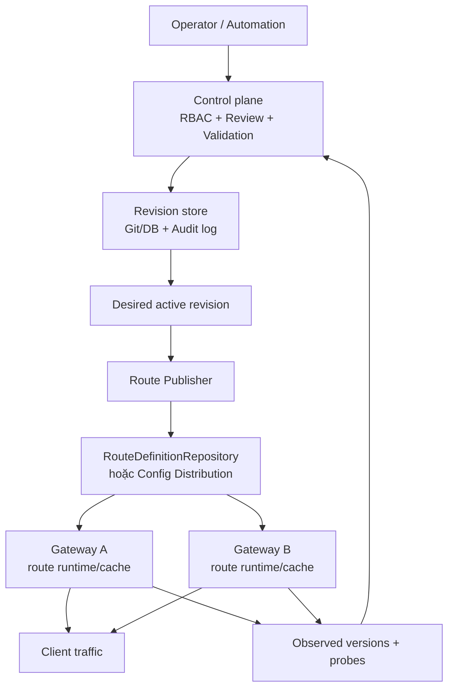
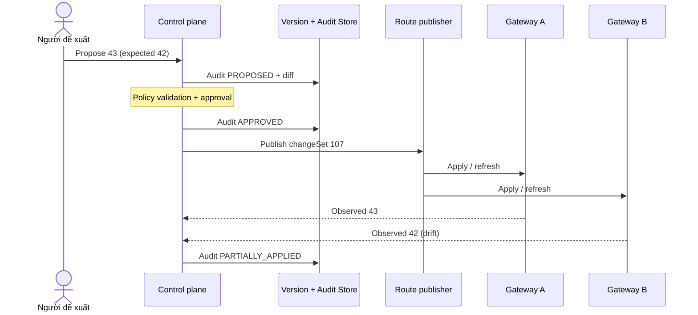
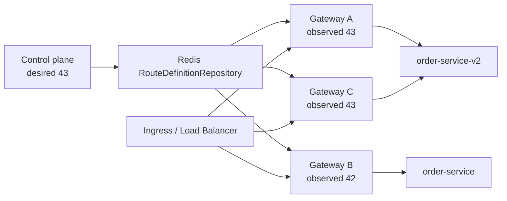
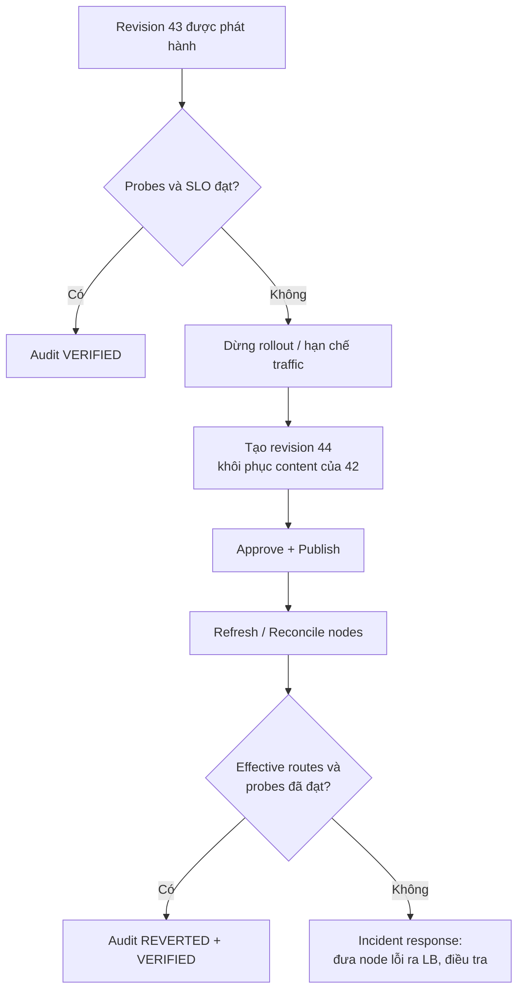

# Phiên bản cấu hình, kiểm toán thay đổi và khôi phục tuyến

Một API Gateway có thể thay đổi tuyến mà không cần khởi động lại: thêm API mới, chuyển lưu lượng sang backend v2, đổi route predicate hoặc bật thêm filter. Khả năng này rất hữu ích trong microservices, nhưng một thay đổi nhỏ cũng có thể làm **request đi nhầm dịch vụ**, bỏ qua giới hạn lưu lượng hoặc gây hàng loạt lỗi `404`/`503`. Vì thế, câu hỏi quan trọng không chỉ là **“cập nhật route bằng cách nào?”**, mà còn là:

- **Phiên bản cấu hình nào** đã được đề xuất, phê duyệt, phát hành và thực sự được Gateway sử dụng?
- **Ai thay đổi**, thay lúc nào, từ bản nào sang bản nào và vì sao?
- Làm sao xác định một Gateway replica vẫn đang chạy bản cũ dù kho dữ liệu đã có bản mới?
- Khi bản vừa phát hành gây sự cố, làm sao **khôi phục tuyến đã biết là tốt** mà không xóa mất lịch sử kiểm toán?

Đây là nội dung của chương **Tuyến động** thuộc module **SPRING_CLOUD_GATEWAY**. Nó liên hệ trực tiếp với route predicate, filter chain, biến đổi đường dẫn/header, service discovery, xác thực, rate limiting, circuit breaker, retry, TLS và quan sát request. Một hệ thống tuyến động đáng tin cậy cần quản lý cả **desired state** (cấu hình mong muốn), **runtime state** (các tuyến đang được xử lý) và **audit trail** (bằng chứng của mọi thay đổi).

> **Phạm vi:** Ví dụ dùng **Spring Cloud Gateway Server WebFlux**. Các phiên bản mới sử dụng namespace route `spring.cloud.gateway.server.webflux.routes`; nhiều phiên bản 4.x sử dụng `spring.cloud.gateway.routes`. API và thuộc tính Actuator phụ thuộc Spring Cloud Gateway/Spring Boot cụ thể. **Gateway không tự cung cấp bộ quản trị phiên bản, phê duyệt, optimistic locking và audit bất biến chỉ vì đã bật endpoint quản trị**: chúng cần một lớp điều phối hoặc quy trình triển khai riêng.

## 1. Một route chứa những thành phần gì?

| Thuộc tính | Vai trò | Rủi ro nếu bị thay đổi ngoài ý muốn |
| --- | --- | --- |
| **`id`** | Định danh tuyến, ví dụ `orders-api`. | Trùng ID hoặc đổi ID có thể làm sai truy vết/quota. |
| **`uri`** | Backend đích: `lb://order-service` hoặc HTTPS URI. | Chuyển dữ liệu đến dịch vụ không được phép. |
| **`predicates`** | Điều kiện `Path`, `Method`, `Host`, `Header`, `Weight`… | Một route mới bắt nhầm request. |
| **`filters`** | `StripPrefix`, `RewritePath`, `RequestRateLimiter`, `Retry`… | Bỏ bảo vệ, sửa sai URL/headers hoặc nhân tác dụng phụ. |
| **`order`** | Ưu tiên chọn route khi nhiều tuyến khớp. | Catch-all che route nhạy cảm. |
| **`metadata`** | Dữ liệu mô tả tùy biến. | Dễ hiểu sai metadata là cơ chế versioning tự động. |

Ví dụ một route đơn giản:

```yaml
spring:
  cloud:
    gateway:
      server:
        webflux:
          routes:
            - id: orders-api
              uri: lb://order-service
              order: -10
              predicates:
                - Path=/api/orders/**
              filters:
                - StripPrefix=1
              metadata:
                owner: orders-team
                configRevision: "42"
```

Nếu bản kế tiếp đổi `uri` sang `lb://order-service-v2` nhưng giữ `id: orders-api`, đó là **một phiên bản mới của cùng tuyến logic**. Không nên coi route ID là version: `orders-api` là định danh, còn **revision 42, 43…** do hệ thống quản trị cấu hình định nghĩa.

`configRevision` trong metadata là **trường do đội ngũ tự đặt**, Gateway không tự so sánh, khóa hoặc rollback theo giá trị này. Đừng đưa credentials hoặc token vào metadata vì chúng có thể được hiển thị khi kiểm tra routes.

### 1.1. RouteDefinition, Route runtime và cache

Một **`RouteDefinition`** mô tả URI, predicates, filters, order. Các factory dùng definitions này để dựng **`Route`** có predicate/filter thực thi. Gateway có thể cache routes đã được dựng để xử lý request hiệu quả.

Cần phân biệt:

1. **Definition trong nguồn dữ liệu:** Bản lưu trong YAML/Redis/repository.
2. **Definition đã được node đọc:** Một Gateway instance đã thấy bản mới chưa?
3. **Route runtime:** Đối tượng route đang được node sử dụng có tương ứng với definition mới chưa?
4. **Lưu lượng thực tế:** Request mới khớp route nào? Request đã bắt đầu trước khi cập nhật có thể vẫn hoàn thành theo xử lý trước đó.

**Ghi definition mới không chứng minh mọi Gateway replica đã nạp và dùng nó.** Đây là điểm cốt lõi của việc phát hành tuyến động an toàn.

## 2. Nguồn sự thật, trạng thái phát hành và trạng thái quan sát



**Control plane** quản trị thay đổi. **Data plane** là các Gateway đang nhận request thật. Hai vai trò có thể nằm cùng một tiến trình trong môi trường nhỏ, nhưng cần phân tách rõ về **quyền thay route** và **quyền xử lý API thông thường**.

| Loại trạng thái | Câu hỏi | Nguồn đo phù hợp |
| --- | --- | --- |
| **Desired revision** | Bản nào được phê duyệt để chạy? | Git commit/tag, revision DB. |
| **Published revision** | Bản nào đã được publisher ghi tới route repository? | Kết quả ghi storage và kiểm tra lại definitions. |
| **Observed revision** | Gateway A/B/C đang giữ route generation nào? | Endpoint/metric nội bộ do ứng dụng xây, runtime diagnostics. |
| **Effective behavior** | Request thực có đi đúng URI, qua đúng filters không? | HTTP probes, integration tests, metrics/tracing. |
| **Audited outcome** | Ai đề xuất/duyệt/phát hành; có thành công toàn bộ không? | Audit append-only và evidence. |

Ví dụ control plane đã ghi revision 43 vào Redis nhưng Gateway B vẫn cache revision 42. **Desired=43, published=43, observed(B)=42**. Một request qua B vẫn có thể đi tới backend cũ. Chỉ nhìn response thành công của publisher là chưa đủ.

### 2.1. Chỉ chọn một nguồn thẩm quyền

Có thể dùng GitOps, DB versioned hoặc hệ thống cấu hình tập trung làm **source of truth**. Tránh trường hợp một người sửa Git, người khác sửa Actuator trực tiếp và một worker tiếp tục đồng bộ từ Redis: khi xảy ra sự cố không còn biết **bản nào là đúng**.

| Cách quản lý | Ưu điểm | Cần bổ sung |
| --- | --- | --- |
| **GitOps** | Review qua pull request, commit lịch sử rõ. | Controller đồng bộ, runtime convergence, audit thao tác thực tế. |
| **DB versioned control plane** | Có optimistic locking, trạng thái duyệt và phân phối linh hoạt. | DDL, RBAC, backup, reconciliation, outbox và audit bền vững. |
| **Config Server/ConfigMap** | Dùng pipeline và hạ tầng có sẵn. | Đảm bảo refresh và phân biệt revision config/runtime. |
| **Actuator trực tiếp** | Dễ thử nghiệm tạo/xóa/refresh routes. | Không có version/audit workflow/transaction như một control plane hoàn chỉnh. |

Nếu có thao tác khẩn cấp ngoài pipeline, phải lưu **emergency change** và reconcile về nguồn thẩm quyền sớm; không để một chỉnh sửa runtime trở thành “bí mật vận hành”.

## 3. Các nguồn route động được Spring Cloud Gateway hỗ trợ

| Nguồn | Cơ chế | Giới hạn quan trọng |
| --- | --- | --- |
| `application.yml` | Cấu hình ứng dụng được nạp vào `RouteDefinitionLocator`. | Version qua config/deployment; không coi là route actuator-created. |
| Java `RouteLocator` bean | Route được dựng bằng code/Java DSL. | Version code artifact; không sửa bằng cách POST một definition cùng ID tùy tiện. |
| `RouteDefinitionRepository` | Đọc/ghi/xóa động qua repository. | Chức năng lưu trữ ≠ tự có audit, CAS hoặc approval. |
| `InMemoryRouteDefinitionRepository` | Định nghĩa route nằm trong memory một node. | Không tự đồng bộ các replicas, không bền qua restart. |
| `RedisRouteDefinitionRepository` | Redis lưu shared route definitions. | Chia sẻ definitions ≠ cache runtime đã hội tụ. |
| Discovery Locator | Sinh route từ danh sách service instances/names. | Registry thay đổi có thể làm tập routes thay đổi ngoài lượt phê duyệt thủ công. |

Tài liệu Server WebFlux mô tả `RedisRouteDefinitionRepository` để chia sẻ definitions giữa Gateway instances, có tùy chọn:

```properties
spring.cloud.gateway.redis-route-definition-repository.enabled=true
```

và dependency Spring Data Redis Reactive phù hợp, thường là `spring-boot-starter-data-redis-reactive`. Kiểm tra phiên bản/starter thực tế. **Không suy luận rằng bật Redis repository sẽ tự phát `RefreshRoutesEvent` trên mọi Gateway instance**.

### 3.1. Trùng nguồn hoặc trùng route ID

Nếu `orders-api` vừa có trong YAML vừa được tạo trong Redis hoặc Discovery Locator, các nguồn `RouteDefinitionLocator` có thể đưa ra definitions trùng ID hoặc predicates overlap. Hành vi phụ thuộc cách kết hợp sources và route ordering; không được mặc định “bản mới tự ghi đè đúng bản cũ”.

Hãy quy định **owner của từng route ID**, namespace hoặc nguồn quản trị. Trước publish, kiểm tra uniqueness và overlap giữa **toàn bộ route set**, không chỉ route được sửa.

## 4. Thiết kế phiên bản cấu hình

**Revision** nên là snapshot bất biến (*immutable snapshot*): nội dung đã được phê duyệt không bị sửa tại chỗ. Có thể tạo revision mới chứa nội dung giống bản cũ để rollback, nhưng **không xóa revision gây lỗi khỏi lịch sử**.

### 4.1. Envelope quản trị (không phải payload Actuator)

```json
{
  "changeId": "chg-2026-0118",
  "environment": "staging",
  "routeId": "orders-api",
  "revision": 43,
  "parentRevision": 42,
  "state": "APPROVED",
  "requestedBy": "user:operator",
  "approvedBy": "user:reviewer",
  "reason": "Chuyển routes orders sang backend v2",
  "ticket": "OPS-481",
  "createdAt": "2026-11-24T04:00:00Z",
  "definitionSha256": "<canonical-definition-hash>",
  "definition": {
    "id": "orders-api",
    "uri": "lb://order-service-v2",
    "order": -10,
    "predicates": ["Path=/api/orders/**"],
    "filters": ["StripPrefix=1"],
    "metadata": {
      "owner": "orders-team",
      "configRevision": "43"
    }
  }
}
```

Đây là **schema của control plane tự xây**. Các trường `changeId`, `revision`, `state`, `ticket`, `definitionSha256`… **không tự được Spring Cloud Gateway hiểu** như cơ chế revisioning. Adapter publisher phải chuyển `definition` sang `RouteDefinition`/payload API được phiên bản Gateway hỗ trợ.

### 4.2. Route ID, revision và change-set generation

```text
orders-api
  revision 40: lb://order-service     + StripPrefix=1
  revision 41: lb://order-service     + Retry giới hạn
  revision 42: lb://order-service     + policy đã duyệt
  revision 43: lb://order-service-v2  + policy giữ nguyên
  revision 44: ROLLBACK của 43, nội dung phục hồi từ 42
```

**Revision 44 không phải revision 42 được “đánh số lại”.** Nó có parent revision 43 và metadata `restoresContentOf=42`, `revertsRevision=43` để giữ liên tục lịch sử.

Nếu một đợt đổi đồng thời nhiều routes, nên có thêm **changeSetRevision** hoặc **routeSetGeneration**. Ví dụ route `orders-read` revision 12 và `orders-write` revision 8 đều nằm trong generation 107 của cả cụm. Điều này giúp biết trạng thái “nửa cũ/nửa mới”.

### 4.3. So sánh snapshot bằng canonical hash

Để xác minh nội dung:

1. Chọn danh sách field có ý nghĩa: `id`, `uri`, `order`, `predicates`, `filters` và metadata liên quan.
2. Biểu diễn JSON canonical với cách sắp xếp object keys, encoding, số/chuỗi được thống nhất.
3. **Không tự sort mảng filter/predicate khi thứ tự có thể mang ý nghĩa**.
4. Tính SHA-256 trên **bytes UTF-8 của canonical definition** và lưu phiên bản thuật toán canonicalization.
5. So sánh hash của proposed, approved, published và observed definitions.

Hash phát hiện drift, nhưng **không xác minh người thực hiện hoặc phê duyệt**; phải kết hợp audit, quyền truy cập và nếu cần chữ ký số/hệ thống lưu trữ chống sửa. Không nhét private keys, token, API credentials vào snapshot để tiện rollback.

## 5. Diff phải xem cả hành vi định tuyến và bảo mật

Ví dụ diff:

```diff
 id: orders-api
-uri: lb://order-service
+uri: lb://order-service-v2
 order: -10
 predicates:
   - Path=/api/orders/**
 filters:
   - StripPrefix=1
```

Thay một dòng URI có vẻ đơn giản, nhưng còn cần kiểm tra service v2 có nhận cùng path, token audience, TLS, khả năng xử lý và rate limit như v1 hay không.

| Loại diff | Điều cần review |
| --- | --- |
| **URI** | Domain, protocol, scheme `lb://` vs `http://`, SSRF và TLS. |
| **Path/Host/Method predicates** | Request mới có nằm ngoài phạm vi API được bảo vệ hay không? |
| **Route order** | Route catch-all có che route admin/chuyên biệt? |
| **StripPrefix/RewritePath** | Backend có nhận đúng endpoint? Có chuyển request vào vùng đặc quyền? |
| **Header filters** | Có loại `Authorization`, tự thêm header danh tính giả hoặc lộ thông tin? |
| **RequestRateLimiter** | Quota có bị gỡ/bỏ qua khi thêm route khác? |
| **Retry/CircuitBreaker** | Có retry POST gây ghi trùng, mở fallback nhạy cảm? |
| **Metadata** | Có thay đổi generation/owner đúng quy định, có lộ secrets? |

Đổi `Path=/api/orders/**` thành `Path=/api/**` mà không sửa security policy là thay đổi **rất lớn về quyền truy cập**, dù diff chỉ một chuỗi. Vì vậy, công cụ duyệt thay đổi phải chạy **route overlap/semantic tests** ngoài việc hiển thị diff văn bản.

## 6. Kiểm toán thay đổi: lưu đủ dấu vết

Audit không chỉ ghi “route updated”. Một sự kiện nên có:

| Thuộc tính | Ví dụ | Mục đích |
| --- | --- | --- |
| `eventId` / `changeId` | `evt-9001` / `chg-2026-0118` | Nối các bước của cùng thay đổi. |
| `actor` | Principal đã được xác thực | Biết người hoặc automation thực hiện. |
| `action` | `PROPOSE`, `APPROVE`, `PUBLISH`, `ROLLBACK` | Phân biệt ý định và hành động. |
| `routeId` / `environment` | `orders-api` / staging | Không nhầm phạm vi. |
| `beforeRevision`/`afterRevision` | 42 → 43 | Tìm đúng snapshots. |
| `beforeHash`/`afterHash` | SHA-256 | Chứng minh chính xác nội dung. |
| `reason` / `ticket` | `OPS-481` | Truy trách nhiệm và nguyên nhân. |
| `approvedBy` | Reviewer độc lập | Đối chiếu phê duyệt. |
| `timestamp` | UTC từ server | Phục dựng thứ tự sự kiện. |
| `result` | Verified/Partial/Failed | Biết trạng thái thực tế. |
| `targetNodes`/`observedNodes` | A/B/C | Gắn với convergence toàn cụm. |

**Không tin thông tin actor lấy từ header do client tùy ý gửi**, chẳng hạn `X-Operator: admin`. Phải dùng OAuth2/OIDC, workload identity, mTLS hoặc nguồn xác thực tương đương, và audit theo principal đã xác minh.

### 6.1. Intent khác outcome



Nếu chỉ A đã nạp bản 43, đừng ghi `VERIFIED` cho toàn cụm. Audit phải tách **proposed**, **approved**, **published** và **observed**; nếu node chưa hội tụ hãy ghi đúng trạng thái `PARTIAL / NOT_CONVERGED`.

### 6.2. Bảo vệ audit

Để audit có giá trị:

- Ghi theo kiểu **append-only**, hạn chế hoặc cấm tài khoản publisher xóa/sửa sự kiện cũ.
- Ghi before/after hash và tham chiếu đến snapshots tồn tại bền vững.
- Tách reviewer khỏi proposer cho tuyến production nhạy cảm (*four-eyes principle*).
- Backup, retention và đồng bộ thời gian cho audit store.
- Ẩn bí mật, JWT, cookie, client secret, credential Redis và dữ liệu PII không cần thiết.
- Nếu cần bảo đảm cao, dùng storage chống chỉnh sửa/WORM hoặc kiểm tra toàn vẹn log.

Một log ứng dụng có thể bị rotate hoặc không đủ durability; đừng coi một thông điệp INFO là hệ thống audit hoàn chỉnh.

## 7. Chống ghi đè đồng thời: optimistic locking

Hai operator cùng đọc revision 42:

```text
Operator A: muốn chuyển URI sang backend v2
Operator B: muốn chỉnh StripPrefix

A ghi revision 43 thành công.
B vẫn dựa trên revision 42 và gửi update.
```

Nếu chỉ áp dụng “last write wins”, B có thể ghi đè thay đổi của A mà không biết. Control plane cần quy tắc:

> Chỉ chấp nhận publish khi **`expectedRevision == currentRevision`** được kiểm tra trong **transaction/compare-and-swap đáng tin cậy**.

Nếu current đã là 43 và B gửi expected=42, nên trả `409 Conflict` (hoặc `412 Precondition Failed` nếu dùng giao thức preconditions tương ứng) và yêu cầu B review diff mới. **Actuator route CRUD không tự bảo đảm expectedRevision/If-Match theo envelope quản trị ví dụ**.

### 7.1. API của control plane tự thiết kế

Ví dụ **không phải Actuator endpoint có sẵn**:

```http
POST /management/route-changes HTTP/1.1
Authorization: Bearer <operator-token>
Idempotency-Key: req-9af41
Content-Type: application/json

{
  "environment": "staging",
  "routeId": "orders-api",
  "expectedRevision": 42,
  "newDefinition": {
    "id": "orders-api",
    "uri": "lb://order-service-v2",
    "order": -10,
    "predicates": ["Path=/api/orders/**"],
    "filters": ["StripPrefix=1"]
  },
  "ticket": "OPS-481",
  "reason": "Chuyển tuyến orders qua backend v2"
}
```

Response minh họa:

```json
{
  "changeId": "chg-2026-0118",
  "state": "PENDING_APPROVAL",
  "basedOnRevision": 42,
  "proposedRevision": 43
}
```

**Idempotency-Key** phải có xử lý state thực tế theo actor/operation/environment, body hash và TTL. Chỉ đọc header rồi bỏ qua không ngăn một publisher retry tạo hai revision hoặc hai thao tác DELETE/POST.

### 7.2. Transaction trong kho version

Mẫu DDL PostgreSQL **do nhóm triển khai tự thiết kế**, không phải schema mặc định của Gateway:

```sql
CREATE TABLE gateway_route_current (
    environment       varchar(40)  NOT NULL,
    route_id          varchar(160) NOT NULL,
    revision          bigint       NOT NULL,
    definition_sha256 char(64)     NOT NULL,
    PRIMARY KEY (environment, route_id)
);

CREATE TABLE gateway_route_revision (
    environment       varchar(40)  NOT NULL,
    route_id          varchar(160) NOT NULL,
    revision          bigint       NOT NULL,
    parent_revision   bigint,
    definition_json   jsonb        NOT NULL,
    definition_sha256 char(64)     NOT NULL,
    actor_id          varchar(160) NOT NULL,
    reason            text         NOT NULL,
    created_at        timestamptz  NOT NULL DEFAULT now(),
    PRIMARY KEY (environment, route_id, revision)
);

CREATE TABLE gateway_route_audit (
    event_id          bigserial PRIMARY KEY,
    change_id         varchar(160) NOT NULL,
    actor_id          varchar(160) NOT NULL,
    action            varchar(40)  NOT NULL,
    event_json        jsonb        NOT NULL,
    occurred_at       timestamptz  NOT NULL DEFAULT now()
);
```

Mẫu optimistic update **bên trong DB transaction có kiểm tra số rows affected**:

```sql
UPDATE gateway_route_current
SET revision = :next_revision,
    definition_sha256 = :new_hash
WHERE environment = :environment
  AND route_id = :route_id
  AND revision = :expected_revision;
```

Nếu cập nhật được **0 dòng**, báo conflict hoặc route không tồn tại; rollback DB transaction, không tiếp tục publish. Trong cùng transaction, lưu snapshot revision mới, audit event và **outbox event** phục vụ phát hành. DDL/chỉ dẫn này chưa đầy đủ cho trường hợp tạo route mới, đổi nhiều routes nguyên nhóm hoặc nâng cấp schema; cần thực hiện uniqueness và isolation thích hợp.

### 7.3. Transactional outbox giúp gì?

Một lỗi phân tán phổ biến:

1. DB ghi `revision=43` thành công.
2. Process chết trước khi gọi refresh cho các Gateway.
3. Control plane tưởng đã hoàn tất, còn data plane chạy 42.

**Transactional outbox** lưu record “cần publish 43” trong **cùng transaction** với việc ghi active revision. Publisher đọc outbox rồi phát lại có idempotency và ghi kết quả từng node. Điều này giảm nguy cơ mất event giữa DB commit và network call, nhưng **không biến nhiều Gateway replicas thành một transaction phân tán nguyên tử**.

Một state machine hợp lý:

```text
DRAFT -> VALIDATED -> APPROVED -> PUBLISHING
   -> PARTIALLY_APPLIED -> APPLIED -> VERIFIED
   -> FAILED -> ROLLING_BACK -> REVERTED
```

Tránh chỉ ghi `SUCCESS/FAILED` nếu một phần replicas có thể đã áp dụng bản mới.

## 8. Actuator Gateway: đọc, tạo, xóa, refresh

Spring Cloud Gateway Server WebFlux có **Actuator API** để quan sát và, khi được cấp quyền phù hợp, quản lý route definitions.

### 8.1. Chế độ chỉ đọc và bảo mật điểm quản trị

Ví dụ cấu hình Actuator **chỉ đọc**:

```properties
management.endpoint.gateway.access=read-only
management.endpoints.web.exposure.include=health,gateway
```

Đối với các phiên bản tương ứng, muốn tạo/xóa/refresh có thể cần `management.endpoint.gateway.access=unrestricted` (hoặc cấu hình bật tương đương mà tài liệu version nêu). **Không mở unrestricted chỉ để đọc routes.**

Ví dụ sandbox **chỉ trên localhost, không phải template production**:

```properties
management.server.port=9091
management.server.address=127.0.0.1
management.endpoint.gateway.access=unrestricted
management.endpoints.web.exposure.include=health,gateway
```

Production phải có mạng quản trị riêng, TLS/mTLS hoặc OIDC/strong identity, RBAC, audit, firewall và chính sách chống CSRF khi dùng cookie auth. Không đưa điểm ghi tuyến động lên Internet chỉ dựa vào một URL khó đoán.

### 8.2. Đọc cấu hình đang chạy

```bash
# Chỉ ví dụ trên management listener local được phép truy cập.
curl -fsS http://127.0.0.1:9091/actuator/gateway/routes
curl -fsS http://127.0.0.1:9091/actuator/gateway/routedefinitions
curl -fsS http://127.0.0.1:9091/actuator/gateway/routes/orders-api
```

**Quan trọng:** `GET /actuator/gateway/routes/{id}` trong tài liệu mới có thể trả predicate/filter ở **dạng human-readable**, khác với định dạng shortcut DSL cần cho POST. Không lấy nguyên output GET rồi POST lại mà không chuyển đổi/validate. Nguồn version đáng tin cậy nên lưu **canonical RouteDefinition**, không lưu string render cho người đọc.

### 8.3. Tạo một route mới trong sandbox

Payload theo định dạng Actuator mà tài liệu Server WebFlux hiện hành mô tả:

```json
{
  "uri": "http://127.0.0.1:9090",
  "predicates": ["Path=/api/orders/**"],
  "filters": ["StripPrefix=1"],
  "order": -10
}
```

Ví dụ HTTP:

```bash
curl -i -X POST \
  'http://127.0.0.1:9091/actuator/gateway/routes/orders-api' \
  -H 'Content-Type: application/json' \
  --data '{
    "uri":"http://127.0.0.1:9090",
    "predicates":["Path=/api/orders/**"],
    "filters":["StripPrefix=1"],
    "order":-10
  }'

curl -i -X POST \
  'http://127.0.0.1:9091/actuator/gateway/refresh'
```

Tài liệu mới mô tả create trả **`201 Created`** rồi cần gọi **`POST /actuator/gateway/refresh`** để áp dụng. **HTTP 200 từ refresh không bảo đảm toàn bộ các Gateway khác đã hội tụ**, và refresh có nhánh bất đồng bộ cần xác minh kết quả.

### 8.4. Không POST đè một route ID đã tồn tại

Một chi tiết quan trọng của tài liệu Actuator hiện hành:

- Không `POST` lặp một ID đã có: tài liệu cảnh báo có thể tạo duplicate route definition và gây lỗi khi gọi GET danh sách routes.
- Với **route đã được tạo qua Actuator**, quy trình thay thế trong tài liệu là **DELETE cũ → POST mới cùng ID → POST refresh**.
- Route khai báo trong **`application.yml`** hoặc `@Bean` không thể bị sửa/xóa qua endpoint này theo cách giống route tạo bằng Actuator; DELETE có thể trả `404 Not Found`.

Ví dụ:

```bash
curl -i -X DELETE \
  'http://127.0.0.1:9091/actuator/gateway/routes/orders-api'

# Gửi POST với definition mới ĐÃ PHÊ DUYỆT, rồi:
curl -i -X POST \
  'http://127.0.0.1:9091/actuator/gateway/refresh'
```

**DELETE rồi POST không nguyên tử.** Nếu process chết hoặc storage lỗi giữa hai bước, route có thể tạm mất. Đây là thao tác cấp thấp để thử nghiệm, **không phải một cơ chế triển khai có version/transaction/rollback đầy đủ**. Không áp dụng thủ công trên production nếu chưa có kế hoạch bảo đảm an toàn và khôi phục.

## 9. RouteDefinitionWriter, Repository và RefreshRoutesEvent

Không bắt buộc phải bật endpoint Actuator ghi để có tuyến động. Một ứng dụng có thể xây lớp quản trị nội bộ dùng API:

- **`RouteDefinitionLocator`:** đọc definitions, thường cho `Flux<RouteDefinition>`.
- **`RouteDefinitionWriter`:** giao diện ghi và xóa definitions.
- **`RouteDefinitionRepository`:** repository vừa đọc vừa ghi route definitions.
- **`RouteLocator` / `CachingRouteLocator`:** nguồn route runtime và bộ nhớ đệm phục vụ request.
- **`RefreshRoutesEvent`:** sự kiện làm mới route tại **application context của node nhận sự kiện**.

### 9.1. Ví dụ Java: lưu definition rồi yêu cầu refresh local

```java
package com.example.gateway.dynamic;

import org.springframework.cloud.gateway.event.RefreshRoutesEvent;
import org.springframework.cloud.gateway.route.RouteDefinition;
import org.springframework.cloud.gateway.route.RouteDefinitionWriter;
import org.springframework.context.ApplicationEventPublisher;
import org.springframework.stereotype.Service;
import reactor.core.publisher.Mono;

@Service
public class LocalRoutePublisher {

    private final RouteDefinitionWriter writer;
    private final ApplicationEventPublisher publisher;

    public LocalRoutePublisher(
            RouteDefinitionWriter writer,
            ApplicationEventPublisher publisher) {
        this.writer = writer;
        this.publisher = publisher;
    }

    public Mono<Void> saveAndRefresh(RouteDefinition definition) {
        return writer.save(Mono.just(definition))
            .then(Mono.fromRunnable(
                () -> publisher.publishEvent(new RefreshRoutesEvent(this))));
    }

    public Mono<Void> deleteAndRefresh(String routeId) {
        return writer.delete(Mono.just(routeId))
            .then(Mono.fromRunnable(
                () -> publisher.publishEvent(new RefreshRoutesEvent(this))));
    }
}
```

**Đây chỉ là ví dụ về API nền tảng**. Nó chưa có RBAC, kiểm tra URI/filter, optimistic locking, approved revision, audit trail, transactional outbox hay quản lý lỗi đa node. `writer.save(...)` hoàn tất **không đồng nghĩa request mới đã chọn đúng route**; phải kiểm tra refresh/runtime/probes. Không xuất bản class này trực tiếp qua controller công khai.

### 9.2. Một event local không phải event toàn cụm

`ApplicationEventPublisher` phát Spring application event **trong tiến trình hiện tại**. Nếu Gateway A phát `RefreshRoutesEvent`, Gateway B không tự nhận event đó chỉ vì cả hai cùng đọc Redis repository. Muốn đảm bảo cập nhật ở B cần có cơ chế:

1. Gửi sự kiện đã xác thực qua message bus cho từng node và verify ACK.
2. Gọi management refresh của từng instance qua mạng quản trị có xác thực.
3. Cho node polling/reconciliation có chu kỳ được quản lý, so desired với observed.
4. Dùng deployment/cutover strategy khác có thể bảo đảm node mới đã sẵn sàng trước khi nhận traffic.

Các lựa chọn này có độ trễ, độ bền và cách xử lý lỗi khác nhau. **Không mặc định event được phân phối exactly-once**; thiết kế publish và refresh nên idempotent.

### 9.3. Refresh không tạo revision cũng không rollback

`POST /actuator/gateway/refresh` hoặc `RefreshRoutesEvent` yêu cầu đọc/xây lại routes; nó **không thay đổi source of truth** thành bản đã biết là tốt.

Nếu repository còn chứa revision 43 bị lỗi, refresh lại có thể tiếp tục nạp chính bản 43 đó. Muốn rollback phải **publish definition đúng** trước, sau đó refresh/reconcile và verify; không lặp lệnh refresh như một “undo” tự động.

## 10. Redis repository và tính nhất quán giữa các Gateway replicas



Ở trạng thái này, cùng `GET /api/orders/42` có thể nhận response khác nhau tùy load balancer chọn Gateway nào. Đây là **config drift/runtime convergence**, không nhất thiết là bug của service discovery.

### 10.1. Chọn mục tiêu nhất quán phù hợp

| Cam kết | Ý nghĩa | Đánh đổi |
| --- | --- | --- |
| **Best effort** | Publisher gửi bản mới, node refresh khi có cơ hội. | Đơn giản nhưng không cam kết thời gian hội tụ. |
| **Eventual consistency** | Mọi node còn khỏe hội tụ trong khoảng SLO xác định. | Có khoảng thời gian mixed revisions. |
| **Quorum verified** | Đủ tỉ lệ nodes báo đã nạp bản mới rồi tiếp tục rollout. | Một số nodes cũ vẫn có thể phục vụ. |
| **All-active-verified** | Mọi node đang nhận traffic đã nạp version mục tiêu hoặc được drain. | Phức tạp và có thể giảm availability. |
| **Atomic cutover toàn cụm** | Không có khoảng traffic gặp hai thế hệ route. | **Không tự có** từ Redis + Actuator; cần cơ chế deployment/cutover riêng. |

Không quảng cáo “atomic cluster configuration” chỉ vì Redis có thao tác ghi nguyên tử. Ghi một key ở Redis và xây route runtime trong nhiều JVMs là **hai hành động khác nhau**.

### 10.2. Một endpoint/metric quan sát revision

Có thể xây endpoint quản trị nội bộ có xác thực, phản ánh route set đã nạp:

```json
{
  "instance": "gateway-b",
  "desiredGeneration": 107,
  "observedGeneration": 106,
  "routeCount": 51,
  "observedHash": "<hash-of-effective-route-set>",
  "state": "OUT_OF_SYNC",
  "lastRefreshAt": "2026-11-24T04:10:00Z"
}
```

**Đây là payload đề xuất tự xây, không phải API Spring Cloud Gateway có sẵn.** Nó cần dựa trên **trạng thái thực sự đã nạp**, không chỉ lặp giá trị revision mà publisher thông báo. Có thể bổ sung kiểm tra hiệu lực với request probe theo route ID/path/method/host.

Để triển khai quan sát đúng cần giải quyết:

- Tính hash nhất quán trên canonical definitions sau khi tất cả nguồn được kết hợp.
- Không chỉ dựa vào metadata do operator tự đặt nếu compiled route khác.
- Phân biệt definitions đang được cache, routes thực thi và requests đã chọn route trước refresh.
- Không đưa thông tin nhạy cảm từ URI/filter/header vào public management response.

### 10.3. Redis failover, mất mạng và restore snapshot

Nếu route repository dùng Redis:

- **Mất mạng:** publisher có thể timeout, một node không đọc được bản mới.
- **Failover:** một số cập nhật rất gần thời điểm đổi primary có thể chưa được sao chép đầy đủ tùy cách triển khai.
- **Restore backup cũ:** Redis trở về definitions cũ hơn approved revision.
- **Nhiều Redis endpoints:** Gateway A và B thực ra đang dùng hai kho độc lập.
- **Cache cũ còn sống:** một số nodes có thể giữ last-known routes trong lúc store mất kết nối.

Phải có **reconciler dựa trên source of truth** và quy tắc khi kho cấu hình lỗi. Không chủ động xóa toàn bộ routes chỉ vì một lần refresh thất bại, cũng không âm thầm tiếp tục phục vụ bằng cấu hình không còn được phép nếu risk policy yêu cầu đóng truy cập.

### 10.4. Có cần đánh dấu node unready?

Với route cực kỳ nhạy cảm, control plane có thể đưa node **chưa hội tụ** ra khỏi load balancer. Nhưng nếu tất cả nodes đều chưa hội tụ do store lỗi, áp dụng quy tắc quá nghiêm có thể gây outage toàn cụm. Cần:

1. Xác định **ngưỡng chấp nhận lệch** theo loại route.
2. Có đủ capacity ở nodes đã hội tụ để chịu traffic.
3. Drain kết nối/request đang xử lý theo chính sách.
4. Thông báo rõ tình huống mixed configuration cho vận hành.

Đối với thay đổi bảo mật khẩn cấp, có thể ưu tiên từ chối request ở một đường nhạy cảm hơn là phục vụ bằng route cũ yếu hơn. Quyết định phải được định nghĩa trước, không phỏng đoán trong sự cố.

## 11. Triển khai theo giai đoạn và canary

Một đợt publish an toàn:

1. **Prepare:** proposal revision 43, diff, tests, preflight.
2. **Approve:** reviewer độc lập, rollback snapshot revision 42.
3. **Publish candidate:** phát hành tới staging hoặc một tập Gateway nodes kiểm thử.
4. **Canary:** dùng load balancer/traffic scoping được kiểm soát, chỉ cho một phần traffic đi qua cấu hình mới.
5. **Observe:** theo dõi route hits, backend marker, 401/403/404/429/5xx, latency p95/p99, retries, CPU và error budget.
6. **Expand:** từng đợt cho thêm nodes hoặc traffic.
7. **Converge:** xác nhận required nodes đã nạp generation 107.
8. **Verify:** so hashes/probes, ghi kết quả audit và đóng change.

**Canary theo route predicate `Weight` và canary theo phiên bản cấu hình Gateway là hai chiều khác nhau.** Có thể chỉ 5% request được Gateway điều hướng sang backend v2 dù 100% Gateway đã nạp cùng một config; ngược lại 5% Gateway nodes có revision mới không đồng nghĩa chính xác 5% traffic chọn backend mới.

### 11.1. Những tín hiệu dừng rollout

Đặt các tiêu chí dừng dựa trên số liệu:

- Tỷ lệ 5xx hoặc 404 tăng vượt ngưỡng.
- 401/403 tăng bất thường trên API trước đây hợp lệ.
- 429 tăng do đổi rate limiter/route key không mong muốn.
- p99 latency tăng vượt ngân sách.
- Backend mới có lỗi TLS, thiếu instances, không nhận path đã rewrite.
- Một node không hội tụ quá thời gian mục tiêu.
- Audit/outbox hoặc kho definitions mất tính nhất quán.

Không chỉ nhìn “backend vẫn có 200” mà bỏ qua các nhóm users/methods khác đang lỗi.

### 11.2. Nhiều routes trong một change set

Giả sử phải cập nhật đồng thời:

```text
orders-read  revision 12 -> 13
orders-write revision 8  -> 9
security policy bundle       -> version 21
```

Nếu cập nhật tuần tự nhiều routes, có thể xảy ra trạng thái một route đã mới, route còn lại cũ. Với thay đổi phụ thuộc nhau, nên phát hành **route-set snapshot hoặc change set** có generation chung, chuẩn bị candidate đầy đủ, kiểm tra rồi cutover theo cơ chế platform hỗ trợ.

**Actuator DELETE/POST nhiều routes không tự cung cấp transaction đa route/đa Gateway**. Không ghi `APPLIED` cả bundle khi chỉ một route đã đổi.

## 12. Quy trình thay đổi tuyến có kiểm soát từ đầu tới cuối

Một chuẩn vận hành gồm năm giai đoạn.

### Giai đoạn A — Đề xuất

1. Người có quyền tạo proposal với `expectedRevision`, route ID, môi trường, lý do và ticket.
2. Control plane xác minh người đề xuất thuộc nhóm sở hữu route.
3. Chuẩn hóa RouteDefinition, tính hash, lưu diff và proposed snapshot.
4. Chạy schema validation, uniqueness và semantic overlap checks.
5. Kiểm tra URI, path, filter whitelist, TLS và security-policy compatibility.

### Giai đoạn B — Phê duyệt

6. Reviewer xem diff và mức ảnh hưởng: khách hàng, tenant, API, % traffic.
7. Phê duyệt theo nguyên tắc least privilege/four-eyes khi cần.
8. Xác minh bản được review vẫn khớp `expectedRevision` hiện tại; nếu không, yêu cầu rebase/review.

### Giai đoạn C — Phát hành

9. CAS revision trong DB transaction, lưu audit và outbox.
10. Publisher ghi definition store hoặc phát hành snapshot generation mới.
11. Gửi refresh/reconcile có xác thực cho các Gateways mục tiêu.
12. Ghi từng kết quả vào audit/outcome, không gộp một success giả.

### Giai đoạn D — Xác minh

13. Đọc observed revision/hash từng Gateway node.
14. Chạy request probes bằng token thử nghiệm có đúng quyền và đường dẫn.
15. So HTTP status, route ID, backend marker, TLS, security và latency.
16. Theo dõi SLO theo nhóm users/routes trong verification window đã định.

### Giai đoạn E — Hoàn tất/khôi phục

17. Ghi `VERIFIED` chỉ khi tiêu chí hội tụ và hành vi đã đạt.
18. Nếu lỗi, dừng rollout, cô lập nodes lỗi và thực hiện rollback được phê duyệt.
19. Lưu timeline, nguyên nhân và bằng chứng sau incident; không xóa revision lỗi.

**Tránh đổi mọi thứ trong cùng một revision**: URI, Path, Route.order, Retry và RateLimiter cùng lúc làm rất khó xác định nguyên nhân khi có lỗi.

## 13. Rollback: khôi phục bản tốt bằng một revision mới

Ví dụ:

```text
orders-api
  revision 42: lb://order-service
  revision 43: lb://order-service-v2

Sau publish:
  Gateway A: observed revision 43
  Gateway B: observed revision 42
  Backend v2: trả 503 cho một nhóm request
```

**Không rollback bằng cách xóa revision 43 khỏi lịch sử rồi đặt revision hiện tại thành 42.** Hãy tạo một bản mới:

```json
{
  "routeId": "orders-api",
  "revision": 44,
  "parentRevision": 43,
  "revertsRevision": 43,
  "restoresContentOf": 42,
  "reason": "Backend v2 lỗi, khôi phục tuyến tốt",
  "ticket": "INC-893",
  "definitionSha256": "<hash-of-known-good-definition>"
}
```

### 13.1. Runbook rollback

1. **Dừng rollout** bản 43 và chặn concurrent changes tới route này.
2. **Xác nhận known-good snapshot** revision 42 và hash đã lưu.
3. Kiểm tra backend v1 còn khỏe, service discovery còn instances, TLS certificate và token audience còn phù hợp.
4. Tạo revision 44 có **nội dung phục hồi từ 42**, nhưng metadata thay đổi để audit biết đây là rollback.
5. Phê duyệt theo chính sách incident/emergency; ghi actor và ticket.
6. Publish revision 44, yêu cầu refresh/reconcile các Gateways.
7. Xác nhận required nodes đã observed=44 và canonical effective hash đúng.
8. Probe các method/path/host quan trọng, xác nhận backend marker v1, 401/403/429/5xx và latency trở về mức hợp lệ.
9. Ghi `ROLLBACK_VERIFIED`; nếu chưa hội tụ, giữ incident mở và xử lý drift.
10. Sau sự cố, đánh giá vì sao revision 43 qua review và bổ sung regression tests.



### 13.2. Rollback không phải lúc nào cũng an toàn

- Backend v1 đã ngừng triển khai, không còn instance.
- Backend v2 đã ghi schema mới mà v1 không đọc được.
- Chứng chỉ TLS hoặc audience cho v1 đã hết hiệu lực.
- Route v1 chứa lỗ hổng bảo mật nghiêm trọng mới vá.
- Mô hình `RewritePath` đã được thay đồng thời với backend.
- Một thao tác POST đang in-flight có side effect không thể hoàn tác.

Do đó, **có snapshot cũ không đồng nghĩa có thể phục hồi thành công**. Có lúc phương án an toàn hơn là duy trì `503` có kiểm soát, chuyển fallback/giới hạn traffic hoặc rollback cả backend deployment.

### 13.3. RTO, RPO và phạm vi ảnh hưởng

| Khái niệm | Khi áp dụng cho cấu hình tuyến | Cách đo |
| --- | --- | --- |
| **RTO** | Thời gian mục tiêu từ lúc quyết định rollback đến khi traffic trở về trạng thái hợp lệ. | Timestamp quyết định → các probes/nodes đạt. |
| **RPO cấu hình** | Số phiên bản/cập nhật có thể mất sau failover/restore mà policy chấp nhận. | So source-of-truth với published/observed state. |
| **Blast radius** | Số routes/users/tenants/nodes và % traffic bị ảnh hưởng. | Route hit metrics, tracing, canary scope. |
| **Verification window** | Thời gian theo dõi sau publish/rollback. | 5xx/404, 401/403, 429 và p99. |

Một HTTP 200 từ endpoint quản trị **không tự chứng minh RTO đã đạt**, bởi node khác có thể chưa refresh hoặc backend cũ không khỏe.

## 14. Phân biệt rollback route với rollback ứng dụng và security

| Triệu chứng | Thành phần phải xem xét | Rollback route có đủ không? |
| --- | --- | --- |
| Route trỏ sai backend host | `uri`/service discovery | Có thể, nếu backend cũ còn khỏe. |
| 404 do `StripPrefix`/`RewritePath` | Gateway filters + backend contract | Có thể, nếu chỉ filter bị sai. |
| 503 vì backend v2 có bug | Deployment backend + route | Có thể đổi route, nhưng phải kiểm tra schema. |
| 401 vì issuer/audience JWT thay đổi | Spring Security/IdP | **Không** nhất thiết. |
| 403 vì backend phân quyền tài nguyên | Policy nghiệp vụ/backend | Không thể chỉ sửa route để bỏ qua authorization. |
| 429 tăng vì route mới bỏ quota theo key | RequestRateLimiter/key policy | Cần review route + quota. |
| Retry tăng, POST bị ghi trùng | Retry filter và idempotency backend | Chỉ rollback filter không xóa side effects đã xảy ra. |
| TLS handshake thất bại | Truststore/certificates/upstream URI | Có thể phải sửa TLS/deployment. |

**Đừng dùng thay đổi route để chữa lỗi xác thực/phân quyền bằng cách bỏ lớp kiểm tra.** Một giải pháp khẩn cấp làm API chạy lại nhưng mở quyền rộng hơn là một sự cố bảo mật mới.

## 15. Bảo mật control plane và Actuator

**Quyền thay RouteDefinition là quyền điều hướng traffic**; có thể dẫn đến SSRF, lộ credential, thay URL công khai hoặc bypass filter.

### 15.1. Những thay đổi cần từ chối hoặc review đặc biệt

| Thay đổi | Nguy cơ |
| --- | --- |
| `uri: http://127.0.0.1:...`, link-local, metadata IP, private host ngoài allowlist | SSRF và truy cập hạ tầng nội bộ. |
| Đổi `https://` thành `http://` | Mất bảo vệ TLS trên outbound hop. |
| `Path=/**` với order ưu tiên cao | Route catch-all chiếm mọi API. |
| `RemoveRequestHeader=Authorization` | Backend nhận sai/thiếu identity. |
| `AddRequestHeader=X-Role,ADMIN` | Giả mạo phân quyền nếu backend tin header. |
| Bỏ `RequestRateLimiter` | Vượt quota, gây quá tải. |
| Retry POST thanh toán không idempotency | Lặp tác dụng phụ. |
| `RedirectTo` sang domain lạ | Redirect lừa đảo hoặc lộ thông tin. |
| `SetPath`/`StripPrefix` vào endpoint đặc quyền | Vượt ranh giới route/backend authorization. |

**Control plane phải validate cho đúng các API được phép**, không chấp nhận tự do mọi scheme, URI và filter. Cần kiểm tra cả đích sau DNS/service discovery, network policy egress và các proxy bên trong, vì whitelist hostname chuỗi đơn thuần chưa chắc chống được SSRF.

### 15.2. Quyền theo vai trò

Một mô hình:

- **Viewer:** chỉ đọc revisions/audit và routes effective.
- **Proposer:** tạo thay đổi cho namespace/route được sở hữu.
- **Reviewer:** duyệt, từ chối; độc lập người đề xuất khi policy yêu cầu.
- **Publisher:** service account chỉ phát hành **approved revision**.
- **Emergency operator:** có thể rollback đã được chuẩn bị, phải ghi incident/audit.

Phân quyền theo **môi trường, route namespace và độ nhạy cảm**, không chỉ `ROLE_ADMIN` toàn cục cho mọi thứ. Nhân viên sửa route orders không tự có quyền tạo `/actuator/**` hoặc route admin.

### 15.3. Tách management network khỏi public traffic

Tài liệu Gateway khuyến nghị Actuator read-only khi chỉ cần giám sát; nếu bật unrestricted, phải bảo vệ bằng:

1. Management port/listener chỉ ở mạng nội bộ riêng, firewall chặn Internet.
2. mTLS/OIDC/workload identity và RBAC.
3. Audit mọi write; phát hiện write ngoài control plane.
4. Rate limiting/quota quản trị, idempotency và approval.
5. CSRF protection nếu dùng browser-cookie auth cho thao tác quản trị.
6. Không lộ Actuator env/configprops/heapdump nhạy cảm.
7. Mật khẩu/secret không nằm trong route definitions hoặc audit raw logs.

**Không suy luận Spring Security bảo vệ public APIs cũng tự bảo vệ management context**; management server có thể có port/security chain riêng. Kiểm tra trực tiếp trong integration/security tests.

## 16. Observability: đo revision và độ trễ hội tụ

Một số metric **do ứng dụng tự instrument**, không phải mặc định Gateway tự xuất:

| Metric/event đề xuất | Ý nghĩa |
| --- | --- |
| `gateway_config_desired_generation` | Revision route set đang được yêu cầu. |
| `gateway_config_observed_generation` | Revision thực tế từng Gateway đã nạp. |
| `gateway_config_refresh_failure_total` | Lỗi refresh/reconcile. |
| `gateway_route_definition_count` | Số routes trên node. |
| `gateway_route_change_total` | Số thay đổi theo trạng thái kết quả. |
| `gateway_config_convergence_seconds` | Thời gian từ publish tới observed convergence. |
| Route hit count theo route ID | Tuyến mới có thật sự xử lý traffic không? |
| 401/403/404/429/5xx theo route | Security, match, quota, backend có bất thường không? |
| p95/p99 và retries/circuit opens | Thay route có làm hệ thống xấu đi? |

Tên metric `gateway_config_*` là **gợi ý tự thiết kế**. Gateway có các metrics/Actuator khác tùy phiên bản; không nên khẳng định bật Actuator là tự có tất cả metric phiên bản trong bảng.

### 16.1. Timeline audit sự cố mẫu

```text
04:00:00Z  CHANGE_PROPOSED    chg-2026-0118 (42 -> 43)
04:03:10Z  POLICY_VALIDATED   PASS
04:04:00Z  APPROVED           reviewer:gateway
04:05:00Z  PUBLISH_STARTED
04:05:01Z  PUBLISHED_TO_STORE revision=43
04:05:03Z  NODE_APPLIED       gateway-a observed=43
04:05:04Z  NODE_APPLIED       gateway-c observed=43
04:05:06Z  NODE_NOT_CONVERGED gateway-b observed=42
04:06:00Z  PROBE_FAILED       503 on gateway-a
04:06:20Z  ROLLBACK_REQUESTED revision=44 (content 42)
04:07:15Z  ROLLBACK_VERIFIED  A/B/C observed=44
```

**Đây là dữ liệu minh họa**, không phải log đã được lấy từ hệ thống thật. Khi tạo timeline thực tế, cần correlation/change IDs xuyên suốt DB, publisher, gateway nodes và probes. Không log raw JWT, cookie hoặc secret chỉ để truy vết actor.

### 16.2. Tránh label quá nhiều giá trị

Đừng đưa nguyên URI, hash dài, JWT subject, credentials hoặc toàn bộ JSON definition vào metric label: dễ tạo **high cardinality** và lộ dữ liệu. Metric chỉ cần environment, route group, status, node/generation có cardinality được kiểm soát; audit chi tiết phải được bảo vệ quyền truy cập riêng.

## 17. Kiểm thử chức năng versioning, audit và rollback

Kiểm thử không chỉ gọi POST rồi assert 200. Một bộ test nên kiểm tra cả **schema, điều kiện cạnh tranh, phiên bản, quyền, phân phối, rollback và HTTP behavior**.

### 17.1. Ma trận kiểm thử tối thiểu

| ID | Kịch bản | Kết quả cần xác minh |
| --- | --- | --- |
| V1 | Tạo route động mới | Có revision 1, audit và route effective đúng. |
| V2 | Thay route từ 42 → 43 | Route ID không trùng, URI/filter mới được áp dụng. |
| V3 | Hai operator cùng expectedRevision=42 | Một update thành công, còn lại conflict. |
| V4 | Client retry publish với cùng idempotency key | Không tạo hai versions hoặc thao tác trùng. |
| V5 | URI không nằm trong allowlist | Bị từ chối trước khi xuất hiện trên data plane. |
| V6 | Route catch-all ưu tiên trước route admin | Semantic overlap validator phát hiện nguy cơ. |
| V7 | Bỏ filter RequestRateLimiter | Phải qua security/policy review theo hợp đồng API. |
| V8 | DELETE Actuator route từ application.yml | Không giả định xóa được; xử lý 404 theo docs. |
| V9 | POST đè ID đã tồn tại | Test sandbox phát hiện nguy cơ duplicate; tránh production. |
| V10 | Redis shared, một Gateway không refresh | Phát hiện drift, không báo VERIFIED toàn cụm. |
| V11 | Refresh trả 200 nhưng lỗi async | Vẫn kiểm tra observed state và probes. |
| V12 | Node restart giữa rollout | Sau restart nhận đúng desired state hoặc không nhận traffic. |
| V13 | Config store lỗi | Không xóa toàn bộ routes hoặc fail-open trái policy. |
| V14 | Redis failover/restore từ snapshot cũ | Reconciler phát hiện mismatch từ approved revision. |
| V15 | Rollback 43 về nội dung 42 | Tạo revision 44, giữ 43 trong audit. |
| V16 | Backend v1 đã dừng | Kiểm tra rollback safety; không khôi phục mù quáng. |
| V17 | Cập nhật hai routes trong một change set | Không báo bundle hoàn tất khi chỉ một route thành công. |
| V18 | Operator thiếu quyền | Không ghi config, không publish, có audit denial phù hợp. |
| V19 | Actuator ghi từ nguồn lạ | Phát hiện thao tác ngoài change management. |
| V20 | Metadata revision đúng nhưng URI sai | So effective definition hash, test request thật. |
| V21 | Thêm public path mới | Security WebFilter và backend authorization được review. |
| V22 | Client request đang in-flight khi rollback | Ghi nhận request đã chọn route cũ, không hứa cắt ngay. |
| V23 | Audit store không ghi được | Không âm thầm publish nếu policy yêu cầu audit bắt buộc. |
| V24 | Git và Redis có phiên bản khác nhau | Reconciliation giải thích drift, khôi phục source of truth. |

### 17.2. Test route order và path overlap

Hai tuyến:

```yaml
- id: orders-api
  order: -100
  uri: lb://order-service
  predicates:
    - Path=/api/orders/**

- id: api-catch-all
  order: 0
  uri: lb://legacy-service
  predicates:
    - Path=/api/**
```

Thử:

- `GET /api/orders/42` phải tới orders-api.
- `POST /api/orders` cần kiểm tra path root, method và security.
- `GET /api/users/42` có thể vào catch-all theo hợp đồng.
- `DELETE /api/orders/42` phải có quyền xóa tương ứng.
- `GET /actuator/gateway/routes` từ public Internet không được mở không kiểm soát.
- `/api/orders/`, encoded path, host không đúng và OPTIONS không được bypass matchers.

Khi một revision đổi `order`/`predicates`, chạy lại **cùng một tập request mẫu** trên route set cũ và mới. Bất kỳ thay đổi nào ngoài phạm vi được phê duyệt là dấu hiệu phải dừng publish.

### 17.3. Bài thực hành rollback trên staging

1. Nạp revision 42: route trỏ backend stub v1 trả header `X-Backend-Version: v1`.
2. Tạo và duyệt revision 43 trỏ stub v2.
3. Publish, kiểm tra A/B đều báo observed=43 và probe tới v2.
4. Trong staging, cấu hình stub v2 cố ý trả `503` theo kịch bản.
5. Monitor nhận biết vượt error threshold, dừng rollout.
6. Control plane tạo revision 44 chứa nội dung của 42, lưu audit đầy đủ.
7. Publish 44 và refresh/reconcile hai instances.
8. Probe cả A và B: backend marker v1, 5xx giảm, bảo mật/quota còn đúng.
9. Xuất report: timestamps, actor, approval, before/after hash, node convergence và RTO.

Chỉ chạy trong **môi trường test được phép**, không làm gián đoạn traffic thật. Dùng backend stub và token thử nghiệm, không dùng hệ thống thanh toán production.

## 18. Các lỗi diễn giải thường gặp

### Lỗi 1 — “Refresh 200 nghĩa là rollout thành công”

Không. Refresh phản ánh một thao tác quản trị, chưa chứng minh mọi nodes đã nạp route mới. Đo observed revisions và probes.

### Lỗi 2 — “Bật Redis repository là có transaction toàn cụm”

Không. Chia sẻ definitions không đồng bộ tức thì các caches và không tự cấp distributed transaction cho mọi requests.

### Lỗi 3 — “Rollback chỉ là gọi refresh thêm lần nữa”

Không. Nếu store chứa revision lỗi, refresh có thể nạp lại revision lỗi. Phải publish định nghĩa known-good rồi refresh.

### Lỗi 4 — “Sửa route trong YAML bằng Actuator DELETE”

Tài liệu mới phân biệt route tạo qua Actuator với route khai báo trong application configuration/`@Bean`. DELETE của Actuator không xóa được mọi nguồn route.

### Lỗi 5 — “POST cùng ID thì replace atomically”

Không. Tài liệu cảnh báo POST lặp cùng route ID có thể tạo duplicate; cách DELETE–POST–refresh là các bước riêng, không có tính nguyên tử.

### Lỗi 6 — “Có hash giống nhau là có quyền hợp lệ”

Hash chỉ chứng minh cùng nội dung theo canonicalization, không xác nhận actor/approval hoặc nguồn đáng tin cậy.

### Lỗi 7 — “Một metadata revision là đủ chứng minh node đã cập nhật”

Không. Cần so hiệu lực routes/URI/predicates/filters với canonical hash và probes, không tin riêng một trường được set từ input.

### Lỗi 8 — “Routes không cần security review vì SecurityWebFilterChain ở ngoài”

Thay public path/method/host hoặc chuyển sang một endpoint backend khác có thể làm quy tắc cũ không còn đủ. Phải review security matchers và backend authorization.

### Lỗi 9 — “Cứ rollback sẽ hết 503”

Backend cũ có thể đã dừng hoặc dependency/TLS khác lỗi. Kiểm tra readiness và contract của backend cũ trước.

### Lỗi 10 — “Audit chỉ cần user, action và timestamp”

Thiếu before/after revision/hash, approval, change ID và observed outcome thì khó khôi phục và điều tra đúng sự kiện.

## 19. Tự kiểm tra kiến thức

### Tình huống A — Hai người thay đổi cùng bản 42

Operator A đã xuất bản revision 43. Operator B vẫn giữ expectedRevision 42 và muốn ghi thay đổi khác.

**Đáp án:** Trả conflict và yêu cầu B review lại dựa trên 43; dùng optimistic concurrency. Không ghi đè âm thầm.

### Tình huống B — Redis chung, cache khác

Gateway A và B dùng cùng RedisRouteDefinitionRepository, nhưng A route v2 còn B route v1.

**Đáp án:** Shared storage chưa đảm bảo cache convergence. Cần refresh/reconciliation theo node, quan sát effective routes và xử lý drift.

### Tình huống C — Người dùng muốn về revision 42

Revision 43 lỗi. Operator định xóa 43 và đặt currentRevision về 42.

**Đáp án:** Nên tạo revision 44 chứa known-good content của 42, ghi parent 43 và revert reason. Giữ 43 cho audit.

### Tình huống D — Actuator POST đè route

Một script retry POST cùng route ID nhiều lần khi lần trước timeout.

**Đáp án:** Có nguy cơ duplicate; không dùng Actuator như API upsert có CAS. Control plane cần idempotency, state/readback và workflow đúng với version.

### Tình huống E — Route từ application.yml

Operator muốn xóa một route YAML bằng DELETE Actuator.

**Đáp án:** Theo tài liệu mới, Actuator không sửa/xóa route config-defined giống route actuator-created. Hãy thay nguồn cấu hình, phát hành và xác minh.

### Tình huống F — Thêm route /api/** ưu tiên cao

Một proposal đổi Path từ `/api/orders/**` sang `/api/**`, `order=-1000`.

**Đáp án:** Semantic diff/overlap validation phải phát hiện nguy cơ route chiếm request không thuộc orders. Phải review policy, không chấp nhận chỉ vì YAML hợp lệ.

### Tình huống G — Metadata là 43, runtime vẫn là v1

Node có `configRevision=43` trong metadata nhưng actual URI khác bản đã duyệt.

**Đáp án:** Metadata không đủ. Đối chiếu canonical hash, effective route và gửi probe thực tế.

### Tình huống H — Audit approved nhưng node B chưa hội tụ

Audit event đã có APPROVED/PUBLISHED, A đạt 43 và B chưa nạp được.

**Đáp án:** Ghi `PARTIALLY_APPLIED` hoặc trạng thái tương ứng; chưa được ghi VERIFIED nếu chính sách yêu cầu A/B cùng hội tụ.

### Tình huống I — Rollback khi backend cũ đã hỏng

Route 42 trỏ về backend v1 đã ngừng phục vụ.

**Đáp án:** Snapshot route tốt trước đây không chứng minh backend còn tốt bây giờ; phải kiểm tra rollback readiness hoặc chọn incident mitigation khác.

### Tình huống J — Control plane có quyền sửa URL bất kỳ

Người có token operator tự đặt `uri: http://169.254.169.254/...`.

**Đáp án:** Đây là nguy cơ SSRF và lộ metadata nội bộ. Cần allowlist, network policy egress, RBAC theo route/environment, không cấp quyền URI tùy ý.

## 20. Checklist vận hành

1. **Nguồn sự thật duy nhất:** Git, DB versioned hoặc config center; chỉ một cơ chế phát hành có thẩm quyền.
2. **Snapshot bất biến:** route ID ổn định, revision/generation và canonical hash.
3. **Diff có ngữ nghĩa:** URI, order, predicates, filters, security, TLS, quota và retry.
4. **Audit đầy đủ:** actor, ticket, reason, before/after hashes, approval và runtime outcome.
5. **Chống lost update:** expectedRevision/CAS và idempotency key.
6. **Validation trước publish:** route overlap, allowlist đích, path/method/host, filters và auth.
7. **Management security:** Actuator read-only trừ khi cần ghi; management network + RBAC/mTLS.
8. **Route repository đúng topology:** InMemory cho local test; shared repository nếu nhiều Gateway nodes, kèm reconciliation.
9. **Refresh có quan sát:** không coi HTTP 200 là convergence; đo observed version từng node.
10. **Canary + stop criteria:** có ngưỡng p99, 5xx, 401/403, 429 và lỗi downstream.
11. **Rollback là revision mới:** known-good snapshot, không xóa lịch sử.
12. **Thử rollback thực tế:** đảm bảo backend cũ còn tương thích, kiểm tra in-flight traffic.
13. **Phân loại lỗi:** route config, backend deployment, discovery, security và Redis là các tầng riêng.
14. **Bảo vệ secrets/audit:** append-only, backup, retention, không log token hay credentials.
15. **Kiểm thử định kỳ:** concurrent publish, Redis failover, node restart, route refresh, stale cache và rollback.

## 21. Ghi nhớ

1. **Tuyến động cho phép thay RouteDefinition không restart**, nhưng versioning, review, audit và rollback cần được thiết kế riêng.
2. **Desired, published, observed và effective là bốn trạng thái khác nhau.** Một thao tác ghi thành công không chứng minh mọi Gateway replica dùng bản mới.
3. **Route ID khác revision.** Lưu snapshot bất biến, hash nội dung chuẩn hóa và chống ghi đè dựa trên expectedRevision.
4. **Audit cần lưu intent lẫn outcome:** người thực hiện, người duyệt, bản trước/sau và nodes đã hội tụ.
5. **Actuator là API thao tác cấp thấp:** không mặc định upsert atomic, không sửa được mọi nguồn và có rủi ro khi POST lặp route ID.
6. **Redis repository chia sẻ definitions**, không tự đồng bộ route cache hoặc cung cấp transaction toàn cụm.
7. **Rollback là một revision mới có nội dung của bản tốt**; phải xác minh backend, TLS, security và route behavior vẫn tương thích.
8. **Đo sự thay đổi bằng tests/probes và SLO**, không chỉ bằng câu trả lời HTTP 200 của endpoint quản trị.

**Kết luận thực hành:** Hãy xem cấu hình tuyến Spring Cloud Gateway như **một sản phẩm có vòng đời phát hành**: đề xuất, review, phiên bản bất biến, audit, publish, kiểm tra hội tụ và rollback. Sự linh hoạt của dynamic route chỉ an toàn khi mỗi thay đổi có người chịu trách nhiệm, có thể so sánh/kiểm chứng và có phương án khôi phục đã thử nghiệm. Khi quản trị đúng, Gateway tiếp tục phục vụ microservices qua route predicates, filter chain, service discovery và các lớp xác thực, rate limiting, retry, TLS trong khi vẫn giữ được khả năng truy vết và kiểm soát rủi ro vận hành.

### Tài liệu tham khảo

- [Spring Cloud Gateway Server WebFlux — Actuator API](https://docs.spring.io/spring-cloud-gateway/reference/spring-cloud-gateway-server-webflux/actuator-api.html): endpoints đọc/tạo/xóa/refresh, quyền truy cập, định dạng POST và cảnh báo trùng route ID.
- [Spring Cloud Gateway Server WebFlux — Sharing Routes between multiple Gateway instances](https://docs.spring.io/spring-cloud-gateway/reference/spring-cloud-gateway-server-webflux/sharing-routes.html): `InMemoryRouteDefinitionRepository` và `RedisRouteDefinitionRepository`.
- [Spring Cloud Gateway 4.2 — Actuator API](https://docs.spring.io/spring-cloud-gateway/reference/4.2/spring-cloud-gateway/actuator-api.html): so sánh hành vi/namespace quản trị của phiên bản 4.x.
- [Spring Cloud Gateway Server WebFlux — GatewayFilter Factories](https://docs.spring.io/spring-cloud-gateway/reference/spring-cloud-gateway-server-webflux/gatewayfilter-factories.html): các filter có thể bị thay đổi theo route revision.
- [Spring Boot — Actuator Endpoints](https://docs.spring.io/spring-boot/reference/actuator/endpoints.html): điều khiển quyền truy cập và công bố endpoints quản trị.
- [Spring Security Reactive — Authorize ServerHttpRequest](https://docs.spring.io/spring-security/reference/reactive/authorization/authorize-http-requests.html): phân quyền public path/method và bảo vệ Gateway management.
