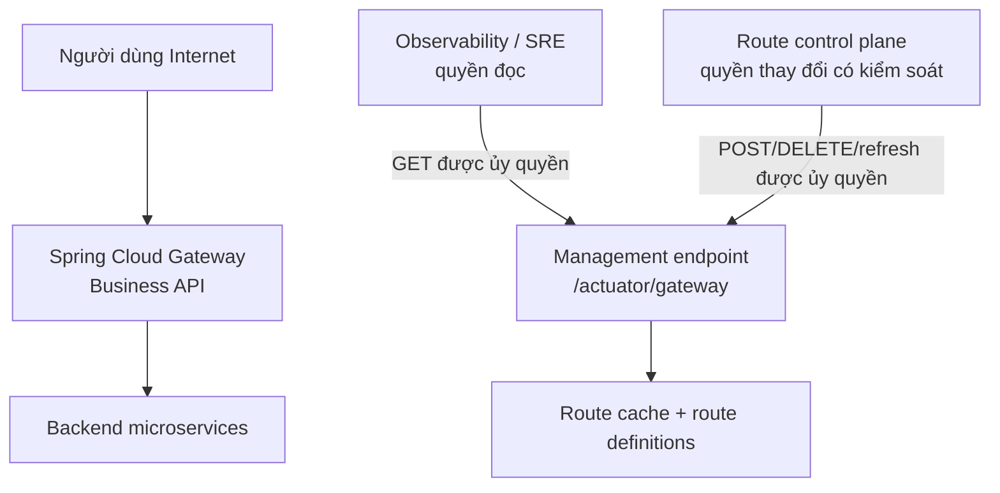
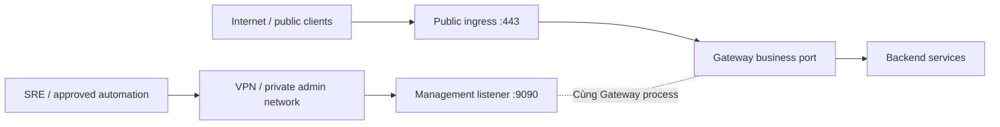
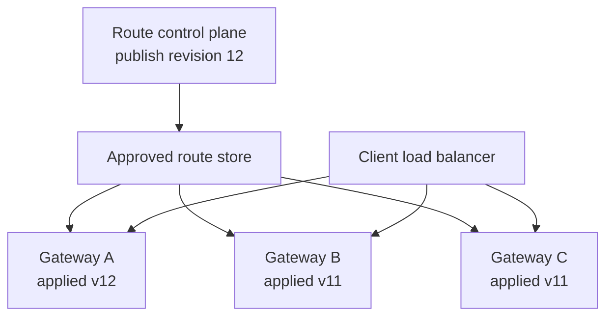
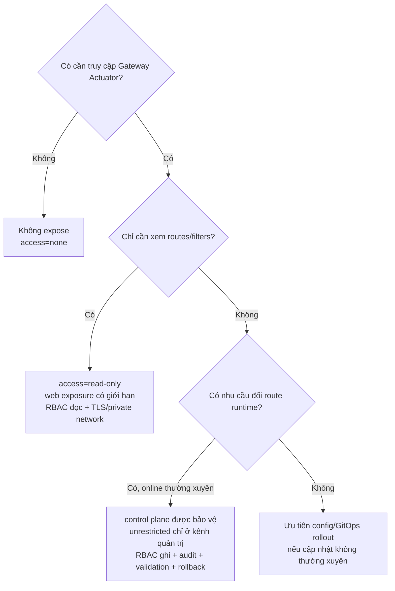

# Phân biệt exposure, quyền đọc và quyền thay đổi tuyến

## Mục tiêu bài học

Trong chương **Quản trị Actuator**, bài học này tập trung vào một nhầm lẫn nguy hiểm khi vận hành **Spring Cloud Gateway Server WebFlux**: **expose endpoint**, **cho phép thao tác đọc** và **cấp quyền thay đổi route** là **ba quyết định khác nhau**. Bật đường dẫn `/actuator/gateway` không nên đồng nghĩa với việc mọi client được xem toàn bộ tuyến nội bộ, càng không đồng nghĩa với việc họ được tạo, xóa hoặc refresh routes.

Sau bài học, bạn có thể:

- Giải thích sự khác nhau giữa **endpoint availability/access**, **web exposure**, **authentication**, **authorization** và **HTTP method**.
- Cấu hình Actuator Gateway ở chế độ **`read-only`** để quan sát route mà không cho thao tác thay đổi tuyến.
- Nhận biết tác động của **`unrestricted`** và cấu hình `enabled` cũ; biết vì sao không được dùng chúng trên management API công khai.
- Sử dụng các endpoint đọc như `GET /actuator/gateway/routes`, `routedefinitions`, `globalfilters`, `routefilters` và `routes/{id}`.
- Hiểu các endpoint ghi như `POST /actuator/gateway/routes/{id}`, `DELETE /actuator/gateway/routes/{id}` và `POST /actuator/gateway/refresh`.
- Thiết kế mạng quản trị riêng, TLS, Spring Security WebFlux, RBAC/scopes, CSRF policy và audit theo nguyên tắc **least privilege**.
- Phân biệt refresh cache với cập nhật nguồn route và việc đồng bộ **nhiều Gateway replicas**.
- Kiểm thử người dùng không có quyền, tài khoản chỉ đọc và người quản trị thay đổi tuyến mà không mở rộng đặc quyền ngoài dự kiến.

> **Phạm vi:** Spring Cloud Gateway **Server WebFlux**, Spring Boot Actuator và Spring Security **reactive** (`SecurityWebFilterChain`, `ServerHttpSecurity`). Không sử dụng `HttpSecurity` của Servlet/MVC như API tương đương. Tên thuộc tính và availability có thể thay đổi giữa các dòng Spring Boot/Spring Cloud Gateway; cần đối chiếu phiên bản dependency thực tế. Nội dung là hướng dẫn kỹ thuật STEP 4, chưa phải kết quả Content QA STEP 6.

## 1. Vì sao `/actuator/gateway` phải được xem là tài sản nhạy cảm?

API Gateway là cổng vào của nhiều microservices, chịu trách nhiệm:

```text
Client → TLS → Authentication → Route predicate
       → GatewayFilter chain (header/path, rate, retry, circuit breaker)
       → Service discovery/load balancing → Backend
```

Một route chứa nhiều hơn địa chỉ đích:

```yaml
id: orders-api
uri: lb://order-service
predicates:
  - Path=/api/orders/**
filters:
  - StripPrefix=1
order: -10
```

Nếu quản trị viên xem được route definitions, họ có thể biết phần nào kiến trúc nội bộ: service IDs, paths, thứ tự định tuyến và những filter đang hoạt động. Nếu còn **được sửa route**, họ có thể thay `uri`, thay `Path`, gỡ một filter hoặc ghi đè thứ tự ưu tiên, ảnh hưởng trực tiếp tới lưu lượng API và ranh giới bảo mật.



Đường truy cập của người dùng nghiệp vụ và đường quản trị trong sơ đồ **không nên dùng chung một chính sách bảo mật**. Dù được đặt trong cùng JVM, chúng có thể cần network segmentation, tài khoản, scopes và monitoring riêng.

**Rủi ro điển hình:**

- Lộ tên service hoặc URI nội bộ qua danh sách route.
- Tạo route wildcard `Path=/**` để chiếm traffic của những route hợp lệ.
- Chuyển `uri` tới một đích không đáng tin, gây **SSRF** hoặc chuyển dữ liệu qua một server khác.
- Gỡ hoặc thay filter bảo mật, CORS, rate limiting và header.
- Dùng `refresh` lúc traffic lớn để kích hoạt thay đổi không được phê duyệt.
- Một thay đổi trên một replica làm cụm Gateway có các route versions khác nhau.

Tuy vậy, **expose GET để quan sát** và **cấp quyền điều khiển runtime** là hai nhu cầu khác nhau. Nguyên tắc mặc định nên là: **không expose nếu không cần; nếu cần, ưu tiên chỉ đọc; nếu cần ghi, tạo một bề mặt quản trị được bảo vệ mạnh hơn**.

## 2. Ba lớp quyết định độc lập

Để hiểu Actuator, tách ba câu hỏi:

1. **Endpoint có được cung cấp và expose qua HTTP/JMX không?** Đây là nhóm cấu hình **availability/access + exposure**.
2. **Những thao tác nào được framework cho phép?** Chỉ các operation đọc hay cả thao tác ghi/xóa/refresh.
3. **Ai được quyền gọi từng thao tác?** Đây là **authentication/authorization** do security layer và hạ tầng quản trị thực thi.

| Lớp | Câu hỏi | Cơ chế minh họa |
| --- | --- | --- |
| Availability/access | Gateway actuator operation có khả dụng không? | `management.endpoint.gateway.access` |
| Web exposure | Endpoint có được xuất bản qua HTTP không? | `management.endpoints.web.exposure.include` |
| Web path/network | HTTP listener nằm ở đâu, ai có thể kết nối? | `management.server.port`, firewall, ingress, Kubernetes NetworkPolicy |
| Authentication | Người gọi đã chứng minh danh tính chưa? | mTLS, OAuth2/JWT, identity-aware proxy |
| Authorization | Danh tính ấy được GET hay POST/DELETE? | `SecurityWebFilterChain`, roles/scopes, policy ở control plane |
| Audit/approval | Ai yêu cầu đổi route, ai phê duyệt, revision nào? | Quản trị cấu hình, GitOps hoặc control plane |

**`management.endpoints.web.exposure.include=gateway` không cấp danh tính hoặc quyền ghi cho bất kỳ người dùng nào.** Nó chỉ đưa endpoint vào phạm vi có thể truy cập qua web **khi các điều kiện availability khác cho phép**. Nếu Spring Security/web policy đang chặn, request vẫn bị từ chối.

Ngược lại, chỉ cấu hình Spring Security `hasRole("OPS")` cũng **không làm hiện ra** một endpoint mà Actuator chưa expose hoặc chưa cho phép access.

### 2.1. Một phép kiểm tra tư duy

Hãy đánh giá request:

```http
POST /actuator/gateway/refresh HTTP/1.1
Host: management.internal.example
Authorization: Bearer <operator-token>
```

Để thao tác thành công, cần đồng thời:

- Gateway actuator và **write operation** tương ứng được framework cung cấp.
- Endpoint được expose qua đường HTTP thích hợp.
- Client kết nối được tới management listener qua TLS/network policy.
- Token được xác thực và có quyền phù hợp với hành động refresh.
- CSRF (nếu được bật trong security chain) và các chính sách bổ sung được đáp ứng.

Nếu bất kỳ lớp nào không thỏa, thao tác có thể thất bại. Không kết luận nguyên nhân chỉ từ một mã HTTP duy nhất mà chưa xem cấu hình hiệu lực.

## 3. `management.endpoint.gateway.access` khác `web.exposure.include`

Trong những dòng Spring Boot/Cloud Gateway hỗ trợ **Actuator access levels**, thuộc tính:

```properties
management.endpoint.gateway.access=read-only
```

giới hạn operations của Gateway actuator ở mức đọc. Còn:

```properties
management.endpoints.web.exposure.include=gateway
```

cho phép endpoint `gateway` xuất hiện qua HTTP.

Hai thuộc tính giải quyết **hai trục riêng**.

### 3.1. Các mức `access`

| Giá trị | Ý nghĩa chung của Spring Boot Actuator | Với Gateway actuator |
| --- | --- | --- |
| `none` | Không cho phép các operation của endpoint | Gateway actuator không khả dụng qua cơ chế ấy |
| `read-only` | Chỉ cho phép operation đọc | Quan sát routes/filters; không cho create/delete/refresh route qua actuator |
| `unrestricted` | Có thể dùng cả operation đọc và ghi được endpoint cung cấp | Có thể tạo, xóa và refresh route khi còn đủ điều kiện access/security |

Kể cả `unrestricted` **không đồng nghĩa** “ai ngoài Internet đều được phép”. Authorization và network access vẫn cần được triển khai. Nhưng một endpoint unrestricted bị expose công khai và thiếu security là một **lỗ hổng quản trị nghiêm trọng**.

### 3.2. Exposure qua HTTP, JMX và mức access

Spring Boot Actuator tách việc expose qua web và JMX:

```properties
management.endpoints.web.exposure.include=health,info,gateway
management.endpoints.jmx.exposure.include=health
```

Nếu Gateway actuator chỉ cần qua HTTP cho đội vận hành, không nhất thiết phải expose nó qua JMX. Ngược lại, tắt HTTP exposure không tự chứng minh một JMX management channel khác cũng đã được tắt.

Spring Boot cũng có các thiết lập điều khiển access **toàn application** như:

```properties
management.endpoints.access.default=none
management.endpoints.access.max-permitted=read-only
```

Trong những phiên bản hỗ trợ, `max-permitted` có thể áp **trần access toàn cục**. Nếu max-permitted là `read-only`, một endpoint cấu hình `unrestricted` riêng cũng không vượt được trần đó. Những property này tác động tới **nhiều endpoints**, nên phải kiểm tra `health`, `info`, `prometheus` hoặc những endpoints khác vẫn khả dụng theo nhu cầu.

### 3.3. Nhầm lẫn với `enabled` trong tài liệu cũ

Nhiều ví dụ Spring Cloud Gateway cũ dùng:

```properties
management.endpoint.gateway.enabled=true
management.endpoints.web.exposure.include=gateway
```

Tài liệu Actuator API cho các dòng mới khuyến nghị **`management.endpoint.gateway.access=read-only`**; đồng thời cho biết `enabled=true` có thể mở khả năng thao tác tạo/xóa/refresh tương đương hướng `unrestricted` theo phiên bản.

Vì vậy:

- **Không sao chép `enabled=true` từ tài liệu cũ** rồi cho rằng nó là “bật GET nhưng không cho POST”.
- Không trộn `enabled=true`, `access=read-only` và overrides ngoài môi trường mà chưa xác minh giá trị hiệu lực.
- Với Spring Boot/Gateway version cũ chưa có access-level API, phải nghiên cứu **bảo vệ network/security** và hành vi actuator thực tế; không tự giả định hỗ trợ property mới.

**Phép kiểm thử bắt buộc:** khi cấu hình `read-only`, tài khoản đã xác thực chỉ đọc phải GET routes thành công **nhưng không thực hiện được POST refresh/POST route/DELETE route**.

## 4. Cấu hình an toàn ưu tiên: Gateway actuator chỉ đọc

Ví dụ minh họa `application.yml` trên một dòng Spring Boot/Cloud Gateway **hỗ trợ access-level**:

```yaml
management:
  server:
    port: 9090
  endpoints:
    web:
      exposure:
        include: "health,info,gateway"
    jmx:
      exposure:
        include: "health"
  endpoint:
    gateway:
      access: read-only
```

Ý nghĩa:

- Management HTTP listener dùng port `9090` khi framework và mô hình deploy hỗ trợ cổng riêng.
- Chỉ một số Actuator endpoints được expose qua web.
- Gateway actuator được phép **đọc**, không được dùng để thực hiện thay đổi tuyến.
- JMX không được cấu hình expose `gateway` trong ví dụ.

Đây **chưa phải cấu hình production hoàn chỉnh**: còn thiếu network policy, TLS ở management hop, xác thực, authorization và audit. Một management port khác **không tự là mạng riêng**; nếu Kubernetes Service/Ingress hoặc firewall vẫn công khai `9090`, endpoint có thể bị truy cập ngoài mong muốn.

### 4.1. Chỉ expose health khi không cần xem routes

Nếu các công cụ vận hành không cần xem route runtime:

```yaml
management:
  endpoints:
    web:
      exposure:
        include: "health"
  endpoint:
    gateway:
      access: none
```

Đây là lựa chọn giảm bề mặt tấn công. Nếu cần xem thông tin health/readiness, sử dụng endpoint health được giới hạn thông tin nhạy cảm, không cần mở `/actuator/gateway` chỉ để biết process còn chạy.

### 4.2. Không dùng `"*"` theo thói quen

Một cấu hình dễ làm lộ quá nhiều thông tin:

```yaml
management:
  endpoints:
    web:
      exposure:
        include: "*"
```

`"*"` nghĩa là cân nhắc expose một tập rộng các Actuator endpoints qua HTTP; trong YAML cần quote dấu `*`. Những endpoint như `env`, `beans`, `configprops`, `loggers`, `heapdump` hoặc route management có rủi ro khác nhau. Không bật chúng chỉ để thử `gateway/routes`.

**Nguyên tắc tối thiểu:** expose theo danh sách chính xác, kiểm tra `exclude` nếu có, và đối chiếu endpoint availability/access hiệu lực.

## 5. Quyền đọc: quan sát route, không điều khiển route

Khi `read-only` và các điều kiện mạng/security phù hợp, Gateway actuator cho phép những thao tác **quan sát**:

| Đường dẫn tương đối với `/actuator/gateway` | Method | Mục đích |
| --- | --- | --- |
| `/` | GET | Liệt kê các chức năng/subpaths mà actuator công bố |
| `/routes` | GET | Xem các route đang được Gateway nhận diện |
| `/routes/{id}` | GET | Xem route theo ID |
| `/routedefinitions` | GET | Xem dữ liệu route definitions theo giao diện hỗ trợ |
| `/globalfilters` | GET | Xem global filters và các order tương ứng |
| `/routefilters` | GET | Xem GatewayFilter factories đã đăng ký |
| `/routepredicates` | GET | Xem các route predicate factories |
| `/routes/{id}/combinedfilters` | GET | Xem combined filters của route theo phiên bản hỗ trợ |

**Lưu ý:** endpoint cụ thể và định dạng response có thể khác theo phiên bản. Chỉ bật/read các endpoint cần thiết; đừng lấy danh sách minh họa thành cam kết mọi bản đều hỗ trợ từng subpath.

### 5.1. Xem routes

Một request minh họa trong **môi trường quản trị đã xác thực**:

```bash
curl -i \
  "https://management.internal.example/actuator/gateway/routes" \
  -H "Authorization: Bearer <read-only-management-token>"
```

Response minh họa:

```json
[
  {
    "route_id": "orders-read",
    "predicate": "Paths: [/api/orders/**]",
    "filters": [
      "[[StripPrefix parts = 1], order = 1]"
    ],
    "uri": "lb://order-service",
    "order": -10
  }
]
```

Đây là **JSON ví dụ để đọc ý nghĩa**, không phải định dạng serialization bất biến. Spring Cloud Gateway có chế độ hiển thị **verbose** với predicate/filter dưới dạng chuỗi mô tả. Tên class, số order, format JSON và property bật/tắt verbose có thể khác theo bản phát hành.

### 5.2. Xem route đơn lẻ

```bash
curl -i \
  "https://management.internal.example/actuator/gateway/routes/orders-read" \
  -H "Authorization: Bearer <read-only-management-token>"
```

Nên xác minh:

1. `route_id` đúng như policy.
2. `predicate` có `Path`, `Method`, `Host` theo contract.
3. URI là logical service name `lb://` hoặc backend đã được phê duyệt.
4. Filter chain có những thành phần mong đợi (`StripPrefix`, rate limiter, CircuitBreaker...).
5. `order` không làm route wildcard khác match trước.

**Đọc được route không chứng minh route hoạt động đúng.** Vẫn cần HTTP integration test, trace, xác thực backend, trạng thái service discovery và kết quả load balancing.

### 5.3. `GET /routefilters` không nói tất cả filter đang chạy

`routefilters` thường mô tả **các GatewayFilter factory có sẵn** trong context. Nó không tự trả lời chính xác factory nào đã được áp dụng trên request cụ thể; hãy xem route và combined filters khi cần. Đừng hiểu một factory xuất hiện trong catalog đồng nghĩa mọi route sử dụng factory đó.

Tương tự, `globalfilters` thể hiện một tập global filters với order, nhưng Spring Security WebFlux `WebFilter` nằm trong lớp xử lý **khác**, không phải danh sách Gateway `GlobalFilter` bình thường. Kiểm tra access policy/security chain riêng.

### 5.4. Định dạng đọc không phải payload ghi

`GET /actuator/gateway/routes/{id}` có thể trả:

```json
{
  "route_id": "orders-read",
  "predicate": "Paths: [/api/orders/**]",
  "filters": ["[[StripPrefix parts = 1], order = 1]"],
  "uri": "lb://order-service",
  "order": -10
}
```

Trong khi endpoint **tạo route** thường yêu cầu **shortcut DSL strings** như `Path=/api/orders/**` và `StripPrefix=1`, không phải chuỗi diễn giải do GET render. Không copy-paste trực tiếp body GET vào POST để cập nhật route.

### 5.5. `read-only` vẫn cần bảo mật thông tin

Người chỉ đọc có thể thấy:

- Tên services và URIs nội bộ.
- Route paths có ý nghĩa sản phẩm hoặc quản trị.
- Filter names và thứ tự áp dụng.
- Cấu hình route có thể tiết lộ cách hệ thống xử lý authentication/rate/headers.

Hãy hạn chế quyền đọc cho đúng nhóm SRE/observability, bảo vệ TLS, giới hạn log response actuator, audit hoạt động truy vấn khi phù hợp và không gửi toàn bộ JSON route vào ticket/công cụ chat không được phép.

## 6. Quyền thay đổi tuyến: tạo, xóa và refresh

Nếu thực sự cần thay đổi route trong runtime qua Actuator, cấu hình access có thể là:

```yaml
management:
  endpoint:
    gateway:
      access: unrestricted
  endpoints:
    web:
      exposure:
        include: "gateway"
```

**Đây là cấu hình minh họa để hiểu chức năng, không phải cấu hình production an toàn đầy đủ.** Chỉ cân nhắc trên **management interface giới hạn mạnh**, với RBAC, audit, review, kiểm tra nội dung route và quy trình rollback. Không để một endpoint `unrestricted` truy cập tự do qua Internet.

### 6.1. Các thao tác thay đổi thường gặp

| Endpoint | Method | Hành vi |
| --- | --- | --- |
| `/actuator/gateway/routes/{id}` | POST | Tạo một route definition mới theo JSON được chấp nhận |
| `/actuator/gateway/routes/{id}` | DELETE | Xóa route definition do actuator quản lý, theo hỗ trợ của phiên bản |
| `/actuator/gateway/refresh` | POST | Yêu cầu refresh/clear route cache để áp dụng nguồn route hiện tại |
| `/actuator/gateway/routes` | POST | Một số phiên bản hỗ trợ tạo nhiều definitions trong một request |

**Không nhầm `POST /refresh` với `POST /routes/{id}`:** một lệnh yêu cầu tải lại tập route runtime; lệnh kia thay đổi nguồn route definitions actuator quản lý.

### 6.2. Tạo route trong môi trường thử nghiệm cô lập

Ví dụ **không thực thi trên Gateway production**. Sau khi control plane đã validate URI, path, filters và caller có quyền ghi, body có thể có dạng:

```json
{
  "uri": "lb://docs-service",
  "predicates": [
    "Path=/api/docs/**",
    "Method=GET"
  ],
  "filters": [
    "StripPrefix=1"
  ],
  "order": 0
}
```

Tài liệu Actuator API hiện hành mô tả `POST /actuator/gateway/routes/{id}` dùng **shortcut DSL strings** cho predicates/filters. Route ID được đưa vào `{id}` trong URL. Cần dùng JSON schema đúng phiên bản; cấu trúc GET verbose **khác** payload POST.

Lệnh minh họa, chỉ trên **management test listener** đã được bảo vệ:

```bash
curl -i -X POST \
  "https://management.test.internal/actuator/gateway/routes/docs-read" \
  -H "Authorization: Bearer <authorized-write-token>" \
  -H "Content-Type: application/json" \
  --data '{
    "uri": "lb://docs-service",
    "predicates": ["Path=/api/docs/**", "Method=GET"],
    "filters": ["StripPrefix=1"],
    "order": 0
  }'
```

Ở phiên bản Gateway hỗ trợ, thao tác thành công có thể trả **201 Created**. Nhưng **201 chỉ xác nhận bước tạo definition**, không đủ chứng minh request tới `/api/docs/**` đã được Gateway runtime định tuyến đúng.

> Dùng token placeholder ở ví dụ; trong vận hành thật không paste bearer token vào ticket, shell history, logs hoặc chia sẻ màn hình. Có thể dùng secret injection/CLI credential store được tổ chức phê duyệt.

### 6.3. Refresh route cache là thao tác thay đổi

Sau khi tạo/xóa definition, một thao tác thường được yêu cầu:

```bash
curl -i -X POST \
  "https://management.test.internal/actuator/gateway/refresh" \
  -H "Authorization: Bearer <authorized-write-token>"
```

Trong tài liệu Gateway Server WebFlux, refresh có thể trả **200 với body rỗng**, nhưng quy trình làm mới route/cache có các khía cạnh bất đồng bộ. **Một HTTP 200 của refresh không chứng minh mọi route đã hợp lệ hoặc mọi Gateway replica đã cập nhật.**

Cần:

1. Đọc lại route runtime trên chính replica được refresh.
2. Thử HTTP request qua Gateway vào route.
3. So sánh route/filter/predicate/URI với revision mong đợi.
4. Kiểm tra mọi replica khác nếu có nhiều instances.
5. Theo dõi 404/502/503, route matching, security và latency sau thay đổi.

### 6.4. Refresh theo metadata nếu phiên bản hỗ trợ

Một số dòng Gateway hỗ trợ refresh giới hạn route cache theo metadata:

```http
POST /actuator/gateway/refresh?metadata=group:group-1
```

Điều này có ích khi chỉ muốn làm mới một nhóm route có metadata tương ứng, nhưng phải kiểm tra semantics chính xác của phiên bản và không suy luận rằng một refresh cục bộ đã đồng bộ các Gateway replicas khác. Không đưa metadata do client chưa xác minh vào cơ chế chỉ đạo refresh.

### 6.5. Không nhầm quyền ghi actuator với quyền sửa mọi route

Trong tài liệu Gateway Actuator API mới, thao tác quản lý route qua endpoint chỉ sửa/xóa những route **được tạo qua cơ chế actuator tương ứng**; route định nghĩa trong `application.yml` hoặc Java `@Bean` thường là **read-only từ góc nhìn actuator writer**.

Ví dụ:

```text
Route orders-read được khai báo trong application.yml
    → GET /actuator/gateway/routes/orders-read: có thể xem
    → DELETE /actuator/gateway/routes/orders-read:
      không tự xóa route cấu hình; có thể trả 404
```

Vì vậy **`unrestricted` là quyền được gọi operation** chứ không phải bảo đảm mọi route source đều hỗ trợ sửa. Nếu muốn thay static route, quy trình đúng có thể là GitOps/config rollout hoặc control plane thiết kế cho chính nguồn đó.

### 6.6. Cẩn thận với POST cùng một route ID

Tài liệu Gateway Actuator API mới cảnh báo rằng **POST lại một route ID đã tồn tại** có thể tạo definition trùng và khiến một số thao tác GET route trả lỗi 500 ở phiên bản chịu ảnh hưởng. Quy trình sửa actuator-managed route được tài liệu mô tả là:

```text
DELETE route cũ
→ POST route definition mới
→ POST refresh
```

Tuy nhiên, đây **không phải một transaction atomic**, có thể tạo cửa sổ route thiếu hoặc trạng thái lệch giữa replicas. Với hệ thống quan trọng, nên có **control plane versioned + approval + validation + rollback** thay vì thực hiện bằng các lệnh thủ công thiếu kiểm soát.

## 7. Ma trận phân biệt exposure, access và authorization

Giả sử:

- **Observer** có scope `gateway.routes.read`.
- **Operator** có thêm scope `gateway.routes.write`.
- **Anonymous** chưa đăng nhập.
- Management endpoint có TLS, network restriction và Spring Security.

| Endpoint được expose? | Access level | Caller | GET routes | POST refresh / DELETE |
| --- | --- | --- | --- | --- |
| Không | Bất kỳ | Bất kỳ | Không qua web | Không qua web |
| Có | `none` | Bất kỳ | Không khả dụng | Không khả dụng |
| Có | `read-only` | Anonymous | Bị security từ chối | Không có write operation |
| Có | `read-only` | Observer | **Cho phép đọc** nếu có quyền | **Không có write operation**, dù observer thử |
| Có | `read-only` | Operator | Có thể đọc nếu được cấp | Không ghi qua actuator, kể cả có role admin |
| Có | `unrestricted` | Anonymous | Security phải từ chối | Security phải từ chối |
| Có | `unrestricted` | Observer | Có thể đọc | **Security phải từ chối ghi** |
| Có | `unrestricted` | Operator | Có thể đọc | Chỉ cho ghi khi RBAC và validation đều thỏa |

Kết quả cụ thể có thể là 401, 403, 404 hoặc 405 tùy lớp xử lý và phiên bản. Hãy kiểm tra **hành vi cuối** (không tạo/xóa/refresh được) thay vì cố gắng ép mọi trường hợp có cùng một status.

### 7.1. Endpoint access không phải quyền ứng dụng

`management.endpoint.gateway.access=read-only` áp dụng ở **độ sẵn có của operation**. Nó không hiểu một tổ chức có những roles như:

```text
SRE_VIEWER
ROUTE_EDITOR
SECURITY_APPROVER
```

Những roles/scopes là công việc của Spring Security, identity provider hoặc control plane. Tương tự, `unrestricted` không tự xác thực người gọi. Bật `unrestricted` mà thiếu security giống như **xuất bản các thao tác điều khiển tuyến không có ranh giới quyền**.

### 7.2. Phân tách theo HTTP method chỉ là một lớp

Đội vận hành có thể đặt quy tắc:

```text
GET  /actuator/gateway/**     → read scope
POST /actuator/gateway/**     → write scope
DELETE /actuator/gateway/**   → write scope
```

Đây là **minh họa RBAC**, không thay `management.endpoint.gateway.access`. Một configuration chỉ đọc an toàn có thể **không cần tồn tại POST operation**; đó là defense in depth mạnh hơn việc tạo operation rồi chỉ dựa vào security rule để chặn.

## 8. Spring Security WebFlux: khóa endpoint quản trị

Trong Spring Cloud Gateway **Server WebFlux**, sử dụng `SecurityWebFilterChain`, không phải Servlet `SecurityFilterChain`/`HttpSecurity`. Một route-level `GatewayFilter` thường chạy **sau** lớp WebFlux security và không phải cách thích hợp để bảo vệ endpoint Actuator, bởi `/actuator/gateway` do actuator handler phục vụ chứ không nhất thiết qua Gateway route filtering chain.

### 8.1. Ví dụ bảo vệ Gateway actuator bằng JWT scope đọc

Ví dụ **Spring Boot 3.x WebFlux API** (cần điều chỉnh imports nếu dùng Boot 4.x):

```java
import org.springframework.boot.actuate.autoconfigure.security.reactive.EndpointRequest;
import org.springframework.context.annotation.Bean;
import org.springframework.context.annotation.Configuration;
import org.springframework.core.annotation.Order;
import org.springframework.security.config.Customizer;
import org.springframework.security.config.web.server.ServerHttpSecurity;
import org.springframework.security.web.server.SecurityWebFilterChain;

@Configuration
class GatewayActuatorSecurityConfiguration {

    @Bean
    @Order(0)
    SecurityWebFilterChain actuatorReadSecurity(ServerHttpSecurity http) {
        return http
            .securityMatcher(EndpointRequest.to("gateway"))
            .authorizeExchange(exchanges -> exchanges
                .anyExchange()
                .hasAuthority("SCOPE_gateway.routes.read")
            )
            .oauth2ResourceServer(oauth2 -> oauth2
                .jwt(Customizer.withDefaults())
            )
            .build();
    }

    @Bean
    @Order(1)
    SecurityWebFilterChain businessApiSecurity(ServerHttpSecurity http) {
        return http
            .authorizeExchange(exchanges -> exchanges
                .pathMatchers("/actuator/health").permitAll()
                .anyExchange().authenticated()
            )
            .oauth2ResourceServer(oauth2 -> oauth2
                .jwt(Customizer.withDefaults())
            )
            .build();
    }
}
```

Giải thích:

- `EndpointRequest.to("gateway")` giúp matcher nhận diện Gateway actuator endpoint theo cấu hình management base path trong những phiên bản hỗ trợ.
- `@Order(0)` giúp chuỗi security chuyên biệt được xét trước chain rộng hơn.
- `.hasAuthority("SCOPE_gateway.routes.read")` giả định JWT converter tạo authority theo scope `gateway.routes.read`. Phải kiểm tra cách identity provider và JWT converter ánh xạ claims.
- Chain thứ hai là **ví dụ fallback cho business API**, ngăn việc tạo một chain chỉ dành cho Actuator rồi để các path khác không được bảo vệ.
- JWT issuer, JWK trust, audience/scope validation, TLS và routing tới management port phải được cấu hình riêng.

Đoạn code **không tự là cấu hình đầy đủ production**. Nếu Actuator chạy trong một management web context/port riêng, cần xác minh security chains thực sự áp lên listener đó. Không giả định chỉ vì class có trong project mà management port đã được bảo vệ; hãy thử request trực tiếp vào cổng quản trị.

Trong các dòng Boot mới, package của `EndpointRequest` hoặc các security auto-configurations có thể đổi. Hãy dùng tài liệu/javadoc của **đúng phiên bản dự án** và test compile; đừng trộn imports WebFlux/Servlet.

### 8.2. Vì sao code trên không phải “write RBAC”?

Code ở mục 8.1 được viết cho **read-only management access**. Nếu đổi:

```yaml
management:
  endpoint:
    gateway:
      access: unrestricted
```

nhưng giữ `.anyExchange().hasAuthority("SCOPE_gateway.routes.read")`, thì **người có read scope có thể được security cho qua cả POST/DELETE**, nếu không có quy tắc method khác chặn. Đây là một lỗi cấu hình đặc quyền nghiêm trọng.

**Không dùng một rule đọc chung làm rule cho mọi HTTP method khi write operations được enable.**

### 8.3. Phân quyền GET khác POST/DELETE

Một cách minh họa nếu bắt buộc phải mở các thao tác ghi:

```java
import org.springframework.http.HttpMethod;

@Bean
@Order(0)
SecurityWebFilterChain actuatorWriteSecurity(ServerHttpSecurity http) {
    return http
        .securityMatcher(EndpointRequest.to("gateway"))
        .authorizeExchange(exchanges -> exchanges
            .pathMatchers(HttpMethod.GET, "/actuator/gateway/**")
                .hasAuthority("SCOPE_gateway.routes.read")
            .pathMatchers(HttpMethod.POST, "/actuator/gateway/**")
                .hasAuthority("SCOPE_gateway.routes.write")
            .pathMatchers(HttpMethod.DELETE, "/actuator/gateway/**")
                .hasAuthority("SCOPE_gateway.routes.write")
            .anyExchange().denyAll()
        )
        .oauth2ResourceServer(oauth2 -> oauth2
            .jwt(Customizer.withDefaults())
        )
        .build();
}
```

Đây là **một biến thể thay thế** cho bean `actuatorReadSecurity`, không khai báo cả hai chain cùng `@Order(0)` với matcher trùng nhau. Mẫu này:

- Giả định Actuator base path `/actuator` và Gateway endpoint `/gateway`.
- Dùng scopes tách biệt theo **read** và **write**; Operator có quyền write có thể cần được cấp **cả hai scopes**.
- Không cho phép `PUT`, `PATCH` hoặc method khác theo mặc định.
- Vẫn yêu cầu `management.endpoint.gateway.access=unrestricted` trên những bản hỗ trợ.
- Vẫn phải có TLS, quản lý danh tính, network segmentation và policy validation.

**Không tự sửa nguyên mẫu này để tắt CSRF toàn Gateway**. Nếu management writer chỉ nhận bearer token trong `Authorization` header và không có cơ chế cookie/credential browser tự gửi, có thể cân nhắc vô hiệu hóa CSRF **theo riêng security chain management** sau khi đánh giá threat model. Nếu quản trị qua browser dùng session cookie, **phải giữ/thiết kế CSRF protection** cho các thao tác POST/DELETE. CORS không thay CSRF.

### 8.4. Không tin `X-User` hay `X-Admin` do client gửi

Một reverse proxy hoặc API Gateway có thể chèn identity headers cho backend, nhưng Actuator management **không được** coi header do Internet client tự đặt như:

```http
X-Admin: true
X-Operator-Role: ROUTE_EDITOR
```

là chứng cứ được phép thay route. Danh tính quản trị cần đến từ mTLS, JWT/OAuth2 đã được xác minh hoặc identity-aware proxy **được tin cậy**, với network boundaries và header sanitization rõ ràng.

## 9. Network isolation quan trọng không kém RBAC

Một kiến trúc đề xuất:



Những biện pháp thường dùng:

1. **Không route `/actuator/gateway/**` qua public ingress**.
2. Dùng **management port** riêng và Service/Ingress nội bộ khi cần.
3. Dùng firewall, VPC, Kubernetes NetworkPolicy hoặc service mesh policy để chỉ máy/quy trình quản trị được phép kết nối.
4. Dùng **TLS có xác minh chứng chỉ**, cân nhắc mTLS cho kênh điều khiển nhạy cảm.
5. Dùng **identity-based authorization** và tài khoản dịch vụ riêng cho automation.
6. Giới hạn rate/connection của management listener, theo dõi request bất thường.
7. Không phát management URLs/credentials vào client bundle, static JavaScript hoặc log công khai.

### 9.1. `management.server.port` không đồng nghĩa riêng mạng

Ví dụ:

```yaml
management:
  server:
    port: 9090
```

chỉ tách listener HTTP theo cấu hình runtime. Nếu Kubernetes Service công khai cả 8080 lẫn 9090 hoặc firewall mở 9090 cho mọi nơi, management endpoint **vẫn có thể truy cập từ bên ngoài**.

Có thể cân nhắc bind địa chỉ quản trị riêng qua `management.server.address` khi phù hợp, nhưng phải kiểm tra triển khai container/pod networking: bind `127.0.0.1` có thể khiến sidecar, Prometheus hay quản trị từ pod khác không kết nối được, còn bind `0.0.0.0` cần network policy chặt.

### 9.2. Chặn ở ingress chưa đủ nếu có đường bypass

Nếu public ingress chặn `/actuator/**` nhưng vẫn tồn tại NodePort, hostNetwork, pod IP công khai, private load balancer chưa bảo vệ hoặc một proxy khác route trực tiếp tới management port, security có thể bị bỏ qua. Hãy thử **mọi đường truy cập thực tế**.

Ngược lại, cấu hình security mạnh trong ứng dụng cũng không thay nhu cầu tách mạng; một lỗ hổng tương lai trong Actuator/Gateway có thể làm hỏng lớp authentication dự kiến. Defense in depth giúp giảm tác động.

## 10. Tại sao quyền ghi cần được coi như quyền triển khai?

Cho phép sửa route runtime gần giống cho một người quyền thay đổi **bản đồ lưu lượng ứng dụng**.

### 10.1. Route hijack bởi path và order

Ví dụ route có thể gây nguy hiểm:

```json
{
  "uri": "http://unapproved.example",
  "predicates": ["Path=/**"],
  "filters": ["StripPrefix=0"],
  "order": -100
}
```

Nếu được publish không kiểm tra, route có predicate rộng và order ưu tiên cao có thể match nhiều request trước những route hợp lệ, chuyển traffic sai đích. **Đây là ví dụ nhận diện rủi ro, không được dùng làm thao tác quản trị thực tế.**

Một control plane phải validate route ID, path ownership, host predicate, method, priority và khả năng **route shadowing** trước khi publish.

### 10.2. SSRF và backend identity

Các URI như:

```text
http://127.0.0.1:...
http://169.254.169.254/...
http://an-internal-control-service/...
```

không nên được chấp nhận chỉ vì parse URI thành công. Gateway có vị trí mạng nội bộ và có thể truy cập những đích mà client Internet không tới được.

Hãy dùng:

- Allowlist scheme, logical service IDs, host/port hoặc service registry IDs.
- Policy kiểm soát DNS rebinding, redirects và dải địa chỉ nội bộ/metadata theo trust boundary.
- Xác minh đích HTTPS, hostname/SNI/certificate và outbound authorization.
- Kiểm tra khả năng route loop trở lại Gateway/management listener.

Không coi route **có cùng `lb://` prefix** là mặc nhiên được phép: một service ID nội bộ có thể không nên được public.

### 10.3. Filters có thể thay đổi security posture

Người tạo route còn có thể chọn filters:

```text
RemoveRequestHeader
SetRequestHeader
RewritePath
ModifyRequestBody
RequestRateLimiter
Retry
CircuitBreaker
```

Một route mới có thể gỡ header chứng thực, ghi đè identity headers, thay đổi path, mở CORS hoặc loại một rate limiter đang bảo vệ service. Do đó không chỉ validate `uri`; cần allowlist **filter factories và arguments**, cấm những tổ hợp không được phép và test quyền thực tế.

### 10.4. Lỗ hổng lịch sử là lý do để vá và hạn chế exposure

Spring đã công bố các cảnh báo bảo mật liên quan **Spring Cloud Gateway Server WebFlux Actuator endpoint** khi bị expose/không bảo vệ ở những phiên bản chịu ảnh hưởng, bao gồm các vấn đề liên quan cách route có thể được sử dụng để truy cập thông tin hoặc thay đổi trạng thái ngoài ý muốn.

Không cần phụ thuộc vào một mã CVE để ra quyết định kiến trúc: **nếu không cần quyền ghi actuator thì không bật quyền ghi; nếu cần, giới hạn mạng, xác thực mạnh, kiểm tra quyền, cập nhật bản vá và có audit/rollback**. Kiểm tra advisory và bản sửa lỗi theo đúng dependency đang chạy.

## 11. Refresh không phải đồng bộ route toàn cụm

Giả sử:

```text
Gateway A: route revision 12
Gateway B: route revision 11
Gateway C: route revision 11
```

Operator gửi:

```http
POST /actuator/gateway/refresh
```

đến **Gateway A** thông qua một load balancer. Điều này không tự tạo sự kiện refresh ở B và C. Với state in-memory/local hoặc route cache mỗi JVM, các replicas có thể tiếp tục dùng các revisions khác nhau.



**Refresh endpoint không phải distributed transaction.** Cần một cơ chế control plane, broadcast/reconciliation hoặc rollout config đảm bảo từng replica nhận đúng revision, cùng telemetry và readback.

### 11.1. Nguồn route quyết định khả năng thay đổi

| Nguồn route | Quan sát qua Actuator | Có thể sửa trực tiếp bằng actuator writer? |
| --- | --- | --- |
| `application.yml` | Thường có thể GET route runtime | Thường không sửa/xóa trực tiếp bằng Actuator |
| Java `@Bean` RouteLocator | Thường có thể GET route runtime | Không tự thành mutable definition |
| In-memory actuator-managed definitions | Có thể GET sau khi tạo/refresh | Có thể POST/DELETE theo implementation và access |
| Custom `RouteDefinitionRepository` | Có thể xuất hiện sau khi locator được nạp | Phụ thuộc writer/repository, security và API |
| Externalized config (Git/Config Server) | Có thể GET nếu Gateway đã áp dụng | Refresh Gateway cache không tự thay Git/environment |
| Discovery locator | Có thể sinh route từ registry | Không được coi registry update là Actuator CRUD |

Nếu mục tiêu chỉ là đổi **backend instance** cho `lb://order-service`, thường dùng **service discovery/load balancing**. Không cần cấp quyền ghi Actuator để thay IP mỗi pod.

### 11.2. Xác nhận applied version

Đối với hệ thống cần dynamic route source, nên quản lý:

```text
desiredRevision = 43
appliedRevision.gateway-a = 43
appliedRevision.gateway-b = 43
appliedRevision.gateway-c = 43
```

Đây là **metadata ứng dụng/control plane do bạn thiết kế**, không phải field mặc định có sẵn trên mọi Actuator Gateway response. Có thể dùng hash của RouteSet được canonicalize, số version hoặc ETag theo hợp đồng riêng để phát hiện drift.

Chỉ tuyên bố thay đổi thành công khi HTTP probes và metrics xác nhận route behavior, không chỉ khi API quản trị báo 200.

## 12. Quy trình phát hành thay đổi tuyến an toàn

Thay vì trực tiếp cho operator gõ POST route vào production, ưu tiên workflow:

```text
Draft route change
  ↓
Schema validation
  ↓
Security/policy validation
  ↓
Peer review / approval
  ↓
Persist immutable revision
  ↓
Publish to approved route store
  ↓
Refresh/reconcile Gateway replicas
  ↓
Verify routes + HTTP behavior
  ↓
Promote / Rollback
```

### 12.1. Kiểm tra trước publish

1. Người yêu cầu có quyền **sửa namespace route đó**, không chỉ có quyền đăng nhập quản trị chung.
2. URI thuộc danh sách dịch vụ/host/port được phê duyệt và không tạo SSRF/loop.
3. Path, Host, Method, `order` không shadow route quan trọng.
4. Filters không bỏ hoặc làm yếu authentication, authorization, CORS, rate limiting, CSRF.
5. `Retry` không áp vào POST thiếu idempotency; `CircuitBreaker` fallback không giả thành công nghiệp vụ.
6. Inbound/outbound TLS và chứng chỉ vẫn phù hợp với endpoint mới.
7. Có integration tests/smoke tests/rollback procedure cho route mới.

### 12.2. Xác minh sau refresh

- `GET /actuator/gateway/routes` và `GET /routes/{id}` trả route mong đợi.
- Request thật match `Path`/`Method`/`Host` dự kiến.
- Backend stub hoặc trace xác minh path/headers/URI sau rewrite.
- Spring Security vẫn chặn request thiếu JWT/role/scope.
- Rate limiter, CircuitBreaker, Retry và CORS xử lý đúng.
- Tất cả Gateway replicas hội tụ về revision.
- Tỷ lệ 404, 401/403, 429, 5xx và p95/p99 latency không tăng bất thường.

### 12.3. Rollback

Nếu route mới không an toàn hoặc làm lỗi traffic:

1. Dừng publish các revisions tiếp theo.
2. Phát lại revision đã được xác minh hoặc rollback deploy/config.
3. Refresh/reconcile những replicas cần thiết.
4. Kiểm tra route runtime và HTTP behavior trên từng replica.
5. Ghi audit về nguyên nhân, phạm vi ảnh hưởng và người phê duyệt rollback.

Không nghĩ rằng một `DELETE` thành công tự hoàn tất rollback, đặc biệt khi request còn đang in-flight và nhiều replicas có route cache khác nhau.

## 13. Chẩn đoán lỗi exposure, quyền đọc và quyền ghi

| Triệu chứng | Nguyên nhân khả dĩ | Hướng kiểm tra |
| --- | --- | --- |
| `GET /actuator/gateway/routes` → 404 | Gateway endpoint chưa available/expose, sai base path/port hoặc handler không tồn tại | Dependencies, `access`, web exposure, management port/base path |
| GET → 401 | Chưa xác thực hoặc bearer token không hợp lệ | JWT issuer/audience, authentication entry point, proxy/mTLS |
| GET → 403 | Đã xác thực nhưng thiếu scope/role hoặc bị policy khác chặn | `SecurityWebFilterChain`, authority mapping, RBAC |
| GET thành công, POST refresh không làm được | `read-only` hoặc security từ chối write | Access level, HTTP method, scopes, CSRF, JMX/web exposure |
| POST route → 401/403 | Người gọi không có quyền ghi, CSRF policy, security match sai | Read/write scopes, cookie vs bearer, WebFilterChain |
| POST route → 201 nhưng chưa match route | Chưa refresh, route cache cũ hoặc target/predicate sai | POST refresh, runtime readback, HTTP probe |
| DELETE static route → 404 | Route nằm trong YAML/Java DSL, không thuộc actuator-managed writer | Phân biệt source/writer; dùng config rollout |
| GET routes → 500 sau ghi cùng ID | Trùng route definitions hoặc lỗi build/serialization | Kiểm tra IDs và bản Gateway, rollback route mới |
| Chỉ pod A thấy route mới | Refresh cục bộ/chưa reconcile | Readback từng pod, desired/applied version |
| Browser báo CORS khi gọi management | CORS không được cấp phép hoặc security preflight chặn | Không mở public CORS; dùng quản trị qua private network/CLI |
| Operator thấy thay đổi 200 nhưng traffic sai | Route order/shadowing, filter rewrite, backend không khỏe | End-to-end tests, trace, metrics, rollback |

### 13.1. 404 không luôn nghĩa route không tồn tại

Nếu actuator không expose, yêu cầu tới `/actuator/gateway/routes` có thể trả 404 ngay từ server. Nếu actuator có tồn tại nhưng caller không đủ quyền, có thể nhận 401/403. Nếu route ID được yêu cầu không tồn tại, `GET /routes/{id}` có thể trả một lỗi khác tùy implementation.

Do đó:

```text
HTTP 404 từ Actuator management path
    ≠ HTTP 404 từ route/business API
    ≠ bằng chứng chắc chắn user thiếu quyền
```

Định vị lỗi theo **host + port + path + method + security chain + handler**.

### 13.2. 405 có thể là do access mode hoặc method

Khi một write operation không khả dụng ở chế độ `read-only`, kết quả không nhất thiết là `403`: tùy actuator/framework và mapping thực tế, operation có thể không được đăng ký hoặc method không được chấp nhận, dẫn đến 404/405. Test quan trọng là request **không gây thay đổi route**, không phải cố định một status code duy nhất.

### 13.3. CSRF gây 403 trên POST

Trong Spring Security WebFlux, nếu chain quản trị dùng **session cookie** và CSRF protection đang bật, một request POST/DELETE thiếu token có thể trả 403 dù người gọi là admin. Đây là chính sách bảo vệ cần thiết với cookie browser.

Với automation sử dụng **bearer header duy nhất**, threat model khác; có thể cấu hình CSRF riêng cho non-browser management chain nếu phù hợp. Không khắc phục bằng cách `csrf.disable()` toàn Gateway mà không biết endpoint nào còn dùng cookie.

## 14. Kiểm thử phân quyền tự động

Một integration test tốt phải xác nhận **cả status và việc route definitions/runtime có bị thay đổi hay không**.

### 14.1. Test theo vai trò

Giả sử management access đang `read-only`:

| Người gọi | GET routes | POST refresh | POST route | DELETE route |
| --- | --- | --- | --- | --- |
| Anonymous | Không cho phép | Không cho phép | Không cho phép | Không cho phép |
| JWT sai/hết hạn | Không cho phép | Không cho phép | Không cho phép | Không cho phép |
| Reader hợp lệ | Cho phép | **Không có hiệu lực** | **Không có hiệu lực** | **Không có hiệu lực** |
| Operator hợp lệ | Cho phép nếu có read scope | **Không có hiệu lực** dù có write scope | **Không có hiệu lực** | **Không có hiệu lực** |

Đổi sang `unrestricted` **trong một test/deployment riêng có kiểm soát**:

| Người gọi | GET routes | POST refresh | POST route | DELETE route |
| --- | --- | --- | --- | --- |
| Anonymous | Từ chối | Từ chối | Từ chối | Từ chối |
| Reader | Cho phép | Từ chối | Từ chối | Từ chối |
| Operator có read + write scopes | Cho phép | Cho phép theo policy | Cho phép sau validation | Cho phép theo ownership |

Việc dùng hai môi trường/test profiles giúp tránh phải mở quyền ghi trên Gateway production chỉ để kiểm tra security.

### 14.2. WebTestClient với mock identities

Đối với Spring Boot WebFlux test đã bật security và actuator đúng profile, có thể dùng `WebTestClient` kèm các test support phù hợp để giả lập user. Ví dụ **khung assertion**:

```java
// Test setup: WebTestClient đã gắn với Spring application context,
// JWT/user test có authority SCOPE_gateway.routes.read.
webTestClient.get()
    .uri("/actuator/gateway/routes")
    .exchange()
    .expectStatus().isOk();

// Chỉ trên profile read-only:
webTestClient.post()
    .uri("/actuator/gateway/refresh")
    .exchange()
    .expectStatus().value(status -> {
        if (status >= 200 && status < 300) {
            throw new AssertionError(
                "Read-only mode must not permit refresh"
            );
        }
    });
```

Đoạn code chỉ minh họa assert, **không thể chạy độc lập** vì chưa có test security identity, ứng dụng, web binding hoặc cấu hình port. Nếu Actuator chạy trên port riêng, `WebTestClient` phải kết nối tới đúng **management listener**, không chỉ application port.

Test bổ sung nên xác minh không có route nào thay đổi sau một POST bị từ chối. Với chế độ `unrestricted`, cần test người chỉ đọc **không thể ghi** dù dùng HTTP POST/DELETE với payload đúng cú pháp.

### 14.3. Ma trận vận hành toàn diện

| Trường hợp | Điều cần xác nhận |
| --- | --- |
| Endpoint chưa expose | Không truy cập từ web |
| Gateway access `none` | Không có operations |
| `read-only` và Reader | GET hoạt động |
| `read-only` và Operator | POST/DELETE không tạo tác động |
| `unrestricted` và Reader | POST/DELETE bị RBAC từ chối |
| `unrestricted` và Operator | Mutation chỉ trên route được phê duyệt |
| Wrong base path/port | Client không nhầm application API với management |
| Public ingress | Không route traffic tới management endpoint |
| JMX | Không vô tình mở quyền trên kênh riêng |
| CSRF cookie session | POST thiếu/sai token bị chặn |
| Bearer automation | JWT hợp lệ/đủ scope, không nhận cookie fallback |
| Static route | Không bị actuator writer xóa ngoài ý muốn |
| Duplicate ID | Không làm route runtime hỏng |
| Invalid URI/filter | Bị validate/reject trước publish |
| Multi-replica | Refresh/reconciliation và convergence được kiểm chứng |
| Rollback | Trả về route revision tốt và HTTP behavior đúng |
| Audit | Có actor, action, route ID, revision, outcome; không log secret |

## 15. Quan sát và audit thao tác quản trị

Không nên chỉ ghi:

```text
POST /actuator/gateway/routes/orders-read 201
```

Đối với thay đổi tuyến có tác động bảo mật, cần biết **ai làm gì, trên môi trường nào, với revision nào**.

Một audit event có thể chứa:

```json
{
  "actor": "route-operator-service",
  "action": "route.publish",
  "routeId": "docs-read",
  "revision": 43,
  "result": "approved-and-applied",
  "environment": "staging",
  "changeRequest": "CHANGE-123"
}
```

Đây là **schema audit do tổ chức thiết kế**, không phải JSON bắt buộc mà Spring Cloud Gateway Actuator tự ghi. Audit nên tách khỏi log thường để quản lý retention, quyền truy cập và tính toàn vẹn.

Các tín hiệu nên quan sát:

- Tổng số **GET introspection** tới gateway actuator và caller scope hợp lệ.
- Số yêu cầu **mutation** được chấp nhận, từ chối bởi RBAC hoặc thất bại do validation.
- Route revision mong muốn và revision đã áp trên từng replica.
- Thời gian hội tụ sau refresh, lỗi cache/repository.
- HTTP 404/502/503 và p95/p99 latency sau thay đổi route.
- Route cardinality, filters được áp và SSRF/policy violations.
- Số lần rollback và số routes bị shadowing/predicate conflict.

**Không ghi raw `Authorization`, cookie, nội dung token, URL có query bí mật, headers nhạy cảm hoặc toàn bộ route payload chưa lọc** vào logs/metrics. Nếu cần lưu diff, hãy scrub hoặc encrypt những trường nhạy cảm theo chính sách.

### 15.1. Không dùng metrics label vô hạn

Route IDs và revisions có thể là dimensions hữu ích nếu tập giá trị được kiểm soát. Nhưng nếu mỗi tenant tự tạo hàng chục nghìn route IDs, số time series có thể tăng mạnh. Không dùng raw URL, query hoặc user-supplied route ID không giới hạn làm metrics labels trên mọi request.

### 15.2. Alert thực tế

Ví dụ alert đáng cân nhắc:

- Một anonymous request tiếp cận management endpoint.
- Có POST/DELETE actuator ngoài maintenance window hoặc ngoài control plane.
- Operator account mới được cấp quyền ghi.
- Số route thay đổi vượt ngưỡng dự kiến.
- Applied revisions giữa replicas lệch quá thời gian cho phép.
- Một route mới trỏ host/service không nằm trong allowlist.
- CORS/auth/rate policy thay đổi bất thường sau refresh.

Đừng alert mọi GET của SRE nếu đó là hoạt động bình thường; phân biệt **đọc để quan sát** và **lệnh làm thay đổi traffic**.

## 16. Quy trình lựa chọn mức quyền

Hãy ra quyết định theo thứ tự:



### 16.1. Trường hợp A: Hệ thống có vài route, thay đổi mỗi tháng

Đội SRE chỉ muốn biết route runtime đã nạp đúng sau deployment. **Chọn** `gateway.access=read-only` và expose web qua management private listener với JWT scope đọc. Thay route qua GitOps/CI/CD, không cần bật Actuator writer.

### 16.2. Trường hợp B: Onboarding hàng nghìn partners

Route definitions thay đổi thường xuyên, cần nhiều người duyệt và quyền theo tenant. **Chọn** control plane có route validation, approval, revision, audit và applied version; `unrestricted` nếu phải dùng thì chỉ được control plane gọi qua network riêng, với quyền giới hạn. Không cho partner gọi trực tiếp Actuator writer.

### 16.3. Trường hợp C: Chỉ thay đổi số pods của Order Service

Route vẫn có:

```yaml
uri: lb://order-service
```

Thay đổi backend instances bằng service discovery/LoadBalancer; **không cần** thao tác write route actuator. Không tăng quyền quản trị Gateway để giải quyết bài toán nằm ở service discovery.

### 16.4. Trường hợp D: Ứng phó sự cố cần tạm chuyển traffic

Thao tác chuyển route có thể cấp bách, nhưng cần một **break-glass** process:

- Credential quản trị ngắn hạn được cấp theo quy trình khẩn cấp.
- Phê duyệt/ghi nhận incident ID.
- Validate URI, path và filters của route thay thế.
- Thực hiện refresh/reconciliation có giám sát.
- Rollback sau sự cố, thu hồi credential và audit toàn bộ.

Không để một credential `unrestricted` lâu dài trong script công khai chỉ để tiết kiệm vài phút khi cần xử lý sự cố.

## 17. Câu hỏi thực hành và đáp án

Giả sử Gateway có:

```yaml
management:
  endpoints:
    web:
      exposure:
        include: "health,info,gateway"
  endpoint:
    gateway:
      access: read-only
```

Spring Security cho Reader quyền `gateway.routes.read` và Operator có thêm `gateway.routes.write`.

**Câu hỏi:**

1. Người Reader gọi `GET /actuator/gateway/routes` có thể thành công không?
2. Operator có thể `POST /actuator/gateway/refresh` chỉ vì có write scope không?
3. `web.exposure.include=gateway` có tự xác thực caller không?
4. Tắt HTTP exposure có tự tắt mọi JMX access không?
5. `GET /routes/{id}` trả JSON mô tả predicate/filter; có thể copy nguyên làm body POST create không?
6. Một route trong `application.yml` có thể bị `DELETE` trực tiếp qua actuator writer không?
7. `POST /refresh` trả 200 có chứng minh ba Gateway pods đã dùng cùng revision không?
8. Thay `management.endpoint.gateway.access=unrestricted` mà security chỉ check `read` scope ở mọi method nguy hiểm ở đâu?
9. Vì sao `management.server.port=9090` không tự cách ly Internet?
10. Có nên mở `Path=/**` và `uri` tùy ý cho partner tự khai báo không?
11. Vì sao 403 trên POST không luôn là thiếu role?
12. Khi nào chỉ cần `lb://order-service` với discovery thay vì cho phép actuator create/delete routes?

**Gợi ý đáp án:**

1. **Có thể**, khi endpoint available, được expose, Reader có quyền và network policy cho phép.
2. **Không.** `read-only` làm write operations không khả dụng; scope không thể vượt giới hạn access của endpoint.
3. **Không.** Exposure chỉ là điều kiện xuất hiện qua web; authentication phải cấu hình riêng.
4. **Không.** HTTP và JMX có exposure riêng; cần kiểm tra từng kênh.
5. **Không.** Response GET verbose thường khác shortcut DSL format của POST.
6. **Không theo contract thông thường của Actuator route writer.** Thay đổi static route qua nguồn cấu hình/deploy đã được quản lý.
7. **Không.** Refresh cục bộ không tự đồng bộ đa replica; cần reconciliation và HTTP verification.
8. Người chỉ có quyền đọc có thể được Security cho phép POST/DELETE nếu write operations khả dụng; cần phân biệt HTTP methods/scopes hoặc control plane.
9. Vì listener vẫn có thể được expose qua Service/Ingress/firewall nếu không có segmentation.
10. **Không.** Có nguy cơ SSRF, route shadowing, mất auth và traffic hijack; cần allowlist và approval.
11. Vì CSRF với cookie session, CORS/security policy hoặc authority mapping cũng có thể tạo 403.
12. Khi route logic không đổi mà chỉ backend instances thay đổi qua registry.

## 18. Checklist triển khai

- [ ] Đã xác nhận đúng Spring Boot/Gateway version và tên property `access` hoặc legacy `enabled`?
- [ ] Đã phân biệt **availability/access**, **HTTP/JMX exposure**, **authentication** và **authorization**?
- [ ] Gateway actuator chỉ được expose nếu có nhu cầu vận hành cụ thể?
- [ ] Nếu chỉ cần quan sát, dùng `access: read-only` và test không thể POST/DELETE?
- [ ] Không sử dụng `management.endpoint.gateway.enabled=true` từ ví dụ cũ mà chưa kiểm tra write behavior?
- [ ] Web exposure chỉ liệt kê endpoints cần thiết, không mở `"*"` theo thói quen?
- [ ] Management port, Service, Ingress và network policy không công khai ngoài ý muốn?
- [ ] TLS/mTLS và identity provider được cấu hình cho management traffic?
- [ ] Spring Security WebFlux có chain bảo vệ `/actuator/gateway` và chain bao phủ business API?
- [ ] Nếu `unrestricted`, đã phân quyền GET khác POST/DELETE bằng roles/scopes và thử bypass?
- [ ] CSRF policy đúng theo cookie browser hoặc bearer-only automation?
- [ ] Các endpoint ghi route chỉ phục vụ control plane/Operator được phê duyệt, không mở cho tenants?
- [ ] Payload routes được validate URI, Path, Host, Method, order, filters và CORS trước publish?
- [ ] Không giả định actuator writer có thể xóa YAML/@Bean routes?
- [ ] Không POST trùng route ID; có quy trình revision/rollback an toàn?
- [ ] Đã phân biệt `POST /routes/{id}` với `POST /refresh`?
- [ ] Có xác minh route runtime/HTTP behavior sau refresh thay vì chỉ tin HTTP 200?
- [ ] Nếu nhiều Gateway replicas, có kiểm tra applied revision từng replica?
- [ ] Có audit actor/route ID/revision/outcome, nhưng không log tokens hoặc secrets?
- [ ] Đã thử anonymous, Reader, Operator với GET/POST/DELETE và kiểm tra **không có mutation** khi bị từ chối?
- [ ] Có kế hoạch vá các advisories liên quan Actuator và diễn tập rollback/break-glass?

## Tài liệu tham khảo chính thức

- [Spring Cloud Gateway Server WebFlux — Actuator API](https://docs.spring.io/spring-cloud-gateway/reference/spring-cloud-gateway-server-webflux/actuator-api.html): access `read-only`/`unrestricted`, danh sách endpoints đọc/ghi, refresh và payload tạo route.
- [Spring Boot — Actuator Endpoints](https://docs.spring.io/spring-boot/reference/actuator/endpoints.html): access-level, exposure qua HTTP/JMX, trần access và bảo mật endpoints.
- [Spring Cloud Gateway Server WebFlux — Spring Security Integration](https://docs.spring.io/spring-cloud-gateway/reference/spring-cloud-gateway-server-webflux/spring-security.html): Security WebFilterChain, authentication và integration.
- [Spring Security advisories của Spring](https://spring.io/security): kiểm tra bản vá phù hợp với dependency đang dùng trước khi bật write management endpoints.

## Tổng kết

**Exposure**, **quyền đọc** và **quyền thay đổi tuyến** là những lớp khác nhau. `management.endpoints.web.exposure.include=gateway` làm endpoint có thể truy cập qua web nếu các điều kiện khác cho phép; `management.endpoint.gateway.access=read-only` giới hạn thao tác ở mức đọc; `unrestricted` cho phép cả các operation thay đổi route mà endpoint hỗ trợ. Nhưng **ngay cả endpoint đọc cũng cần TLS/network isolation và phân quyền**, vì route information có thể nhạy cảm.

Trên Spring Cloud Gateway Server WebFlux, hãy ưu tiên **không expose** nếu không cần, hoặc **`read-only` + RBAC đọc** khi cần chẩn đoán. Chỉ bật quyền ghi khi thật sự có nhu cầu runtime mutation và đã có **control plane, validation, audit, revisioning, rollback**, phân quyền GET khác POST/DELETE và cơ chế refresh/reconciliation nhiều Gateway replicas. Cuối cùng, luôn kiểm thử trạng thái route và traffic thật — một response GET, POST hoặc refresh thành công **không tự chứng minh** hệ thống microservices đã được định tuyến chính xác và an toàn.
