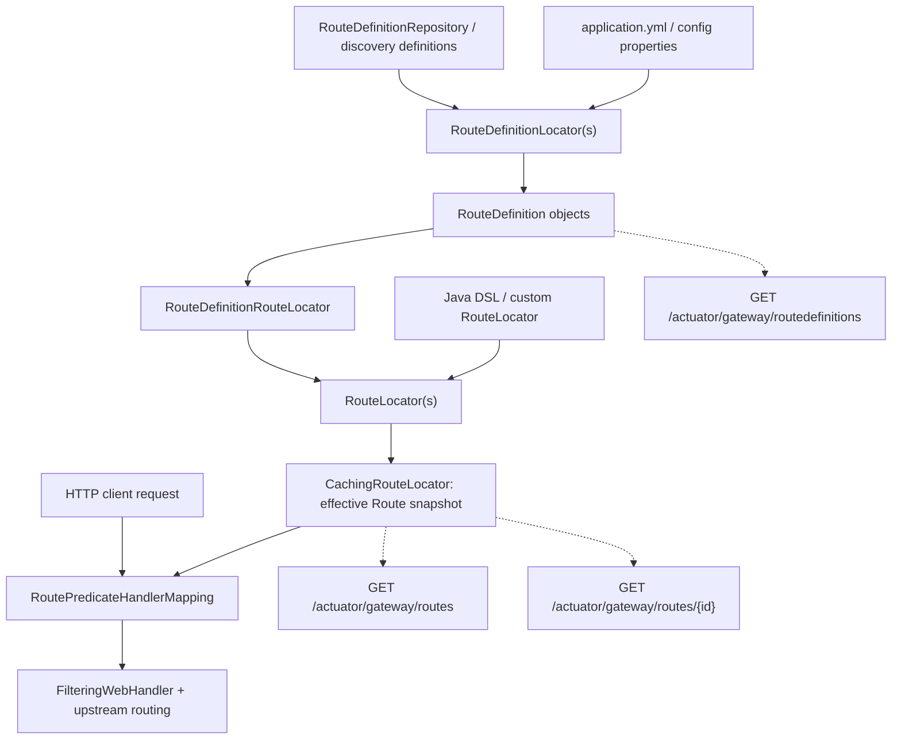
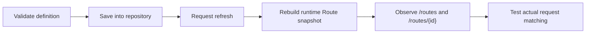
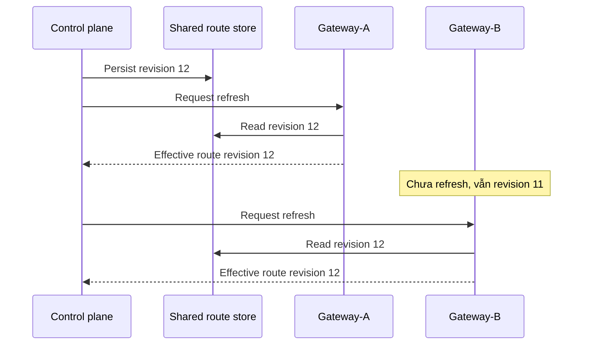
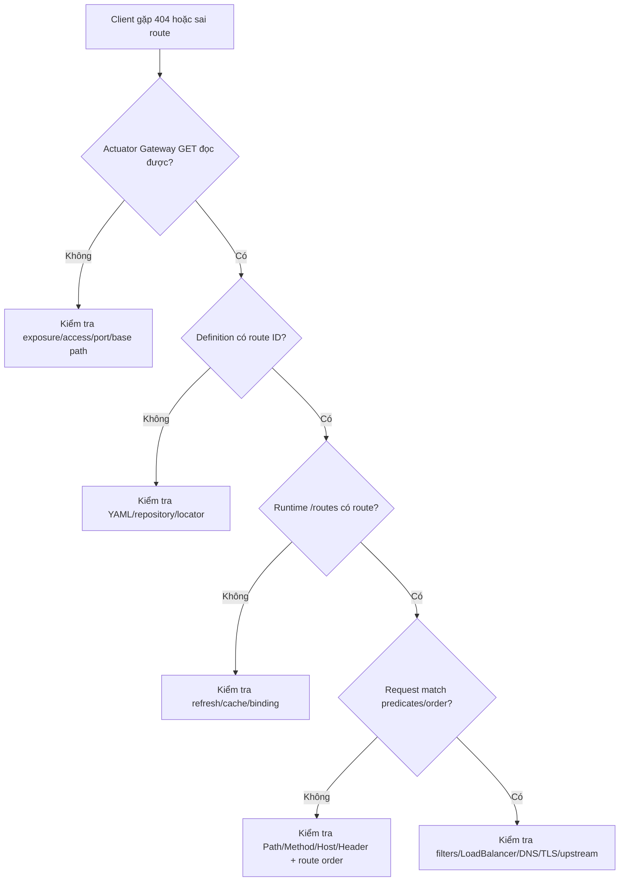

# Xem danh sách tuyến, định nghĩa tuyến và chi tiết một tuyến

Một **Spring Cloud Gateway** có thể nhận request, kiểm tra route predicates, thực thi filter chain, chọn instance dịch vụ và proxy HTTP/TLS tới microservice. Khi một API bất ngờ trả `404`, `503`, đi nhầm backend hoặc không áp dụng `StripPrefix` như dự kiến, người vận hành cần biết **các tuyến mà Gateway đang sử dụng thực tế**. Chỉ đọc `application.yml` thường chưa đủ: route có thể được tạo bởi Java DSL, repository động hoặc discovery locator, rồi được cache trong runtime của từng Gateway replica.

Trong chương **Quản trị Actuator**, bài này hướng dẫn dùng **Spring Boot Actuator và Gateway Actuator endpoint** để **xem danh sách tuyến, định nghĩa tuyến và chi tiết một tuyến theo ID**. Nội dung áp dụng cho **Spring Cloud Gateway Server WebFlux**, gắn với Path/Method/Host predicates, biến đổi đường dẫn/header, `lb://` service discovery, Spring Security, rate limiting, circuit breaker, retry, TLS và observability.

> **Phạm vi phiên bản:** Những đường dẫn `/actuator/gateway/...` là API quen thuộc của nhiều phiên bản Gateway Server WebFlux, nhưng khả năng enable/expose, thuộc tính quyền đọc/ghi và dạng JSON có thể thay đổi theo Spring Boot và Spring Cloud Gateway. Ví dụ response bên dưới là **hình dạng minh họa** để học cách đọc, không phải schema bất biến. Gateway Server MVC có thể dùng thành phần/endpoint khác; luôn kiểm tra bản thực tế đang chạy.

## 1. Ba câu hỏi khác nhau trong một sự cố định tuyến

Giả sử đội platform dự kiến khai báo:

```yaml
spring:
  cloud:
    gateway:
      routes:
        - id: orders-read
          uri: lb://order-service
          order: 10
          predicates:
            - Path=/api/orders/**
            - Method=GET
          filters:
            - StripPrefix=1
```

Ý định là:

```text
GET /api/orders/42
  -> Gateway route "orders-read"
  -> Path=/api/orders/** và Method=GET khớp
  -> StripPrefix=1
  -> GET /orders/42 tại một instance của order-service
```

Nếu client nhận `404`, cần phân biệt:

1. **Route có được khai báo không?** Có `RouteDefinition` chứa `orders-read` không?
2. **Route có được nạp vào runtime không?** Tập route dùng để matching đã có `orders-read` chưa?
3. **Request có được chọn vào route đó không?** Method, path, host, header, query và order có thỏa không?

Actuator hỗ trợ mạnh ở hai câu đầu và cho biết thông tin để điều tra câu thứ ba. **Nó không tự mô phỏng mọi request**; để chứng minh request thật match route và đi tới backend nào còn cần log/trace hoặc integration test.

## 2. Ba endpoint GET cần biết

| Endpoint | Mục đích | Góc nhìn |
| --- | --- | --- |
| `GET /actuator/gateway/routes` | Liệt kê các route runtime/effective mà Gateway expose | Tập route có thể được dùng để matching |
| `GET /actuator/gateway/routedefinitions` | Liệt kê `RouteDefinition` do các nguồn definition cung cấp | Dữ liệu cấu hình định nghĩa |
| `GET /actuator/gateway/routes/{id}` | Xem một route runtime theo ID | URI, predicate, filters, order của route cụ thể |

Ba endpoint này có vai trò riêng. **`/routedefinitions` không đơn giản là tên dài hơn của `/routes`**.



Sơ đồ mô tả đường đi **khái niệm**, không phải lời cam kết mọi bản Gateway dùng đúng một instance locator/cache. Ngoài nguồn definitions, Gateway có thể nhận route runtime được tạo trực tiếp.

### Definition, effective, matched

- **Definition:** Các thành phần cấu hình mô tả route.
- **Effective runtime route:** Đối tượng route đã được chuyển đổi/bind và được runtime locator cung cấp.
- **Matched request:** Một request cụ thể đã thỏa predicates và được chọn vào một route.

Các mốc không đồng thời tuyệt đối: sau khi cập nhật route động, repository có thể mới hơn runtime cache. Sau khi route đã active, một request vẫn có thể không khớp vì `Method` hoặc `Host`.

## 3. Cần bật Actuator như thế nào?

### Dependency

Ứng dụng cần:

- Spring Cloud Gateway Server WebFlux tương thích với Spring Boot.
- `spring-boot-starter-actuator`.
- Spring Security và cơ chế quản trị theo policy của tổ chức nếu muốn bảo vệ HTTP management API.
- Với URI `lb://`, cần Spring Cloud LoadBalancer và nguồn discovery tương ứng cho việc proxy; **không cần registry chỉ để liệt kê route**.

### Ba lớp bảo vệ khác nhau

Khi Actuator không trả kết quả, kiểm tra:

1. **Availability:** Endpoint có được đăng ký và enable trong phiên bản đang chạy không?
2. **Exposure/access:** Endpoint có được expose qua HTTP và có quyền đọc không?
3. **Authentication/authorization/network:** Caller có được phép truy cập management interface không?

**Chỉ thêm `gateway` vào `management.endpoints.web.exposure.include` không tạo ra xác thực.** Nếu management interface bị công khai, người ngoài có thể đọc service IDs/URIs, route matching rules hoặc filter arguments, kể cả khi không có write permission.

### Ví dụ cấu hình ở phiên bản hỗ trợ read-only access

```yaml
management:
  server:
    port: 9090
  endpoints:
    web:
      exposure:
        include: "health,info,gateway"
  endpoint:
    gateway:
      access: read-only
```

Đây là **cấu hình minh họa** cho dòng phiên bản hỗ trợ `management.endpoint.gateway.access`. Mục đích là dùng cổng quản trị riêng và giới hạn endpoint ở chế độ **đọc**. Vẫn phải bảo vệ bằng mạng nội bộ, role/operator authentication và TLS phù hợp.

**Lưu ý tương thích:** Một số dòng Spring Boot/Gateway cũ sử dụng `management.endpoint.gateway.enabled` hoặc cơ chế enable/exposure khác, còn một số dòng mới có `access=read-only`/`unrestricted`. Không copy cả các thuộc tính cũ/mới rồi mặc định chúng tương đương. Đối chiếu documentation, configuration metadata và endpoint thực tế của **phiên bản đang triển khai**.

### Public port và management port

Nếu `server.port=8080` và `management.server.port=9090`:

```text
Ứng dụng API:
    http://localhost:8080/api/orders/42

Quản trị Actuator:
    http://localhost:9090/actuator/gateway/routes
```

Thay `management.endpoints.web.base-path`, dùng reverse proxy rewrite, context path hoặc management port khác có thể làm URL thực tế khác mẫu. Management endpoint **không** phải Gateway route dành cho client đi vào `lb://order-service`.

Nếu management server chạy trong context riêng, đừng giả định Security filter chain đang bảo vệ public API mặc nhiên bảo vệ toàn bộ management endpoints. Cần kiểm chứng access rule ở đúng management listener.

## 4. Xem danh sách route runtime: `/actuator/gateway/routes`

Đây là endpoint nên mở đầu khi cần biết “Gateway hiện đang có những tuyến nào?”

### Gọi bằng curl

Tại môi trường lab có management port trên loopback:

```bash
curl -i http://127.0.0.1:9090/actuator/gateway/routes
```

Nếu môi trường yêu cầu quyền quản trị, thêm credential theo quy trình được cấp. Một ví dụ shell dùng biến môi trường đã được nạp an toàn:

```bash
curl -sS \
  -H "Authorization: Bearer $ACTUATOR_READ_TOKEN" \
  http://127.0.0.1:9090/actuator/gateway/routes
```

**Không lưu token thật** trong tài liệu, shell history chung, log debug hoặc output public. Khi đi qua mạng không tin cậy, dùng HTTPS/mTLS/VPN hoặc kết nối quản trị được bảo vệ.

### JSON phản hồi minh họa

```json
[
  {
    "route_id": "orders-read",
    "predicate": "(Paths: [/api/orders/**] && Methods: [GET])",
    "filters": ["StripPrefix=1"],
    "uri": "lb://order-service",
    "order": 10
  },
  {
    "route_id": "catalog-public",
    "predicate": "(Paths: [/api/public/catalog/**])",
    "filters": [],
    "uri": "lb://catalog-service",
    "order": 20
  }
]
```

**Dạng JSON có thể khác:** Trong một số Gateway phiên bản, `predicate` và `filters` là các chuỗi mô tả đối tượng runtime rất dài, có thêm tên lớp/order; có bản hiển thị compact hoặc verbose với field khác. Không nên viết parser production dựa vào chuỗi minh họa như `"StripPrefix=1"`.

### Diễn giải từng trường

| Trường | Ý nghĩa vận hành | Không được suy ra |
| --- | --- | --- |
| `route_id` | ID của route được liệt kê | Request client đã match route đó |
| `predicate` | Điều kiện chọn route được runtime mô tả | Path đúng thì mọi method đều đúng |
| `filters` | Các filters mà endpoint đang hiển thị | Đã nhìn thấy toàn bộ Spring Security/WebFilter pipeline |
| `uri` | Địa chỉ logic/physical được cấu hình | IP và port của backend instance được chọn |
| `order` | Thứ tự ưu tiên route | Đây là cơ chế authorization |

Với `uri: lb://order-service`, Actuator chỉ cho biết **service ID**, không tự nói instance vật lý nào sẽ nhận request. Cần telemetry của LoadBalancer/HTTP client để xác định địa chỉ upstream.

### Lọc bằng jq

Nếu response tương thích JSON minh họa:

```bash
curl -sS http://127.0.0.1:9090/actuator/gateway/routes |
  jq '.[] | {route_id, uri, order}'
```

Chỉ xem route chứa `orders`:

```bash
curl -sS http://127.0.0.1:9090/actuator/gateway/routes |
  jq -r '.[] | select(.route_id | contains("orders")) | .route_id'
```

Hãy **xem response thô trước** rồi mới chọn JSONPath/jq filter, vì field names/serialization không phải lúc nào cũng giống ví dụ.

### Một route xuất hiện không có nghĩa mọi request match

Route có:

```yaml
predicates:
  - Path=/api/orders/**
  - Method=GET
```

thì request `POST /api/orders` không thể match route chỉ vì path phù hợp. Tương tự, `Host`, `Header`, `Query` và `Cookie` predicates có thể thay đổi kết quả matching. Dùng route list để nhận diện ứng viên, rồi so sánh **request thực tế**.

## 5. Xem định nghĩa tuyến: `/actuator/gateway/routedefinitions`

Đây là góc nhìn **RouteDefinition** thay vì đối tượng runtime `Route`.

### Gọi API

```bash
curl -i http://127.0.0.1:9090/actuator/gateway/routedefinitions
```

### JSON definition minh họa

```json
[
  {
    "id": "orders-read",
    "predicates": [
      {
        "name": "Path",
        "args": { "_genkey_0": "/api/orders/**" }
      },
      {
        "name": "Method",
        "args": { "_genkey_0": "GET" }
      }
    ],
    "filters": [
      {
        "name": "StripPrefix",
        "args": { "_genkey_0": "1" }
      }
    ],
    "uri": "lb://order-service",
    "order": 10,
    "metadata": {
      "owner": "platform"
    }
  }
]
```

Dạng `name`/`args`/`_genkey_0` minh họa cấu trúc `PredicateDefinition`/`FilterDefinition` sau khi bind shortcut arguments. Tên key, order của fields và dạng serialize phụ thuộc version và cách khai báo (shortcut so với named arguments).

### Những câu hỏi mà definitions giúp trả lời

- Route ID `orders-read` có trong những nguồn definition hiện tại không?
- URI được khai báo là `lb://order-service` hay `http://localhost:8081`?
- Predicate factory names và arguments ra sao?
- `StripPrefix` có giá trị 1 hay 2?
- `order` và `metadata` có đúng như được phê duyệt?
- Sau khi save động, nguồn definition đã cung cấp version mới chưa?
- Có routes trùng ID hoặc cùng prefix path không?

Trong một route có nhiều filter, `/routedefinitions` thường dễ đọc **factory names và arguments** hơn `/routes` vì không phải chuỗi diễn giải của runtime filter object.

### Không phải mọi route runtime đều có RouteDefinition tương ứng

Gateway có thể nhận route qua nhiều nguồn:

| Nguồn route | Có thể xuất hiện ở `/routedefinitions`? | Có thể xuất hiện ở `/routes`? |
| --- | --- | --- |
| YAML/properties route definitions | Có | Có nếu conversion thành công và runtime đã load |
| `RouteDefinitionRepository` | Có qua locator tương ứng | Có sau refresh/conversion phù hợp |
| Discovery `RouteDefinitionLocator` | Có thể | Có khi route được tạo/bind |
| Custom `RouteDefinitionLocator` | Có thể | Có khi được tổng hợp |
| Java DSL `RouteLocatorBuilder` tạo `Route` trực tiếp | **Không nhất thiết** | Có nếu locator tham gia runtime |

Do vậy “route có trong `/routes` nhưng không thấy trong `/routedefinitions`” có thể là bình thường với Java DSL hoặc custom RouteLocator, không phải bằng chứng Actuator hoạt động sai.

**Mặt khác:** Nếu definition có mặt nhưng runtime không có, có thể do refresh chưa hoàn tất, lỗi binding factory/args hoặc một nguồn/locator khác nhau. Phải điều tra logs và runtime state, không tự kết luận chỉ từ một GET.

## 6. Xem chi tiết một tuyến: `/actuator/gateway/routes/{id}`

Khi đã biết route ID, endpoint detail giúp xem một route cụ thể thay vì tìm giữa hàng trăm route.

```bash
curl -i http://127.0.0.1:9090/actuator/gateway/routes/orders-read
```

JSON minh họa:

```json
{
  "route_id": "orders-read",
  "predicate": "(Paths: [/api/orders/**] && Methods: [GET])",
  "filters": ["StripPrefix=1"],
  "uri": "lb://order-service",
  "order": 10
}
```

Nếu route ID có ký tự đặc biệt, hãy encode thành URL path segment đúng chuẩn. Không ghép raw input không tin cậy vào management URL.

### Tìm bằng ID khác tìm bằng URL API

`orders-read` là **route ID**, không phải path `/api/orders/**`. Gọi:

```text
GET /actuator/gateway/routes/orders-read
```

khác hoàn toàn với:

```text
GET /api/orders/42
```

Request đầu hỏi **thông tin cấu hình runtime**, request sau đi vào **Gateway route mapping và backend**.

### Những tình huống đáng chú ý

| Quan sát | Nguyên nhân có thể |
| --- | --- |
| Detail có route, client API trả 404 | Predicate không match, route order sai hoặc upstream trả 404 |
| Definition có route, detail không có | Snapshot chưa refresh, conversion/binding lỗi hoặc khác replica |
| Detail URI khác definition URI | Runtime cache cũ, nguồn cấu hình chồng lấn hoặc đang rollout |
| Detail đúng URI nhưng client 503 | Discovery/LoadBalancer, TLS, backend hoặc CircuitBreaker |
| Detail filter khác kỳ vọng | Default filters, GlobalFilters, thứ tự runtime hoặc cập nhật chưa đồng bộ |
| Detail chỉ có 404 với một ID | Sai ID hoặc route không active ở replica đó |
| Tất cả Gateway Actuator URLs trả 404 | Endpoint chưa enable/expose, sai cổng/base path/version |

Không dùng lỗi management endpoint để suy luận trực tiếp trạng thái upstream. Chẳng hạn `GET /actuator/gateway/routes/missing` trả 404 không nói gì về `GET /api/orders/42`.

## 7. So sánh danh sách, definition và detail trong một lần chẩn đoán

Một quy trình đơn giản:

```text
GET /actuator/gateway/routedefinitions
   -> kiểm tra data definition mới

GET /actuator/gateway/routes
   -> kiểm tra tập route runtime

GET /actuator/gateway/routes/orders-read
   -> kiểm tra URI/predicate/filter/order của route đó

Gửi GET /api/orders/42
   -> kiểm tra request thật và upstream
```

### Bảng diễn giải

| Definition | Runtime list | Detail | Khả năng |
| --- | --- | --- | --- |
| Có | Có | Có | Route được mô tả và nạp trong runtime |
| Có | Không | Không | Có thể thiếu refresh hoặc conversion lỗi |
| Không | Có | Có | Có thể route từ Java DSL/custom RouteLocator |
| Mới | Cũ | Cũ | Có thể cached route snapshot chưa hội tụ |
| Không | Không | Không | Chưa được khai báo hoặc đang hỏi sai context/source |
| Có | Có nhưng khác URI | Khác URI | Có thể xung đột nguồn hoặc snapshot cũ |

**Lưu ý consistency:** Ba GET được gọi tuần tự không phải một snapshot transaction. Một operator khác có thể cập nhật route hoặc refresh giữa các lần gọi; nếu requests đi qua load balancer, bạn thậm chí có thể đang đọc **ba Gateway replicas khác nhau**.

## 8. Route ID, predicate, order: hiểu thế nào cho đúng?

### Route ID

Route ID là tên liên kết logs, metrics, Actuator và thay đổi cấu hình. Cần tránh trùng ID không kiểm soát giữa YAML, repository, discovery locator và Java DSL.

```text
Route ID: orders-read
URI:      lb://order-service
Path:     /api/orders/**
Method:   GET
Order:    10
```

Đừng nhầm ID với service ID: `orders-read` xác định **route**, còn `order-service` xác định **logical upstream service** để LoadBalancer tìm instance.

### Predicate là điều kiện match

Ví dụ:

```yaml
id: partner-orders
uri: lb://partner-service
predicates:
  - Path=/api/partner/orders/**
  - Method=GET
  - Host=api.partner.example.test
  - Header=X-Partner-Mode,enabled
```

Request có path và method phù hợp nhưng `Host=api.example.test` không match. Nhiều predicates của một route thường kết hợp như một điều kiện phải thỏa tất cả, không phải chọn đại một predicate.

Với preflight CORS, HTTP method thực là `OPTIONS`; nếu route có `Method=POST` thì preflight **không tự match** nhờ `Access-Control-Request-Method: POST`. Điều này có thể được xử lý ở WebFlux/Security CORS layer trước route mapping.

### Order và route chồng lấn

```yaml
- id: generic-api
  uri: lb://generic-service
  order: 100
  predicates:
    - Path=/api/**

- id: orders-read
  uri: lb://order-service
  order: 10
  predicates:
    - Path=/api/orders/**
    - Method=GET
```

Trong Spring ordering thông thường, order có giá trị **nhỏ hơn** được ưu tiên hơn. Actuator giúp xem order của hai route để phát hiện trường hợp catch-all route chiếm traffic.

**Route order không phải authorization.** Dù route nào match, Spring Security và backend vẫn phải kiểm soát quyền truy cập. Không coi `Path=/api/admin/**` là cơ chế phân quyền.

## 9. FilterDefinitions không hoàn toàn giống chuỗi thực thi

`/routedefinitions` có thể hiển thị:

```yaml
filters:
  - StripPrefix=1
  - AddRequestHeader=X-Gateway,edge
  - name: CircuitBreaker
    args:
      name: ordersReadBreaker
      fallbackUri: forward:/fallback/orders
```

`/routes/{id}` có thể hiển thị các filter runtime dưới dạng chuỗi có order/adapter class. Ngoài ra còn có:

- `GlobalFilter` áp dụng xuyên routes.
- Default filters từ cấu hình Gateway.
- HTTP headers filters, xử lý forwarded headers.
- Spring Security `WebFilter`, có thể xử lý request trước khi route được chọn.

**Không suy ra một JSON array `filters` là toàn bộ các lớp bảo mật/network thực thi.** Nếu nghi ngờ filter order, dùng thêm diagnostics dành cho global filters nếu phiên bản hỗ trợ, logs đã kiểm soát và integration test thực.

### Chẩn đoán StripPrefix bằng Actuator

Public request:

```text
GET /api/orders/42
```

- `StripPrefix=1` → upstream thường nhận `/orders/42`.
- `StripPrefix=2` → upstream có thể nhận `/42`.

Nếu route vẫn match nhưng backend trả `404`, xem filter definition/runtime rồi xác minh bằng log hoặc mock upstream. **Actuator không tự trả “đường dẫn cuối cùng” của từng request**.

### Các filter khác

Nếu route có `Retry`, `CircuitBreaker`, `RequestRateLimiter`, `TokenRelay` hay `LocalResponseCache`, Actuator có thể giúp xác nhận chúng được khai báo/nạp. Nhưng:

- Retry count của một request không hiển thị chỉ vì filter có mặt.
- Circuit breaker OPEN/CLOSED là trạng thái runtime riêng.
- Quota limiter cần metric/Redis state riêng.
- TokenRelay có authorized client/token hợp lệ hay không cần Security/OAuth2 diagnostics riêng.
- Response cache có đang hit/miss hay lộ dữ liệu người dùng cần cache telemetry và security tests.

Route definition chỉ mô tả **chính sách**, không bảo đảm kết quả thực thi của từng request.

## 10. Dynamic routes: save không đồng nghĩa active

Spring Cloud Gateway có thể lấy route từ `RouteDefinitionRepository` hoặc các nguồn động. Vòng đời lý tưởng:



Giả sử:

```text
T0: Repository: orders-read -> lb://order-service-v1
    Runtime:    orders-read -> lb://order-service-v1

T1: Repository save:
    orders-read -> lb://order-service-v2

    Runtime chưa refresh:
    orders-read -> lb://order-service-v1

T2: Sau refresh thành công:
    Runtime: orders-read -> lb://order-service-v2
```

Trong giai đoạn T1, `/routedefinitions` có thể đã thấy v2 nhưng `/routes/{id}` còn v1. Đó là **khác biệt giữa dữ liệu định nghĩa và route runtime đã cache**, không tự chứng minh Actuator bị lỗi.

Một số phiên bản hỗ trợ một thao tác quản trị riêng để refresh routes, thường là `POST /actuator/gateway/refresh`. **Bài này chỉ yêu cầu ba thao tác GET quan sát**. Refresh là hành động có tác dụng thay đổi runtime, cần quyền ghi/admin riêng. Không cấp unrestricted/write access chỉ để xem thông tin.

**Refresh route không có nghĩa làm mới** DNS resolver, service discovery instance cache, response cache hay đóng HTTP connections cũ. Những lớp đó có vòng đời độc lập.

## 11. Nhiều Gateway replicas: dữ liệu nào đang được đọc?

Trong cụm nhiều process:

```text
Shared RouteDefinition store:
    orders-read -> lb://order-service-v2

Gateway-A runtime cache:
    orders-read -> lb://order-service-v2

Gateway-B runtime cache:
    orders-read -> lb://order-service-v1

Gateway-C runtime cache:
    orders-read -> lb://order-service-v2
```

Nếu request tới `/actuator/gateway/routes` đi qua load balancer chung, hai lần GET liên tiếp có thể trả URI khác nhau vì được phục vụ bởi **hai replicas khác nhau**.

### Cách so sánh đúng

1. Xác định Gateway replica/pod ID và management port.
2. Đọc `/routedefinitions` và `/routes` trên **cùng replica**.
3. Kiểm tra `/routes/{id}` trên replica đó.
4. Ghi mốc thời gian, route revision/deployment version (nếu có).
5. So sánh các replicas.
6. Nếu có replica lệch, kiểm tra refresh fan-out, route conversion exception, rollout status hoặc store availability.
7. Chỉ kết luận toàn cụm đã hội tụ khi có bằng chứng từ **mọi replica cần phục vụ traffic** hoặc hệ thống reconciliation đáng tin.



`RefreshRoutesEvent` phát trong một ứng dụng không mặc nhiên **broadcast qua mạng** cho mọi Gateway process. Repository chia sẻ là bước quan trọng cho persistence, nhưng vẫn cần refresh/reconcile.

### Mẫu port-forward tới đúng Pod

Nếu được cấp Kubernetes RBAC, có thể kết nối trực tiếp management port của một Gateway Pod:

```bash
# Terminal 1: thay namespace, pod và management port theo cluster thật.
kubectl -n demo port-forward pod/gateway-a 9090:9090

# Terminal 2:
curl -i http://127.0.0.1:9090/actuator/gateway/routes
```

Cách này chỉ hoạt động khi Pod có management server đang lắng nghe ở port tương ứng và mạng/quyền cho phép. Không dùng port-forward như phương thức vượt qua quy định quản trị của hệ thống.

## 12. Phân biệt status lỗi của management endpoint

| HTTP kết quả | Ý nghĩa có thể | Điều tra |
| --- | --- | --- |
| `200` kèm JSON | Endpoint đọc hoạt động | Nội dung/route IDs thực |
| `200` kèm `[]` | Nguồn route/definition tương ứng trống hoặc không tham gia | Cấu hình, locator, đúng replica |
| `401` | Chưa có authentication hợp lệ | Management authentication |
| `403` | Caller thiếu quyền hoặc access policy từ chối | Management authorization/read-only policy |
| `404` cho mọi `/actuator/gateway/...` | Chưa expose/enable, sai base path/port hoặc unsupported | Boot Actuator/Gateway version/config |
| `404` riêng `/routes/missing-id` | ID không tồn tại trong effective routes được endpoint đọc | Exact route ID, cache, replica |
| `5xx` khi đọc route | Có thể locator, repository, conversion, serialization lỗi | Logs endpoint/route source |
| Timeout/connection refused | Management listener/network/TLS có vấn đề | Port, address, proxy, firewall |

**Không tắt Spring Security để “sửa 401/403”.** Đây là endpoint quản trị, phải truy cập với quyền được cấp và dùng đúng management network.

### Checklist cấu hình

- Dependency Spring Boot Actuator hiện diện?
- Gateway Server WebFlux starter/version đúng?
- Endpoint `gateway` có được hỗ trợ và bật?
- Có trong HTTP exposure include?
- Access mode là read-only hoặc quyền đọc tương đương?
- Management base-path/port chính xác?
- Security filter/role áp đúng management context?
- Network policy, ingress, reverse proxy có chặn hoặc rewrite?
- Request đang tới đúng Gateway replica?
- Có error logs từ route locator hay repository không?

## 13. Route tồn tại nhưng client API vẫn lỗi

Một route đúng trong Actuator không đảm bảo backend đang khỏe.

| Sự cố public API | Actuator giúp thấy gì? | Cần thêm gì? |
| --- | --- | --- |
| `404` | Route có tồn tại? Predicates/order nào? | Matched route logs và upstream HTTP status |
| `503` trên `lb://service` | Service ID của URI | Discovery/instance list, readiness, LB cache |
| `502/504` | Route/filter policy | DNS, TLS, connect/response timeout |
| Path sau rewrite sai | FilterDefinition `StripPrefix/RewritePath` | Backend access log hoặc test stub |
| Header mất hoặc bị trùng | Add/Set/Remove header filters | GlobalFilters, upstream headers, CORS |
| CircuitBreaker fallback | Route có breaker/filter | Breaker state, failure-rate, fallback handler |
| Retry quá nhiều | Có Retry/filter args | Attempt count, exception/status, idempotency |
| JWT `401` | Route có thể không được chọn | Spring Security/OAuth2 logs |
| Response cache stale | Có cache filter không? | Cache eligibility, TTL, tenant isolation, CDN |

**Đừng nhầm service ID với IP**: `lb://order-service` là URI logic. Một pod mới hoặc pod đã rời thường thay đổi danh sách instances trong discovery mà không đòi hỏi sửa route definition.

Cũng vậy, SSL certificate sai không thể sửa bằng cách refresh route nếu URI, DNS/SNI/trust configuration chưa đúng.

## 14. Không expose dữ liệu quản trị ra công khai

Ngay cả khi API chỉ dùng GET, response có thể chứa:

- Service IDs/hostnames nội bộ.
- Route patterns dành cho admin hoặc đối tác.
- Filter arguments chứa rate limiter config, internal header names hoặc metadata.
- Trong hệ thống cấu hình sai, secret/token có thể bị nhúng vào URI/query/header filter.
- Thông tin cho kẻ tấn công lập bản đồ internal network và trust boundaries.

Các biện pháp phòng thủ:

1. Tách management network/port khỏi public API.
2. Cho phép chỉ một nhóm role có nhu cầu thực sự.
3. Chỉ cấp quyền read-only; tuyệt đối không bật write operations nếu không cần.
4. Bảo vệ TLS/mTLS, VPN và authentication ở mức phù hợp.
5. Giới hạn exposure, không expose toàn bộ Actuator chỉ để xem routes.
6. Giám sát hành vi đọc endpoint management bất thường.
7. Redact dữ liệu nhạy cảm trước khi chia sẻ snapshot logs.
8. Không đặt raw token/cookie hoặc route args chứa secret trong metric labels.
9. Kiểm thử cả `401/403` cho người không có quyền.

### Snapshot có kiểm soát

Trong **môi trường thử nghiệm** với quyền thích hợp:

```bash
curl -sS http://127.0.0.1:9090/actuator/gateway/routes \
  > gateway-routes-snapshot.json

curl -sS http://127.0.0.1:9090/actuator/gateway/routedefinitions \
  > gateway-definitions-snapshot.json
```

Các file snapshot có thể nhạy cảm; lưu trong vùng kiểm soát truy cập, không commit vào Git public, áp chính sách retention/delete phù hợp. Với automation, kiểm tra response status trước khi lưu/phân tích vì `401` hoặc error page có thể không phải JSON bạn đang mong đợi.

## 15. Tình huống: thay route từ service v1 sang v2

Operator muốn cập nhật:

```text
Route ID: orders-read

Trước:
    lb://order-service-v1

Sau:
    lb://order-service-v2
```

Một quy trình kiểm chứng:

1. Chụp route detail và danh sách trước thay đổi.
2. Save definition mới theo quy trình control plane đã validate.
3. Đọc `/routedefinitions`: xác minh ID/URI mới (nếu nguồn definition được endpoint trả).
4. Phát refresh theo cơ chế được phê duyệt.
5. Đọc `/routes/orders-read`: xác minh **runtime** dùng URI mới.
6. Lặp ở **mỗi Gateway replica** liên quan.
7. Gửi GET request thật với đúng Path/Method/Host và xác minh backend v2 nhận request.
8. Xem upstream status/latency, circuit breaker/retry/TLS metrics.
9. Nếu cần rollback, restore definition cũ, refresh rồi **readback/verify** lại.

| Lớp | Bằng chứng cần có | Không kết luận chỉ từ |
| --- | --- | --- |
| Repository | Definition đã lưu revision mới | API save trả `200` |
| Definition locator | `/routedefinitions` thấy URI mới | YAML file trên laptop |
| Runtime | `/routes/{id}` thấy URI mới | Repository đã cập nhật |
| Matching | Request đi vào đúng route ID | Route xuất hiện trong list |
| Proxy | Backend v2 nhận đúng path/headers | Client chỉ nhận `200` từ fallback/cache |
| Cluster | Từng Gateway replica đã hội tụ | Một GET qua ingress load balancer |

**In-flight requests** đã chọn route/instance trước refresh có thể tiếp tục theo đường cũ. Vì vậy cutover cần kế hoạch drain, request timeout và kiểm tra instance availability.

## 16. Kiểm thử cùng với HTTP request thật

Một suite integration test nên có:

- Spring Cloud Gateway Server WebFlux với route `orders-read`.
- Actuator Gateway read endpoints được bật trong test configuration.
- Management authentication/authorization fixture.
- Upstream mock (WireMock hoặc HTTP test server).
- `WebTestClient` cho management và client API.
- Discovery/LoadBalancer test fixture nếu dùng `lb://`.

### Test danh sách routes

```java
@Test
void actuatorListsOrdersRoute() {
    // actuatorClient trỏ tới management endpoint
    // và có authentication dành cho operator đọc.
    actuatorClient.get()
        .uri("/actuator/gateway/routes")
        .exchange()
        .expectStatus().isOk()
        .expectBody()
        .jsonPath("$[?(@.route_id == 'orders-read')]").exists();
}
```

Đây là **mảnh test minh họa**. JSONPath filter expression và serializer có thể khác theo test library/version; nếu response schema khác, hãy điều chỉnh assertion theo contract thực tế. Nó không chạy độc lập nếu không có `actuatorClient` và test context.

### Test chi tiết route

```java
@Test
void actuatorShowsOrdersRouteDetail() {
    actuatorClient.get()
        .uri("/actuator/gateway/routes/orders-read")
        .exchange()
        .expectStatus().isOk()
        .expectBody()
        .jsonPath("$.route_id").isEqualTo("orders-read")
        .jsonPath("$.uri").isEqualTo("lb://order-service");
}
```

Test này chỉ chứng minh endpoint đọc trả route phù hợp. Cần thêm test xác nhận unauthorized user bị chặn, và route runtime thực sự xử lý request.

### Test end-to-end

```java
@Test
void ordersRouteProxiesCorrectPath() {
    publicApiClient.get()
        .uri("/api/orders/42")
        .exchange()
        .expectStatus().isOk()
        .expectBody()
        .jsonPath("$.id").isEqualTo("42");

    wireMockServer.verify(
        1, getRequestedFor(urlEqualTo("/orders/42")));
}
```

Test cần route `StripPrefix=1`, upstream stub và Security fixture hợp lệ. Nếu có `Retry`, số backend requests có thể lớn hơn 1 trong lỗi tạm thời; bài test này giả định happy path không retry.

### Không quên negative tests

- `/routes` trả `401/403` khi thiếu quyền quản trị.
- `/routes/missing-id` không xuất hiện thành route hợp lệ.
- Request `POST /api/orders` không match route `Method=GET`.
- Route `Path=/api/orders/**` không khớp `/api/payments/**`.
- Route dynamic save chưa refresh không được coi active.
- URI `lb://...` có route nhưng không có instance thì lỗi riêng.
- Một Gateway replica chưa refresh có thể trả snapshot cũ.

## 17. Ma trận kiểm thử Actuator và route runtime

| Test | Điều kiện | Điều phải chứng minh |
| --- | --- | --- |
| T1 | Gateway Actuator chưa expose | HTTP endpoint không lộ cho caller ngoài ý muốn |
| T2 | Không đăng nhập | Management request bị từ chối |
| T3 | Đăng nhập nhưng thiếu role | Không được xem route metadata |
| T4 | Operator có quyền đọc | `GET /routes` hoạt động |
| T5 | `GET /routedefinitions` | Đọc được dữ liệu `RouteDefinition` |
| T6 | `GET /routes/orders-read` | Đúng ID/URI/predicate/filter/order |
| T7 | Route ID không tồn tại | Kết quả quản trị không bị nhầm với upstream status |
| T8 | Có `Path` và `Method` predicates | Test request đúng/sai method |
| T9 | Route có `Host` predicate | Host sai không match |
| T10 | Hai routes cùng match | Kiểm tra order ưu tiên |
| T11 | Custom Java `RouteLocator` | Runtime route có thể không có definition qua cùng nguồn |
| T12 | Save dynamic definition nhưng chưa refresh | Phát hiện definition/runtime khác nhau |
| T13 | Refresh thành công | Runtime route phản ánh thay đổi |
| T14 | Refresh lỗi/binding lỗi | Có logs, không báo active sai |
| T15 | Hai Gateway replicas lệch version | Phát hiện URI/route snapshot khác |
| T16 | Route có `StripPrefix` | Upstream nhận đúng path |
| T17 | Route dùng `lb://` và không có instance | Không nhầm no-instance với route-not-found |
| T18 | Security `401` trước route | Route filter không xử lý request bị chặn sớm |
| T19 | CORS preflight OPTIONS | Kiểm tra CORS layer, không suy từ GET route |
| T20 | Retry/CircuitBreaker filter | Actuator thấy config, metric xác nhận hành vi |
| T21 | Management chỉ được read-only | Các phương thức ghi/refresh bị chặn |
| T22 | Filter args nhạy cảm | Không phơi bày qua public ingress |
| T23 | Upgrade Spring/Gateway | JSON schema/parser compatibility test |
| T24 | Route bị xóa | Runtime không còn route sau refresh/reconcile |
| T25 | Cache/fallback vẫn trả `200` | Không dùng client `200` làm chứng minh upstream đã nhận |

Cần ưu tiên **tính chính xác của các route được đọc** lẫn **tính an toàn khi cho đọc**.

## 18. Runbook sự cố: “Đã có route trong YAML mà API vẫn 404”

Quy trình:

1. **Tách management và public API:** `404` đến từ `/actuator/gateway/...` hay `/api/...`?
2. **Xác nhận management endpoint:** dependency, exposure/access, base path, port, Security.
3. **Chọn Gateway replica cụ thể:** ghi pod/instance ID và thời điểm.
4. **Đọc `/routedefinitions`:** ID, URI, predicates, filters, order đã xuất hiện chưa?
5. **Đọc `/routes`:** route runtime đã nạp chưa?
6. **Đọc `/routes/{id}`:** URI/order/filter runtime là gì?
7. **Nếu definition mới nhưng runtime cũ:** kiểm tra refresh, route cache và lỗi conversion factory/args.
8. **Nếu runtime đúng nhưng không match:** kiểm tra Path/Method/Host/Header/Query predicates, route order, Security trước mapping.
9. **Nếu match nhưng trả lỗi:** kiểm tra path rewrite, LB instance/discovery, DNS/TLS, timeout và backend HTTP status.
10. **Nếu chỉ một phần request lỗi:** so sánh từng Gateway replica và ingress routing.
11. **Sau khi khắc phục:** đọc lại runtime routes và gửi request end-to-end; đừng chỉ kiểm tra một lần API save thành công.



## 19. Bài thực hành: route sai giữa ba Gateway replicas

Hệ thống có ba Gateway replicas, một route chung và hai routes chuyên biệt:

```yaml
spring:
  cloud:
    gateway:
      routes:
        - id: public-catalog
          uri: lb://catalog-service
          order: 20
          predicates:
            - Path=/api/public/catalog/**
            - Method=GET
          filters:
            - StripPrefix=2

        - id: orders-read
          uri: lb://order-service
          order: 10
          predicates:
            - Path=/api/orders/**
            - Method=GET
          filters:
            - StripPrefix=1

        - id: generic-api
          uri: lb://fallback-service
          order: 100
          predicates:
            - Path=/api/**
```

Tình huống:

- Gateway-A: `GET /api/orders/42` đến đúng `order-service`.
- Gateway-B: cùng request lại đến `fallback-service`.
- Gateway-C: `GET /api/public/catalog/items` trả `404` từ backend.

### Nhiệm vụ 1 — So sánh danh sách route theo replica

Lập bảng kết quả từ `GET /actuator/gateway/routes`:

| Replica | `orders-read`? | URI | Order | `generic-api`? |
| --- | --- | --- | --- | --- |
| Gateway-A | Đọc thực tế | Đọc thực tế | Đọc thực tế | Đọc thực tế |
| Gateway-B | Đọc thực tế | Đọc thực tế | Đọc thực tế | Đọc thực tế |
| Gateway-C | Đọc thực tế | Đọc thực tế | Đọc thực tế | Đọc thực tế |

Nếu Gateway-B thiếu `orders-read`, route catch-all có thể bắt `/api/orders/42`. Nếu B có route nhưng không được chọn, phải xem Method/Path/order và Security chứ không dừng ở giả thuyết thiếu route.

### Nhiệm vụ 2 — Đọc definition và detail

```bash
# Gọi trên địa chỉ management của đúng Gateway-B,
# không phải một frontend load balancer ngẫu nhiên.
curl -sS http://127.0.0.1:9090/actuator/gateway/routedefinitions
curl -sS http://127.0.0.1:9090/actuator/gateway/routes
curl -sS http://127.0.0.1:9090/actuator/gateway/routes/orders-read
```

Nếu definition có nhưng runtime thiếu, tìm lỗi route refresh/binding. Nếu tất cả đúng nhưng request bị route khác bắt, tìm route order/predicate conditions và trace matched route ID.

### Nhiệm vụ 3 — Kiểm tra đường dẫn sau filter

`public-catalog` có `StripPrefix=2`. Khi gọi `GET /api/public/catalog/items`, path có thể được chuyển thành `/catalog/items`. Nếu backend lại mong `/public/catalog/items`, upstream có thể trả `404` dù Gateway route đã khớp. Dùng Actuator xem filter args rồi xác minh upstream path bằng test stub/log đã được kiểm soát.

### Nhiệm vụ 4 — Chứng minh rollout hội tụ

Sau khi sửa route source/refresh, đối chiếu trên cả ba replicas:

- ID, URI và order của route runtime.
- Predicates và filters.
- Request thực tế có vào đúng backend và đúng path.
- Không có route catch-all lấn sang API protected.
- Security, CORS, rate limiting và TLS vẫn đúng.
- Metrics HTTP lỗi/latency không tăng bất thường.

## 20. Câu hỏi tự kiểm tra

1. Ba endpoint GET quan trọng nhất để xem list, definitions và một route theo ID là gì?
2. `RouteDefinition` khác `Route` ở vòng đời Gateway như thế nào?
3. Vì sao route trong `/routedefinitions` chưa chắc có trong `/routes`?
4. Route tạo trực tiếp từ Java `RouteLocatorBuilder` có thể xuất hiện trong runtime mà không có cùng representation RouteDefinition không?
5. `route_id` khác service ID trong `lb://service-id` như thế nào?
6. Khi nhiều predicates được khai báo, chỉ match `Path` có đủ không?
7. `Method=POST` có tự match request preflight `OPTIONS` không?
8. Route `order=10` và route `order=100` cùng match: route nào thường được ưu tiên?
9. Vì sao `filters` trong Actuator không phải toàn bộ Spring Security WebFilter chain?
10. Có thể suy ra IP backend được chọn từ `uri: lb://order-service` không?
11. Actuator exposure có tự là authentication/authorization không?
12. Vì sao management port riêng vẫn phải được kiểm soát mạng và Security?
13. Vì sao GET route metadata vẫn nhạy cảm?
14. Khi operator save RouteDefinition mới, bước nào còn thiếu trước khi runtime nhận route?
15. `RefreshRoutesEvent` có tự broadcast tới tất cả Gateway replicas hoặc refresh DNS/response cache không?
16. Nếu hai GET qua một load balancer cho URI khác nhau, cần biết thêm điều gì trước khi kết luận dữ liệu thay đổi?
17. `404` trên `/actuator/gateway/routes/missing` và `404` từ upstream API khác nhau thế nào?
18. Khi route active mà client nhận `503`, cần xem các lớp nào ngoài route definition?
19. Vì sao một test “Actuator trả 200” không chứng minh upstream nhận đúng path?
20. Khi đổi route từ v1 sang v2, cần chứng minh trạng thái **persisted, active, matched** bằng những quan sát gì?

**Ghi nhớ:** **`GET /actuator/gateway/routedefinitions`** cho cái nhìn về **định nghĩa tuyến**; **`GET /actuator/gateway/routes`** cho cái nhìn về **tập route runtime**; và **`GET /actuator/gateway/routes/{id}`** cho **chi tiết một tuyến**. Hãy phân biệt **đã lưu → đã nạp → đã match**, luôn ghi rõ **Gateway replica và phiên bản** khi so sánh. Expose Actuator theo nguyên tắc **ít quyền nhất**, và kết hợp kết quả đọc cấu hình với request test/tracing để vận hành Spring Cloud Gateway an toàn, chính xác.

