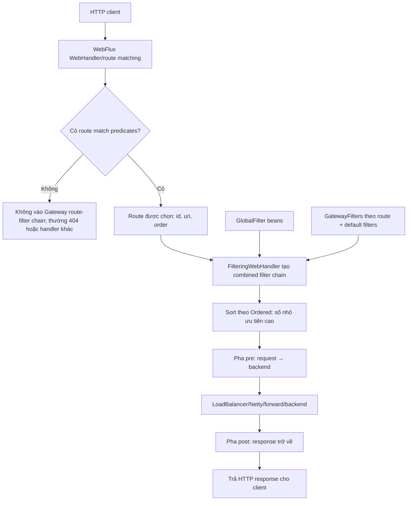
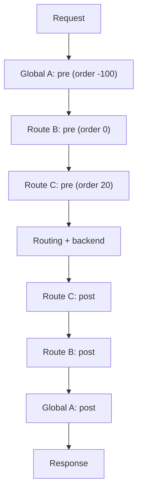
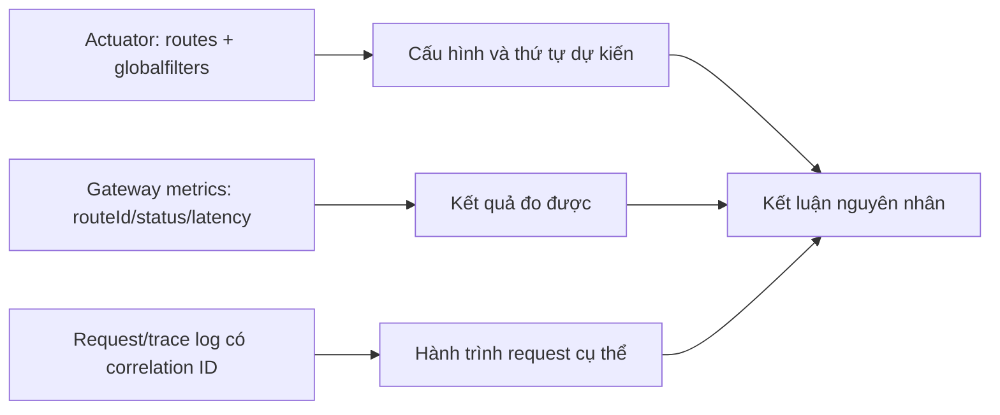

# Xem predicate, route filter, global filter và thứ tự bộ lọc bằng Spring Cloud Gateway Actuator

## 1. Tại sao cần nhìn thấy filter chain thực tế?

**Spring Cloud Gateway** đóng vai trò API Gateway cho kiến trúc microservices: nhận request, chọn route bằng **predicate**, chạy **GatewayFilter/GlobalFilter chain**, biến đổi path/header, khám phá dịch vụ và chuyển tiếp tới backend. Các chức năng xác thực, giới hạn lưu lượng, circuit breaker, retry, TLS và quan sát request đều có thể ảnh hưởng tới request trước khi nó chạm dịch vụ phía sau.

Giả sử một request `GET /api/orders/42` trả HTTP 404 mặc dù `orders-service` vẫn hoạt động. Có ít nhất bốn khả năng:

- **Không route nào match** vì `Path`, `Host` hoặc `Method` predicate không phù hợp.
- **Route đúng nhưng URI/path sai** vì `StripPrefix`, `RewritePath` hoặc service discovery.
- **Một filter chặn request**: Spring Security trả 401/403, `RequestRateLimiter` trả 429, `CircuitBreaker` trả fallback, hoặc custom filter tự kết thúc chain.
- **Global filter và route filter chạy khác thứ tự dự kiến**, dẫn tới header bị ghi đè hoặc path thay đổi không đúng lúc.

Để điều tra có bằng chứng thay vì đoán từ `application.yml`, Spring Cloud Gateway Server WebFlux cung cấp **Actuator API** dưới `/actuator/gateway`. Bài này hướng dẫn cách đọc **predicate**, **route-specific filters**, **global filters** và đặc biệt là **thứ tự phối hợp pre/post**.

Sau bài học, bạn có thể:

1. Cấu hình quyền `read-only` cho Gateway Actuator theo cách tối thiểu.
2. Dùng `GET /actuator/gateway/routes` và `routes/{id}` để xem route, predicate, filter và route order.
3. Phân biệt `/routefilters` (danh mục factory) với `/globalfilters` (các bean global có order).
4. Đọc các giá trị `order` và giải thích thứ tự **pre phase/post phase** của combined filter chain.
5. Đối chiếu Actuator với request thật và log/metrics khi gặp sai route, header hoặc fallback.
6. Bảo vệ endpoint quản trị, không biến quyền quan sát thành quyền sửa route từ Internet.

> **Phạm vi:** ví dụ chính cho **Spring Cloud Gateway Server WebFlux 4.3+/5.x**, với `spring.cloud.gateway.server.webflux.*`. Với các phiên bản WebFlux cũ, prefix thường là `spring.cloud.gateway.*`. Gateway Server **Web MVC** có runtime/filter API khác; không sao chép các ví dụ `GlobalFilter`/`RouteLocatorBuilder` của WebFlux sang MVC.

## 2. Sơ đồ request: predicate chọn route, rồi mới có filter chain



**Phân biệt ba chữ “order”:**

| Thành phần | Dùng để làm gì? | Phạm vi |
|---|---|---|
**Route `order`** | Quyết định **route nào được xét ưu tiên** khi nhiều route có predicate trùng hoặc chồng lấn | Giữa các route |
**GatewayFilter `order`** | Quyết định thứ tự filter **của route đã chọn** khi trộn với global filters | Trong một combined filter chain |
**GlobalFilter `getOrder()`** | Đặt thứ tự cho GlobalFilter so với các GatewayFilter khác | Trong một combined filter chain |

**Hai điều dễ nhầm:** route có `order: -10` **không làm các filter của nó chạy ở order -10**. Và `@Order(-1)` trên một GlobalFilter **không khiến GlobalFilter đó chạy trước giai đoạn chọn route**: Gateway global filter được đưa vào chain khi request đã match một route.

## 3. Bật Actuator chỉ đọc trên một cổng quản trị được kiểm soát

### 3.1. Dependency Maven/Gradle

Gateway WebFlux có Actuator khi thêm `spring-boot-starter-actuator`:

```xml
<!-- Version của starters do Spring Boot parent và Spring Cloud BOM quản lý. -->
<dependency>
    <groupId>org.springframework.cloud</groupId>
    <artifactId>spring-cloud-starter-gateway-server-webflux</artifactId>
</dependency>
<dependency>
    <groupId>org.springframework.boot</groupId>
    <artifactId>spring-boot-starter-actuator</artifactId>
</dependency>
```

```groovy
dependencies {
    implementation 'org.springframework.cloud:spring-cloud-starter-gateway-server-webflux'
    implementation 'org.springframework.boot:spring-boot-starter-actuator'
}
```

Không cần Redis, Eureka hoặc Resilience4j **chỉ để đọc route/filter metadata**. Những dependency đó chỉ cần khi chính route của ứng dụng sử dụng các tính năng tương ứng, ví dụ `lb://`, rate limiting hoặc circuit breaker.

### 3.2. Cấu hình `read-only`

Tài liệu Gateway 5.1 nêu endpoint `gateway` **bị vô hiệu quyền truy cập mặc định**. Để bật khả năng quan sát qua HTTP:

```yaml
server:
  port: 8080

management:
  server:
    port: 9090
    address: 127.0.0.1   # Chỉ ví dụ local; không public management API.
  endpoint:
    gateway:
      access: read-only
  endpoints:
    web:
      exposure:
        include: health,info,gateway

spring:
  cloud:
    gateway:
      server:
        webflux:
          actuator:
            verbose:
              enabled: true
```

**Ý nghĩa chính xác:**

- `spring-boot-starter-actuator` đăng ký hạ tầng quản trị.
- `management.endpoint.gateway.access: read-only` chỉ cho phép **đọc**, không cấp quyền tạo/xóa/refresh routes.
- `management.endpoints.web.exposure.include` xác định endpoints **được expose** qua web. Chỉ đặt `access` mà không expose có thể khiến endpoint không có HTTP mapping.
- `management.server.port: 9090` tách cổng quản trị khỏi cổng API client 8080; `management.server.address: 127.0.0.1` chỉ có ý nghĩa thích hợp khi management server dùng cổng riêng. Trong container, loopback của container **khác** loopback của máy vận hành; cần kết nối từ bên trong container/port-forward được cấp phép.
- `verbose.enabled: true` giúp đọc predicate/filters dạng mô tả dễ hiểu. Tài liệu Gateway 5.1 mô tả chế độ verbose **đã bật mặc định**; khai báo ở đây nhằm minh họa rõ.

**Quan trọng:** tách cổng hoặc bind localhost **không tự thay thế authentication/authorization**. Với production nên dùng mạng quản trị riêng, ingress/firewall/NetworkPolicy, TLS, user/service identity có quyền vận hành, logging audit và nguyên tắc least privilege.

### 3.3. Đọc từ môi trường local

Khi được cấp quyền truy cập tới management listener:

```bash
# Truy cập từ cùng host/namespace mà management listener cho phép.
curl -i http://127.0.0.1:9090/actuator/health

# Liệt kê resource trong gateway Actuator.
curl -i http://127.0.0.1:9090/actuator/gateway

# Danh sách route thực đang nạp.
curl -i http://127.0.0.1:9090/actuator/gateway/routes
```

Trong môi trường có Spring Security, các request đọc cần được cấp **credential quản trị đã xác thực**, ví dụ Bearer token của management audience và scope phù hợp. Không vô hiệu hóa authentication chỉ để `curl` trả 200; tham khảo phần bảo mật ở mục 11.

### 3.4. Các endpoint nào phục vụ chủ đề bài học?

| Endpoint (GET) | Bạn nhìn thấy gì? | Lưu ý |
|---|---|---|
`/actuator/gateway` | Danh sách liên kết thao tác gateway Actuator được công bố | Đối chiếu HTTP methods thực sự được phép |
`/actuator/gateway/routes` | Các route đang tồn tại: predicate, filters, URI, **route order** | Nguồn chính để xem route-specific filter |
`/actuator/gateway/routes/{id}` | Chi tiết một route có ID cụ thể | Không nhất thiết cùng format JSON với tạo route qua POST |
`/actuator/gateway/globalfilters` | Các GlobalFilter beans và **order** | Thể hiện string representation của object |
`/actuator/gateway/routefilters` | Các `GatewayFilterFactory` được đăng ký | **Không** phải danh sách filter đã chạy trên route cụ thể |
`/actuator/gateway/routedefinitions` | Các route definitions từ nguồn được hỗ trợ | Định nghĩa có thể khác route runtime đã dựng |
`/actuator/gateway/routepredicates` | Các predicate factory đã đăng ký ở các version hỗ trợ | **Không** phải các predicate đã match request nào đó |
`/actuator/gateway/routes/{id}/combinedfilters` | Có thể xuất hiện trong endpoint index của một số version | Cần kiểm chứng runtime/format, không dựa vào như API ổn định ở mọi bản |

Các đường dẫn trên giả định `management.endpoints.web.base-path=/actuator` mặc định. Nếu có context path khác hoặc reverse proxy/management mapping tùy biến, đường dẫn thực tế sẽ khác. **Read-only** là quyền **đọc**, không cấp khả năng `POST /refresh` hoặc `POST/DELETE /routes`.

## 4. Xem predicate và giải thích route được chọn

### 4.1. Ví dụ hai route có thể chồng lấn

Xét cấu hình Gateway dưới đây:

```yaml
spring:
  cloud:
    gateway:
      server:
        webflux:
          routes:
            - id: catalog-partner
              order: -10
              uri: http://localhost:8081
              predicates:
                - Host=partner.example.test
                - Path=/api/catalog/**
                - Method=GET
              filters:
                - StripPrefix=1
                - SetRequestHeader=X-Route-Class, partner

            - id: catalog-public
              order: 10
              uri: http://localhost:8082
              predicates:
                - Path=/api/catalog/**
                - Method=GET
              filters:
                - StripPrefix=1
                - SetRequestHeader=X-Route-Class, public
```

Một route có nhiều predicates thì các điều kiện phải thỏa theo logic của route đó. Route `catalog-partner` yêu cầu **Host**, **Path** và **Method** phù hợp. Route `catalog-public` chỉ cần **Path** và **Method**. Nếu request là `GET /api/catalog/products/42` với `Host: partner.example.test`, cả hai route có thể match, nhưng `order: -10` có ưu tiên hơn `order: 10`.

**Điểm thường nhầm:** số route `order: -10` chỉ ưu tiên **định nghĩa route**, **không** có nghĩa `StripPrefix` sẽ có filter order `-10`. Trong mỗi route, filter có các order riêng sau khi được dựng thành `GatewayFilter`.

### 4.2. Dùng `GET /routes` xem toàn bộ route

```bash
curl -sS http://127.0.0.1:9090/actuator/gateway/routes
```

Một **ví dụ minh họa** cho định dạng verbose (các tên và mô tả cụ thể phụ thuộc version):

```json
[
  {
    "route_id": "catalog-partner",
    "predicate": "(Hosts: [partner.example.test] && Paths: [/api/catalog/**] && Methods: [GET])",
    "filters": [
      "[[StripPrefix parts = 1], order = 1]",
      "[[SetRequestHeader X-Route-Class = 'partner'], order = 2]"
    ],
    "uri": "http://localhost:8081",
    "order": -10
  },
  {
    "route_id": "catalog-public",
    "predicate": "(Paths: [/api/catalog/**] && Methods: [GET])",
    "filters": [
      "[[StripPrefix parts = 1], order = 1]",
      "[[SetRequestHeader X-Route-Class = 'public'], order = 2]"
    ],
    "uri": "http://localhost:8082",
    "order": 10
  }
]
```

Đây là JSON **minh họa ý nghĩa của fields**, không phải output bắt buộc byte-for-byte cho hai routes. Các đoạn `predicate` và `filters` là string representation, có thể đổi theo Spring Cloud Gateway version/factory implementation. Không viết công cụ giám sát phụ thuộc tuyệt đối vào `toString()` của một filter.

### 4.3. Đọc từng trường một

| Trường | Cần hiểu như thế nào? | Câu hỏi kiểm tra |
|---|---|---|
`route_id` | ID route dùng để nhận diện trong cấu hình, metrics, logs | Có đúng route đang điều tra? |
`predicate` | Biểu thức điều kiện match request | Host/Path/Method/Header/Query có khớp? |
`filters` | Các route-specific/default `GatewayFilter` đã được dựng | Có `StripPrefix`, `Retry`, `CircuitBreaker`, `SetRequestHeader` đúng policy? |
`uri` | URI logical/physical mà route hướng đến | `lb://service-id` hay địa chỉ backend cố định? |
`order` | **Thứ tự ưu tiên của route**, không phải filter | Có route rộng hơn “cướp” request không? |

Nếu `predicate` chứa nhiều điều kiện nối `&&`, **không thể chỉ nhìn vào `Path` rồi kết luận request sẽ match**. `Host` cần được đánh giá theo Host header đã nhận (có thể qua ingress/trusted proxy). `Method` cũng có thể loại request POST dù Path đúng.

### 4.4. Xem một route bằng ID

```bash
curl -sS \
  http://127.0.0.1:9090/actuator/gateway/routes/catalog-partner
```

Đường `routes/{id}` giúp kiểm tra **một route** trước khi trace sâu hơn. Ví dụ dễ đọc:

```json
{
  "route_id": "catalog-partner",
  "predicate": "(Hosts: [partner.example.test] && Paths: [/api/catalog/**] && Methods: [GET])",
  "filters": [
    "[[StripPrefix parts = 1], order = 1]",
    "[[SetRequestHeader X-Route-Class = 'partner'], order = 2]"
  ],
  "uri": "http://localhost:8081",
  "order": -10
}
```

Tài liệu Gateway 5.1 nêu `predicate` tại đây là mô tả human-readable, **khác** dạng shortcut DSL khi tạo route động. Không dùng trực tiếp output của `GET /routes/{id}` làm body cho `POST /routes/{id}`.

### 4.5. Lọc JSON bằng `jq`

Khi có `jq` trên máy quản trị:

```bash
# Chỉ hiển thị route ID, route order, URI và predicate.
curl -sS http://127.0.0.1:9090/actuator/gateway/routes \
  | jq '.[] | {id: .route_id, order: .order, uri: .uri, predicate: .predicate}'

# Chỉ những route liên quan Catalog.
curl -sS http://127.0.0.1:9090/actuator/gateway/routes \
  | jq '.[] | select(.route_id | contains("catalog"))'

# Chỉ filters của route cần điều tra.
curl -sS http://127.0.0.1:9090/actuator/gateway/routes/catalog-partner \
  | jq '.filters'
```

Ví dụ đặt management listener local và **chưa trình bày credential quản trị**. Với endpoint có Bearer auth, chỉ bổ sung `Authorization` từ token được cấp cho operator; tránh để token trong lịch sử shell hoặc output log. Nếu shell không có `jq`, dùng JSON viewer nội bộ đã được phê duyệt.

### 4.6. Actuator đọc được route nhưng request vẫn không match?

Các nguyên nhân có thể:

- Header `Host` thực nhận khác với Host bạn thấy ở browser vì có ingress/reverse proxy.
- Request `POST` nhưng route chỉ cho `Method=GET`.
- `Path` bị xử lý ở một ingress/base-path trước khi vào Gateway.
- Route bạn xem thuộc **pod A**, nhưng request thực đi tới **pod B** với route cache/config cũ.
- Có route khác có ưu tiên cao hơn và predicates cũng match.
- Spring Security đã chặn request trước Gateway route chain; Actuator không thay thế phép thử auth.

Hãy đối chiếu **request thực**, **config revision/pod** và kết quả `routes`, không suy rằng “route có trong Actuator = request chắc chắn đi qua route đó”.

## 5. Xem `routefilters`: danh mục factory, không phải thứ tự thi hành

### 5.1. Endpoint `/routefilters` dùng để làm gì?

```bash
curl -sS \
  http://127.0.0.1:9090/actuator/gateway/routefilters
```

Một response mẫu theo dạng đã được tài liệu mô tả:

```json
{
  "[AddRequestHeaderGatewayFilterFactory@a18f configClass = AbstractNameValueGatewayFilterFactory.NameValueConfig]": null,
  "[SecureHeadersGatewayFilterFactory@bd2e configClass = Object]": null,
  "[SaveSessionGatewayFilterFactory@21b4 configClass = Object]": null
}
```

**Hiểu đúng:**

- Đây là danh sách **GatewayFilterFactory beans** được Gateway đăng ký, **không** phải “filter nào đã chạy trong request /api/orders/42”.
- Một factory như `AddRequestHeaderGatewayFilterFactory` có thể tồn tại dù một route cụ thể **không dùng** `AddRequestHeader`.
- `null` ở value **không có nghĩa order=0**, không có nghĩa filter lỗi và không chứng minh filter không chạy. Tài liệu chính thức nói `null` xuất phát từ việc endpoint cố lấy order của **factory object**, trong khi order áp dụng cho **GatewayFilter instance**, không phải factory.
- Chuỗi `@a18f` chỉ là thành phần nhận diện của object `toString()`, không phải version/order/route ID.

**Muốn xem filters thật sự gắn trên route `catalog-partner`, hãy xem `GET /actuator/gateway/routes/catalog-partner`** hoặc `GET /actuator/gateway/routes`, không chỉ xem danh sách factories.

### 5.2. `routepredicates`: cũng là danh mục factory

```bash
curl -sS \
  http://127.0.0.1:9090/actuator/gateway/routepredicates
```

Endpoint này có thể liệt kê các **RoutePredicateFactory** khả dụng như `Path`, `Host`, `Method`, `Header`, `Query` theo cấu hình/phiên bản. Nó **không trả kết quả đánh giá True/False** cho một request cụ thể. Muốn biết predicate đã match, hãy tái hiện request, bật logging/metrics có kiểm soát và so khớp các điều kiện của route.

### 5.3. `routedefinitions` so với `routes`

| Endpoint | Góc nhìn |
|---|---|
`/actuator/gateway/routedefinitions` | Route definitions từ những nguồn được cung cấp, thường gồm cấu hình dạng tên factory và args |
`/actuator/gateway/routes` | Các route runtime sau khi được dựng thành predicate/filter instances, dùng cho routing |
`/actuator/gateway/routes/{id}` | Một route runtime theo ID |
`/actuator/gateway/routefilters` | Catalog các factory hỗ trợ tạo route filters |
`/actuator/gateway/routepredicates` | Catalog các predicate factories |

Điều này đặc biệt hữu ích với **Discovery Locator** hoặc route động. Một service registry có thể công bố nhiều instances, nhưng route runtime có thể là `lb://orders-service`. Thay đổi route definition và thay đổi kết quả chọn instance của LoadBalancer **không phải một việc**.

## 6. Xem `globalfilters`: danh sách GlobalFilter và order

### 6.1. Endpoint danh sách global filters

```bash
curl -sS \
  http://127.0.0.1:9090/actuator/gateway/globalfilters
```

Ví dụ JSON rút gọn minh họa **một cấu hình WebFlux có các GlobalFilter phổ biến**:

```json
{
  "org.springframework.cloud.gateway.filter.NettyWriteResponseFilter@ab7": -1,
  "org.springframework.cloud.gateway.filter.ForwardPathFilter@c11": 0,
  "org.springframework.cloud.gateway.filter.RouteToRequestUrlFilter@e20": 10000,
  "org.springframework.cloud.gateway.filter.ReactiveLoadBalancerClientFilter@b63": 10100,
  "org.springframework.cloud.gateway.filter.WebsocketRoutingFilter@8f2": 2147483646,
  "org.springframework.cloud.gateway.filter.NettyRoutingFilter@9ac": 2147483647
}
```

Tên bean/lớp và order trên **không nhất thiết có đủ ở mọi deployment**, vì một số GlobalFilter được điều kiện hóa theo dependency, properties, protocol và phiên bản. Các giá trị order mô phỏng những ví dụ tài liệu Gateway, không nên hard-code làm hợp đồng API ổn định.

### 6.2. Đọc một số GlobalFilter thường gặp

| GlobalFilter | Vai trò ở mức khái niệm | Lưu ý |
|---|---|---|
`NettyWriteResponseFilter` | Ghi response từ Netty client trở về client sau phần routing | Có order rất sớm nhưng hành động ghi body quan trọng xảy ra ở **post phase** |
`RouteToRequestUrlFilter` | Dựng URL đích vào exchange attribute từ URI của route | Thường đi trước load balancing |
`ReactiveLoadBalancerClientFilter` | Chuyển `lb://service-id` thành host/port của instance | Chỉ có tác dụng phù hợp khi dùng LB |
`NettyRoutingFilter` | Dùng Netty HTTP client gọi backend HTTP/HTTPS | Không phải mọi route `forward:/...` hay WebSocket đều đi cùng đường |
`ForwardRoutingFilter` | Chuyển tiếp xử lý nội bộ cho `forward:` URI | Khác HTTP redirect 3xx |
`WebsocketRoutingFilter` | Định tuyến WebSocket `ws/wss` | Không phải NettyRoutingFilter của request HTTP bình thường |
Custom `GlobalFilter` | Logging, correlation, policy chung theo route | Cần có `Ordered` và callback reactive không chặn |

**Vì sao `NettyWriteResponseFilter` có `order=-1` mà lại “ghi sau”?** Vì filter có thể được **vào sớm ở pha pre** để bọc phần chain còn lại, sau đó thực hiện logic ghi response **khi reactive publisher downstream hoàn tất**, ở pha post. Số order thấp **không đồng nghĩa tất cả hành động bên trong filter xảy ra đầu tiên**.

### 6.3. `GlobalFilter` không hoàn toàn giống Spring WebFlux `WebFilter`

`GlobalFilter` của Gateway tham gia vào **Gateway filtering chain sau khi route match**. `WebFilter` của Spring WebFlux/Spring Security có thể tham gia vào **web security/filtering chain ở tầng ngoài**, ngay cả request không match route Gateway.

| Loại filter | Được áp dụng ở đâu? | Có thấy ở `/gateway/globalfilters` không? |
|---|---|---|
`GlobalFilter` | Combined Gateway filter chain cho route đã match | Thường có nếu bean đang đăng ký |
`GatewayFilter` | Route cụ thể (và default filters cho routes) | Xem chi tiết ở `/gateway/routes`; **không** là GlobalFilter |
`WebFilter` | Spring WebFlux web chain bên ngoài Gateway router | **Không phải đối tượng của endpoint này** |
Spring Security `SecurityWebFilterChain` | Xác thực/phân quyền ở WebFlux | Không suy ra từ danh sách GlobalFilter |
Reactor Netty `HttpClientCustomizer` | Cấu hình outbound HTTP client | Không phải per-request GatewayFilter |

Vì vậy, một request nhận 401 do JWT sai **có thể bị chặn trước khi Gateway chọn route**; không kỳ vọng custom GlobalFilter ghi log post-phase trong tình huống đó.

## 7. Thứ tự bộ lọc: số nhỏ ưu tiên cao, nhưng post chạy ngược

Tài liệu Gateway mô tả: sau khi route match, `FilteringWebHandler` lấy **tất cả GlobalFilter** và **GatewayFilter cho route** (bao gồm default filters được áp dụng), rồi **sắp xếp combined chain theo `org.springframework.core.Ordered`**.

Ở pha **pre**, filter ưu tiên cao (giá trị order nhỏ) chạy trước. Ở pha **post**, vì các filter bọc nhau qua `chain.filter(exchange)`, logic sau downstream của filter ưu tiên cao thường chạy **sau cùng**.

### 7.1. Sơ đồ số order và hai chiều

Giả sử có ba filters minh họa:

| Filter | Order | Pha pre | Pha post |
|---|---:|---:|---:|
GlobalFilter A | `-100` | Thứ 1 | Thứ 3 |
RouteFilter B | `0` | Thứ 2 | Thứ 2 |
RouteFilter C | `20` | Thứ 3 | Thứ 1 |



**Đây chỉ là một chain ba filter đã được đơn giản hóa.** Gateway thực có nhiều GlobalFilter được khởi tạo sẵn với các thứ tự như `NettyWriteResponseFilter(-1)`, `RouteToRequestUrlFilter(10000)`, `ReactiveLoadBalancerClientFilter(10100)` và các filters gần `Integer.MAX_VALUE`. Đừng suy ngược từ ví dụ ba filter rằng chúng là toàn bộ chain của Gateway.

### 7.2. Vì sao `order` không quyết định duy nhất hành vi?

Một filter có thể:

- Làm việc ở **pre** rồi gọi `chain.filter(exchange)`.
- Đặt một callback `then(...)`, `doFinally(...)` hoặc tương đương để làm việc ở **post**.
- **Short-circuit** và không gọi `chain.filter(exchange)`, ví dụ từ chối request hoặc tạo response fallback.
- Chỉ hoạt động khi exchange có attribute nhất định, URI dùng scheme phù hợp, hoặc response chưa commit.

Vì vậy “filter order -1” nói về **vị trí wrapper trong chain** chứ không bảo đảm callback xử lý response của nó chạy trước mọi callback khác. Cần đọc source/API của filter tương ứng hoặc quan sát execution trace khi nghi ngờ.

## 8. `default-filters` và route filters: thứ tự có thể xen kẽ

Gateway Server WebFlux có cấu hình **default filters** để gắn filter cho các route được định nghĩa qua cơ chế route definitions. Các filters này **không phải `GlobalFilter` Java beans**, nên chúng không xuất hiện trong `/actuator/gateway/globalfilters` chỉ vì được khai báo ở `default-filters`.

### 8.1. Cấu hình minh họa

```yaml
spring:
  cloud:
    gateway:
      server:
        webflux:
          default-filters:
            - AddResponseHeader=X-Default-A, A
            - AddResponseHeader=X-Default-B, B
            - AddResponseHeader=X-Default-C, C
          routes:
            - id: api-one
              uri: http://localhost:8081
              predicates:
                - Path=/api/one/**
              filters:
                - StripPrefix=1
                - AddRequestHeader=X-Route-Y, Y
```

Theo quy tắc default filters của Gateway, với những filter không tự đặt `Ordered`, **hai danh sách được đánh số độc lập bắt đầu từ 1** và sau đó được **stable sort**. Filter default có cùng order với route filter được thêm trước trong cùng nhóm order.

Minh họa:

```text
Default filters: A(order 1), B(order 2), C(order 3)
Route filters:   X(order 1), Y(order 2)

Sau stable sort:
  A(order 1) -> X(order 1) -> B(order 2) -> Y(order 2) -> C(order 3)
```

Vì vậy không nên khẳng định “toàn bộ default filters luôn chạy trước toàn bộ route filters”. Các filters có cùng order cần xem **thứ tự chèn và stable sort**. Còn một filter tự implement `Ordered` hoặc được bọc bằng `OrderedGatewayFilter` có thể có order riêng, không chỉ theo vị trí.

**Phạm vi:** các default filters từ property `spring.cloud.gateway.server.webflux.default-filters` được áp dụng khi dựng routes từ route definition trong cơ chế chuẩn. Không giả định mọi route được dựng trực tiếp bằng Java `RouteLocatorBuilder` cũng đi qua đúng mọi bước ráp default filters như YAML routes; phải xem route runtime/kiểm thử trên version đang chạy.

### 8.2. Tại sao danh sách `filters` trong Actuator có thể trông khác YAML?

- Trong YAML bạn khai báo factory như `StripPrefix=1`; khi dựng route, Gateway wrap thành `GatewayFilter` có order.
- Default filter có thể được thêm vào danh sách trước khi sort nên cùng xuất hiện trong `filters` của route.
- Một custom `GatewayFilter` có thể có order âm/dương ngoài thứ tự xuất hiện trong file.
- Một số filters có `toString()` chỉ hiện tên lớp/lambda, không cung cấp args đọc được.
- `/routes` thường hiển thị **route filters**, không nhất thiết lặp lại toàn bộ GlobalFilter beans; hãy xem `/globalfilters` và nếu có `combinedfilters` ở version tương ứng.

**Cách điều tra:** đối chiếu YAML, Actuator `routes/{id}`, `globalfilters` và log/traces request cụ thể. Đừng dùng **chỉ** thứ tự dòng YAML để giải thích thứ tự chạy thực tế của combined chain.

## 9. Viết GlobalFilter để quan sát pre/post một cách không chặn

### 9.1. Bean Java minh họa

Đoạn code sau ghi log mức DEBUG khi bước vào và khi phần chain kết thúc/cancel. Nó **không** sửa request/response, không gọi I/O blocking và không log token:

```java
package com.example.gateway.observation;

import org.slf4j.Logger;
import org.slf4j.LoggerFactory;
import org.springframework.cloud.gateway.filter.GatewayFilterChain;
import org.springframework.cloud.gateway.filter.GlobalFilter;
import org.springframework.cloud.gateway.route.Route;
import org.springframework.cloud.gateway.support.ServerWebExchangeUtils;
import org.springframework.core.Ordered;
import org.springframework.stereotype.Component;
import org.springframework.web.server.ServerWebExchange;
import reactor.core.publisher.Mono;

@Component
public final class FilterOrderProbe implements GlobalFilter, Ordered {

    private static final Logger log =
        LoggerFactory.getLogger(FilterOrderProbe.class);

    @Override
    public int getOrder() {
        return -10;
    }

    @Override
    public Mono<Void> filter(ServerWebExchange exchange,
                             GatewayFilterChain chain) {
        Route route = exchange.getAttribute(
            ServerWebExchangeUtils.GATEWAY_ROUTE_ATTR);
        String routeId = route == null ? "unknown" : route.getId();

        log.debug("probe pre route={} order={}", routeId, getOrder());

        return chain.filter(exchange)
            .doFinally(signal -> log.debug(
                "probe final route={} signal={} status={}",
                routeId, signal, exchange.getResponse().getStatusCode()));
    }
}
```

**Các điểm quan trọng:**

1. `GlobalFilter` được gọi cho request đã match một Gateway route; `GATEWAY_ROUTE_ATTR` thường có thông tin route ID lúc này.
2. `getOrder()=-10` đưa filter vào vị trí tương ứng trong **combined chain**.
3. `chain.filter(exchange)` phải được **return**. Không tự `subscribe()` và cũng không `block()` trên Reactor Netty event loop.
4. `doFinally` chạy khi publisher kết thúc, lỗi hoặc bị cancel; nó thích hợp để **quan sát**, nhưng không nên dùng để sửa response headers vì response có thể đã commit.
5. Không kết luận “filter có pre log là chắc chắn gọi backend”: các filters sau có thể chặn hoặc fallback.
6. Chỉ ghi route ID, status/signal và metadata đã được kiểm soát. Không log `Authorization`, cookie, raw query, private headers hay body.

Khi bean này được Spring scan và Actuator mở read-only, `/actuator/gateway/globalfilters` thường sẽ có một entry tương ứng với `FilterOrderProbe` và order `-10`. **Từ đó bạn xác nhận bean tồn tại và order được đăng ký**, chưa chứng minh mọi request đều đi qua filter hoặc hoàn tất.

### 9.2. Thêm một route-specific filter có order tường minh

Nếu cần chứng minh order của route filter trong Java DSL, có thể dùng `OrderedGatewayFilter`:

```java
package com.example.gateway.observation;

import org.springframework.cloud.gateway.filter.OrderedGatewayFilter;
import org.springframework.cloud.gateway.route.RouteLocator;
import org.springframework.cloud.gateway.route.builder.RouteLocatorBuilder;
import org.springframework.context.annotation.Bean;
import org.springframework.context.annotation.Configuration;
import reactor.core.publisher.Mono;

@Configuration(proxyBeanMethods = false)
public class DebugRouteConfiguration {

    @Bean
    RouteLocator debugRoute(RouteLocatorBuilder builder) {
        return builder.routes()
            .route("debug-route", r -> r
                .path("/debug/**")
                .filters(f -> f.filter(new OrderedGatewayFilter(
                    (exchange, chain) -> {
                        exchange.getResponse().getHeaders()
                            .set("X-Debug-Route-Filter", "executed");
                        return chain.filter(exchange);
                    },
                    -20)))
                .uri("http://localhost:8081"))
            .build();
    }
}
```

Trong ví dụ này, route filter có `order=-20`, nên đứng **trước** custom GlobalFilter `order=-10` ở pha pre (nhưng vẫn nằm trong chuỗi cùng các GlobalFilter built-in có order khác). Header response được đặt **trước khi response commit**; không dùng ví dụ này để ghi dữ liệu nội bộ khi triển khai production.

**Không đặt trùng route ID** giữa bean Java và YAML route. Cũng không mặc định các route tạo trực tiếp bằng Java được ghép `default-filters` theo cùng đường cấu hình với YAML; xác minh trong `/actuator/gateway/routes/debug-route`.

### 9.3. Kiểm chứng qua log thay vì đoán từ order

Trong profile sandbox, có thể bật:

```yaml
logging:
  level:
    com.example.gateway.observation: DEBUG
```

Sau đó gọi route `/debug/hello` từ client thử nghiệm:

```bash
curl -i http://127.0.0.1:8080/debug/hello
```

Nếu backend tồn tại, header `X-Debug-Route-Filter` cho thấy route filter đã tham gia. Log `probe pre` và `probe final` giúp xem vòng đời GlobalFilter. Nếu backend không chạy, bạn vẫn có thể thấy pre log và final signal lỗi; vì vậy **trạng thái kết nối backend và việc filter chạy là hai câu hỏi khác nhau**.

### 9.4. Muốn đo chính xác pre/post order của nhiều filters?

Với 2–3 custom filters do bạn sở hữu, log pre/post trên mỗi filter bằng cùng **correlation ID**, rồi đối chiếu thứ tự trong một request:

```text
probe A (order -100): pre
probe B (order 0):    pre
probe C (order 20):   pre
... backend response ...
probe C (order 20):   post
probe B (order 0):    post
probe A (order -100): post
```

Đây là **expected trace cho các filters minh họa nếu đều gọi chain và thực hiện post callback theo dạng nested composition**. Log từ các async components có thể đan xen khi nhiều request đồng thời; bắt buộc nhóm theo trace/request ID, không đọc log trộn nhiều request rồi kết luận filter order sai.

## 10. Thực hành end-to-end: tìm route, đối chiếu request và filters

### 10.1. Điều kiện chuẩn bị

Trong một **môi trường test**:

1. Gateway Server WebFlux chạy tại `http://127.0.0.1:8080`, management listener tại `http://127.0.0.1:9090` với quyền đọc phù hợp.
2. Có route `catalog-partner` và `catalog-public` trong mục 4.1.
3. Có backend thử nghiệm tại `localhost:8081` và `localhost:8082`, đều hỗ trợ `GET /catalog/ping` hoặc có thể trả một HTTP response xác định.
4. Người kiểm thử có quyền xem Actuator `gateway`, nhưng **không có quyền tạo/xóa/refresh route**.
5. Khi có Spring Security/management auth, sử dụng **credential test hợp lệ**, không tắt security chỉ để thấy 200.

Để backend phản ánh header mà Gateway đã đặt, trong **ứng dụng backend WebFlux riêng** có thể dùng controller thử nghiệm:

```java
package com.example.catalogdemo;

import java.util.Map;
import org.springframework.http.ResponseEntity;
import org.springframework.web.bind.annotation.GetMapping;
import org.springframework.web.bind.annotation.RequestHeader;
import org.springframework.web.bind.annotation.RestController;
import reactor.core.publisher.Mono;

@RestController
public class EchoCatalogController {

    @GetMapping("/catalog/ping")
    Mono<ResponseEntity<Map<String, String>>> ping(
            @RequestHeader(value = "X-Route-Class", required = false)
            String routeClass) {
        String value = routeClass == null ? "missing" : routeClass;
        return Mono.just(ResponseEntity.ok(Map.of(
            "source", "catalog-test-backend",
            "routeClass", value)));
    }
}
```

Controller cần chạy trong **backend** chứ không phải trong Gateway. Response JSON của test phản ánh route filter `SetRequestHeader`; **không dùng một request header như bằng chứng phân quyền** trong API thật.

### 10.2. Bước 1 — Kiểm tra route tồn tại và priority

```bash
curl -i http://127.0.0.1:9090/actuator/gateway/routes
curl -i http://127.0.0.1:9090/actuator/gateway/routes/catalog-partner
curl -i http://127.0.0.1:9090/actuator/gateway/routes/catalog-public
```

Kỳ vọng hai route cùng có `Path=/api/catalog/**`, nhưng:

- `catalog-partner` còn yêu cầu `Host=partner.example.test`, có `order=-10`.
- `catalog-public` chỉ yêu cầu path và GET, có `order=10`.
- `filters` của mỗi route có `StripPrefix` và `SetRequestHeader`.
- `uri` khác nhau (`8081` và `8082`).

Chỉ khi hai backend và routing hoạt động đúng mới kỳ vọng response body từ Catalog. Actuator list chỉ chứng minh route đã được dựng, không chứng minh backend còn sống.

### 10.3. Bước 2 — Gửi hai request có cùng path nhưng Host khác

```bash
# Khớp route partner và public; ưu tiên route partner có order -10.
curl -i \
  -H 'Host: partner.example.test' \
  http://127.0.0.1:8080/api/catalog/ping

# Không khớp Host predicate của partner, nên route public có thể match.
curl -i \
  -H 'Host: public.example.test' \
  http://127.0.0.1:8080/api/catalog/ping
```

Trong điều kiện demo và không có route khác cạnh tranh:

| Header Host gửi vào | Route dự kiến | URI backend | Header backend nhận |
|---|---|---|---|
`partner.example.test` | `catalog-partner` | `http://localhost:8081` | `X-Route-Class: partner` |
`public.example.test` | `catalog-public` | `http://localhost:8082` | `X-Route-Class: public` |

Lệnh dùng HTTP local để học routing. Trong production, cần HTTPS/TLS đúng Host/SNI và chỉ tin các proxy/forwarded headers được cấu hình. **Không dùng Host predicate làm lớp xác thực duy nhất** cho API private: client có thể tự đặt Host trong một kết nối HTTP thông thường.

### 10.4. Bước 3 — Kiểm tra phương thức không phù hợp

```bash
curl -i \
  -X POST \
  -H 'Host: partner.example.test' \
  http://127.0.0.1:8080/api/catalog/ping
```

Vì cả hai route minh họa chỉ cho `Method=GET`, POST không match các route đó. Nếu không có handler/route khác, response thường là `404`; với cấu hình Spring Security hoặc handlers khác, status có thể khác. **Không tự quy 404 thành backend 404** nếu request chưa được định tuyến xuống backend.

### 10.5. Bước 4 — Đọc filters của route và global filters

```bash
curl -sS http://127.0.0.1:9090/actuator/gateway/routes/catalog-partner
curl -sS http://127.0.0.1:9090/actuator/gateway/globalfilters
curl -sS http://127.0.0.1:9090/actuator/gateway/routefilters
```

So sánh **ba kiểu dữ liệu khác nhau**:

1. `routes/catalog-partner`: thực tế route đã cấu hình những `GatewayFilter` nào, ví dụ `StripPrefix`/`SetRequestHeader`.
2. `globalfilters`: những GlobalFilter bean nào đã đăng ký và số order của chúng.
3. `routefilters`: những **factory** nào Gateway có khả năng dùng; `null` ở value không phải order filter.

**Kết luận chẩn đoán:** một factory có trong `/routefilters` nhưng không có ở `routes/catalog-partner.filters` chỉ cho biết factory tồn tại, không phải filter đã được gắn vào route đó. Một GlobalFilter có trong `/globalfilters` cũng có thể **bỏ qua logic thực tế** nếu điều kiện URI/exchange của nó không thỏa.

### 10.6. Bước 5 — Xem filter order theo trace

Đăng ký `FilterOrderProbe` mục 9.1 trong Gateway test và bật DEBUG log cho package tương ứng. Gửi lại một request GET rồi xem:

```text
probe pre route=catalog-partner order=-10
... xử lý Netty routing/backend ...
probe final route=catalog-partner signal=onComplete status=200
```

Đây là **ví dụ log kỳ vọng**, không phải output mặc định của Gateway. Nếu backend hỏng, status/signal khác hoặc response vẫn chưa được commit, các giá trị có thể khác. Với nhiều custom filters, thêm log pre/post có route ID và correlation ID để quan sát relative order.

### 10.7. Bước 6 — Kiểm chứng route selection bằng `actuator/gateway/combinedfilters` nếu bản có hỗ trợ

Một số phiên bản liệt kê `GET /actuator/gateway/routes/{id}/combinedfilters` trong index. Bạn có thể kiểm tra endpoint index của deployment trước:

```bash
curl -i http://127.0.0.1:9090/actuator/gateway

# Chỉ thử khi endpoint index/runtime xác nhận được hỗ trợ:
curl -i \
  http://127.0.0.1:9090/actuator/gateway/routes/catalog-partner/combinedfilters
```

Nếu response là `404` hoặc format khác, **đừng cố thay đổi quyền thành unrestricted để “mở” endpoint**. Có thể đó là khác biệt implementation/version hoặc route ID chưa tồn tại. Hai endpoint được tài liệu mô tả rõ là `routes/{id}` và `globalfilters`, cùng log thực thi, đã đủ cho một phần lớn nhu cầu điều tra.

## 11. Bảo mật control plane: chỉ xem cũng phải được cấp quyền

### 11.1. Ba lớp kiểm soát độc lập

| Lớp | Ví dụ | Nếu thiếu |
|---|---|---|
**Endpoint access level** | `management.endpoint.gateway.access: read-only` | Có thể vô tình cấp route mutations |
**Web/JMX exposure** | `management.endpoints.web.exposure.include: health,info,gateway` | Endpoint có thể không truy cập được hoặc bị expose quá rộng |
**Network + authentication/authorization** | Management port private, TLS/mTLS, OAuth2/JWT operator scope, firewall | Người không có quyền có thể đọc topology/URI hoặc thao tác endpoint |

Đừng nhầm `read-only` với `permitAll`. **Read-only chỉ chặn thao tác ghi**, nhưng thông tin như tên service nội bộ, URI đích, route predicates và filters có thể giúp kẻ tấn công suy đoán kiến trúc hoặc tìm cách bypass.

### 11.2. Vì sao tránh `unrestricted` và `enabled=true`?

Theo tài liệu Gateway, `read-only` chặn tạo route, xóa route và refresh cache. Khi cấp `unrestricted` hoặc dùng biến bật endpoint cũ `management.endpoint.gateway.enabled=true` trong một số release trains, endpoint có thể cho phép:

- `POST /actuator/gateway/routes/{id}`: tạo route.
- `DELETE /actuator/gateway/routes/{id}`: xóa route do Actuator quản lý.
- `POST /actuator/gateway/refresh`: làm mới route cache.

**Rủi ro:** một người có quyền ghi route có thể thay đổi nơi Gateway proxy request, gây gián đoạn, mở dịch vụ nội bộ hoặc tạo đường dẫn gửi dữ liệu tới host ngoài. Với hệ thống xử lý Authorization/JWT/mTLS, đây là quyền **điều khiển lưu lượng** cần kiểm soát gần như quyền thay đổi production deployment.

Nếu người học chỉ muốn xem predicates/filters, **đừng bật quyền ghi**. Nếu doanh nghiệp thật sự cần route management qua Actuator, phải có flow phê duyệt, audit, backup, validation, change window, rollback và permission tách biệt; không trình diễn thao tác tạo/xóa trên production.

### 11.3. Ví dụ nguyên tắc Spring Security WebFlux (cùng cổng)

Nếu API và Actuator dùng **cùng WebFlux server/cổng**, có thể cấu hình một `SecurityWebFilterChain` **ưu tiên cho management path**, sau đó một chain khác bảo vệ API. Ví dụ dưới đây minh họa về **phân quyền**, không tự tạo IdP/JWT hoặc cung cấp full production security:

```java
package com.example.gateway.security;

import org.springframework.context.annotation.Bean;
import org.springframework.context.annotation.Configuration;
import org.springframework.core.annotation.Order;
import org.springframework.security.config.Customizer;
import org.springframework.security.config.web.server.ServerHttpSecurity;
import org.springframework.security.web.server.SecurityWebFilterChain;
import org.springframework.security.web.server.util.matcher.PathPatternParserServerWebExchangeMatcher;

@Configuration(proxyBeanMethods = false)
public class GatewayManagementSecurity {

    @Bean
    @Order(0)
    SecurityWebFilterChain managementChain(ServerHttpSecurity http) {
        return http
            .securityMatcher(
                new PathPatternParserServerWebExchangeMatcher("/actuator/**"))
            .authorizeExchange(ex -> ex
                .pathMatchers("/actuator/health").permitAll()
                .anyExchange().hasAuthority("SCOPE_gateway.observe"))
            .oauth2ResourceServer(oauth2 ->
                oauth2.jwt(Customizer.withDefaults()))
            .build();
    }

    @Bean
    @Order(1)
    SecurityWebFilterChain apiChain(ServerHttpSecurity http) {
        return http
            .authorizeExchange(ex -> ex.anyExchange().authenticated())
            .oauth2ResourceServer(oauth2 ->
                oauth2.jwt(Customizer.withDefaults()))
            .build();
    }
}
```

**Cần kiểm tra thêm trước khi dùng:**

- Đây là mẫu cho **cùng web security context/cổng**. Nếu management server dùng **cổng/ngữ cảnh riêng** như mục 3.2, cần xác minh cách Spring Boot tạo và bảo vệ **management context**; không mặc định chain này áp dụng y hệt.
- JWT phải có issuer, audience và `SCOPE_gateway.observe` do IdP cấp đúng cho operator; không chấp nhận token API thông thường làm credential quản trị.
- Với mô hình API stateless Bearer-only, CSRF và CORS cần cấu hình có chủ đích. Không tắt toàn bộ CSRF trên ứng dụng có browser session/cookie nếu chưa phân tích rủi ro.
- `@Order(0)`/`@Order(1)` ở đây là **Spring Security filter-chain priority**, **không** phải order của Gateway `GlobalFilter` hoặc route.
- `/actuator/health` công khai hay không tùy yêu cầu vận hành; có thể chỉ cho health readiness ở private network.
- Đừng để một `anyExchange().permitAll()` trong chain khác vô tình mở Actuator. Kiểm thử bằng token có/không có scope, bằng cổng trong/ngoài mạng quản trị.

Nếu dùng management audience riêng với gateway API audience, có thể cần decoder/security configuration riêng cho management chain. **Không tự suy một bộ `spring.security.oauth2.resourceserver.jwt.*` dùng chung giải quyết được mọi trường hợp đa-audience**.

### 11.4. Quản lý kết nối tới Actuator từ Kubernetes

Trong Kubernetes, tốt hơn nên **không công khai management port trên public ingress**. Nếu listener bind `127.0.0.1` trong pod, một cách xem có kiểm soát là chạy lệnh từ container qua session được cấp quyền, hoặc sử dụng port-forward đúng security policy/namespace và xác minh listener thực tế.

**Không coi `kubectl port-forward` là kiểm soát danh tính ứng dụng đầy đủ**: RBAC của cluster bảo vệ quyền tạo session, nhưng Actuator vẫn cần kiểm soát network, audit và authentication phù hợp. Không đưa Bearer quản trị vào log pipeline CI/CD hoặc câu trả lời được chia sẻ.

## 12. Khi nào phải xem thêm metrics, log và runtime exchange?

Actuator route endpoints trả **cấu hình và object metadata**, không phải một bản ghi của từng HTTP request. Để chứng minh request thực sự match route nào và filter nào đã quyết định status, thường cần **kết hợp ba nguồn**:



### 12.1. Gateway metrics

Với Spring Boot Actuator và Micrometer registry phù hợp, Gateway thường phát metric **`spring.cloud.gateway.requests`** có các tags như `routeId`, `routeUri`, `status`, `outcome` và HTTP method:

```bash
# Từ management listener có quyền quan sát metrics.
curl -i \
  http://127.0.0.1:9090/actuator/metrics/spring.cloud.gateway.requests
```

Để truy cập, `management.endpoints.web.exposure.include` cần cho phép `metrics`, ngoài `gateway`. Ví dụ local được kiểm soát:

```yaml
management:
  endpoints:
    web:
      exposure:
        include: health,info,gateway,metrics
```

Giữ endpoint `metrics` ở vùng quản trị; không bật tags có cardinality cao như raw path/query/user ID nếu không thật sự cần. Một route bị Security chặn **trước khi chọn route** có thể không có Gateway route ID trong cùng metric, vì request chưa đi qua Gateway filtering chain.

### 12.2. Vì sao status không nói đủ nguyên nhân?

| Status client nhận | Có thể xảy ra ở đâu? | Dữ liệu cần đối chiếu |
|---|---|---|
`404` | Không route match, backend trả 404 hoặc route fallback | `routes`, request Host/Path/Method, backend logs |
`401` | Spring Security chặn bearer token thiếu/hết hạn | JWT/security logs, không chỉ `globalfilters` |
`403` | Authorization/CSRF/CORS hoặc backend policy | Security chains, browser headers, backend audit |
`429` | `RequestRateLimiter` route hoặc upstream/WAF | Filter route, KeyResolver, Redis/backend/ingress metrics |
`500` | Lỗi custom filter, exception handler hoặc backend | Stack/exception type đã redacted, trace ID |
`502/503` | Backend connect lỗi, `lb://` không có instance, circuit breaker/fallback, gateway policy | Route URI, Netty/LB metrics, resilience metrics |
`200` nhưng header sai | `SetRequestHeader`/`AddRequestHeader` thứ tự, filter post-phase, backend tự sửa | Actuator filters và HTTP echo/log an toàn |

**Đừng kết luận `404` luôn do `Path` predicate**: backend cũng có thể trả 404 sau khi Gateway định tuyến đúng. Tương tự, `429` có thể do WAF phía trước Gateway hoặc backend quota, không nhất thiết là RedisRateLimiter của route.

### 12.3. Quan sát một route qua nhiều replicas

Khi Gateway có nhiều pods:

- `GET /actuator/gateway/routes` đọc **trạng thái của instance được gọi**, không phải snapshot phân tán có tính giao dịch của toàn cluster.
- Một pod có thể đã refresh route cache nhưng pod khác vẫn dùng config cũ.
- Route ID và filter order có thể khác nếu replicas dùng version/release train khác trong rolling deployment.
- `GlobalFilter` bean tùy chỉnh có thể chỉ xuất hiện ở một pod do component scan/feature flag.
- Health/metrics cũng cần gắn với **instance/pod** và **release revision**.

Nên thu thập một bản so sánh gồm deployment version, instance ID, route ID, route order, predicate, filters và global filter list từ từng replica trong khung bảo mật quản trị. **Không chỉ gọi một load-balanced management URL rồi tuyên bố cả cluster đã đồng bộ**.

## 13. Những nhầm lẫn về `order` thường gây lỗi

### 13.1. “Route có `order=-5` nên `StripPrefix` cũng chạy trước mọi GlobalFilter”

**Sai.** Route order chỉ ảnh hưởng cách **chọn route**. `StripPrefix` có filter order riêng sau khi được dựng, rồi được sort trong combined chain với các GlobalFilter beans.

### 13.2. “GlobalFilter có `order=-1` thì luôn sửa response trước các filter khác”

**Sai.** Order thấp vào **pre** trước và logic **post** thường diễn ra cuối, do nested reactive chain. Đọc vị trí logic trước/sau `chain.filter(exchange)`.

### 13.3. “`/routefilters` trả `null` là filter chạy không đúng thứ tự”

**Sai.** Giá trị `null` ở endpoint này thuộc **factory**, không phải order của GatewayFilter instance. Tài liệu chính thức nêu đây là hạn chế trong cách endpoint biểu diễn order cho factory object.

### 13.4. “`/globalfilters` cho biết mọi filter đã chạy trên request cụ thể”

**Sai.** Endpoint liệt kê GlobalFilter beans và order có mặt trong Gateway instance. Một filter có thể có điều kiện scheme/route/exchange và không thực hiện tác vụ chính cho request đang xem. Spring Security WebFilter cũng không nhất thiết nằm trong danh sách này.

### 13.5. “Thứ tự ghi trong YAML luôn là thứ tự chạy”

**Sai một phần.** GatewayFilterFactory có thể sinh `OrderedGatewayFilter`; default filters và route filters đánh thứ tự độc lập rồi sort, hoặc custom Java filter có explicit order. Hơn nữa, **pha post chạy ngược nesting**. Đọc route output, global filters và trace.

### 13.6. “Đã bật `management.endpoint.gateway.access=read-only` nên endpoint an toàn trên Internet”

**Sai.** Read-only giới hạn **loại thao tác**, không xác thực người đang đọc. Route URI, nội dung predicate/headers/filters và topology nội bộ vẫn là thông tin có giá trị với đối tượng tấn công. Cần network isolation, TLS, authz và audit.

### 13.7. “Có route trong Actuator đồng nghĩa request được gửi tới backend”

**Sai.** Request có thể không match predicate, Security có thể chặn từ trước, `RequestRateLimiter` có thể trả 429, `CircuitBreaker` có thể trả fallback hoặc một filter khác có thể short-circuit. Ngoài ra backend `lb://` có thể không có service instances.

## 14. Ma trận lỗi Actuator và hướng xử lý

| Triệu chứng | Nguyên nhân có thể | Cách khắc phục |
|---|---|---|
`GET /actuator/gateway/routes` trả 404 | Thiếu Actuator starter, endpoint chưa bật quyền/exposure, path/port sai | Kiểm tra starter, `management.endpoint.gateway.access`, exposure, base path và listener |
`GET /actuator/gateway/routes` trả 401 | Endpoint được Spring Security bảo vệ, credential thiếu/sai | Dùng management credential hợp lệ, không tắt auth |
`GET /actuator/gateway/routes` trả 403 | Token thiếu scope, management network policy hoặc security matcher sai | Kiểm tra operator roles, SecurityWebFilterChain, ACL và audit |
Endpoint chỉ có `/health` | Mặc định web exposure hạn chế | Expose `gateway` có kiểm soát, không dùng wildcard công khai |
`POST /actuator/gateway/refresh` không hoạt động | Đã chọn `read-only` | Đây là hành vi chủ đích; chỉ operator có quyền change-management mới được bật unrestricted trong môi trường phù hợp |
`/routefilters` hiện `null` | Endpoint liệt kê factory, không có order của filter instance | Xem `/routes/{id}.filters` và `/globalfilters` |
`/globalfilters` không có filter custom | Bean chưa đăng ký, package ngoài component scan, profile/conditional không phù hợp | Kiểm tra bean definition và config của đúng pod |
`/routes/{id}` thiếu một default filter dự kiến | Route nguồn khác hoặc namespace property sai | Kiểm tra `server.webflux.default-filters` và cách route được dựng |
`predicate` hiển thị class/lambda khó đọc | Verbose format bị tắt hoặc khác version | Kiểm tra `spring.cloud.gateway.server.webflux.actuator.verbose.enabled` |
`routes` hiện đúng path nhưng request 404 | Host/Method không match, Security, context path hoặc route cạnh tranh | Tái hiện request, đối chiếu predicates và route order |
Route GET bị chọn khi không mong đợi | Route rộng hơn có `order` ưu tiên cao hơn | Thu hẹp predicate, sắp xếp route order và test overlapping routes |
Filter order khác thứ tự khai báo YAML | Sort theo Ordered; default filters interleaved | Đọc order trong route output, trace pre/post |
Response header sai dù filter xuất hiện | Filter ở pha post, response commit, backend/ingress ghi đè | Kiểm tra pre/post timing, filter behavior và toàn HTTP path |
`/combinedfilters` trả 404 | Endpoint không có trong runtime/version, sai route ID hoặc policy | Kiểm tra `/actuator/gateway` index, dùng `routes/{id}` + `globalfilters` |
Hai pods có danh sách route khác nhau | Route cache/config revision/rollout drift | So sánh từng replica, nguồn route và quy trình refresh/rollout |
Metrics không có route ID | Request bị Security chặn trước route, chưa có traffic hoặc registry thiếu | Kiểm tra authentication flow, Actuator/Micrometer setup, test route |

**Không sửa lỗi đọc Actuator bằng cách đổi `read-only` thành `unrestricted` theo phản xạ.** Trước tiên hãy phân biệt quyền endpoint, web exposure, cổng/đường dẫn, Spring Security, rồi mới điều tra thiếu route/filter thực sự.

## 15. Checklist vận hành trước khi dùng Gateway Actuator

1. **Xác minh stack:** đúng Spring Cloud Gateway **Server WebFlux**, dependency phù hợp Spring Boot/Spring Cloud BOM.
2. **Bật endpoint ở quyền tối thiểu:** `management.endpoint.gateway.access: read-only`.
3. **Giới hạn web exposure:** chỉ `health/info/gateway` và `metrics` nếu có nhu cầu, không `include: "*"` ở môi trường public.
4. **Cô lập management:** cổng/nền mạng riêng, không public ingress, network policy, TLS/mTLS và audit.
5. **Phân quyền operator:** JWT/SSO/service identity dành cho management, không cho token người dùng thông thường truy cập control plane.
6. **Đọc `routes` trước:** xác định route IDs, predicates, URI, route order, filters.
7. **Đọc `routefilters` đúng nghĩa:** biết factory tồn tại nhưng không suy filter order từ `null`.
8. **Đọc `globalfilters`:** xem các bean global và order; phân biệt với WebFilter/Security chain.
9. **Phân biệt hai order:** route selection order và combined filter execution order hoàn toàn khác nhau.
10. **Xét pha pre/post:** order nhỏ đi pre trước, callback post thường chạy ngược; đo log nếu có cancellation/short-circuit.
11. **Đối chiếu default filters:** xem cách default/route filters trộn order; không dựa vào vị trí YAML đơn lẻ.
12. **Dùng request thực có kiểm soát:** kiểm tra Path/Host/Method, backend echo và correlation ID thay vì chỉ nhìn config.
13. **Kiểm tra nhiều replicas:** mỗi pod có thể có route cache, GlobalFilter beans và version khác nhau khi rollout.
14. **Không dùng Actuator để bypass security:** không tạo route mở service nội bộ, không vô hiệu Spring Security/CSRF tùy tiện.
15. **Có runbook incident:** biết cách chẩn đoán 404/401/403/429/5xx bằng route, filter, network, Security và backend metrics.

## 16. Câu hỏi luyện tập và đáp án

**Bài 1 — Route order.** Route A có `order=-20`, route B có `order=5` và cả hai match cùng request. Route nào được xét ưu tiên hơn?

**Đáp án:** route A vì số order nhỏ hơn. Điều này **không** cho biết order của từng GatewayFilter bên trong A.

**Bài 2 — Filter order.** GlobalFilter X có `getOrder()=-10` và RouteFilter Y có `order=10`. Trong trường hợp cả hai tham gia chain và gọi `chain.filter`, filter nào chạy pre trước, post sau?

**Đáp án:** X pre trước Y. Khi downstream kết thúc bình thường và cả hai có post callback dạng nested, Y post trước, X post sau.

**Bài 3 — `null`.** `GET /actuator/gateway/routefilters` trả `"[AddRequestHeaderGatewayFilterFactory@...]" : null`. Có phải AddRequestHeader không có order hoặc bị hỏng?

**Đáp án:** không. Endpoint hiển thị **factory object**, không có order của một GatewayFilter instance. Xem filters của route tại `routes/{id}`.

**Bài 4 — Route-specific filter.** Bạn muốn biết route `orders` đã gắn `Retry` và `CircuitBreaker` hay chưa. Nên gọi `/routefilters` hay `/routes/orders`?

**Đáp án:** `GET /actuator/gateway/routes/orders`. `/routefilters` chỉ cho biết các filter factories có sẵn.

**Bài 5 — GlobalFilter.** `NettyWriteResponseFilter` có order `-1` nhưng nhiệm vụ chính là ghi response sau khi routing. Có mâu thuẫn?

**Đáp án:** không. Order quyết định vị trí trong pre wrapper; filter có thể thực hiện hành động ghi response khi chain downstream hoàn tất ở **post phase**.

**Bài 6 — Route predicate.** `GET /api/catalog/42` có Host `public.example.test`. Route partner đòi Host `partner.example.test`, route public chỉ đòi Path/Method. Route nào phù hợp?

**Đáp án:** route partner không match Host; route public phù hợp nếu không có điều kiện khác cản trở, dù route partner có order ưu tiên cao.

**Bài 7 — Default filters.** Có default filters A/B với order mặc định 1/2 và route filters X/Y cũng có order 1/2. Pre order là A,B,X,Y?

**Đáp án:** không. Theo stable sort với default filters được thêm trước khi cùng order: **A, X, B, Y**.

**Bài 8 — Spring Security.** Một request không có JWT nhận 401 và custom `GlobalFilter` không thấy log. Có chứng minh `GlobalFilter` chưa đăng ký?

**Đáp án:** không. Spring Security WebFilter có thể chặn request trước Gateway route match; global filter chỉ tham gia combined Gateway chain sau khi chọn route.

**Bài 9 — Read-only.** `management.endpoint.gateway.access: read-only` có cho `POST /actuator/gateway/refresh` không?

**Đáp án:** không. Read-only cho phép quan sát, không cho quản trị/refresh/create/delete routes. Muốn thay đổi phải qua workflow operator có quyền và bảo vệ riêng.

**Bài 10 — Endpoints.** `/actuator/gateway/globalfilters` có hiển thị toàn bộ Spring Security `SecurityWebFilterChain`?

**Đáp án:** không. Nó dành cho Gateway `GlobalFilter` beans. Spring Security WebFilters thuộc WebFlux security layer khác.

**Bài 11 — Multiple replicas.** Gateway A đã refresh route, B chưa. Gọi management URL đi qua load balancer một lần rồi thấy route mới có chứng minh cả cluster đã đồng bộ?

**Đáp án:** không. Endpoint phản ánh instance được chọn; cần kiểm tra riêng từng replica hoặc cơ chế đồng bộ/rollout được xác minh.

**Bài 12 — Log pre/post.** Bạn thấy log pre của custom filter nhưng không có post log như mong đợi. Có phải Gateway luôn bỏ qua post phase?

**Đáp án:** không. Có thể request bị cancel, filter short-circuit, reactive error, log level/async interleaving hoặc cách operator được đặt khiến callback không chạy như dự kiến. Dùng `doFinally` và correlation ID để phân loại terminal signal.

**Bài 13 — 404.** Client nhận 404; Actuator có route đúng path. Có thể kết luận backend trả 404 không?

**Đáp án:** không. Host/Method hoặc route priority có thể làm route không match; cũng có thể response đến từ filter/handler khác. Dùng trace ID, request headers và backend logs để phân biệt.

**Bài 14 — Bảo mật.** Vì sao không nên expose `/actuator/gateway/routes` công khai dù chỉ cho GET?

**Đáp án:** route IDs, URIs, predicates và filters có thể tiết lộ topology và chính sách bảo vệ. Read-only không thay network isolation, xác thực và phân quyền operator.

**Bài 15 — Order bằng Java.** Một custom route filter được bọc bằng `OrderedGatewayFilter(..., -20)`, một GlobalFilter có `order=-10`. Filter route có đương nhiên được chọn trước predicate không?

**Đáp án:** không. Cả hai được chạy trong **combined chain sau khi route match**; route filter order -20 ưu tiên pre trước GlobalFilter -10, nhưng không chạy trước giai đoạn predicate/route selection.

## 17. Tài liệu tham khảo chính thức

- [Spring Cloud Gateway 5.1 – Actuator API](https://docs.spring.io/spring-cloud-gateway/reference/spring-cloud-gateway-server-webflux/actuator-api.html): `read-only`, endpoints `routes`, `routefilters`, `globalfilters`, verbose format, refresh và route management.
- [Spring Cloud Gateway 5.1 – Global Filters](https://docs.spring.io/spring-cloud-gateway/reference/spring-cloud-gateway-server-webflux/global-filters.html): combined filter chain, `Ordered`, pre/post phases, NettyWriteResponse, NettyRouting và LoadBalancer.
- [Spring Cloud Gateway – Default Filters](https://docs.spring.io/spring-cloud-gateway/reference/spring-cloud-gateway-server-webflux/gatewayfilter-factories/default-filters.html): quy tắc đánh order độc lập và stable sort giữa default filters/route filters.
- [Spring Cloud Gateway 5.1 – Configuration Properties](https://docs.spring.io/spring-cloud-gateway/reference/5.1/configprops.html): `spring.cloud.gateway.server.webflux.routes`, `default-filters`, `actuator.verbose.enabled` và các filter flags.
- [Spring Cloud Gateway – Route Predicate Factories](https://docs.spring.io/spring-cloud-gateway/reference/spring-cloud-gateway-server-webflux/route-predicate-factories.html): điều kiện `Path`, `Host`, `Method`, `Header`, `Query` và kết hợp predicates.
- [Spring Cloud Gateway – Developer Guide](https://docs.spring.io/spring-cloud-gateway/reference/spring-cloud-gateway-server-webflux/developer-guide.html): viết `GlobalFilter`/`GatewayFilterFactory` và extension points.
- [Spring Boot – Actuator Endpoints](https://docs.spring.io/spring-boot/reference/actuator/endpoints.html): access levels, exposure, endpoint security và management server.
- [Spring Security – Reactive Security](https://docs.spring.io/spring-security/reference/reactive/configuration/webflux.html): `SecurityWebFilterChain`, ưu tiên nhiều security chains.

**Ghi nhớ:** để hiểu một request được Gateway xử lý thế nào, hãy đọc `/actuator/gateway/routes` cho **predicate, route-specific filters và route order**, đọc `/actuator/gateway/globalfilters` cho **GlobalFilter beans và filter order**, và hiểu `/actuator/gateway/routefilters` chỉ liệt kê **factories** chứ không quyết định execution order. Sau khi route match, các filters được trộn và sắp xếp theo `Ordered`: **order nhỏ chạy pre trước, post thường chạy ngược lại**. Luôn đối chiếu với request/log/metrics thực tế và chỉ mở Actuator ở quyền **read-only**, có xác thực và mạng quản trị được bảo vệ.
